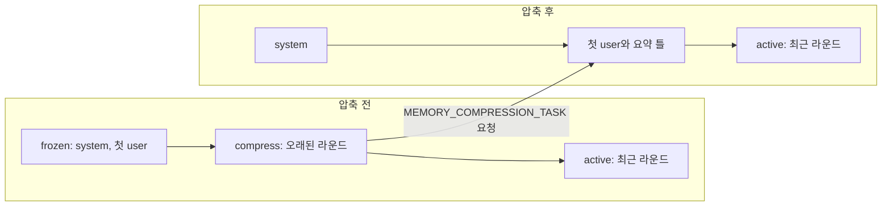

대화가 길어질 때 이전 기록을 압축하는 시점, 방식, 프롬프트를 다룬다.

## 컨텍스트 압축 시점

대화가 길어지면 다음 요청이 모델의 컨텍스트를 넘는다. llmloop는 `MaxContextTokens`의 60%와 80% 두 기준으로 압축을 건다.

파일: [`internal/llmloop/compression.go` L23-L35](https://github.com/alibaba/open-code-review/blob/e74f2c6bd4422bd1e12d257d1725bcce1d6b9ddd/internal/llmloop/compression.go#L23-L35)

```go
// Compression thresholds, as fractions of MaxTokens.
const (
	tokenSoftThreshold    = 0.60 // async background compression
	tokenWarningThreshold = 0.80 // immediate sync compression
)

// PromptTokenLimit returns tokenWarningThreshold (80%) of maxTokens. It is
// shared by the agent and scan pre-flight gates, their large-input filters, and
// partitionMessages so the threshold has a single definition. Non-positive
// input is not special-cased — each caller decides what that means.
func PromptTokenLimit(maxTokens int) int {
	return int(float64(maxTokens) * tokenWarningThreshold)
}
```

| 기준 | 값 | 동작 |
|---|---|---|
| soft | `MaxContextTokens`의 60% | 백그라운드 goroutine으로 압축을 시작하고 루프는 계속 진행 |
| warning | `MaxContextTokens`의 80% (`PromptTokenLimit`) | 진행 중인 백그라운드 압축을 취소하고 그 자리에서 동기 압축 |
| 동기 압축 후에도 warning 이상 | 같은 80% | `StopCompression`으로 종료 |

`PromptTokenLimit`은 루프 밖에서도 쓰인다. 리뷰와 스캔은 첫 요청 전에 프롬프트가 이 값을 넘으면 그 파일을 건너뛴다. 스캔의 경우 기본 `MAX_TOKENS` 58888의 80%인 47110 토큰이 파일 하나의 실질 상한이 된다(11장).

여기서 쓰는 토큰 수는 프로바이더가 돌려주는 값이 아니라 클라이언트에서 계산한 추정치다. `messageTokens`는 보이는 텍스트를 `llm.CountTokens`로 세고, tool call 인자와 프로바이더 원본 페이로드(thinking 블록 등)는 바이트 수의 1/4로 더한다([`compression.go` L62-L77](https://github.com/alibaba/open-code-review/blob/e74f2c6bd4422bd1e12d257d1725bcce1d6b9ddd/internal/llmloop/compression.go#L62-L77)). `llm.CountTokens`는 모델 이름 없이 호출되므로 항상 tiktoken의 `cl100k_base` 인코딩을 쓰고, 인코더를 불러오지 못하면 바이트 수의 1/4로 대신한다([`llm/client.go` L565-L593](https://github.com/alibaba/open-code-review/blob/e74f2c6bd4422bd1e12d257d1725bcce1d6b9ddd/internal/llm/client.go#L565-L593)). OpenAI 계열이 아닌 모델의 실제 토큰 수와는 차이가 나므로, 60%와 80%는 정확한 경계가 아니라 여유를 둔 근사 기준이다.

### 코드 분석: addNextMessage의 압축 판단

도구 결과를 대화에 붙이는 함수가 압축 시점도 결정한다. 아래는 결과를 붙인 뒤의 판단 부분이다.

파일: [`internal/llmloop/loop.go` L609-L631](https://github.com/alibaba/open-code-review/blob/e74f2c6bd4422bd1e12d257d1725bcce1d6b9ddd/internal/llmloop/loop.go#L609-L631)

```go
	if budgetDenied {
		return StopTokenBudget
	}

	finalCount := CountMessagesTokens(*messages)
	if finalCount >= warnLimit {
		if errors.Is(compress(), llm.ErrTokenBudget) {
			return StopTokenBudget
		}
		finalCount = CountMessagesTokens(*messages)
		if finalCount >= warnLimit {
			return StopCompression
		}
	}

	// Trigger async compression only after all appends for this update, so
	// a job is never started and then immediately cancelled by the same
	// call (#384), and never started when investigation has stopped.
	if finalCount > softLimit {
		r.triggerAsyncCompression(ctx, st, *messages, taskKey)
	}

	return StopNone
}
```

함수 전체([`loop.go` L580-L632](https://github.com/alibaba/open-code-review/blob/e74f2c6bd4422bd1e12d257d1725bcce1d6b9ddd/internal/llmloop/loop.go#L580-L632))의 순서는 다음과 같다.

1. 끝난 백그라운드 압축이 있으면 먼저 적용한다(`tryApplyPendingCompression`)
2. 새 메시지를 붙이기 전에 이미 80%를 넘었으면 동기 압축한다. 첫 프롬프트가 큰 경우를 위한 처리다
3. assistant 메시지와 도구 결과 메시지를 붙인다. 압축이 예산에 막혔더라도 결과는 붙여, grace round에서 최신 결과를 보고 제출할 수 있게 한다
4. 붙인 뒤 80% 이상이면 동기 압축하고, 그래도 80% 이상이면 `StopCompression`을 돌려준다
5. 60%를 넘으면 백그라운드 압축을 시작한다

압축 실패는 대부분 루프를 멈추지 않는다. `compress()`는 실패하면 진행 메시지만 출력하고 원래 메시지를 그대로 둔다. 멈추는 것은 "압축 후에도 80% 이상"과 "압축 요청이 예산에 막힘" 두 경우뿐이다.

## 압축 방식: 세 구역 분할

압축은 대화를 세 구역으로 나눈 뒤 가운데만 요약한다.



### 코드 분석: partitionMessages

파일: [`internal/llmloop/compression.go` L82-L99](https://github.com/alibaba/open-code-review/blob/e74f2c6bd4422bd1e12d257d1725bcce1d6b9ddd/internal/llmloop/compression.go#L82-L99)

```go
func partitionMessages(messages []llm.Message, maxTokens int, summaryTokenReserve int) partitionResult {
	result := partitionResult{frozenEnd: min(2, len(messages)), compressEnd: len(messages)}
	remaining := PromptTokenLimit(maxTokens) - CountMessagesTokens(messages[:result.frozenEnd]) - summaryTokenReserve
	for index := len(messages) - 1; index >= result.frozenEnd; index-- {
		remaining -= messageTokens(messages[index])
		if remaining <= 0 {
			break
		}
		if messages[index].Role == "assistant" {
			result.activeCount++
			result.compressEnd = index
		} else if index == result.frozenEnd {
			result.compressEnd = result.frozenEnd
		}
	}

	return result
}
```

- frozen 구역은 항상 `messages[0:2]`, 즉 system 프롬프트와 첫 user 프롬프트다
- 뒤에서부터 메시지 토큰을 빼 나가며 남은 예산이 0 이하가 되면 멈춘다. 예산은 80% 기준에서 frozen 구역과 요약 예약분을 뺀 값이다
- active 구역의 시작점(`compressEnd`)은 assistant 메시지에서만 옮긴다. assistant 메시지와 그 뒤의 tool 결과 메시지들이 한 라운드이므로 라운드 중간에서 잘리지 않는다. tool call 없이 tool 결과만 남으면 프로바이더가 요청을 거부할 수 있기 때문으로 보인다(추정)

### 코드 분석: 요약 길이 계산

요약을 붙인 결과가 다시 80%를 넘지 않도록 요약 길이를 미리 정한다.

파일: [`internal/llmloop/compression.go` L260-L281](https://github.com/alibaba/open-code-review/blob/e74f2c6bd4422bd1e12d257d1725bcce1d6b9ddd/internal/llmloop/compression.go#L260-L281)

```go
	limit := PromptTokenLimit(r.task.MaxContextTokens)
	summaryOccurrences := strings.Count(r.task.Compression.SummaryTemplate, "{{summary}}")
	if summaryOccurrences == 0 {
		return msgs, fmt.Errorf("memory compression: summary template has no summary placeholder")
	}
	frameTokens := llm.CountTokens(strings.ReplaceAll(r.task.Compression.SummaryTemplate, "{{summary}}", ""))
	availableTokens := limit - CountMessagesTokens(msgs[:2]) - frameTokens - 1
	summaryLimit := min(r.task.MaxContextTokens-limit, availableTokens/summaryOccurrences)
	if r.task.MaxCompletionTokens > 0 {
		summaryLimit = min(summaryLimit, r.task.MaxCompletionTokens)
	}
	if summaryLimit <= 0 {
		return msgs, fmt.Errorf("memory compression: fixed prompt leaves no room for a summary")
	}
	part := partitionMessages(msgs, r.task.MaxContextTokens, frameTokens+summaryLimit*summaryOccurrences)
	if part.compressEnd <= part.frozenEnd {
		return msgs, nil
	}
	originalTokens := CountMessagesTokens(msgs)
	if part.activeCount == 0 && originalTokens < limit {
		return msgs, nil
	}
```

요약 상한은 세 값 중 가장 작은 값이다. 80%와 100% 사이 여유(리뷰 기본값으로 200000 - 160000 = 40000), frozen 구역을 뺀 남은 자리를 자리표시자 수로 나눈 값, 그리고 `MaxCompletionTokens`(16384)다. 기본 템플릿에서는 대개 `MAX_COMPLETION_TOKENS` 16384가 요약 상한이 된다. `MaxCompletionTokens`가 요약 상한보다 크면 압축 프롬프트 끝에 "Keep the visible summary within N tokens."를 덧붙이고 생성 한도를 넉넉하게 준다(L290-L306). reasoning 모델이 생각 토큰을 쓰고도 요약을 끝낼 수 있게 하려는 처리로 보인다(추정).

### 코드 분석: 요약 결과의 재구성과 검증

파일: [`internal/llmloop/compression.go` L353-L374](https://github.com/alibaba/open-code-review/blob/e74f2c6bd4422bd1e12d257d1725bcce1d6b9ddd/internal/llmloop/compression.go#L353-L374)

```go
	rebuilt := make([]llm.Message, 2)
	copy(rebuilt, msgs[:2])

	userMsg := rebuilt[1]
	currentText := userMsg.ExtractText()
	rebuilt[1] = llm.NewTextMessage(userMsg.Role, currentText+strings.ReplaceAll(r.task.Compression.SummaryTemplate, "{{summary}}", rawSummary))

	for i := part.compressEnd; i < len(msgs); i++ {
		rebuilt = append(rebuilt, msgs[i])
	}
	rebuiltTokens := CountMessagesTokens(rebuilt)
	if rebuiltTokens >= limit {
		return msgs, fmt.Errorf("memory compression: rebuilt context exceeds its threshold")
	}
	if rebuiltTokens >= originalTokens {
		return msgs, nil
	}
	if llm.CountTokens(rawSummary) > summaryLimit {
		return msgs, fmt.Errorf("memory compression: visible summary exceeds its reservation")
	}

	return rebuilt, nil
```

요약은 별도 메시지가 아니라 첫 user 메시지 끝에 `<previous_review_summary>` 태그로 덧붙는다. 그래서 압축 후에도 system, user로 시작하는 메시지 순서가 유지된다. 이 인용 앞(L339-L351)에서 두 가지를 먼저 확인한다. `finish_reason`이 정상 종료 값(`stop`, `end_turn`, `stop_sequence` 또는 빈 값)이 아니면 잘린 요약으로 보고 거부하고, `compressionSummary`가 `<think>` 블록과 코드 펜스를 걷어낸 결과가 비어 있으면 압축을 포기한다.

| 확인 항목 | 실패 시 결과 |
|---|---|
| 요약이 정상 종료로 끝났는가 | 오류, 원래 메시지 유지 |
| 정리한 요약이 비어 있지 않은가 | 원래 메시지 유지 |
| 재구성한 대화가 80% 미만인가 | 오류, 원래 메시지 유지 |
| 재구성한 대화가 원래보다 작은가 | 원래 메시지 유지 |
| 요약이 예약한 길이를 넘지 않는가 | 오류, 원래 메시지 유지 |

모든 실패 경로가 원래 메시지를 돌려준다는 점이 설계의 중심이다. 주석(L331-L333)은 "frozen 구역까지 잘라내면 대화 맥락이 모두 사라지므로, 잠시 토큰 한계를 넘는 편이 낫다"고 적었다. `compressionSummary`(L184-L220)는 코드 스팬이나 코드 블록 안의 `<think>` 문자열을 goldmark 파서로 찾아 건드리지 않고, 태그 짝이 맞지 않으면 빈 문자열을 돌려준다.

## 비동기 압축과 동시성

soft 기준(60%)을 넘으면 압축을 백그라운드로 돌리고, 다음 라운드의 `addNextMessage`에서 결과가 준비됐는지 확인한다. 루프는 그 사이 LLM 요청을 계속 보낸다.

### 코드 분석: triggerAsyncCompression

파일: [`internal/llmloop/compression.go` L381-L404](https://github.com/alibaba/open-code-review/blob/e74f2c6bd4422bd1e12d257d1725bcce1d6b9ddd/internal/llmloop/compression.go#L381-L404)

```go
func (r *Runner) triggerAsyncCompression(ctx context.Context, st *compressionState, messages []llm.Message, taskKey string) {
	st.mu.Lock()
	if st.pendingJob != nil {
		st.mu.Unlock()
		return
	}
	msgSnapshot := copyMessages(messages)
	asyncCtx, cancel := context.WithTimeout(context.WithoutCancel(ctx), 5*time.Minute)
	job := &compressionJob{done: make(chan struct{}), cancel: cancel, snapshotLen: len(messages)}
	st.pendingJob = job
	st.mu.Unlock()

	// Registered before the goroutine starts so WaitBackground can never miss
	// a job that was launched but has not run yet.
	r.bg.Go(func() {
		defer cancel()
		rebuilt, err := r.runCompression(asyncCtx, msgSnapshot, taskKey)

		st.mu.Lock()
		defer st.mu.Unlock()

		if st.pendingJob != job {
			return // cancelled or superseded
		}
```

- 대화 하나에 진행 중인 작업은 하나뿐이다. 이미 있으면 새로 시작하지 않는다
- 상위 컨텍스트의 취소를 끊고(`WithoutCancel`) 5분 timeout을 따로 건다. 취소는 `cancelPendingCompression`이 명시적으로 한다
- `compressionState`는 `Runner`가 아니라 `runMainTask`의 지역 변수다. 주석은 `Runner`가 여러 하위 작업 goroutine에 공유되므로, 상태를 `Runner`에 두면 한 하위 작업이 다른 하위 작업의 압축을 적용하거나 취소할 수 있었다고 적었다(이슈 #384로 표시)

`tryApplyPendingCompression`(L424-L455)은 끝난 작업의 결과에 스냅숏 이후에 붙은 메시지를 이어 붙여 적용한다. 백그라운드 작업은 스냅숏 시점의 메시지만 압축했기 때문이다. 실패한 작업은 결과를 적용하지 않고 버린다.

`WaitBackground`는 `Runner`가 띄운 모든 백그라운드 압축이 끝날 때까지 기다린다. 대화가 끝날 때 작업은 취소만 되고 기다리지 않으므로 LLM 요청이 아직 진행 중일 수 있다. 리뷰와 스캔은 세션을 마무리하기 전에 이 함수를 불러, 세션 종료 기록 뒤에 압축 기록이 쓰이는 일을 막는다(스캔은 [`scan/agent.go` L392-L396](https://github.com/alibaba/open-code-review/blob/e74f2c6bd4422bd1e12d257d1725bcce1d6b9ddd/internal/scan/agent.go#L392-L396)).

## 압축 프롬프트

압축 요청의 메시지는 템플릿의 `MEMORY_COMPRESSION_TASK`에서 온다. diff 리뷰 템플릿은 두 프롬프트 파일을 참조하고, user 메시지는 [`memory_compression_task_user.md`](https://github.com/alibaba/open-code-review/blob/e74f2c6bd4422bd1e12d257d1725bcce1d6b9ddd/internal/config/template/prompts/memory_compression_task_user.md#L1)의 `{{context}}` 한 줄이 전부다. 여기에 `buildMessageXML`(L224-L242)이 compress 구역을 `<message id="N" role="..."><content>...</content></message>` 형태로 직렬화해 넣는다. reasoning이 있으면 `<reasoning>` 요소도 함께 넣는다.

system 프롬프트는 요약 형식을 다섯 개 제목(Identified Code Issues, Tool Call Conclusions, Completed Tasks, Pending Tasks, Current Focus)으로 고정한다. 아래는 두 번째 제목의 예시 부분이다.

파일: [`internal/config/template/prompts/memory_compression_task_system.md` L12-L15](https://github.com/alibaba/open-code-review/blob/e74f2c6bd4422bd1e12d257d1725bcce1d6b9ddd/internal/config/template/prompts/memory_compression_task_system.md#L12-L15)

```markdown
### Tool Call Conclusions
Summarize key findings and conclusions from each tool invocation. Example:
- get_function_info(UserService): confirmed concurrent write-to-map logic within this function
- search_file("database"): no other related configuration issues found
```

- 규칙 1번 "Do not include specific code details; only reference file paths and issue types"가 요약 크기를 제한하는 장치다. 코드 본문이 필요하면 압축 뒤에 `file_read`로 다시 읽어야 한다
- 예시의 도구 이름 `get_function_info`, `search_file`은 OpenCodeReview의 도구 카탈로그(08장)에 없는 이름이다. 다른 도구 세트를 쓰던 시기의 흔적으로 보인다(추정). 예시일 뿐이라 동작에는 영향이 없다
- "Identified Code Issues"를 요약에 남기는 이유는 압축된 구역에서 이미 보고한 문제를 모델이 다시 보고하지 않게 하려는 것으로 읽힌다(추정)

스캔 템플릿은 같은 문장을 파일 참조 없이 JSON 안에 직접 넣어 두었다([`scan_template.json` L55-L67](https://github.com/alibaba/open-code-review/blob/e74f2c6bd4422bd1e12d257d1725bcce1d6b9ddd/internal/config/template/scan_template.json#L55-L67)). 두 템플릿을 따로 고치면 내용이 갈라질 수 있는 구조다.
