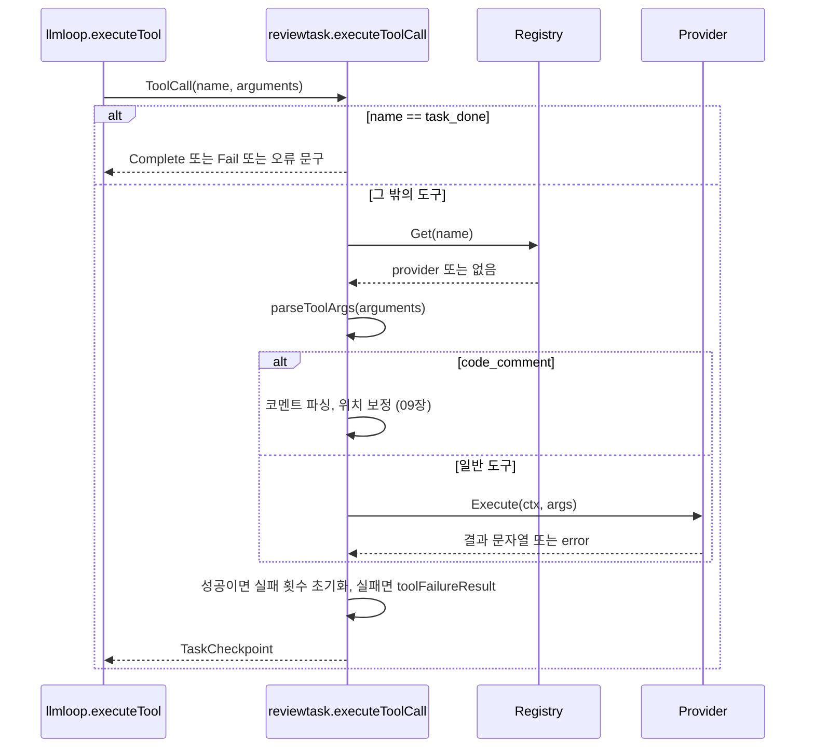

도구 식별자와 레지스트리, 도구 호출이 실행되는 경로를 다룬다.

## 도구 식별자와 레지스트리

카탈로그가 "모델에게 보여 줄 정의"라면, 레지스트리는 "이름으로 찾는 실행 객체" 모음이다. 두 목록은 이름으로만 연결된다.

### 코드 분석: 내장 도구 이름과 예약어

파일: [`internal/tool/definitions.go` L17-L53](https://github.com/alibaba/open-code-review/blob/e74f2c6bd4422bd1e12d257d1725bcce1d6b9ddd/internal/tool/definitions.go#L17-L53)

```go
var (
	Unknown        = Tool{name: "unknown"}
	TaskDone       = Tool{name: "task_done"}
	CodeComment    = Tool{name: "code_comment"}
	FileRead       = Tool{name: "file_read"}
	FileFind       = Tool{name: "file_find"}
	FileReadDiff   = Tool{name: "file_read_diff"}
	CodeSearch     = Tool{name: "code_search"}
	ContextRead    = Tool{name: "context_read"}
	SubmitAnalysis = Tool{name: "submit_analysis"}
)
// ... OfName, allTools
// IsReserved reports whether a name is unavailable to Review MCP providers.
func IsReserved(name string) bool {
	if name == ContextRead.name || name == SubmitAnalysis.name {
		return false
	}
	for _, t := range allTools() {
		if t.name == name {
			return true
		}
	}
	return false
}
```

- `Tool`은 이름 하나를 감싼 값 타입이다. 내장 도구는 패키지 변수로 고정되고, MCP 도구는 `Dynamic(name)`으로 만든다. `Dynamic`은 빈 이름이나 예약어가 들어오면 panic한다(L56-L64)
- `IsReserved`는 리뷰의 MCP 도구가 쓸 수 없는 이름을 판정한다. `unknown`과 리뷰 도구 여섯 개가 예약어이고, 동작 영향 분석 전용 두 이름은 예약어에서 뺐다. 리뷰에는 이 두 도구가 없으니 MCP 서버가 같은 이름을 써도 충돌하지 않는다는 판단으로 보인다(추정)

`Registry`는 `map[string]Provider`와 `frozen` 플래그뿐이다([L84-L111](https://github.com/alibaba/open-code-review/blob/e74f2c6bd4422bd1e12d257d1725bcce1d6b9ddd/internal/tool/definitions.go#L84-L111)). `Freeze` 이후 `Register`를 부르면 panic한다. 동시 읽기 안전성은 잠금이 아니라 "등록을 모두 끝낸 뒤 얼려서 이후엔 읽기만 한다"는 규약으로 지킨다. 리뷰는 [`agent.go` L318](https://github.com/alibaba/open-code-review/blob/e74f2c6bd4422bd1e12d257d1725bcce1d6b9ddd/internal/agent/agent.go#L318), 스캔은 [`scan/agent.go` L342](https://github.com/alibaba/open-code-review/blob/e74f2c6bd4422bd1e12d257d1725bcce1d6b9ddd/internal/scan/agent.go#L342)에서 얼린다.

### 레지스트리 구성

리뷰와 스캔은 같은 함수로 레지스트리를 채운다.

[`buildToolRegistryWithCodeAccess`](https://github.com/alibaba/open-code-review/blob/e74f2c6bd4422bd1e12d257d1725bcce1d6b9ddd/cmd/opencodereview/review_cmd.go#L702-L716)는 `file_read`, `file_find`, `code_search`에 같은 `FileReader`와 `CodeAccess`를 넣고, `file_read_diff`와 `code_comment`를 더해 등록한다.

- 등록되는 provider는 다섯 개다. `task_done`은 레지스트리에 없다. 실행 콜백이 레지스트리 조회 전에 이름으로 따로 처리한다(아래 절)
- `file_read_diff`는 빈 `DiffMap`으로 등록하고, diff를 읽은 뒤 [`injectDiffMap`](https://github.com/alibaba/open-code-review/blob/e74f2c6bd4422bd1e12d257d1725bcce1d6b9ddd/internal/agent/agent.go#L616-L631)이 `SetDiffMap`으로 채운다. 스캔은 이 함수를 호출하지 않으므로 빈 상태로 남지만, 스캔 템플릿이 도구 목록에서 빼 두었기 때문에 모델이 호출할 수 없다(07장 `executeTool`의 허용 목록 확인)
- 스캔은 `access`가 없는 `buildToolRegistry`를 쓴다. 그래서 스캔의 세 읽기 도구는 `side` 인자를 받지 않는다

## 도구 실행 경로

llmloop가 도구 호출을 허용 목록과 대조한 뒤(07장) 리뷰와 스캔은 `reviewtask.Runner.executeToolCall`을 부른다. 여기서 이름 분기, 인자 파싱, provider 실행, 실패 누적이 일어난다.



### 코드 분석: task_done 처리와 레지스트리 조회

파일: [`internal/reviewtask/tools.go` L27-L57](https://github.com/alibaba/open-code-review/blob/e74f2c6bd4422bd1e12d257d1725bcce1d6b9ddd/internal/reviewtask/tools.go#L27-L57)

```go
func (r *Runner) executeToolCall(ctx context.Context, taskKey string, call llm.ToolCall, rec *session.TaskRecord, thinking string) tool.TaskCheckpoint {
	t := tool.OfName(call.Function.Name)

	if t == tool.TaskDone {
		args, err := parseToolArgs(call.Function.Arguments)
		if err != nil {
			return tool.Of(fmt.Sprintf("Error parsing tool arguments for %s: %v", t.Name(), err))
		}
		rawState, hasState := args["state"]
		if !hasState {
			return tool.Complete()
		}
		// ... 문자열이 아니면 오류 문구
		switch state {
		case "DONE":
			return tool.Complete()
		case "FAILED":
			return tool.Fail("task_done reported FAILED")
		default:
			return tool.Of(fmt.Sprintf("Error: invalid task_done state %q; expected DONE or FAILED.", state))
		}
	}

	toolName := call.Function.Name
	p, found := r.deps.Tools.Get(toolName)
```

| `task_done` 호출 | 결과 | 루프의 처리 (07장) |
|---|---|---|
| `state` 없음 | `Complete` | 완료 |
| `"DONE"` | `Complete` | 완료 |
| `"FAILED"` | `Fail` | `task failed: task_done reported FAILED` 오류 |
| 그 밖의 문자열, 문자열이 아닌 값, 인자 JSON 오류 | 오류 문구 | 다음 라운드에서 다시 시도 |

스키마는 `state`를 필수로 표시하지만 코드는 없으면 `DONE`으로 본다. 원본 문서는 `state`가 "accepted but not persisted"이고 종료 코드에도 영향이 없다고 적었는데, 코드상 `FAILED`는 하위 작업을 오류로 끝내는 `Fail`로 이어진다. 그 오류가 최종 종료 코드까지 어떻게 전달되는지는 이 장 범위 밖이다(06장, 14장).

### 인자 파싱과 연속 실패

`parseToolArgs`([L238-L256](https://github.com/alibaba/open-code-review/blob/e74f2c6bd4422bd1e12d257d1725bcce1d6b9ddd/internal/reviewtask/tools.go#L238-L256))는 두 가지 방어를 한다. 일부 OpenAI 호환 게이트웨이가 `"arguments": null`을 보내면 nil map이 되어 이후 쓰기에서 panic하므로 빈 map으로 바꾼다. 그리고 유효한 JSON 뒤에 다른 텍스트가 붙은 경우 처음의 완결된 JSON 값만 잘라 다시 파싱한다.

일반 도구의 실행 결과는 다음처럼 모델에게 돌아간다([L202-L223](https://github.com/alibaba/open-code-review/blob/e74f2c6bd4422bd1e12d257d1725bcce1d6b9ddd/internal/reviewtask/tools.go#L202-L223)).

| 상황 | 모델이 받는 결과 | 실패 기록 |
|---|---|---|
| 레지스트리에 없는 이름 | `tool.NotAvailableMsg` | 연속 실패 횟수만 증가 |
| 인자 JSON 파싱 실패 | `Error parsing tool arguments for ...` | `ToolFailureDetail` 기록 |
| provider가 `error` 반환 | `Error executing tool <name>: <err>` | `ToolFailureDetail` 기록 |
| provider가 `"Error: ..."` 문자열 반환 | 그 문자열 그대로 | 기록하지 않음 (성공으로 처리) |
| 정상 결과 | 결과 문자열 | 연속 실패 횟수 초기화 |

provider 구현은 두 종류의 실패를 구분해 쓴다. 인자가 비었거나 결과가 없는 경우처럼 모델이 고칠 수 있는 상황은 `"Error: file_path is required"` 같은 문자열을 정상 결과로 돌려주고, 파일 읽기 실패나 git 실패는 `error`로 돌려준다.

### 코드 분석: toolFailureResult

같은 하위 작업에서 같은 도구가 연속으로 실패하면 응답 문구를 단계적으로 바꾼다.

파일: [`internal/reviewtask/tool_failure_streak.go` L73-L88](https://github.com/alibaba/open-code-review/blob/e74f2c6bd4422bd1e12d257d1725bcce1d6b9ddd/internal/reviewtask/tool_failure_streak.go#L73-L88)

```go
func (r *Runner) toolFailureResult(taskKey, toolName, errMsg string) tool.TaskCheckpoint {
	switch r.recordToolFailureStreak(taskKey, toolName) {
	case 1:
		return tool.Of(errMsg)
	case 2:
		return tool.Of(fmt.Sprintf(
			"%s\nThis is the second consecutive failure calling %s for this task. "+
				"Fix your arguments, or call task_done if you have nothing further to report.",
			errMsg, toolName))
	default:
		return tool.Of(fmt.Sprintf(
			"%s has failed repeatedly for this task and has been skipped; it will not be retried further. "+
				"Move on to your next finding, or call task_done if you have nothing further to report.",
			toolName))
	}
}
```

- 세 번째 실패부터는 오류 내용을 빼고 "건너뛰었다"고만 알린다. 같은 발견을 표현만 바꿔 계속 다시 보내는 모델을 멈추게 하려는 장치다. 주석은 한 리뷰가 같은 발견을 6번 다시 시도한 사례가 있었다고 적었다
- 횟수는 (하위 작업 키, 도구 이름) 쌍마다 세고, 같은 쌍이 한 번 성공하면 초기화한다
