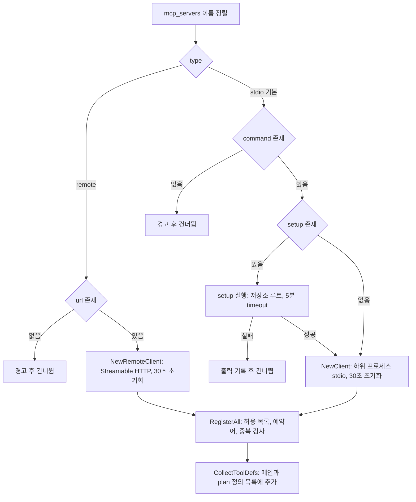

외부 MCP 서버의 도구를 리뷰 에이전트에 연결하는 방식을 다룬다.

## MCP 확장

리뷰 에이전트의 도구는 MCP(Model Context Protocol) 서버로 늘릴 수 있다. 설정 파일 `~/.opencodereview/config.json`의 `mcp_servers` 아래 서버마다 `type`, `command`, `args`, `env`, `url`, `headers`, `tools`, `setup`을 둔다([`config_cmd.go` L335-L346](https://github.com/alibaba/open-code-review/blob/e74f2c6bd4422bd1e12d257d1725bcce1d6b9ddd/cmd/opencodereview/config_cmd.go#L335-L346)). MCP 연결은 `ocr review`에만 있고 `ocr scan`에는 없다. 스캔 명령은 MCP 초기화 함수를 호출하지 않는다([`scan_cmd.go` L199-L205](https://github.com/alibaba/open-code-review/blob/e74f2c6bd4422bd1e12d257d1725bcce1d6b9ddd/cmd/opencodereview/scan_cmd.go#L199-L205)).



### 코드 분석: initMCPClients

파일: [`cmd/opencodereview/review_cmd.go` L616-L686](https://github.com/alibaba/open-code-review/blob/e74f2c6bd4422bd1e12d257d1725bcce1d6b9ddd/cmd/opencodereview/review_cmd.go#L616-L686)

```go
	mcpNames := make([]string, 0, len(cfg.MCPServers))
	for name := range cfg.MCPServers {
		mcpNames = append(mcpNames, name)
	}
	sort.Strings(mcpNames)

	var clients []*mcp.Client
	for _, name := range mcpNames {
		serverCfg := cfg.MCPServers[name]
		// ... remote 분기, command 확인, setup 실행
		initCtx, initCancel := context.WithTimeout(ctx, 30*time.Second)
		mc, err := mcp.NewClient(initCtx, name, serverCfg.Command, serverCfg.Args, serverCfg.Env, repoDir, version)
		initCancel()
		if err != nil {
			fmt.Fprintf(os.Stderr, "[ocr] WARNING: failed to start MCP server %q: %v\n", name, err)
			continue
		}
		clients = append(clients, mc)
		mcp.RegisterAll(tools, mc, serverCfg.Tools)
	}
	return clients
```

- 서버를 이름순으로 정렬한 뒤 연결한다. 원본 문서의 "First registration wins"에서 "먼저"는 설정 파일에 적은 순서가 아니라 서버 이름의 사전순이다
- 어떤 실패도 리뷰를 멈추지 않는다. URL이나 command가 없거나, setup이 실패하거나, 30초 안에 연결과 도구 목록 조회가 끝나지 않으면 경고만 남기고 그 서버를 뺀다
- stdio 서버는 저장소 루트를 작업 디렉터리로, 현재 환경 변수에 `env`를 덧붙여 실행한다. 30초 timeout은 초기화(연결과 페이지를 끝까지 따라가는 도구 목록 조회)에만 걸리고 하위 프로세스 수명에는 걸리지 않는다
- 원격 서버의 `headers` 값은 `os.Expand`로 `$VAR`, `${VAR}`를 펼치고, 펼친 값이 비면 연결 자체를 실패시킨다([`client.go` L84-L94](https://github.com/alibaba/open-code-review/blob/e74f2c6bd4422bd1e12d257d1725bcce1d6b9ddd/internal/mcp/client.go#L84-L94)). 401과 403 응답은 원인을 적은 오류로 바꾼다

### 코드 분석: RegisterAll

파일: [`internal/mcp/provider.go` L34-L68](https://github.com/alibaba/open-code-review/blob/e74f2c6bd4422bd1e12d257d1725bcce1d6b9ddd/internal/mcp/provider.go#L34-L68)

```go
func RegisterAll(reg *tool.Registry, c *Client, allowedTools []string) {
	allowed := make(map[string]struct{}, len(allowedTools))
	for _, name := range allowedTools {
		allowed[name] = struct{}{}
	}
	filtering := len(allowed) > 0

	matched := make(map[string]struct{})
	for _, t := range c.Tools() {
		if filtering {
			if _, ok := allowed[t.Name]; !ok {
				continue
			}
			matched[t.Name] = struct{}{}
		}
		if tool.IsReserved(t.Name) {
			fmt.Fprintf(os.Stderr, "[ocr] WARNING: MCP server %q tool %q conflicts with built-in tool, skipping\n", c.Name(), t.Name)
			continue
		}
		if _, exists := reg.Get(t.Name); exists {
			fmt.Fprintf(os.Stderr, "[ocr] WARNING: MCP server %q tool %q conflicts with already-registered tool, skipping\n", c.Name(), t.Name)
			continue
		}
		reg.Register(&Provider{
```

| 검사 | 결과 |
|---|---|
| `tools` 허용 목록에 없음 | 등록하지 않음 (경고 없음) |
| 예약어(내장 도구 이름) | 경고 후 건너뜀 |
| 다른 서버가 이미 등록한 이름 | 경고 후 건너뜀 |
| 허용 목록에 있지만 서버가 제공하지 않음 | 반복이 끝난 뒤 이름별 경고 |
| 그 밖 | `mcp.Provider`로 등록 |

`CollectToolDefs`(L98-L122)는 레지스트리에 실제로 그 클라이언트의 provider로 등록된 도구만 골라 `llm.ToolDef`로 바꾼다. 입력 스키마가 map이면 복사하고 `type`이 없으면 `object`를 넣는다. 만들어진 정의는 메인 단계와 plan 단계 정의 목록 양쪽 끝에 붙는다([`review_cmd.go` L244-L249](https://github.com/alibaba/open-code-review/blob/e74f2c6bd4422bd1e12d257d1725bcce1d6b9ddd/cmd/opencodereview/review_cmd.go#L244-L249)). 내장 도구와 달리 `side` 주입이나 설명 치환은 없다.

### MCP 도구 호출과 종료

`mcp.Provider.Execute`는 인자를 그대로 `CallTool`에 넘긴다([`client.go` L188-L204](https://github.com/alibaba/open-code-review/blob/e74f2c6bd4422bd1e12d257d1725bcce1d6b9ddd/internal/mcp/client.go#L188-L204)).

| 응답 | 모델이 받는 결과 | 실패로 기록 |
|---|---|---|
| 전송 오류 | `Error executing tool <name>: call MCP tool ...` | 예 |
| `IsError: true` | `MCP tool "<name>" returned an error: <text>` | 아니오 (정상 결과 문자열) |
| 텍스트 콘텐츠 | 텍스트를 줄바꿈으로 이어 붙인 값 | 아니오 |
| 이미지 등 텍스트가 아닌 콘텐츠 | `[unsupported content type: <type>]` | 아니오 |

원본 문서는 OCR이 MCP 도구의 읽기 전용 여부를 강제하지 않는다고 밝히고, 읽기 전용 도구와 최소한의 `tools` 허용 목록을 권한다. 코드에도 쓰기 동작을 막는 장치는 없다. 리뷰가 끝나면 `closeReviewMCPClients`가 모든 클라이언트를 동시에 닫고, 전체 대기 시간은 2.8초(`CloseAllTimeout`)로 제한한다([`client.go` L20-L23](https://github.com/alibaba/open-code-review/blob/e74f2c6bd4422bd1e12d257d1725bcce1d6b9ddd/internal/mcp/client.go#L20-L23)). 시간 안에 끝나지 않은 하위 프로세스는 SDK가 백그라운드에서 종료 신호를 높여 가며 정리한다.
