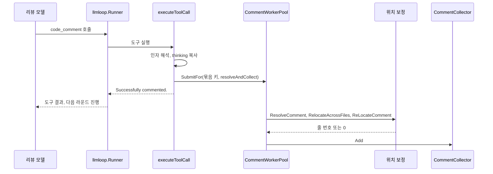

코멘트 도구 인자의 해석과 복구, 후처리 경로를 다룬다.

## code_comment 인자 해석

`code_comment` 도구의 스키마는 `comments` 배열을 받고, 항목마다 `content`, `existing_code`, `suggestion_code`, `category`, `severity`, `path`를 둔다. 도구 설명([tools.json L29-L29](https://github.com/alibaba/open-code-review/blob/e74f2c6bd4422bd1e12d257d1725bcce1d6b9ddd/internal/config/toolsconfig/tools.json#L29-L29))은 모델에게 "dynamic sliding window algorithm"으로 줄을 맞추므로 `existing_code`가 diff에 정확히 같은 형식으로 있어야 한다고 알려 준다. 도구 정의 전체는 08장에서 다룬다.

### 코드 분석: parseCommentsInner

`internal/tool/code_comment.go`, [code_comment.go L148-L166](https://github.com/alibaba/open-code-review/blob/e74f2c6bd4422bd1e12d257d1725bcce1d6b9ddd/internal/tool/code_comment.go#L148-L166)

항목 하나를 `LlmComment`로 바꾸는 부분의 후반이다.

```go
		if category, ok := obj["category"].(string); ok {
			cm.Category = normalizeCodeCommentCategory(category)
		}
		if severity, ok := obj["severity"].(string); ok {
			cm.Severity = normalizeCodeCommentSeverity(severity)
		}
		if pathVal, ok := obj["path"].(string); ok && pathVal != "" {
			cm.Path = normalizeCommentPath(pathVal)
		}
		if cm.Path == "" {
			cm.Path = normalizeCommentPath(defaultPath)
		}

		if cm.Path == "" || cm.Content == "" {
			continue
		}

		comments = append(comments, cm)
	}
```

| 처리 | 규칙 |
|---|---|
| `category` | 소문자로 바꿔 bug, security, performance, maintainability, test, style, documentation, other 중 하나면 유지, 아니면 `other` |
| `severity` | 소문자로 바꿔 critical, high, medium, low 중 하나면 유지, 아니면 `low` |
| `path` | `\`를 `/`로, `path.Clean`, 앞의 `/` 제거 ([code_comment.go L170-L180](https://github.com/alibaba/open-code-review/blob/e74f2c6bd4422bd1e12d257d1725bcce1d6b9ddd/internal/tool/code_comment.go#L170-L180)) |
| `path` 없음 | 호출한 하위 작업의 키(`defaultPath`) 사용 |
| `path`나 `content`가 빔 | 그 항목만 건너뜀 |
| 쓸 수 있는 항목 0개 | `CommentNoneUsableMsg`로 도구 실패 응답 |

`defaultPath`로 들어가는 값은 `reviewtask.Runner`의 `taskKey`, 곧 묶음 키다. 파일이 하나인 묶음에서는 그 파일 경로지만, 여러 파일 묶음에서는 경로를 정렬해 쉼표로 이은 문자열이다([grouping.go L367-L377](https://github.com/alibaba/open-code-review/blob/e74f2c6bd4422bd1e12d257d1725bcce1d6b9ddd/internal/agent/grouping.go#L367-L377)). 모델이 여러 파일 묶음에서 `path`를 빼먹으면 `a.go,b.go` 같은 존재하지 않는 경로가 붙는다. 이 경우 같은 파일 diff를 찾지 못하므로 아래 cross-file 재배치가 유일한 일치를 찾아야 경로가 바로잡힌다(추정). 스키마가 `path`를 필수 필드로 두는 것도 이 때문으로 보인다(추정).

사용 가능한 코멘트가 하나도 없을 때 성공이 아니라 실패를 돌려주는 이유는 [tools.go L85-L88](https://github.com/alibaba/open-code-review/blob/e74f2c6bd4422bd1e12d257d1725bcce1d6b9ddd/internal/reviewtask/tools.go#L85-L88)의 주석대로다. 모델이 "저장되었다"고 믿고 넘어가지 않고 다시 보내게 하기 위해서다.

## 직렬화된 comments 인자 복구

모델이 `comments`를 배열이 아니라 JSON 문자열로 직렬화해 보내는 경우가 있다. 이때는 이스케이프가 한 단계 더 필요한데, 모델이 본문 속 큰따옴표를 이스케이프하지 않아 파싱이 실패하고 묶음 전체가 사라진다. [`comment_args_repair.go`](https://github.com/alibaba/open-code-review/blob/e74f2c6bd4422bd1e12d257d1725bcce1d6b9ddd/internal/tool/comment_args_repair.go#L13-L19)는 이 경우를 LLM 없이 복구한다.

### 코드 분석: repairSerializedComments의 따옴표 판정

`internal/tool/comment_args_repair.go`, [comment_args_repair.go L132-L147](https://github.com/alibaba/open-code-review/blob/e74f2c6bd4422bd1e12d257d1725bcce1d6b9ddd/internal/tool/comment_args_repair.go#L132-L147)

문자열 안에서 만난 따옴표가 종료 기호인지 본문인지 가르는 부분이다.

```go
		case c == '"':
			if next := nextSignificantByte(s, i+1); next < 0 || isJSONStructural(s[next]) {
				inString = false
				b.WriteByte(c)
			} else {
				b.WriteString(`\"`)
				escaped++
			}
			i++
		case c < 0x20:
			b.WriteString(escapeControl(c))
			escaped++
			i++
		default:
			b.WriteByte(c)
			i++
		}
```

판정 기준은 "진짜 종료 따옴표 뒤에는 공백을 건너뛴 다음 `,`, `}`, `]`, `:` 또는 문자열 끝이 온다"이다. 그 밖의 문자가 오면 본문의 따옴표로 보고 이스케이프한다. 제어 문자와 유효하지 않은 백슬래시도 함께 이스케이프한다. 이 방식이 틀릴 수 있는 유일한 경우는 본문 따옴표 뒤에 우연히 구두점이 와서 문자열을 일찍 끝내는 경우이고, 그래서 복구 뒤에 검사를 세 겹으로 둔다.

| 검사 | 함수 | 거부 조건 |
|---|---|---|
| 재파싱 | `json.Unmarshal` | 복구해도 JSON이 아님 |
| 항목 보존 | [`repairedCommentsAcceptable`](https://github.com/alibaba/open-code-review/blob/e74f2c6bd4422bd1e12d257d1725bcce1d6b9ddd/internal/tool/comment_args_repair.go#L188-L208) | `content`가 빈 항목, 스키마에 없는 필드, 원문의 `"content":` 개수보다 적은 항목 수 |
| 잘림 의심 | [`hasSuspectTruncation`](https://github.com/alibaba/open-code-review/blob/e74f2c6bd4422bd1e12d257d1725bcce1d6b9ddd/internal/tool/comment_args_repair.go#L242-L255) | `content`, `existing_code`, `suggestion_code`, `path` 중 따옴표 개수가 홀수인 값 |
| 변경 없음 | [`parseRepairedComments`](https://github.com/alibaba/open-code-review/blob/e74f2c6bd4422bd1e12d257d1725bcce1d6b9ddd/internal/tool/comment_args_repair.go#L275-L291) | 이스케이프한 문자가 0개 |

잘림 검사가 엄격한 이유는 주석에 적혀 있다. 잘린 `existing_code`는 어떤 diff 줄과도 맞지 않아 deterministic 위치 보정이 모두 실패하고, 결국 LLM 재위치 요청이 망가진 발췌로 줄 번호를 추측하게 된다. 그보다는 원래 파싱 오류를 돌려줘서 모델이 온전한 발췌와 함께 다시 보내게 하는 편이 낫다는 판단이다. 거부할 때 오류 문장을 "invalid character" 형태의 파서 원문 그대로 두는 것도 의도된 선택이다([code_comment.go L111-L116](https://github.com/alibaba/open-code-review/blob/e74f2c6bd4422bd1e12d257d1725bcce1d6b9ddd/internal/tool/code_comment.go#L111-L116)). 스키마 위반이라고 알려 주면 모델이 같은 문자열을 다시 보내는 경향이 있었다고 적혀 있다.

복구가 받아들여지면 모델에게는 평범한 성공만 보이고, `comment_args_repaired` 경고가 유일한 기록으로 남는다([tools.go L78-L84](https://github.com/alibaba/open-code-review/blob/e74f2c6bd4422bd1e12d257d1725bcce1d6b9ddd/internal/reviewtask/tools.go#L78-L84)).

## 코멘트 후처리 경로

`code_comment` 처리는 `reviewtask.Runner.executeToolCall` 안에 있다. 위치 계산을 대화 루프와 분리하기 위해 `CommentWorkerPool`이 있으면 비동기로 넘기고 모델에게는 바로 성공을 돌려준다.



### 코드 분석: 비동기 제출

`internal/reviewtask/tools.go`, [tools.go L167-L186](https://github.com/alibaba/open-code-review/blob/e74f2c6bd4422bd1e12d257d1725bcce1d6b9ddd/internal/reviewtask/tools.go#L167-L186)

```go
		if r.deps.CommentWorkerPool != nil {
			if rec != nil {
				rec.AddToolResult(t.Name(), call.Function.Arguments, "(async)")
			}
			pool := r.deps.CommentWorkerPool
			asyncCtx := context.WithoutCancel(ctx)
			toolName := t.Name()
			pool.SubmitFor(taskKey, func() ([]model.LlmComment, error) {
				defer func() {
					dur := time.Since(startTime)
					telemetry.RecordToolResult(toolSpan, toolName, dur.Milliseconds(), nil)
					toolSpan.End()
					telemetry.PrintToolCallFinished(toolName, dur)
				}()
				resolveAndCollect(asyncCtx)
				return []model.LlmComment{}, nil
			})
			telemetry.RecordToolCall(asyncCtx, toolName, time.Since(startTime), true)
			r.resetToolFailureStreak(taskKey, t.Name())
			return tool.Of(tool.CommentSucceed)
		}
```

- `context.WithoutCancel`로 취소를 끊는다. 묶음의 대화가 끝나거나 시간 초과로 취소되어도 이미 제출된 코멘트의 위치 계산과 LLM 재위치 요청은 끝까지 돈다
- 세션 기록에는 도구 결과로 `(async)`가 남는다. 모델이 받는 결과는 `Successfully commented.`이다
- 제출은 묶음 키로 묶인다. 06장에서 본 것처럼 라운드가 끝나면 `AwaitKey`로 이 묶음의 작업만 기다린 뒤 필터와 신규 코멘트 계산으로 넘어간다
- 같은 턴에 여러 코멘트를 보내면 그 턴의 추론 텍스트(`thinking`)를 비어 있는 코멘트에 복사한다([tools.go L101-L108](https://github.com/alibaba/open-code-review/blob/e74f2c6bd4422bd1e12d257d1725bcce1d6b9ddd/internal/reviewtask/tools.go#L101-L108))

> **주의**: `CommentWorkerPool` 타입 주석([pool.go L15-L17](https://github.com/alibaba/open-code-review/blob/e74f2c6bd4422bd1e12d257d1725bcce1d6b9ddd/internal/reviewtask/pool.go#L15-L17))과 `Args.CommentWorkerPool` 주석은 풀이 "line-range tracking, re-tracking, reflection, suggestion validation"을 처리한다고 적는다. 실제로 풀에 제출되는 작업은 `resolveAndCollect` 하나이고, 위치 계산과 재위치만 한다. 반성(필터)은 06장의 라운드 반복 안에서 동기로 돌고, `suggestion_code`를 검증하는 단계는 리뷰 경로 어디에도 없다.

### 코드 분석: 위치 보정 순서

`internal/reviewtask/tools.go`, [tools.go L117-L131](https://github.com/alibaba/open-code-review/blob/e74f2c6bd4422bd1e12d257d1725bcce1d6b9ddd/internal/reviewtask/tools.go#L117-L131)

`resolveAndCollect` 안에서 세 가지 위치 보정을 시도하는 순서다.

```go
				// Resolution order: the comment's own file, then a cross-file
				// search, then the LLM. The cross-file search precedes the LLM
				// because it needs the Agent's original ExistingCode, which the
				// LLM step overwrites; and it runs even when d is nil, since a
				// comment filed against a path this run holds no diff for is
				// exactly the case that search can still place.
				located := d != nil && diff.ResolveComment(cm, d)
				if !located && r.deps.AllDiffs != nil {
					from := cm.Path
					if to, ok := diff.RelocateAcrossFiles(cm, r.deps.AllDiffs()); ok {
						located = true
						r.RecordWarning("comment_refiled", to, fmt.Sprintf(
							"comment filed against %s describes code in %s; re-filed", from, to))
					}
				}
```

cross-file 탐색이 LLM보다 앞서는 이유가 주석에 있다. LLM 재위치는 `ExistingCode`를 덮어쓰는데, cross-file 탐색은 에이전트가 처음 쓴 발췌가 있어야 동작한다. LLM 재위치는 `d != nil`, 곧 코멘트 경로에 해당하는 diff가 이번 실행에 있을 때만 돈다([tools.go L132-L162](https://github.com/alibaba/open-code-review/blob/e74f2c6bd4422bd1e12d257d1725bcce1d6b9ddd/internal/reviewtask/tools.go#L132-L162)). 경로가 틀린 코멘트에 엉뚱한 파일의 diff를 주고 위치를 묻지 않으려는 조건이다.
