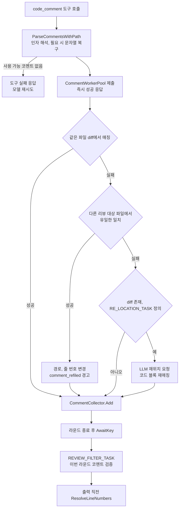

리뷰 에이전트가 `code_comment`로 남긴 지적은 바로 출력되지 않는다. 먼저 코드가 `existing_code` 발췌를 diff에서 찾아 줄 번호를 붙이고, 찾지 못하면 다른 파일과 LLM 재위치 작업을 차례로 시도한다. 라운드가 끝나면 별도의 LLM 호출이 diff로 반증되는 지적만 골라 지운다. 이 장은 README가 "External positioning and reflection modules"라고 부르는 이 두 단계를 코드 기준으로 정리하고, README와 공식 문서의 설명이 실제 구현과 어디서 갈리는지 확인한다.

## README 주장과 구현 대응

README의 [설계 원칙](https://github.com/alibaba/open-code-review/blob/e74f2c6bd4422bd1e12d257d1725bcce1d6b9ddd/README.md#L94-L94)은 이 단계를 다음 한 줄로 설명한다.

```text
- **External positioning and reflection modules** — Independent comment-positioning and comment-reflection modules systematically improve both the location accuracy and content accuracy of AI feedback.
```

"External"과 "Independent"는 두 단계 모두 리뷰를 수행한 에이전트의 대화 밖에서 돈다는 뜻이다. 코드에서 위치 보정은 대부분 LLM 없이 문자열 비교로 끝나고, LLM은 마지막 보조 수단으로만 쓰인다. 반성 단계는 별도 LLM 요청이지만 도구가 없고 diff만 본다.

| README 표현 | 구현 | LLM 사용 | 위치 |
|---|---|---|---|
| comment-positioning | 같은 파일 diff hunk에서 `existing_code` 연속 줄 매칭 | 없음 | `diff.ResolveComment` |
| | 같은 파일 전체 내용에서 매칭 | 없음 | `resolveFromFileContent` |
| | 다른 리뷰 대상 파일에서 유일한 일치 탐색 후 경로 변경 | 없음 | `diff.RelocateAcrossFiles` |
| | `RE_LOCATION_TASK`로 발췌를 다시 받아 재매칭 | 있음 (요청 1회) | `diff.ReLocateComment` |
| | 출력 직전 줄 번호 재계산 | 없음 | `diff.ResolveLineNumbers` |
| comment-reflection | `REVIEW_FILTER_TASK`로 diff가 반증하는 코멘트 제거 | 있음 (라운드마다 1회) | `Agent.executeGroupReviewFilter` |

코멘트 하나가 지나가는 경로는 다음과 같다.



위치를 끝내 찾지 못한 코멘트도 버리지 않는다. 모든 경로가 `CommentCollector.Add`로 모인다. 공식 문서 [architecture.md L299-L304](https://github.com/alibaba/open-code-review/blob/e74f2c6bd4422bd1e12d257d1725bcce1d6b9ddd/pages/src/content/docs/en/architecture.md#L299-L304)는 이 경우 `start_line`, `end_line`이 0으로 남고, 0이 "사용자가 직접 위치를 찾아야 하는 코멘트"라는 암묵적 신호라고 설명한다. 별도 플래그는 없다.

## 정리

- README의 위치 보정 모듈은 같은 파일 hunk 매칭, 파일 전체 매칭, cross-file 유일 일치, LLM 재위치 순으로 동작하며, LLM 결과도 다시 문자열 매칭을 통과해야 받아들여진다
- 위치를 찾지 못한 코멘트도 버리지 않고 줄 번호 0으로 출력한다. hunk 옛 쪽에서 맞은 코멘트는 옛 파일 기준 줄 번호를 갖는다
- `code_comment`는 `CommentWorkerPool`에 비동기로 제출되고 취소와 분리된 context에서 처리된다. 직렬화된 `comments` 문자열은 따옴표 판정과 세 겹의 검사를 거쳐 LLM 없이 복구된다
- 반성 필터는 도구 없이 diff만 보는 별도 요청이며, 보호 주제 거부권과 "반증된 것만 제거" 기준을 쓴다. 모든 실패 경로가 "지우지 않음"으로 끝나는 fail-open 구조다
- 필터 도구의 `analysis`, `comment_ids` 필드 이름은 JSON 직렬화 순서로 모델의 생성 순서를 정하는 장치다
- 풀 주석의 "suggestion validation", 문서의 필터 실행 시점, `{{path}}` 사용, 두 번째 줄 번호 계산의 역할은 실제 구현과 다르다
