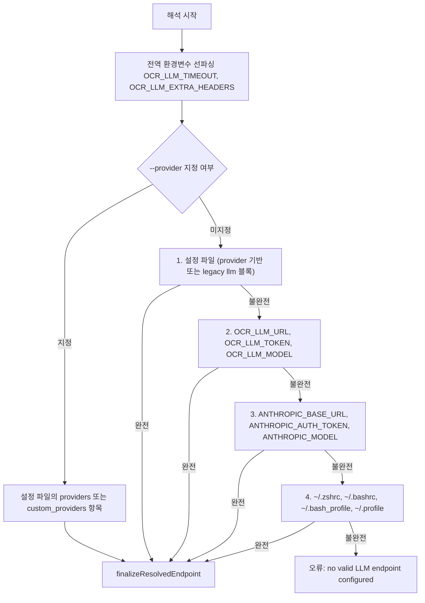

엔드포인트와 API 키를 정하는 해석 순서를 다룬다.

## 엔드포인트 해석 순서

해석기의 진입점은 [`ResolveEndpointWithOptions`](https://github.com/alibaba/open-code-review/blob/e74f2c6bd4422bd1e12d257d1725bcce1d6b9ddd/internal/llm/resolver.go#L104-L158)다. `--provider`가 주어지면 설정 파일의 해당 항목만 보고, 없으면 네 가지 전략을 순서대로 시도해 처음으로 "완전한" 엔드포인트를 돌려준 전략을 채택한다.



### 코드 분석: 전략 목록과 완전성 판정

파일: `internal/llm/resolver.go`, [resolver.go L134-L155](https://github.com/alibaba/open-code-review/blob/e74f2c6bd4422bd1e12d257d1725bcce1d6b9ddd/internal/llm/resolver.go#L134-L155)

네 전략과 "완전하다"의 정의가 한 자리에 있다.

```go
	strategies := []struct {
		name string
		fn   func() (ResolvedEndpoint, bool, error)
	}{
		{"OCR config file", func() (ResolvedEndpoint, bool, error) { return tryOCRConfig(configPath, opts) }},
		{"OCR environment", func() (ResolvedEndpoint, bool, error) { return tryOCREnv(opts.Model) }},
		{"Claude Code environment", func() (ResolvedEndpoint, bool, error) { return tryCCEnv(opts.Model) }},
		{"Shell rc file", func() (ResolvedEndpoint, bool, error) { return tryShellRC(opts.Model) }},
	}

	for _, strategy := range strategies {
		ep, ok, err := strategy.fn()
		if err != nil {
			return ResolvedEndpoint{}, fmt.Errorf("resolve %s: %w", strategy.name, err)
		}
		// An ambient-auth endpoint is complete without a URL or token: the
		// transport supplies both. Everything else still needs all three.
		complete := ep.Model != "" && (ep.AmbientAuth || (ep.URL != "" && ep.Token != ""))
		if ok && complete {
			return finalizeResolvedEndpoint(strategy.name, ep, env), nil
		}
	}
```

전략은 값을 섞지 않는다. 설정 파일에 URL만 있고 환경변수에 토큰만 있으면 두 전략 모두 불완전으로 판정되어 넘어간다. 반면 전략 안에서 오류가 나면(예: 잘못된 protocol, 형식이 틀린 URL) 다음 전략으로 넘어가지 않고 그 자리에서 실패한다. "불완전은 다음으로, 잘못된 값은 즉시 실패"가 이 함수의 규칙이다. Bedrock처럼 `AmbientAuth`가 켜진 엔드포인트는 모델만 있으면 완전하다.

### 전략별 입력과 기본값

| 순서 | 전략 이름 (`Source` 값) | 읽는 값 | protocol 결정 | Anthropic 인증 헤더 |
|---|---|---|---|---|
| 1 | `OCR config file` 또는 `provider:<name>` | `provider`, `providers`, `custom_providers`, legacy `llm` 블록 | 프리셋 또는 항목의 `protocol`. legacy 블록은 `protocol`, 없으면 `use_anthropic`(기본 true) | 프리셋 값, 없으면 `authorization` |
| 2 | `OCR environment` | `OCR_LLM_URL`, `OCR_LLM_TOKEN`, `OCR_LLM_MODEL` | `OCR_LLM_PROTOCOL`, 없으면 `OCR_USE_ANTHROPIC`(기본 true) | `OCR_LLM_AUTH_HEADER`, 없으면 `authorization` |
| 3 | `Claude Code environment` | `ANTHROPIC_BASE_URL`, `ANTHROPIC_AUTH_TOKEN`, `ANTHROPIC_MODEL` | 항상 `anthropic` | `authorization` |
| 4 | `Shell rc file` | rc 파일의 `export ANTHROPIC_*=` 줄 | 항상 `anthropic` | `authorization` |

설정 파일 안에서는 `provider`가 비어 있을 때만 legacy `llm` 블록을 본다([resolver.go L377-L402](https://github.com/alibaba/open-code-review/blob/e74f2c6bd4422bd1e12d257d1725bcce1d6b9ddd/internal/llm/resolver.go#L377-L402)). `--provider`로 다른 프로바이더를 고르면 최상위 `model` 값을 비운다. 다른 프로바이더용으로 저장된 모델 이름이 엉뚱한 엔드포인트로 가지 않게 하려는 처리다.

shell rc 전략은 셸을 실행하지 않는다. [`exportRe`](https://github.com/alibaba/open-code-review/blob/e74f2c6bd4422bd1e12d257d1725bcce1d6b9ddd/internal/llm/resolver.go#L789-L789) 정규식으로 `export ANTHROPIC_XXX=값` 형태의 줄만 읽고, 네 파일을 `~/.zshrc`, `~/.bashrc`, `~/.bash_profile`, `~/.profile` 순서로 보다가 세 값이 모두 모인 첫 파일을 쓴다. `source`나 조건문 안에서 정의한 값은 읽지 못한다. 세 번째와 네 번째 전략은 Claude Code를 쓰는 개발자가 별도 설정 없이 OCR을 돌릴 수 있게 한 호환 경로이며, 사용자 문서는 이 순서를 "saved configuration, `OCR_LLM_*`, Claude Code 환경변수, shell rc files"로 설명한다.

### 전역 덮어쓰기와 마무리 단계

`OCR_LLM_TIMEOUT`과 `OCR_LLM_EXTRA_HEADERS`는 어느 전략이 이기든 마지막에 덮어쓴다. 두 값은 전략을 시도하기 전에 먼저 파싱한다([resolver.go L108-L117](https://github.com/alibaba/open-code-review/blob/e74f2c6bd4422bd1e12d257d1725bcce1d6b9ddd/internal/llm/resolver.go#L108-L117)). 주석에 이유가 적혀 있다. 나중에 파싱하면 `OCR_LLM_TIMEOUT=30s` 같은 오타 때문에 해석이 실패하기 전에 `api_key_cmd`가 이미 1Password나 Touch ID 프롬프트를 띄운 뒤라, 사용자가 승인한 비밀값을 버리게 된다.

[`finalizeResolvedEndpoint`](https://github.com/alibaba/open-code-review/blob/e74f2c6bd4422bd1e12d257d1725bcce1d6b9ddd/internal/llm/resolver.go#L187-L207)는 세 가지를 한다.

- `Source` 라벨을 채운다. `ocr llm test`가 출력하는 "Source:" 줄이 이 값이다
- ChatGPT가 아니면 모델 이름 끝의 `[1m]` 같은 접미사를 지운다([resolver.go L791-L795](https://github.com/alibaba/open-code-review/blob/e74f2c6bd4422bd1e12d257d1725bcce1d6b9ddd/internal/llm/resolver.go#L791-L795)). Claude Code의 `ANTHROPIC_MODEL` 값에 붙는 표기를 정리하는 처리로 보인다(추정)
- 환경변수의 타임아웃과 추가 헤더를 덮어쓴다. 추가 헤더는 설정 파일 값과 병합하고 같은 키는 환경변수가 이긴다

`ParseExtraHeaders`는 `authorization`, `x-api-key`, `content-type`, `user-agent`를 예약 헤더로 막는다([resolver.go L882-L887](https://github.com/alibaba/open-code-review/blob/e74f2c6bd4422bd1e12d257d1725bcce1d6b9ddd/internal/llm/resolver.go#L882-L887)). 인증 헤더를 `extra_headers`로 우회해서 넣는 설정을 오류로 돌려 전용 필드를 쓰게 한다.

## 키 해석: api_key, api_key_cmd, 환경변수

provider 기반 설정에서 키를 찾는 순서는 `api_key` 정적 값, `api_key_cmd` 실행 결과, 프리셋의 환경변수다. 커스텀 프로바이더에는 환경변수 단계가 없다.

### 코드 분석: 키 출처 선택

파일: `internal/llm/resolver.go`, [resolver.go L446-L464](https://github.com/alibaba/open-code-review/blob/e74f2c6bd4422bd1e12d257d1725bcce1d6b9ddd/internal/llm/resolver.go#L446-L464)

`tryProviderConfig`가 세 출처 중 하나를 고르는 분기다.

```go
	switch {
	case apiKey != "":
		// Static api_key always wins. Warn (don't error) if a command is also set,
		// so a config that keeps api_key_cmd as a deliberate fallback still works.
		if apiKeyCmd != "" {
			fmt.Fprintf(os.Stderr, "[ocr] WARNING: provider %q has both api_key and api_key_cmd set; using the static api_key\n", cfg.Provider)
		}
	case apiKeyCmd == "" && isPreset && preset.EnvVar != "":
		// Env var is the last resort: only when neither api_key nor api_key_cmd
		// is set, and only for preset providers (custom ones have no fallback).
		// Same whitespace rule as the static key above, so `export
		// ANTHROPIC_API_KEY="  "` reports "no api_key configured" instead of
		// sending `Authorization: Bearer  ` and getting an opaque 401. Trim the
		// stored value too, not just the emptiness check, or a key carrying a
		// trailing "\r" reaches the auth header.
		if v := strings.TrimSpace(os.Getenv(preset.EnvVar)); v != "" {
			apiKey = v
		}
	}
	var url, protocol, authHeader, model string
	var extraBody map[string]any
```

바로 위 줄에서 공백뿐인 `api_key`, `api_key_cmd`를 빈 값으로 취급한다([resolver.go L436-L445](https://github.com/alibaba/open-code-review/blob/e74f2c6bd4422bd1e12d257d1725bcce1d6b9ddd/internal/llm/resolver.go#L436-L445)). 공백 키가 동작하는 `api_key_cmd`를 가려서 원인을 알 수 없는 401이 나는 상황을 막는다. 이 분기는 출처를 고르기만 하고 명령은 실행하지 않는다는 점이 중요하다.

### 코드 분석: 명령 실행 시점

파일: `internal/llm/resolver.go`, [resolver.go L605-L611](https://github.com/alibaba/open-code-review/blob/e74f2c6bd4422bd1e12d257d1725bcce1d6b9ddd/internal/llm/resolver.go#L605-L611)

`api_key_cmd`는 모든 검증이 끝난 함수 끝에서 한 번만 실행된다.

```go
	if apiKey == "" && apiKeyCmd != "" && !ambientAuth {
		resolved, err := resolveKeyCmd(apiKeyCmd, fmt.Sprintf("api_key_cmd for provider %q", cfg.Provider))
		if err != nil {
			return ResolvedEndpoint{}, false, err
		}
		apiKey = resolved
	}
```

protocol 검증, 모델 확인, 타임아웃과 재시도 코드 검증이 모두 이 앞에 있다. 설정 오타 때문에 실패할 실행이라면 비밀 관리 도구의 프롬프트가 뜨기 전에 실패한다. `ambientAuth`는 [resolver.go L512-L513](https://github.com/alibaba/open-code-review/blob/e74f2c6bd4422bd1e12d257d1725bcce1d6b9ddd/internal/llm/resolver.go#L512-L513)에서 "실제로 적용되는 protocol"로 결정한다. 프리셋이 `bedrock`이어도 항목에서 `protocol`을 `openai`로 바꾸면 SigV4 서명이 없으므로 키가 필요해지고, 반대로 커스텀 항목이 `anthropic-bedrock`을 고르면 키 없이 서명한다.

### 코드 분석: 명령 출력 검증

파일: `internal/llm/keycmd.go`, [keycmd.go L143-L167](https://github.com/alibaba/open-code-review/blob/e74f2c6bd4422bd1e12d257d1725bcce1d6b9ddd/internal/llm/keycmd.go#L143-L167)

명령의 표준 출력을 키 하나로 받아들이기 전에 거치는 검사다.

```go
	trimmed := strings.TrimRight(out.buf.String(), "\r\n")
	if strings.ContainsAny(trimmed, "\n\r") {
		return "", fmt.Errorf("%s produced multi-line output; expected a single credential (pipe through 'head -n1' if your command prints more)", label)
	}
	// Same reason as the line-break check, wider net: httpguts.ValidHeaderFieldValue
	// (what net/http enforces) rejects every byte below 0x20 except SP and TAB, plus
	// DEL. A NUL or VT smuggled in by e.g. `printf 'sk-a\0b'` would otherwise reach
	// net/http as the opaque `invalid header field value for "Authorization"`.
	//
	// Deliberately before the TrimSpace below, so a trailing control byte is an
	// error naming its offset rather than silently stripped: only TAB, SP and the
	// line breaks already handled above are things a credential command can
	// plausibly append by accident. Offsets are therefore into the pre-TrimSpace
	// string, which is what the command actually produced.
	for i := 0; i < len(trimmed); i++ {
		if b := trimmed[i]; (b < 0x20 && b != '\t') || b == 0x7f {
			return "", fmt.Errorf("%s produced a control byte 0x%02X at offset %d; a credential must not contain control characters", label, b, i)
		}
	}

	key := strings.TrimSpace(trimmed)
	if key == "" {
		return "", fmt.Errorf("%s produced empty output", label)
	}
	return key, nil
```

끝 줄바꿈 하나만 허용하고, 여러 줄이나 제어 문자는 위치를 알려 주는 오류로 바꾼다. net/http가 내는 "invalid header field value" 같은 불투명한 오류 대신 설정 키 이름이 들어간 오류를 보여 주려는 목적이다. 실패하면 환경변수로 넘어가지 않고 그대로 실패한다.

| 항목 | 값 | 근거 |
|---|---|---|
| 실행 셸 | Unix `sh -c`, Windows `cmd.exe` | [keycmd_unix.go L32-L34](https://github.com/alibaba/open-code-review/blob/e74f2c6bd4422bd1e12d257d1725bcce1d6b9ddd/internal/llm/keycmd_unix.go#L32-L34) |
| 제한 시간 | 60초 (`keyCmdTimeout`) | [keycmd.go L20](https://github.com/alibaba/open-code-review/blob/e74f2c6bd4422bd1e12d257d1725bcce1d6b9ddd/internal/llm/keycmd.go#L20) |
| 파이프 대기 | 5초 (`keyCmdWaitDelay`) | [keycmd.go L25](https://github.com/alibaba/open-code-review/blob/e74f2c6bd4422bd1e12d257d1725bcce1d6b9ddd/internal/llm/keycmd.go#L25) |
| 출력 상한 | 64KiB (`keyCmdMaxOutput`) | [keycmd.go L28](https://github.com/alibaba/open-code-review/blob/e74f2c6bd4422bd1e12d257d1725bcce1d6b9ddd/internal/llm/keycmd.go#L28) |
| 거부 패턴 | 백틱, NUL 바이트 | [keycmd.go L41-L44](https://github.com/alibaba/open-code-review/blob/e74f2c6bd4422bd1e12d257d1725bcce1d6b9ddd/internal/llm/keycmd.go#L41-L44) |
| 표준 입력, 표준 오류 | 부모 프로세스의 것을 그대로 연결 | [keycmd.go L97-L106](https://github.com/alibaba/open-code-review/blob/e74f2c6bd4422bd1e12d257d1725bcce1d6b9ddd/internal/llm/keycmd.go#L97-L106) |

표준 입력을 넘기는 이유는 pinentry나 `op`처럼 터미널에서 암호를 묻는 도구가 동작하게 하려는 것이다. 주석은 이것이 안전한 조건으로 "엔드포인트 해석은 bubbletea TUI가 실행 중일 때 일어나지 않는다"를 든다. 실제로 `ocr config provider`는 TUI를 끝낸 뒤에 연결 테스트를 실행한다(이 장 마지막 절). 프로세스 그룹을 분리하지 않는 이유도 [keycmd_unix.go](https://github.com/alibaba/open-code-review/blob/e74f2c6bd4422bd1e12d257d1725bcce1d6b9ddd/internal/llm/keycmd_unix.go#L14-L31)에 길게 적혀 있다. 그룹을 분리하면 터미널을 읽는 자식이 SIGTTIN으로 멈춘다.

> **주의**: legacy `llm` 블록의 `auth_token_cmd`도 같은 `resolveKeyCmd`를 쓴다. 다만 legacy 블록은 URL, 모델, 키 출처가 모두 있어야 명령을 실행하며, 하나라도 비면 명령을 실행하지 않고 다음 전략으로 넘어간다([resolver.go L637-L655](https://github.com/alibaba/open-code-review/blob/e74f2c6bd4422bd1e12d257d1725bcce1d6b9ddd/internal/llm/resolver.go#L637-L655)).
