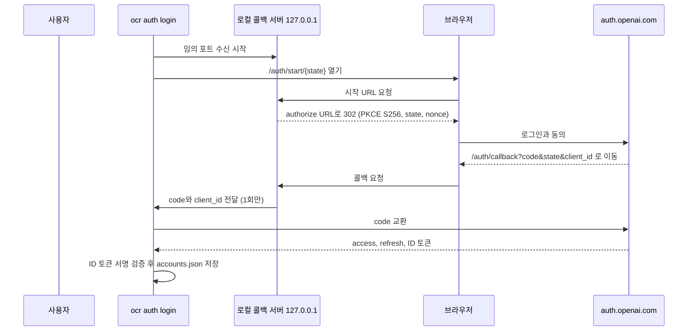

protocol별 클라이언트 구현과 ChatGPT OAuth 경로를 다룬다.

## protocol별 클라이언트

### 코드 분석: 클라이언트 팩토리

파일: `internal/llm/client.go`, [client.go L517-L527](https://github.com/alibaba/open-code-review/blob/e74f2c6bd4422bd1e12d257d1725bcce1d6b9ddd/internal/llm/client.go#L517-L527)

`ResolvedEndpoint`를 `ClientConfig`로 옮긴 뒤 protocol로 분기한다.

```go
	switch ep.Protocol {
	case ProtocolAnthropic:
		return NewAnthropicClient(cfg)
	case ProtocolAnthropicBedrock:
		return NewAnthropicBedrockClient(cfg)
	case ProtocolOpenAIResponses:
		return NewOpenAIResponsesClient(cfg)
	default:
		return NewOpenAIClient(cfg)
	}
```

`default`가 Chat Completions 클라이언트인 것은 해석기를 거치지 않은 예전 호출자를 위한 방어 처리라고 주석이 설명한다. 팩토리는 `RetryCollector`와 `RawHolder`를 인자로 받는다. 두 값은 엔드포인트가 아니라 한 번의 실행에 속하기 때문에 `ResolvedEndpoint` 필드로 두지 않았다.

### 네 클라이언트의 차이

| 항목 | OpenAIClient | AnthropicClient | OpenAIResponsesClient | Bedrock 모드 |
|---|---|---|---|---|
| URL 정규화 | 끝에 `/chat/completions` | 끝에 `/v1/messages` | 끝에 `/responses` | URL 미사용, 리전이 호스트 결정 |
| SDK 최대 재시도 | 5 | 5 | 5 (ChatGPT는 0) | 5 |
| 기본 타임아웃 | 5분 | 5분 | 5분 | 5분 |
| 응답 헤더 타임아웃 | 요청 타임아웃 + 30초 | 요청 타임아웃 + 30초 | 요청 타임아웃 + 30초 | SDK 기본 동작 |
| 스트리밍 | `extra_body.stream`이 true일 때 | 사용하지 않음 | `RequiresStreaming`일 때 | 사용하지 않음 |
| 요청 상태 | 전체 이력 전송 | 전체 이력 전송 | `store: false`, 전체 이력 전송 | 전체 이력 전송 |

Chat Completions 클라이언트는 `extra_body.stream`이 true이면 스트리밍 경로로 가고, 이때 `stream_options.include_usage`를 기본으로 켠다([client.go L710-L733](https://github.com/alibaba/open-code-review/blob/e74f2c6bd4422bd1e12d257d1725bcce1d6b9ddd/internal/llm/client.go#L710-L733)). OpenAI 호환 서버는 요청하지 않으면 스트림에 token 사용량을 넣지 않아 비용 집계가 빠지기 때문이다. 응답이 `io.ErrUnexpectedEOF`로 잘리면 같은 요청을 한 번 더 보낸다([client.go L735-L767](https://github.com/alibaba/open-code-review/blob/e74f2c6bd4422bd1e12d257d1725bcce1d6b9ddd/internal/llm/client.go#L735-L767)). HTTP 200으로 기록된 시도를 재시도 보고서에서 네트워크 오류로 고쳐 적는 처리(`reviseAttempt`)가 함께 있다.

Anthropic 클라이언트는 `extra_body.thinking`을 무조건 보내지 않는다. `tool_choice`가 `required`이거나 thinking의 `budget_tokens`가 요청의 `max_tokens`(없으면 8192) 이상이면 그 요청에서만 thinking을 뺀다([client.go L1536-L1547](https://github.com/alibaba/open-code-review/blob/e74f2c6bd4422bd1e12d257d1725bcce1d6b9ddd/internal/llm/client.go#L1536-L1547)). 마지막 system 블록과 마지막 tool 정의에는 `cache_control: ephemeral`을 붙여 prompt cache 지점을 만든다([client.go L1668-L1674](https://github.com/alibaba/open-code-review/blob/e74f2c6bd4422bd1e12d257d1725bcce1d6b9ddd/internal/llm/client.go#L1668-L1674)).

Responses 클라이언트는 상태를 서버에 두지 않는다. 매 요청에 `store: false`와 전체 입력 이력을 보내고, 다음 턴에 재생할 수 있도록 `reasoning.encrypted_content`를 요청에 포함시킨다([responses_client.go L472-L473](https://github.com/alibaba/open-code-review/blob/e74f2c6bd4422bd1e12d257d1725bcce1d6b9ddd/internal/llm/responses_client.go#L472-L473)). `ChatRequest.SessionID`가 있으면 `prompt_cache_key`로 쓴다. 클래스 주석은 이 설계의 근거로 `DESIGN_STATE_CACHE_PHASE.md`를 가리키지만, 기준 커밋의 저장소에는 그 파일이 없다.

모델이 직전에 돌려준 응답 원형은 `NativeTurn`으로 보존된다([client.go L121-L131](https://github.com/alibaba/open-code-review/blob/e74f2c6bd4422bd1e12d257d1725bcce1d6b9ddd/internal/llm/client.go#L121-L131)). Anthropic의 thinking 서명, Responses의 암호화된 reasoning은 다음 턴에 그대로 돌려보내야 프로바이더가 받아 주므로, 공통 `Message` 형식으로 변환하지 않고 원래 SDK 타입을 그대로 들고 다닌다. 7장의 도구 호출 루프가 이 값을 다음 요청에 다시 넣는다.

### 코드 분석: Bedrock의 bearer 토큰 제거

파일: `internal/llm/client.go`, [client.go L1355-L1362](https://github.com/alibaba/open-code-review/blob/e74f2c6bd4422bd1e12d257d1725bcce1d6b9ddd/internal/llm/client.go#L1355-L1362)

Bedrock 클라이언트 생성의 마지막 두 단계다.

```go
	awsCfg.BearerAuthTokenProvider = nil

	// Appended last on purpose, and the order depends on the SDK wrapping
	// direction: each option wraps the ones before it, so the last appended
	// middleware ends up innermost — signing runs closest to the wire, after any
	// header the earlier options set, and a retry re-signs rather than replaying
	// a stale signature. Moving this call earlier silently breaks both.
	opts = append(opts, bedrock.WithConfig(awsCfg))
```

바로 위 주석([client.go L1337-L1354](https://github.com/alibaba/open-code-review/blob/e74f2c6bd4422bd1e12d257d1725bcce1d6b9ddd/internal/llm/client.go#L1337-L1354))이 이유를 설명한다. AWS SDK의 `LoadDefaultConfig`는 SSO 토큰 캐시에서 bearer 토큰 공급자를 채우고, Anthropic SDK의 bedrock middleware는 그 공급자가 있으면 SigV4 대신 bearer 인증을 쓴다. 그러면 SSO 사용자는 Bedrock API 키가 아닌 SSO 토큰을 보내 403을 받는다. 공급자를 비우면 `AWS_BEARER_TOKEN_BEDROCK`이 있을 때만 bearer를 쓰고 나머지는 SigV4로 서명한다. 서명 middleware를 마지막에 붙이는 이유도 같은 주석에 있다. 재시도할 때 이전 서명을 재사용하지 않고 다시 서명하게 하려는 것이다.

AWS 설정 로드가 실패해도 팩토리는 오류를 돌려주지 않는다. `LLMClient`를 돌려주는 팩토리에는 오류 반환 경로가 없으므로, 실패를 `initErr`에 담아 두었다가 첫 요청에서 돌려준다([client.go L1315-L1336](https://github.com/alibaba/open-code-review/blob/e74f2c6bd4422bd1e12d257d1725bcce1d6b9ddd/internal/llm/client.go#L1315-L1336)). SDK의 `bedrock.WithLoadDefaultConfig`가 실패 시 panic하는 것을 피하려는 구조다. 설정 로드에는 60초 제한(`bedrockConfigLoadTimeout`)이 걸린다.

## ChatGPT OAuth 경로

`chatgpt` 프리셋은 API 키 없이 ChatGPT 요금제 사용량으로 Responses API를 호출하는 미리보기 경로다. 키 대신 OAuth 토큰을 쓰고, 토큰은 `internal/chatgptauth` 패키지가 `~/.opencodereview/auth/chatgpt/accounts.json`에 보관한다([store.go L85-L91](https://github.com/alibaba/open-code-review/blob/e74f2c6bd4422bd1e12d257d1725bcce1d6b9ddd/internal/chatgptauth/store.go#L85-L91)).



로그인 흐름의 세부는 [oauth.go L359-L477](https://github.com/alibaba/open-code-review/blob/e74f2c6bd4422bd1e12d257d1725bcce1d6b9ddd/internal/chatgptauth/oauth.go#L359-L477)에 있다. 콜백 서버는 `127.0.0.1:0`에만 바인딩하고, `Host` 헤더가 리스너 주소와 다르면 403을 돌려준다. 시작 URL과 콜백은 `sync.Once`로 한 번만 처리하며, 두 번째 요청에는 410을 돌려준다. `authorize`는 처음 등록할 때만 `agent_name_hint=OpenCodeReview`를 넣고, 이미 등록된 계정이면 `id_token_hint`와 `login_hint`를 넣는다([oauth.go L138-L158](https://github.com/alibaba/open-code-review/blob/e74f2c6bd4422bd1e12d257d1725bcce1d6b9ddd/internal/chatgptauth/oauth.go#L138-L158)).

### 코드 분석: 해석 단계의 제약

파일: `internal/llm/chatgpt.go`, [chatgpt.go L77-L86](https://github.com/alibaba/open-code-review/blob/e74f2c6bd4422bd1e12d257d1725bcce1d6b9ddd/internal/llm/chatgpt.go#L77-L86)

ChatGPT 항목은 일반 프로바이더와 달리 덮어쓸 수 있는 값이 좁다.

```go
func validateChatGPTBody(body map[string]any) error {
	for k := range body {
		switch k {
		case "reasoning", "text", "prompt_cache_key":
		default:
			return fmt.Errorf("chatgpt preview does not accept extra_body.%s; supported overrides: reasoning, text, prompt_cache_key", k)
		}
	}
	return nil
}
```

[`resolveChatGPT`](https://github.com/alibaba/open-code-review/blob/e74f2c6bd4422bd1e12d257d1725bcce1d6b9ddd/internal/llm/chatgpt.go#L33-L76)는 `url`, `protocol`, `api_key`, `api_key_cmd`, `auth_header` 중 하나라도 있으면 거부한다. 모델이 비어 있으면 계정별 모델 카탈로그를 받아 첫 번째 항목을 쓴다. 해석 결과에는 `RequiresStreaming`, `RejectsSamplingParams`, `ChatGPTPlan`이 켜진다. 클라이언트는 요청마다 엔드포인트가 공개 Responses 엔드포인트인지 다시 확인하고([responses_client.go L130-L133](https://github.com/alibaba/open-code-review/blob/e74f2c6bd4422bd1e12d257d1725bcce1d6b9ddd/internal/llm/responses_client.go#L130-L133)), 리뷰 도구를 `ocr` namespace로 묶어 보낸 뒤 그 밖의 function call이 돌아오면 오류로 처리한다.

### 코드 분석: 토큰 갱신 시점

파일: `internal/chatgptauth/oauth.go`, [oauth.go L493-L498](https://github.com/alibaba/open-code-review/blob/e74f2c6bd4422bd1e12d257d1725bcce1d6b9ddd/internal/chatgptauth/oauth.go#L493-L498)

access 토큰을 언제 갱신할지 판단하는 함수다.

```go
func (a *Auth) refreshDue(now time.Time) bool {
	if !now.Before(a.ExpiresAt) {
		return true
	}
	return !a.ExpiresAt.After(now.Add(5*time.Minute)) && !now.Before(a.EarliestRefreshAt)
}
```

만료됐거나, 만료 5분 전 이내이면서 서버가 준 `earliest_refresh_at` 이후이면 갱신한다. 갱신은 파일 잠금(`session.lock`, 25ms 간격으로 재시도) 안에서 일어나므로 여러 `ocr` 프로세스가 동시에 refresh 토큰을 쓰지 않는다([store.go L166-L200](https://github.com/alibaba/open-code-review/blob/e74f2c6bd4422bd1e12d257d1725bcce1d6b9ddd/internal/chatgptauth/store.go#L166-L200)). 갱신 응답에 ID 토큰이 있으면 먼저 `PendingRefresh`로 디스크에 저장한 뒤 서명을 검증한다([oauth.go L562-L592](https://github.com/alibaba/open-code-review/blob/e74f2c6bd4422bd1e12d257d1725bcce1d6b9ddd/internal/chatgptauth/oauth.go#L562-L592)). 발급자가 이전 refresh 토큰을 이미 폐기했을 수 있으므로, 검증 도중 프로세스가 끊겨도 새 토큰을 잃지 않게 하려는 순서다. 검증이 실패하면 주체(subject)나 발급자가 바뀐 것으로 보고 재로그인을 요구한다.

ChatGPT 경로의 SDK 재시도는 0회다([responses_client.go L53-L56](https://github.com/alibaba/open-code-review/blob/e74f2c6bd4422bd1e12d257d1725bcce1d6b9ddd/internal/llm/responses_client.go#L53-L56)). 리다이렉트도 따라가지 않는다. 사용량 제한 오류를 반복 요청으로 키우지 않으려는 설정으로 보인다(추정).
