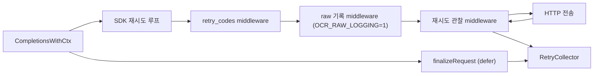

재시도와 타임아웃, 토큰 계산, 설정 명령과 연결 테스트를 다룬다.

## 재시도와 타임아웃

재시도는 OCR이 직접 구현하지 않는다. OpenAI, Anthropic SDK의 재시도 루프(최대 5회, 지수 백오프, `Retry-After` 반영)를 그대로 쓰고, OCR은 그 루프 안쪽에 middleware 세 개를 끼워 넣는다.



등록 순서는 retry_codes, raw, 관찰자 순이다. SDK는 나중에 등록한 middleware를 안쪽에 두므로 관찰자가 전송에 가장 가깝다. raw middleware가 본문 전체를 읽고 디스크에 쓰는 시간이 관찰자가 재는 "헤더까지 걸린 시간"에 섞이지 않게 하려는 순서라고 [client.go L631-L638](https://github.com/alibaba/open-code-review/blob/e74f2c6bd4422bd1e12d257d1725bcce1d6b9ddd/internal/llm/client.go#L631-L638)의 주석이 밝힌다.

### 코드 분석: 추가 재시도 코드

파일: `internal/llm/client.go`, [client.go L461-L479](https://github.com/alibaba/open-code-review/blob/e74f2c6bd4422bd1e12d257d1725bcce1d6b9ddd/internal/llm/client.go#L461-L479)

일부 게이트웨이는 속도 제한을 403이나 400으로 돌려준다. 이런 응답을 SDK가 재시도하게 만드는 middleware다.

```go
func retryCodesMiddleware(codes []int) func(*http.Request, func(*http.Request) (*http.Response, error)) (*http.Response, error) {
	if len(codes) == 0 {
		return nil
	}
	codeSet := make(map[int]bool, len(codes))
	for _, c := range codes {
		codeSet[c] = true
	}
	return func(req *http.Request, next func(*http.Request) (*http.Response, error)) (*http.Response, error) {
		resp, err := next(req)
		if err != nil {
			return resp, err
		}
		if codeSet[resp.StatusCode] {
			resp.Header.Set("x-should-retry", "true")
		}
		return resp, err
	}
}
```

재시도 정책을 새로 만들지 않고 SDK가 이미 존중하는 `x-should-retry` 응답 헤더를 심는다. 백오프와 횟수 제한은 SDK 것을 그대로 쓴다. 받을 수 있는 코드는 [`sanitizeRetryCodes`](https://github.com/alibaba/open-code-review/blob/e74f2c6bd4422bd1e12d257d1725bcce1d6b9ddd/internal/llm/resolver.go#L977-L989)가 4xx로 제한한다. 5xx는 SDK가 이미 재시도하므로 오류이고, 408, 409, 429는 경고와 함께 버린다.

> **주의**: 사용자 문서(Configuration의 Additional retry status codes)는 `retry_codes`를 `llm.retry_codes`와 `custom_providers.<name>.retry_codes`에서 설정할 수 있다고 적는다. 코드는 내장 프로바이더 항목에서도 같은 필드를 읽는다. `providerEntryConfig.RetryCodes`가 `providers`와 `custom_providers` 양쪽에 쓰이고([resolver.go L347-L358](https://github.com/alibaba/open-code-review/blob/e74f2c6bd4422bd1e12d257d1725bcce1d6b9ddd/internal/llm/resolver.go#L347-L358)), `ocr config set providers.<name>.retry_codes`도 [config_cmd.go L861-L869](https://github.com/alibaba/open-code-review/blob/e74f2c6bd4422bd1e12d257d1725bcce1d6b9ddd/cmd/opencodereview/config_cmd.go#L861-L869)에서 처리된다.

### 타임아웃 두 겹

| 설정 | 기본값 | 적용 위치 |
|---|---|---|
| `timeout_sec` (프로바이더 항목, legacy `llm`) | 0 (클라이언트 기본 5분) | `ClientConfig.Timeout` |
| `OCR_LLM_TIMEOUT` | 없음 | 모든 전략의 결과를 덮어씀 |
| 응답 헤더 타임아웃 | 요청 타임아웃 + 30초 | `http.Transport.ResponseHeaderTimeout` |
| `--timeout` (리뷰, 스캔) | 2장 참고 | 작업 전체의 context deadline |

SDK 기본 HTTP 클라이언트는 응답 헤더 타임아웃을 10분으로 고정한다. 그래서 `timeout_sec`를 15분으로 늘려도 느린 엔드포인트에서는 10분에 끊긴다. OCR은 [`httpClientWithHeaderTimeout`](https://github.com/alibaba/open-code-review/blob/e74f2c6bd4422bd1e12d257d1725bcce1d6b9ddd/internal/llm/client.go#L68-L78)으로 이 값을 요청 타임아웃보다 30초 길게 다시 잡는다. 같게 두면 헤더 타임아웃이 먼저 터질 수 있고, 그 오류는 SDK가 재시도 대상으로 보므로 매번 새 타임아웃으로 5번 더 시도한다고 [client.go L49-L57](https://github.com/alibaba/open-code-review/blob/e74f2c6bd4422bd1e12d257d1725bcce1d6b9ddd/internal/llm/client.go#L49-L57)의 주석이 설명한다.

[`describeTimeout`](https://github.com/alibaba/open-code-review/blob/e74f2c6bd4422bd1e12d257d1725bcce1d6b9ddd/internal/llm/request_timeout.go#L14-L22)은 deadline 초과를 두 종류로 나눈다. 호출자 context가 끝났으면 `caller deadline exceeded`, 요청 자체가 시간을 넘겼으면 `LLM request timeout (configure OCR_LLM_TIMEOUT or provider timeout_sec)`이다. 사용자가 어느 값을 늘려야 하는지 오류 문구에서 알 수 있게 하려는 구분이다.

### 코드 분석: 재시도 시도 분류

파일: `internal/llm/retry_report.go`, [retry_report.go L182-L199](https://github.com/alibaba/open-code-review/blob/e74f2c6bd4422bd1e12d257d1725bcce1d6b9ddd/internal/llm/retry_report.go#L182-L199)

관찰 middleware가 시도 하나를 기록할 때 쓰는 분류 규칙의 앞부분이다.

```go
func classifyAttempt(obs attemptObservation) (ErrorClass, FailurePhase) {
	if isErrorStatus(obs.StatusCode) {
		switch obs.StatusCode {
		case 429:
			return ErrorClassRateLimited, FailurePhaseHTTP
		case 529:
			return ErrorClassOverloaded, FailurePhaseHTTP
		case 401, 403:
			return ErrorClassAuthentication, FailurePhaseHTTP
		case 408, 504:
			return ErrorClassTimeout, FailurePhaseHTTP
		default:
			// Coarse bucket on purpose: 402/404/409/413 and transient 5xx all
			// land here and are told apart by status_code, rather than growing
			// an enum that duplicates HTTP.
			return ErrorClassProvider, FailurePhaseHTTP
		}
	}
```

분류는 상태 코드와 Go 오류 타입으로만 하고 오류 문구는 보지 않는다. 상태 코드가 없으면 `context.Canceled`는 cancelled, deadline 초과는 timeout, `io.ErrUnexpectedEOF`는 응답 디코딩 단계의 network, 그 밖의 전송 오류는 network로 분류한다. `RetryCollector`는 실행마다 하나 만들어지고, 각 `CompletionsWithCtx`가 `defer`로 `finalizeRequest`를 호출해 논리 요청 하나의 결과(succeeded, recovered, failed, cancelled)를 확정한다. 결과는 스키마 `ocr.llm-retry-report/v1`의 보고서로 고정되어 JSON 출력에 실린다(14장에서 다룬다). 요청 본문, 프롬프트, URL은 보고서에 넣지 않는다.

raw 기록은 `OCR_RAW_LOGGING=1`일 때만 켜진다([raw.go L24-L28](https://github.com/alibaba/open-code-review/blob/e74f2c6bd4422bd1e12d257d1725bcce1d6b9ddd/internal/llm/raw.go#L24-L28)). 헤더 이름에 `auth`, `token`, `key`, `secret`, `credential`, `cookie`가 들어가면 값을 `[REDACTED]`로 바꾼다([raw.go L147-L158](https://github.com/alibaba/open-code-review/blob/e74f2c6bd4422bd1e12d257d1725bcce1d6b9ddd/internal/llm/raw.go#L147-L158)). 기록 파일 위치는 13장에서 다룬다.

## 토큰 계산

OCR은 프롬프트 상한(`max_tokens`), 파일 묶음 구성(4장), 컨텍스트 압축(7장)에서 token 수를 센다. 계산은 tiktoken-go 하나로 하며, 네트워크에 의존하지 않도록 BPE 파일을 바이너리에 넣는다.

### 코드 분석: 인코딩 선택과 대체 계산

파일: `internal/llm/client.go`, [client.go L565-L593](https://github.com/alibaba/open-code-review/blob/e74f2c6bd4422bd1e12d257d1725bcce1d6b9ddd/internal/llm/client.go#L565-L593)

모델 이름으로 인코딩을 고르고, 실패하면 바이트 수를 4로 나눈다.

```go
func countTokensWithEncoding(text string, encName string) int {
	tke, err := defaultTokenizer.getOrLoad(encName)
	if err != nil {
		return len([]byte(text)) / 4
	}
	return len(tke.Encode(text, nil, nil))
}

func CountTokens(text string) int {
	return CountTokensForModel(text, "")
}

func CountTokensForModel(text string, modelName string) int {
	if text == "" {
		return 0
	}
	encName := encodingForModel(modelName)
	return countTokensWithEncoding(text, encName)
}

func encodingForModel(modelName string) string {
	lower := strings.ToLower(modelName)
	switch {
	case strings.Contains(lower, "o1") || strings.Contains(lower, "o3") || strings.Contains(lower, "o4"):
		return "o200k_base"
```

배포 코드에서 `CountTokensForModel`을 모델 이름과 함께 부르는 곳은 없다. 에이전트, 스캔, 압축, 세션 기록, behaviortask가 모두 `CountTokens`를 호출하므로 실제로는 항상 `cl100k_base`로 센다. Claude, Qwen, Gemini 같은 모델은 tokenizer가 다르므로 이 값은 근사치다.

[`embedded_loader.go`](https://github.com/alibaba/open-code-review/blob/e74f2c6bd4422bd1e12d257d1725bcce1d6b9ddd/internal/llm/embedded_loader.go#L43-L55)의 `urlToFileMap`은 `cl100k_base`, `o200k_base`, `p50k_base`, `r50k_base` 네 인코딩을 매핑하지만, `bpe_data/`에 실제로 들어 있는 파일은 `cl100k_base.tiktoken` 하나뿐이다. `o200k_base`를 요청하면 내장 파일을 찾지 못해 오류가 나고 바이트 수를 4로 나눈 값으로 대체된다. 테스트 `TestCountTokensForModel`은 o1 모델의 결과가 0이 아닌지만 확인하므로 이 대체 계산으로도 통과한다(추정, 테스트는 실행하지 않았다). 현재 호출 경로에서는 o 계열 인코딩을 쓰지 않으므로 리뷰 동작에는 영향이 없다.

`NativeTurn`의 thinking 블록, reasoning 항목, tool call 인자처럼 텍스트로 추출되지 않는 부분은 JSON으로 직렬화한 길이를 4로 나눠 더한다([client.go L140-L170](https://github.com/alibaba/open-code-review/blob/e74f2c6bd4422bd1e12d257d1725bcce1d6b9ddd/internal/llm/client.go#L140-L170)). Anthropic 응답과 Responses 응답에서 tool call이 원형 payload에 이미 들어 있으면 `Message.ToolCalls`를 다시 세지 않는다(`countsToolCalls`). 같은 호출을 두 번 세지 않으려는 처리다.

## 설정 명령과 연결 테스트

`cmd/opencodereview`의 설정 명령은 모두 `~/.opencodereview/config.json` 하나를 읽고 쓴다.

| 명령 | 역할 | 구현 |
|---|---|---|
| `ocr config set <key> <value>` | 값 하나 저장. `api_key`, `auth_token`으로 끝나는 키는 화면에 가려서 출력 | [config_cmd.go L101-L138](https://github.com/alibaba/open-code-review/blob/e74f2c6bd4422bd1e12d257d1725bcce1d6b9ddd/cmd/opencodereview/config_cmd.go#L101-L138) |
| `ocr config unset <key>` | 값 삭제 | [config_cmd.go L140-L169](https://github.com/alibaba/open-code-review/blob/e74f2c6bd4422bd1e12d257d1725bcce1d6b9ddd/cmd/opencodereview/config_cmd.go#L140-L169) |
| `ocr config provider` | TUI로 프로바이더, 키, 모델 선택 후 연결 테스트 | [provider_cmd.go L19-L58](https://github.com/alibaba/open-code-review/blob/e74f2c6bd4422bd1e12d257d1725bcce1d6b9ddd/cmd/opencodereview/provider_cmd.go#L19-L58) |
| `ocr config model` | 현재 프로바이더의 모델 선택 | [provider_cmd.go L330-L430](https://github.com/alibaba/open-code-review/blob/e74f2c6bd4422bd1e12d257d1725bcce1d6b9ddd/cmd/opencodereview/provider_cmd.go#L330-L430) |
| `ocr llm test` | 도구 호출 왕복을 포함한 연결 테스트 | [llm_cmd.go L63-L171](https://github.com/alibaba/open-code-review/blob/e74f2c6bd4422bd1e12d257d1725bcce1d6b9ddd/cmd/opencodereview/llm_cmd.go#L63-L171) |
| `ocr llm providers` | 내장 프로바이더 목록 | [llm_cmd.go L39-L46](https://github.com/alibaba/open-code-review/blob/e74f2c6bd4422bd1e12d257d1725bcce1d6b9ddd/cmd/opencodereview/llm_cmd.go#L39-L46) |
| `ocr auth login`, `status`, `logout` | ChatGPT 로그인 관리 | [auth_cmd.go L13-L65](https://github.com/alibaba/open-code-review/blob/e74f2c6bd4422bd1e12d257d1725bcce1d6b9ddd/cmd/opencodereview/auth_cmd.go#L13-L65) |

`config set`이 받는 최상위 키는 [`supportedConfigKeys`](https://github.com/alibaba/open-code-review/blob/e74f2c6bd4422bd1e12d257d1725bcce1d6b9ddd/cmd/opencodereview/config_cmd.go#L604-L628) 한 목록에서 관리하고, 모르는 키의 오류 문구도 이 목록으로 만든다. 설정 구조체는 모르는 JSON 필드를 따로 모아 두었다가 저장할 때 다시 합친다([config_cmd.go L411-L470](https://github.com/alibaba/open-code-review/blob/e74f2c6bd4422bd1e12d257d1725bcce1d6b9ddd/cmd/opencodereview/config_cmd.go#L411-L470)). 새 버전이 추가한 필드를 예전 버전의 `config set`이 지우지 않게 하려는 처리다. [`saveConfig`](https://github.com/alibaba/open-code-review/blob/e74f2c6bd4422bd1e12d257d1725bcce1d6b9ddd/cmd/opencodereview/provider_cmd.go#L432-L451)는 기존 파일 권한을 먼저 0600으로 좁힌 뒤 쓴다. `os.WriteFile`의 권한 인자는 새 파일을 만들 때만 적용되기 때문이다.

### 프로바이더 TUI 구조

`provider_tui.go`는 3171줄이지만 구조는 단순하다. bubbletea 모델 하나(`providerTUIModel`)가 탭 세 개와 단계 상수로 화면을 나눈다([provider_tui.go L21-L56](https://github.com/alibaba/open-code-review/blob/e74f2c6bd4422bd1e12d257d1725bcce1d6b9ddd/cmd/opencodereview/provider_tui.go#L21-L56)).

| 탭 | 단계 | 저장 위치 |
|---|---|---|
| 공식 (`tabOfficial`) | 프로바이더 선택, 모델 선택, API 키 입력 | `providers.<name>` |
| 커스텀 (`tabCustom`) | 이름, protocol, base URL, API 키, 인증 헤더 | `custom_providers.<name>` |
| 수동 (`tabManual`) | URL, protocol, 모델, auth token, 인증 헤더 | legacy `llm` 블록 |

수동 탭의 protocol 목록에는 Bedrock이 없다([provider_tui.go L73-L77](https://github.com/alibaba/open-code-review/blob/e74f2c6bd4422bd1e12d257d1725bcce1d6b9ddd/cmd/opencodereview/provider_tui.go#L73-L77)). legacy 블록에는 리전과 프로파일을 둘 자리가 없어서 해석기가 그 조합을 거부하기 때문이다. 저장된 키는 길이를 숨기려고 항상 20개의 `*`로 보여 주고, 키를 누르면 교체 모드로 바뀐다. TUI가 끝나고 사용자가 확인하면 [`runLLMTestPath`](https://github.com/alibaba/open-code-review/blob/e74f2c6bd4422bd1e12d257d1725bcce1d6b9ddd/cmd/opencodereview/provider_cmd.go#L147-L152)로 연결 테스트를 한다. 테스트가 실패해도 설정은 저장된 상태로 남는다.

### 연결 테스트의 도구 호출 왕복

`ocr llm test`는 [`task.json`](https://github.com/alibaba/open-code-review/blob/e74f2c6bd4422bd1e12d257d1725bcce1d6b9ddd/internal/config/testconnection/task.json)의 대화를 보낸다. system 프롬프트는 `ocr_selftest` 도구를 한 번 호출하라고 지시하고, 모델이 도구를 부르면 고정 결과 `ocr_selftest ok`를 돌려준 뒤 두 번째 요청을 보낸다. 요청마다 120초(task의 `timeout`) 제한이 따로 걸린다.

```text
"tool": {
  "name": "ocr_selftest",
  "description": "Connectivity self-test. Echoes back a fixed acknowledgement so the caller can verify a tool-call round trip.",
```

두 번째 요청이 필요한 이유는 [testconnection.go L22-L26](https://github.com/alibaba/open-code-review/blob/e74f2c6bd4422bd1e12d257d1725bcce1d6b9ddd/internal/config/testconnection/testconnection.go#L22-L26)의 주석에 있다. 요청 하나만 보내는 테스트로는 "tool call 다음 턴을 거부하는 프로바이더"를 잡지 못하고, 실제로 그런 프로바이더가 테스트는 통과하고 모든 리뷰에서 실패한 일이 있었다. 리뷰는 대부분 도구 호출 루프이므로 연결 테스트도 그 형태를 따른다. Bedrock이면 URL 대신 해석된 리전과 프로파일을 출력한다.
