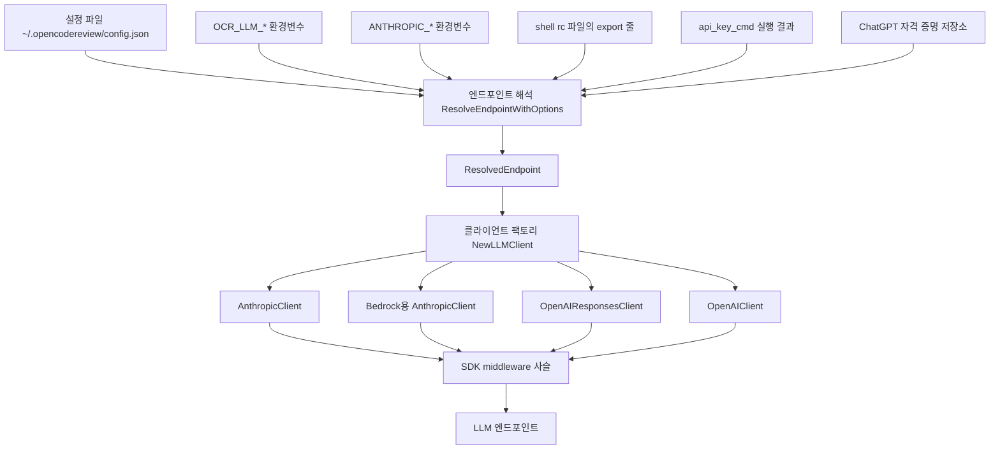

OpenCodeReview(이하 OCR)의 리뷰 에이전트는 어떤 LLM을 부르는지 모른다. `internal/llm` 패키지가 설정 파일, 환경변수, shell rc 파일에서 엔드포인트 하나를 해석해 `ResolvedEndpoint`로 고정하고, 그 값의 protocol에 맞는 클라이언트를 만들어 `LLMClient` 인터페이스 하나로 감싼다. 이 장은 그 해석 순서, 키를 꺼내는 방법, 네 가지 protocol 클라이언트, ChatGPT OAuth 경로, 재시도와 타임아웃, 토큰 계산을 코드 기준으로 정리한다.

## 프로바이더 계층 개요

프로바이더 계층은 세 단계로 나뉜다. 첫 단계는 "어디로, 무슨 키로, 어떤 모델에" 보낼지를 정하는 해석(resolver)이고, 둘째 단계는 해석 결과로 SDK 클라이언트를 조립하는 팩토리(`NewLLMClient`)이며, 셋째 단계는 실제 HTTP 시도를 감싸는 middleware 사슬이다. 리뷰 에이전트(6장)와 `llmloop`(7장)는 마지막에 만들어진 `LLMClient.CompletionsWithCtx` 하나만 호출한다.



`ResolvedEndpoint`는 URL, 토큰, 모델 외에도 인증 헤더 이름, `extra_body`, `extra_headers`, 요청 타임아웃, 추가 재시도 코드, AWS 프로파일과 리전, ChatGPT 계정 같은 값을 모두 담는다. 해석이 끝난 뒤에는 어떤 값도 다시 읽지 않으므로, 한 번의 `ocr review` 실행 안에서 엔드포인트는 바뀌지 않는다.

### 코드 분석: 네 가지 protocol 상수

파일: `internal/llm/protocol.go`, [protocol.go L19-L38](https://github.com/alibaba/open-code-review/blob/e74f2c6bd4422bd1e12d257d1725bcce1d6b9ddd/internal/llm/protocol.go#L19-L38)

팩토리와 해석기가 비교하는 protocol 이름은 아래 네 상수뿐이다.

```go
const (
	// ProtocolAnthropic is the Anthropic Messages API spoken directly to
	// api.anthropic.com (or a compatible gateway).
	ProtocolAnthropic = "anthropic"
	// ProtocolOpenAIChatCompletions is the OpenAI Chat Completions API
	// (/v1/chat/completions). The value "openai" is kept for full backward
	// compatibility with existing config files.
	ProtocolOpenAIChatCompletions = "openai"
	// ProtocolOpenAIResponses is the OpenAI Responses API (/v1/responses),
	// used by GPT-5.x / o-series models.
	ProtocolOpenAIResponses = "openai-responses"
	// ProtocolAnthropicBedrock is the Anthropic Messages API served by AWS
	// Bedrock. The request body is the same as ProtocolAnthropic — the
	// difference is transport: requests are SigV4-signed from the ambient AWS
	// credential chain rather than carrying an API key, the model moves from
	// the body into the URL path, and the region determines the host. The
	// official SDK's bedrock middleware performs that rewriting, so this
	// shares the Anthropic client rather than reimplementing the protocol.
	ProtocolAnthropicBedrock = "anthropic-bedrock"
)
```

`NormalizeProtocol`은 대소문자와 공백만 정리하고 모르는 값은 그대로 돌려준다. 오타를 조용히 기본값으로 바꾸지 않고 [`ValidateProtocol`](https://github.com/alibaba/open-code-review/blob/e74f2c6bd4422bd1e12d257d1725bcce1d6b9ddd/internal/llm/protocol.go#L65-L72)이 지원 목록을 붙인 오류를 내게 하려는 설계다. Bedrock이 별도 클라이언트 클래스가 아니라 Anthropic 클라이언트를 공유한다는 점도 이 주석에 적혀 있다.

| protocol 값 | API | 클라이언트 | 인증 |
|---|---|---|---|
| `anthropic` | Anthropic Messages API | `AnthropicClient` | `x-api-key` 또는 `Authorization` |
| `openai` | OpenAI Chat Completions | `OpenAIClient` | Bearer 토큰 |
| `openai-responses` | OpenAI Responses API | `OpenAIResponsesClient` | Bearer 토큰 또는 ChatGPT OAuth 토큰 |
| `anthropic-bedrock` | Bedrock의 Messages API | `AnthropicClient` (bedrock 모드) | AWS SigV4 서명 |

### 내장 프로바이더 레지스트리

[`providers.go`](https://github.com/alibaba/open-code-review/blob/e74f2c6bd4422bd1e12d257d1725bcce1d6b9ddd/internal/llm/providers.go#L23-L41)의 `Provider` 구조체는 내장 프로바이더 하나의 기본값이다. 기준 커밋의 `registry`에는 30개가 들어 있고, protocol로 나누면 Chat Completions 26개, Responses API 2개(`openai-responses`, `chatgpt`), Anthropic 1개, Bedrock 1개다. 파일 맨 위의 `go:generate` 지시문이 이 목록으로 IDE 확장용 TypeScript, Kotlin 카탈로그를 생성하므로, 프로바이더를 추가하면 생성 파일도 함께 커밋해야 한다.

| 필드 | 의미 |
|---|---|
| `Name` | 설정 파일의 `provider` 값과 `providers.<name>` 키 |
| `Protocol`, `BaseURL` | 기본 protocol과 엔드포인트. 설정의 `url`, `protocol`이 있으면 덮어쓴다 |
| `AuthHeader` | Anthropic 전용 인증 헤더. 레지스트리에서는 `anthropic`만 `x-api-key`를 지정한다 |
| `EnvVar` | `api_key`, `api_key_cmd`가 모두 없을 때 읽는 환경변수 (예: `ANTHROPIC_API_KEY`) |
| `AmbientAuth` | 키 대신 실행 환경의 자격 증명을 쓴다. `bedrock`이 해당한다 |
| `ExternalAuth`, `RequiresStreaming`, `RejectsSamplingParams` | `chatgpt` 전용. 별도 로그인, 스트리밍 강제, temperature 같은 샘플링 인자 제거 |
| `Models` | 대화형 모델 선택에 보여 줄 추천 목록 |

`LookupProvider`와 `ListProviders`는 `Models` 슬라이스를 복사해서 돌려준다([providers.go L518-L546](https://github.com/alibaba/open-code-review/blob/e74f2c6bd4422bd1e12d257d1725bcce1d6b9ddd/internal/llm/providers.go#L518-L546)). 호출자가 목록을 수정해도 전역 레지스트리가 바뀌지 않게 하려는 방어 복사다.

## 정리

- 엔드포인트는 설정 파일, `OCR_LLM_*`, `ANTHROPIC_*`, shell rc 순서로 해석하고, 전략끼리 값을 섞지 않는다. 불완전한 전략은 건너뛰고 잘못된 값은 즉시 실패한다
- 키는 `api_key`, `api_key_cmd`, 프리셋 환경변수 순서로 찾으며, `api_key_cmd`는 모든 검증 뒤에 한 번만 실행해 불필요한 비밀 관리 도구 프롬프트를 피한다
- protocol은 `anthropic`, `openai`, `openai-responses`, `anthropic-bedrock` 네 개이고, Bedrock은 Anthropic 클라이언트에 SigV4 middleware를 결합한 형태다. SSO bearer 토큰을 지워 서명 경로를 강제한다
- ChatGPT 경로는 PKCE 루프백 로그인, 파일 잠금 안의 토큰 갱신, 검증 전 임시 저장, 제한된 `extra_body`와 재시도 0회로 구성된다
- 재시도는 SDK 루프(최대 5회)를 그대로 쓰고 `x-should-retry` 헤더 주입으로 4xx 코드를 추가한다. 응답 헤더 타임아웃을 요청 타임아웃보다 30초 길게 잡아 SDK의 10분 고정값을 대체한다
- token 계산은 내장 `cl100k_base` 하나로 하며, 매핑에 있는 `o200k_base` 등은 내장되어 있지 않아 쓰면 바이트 수를 4로 나눈 근사치로 대체된다
