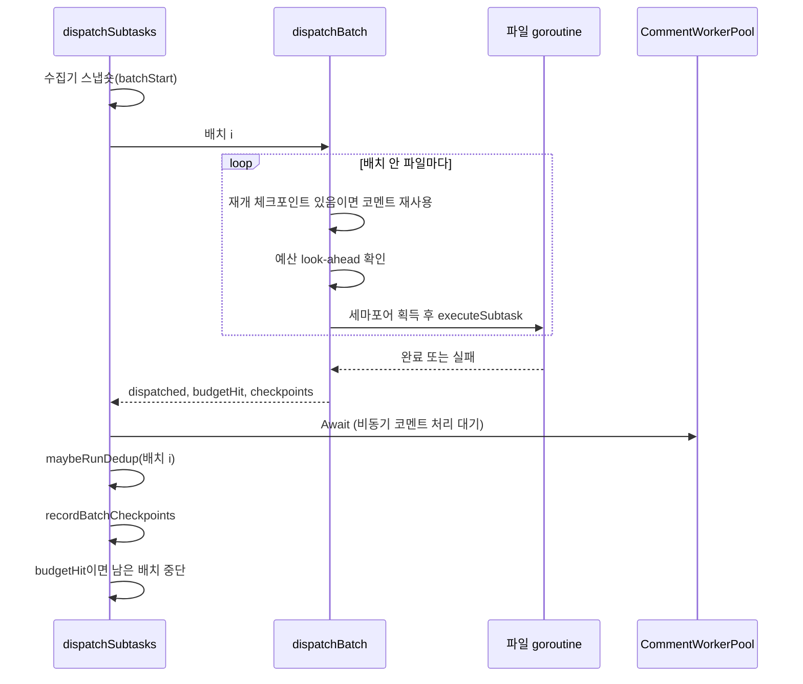

배치 구성과 분배, 파일 하나의 리뷰 과정을 다룬다.

## 배치 구성

스캔은 파일을 배치로 나눠 배치 단위로 순서대로 처리한다. 배치는 diff 리뷰의 묶음(04장)과 다르다. 묶음은 여러 파일을 한 대화에 넣지만, 배치는 파일마다 별도 대화를 열고 "어떤 파일들을 같은 시기에 실행할지"와 "어디까지를 한 번에 중복 제거할지"만 정한다.

| 전략 | 그룹 키 | 예 |
|---|---|---|
| `none` | 파일 경로 (파일마다 배치 하나) | `a.go`, `b.go` 각각 |
| `by-language` (기본) | 소문자 확장자, 없으면 `<no-ext>` | `.go`, `.ts` |
| `by-directory` | 첫 번째 경로 요소, 루트 파일은 `<root>` | `internal`, `cmd` |

### 코드 분석: groupBatches

파일: [`internal/scan/batch.go` L50-L78](https://github.com/alibaba/open-code-review/blob/e74f2c6bd4422bd1e12d257d1725bcce1d6b9ddd/internal/scan/batch.go#L50-L78)

```go
	keyFn := batchKeyFunc(strategy)
	buckets := make(map[string][]model.ScanItem)
	for _, it := range items {
		key := keyFn(it)
		buckets[key] = append(buckets[key], it)
	}

	keys := make([]string, 0, len(buckets))
	for k := range buckets {
		keys = append(keys, k)
	}
	sort.Strings(keys)

	var out [][]model.ScanItem
	for _, k := range keys {
		group := buckets[k]
		if size <= 0 || len(group) <= size {
			out = append(out, group)
			continue
		}
		for start := 0; start < len(group); start += size {
			end := min(start+size, len(group))
			out = append(out, group[start:end])
		}
	}
```

- 배치 순서는 그룹 키의 사전순이라 실행할 때마다 같다. 배치 안의 파일 순서는 열거 순서를 유지한다
- 그룹이 `BATCH_SIZE`(기본 50)보다 크면 50개씩 자른다. 같은 확장자 파일이 120개면 50, 50, 20 세 배치가 된다
- `dispatchSubtasks` 주석은 배치를 순차로 처리하는 이유로 두 가지를 든다. 배치마다 중복 제거 같은 후처리를 걸 수 있고, 같은 언어 파일을 시간상 붙여 두면 prompt cache 적중률이 오른다는 것이다([`agent.go` L536-L540](https://github.com/alibaba/open-code-review/blob/e74f2c6bd4422bd1e12d257d1725bcce1d6b9ddd/internal/scan/agent.go#L536-L540)). 하위 작업마다 cache 키가 따로이므로 이 효과가 실제로 얼마나 나는지는 코드만으로 확인할 수 없다(미검증)

## 배치 분배와 동시성

배치는 하나씩 처리하고, 배치 안의 파일은 세마포어로 동시에 실행한다.



동시 실행 수는 `--concurrency`(기본 8)이고, 0 이하이면 코드에서 8로 바꾼다. 파일 하나의 시간 상한은 `--timeout` 분이다([`agent.go` L677-L683](https://github.com/alibaba/open-code-review/blob/e74f2c6bd4422bd1e12d257d1725bcce1d6b9ddd/internal/scan/agent.go#L677-L683)). 모든 파일이 같은 `reviewtask.Runner`를 공유하므로 토큰 카운터와 경고는 실행 전체에 하나로 모인다.

### 코드 분석: 파일 단위 예산 look-ahead

파일: [`internal/scan/agent.go` L710-L726](https://github.com/alibaba/open-code-review/blob/e74f2c6bd4422bd1e12d257d1725bcce1d6b9ddd/internal/scan/agent.go#L710-L726)

```go
		// Per-file budget look-ahead. Stop before acquiring a slot so we
		// don't even queue work that would blow the budget.
		if a.args.MaxTokensBudget > 0 {
			used := a.runner.TotalTokensUsed()
			projected := used + estimateFileTokens(it, a.planEnabledFor)
			if projected > a.args.MaxTokensBudget {
				fmt.Fprintf(stdout.Writer(), "[ocr] token budget reached (used %s + next-file est ≈ %s > budget %s) — skipping %s and remaining files\n",
					humanTokens(used), humanTokens(projected), humanTokens(a.args.MaxTokensBudget), it.Path)
				a.recordWarning("token_budget_reached", it.Path,
					fmt.Sprintf("stopped in batch #%d: used %d tokens + next-file estimate exceeds budget %d", batchIdx, used, a.args.MaxTokensBudget))
				budgetHit = true
				// budgetHit is per-batch and dies with this call; the field is
				// the run-level signal emitRunResult reads after Run returns.
				a.budgetExceeded.Store(true)
				break
			}
		}
```

누적 예산은 두 지점에서 확인한다.

| 확인 지점 | 기준 | 결과 |
|---|---|---|
| 파일 분배 직전 (위 코드) | 현재 사용량 + 이 파일의 추정치 > 예산 | 이 파일과 배치의 남은 파일을 건너뛰고, 배치 후처리 뒤 남은 배치도 중단 |
| 파일 대화의 매 라운드 직전 (07장) | 현재 사용량 > 예산 | `StopTokenBudget`, grace round 후 파일을 미완료로 기록 |

- 분배 단계의 확인은 추정치를 더하므로 실제 예산보다 일찍 멈출 수 있다. 반대로 라운드 단계의 확인은 이미 넘은 뒤에만 멈추므로 동시에 돌던 파일 수만큼 예산을 넘길 수 있다. 주석은 이 구조가 초과분을 "작업자당 진행 중인 파일 하나 정도"로 제한한다고 설명한다(L671-L676)
- 라운드 단계에서 예산으로 멈춘 경우에도 `budgetExceeded`를 세운다(L831-L834). 주석은 이것이 없으면 `--format json`이 `budget_exceeded: false`를 보고하는 문제가 있었다고 적었다
- 예산 초과는 오류가 아니다. 스캔은 그때까지의 코멘트와 nil 오류를 돌려주고, 초과 여부는 출력의 `summary.budget_exceeded`로만 전달된다(L243-L248)

## 파일 하나의 리뷰: plan과 main

파일 하나의 하위 작업은 `executeSubtask`가 처리한다. 선택 단계인 plan 요청 하나와 도구 호출 루프 하나로 이뤄진다.

| 단계 | 실행 조건 | 요청 형태 | 실패 시 |
|---|---|---|---|
| PLAN_TASK | 템플릿에 정의, `--no-plan` 아님, 바이너리나 빈 파일 아님, 200줄 이상 | 도구 없는 단일 요청, JSON 응답 | 계획 없음 문구로 대체하고 계속 |
| 프롬프트 크기 확인 | 항상 | 없음 | 80% 초과 시 `token_threshold_exceeded` 경고, 파일 실패로 기록 |
| MAIN_TASK | 항상 | `reviewtask.Runner.RunMainTask` (07장 루프) | 미완료 사유를 `Reason()`으로 기록 |

plan 응답은 `{"summary": ..., "checkpoints": [{"focus", "lines", "why"}]}` 형식이다. [`formatPlanGuidance`](https://github.com/alibaba/open-code-review/blob/e74f2c6bd4422bd1e12d257d1725bcce1d6b9ddd/internal/scan/agent.go#L1153-L1196)는 이를 "**Focus areas (give these extra attention; not exhaustive):**" 아래 번호 목록으로 바꿔 메인 프롬프트의 `{{plan_guidance}}`에 넣는다. JSON 파싱에 실패하면 응답 원문을 그대로 넣는다. plan 단계가 없거나 실패하면 "(no pre-scan plan; review the entire file as usual)"을 넣는데, 비어 있으면 프롬프트의 "### Pre-scan Focus Areas" 제목이 내용 없이 남기 때문이다.

### 코드 분석: 메인 프롬프트 구성

파일: [`internal/scan/agent.go` L1203-L1218](https://github.com/alibaba/open-code-review/blob/e74f2c6bd4422bd1e12d257d1725bcce1d6b9ddd/internal/scan/agent.go#L1203-L1218)

```go
func (a *Agent) renderMessages(it model.ScanItem, rule, planGuidance string) []llm.Message {
	rawMsgs := a.args.Template.MainTask.Messages
	messages := make([]llm.Message, 0, len(rawMsgs))
	for _, m := range rawMsgs {
		content := m.Content
		content = strings.ReplaceAll(content, "{{plan_guidance}}", planGuidance)
		content = strings.ReplaceAll(content, "{{current_system_date_time}}", a.currentDate)
		content = strings.ReplaceAll(content, "{{current_file_path}}", it.Path)
		content = strings.ReplaceAll(content, "{{system_rule}}", rule)
		content = strings.ReplaceAll(content, "{{change_files}}", changeFilesScanLiteral)
		content = strings.ReplaceAll(content, "{{file_content}}", it.Content)
		content = strings.ReplaceAll(content, "{{requirement_background}}", a.args.Background)
		messages = append(messages, llm.NewTextMessage(m.Role, content))
	}
	return messages
}
```

- 파일 내용 전체가 첫 user 메시지에 들어간다. 07장의 압축은 처음 두 메시지를 frozen 구역으로 유지하므로, 파일 내용은 압축 뒤에도 대화에 남는다
- `{{file_content}}`를 다른 자리표시자보다 뒤에서 바꾼다. 파일 내용 안에 `{{plan_guidance}}` 같은 문자열이 있어도 다시 치환되지 않는다. 다만 `{{requirement_background}}` 치환은 파일 내용 치환 뒤에 오므로, 파일 안에 그 문자열이 있으면 `--background` 값으로 바뀐다(코드 순서로 판단)
- `{{change_files}}`는 "(not applicable in full-scan mode)"로 고정한다. 기본 스캔 템플릿에는 이 자리표시자가 없다
- `{{system_rule}}`은 파일 경로로 찾은 리뷰 규칙이다(05장)

### 메인 프롬프트의 도구 사용 지침

스캔 system 프롬프트는 diff 리뷰와 달리 도구 호출 예산을 명시적으로 강조한다.

파일: [`internal/config/template/scan_template.json` L7](https://github.com/alibaba/open-code-review/blob/e74f2c6bd4422bd1e12d257d1725bcce1d6b9ddd/internal/config/template/scan_template.json#L7) (`MAIN_TASK` system 메시지 중 일부)

```markdown
## Tool-call discipline (IMPORTANT — your tool-call budget per file is limited)
- The file content is ALREADY in <current_file_content>; do NOT call `file_read` to re-fetch the current file.
- Limit context-gathering to AT MOST 2-3 tool calls per finding. Avoid calling the same tool with the same arguments more than once.
- Once you have enough evidence for an issue, call `code_comment` immediately rather than gathering more context.
- Batch multiple comments in a single `code_comment` call (its `comments` parameter accepts an array) instead of issuing one call per finding.
- If no further issues are evident after a quick sweep of the file, call `task_done` immediately — do not keep probing for marginal findings.
```

- 파일 내용이 이미 프롬프트에 있으므로 `file_read`로 같은 파일을 다시 읽지 말라고 지시한다. 라운드마다 대화 전체를 다시 보내는 구조에서 같은 내용을 두 번 싣는 비용을 줄이려는 지시다
- "Do not comment on code in other files"라는 규칙도 같은 프롬프트에 있다. 다른 파일을 읽는 도구는 참고용이고 코멘트 대상은 현재 파일뿐이다

### 코멘트 줄 번호와 결과 기록

`code_comment`의 줄 번호 찾기는 diff를 전제로 만들어져 있다. 스캔은 `ScanItem.AsDiff()`로 diff 본문은 비고 `NewFileContent`에 파일 전체가 든 가짜 `Diff`를 만들어 넘긴다([`agent.go` L412-L421](https://github.com/alibaba/open-code-review/blob/e74f2c6bd4422bd1e12d257d1725bcce1d6b9ddd/internal/scan/agent.go#L412-L421)). hunk가 없으므로 줄 번호는 파일 전체 내용에서 `existing_code`를 찾는 대체 경로로 정해진다(09장).

메인 루프가 미완료로 끝나면 `"main_task did not complete before stopping: " + stop.Reason()`을 실패 사유로 기록한다([L821-L843](https://github.com/alibaba/open-code-review/blob/e74f2c6bd4422bd1e12d257d1725bcce1d6b9ddd/internal/scan/agent.go#L821-L843)). 스캔은 run manifest가 없으므로 이 문자열 하나가 파일별 진단의 전부다.
