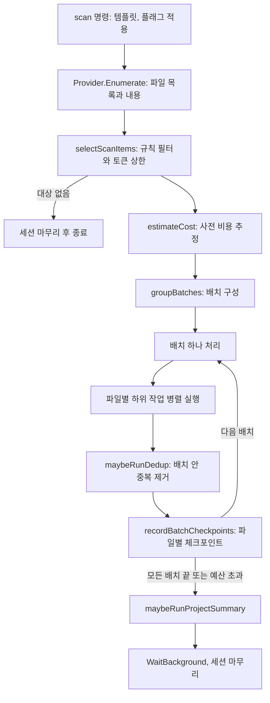

`ocr scan`은 diff 없이 파일 전체를 리뷰한다. git 이력이 없는 디렉터리나 처음 보는 코드베이스를 점검할 때 쓰는 경로이고, 파일 하나를 하위 작업 하나로 삼아 diff 리뷰와 같은 도구 호출 루프에 태운다. 이 장은 파일 열거와 선별, 배치 구성, 누적 토큰 예산, 배치별 중복 제거와 프로젝트 요약, 그리고 중단된 스캔의 재개를 코드로 따라가며 diff 리뷰 경로와 어디가 다른지 정리한다.

## review 경로와의 차이점

스캔은 `internal/scan` 패키지가 맡지만, 파일 하나를 리뷰하는 루프는 diff 리뷰와 같은 `reviewtask.Runner`를 쓴다(06장, 07장). 패키지 주석은 이 분담을 "scan-specific concerns (enumeration, FULL_SCAN_TASK rendering, scan-specific filter)"만 이 패키지가 맡는다고 적는다([`provider.go` L4-L9](https://github.com/alibaba/open-code-review/blob/e74f2c6bd4422bd1e12d257d1725bcce1d6b9ddd/internal/scan/provider.go#L4-L9)). 나머지는 설정값과 단계 구성이 다르다.

| 항목 | `ocr review` | `ocr scan` |
|---|---|---|
| 입력 | git diff (03장) | 파일 전체 내용. git 저장소가 아니어도 된다 |
| 템플릿 | `task_template.json` | `scan_template.json` (바이너리에 포함, 별도 구조체 `ScanTemplate`) |
| `MAX_TOKENS` | 200000 | 58888 |
| `MAX_TOOL_REQUEST_TIMES` | 100 | 60 |
| 하위 작업 단위 | 파일 묶음 (04장) | 파일 하나. 배치는 분배 순서와 중복 제거 범위만 정한다 |
| plan 단계 기준 | 50줄 이상 | 200줄 이상 |
| 메인 도구 | `file_read_diff` 포함, `side` 인자 있음 | `file_read_diff` 없음, `side` 없음 |
| MCP 도구 | 있음 (08장) | 없음 |
| 사후 처리 | 반성 필터, 리뷰 회차 (09장) | 배치별 중복 제거, 프로젝트 요약 |
| run manifest | 있음 | 없음 (`RunManifest()`가 nil) |
| 재시도 보고서 | 있음 | 없음 (`NewRequestMeta`를 nil로 둠) |

마지막 두 줄은 출력과 진단 쪽 차이다. 스캔은 run manifest 범위 밖이라 `RunManifest()`가 항상 nil을 돌려주고([`agent.go` L197-L200](https://github.com/alibaba/open-code-review/blob/e74f2c6bd4422bd1e12d257d1725bcce1d6b9ddd/internal/scan/agent.go#L197-L200)), 재시도 보고서는 리뷰를 위한 것이라 스캔 요청이 들어가지 않게 요청 메타 생성 함수를 비워 둔다(L163-L165). 두 출력의 형식은 14장에서 다룬다.

전체 흐름은 다음과 같다.

## 정리

- `ocr scan`은 diff 대신 파일 전체를 하위 작업 하나로 삼고, 파일별 도구 호출 루프는 diff 리뷰와 같은 `reviewtask.Runner`(07장 llmloop)를 쓴다. 템플릿은 `scan_template.json`으로 분리되어 `MAX_TOKENS` 58888, 라운드 60, plan 기준 200줄을 쓴다
- 파일은 git 저장소면 `git ls-files`의 추적과 미추적 합집합으로, 아니면 디렉터리 순회로 모은다. 2MiB 초과와 바이너리를 거르고, 비밀 정보 경로, 사용자 규칙, 확장자, 기본 제외 경로, 토큰 상한(기본 47110) 순서로 제외 사유를 정한다
- 배치는 확장자(기본), 첫 디렉터리, 파일 단위 중 하나로 나누고 50개씩 자른다. 배치는 순차, 배치 안 파일은 기본 8개 동시 실행이며, 배치는 분배 순서와 중복 제거 범위만 정한다
- 누적 예산은 파일 분배 직전의 추정치 look-ahead와 라운드 직전 확인 두 곳에서 본다. 예산 초과는 오류가 아니라 `budget_exceeded` 표시와 경고로 남는다
- 사후 처리는 반성 필터 대신 배치별 중복 제거와 프로젝트 요약이다. 중복 제거는 LLM 응답이 모든 코멘트를 정확히 한 번씩 덮지 않으면 결과를 버리고, 체크포인트에는 파일별 원래 코멘트를 남긴다
- 재개는 경로와 내용의 SHA-256 지문으로 끝난 파일을 건너뛴다. `--batch` 오타가 조용히 `none`이 되는 점, 템플릿의 `timeout` 값이 읽히지 않는 점, MCP가 연결되지 않는 점이 diff 리뷰와 비교해 알아 둘 차이다
