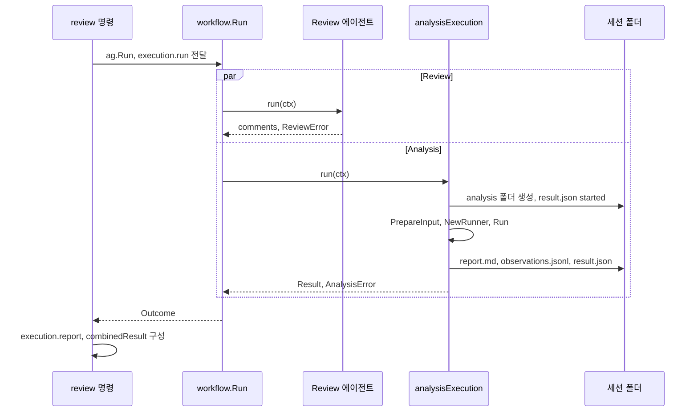

Review와 Analysis의 병렬 실행과 분석 입력 준비를 다룬다.

## workflow 패키지: Review와 Analysis의 병렬 실행

`internal/workflow`는 파일 두 개뿐인 작은 패키지다. 하나는 두 작업을 동시에 실행하고, 다른 하나는 Analysis 결과를 출력용 보고서 구조로 바꾼다.

### 코드 분석: workflow.Run

[workflow/run.go L23-L39](https://github.com/alibaba/open-code-review/blob/e74f2c6bd4422bd1e12d257d1725bcce1d6b9ddd/internal/workflow/run.go#L23-L39)

```go
func Run(ctx context.Context, review func(context.Context) ([]model.LlmComment, error), analysis func(context.Context) (behaviortask.Result, error)) Outcome {
	var result Outcome
	var workers sync.WaitGroup
	workers.Add(2)
	go func() {
		defer workers.Done()
		started := time.Now()
		result.Comments, result.ReviewError = review(ctx)
		result.ReviewElapsed = time.Since(started)
	}()
	go func() {
		defer workers.Done()
		result.Analysis, result.AnalysisError = analysis(ctx)
	}()
	workers.Wait()
	return result
}
```

- 두 goroutine은 서로의 오류를 보지 않는다. 한쪽이 실패해도 다른 쪽은 끝까지 실행된다. 공유하는 것은 부모 `ctx`뿐이라, 사용자가 Ctrl-C를 누르면 둘 다 취소된다.
- `ReviewElapsed`를 따로 재는 이유는 출력 요약에 Review 소요 시간만 싣기 위해서다. `reviewDuration`은 결과가 `combinedResult`이면 이 값을 쓴다([analysis.go L203-L208](https://github.com/alibaba/open-code-review/blob/e74f2c6bd4422bd1e12d257d1725bcce1d6b9ddd/cmd/opencodereview/analysis.go#L203-L208)).

### 코드 분석: review 명령의 결합 지점

[review_cmd.go L307-L318](https://github.com/alibaba/open-code-review/blob/e74f2c6bd4422bd1e12d257d1725bcce1d6b9ddd/cmd/opencodereview/review_cmd.go#L307-L318)

```go
	if opts.analysis {
		execution := newAnalysisExecution(analysisInputForReview(cc, opts, rt, ag.Session().SessionID, *codeTools.resolution))
		outcome := workflow.Run(runCtx, ag.Run, execution.run)
		comments, runErr = outcome.Comments, outcome.ReviewError
		report := execution.report(outcome.Analysis, outcome.AnalysisError)
		resultProvider = &combinedResult{Agent: ag, report: report, reviewErr: runErr, reviewElapsed: outcome.ReviewElapsed}
		if report.Status != "completed" {
			fmt.Fprintf(os.Stderr, "[ocr] warning: analysis execution %s; see the Analysis diagnostics in the result\n", report.Status)
		}
	} else {
		comments, runErr = ag.Run(runCtx)
	}
```

- `runErr`에는 Review 오류만 들어간다. Analysis 오류는 `report`의 `Errors`와 `Status`로만 남고, 명령의 종료 코드를 결정하는 `reviewResultError(runErr, manifest)`에는 전달되지 않는다. README의 "An Analysis failure does not change Review's exit status"가 이 구조에서 나온다.
- 예외는 취소다. `--analysis`일 때 Review가 정상 종료했더라도 `ctx.Err()`가 있으면 결과 오류로 승격한다([review_cmd.go L337-L339](https://github.com/alibaba/open-code-review/blob/e74f2c6bd4422bd1e12d257d1725bcce1d6b9ddd/cmd/opencodereview/review_cmd.go#L337-L339)).
- 보고서 ID는 Review 세션 ID(`ag.Session().SessionID`)를 그대로 받는다. 세션 뷰어가 하나의 ID로 Review 탭과 Analysis 탭을 함께 여는 근거다(세션 뷰어는 13장에서 다룬다).
- `runCtx`는 `review.run` span을 담은 context다. Analysis의 LLM 요청 span도 이 span의 하위로 기록된다(텔레메트리는 14장에서 다룬다).

### 코드 분석: 산출물 폴더 준비

`analysisExecution.prepare`는 조사 시작 전에 증거 폴더를 만든다. 위치는 저장소 밖의 세션 폴더 아래다.

[analysis.go L117-L124](https://github.com/alibaba/open-code-review/blob/e74f2c6bd4422bd1e12d257d1725bcce1d6b9ddd/cmd/opencodereview/analysis.go#L117-L124)

```go
	reportDir := filepath.Join(parent, request.reviewID)
	if _, err := os.Stat(reportDir + ".jsonl"); err != nil {
		return err
	}
	if err := os.Mkdir(reportDir, 0700); err != nil {
		return err
	}
	directory := filepath.Join(reportDir, "analysis")
```

이어서 `CreateArtifacts`로 `analysis` 폴더를 만들고, `fallback` 결과를 `started` 상태로 저장한 다음에야 `PrepareInput`을 호출한다([analysis.go L125-L137](https://github.com/alibaba/open-code-review/blob/e74f2c6bd4422bd1e12d257d1725bcce1d6b9ddd/cmd/opencodereview/analysis.go#L125-L137)).

- Review 세션 로그(`<id>.jsonl`)가 이미 있어야 진행한다. 같은 ID의 폴더가 있으면 `os.Mkdir`가 실패하므로 한 세션에 Analysis는 한 번만 붙는다.
- `result.json`을 `started` 상태로 먼저 쓴다. 프로세스가 중간에 죽어도 "시작했지만 끝나지 않은 조사"가 디스크에 남는다. CLI 문서도 "An unfinished run may have no final status"라고 적는다.
- 이 함수 바로 위 반복문은 세션 폴더의 조상 경로가 분석 대상 저장소 안에 있는지 검사하고, 그렇다면 `ErrArtifactLocation`으로 중단한다([analysis.go L104-L116](https://github.com/alibaba/open-code-review/blob/e74f2c6bd4422bd1e12d257d1725bcce1d6b9ddd/cmd/opencodereview/analysis.go#L104-L116)). 증거 파일이 저장소 안에 생기면 다음 조사에서 그 파일을 다시 읽게 되기 때문이다(추정).

`prepare`가 실패하면 `run`은 `fallback` 결과에 실패 요약을 채워 다시 저장하고 돌려준다([analysis.go L172-L180](https://github.com/alibaba/open-code-review/blob/e74f2c6bd4422bd1e12d257d1725bcce1d6b9ddd/cmd/opencodereview/analysis.go#L172-L180)). `fallback`의 `StopReason`은 `"preparation"`이며, 이 값은 뒤에서 볼 보고서 오류 문구를 고르는 데 쓰인다.



## 입력 준비: PrepareInput과 변경 목록

Analysis는 Review가 만든 diff를 쓰지 않는다. `PrepareInput`이 확정된 두 SHA로 Git을 다시 호출해 전체 변경 목록을 직접 만든다. README의 "The caller is a trusted preparation layer, not model output"이라는 문장이 이 경계를 요약한다. 비교 대상 해석은 신뢰할 수 있는 CLI 쪽에서 한 번만 하고, 모델은 그 결과를 바꿀 수 없다.

### 코드 분석: prepareCodeTools의 비교 대상 검사

`PrepareInput`과 `NewRunner`는 모두 `prepareCodeTools`를 먼저 호출한다. 이 함수의 첫 조건문이 Analysis가 받는 입력 형태를 정한다.

[code.go L41-L44](https://github.com/alibaba/open-code-review/blob/e74f2c6bd4422bd1e12d257d1725bcce1d6b9ddd/internal/behaviortask/code.go#L41-L44)

```go
	if (input.Mode != "range" && input.Mode != "commit") || !revisionPattern.MatchString(resolution.ResolvedHead) ||
		(!resolution.BaseIsEmpty && !revisionPattern.MatchString(resolution.ResolvedBase)) ||
		(resolution.BaseIsEmpty && (input.Mode != "commit" || resolution.ResolvedBase != "")) {
		return nil, fmt.Errorf("behavior requires a resolved commit or range comparison")
```

- `revisionPattern`은 40자 또는 64자 소문자 16진수만 허용한다([code.go L27](https://github.com/alibaba/open-code-review/blob/e74f2c6bd4422bd1e12d257d1725bcce1d6b9ddd/internal/behaviortask/code.go#L27)). SHA-1과 SHA-256 저장소를 모두 받지만, `main`이나 `HEAD~1` 같은 이름은 받지 않는다.
- old 쪽이 빈 트리(`BaseIsEmpty`)인 경우는 commit 모드의 루트 커밋뿐이다.
- commit 모드에서는 부모 커밋을 한 번 더 계산해 호출자가 넘긴 값과 비교한다([code.go L50-L58](https://github.com/alibaba/open-code-review/blob/e74f2c6bd4422bd1e12d257d1725bcce1d6b9ddd/internal/behaviortask/code.go#L50-L58)). 준비 계층이 잘못된 부모를 넘겨도 다른 비교를 조사하지 않고 실패한다.

비교 대상의 식별자 `comparison.ID`는 저장소 경로, 모드, 두 SHA, 빈 트리 여부를 이어 붙인 문자열의 SHA-256이다([code.go L61](https://github.com/alibaba/open-code-review/blob/e74f2c6bd4422bd1e12d257d1725bcce1d6b9ddd/internal/behaviortask/code.go#L61)). 모든 관찰 기록에 이 ID가 찍혀, 다른 비교의 증거와 섞이지 않는다.

### 코드 분석: 읽기 허용 경로 목록

new 쪽과 old 쪽 각각에 대해 `git ls-tree`로 트리를 나열하고, 조건을 통과한 경로만 `allowed[side]`에 넣는다.

[code.go L99-L101](https://github.com/alibaba/open-code-review/blob/e74f2c6bd4422bd1e12d257d1725bcce1d6b9ddd/internal/behaviortask/code.go#L99-L101)

```go
			if fields[1] == "blob" && fields[0] != "120000" && safePath(filePath) && diff.ProviderDirPrefix(filePath) == "" && !(&rules.FileFilter{Exclude: input.ExcludePatterns}).IsUserExcluded(filePath) {
				result.allowed[side][filePath] = true
			}
```

조건은 다섯 개다.

| 조건 | 제외 대상 |
|---|---|
| `fields[1] == "blob"` | 하위 모듈(commit 항목)과 트리 |
| `fields[0] != "120000"` | 심볼릭 링크 |
| `safePath` | 자격 증명으로 보이는 경로, 비정상 경로 문자 |
| `ProviderDirPrefix == ""` | 내장 제외 디렉터리(4장의 경로 필터와 같은 목록) |
| `IsUserExcluded` | `--exclude`로 지정한 패턴 |

`safePath`는 `.env`, `.env.*`, `.netrc`, `.npmrc`, `.pypirc`, `credentials`, `id_rsa*`, `id_ed25519*`, `*.pem`, `*.key`, `*.p12`, `*.pfx`, 그리고 `.git`, `.ssh`, `.aws`, `.gnupg` 디렉터리 아래 경로를 거부한다([code.go L131-L148](https://github.com/alibaba/open-code-review/blob/e74f2c6bd4422bd1e12d257d1725bcce1d6b9ddd/internal/behaviortask/code.go#L131-L148)). 이 목록은 `file_read`, `code_search`, `file_find`, `file_read_diff` 모든 도구의 공통 관문이다.

허용 목록은 변경 파일만이 아니라 커밋 전체의 파일이다. 바뀌지 않은 호출자도 읽을 수 있어야 영향을 추적할 수 있기 때문이다. README는 이를 "Unchanged authorized consumers remain readable"이라고 적는다.

### 코드 분석: 변경 목록과 제외 사유

`PrepareInput`은 `git diff --name-status -z`로 변경 목록을 먼저 읽고, 경로 배치마다 patch를 따로 읽어 목록과 맞춘다.

[prepare.go L44-L60](https://github.com/alibaba/open-code-review/blob/e74f2c6bd4422bd1e12d257d1725bcce1d6b9ddd/internal/behaviortask/prepare.go#L44-L60)

```go
	changes, err := readInventory("--find-renames=100%")
	if err != nil {
		return input, err
	}
	if code.allowSimilarityCheck(changes) {
		changes, err = readInventory("--find-renames")
		if err != nil {
			return input, err
		}
	}
	if len(changes) > 0 {
		patterns, err := diff.LoadGitignoreAtRef(ctx, input.RepoDir, input.Resolution.ResolvedHead, runner)
		if err != nil {
			return input, err
		}
		changes = slices.DeleteFunc(changes, func(change model.Diff) bool { return patterns.Matches(change.NewPath) })
	}
```

- 이름 변경 탐지는 두 단계다. 먼저 내용이 100% 같은 이름 변경만 찾는다. 유사도 기반 탐지(`--find-renames`)는 추가와 삭제가 모두 있고 그 경로가 전부 허용 목록에 있을 때만 다시 실행한다(`allowSimilarityCheck`, [prepare.go L133-L150](https://github.com/alibaba/open-code-review/blob/e74f2c6bd4422bd1e12d257d1725bcce1d6b9ddd/internal/behaviortask/prepare.go#L133-L150)). 유사도 계산은 파일 내용을 비교하므로, 읽기 금지 파일의 내용이 비교에 쓰이지 않게 막는 장치로 보인다(추정).
- `.gitignore`는 작업 트리가 아니라 head 커밋의 루트 `.gitignore`를 읽는다. Review와 같은 규칙이다. 이 필터는 변경 목록에만 걸리고, 무시된 파일을 문맥으로 읽는 것은 막지 않는다. CLI 문서가 "use `--exclude` to prevent Analysis from reading it"이라고 안내하는 이유다.
- `baseArgs`에는 `--attr-source=<head>`, `--no-ext-diff`, `--no-textconv`, `--no-color`가 들어간다([prepare.go L24-L30](https://github.com/alibaba/open-code-review/blob/e74f2c6bd4422bd1e12d257d1725bcce1d6b9ddd/internal/behaviortask/prepare.go#L24-L30)). 작업 트리의 `.gitattributes`나 사용자 diff 드라이버가 결과를 바꾸지 못하게 한다.

경로 인자는 `:(top,glob)` pathspec으로 이스케이프하고(`exactFilePathspec`), 배치 하나가 16 KiB를 넘지 않게 나눈다([search.go L17](https://github.com/alibaba/open-code-review/blob/e74f2c6bd4422bd1e12d257d1725bcce1d6b9ddd/internal/behaviortask/search.go#L17)). 이 상한은 명령행 길이 제한을 피하기 위한 값이다. 이름 변경 쌍은 각각 따로 patch를 읽는다.

목록과 patch가 어긋나면 `analysis diff does not match inventory`로 중단한다. 이 결과는 `prepareCodeTools`에서 범위 항목(`Change`)으로 바뀌며, 각 항목에 제외 사유가 붙을 수 있다.

[code.go L107-L111](https://github.com/alibaba/open-code-review/blob/e74f2c6bd4422bd1e12d257d1725bcce1d6b9ddd/internal/behaviortask/code.go#L107-L111)

```go
		if (!changed.IsNew && !result.allowed["old"][changed.OldPath]) || (!changed.IsDeleted && !result.allowed["new"][changed.NewPath]) {
			entry.ExcludedReason = "path is outside the authorized code scope"
		} else if changed.IsBinary {
			entry.ExcludedReason = "binary diff is unavailable to this task version"
		} else {
```

`else` 분기에서는 diff 본문을 경로별 맵에 넣는다. 같은 경로가 두 번 나오면 `duplicate diff path` 오류로 중단한다. 제외된 파일도 범위 목록에는 남는다. 모델은 "이 파일이 바뀌었지만 읽을 수 없다"는 사실을 알고 조사하며, 보고서에서 그 한계를 밝힐 수 있다. 삭제 파일은 old 경로를 키로 쓰므로 삭제 효과도 조사 대상이다.
