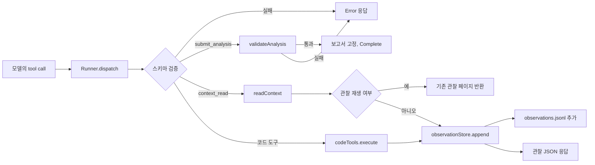

분석 도구와 관찰 기록, 제출 결과의 근거 검증을 다룬다.

## 도구 세트와 관찰 기록

Analysis 모델이 쓸 수 있는 도구는 여섯 개로 고정되어 있다. 템플릿 검증 함수가 목록을 하드코딩해 검사한다.

### 코드 분석: BehaviorTemplate.Validate

[behavior.go L57-L62](https://github.com/alibaba/open-code-review/blob/e74f2c6bd4422bd1e12d257d1725bcce1d6b9ddd/internal/config/template/behavior.go#L57-L62)

```go
	expected := []string{"code_search", "context_read", "file_find", "file_read", "file_read_diff", "submit_analysis"}
	actual := slices.Clone(tpl.MainTask.Tools)
	slices.Sort(actual)
	if !slices.Equal(actual, expected) || !slices.Equal(tpl.FinalRound.Tools, []string{"submit_analysis"}) || len(tpl.MemoryCompressionTask.Tools) != 0 {
		return fmt.Errorf("behavior template has invalid tool bindings")
	}
```

Review 템플릿(5장)은 사용자가 도구 목록을 바꿀 수 있지만, Behavior 템플릿은 도구 집합이 다르면 로드 자체가 실패한다. MCP 도구도 붙지 않는다. 메인 대화는 여섯 개, 마지막 라운드는 `submit_analysis` 하나, 압축 대화는 도구 없음이라는 세 가지 조합만 허용된다.

| 도구 | 역할 | 관찰 기록 생성 | 주요 제한 |
|---|---|---|---|
| `file_read` | old 또는 new 쪽 파일 읽기 | 예 | 허용 목록 밖이면 `unavailable` |
| `code_search` | old 또는 new 쪽 텍스트 검색 | 예 | 일치 줄 100개 |
| `file_find` | 파일 이름 검색 | 예 | 경로 100개 |
| `file_read_diff` | 변경 파일의 patch 읽기 | 예 | 범위 목록의 diff만 |
| `context_read` | 배경, 목록 색인, 이전 관찰 읽기 | 관찰 재생은 아니오 | 기본 16 KiB, 최대 64 KiB |
| `submit_analysis` | 보고서 제출과 고정 | 아니오 | 256 KiB |

`toolsconfig.WithComparisonSides`가 앞의 세 도구에 `side` 인자를 추가한다([runner.go L106](https://github.com/alibaba/open-code-review/blob/e74f2c6bd4422bd1e12d257d1725bcce1d6b9ddd/internal/behaviortask/runner.go#L106)). `side`를 생략하면 `new`로 처리된다.

### 코드 분석: 관찰 기록 저장

도구 실행 결과는 모델에게 그대로 전달되지 않는다. 먼저 `Observation` 구조체로 감싸 `observations.jsonl`에 추가하고, 저장된 JSON 문자열이 도구 응답이 된다.

[observation.go L80-L83](https://github.com/alibaba/open-code-review/blob/e74f2c6bd4422bd1e12d257d1725bcce1d6b9ddd/internal/behaviortask/observation.go#L80-L83)

```go
	observation.ID = fmt.Sprintf("obs-%06d", len(store.items)+1)
	observation.ComparisonID = store.comparisonID
	observation.ContentHash = contentHash(observation.ReturnedContent)
	observation.Locations = compactLocations(observation.Locations)
```

뒤이어 JSON 한 줄을 `O_APPEND`로 파일 끝에 쓰고, 파일 내 오프셋과 길이를 기록한 다음 메모리 쪽 사본의 `ReturnedContent`를 비운다([observation.go L84-L104](https://github.com/alibaba/open-code-review/blob/e74f2c6bd4422bd1e12d257d1725bcce1d6b9ddd/internal/behaviortask/observation.go#L84-L104)).

- ID는 `obs-000001`부터 순서대로 붙는다. 모델은 도구 응답 JSON 안의 `observation_id`를 보고 인용한다.
- 메모리에는 본문(`ReturnedContent`)을 지운 기록만 남기고, 파일 내 오프셋과 길이(`section`)를 따로 보관한다. 긴 조사에서도 메모리 사용이 관찰 본문 크기에 비례해 늘지 않는다.
- 파일 쓰기가 실패하면 `dispatch`는 `llmloop.Fail`을 돌려 조사 전체를 멈춘다([runner.go L408-L411](https://github.com/alibaba/open-code-review/blob/e74f2c6bd4422bd1e12d257d1725bcce1d6b9ddd/internal/behaviortask/runner.go#L408-L411)). README의 "Persistence failures stop the task rather than accepting evidence that cannot be recovered"와 같은 규칙이다.

`Observation` 구조체는 도구 이름, 정규화된 인자, 비교 ID, 쪽(old 또는 new), SHA, 위치 목록, 본문 해시, 잘림 여부, 이어 읽기 안내, 오류 분류를 담는다([observation.go L32-L47](https://github.com/alibaba/open-code-review/blob/e74f2c6bd4422bd1e12d257d1725bcce1d6b9ddd/internal/behaviortask/observation.go#L32-L47)). 위치 목록은 `file_read`와 `code_search` 출력의 `N|` 줄 번호 접두어에서 추출하고, `file_read_diff`는 hunk 범위에서 old와 new 위치를 함께 만든다([code.go L223-L254](https://github.com/alibaba/open-code-review/blob/e74f2c6bd4422bd1e12d257d1725bcce1d6b9ddd/internal/behaviortask/code.go#L223-L254)).

`compactLocations`는 위치를 쪽, SHA, 경로, 시작 줄 순으로 정렬한 뒤, 같은 쪽과 같은 경로에서 `StartLine <= EndLine+1`로 이어지는 줄만 한 범위로 합친다([observation.go L132-L158](https://github.com/alibaba/open-code-review/blob/e74f2c6bd4422bd1e12d257d1725bcce1d6b9ddd/internal/behaviortask/observation.go#L132-L158)). 검색 결과처럼 떨어진 줄 사이의 빈칸은 합치지 않는다. 사람이 위치 목록을 볼 때 실제로 보지 않은 줄이 범위에 섞이지 않는다.

### 코드 분석: code_search의 일치 줄 상한

`code_search`는 검색 대상 경로를 먼저 `git ls-files --with-tree=<rev>`로 나열하고 허용 목록과 교차시킨 뒤, 배치마다 기존 검색 provider를 호출한다. 결과를 합치면서 일치 줄 수를 센다.

일치 줄을 하나 받을 때마다 그 줄이 속한 파일이 허용 목록에 있는지 확인하고, 상한 `searchMatchLimit`에 도달하면 더 받지 않고 `truncated`를 켠다([search.go L136-L142](https://github.com/alibaba/open-code-review/blob/e74f2c6bd4422bd1e12d257d1725bcce1d6b9ddd/internal/behaviortask/search.go#L136-L142)).

`searchMatchLimit`는 100이다([search.go L18](https://github.com/alibaba/open-code-review/blob/e74f2c6bd4422bd1e12d257d1725bcce1d6b9ddd/internal/behaviortask/search.go#L18)). 상한에 도달하면 응답 앞에 "Note: Showing the first 100 matches"를 붙이고 관찰 기록의 `Truncated`가 참이 된다. 줄 단위로 허용 목록을 다시 확인하므로, provider가 허용되지 않은 파일의 줄을 돌려줘도 응답에 들어가지 않는다. README는 "The adapter does not invent total search counts"라고 적는다. 잘린 경우 전체 일치 수를 추정해 보여 주지 않는다는 뜻이다.

`file_find`도 같은 방식으로 101개까지 찾은 뒤 100개를 넘으면 잘림 표시를 한다([code.go L170-L191](https://github.com/alibaba/open-code-review/blob/e74f2c6bd4422bd1e12d257d1725bcce1d6b9ddd/internal/behaviortask/code.go#L170-L191)).

### context_read와 페이지 단위 조회

`context_read`는 세 종류의 자료를 읽는다. 사용자가 `--background`로 넘긴 배경 자료, prompt에 다 들어가지 않을 때 따로 빼 둔 목록 색인(`inventory`), 그리고 이미 기록된 관찰이다. 기본 페이지 크기는 16384바이트다([context.go L13-L17](https://github.com/alibaba/open-code-review/blob/e74f2c6bd4422bd1e12d257d1725bcce1d6b9ddd/internal/behaviortask/context.go#L13-L17)).

[observation.go L185-L188](https://github.com/alibaba/open-code-review/blob/e74f2c6bd4422bd1e12d257d1725bcce1d6b9ddd/internal/behaviortask/observation.go#L185-L188)

```go
	end := min(len(content), cursor+maxBytes)
	for end < len(content) && !utf8.RuneStart(content[end]) {
		end--
	}
```

cursor는 UTF-8 바이트 오프셋이다. 페이지 끝이 다중 바이트 문자 중간이면 문자 시작점까지 물러나므로, 한국어나 중국어 문서도 글자가 깨지지 않는다. 최소값 4는 UTF-8 문자 하나의 최대 길이다.

관찰 재생(`kind: "observation"`)은 새 관찰 ID를 만들지 않는다([runner.go L401-L407](https://github.com/alibaba/open-code-review/blob/e74f2c6bd4422bd1e12d257d1725bcce1d6b9ddd/internal/behaviortask/runner.go#L401-L407)). 압축으로 대화에서 사라진 증거를 다시 확인할 때 쓰며, 같은 증거가 두 ID로 인용되는 일을 막는다. 외부 자료는 가져올 수 없다. 요청한 kind와 ID가 없으면 "no external fetch is permitted" 오류가 난다.



## 제출 검증과 인용 규칙

조사는 `submit_analysis`가 받아들여질 때 끝난다. 산문만 출력하고 도구를 호출하지 않으면 `EmptyResponseMessage`로 "prose alone does not complete the analysis"라는 안내가 다시 주입된다([runner.go L160](https://github.com/alibaba/open-code-review/blob/e74f2c6bd4422bd1e12d257d1725bcce1d6b9ddd/internal/behaviortask/runner.go#L160)).

### 코드 분석: dispatch의 제출 처리

`dispatch`는 모든 도구 호출에 대해 공통으로 세 가지를 확인한다. 이미 고정된 보고서가 있는지, 알려지지 않은 인자가 있는지, JSON 스키마를 만족하는지다. 그 뒤 `submit_analysis`를 처리한다.

[runner.go L367-L381](https://github.com/alibaba/open-code-review/blob/e74f2c6bd4422bd1e12d257d1725bcce1d6b9ddd/internal/behaviortask/runner.go#L367-L381)

```go
	if name == "submit_analysis" {
		var analysis Analysis
		if err := json.Unmarshal([]byte(raw), &analysis); err != nil {
			return llmloop.ToolOutcome{}, err
		}
		if analysis.DeclaredCompletion == "" {
			analysis.DeclaredCompletion = "unknown"
		}
		if err := runner.validateAnalysis(analysis); err != nil {
			return llmloop.ToolOutcome{}, err
		}
		runner.analysis = &analysis
		runner.submissionStatus = "accepted"
		return llmloop.ToolOutcome{Content: "Analysis accepted and frozen.", Action: llmloop.Complete}, nil
	}
```

- 제출 시도가 들어오면 그 순간 `submissionStatus`를 `rejected`로 바꿔 두고([runner.go L352-L354](https://github.com/alibaba/open-code-review/blob/e74f2c6bd4422bd1e12d257d1725bcce1d6b9ddd/internal/behaviortask/runner.go#L352-L354)), 검증을 통과해야 `accepted`가 된다. 최종 결과의 `submission_status`는 `not_submitted`, `rejected`, `accepted` 중 하나다.
- 검증 실패는 도구 오류 응답으로 돌아가므로, 모델은 같은 대화 안에서 고쳐 다시 제출할 수 있다.
- 한 번 받아들여지면 이후 모든 도구 호출이 "the first accepted analysis is frozen"으로 거부된다([runner.go L345-L347](https://github.com/alibaba/open-code-review/blob/e74f2c6bd4422bd1e12d257d1725bcce1d6b9ddd/internal/behaviortask/runner.go#L345-L347)).

### 코드 분석: validateAnalysis

[validate.go L38-L46](https://github.com/alibaba/open-code-review/blob/e74f2c6bd4422bd1e12d257d1725bcce1d6b9ddd/internal/behaviortask/validate.go#L38-L46)

```go
	if strings.Contains(observationCitation.ReplaceAllString(analysis.Markdown, ""), "[[obs-") {
		return fmt.Errorf("malformed observation citation; use [[obs-000001]] with an actual observation ID")
	}
	for _, id := range citedObservations(analysis.Markdown) {
		observation, exists := runner.store.get(id)
		if !exists || observation.ErrorClass != "" {
			return fmt.Errorf("cited observation %q is missing or failed", id)
		}
	}
```

그 앞의 두 검사는 본문 크기와 `declared_completion` 값이다([validate.go L30-L37](https://github.com/alibaba/open-code-review/blob/e74f2c6bd4422bd1e12d257d1725bcce1d6b9ddd/internal/behaviortask/validate.go#L30-L37)). 검증 항목은 모두 네 가지다.

| 검증 항목 | 기준 |
|---|---|
| 본문 크기 | 공백만 있으면 거부, `MaxReportBytes`(256 KiB) 초과면 거부 |
| 자기 평가 값 | `complete`, `partial`, `unknown` 또는 생략 |
| 인용 형식 | `[[obs-` 로 시작하지만 정규식 `\[\[(obs-[0-9]+)\]\]`에 맞지 않는 표기가 있으면 거부 |
| 인용 대상 | 이번 실행에 존재하고 오류 분류가 없는 관찰만 허용 |

인용 형식 검사는 코드 블록 안도 예외로 두지 않는다. README가 "Markers are reserved even inside code blocks"라고 적은 이유다. 보고서 안에 `` `[[obs-x]]` `` 같은 예시를 넣으면 형식 오류로 거부된다.

README와 프롬프트는 이 검증이 하지 않는 일을 명확히 적는다. 문장마다 근거가 있는지, 산문에 적은 줄 위치가 맞는지, old와 new를 바르게 구분했는지, 인과 관계와 실행 주장이 맞는지는 검사하지 않는다. 시스템 프롬프트도 모델에게 같은 내용을 알린다.

```markdown
- Cite observations using the literal marker [[obs-000001]], replacing the ID with one actually returned by a tool. Describe old/new sides and source locations in prose where helpful. The program checks only that cited observations exist and did not fail; it does not verify your interpretation, prose locations, or claims of execution.
```

출처: [prompts/behavior_system.md L10](https://github.com/alibaba/open-code-review/blob/e74f2c6bd4422bd1e12d257d1725bcce1d6b9ddd/internal/config/template/prompts/behavior_system.md#L10)

즉 인용 검증은 "존재하지 않는 증거를 만들어 내는 것"만 막는다. 실제 근거 판단은 사람이 `observations.jsonl`과 세션 뷰어의 Evidence 영역을 보고 한다. 인용하지 않은 보고서도 허용되며, 이때 `cited_observation_ids`는 빈 목록이다.

### 보고서 형식 지시

보고서 구조는 스키마로 강제하지 않고 프롬프트로만 지시한다. 프롬프트가 요구하는 형식은 다음과 같다.

- 첫 문장에 결론을 둔다. 영향받는 사용자 흐름을 문장으로 쓰고, 명령 호출이나 두 번째 제목으로 시작하지 않는다.
- 근거가 있는 전후 시나리오가 두 개 이상이면 결론 바로 뒤에 `Scenario | Before | After` 열의 표를 둔다. 하나뿐이면 표를 만들지 않는다.
- 검증 근거와 남은 공백은 한 메모로 모은다. 소스에서 본 테스트와 실제 실행 결과를 구분한다.
- 조치가 필요할 때만 `## Pre-merge maintainer decisions` 절을 둔다. 항목은 Required fix, Acceptance check, Maintainer choice 세 종류다.

출처: [prompts/behavior_system.md L22-L48](https://github.com/alibaba/open-code-review/blob/e74f2c6bd4422bd1e12d257d1725bcce1d6b9ddd/internal/config/template/prompts/behavior_system.md#L22-L48)

Required fix는 "a demonstrated violation"에만 쓰라고 제한한다. 가능성만 있는 위험이나 의도된 변경은 필수 수정으로 올리지 않는다. 라인 단위 리뷰 결과에 대해서는 "Do not assume access to the separate review's findings"라고 적어, 두 작업이 서로의 결과를 모른다는 점을 모델에게도 알린다.
