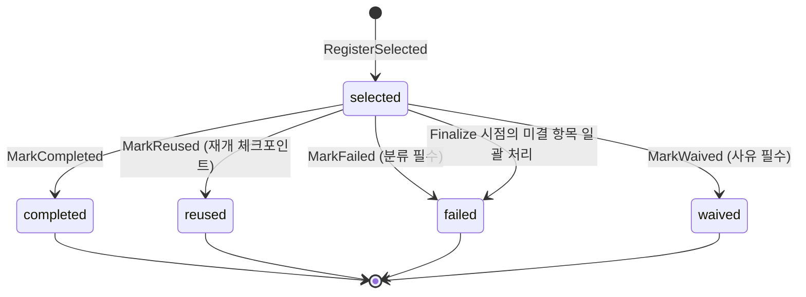

세션 JSONL 레코드 종류와 실행 manifest의 커버리지 기록을 다룬다.

## JSONL 레코드 종류

`jsonlWriter`는 레코드를 한 줄에 하나씩 쓰고, 모든 레코드에 `uuid`와 직전 레코드를 가리키는 `parentUuid`를 붙인다([persist.go L26-L43](https://github.com/alibaba/open-code-review/blob/e74f2c6bd4422bd1e12d257d1725bcce1d6b9ddd/internal/session/persist.go#L26-L43)). 레코드는 아래 여덟 종류다.

| `type` | 쓰는 시점 | 주요 필드 |
|---|---|---|
| `session_start` | 세션 생성 직후 | `cwd`, `gitBranch`, `model`, `llmSource`, `reviewMode`, `diffFrom`, `diffTo`, `diffCommit`, `scanPaths`, `resumedFrom` |
| `llm_request` | LLM 호출 직전 | `filePath`(묶음 키), `taskType`, `request_no`, `messages` |
| `llm_response` | 응답 수신 후 | `content`, `reasoning`, tool call, `usage`, `duration_ms`, 원형 payload |
| `llm_error` | 호출 실패 | 오류 문자열, 걸린 시간 |
| `tool_call` | 도구 실행 후 | `tool_name`, `arguments`, `result`, `ok` |
| `review_item_done`, `review_item_reused`, `review_item_failed` | 파일 하나의 결과 확정 | `filePath`, `oldPath`, `newPath`, `fingerprint`, `comments`, `error` |
| `resume_lineage` | 재개 실행 시작 | 부모 실행 ID, 이전과 현재의 provider, model |
| `session_end` | 실행 종료 | `files_reviewed`, `duration_seconds`, `llm_failures`, `run_manifest` |

`taskType`은 `plan_task`, `main_task`, `memory_compression_task`, `re_location_task`, `review_filter_task`, `grouping_task` 중 하나다([history.go L24-L31](https://github.com/alibaba/open-code-review/blob/e74f2c6bd4422bd1e12d257d1725bcce1d6b9ddd/internal/session/history.go#L24-L31)). 각 작업의 역할은 6장, 7장, 9장에서 다룬다.

### 코드 분석: 체크포인트 레코드

파일: `internal/session/persist.go`, [persist.go L217-L241](https://github.com/alibaba/open-code-review/blob/e74f2c6bd4422bd1e12d257d1725bcce1d6b9ddd/internal/session/persist.go#L217-L241)

파일 단위 결과를 남기는 세 레코드는 하나의 함수로 쓴다.

```go
	rec := map[string]any{
		"uuid":        uuid,
		"parentUuid":  jw.lastUUID,
		"type":        recordType,
		"sessionId":   jw.sessionID,
		"timestamp":   time.Now().UTC().Format(time.RFC3339),
		"filePath":    filePath,
		"oldPath":     oldPath,
		"newPath":     newPath,
		"fingerprint": fingerprint,
		"model":       jw.model,
	}
	if len(comments) > 0 {
		rec["comments"] = comments
	}
	if sourceSessionID != "" {
		rec["sourceSessionId"] = sourceSessionID
	}
	if errorMsg != "" {
		rec["error"] = errorMsg
	}
	jw.writeRecordLocked(rec)
	if jw.writer != nil {
		jw.writer.Flush()
	}
```

`fingerprint`는 diff 내용을 포함한 지문이고, 재개할 때 이 값으로 체크포인트를 찾는다. 이 레코드는 쓰자마자 `Flush`한다. 반면 `llm_request`, `llm_response`, `tool_call`은 `bufio.Writer`에 쌓였다가 다음 flush 때 디스크에 기록된다. 프로세스가 중간에 죽으면 대화 기록 일부는 잃을 수 있어도, 끝난 파일의 결과는 남게 하려는 우선순위다. `resume_lineage`도 같은 이유로 바로 flush한다는 주석이 [persist.go L378-L384](https://github.com/alibaba/open-code-review/blob/e74f2c6bd4422bd1e12d257d1725bcce1d6b9ddd/internal/session/persist.go#L378-L384)에 있다.

`session_end`는 마지막 레코드이며 파일도 함께 닫는다. 이 레코드만은 직렬화나 쓰기 실패를 삼키지 않고 오류로 돌려준다([persist.go L395-L444](https://github.com/alibaba/open-code-review/blob/e74f2c6bd4422bd1e12d257d1725bcce1d6b9ddd/internal/session/persist.go#L395-L444)). 실행 manifest가 이 레코드 안의 `run_manifest`에만 실리기 때문이다.

## 실행 manifest와 커버리지

리뷰 세션(`Operation`이 `review`)은 종료 시 `RunManifest`를 하나 만든다. 스키마는 `ocr.run-manifest/v1`이고, CLI JSON 출력과 세션 파일에 같은 객체가 들어간다([manifest.go L288-L304](https://github.com/alibaba/open-code-review/blob/e74f2c6bd4422bd1e12d257d1725bcce1d6b9ddd/internal/session/manifest.go#L288-L304)). manifest의 핵심은 "어떤 파일을 리뷰하기로 했고, 각각 어떻게 끝났는가"를 기록한 커버리지다. 스캔 세션은 manifest를 만들지 않는다.



| 커버리지 집합 | 의미 |
|---|---|
| `selected` | 리뷰하기로 한 파일 전체. 분모이며 아래 네 집합의 합과 같다 |
| `completed`, `reused` | 이번 실행이 결론을 낸 파일. `reused`는 재개로 이전 결과를 이어받은 파일 |
| `failed` | 실패한 파일. `provider`, `timeout`, `cancelled`, `budget` 등 분류가 붙는다 |
| `waived` | 의도적으로 건너뛴 파일. 사유가 필수다 |
| `excluded` | 선별 단계(4장)에서 빠진 파일. 분모 밖이며 지문을 저장하지 않는다 |

[`transition`](https://github.com/alibaba/open-code-review/blob/e74f2c6bd4422bd1e12d257d1725bcce1d6b9ddd/internal/session/manifest.go#L618-L672)은 모든 상태 전이의 단일 진입점이다. 모르는 항목, 이미 다른 상태로 끝난 항목, 고정(freeze) 이후의 호출은 조용히 무시하지 않고 오류로 돌려준다. 같은 상태를 다시 적용하는 것만 허용하되, `failed`의 분류가 다르면 오류다. 실패 사유는 [`sanitizeReason`](https://github.com/alibaba/open-code-review/blob/e74f2c6bd4422bd1e12d257d1725bcce1d6b9ddd/internal/session/manifest.go#L721-L746)을 거치며 URL 안의 사용자 정보, Bearer 토큰, `api_key=` 같은 할당 값을 `[REDACTED]`로 바꾸고 500자로 자른다.

### 코드 분석: 항목 ID

파일: `internal/session/manifest.go`, [manifest.go L201-L212](https://github.com/alibaba/open-code-review/blob/e74f2c6bd4422bd1e12d257d1725bcce1d6b9ddd/internal/session/manifest.go#L201-L212)

커버리지 항목의 식별자는 diff 내용과 무관하게 만든다.

```go
func ItemID(operation, mode, oldPath, newPath string) string {
	// NUL-join the identity fields. Paths never contain NUL and operation/mode
	// are controlled enums, so this join is unambiguous.
	key := strings.Join([]string{
		operation,
		mode,
		normalizePath(oldPath),
		normalizePath(newPath),
	}, "\x00")
	sum := sha256.Sum256([]byte(key))
	return hex.EncodeToString(sum[:])
}
```

같은 파일이면 diff가 바뀌어도 `item_id`가 같다. 그래서 manifest에는 두 식별자가 함께 있다. `item_id`는 재개 체인 전체에서 파일을 가리키는 논리 식별자이고, `fingerprint`는 diff 내용까지 포함해 "이 체크포인트를 그대로 써도 되는가"를 판단하는 값이다. 입력 모드가 키에 들어가므로 range 세션의 항목과 commit 세션의 항목은 나란히 비교할 수 없다.

### 코드 분석: 종료 상태 계산

파일: `internal/session/manifest.go`, [manifest.go L1009-L1026](https://github.com/alibaba/open-code-review/blob/e74f2c6bd4422bd1e12d257d1725bcce1d6b9ddd/internal/session/manifest.go#L1009-L1026)

실행 전체의 결과는 커버리지와 실행 실패 여부만으로 정한다.

```go
func computeTerminal(cov Coverage, rf *RunFailure) TerminalState {
	if rf != nil {
		return StateFailed
	}
	selected := len(cov.Selected)
	if selected == 0 {
		return StateSkipped
	}
	failed := len(cov.Failed)
	switch {
	case failed == 0:
		return StateComplete
	case failed == selected:
		return StateFailed
	default:
		return StatePartial
	}
}
```

코멘트 수나 경고 수는 결과에 영향을 주지 않는다. `Finalize`는 이 계산 전에 아직 `selected`로 남은 항목을 모두 `failed`로 바꾸는 일괄 처리를 한다([manifest.go L811-L851](https://github.com/alibaba/open-code-review/blob/e74f2c6bd4422bd1e12d257d1725bcce1d6b9ddd/internal/session/manifest.go#L811-L851)). 분류는 실행 실패가 기록돼 있으면 그 분류, 의도적인 중단 사유가 있으면 그 사유, 둘 다 없으면 `unknown`이다. 일찍 끝난 goroutine이나 취소 때문에 결과 없이 남은 파일이 "성공"으로 집계되지 않게 하는 안전장치다.
