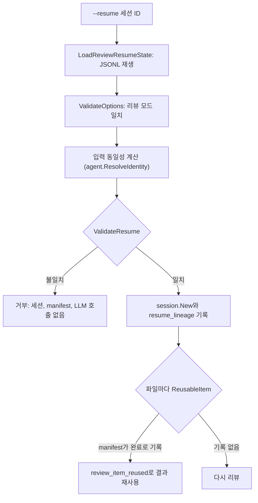

재개 시 동일성 판정과 세션 조회, 비교, 삭제 명령을 다룬다.

## 재개 시 동일성 판정

`ocr review --resume <session-id>`는 이전 세션의 체크포인트를 읽어 끝난 파일을 다시 리뷰하지 않는다. 문제는 "이전 결과가 지금 입력에도 유효한가"다. OCR은 이 판단을 부분적으로 하지 않는다. 하나라도 어긋나면 재개 전체를 거부하고 새 리뷰를 시작하라고 안내한다.



### 코드 분석: 체크포인트 재생

파일: `internal/session/resume.go`, [resume.go L160-L181](https://github.com/alibaba/open-code-review/blob/e74f2c6bd4422bd1e12d257d1725bcce1d6b9ddd/internal/session/resume.go#L160-L181)

JSONL을 처음부터 다시 읽으며 지문별 색인을 만든다.

```go
	switch rec.Type {
	case "session_start":
		s.applySessionStart(rec)
	case "review_item_done", "review_item_reused":
		if rec.Fingerprint == "" {
			return nil
		}
		filePath := rec.FilePath
		if filePath == "" {
			filePath = rec.NewPath
		}
		s.Items[rec.Fingerprint] = ResumeItem{
			FilePath:    filePath,
			OldPath:     rec.OldPath,
			NewPath:     rec.NewPath,
			Fingerprint: rec.Fingerprint,
			Comments:    copyLlmComments(rec.Comments),
		}
	case "review_item_failed":
		if rec.Fingerprint != "" {
			delete(s.Items, rec.Fingerprint)
		}
```

나중 레코드가 앞 레코드를 덮고, 실패 레코드는 앞선 완료 기록을 지운다. 줄바꿈 없이 끝난 마지막 줄은 쓰다 끊긴 레코드로 보고 버린다([resume.go L129-L134](https://github.com/alibaba/open-code-review/blob/e74f2c6bd4422bd1e12d257d1725bcce1d6b9ddd/internal/session/resume.go#L129-L134)). 리뷰 재개는 `LoadReviewResumeState`로 읽어 파싱할 수 없는 줄을 건너뛰고, 스캔 재개는 `LoadResumeState`로 읽어 그런 줄이 있으면 실패한다. 리뷰는 아래의 manifest 확인이 한 번 더 있으므로 줄 하나를 잃어도 그 파일을 다시 리뷰할 뿐이지만, 스캔에는 그 확인이 없기 때문이다.

### 코드 분석: manifest가 보증한 체크포인트만 재사용

파일: `internal/session/resume.go`, [resume.go L244-L255](https://github.com/alibaba/open-code-review/blob/e74f2c6bd4422bd1e12d257d1725bcce1d6b9ddd/internal/session/resume.go#L244-L255)

체크포인트 줄이 있어도 부모 manifest가 그 지문을 완료로 기록하지 않았으면 재사용하지 않는다.

```go
func (s *ResumeState) ReusableItem(fingerprint string) (ResumeItem, bool) {
	if s == nil || s.Manifest == nil {
		return ResumeItem{}, false
	}
	if s.reusable == nil {
		s.reusable = manifestReusableFingerprints(s.Manifest)
	}
	if !s.reusable[fingerprint] {
		return ResumeItem{}, false
	}
	return s.Item(fingerprint)
}
```

manifest의 `completed`와 `reused` 두 집합이 재사용 가능한 지문이다. 부모가 재개 실행이었다면 그 부모가 이어받은 결과도 최종 결과로 친다. 체크포인트 줄과 manifest가 어긋나는 경우, 예를 들어 `review_item_failed` 줄이 유실된 경우에도 manifest가 실패를 따로 기록하므로 잘못 재사용하지 않는다.

### 코드 분석: 입력과 실행 대상 비교

파일: `internal/session/resume_identity.go`, [resume_identity.go L76-L87](https://github.com/alibaba/open-code-review/blob/e74f2c6bd4422bd1e12d257d1725bcce1d6b9ddd/internal/session/resume_identity.go#L76-L87)

`ValidateResume`의 마지막 단계는 provider와 model의 변경 여부다.

```go
	m := s.Manifest
	providerChanged := m.Execution.Provider != req.Provider
	if providerChanged && !req.ProviderExplicit {
		return fmt.Errorf("resume rejected: provider changed from %q to %q without being asked for; %s to resume across providers on purpose", m.Execution.Provider, req.Provider, explicitFlagHint("--provider", req.Provider))
	}
	// Model is only compared within the same provider: switching provider on
	// purpose necessarily brings that provider's own model with it.
	if !providerChanged && m.Execution.Model != req.Model && !req.ModelExplicit {
		return fmt.Errorf("resume rejected: model changed from %q to %q without being asked for; %s to resume across models on purpose", m.Execution.Model, req.Model, explicitFlagHint("--model", req.Model))
	}
	return nil
}
```

설정 파일이나 환경변수가 바뀌어 모델이 달라진 것은 "암묵적 전환"으로 보고 거부한다. 같은 명령줄에 `--provider`나 `--model`을 직접 쓴 경우만 의도된 전환으로 인정하고, 이 전환은 `resume_lineage` 레코드에 이전과 이후 값으로 남는다. 한 보고서 안에 서로 다른 모델이 낸 결과가 섞일 때 그 사실이 기록에서 사라지지 않게 하려는 규칙이다.

그 앞의 입력 비교([resume_identity.go L99-L151](https://github.com/alibaba/open-code-review/blob/e74f2c6bd4422bd1e12d257d1725bcce1d6b9ddd/internal/session/resume_identity.go#L99-L151))는 아래 순서로 첫 불일치에서 멈춘다.

| 순서 | 확인 항목 | 거부 이유 |
|---|---|---|
| 1 | 부모 manifest 존재 | 중단돼 `session_end`가 없거나 manifest 없이 끝난 세션은 입력을 검증할 수 없음 |
| 2 | manifest 스키마, operation | 다른 스키마 버전이나 리뷰가 아닌 실행 |
| 3 | `selected`가 비어 있지 않음 | 빈 부모와 빈 자식은 지문이 같아 아무것도 하지 않는 실행이 통과함 |
| 4 | 입력 모드 | 모드가 `item_id`에 들어가므로 항목을 비교할 수 없음 |
| 5 | 저장소 식별 해시 | 원격 저장소 정보로 만든 해시. 다른 저장소 |
| 6 | 입력 산출물 해시 (`source_artifact_sha256`) | ref가 다른 커밋을 가리키거나 선택된 파일 집합, 작업 트리 변경이 달라짐 |
| 7 | 규칙 설정 해시 (`rule_config_sha256`) | 규칙 텍스트 계층이나 include, exclude 필터 변경 (5장) |
| 8 | 비교 끝점 (range, commit) 또는 기준 커밋 (workspace) | 해석된 커밋 SHA가 달라짐 |
| 9 | provider, model | 명시 플래그 없이 바뀜 |

규칙 해시보다 입력 해시를 먼저 비교하는 데에도 이유가 있다. 파일 필터를 바꾸면 선택된 파일 집합이 바뀌어 입력 해시도 달라지는데, 규칙 해시는 여러 계층을 합친 값이라 어느 규칙이 바뀌었는지 분해할 수 없다. 입력을 먼저 보면 "선택된 파일이 바뀌었다"는 구체적인 원인으로 보고할 수 있다고 [resume_identity.go L46-L51](https://github.com/alibaba/open-code-review/blob/e74f2c6bd4422bd1e12d257d1725bcce1d6b9ddd/internal/session/resume_identity.go#L46-L51)의 주석이 설명한다.

> **주의**: README의 Quick Start는 재개를 "Resume an interrupted range or commit review"로 소개한다. 코드는 workspace 모드도 받는다. [`ValidateOptions`](https://github.com/alibaba/open-code-review/blob/e74f2c6bd4422bd1e12d257d1725bcce1d6b9ddd/internal/session/resume.go#L278-L297)가 `range`, `commit`, `workspace`를 허용하고, workspace는 기준 커밋과 작업 트리 변경 해시가 같을 때만 재개된다. CLI Reference 문서는 세 모드를 모두 적고 있어 코드와 맞다. workspace 재개는 시작 시점에 한 번만 확인하므로, 재개 실행 도중 작업 트리를 고치는 것은 보장 범위 밖이라고 코드 주석이 밝힌다.

## 세션 조회, 비교, 삭제 명령

`ocr session` 하위 명령은 모두 세션 JSONL을 읽기만 하거나(`rm` 제외) 파일 단위로 지운다.

| 명령 | 역할 | 구현 |
|---|---|---|
| `ocr session list` | 현재 저장소의 세션 목록 (기본 20개, `--branch` 필터) | [session_cmd.go L274-L312](https://github.com/alibaba/open-code-review/blob/e74f2c6bd4422bd1e12d257d1725bcce1d6b9ddd/cmd/opencodereview/session_cmd.go#L274-L312) |
| `ocr session show <id>` | 세션 요약과 파일별 체크포인트 상태. 기본으로 모든 저장소에서 ID를 찾음 | [session_cmd.go L314-L371](https://github.com/alibaba/open-code-review/blob/e74f2c6bd4422bd1e12d257d1725bcce1d6b9ddd/cmd/opencodereview/session_cmd.go#L314-L371) |
| `ocr session comments <id>` | 코멘트만 출력. 심각도, 분류 필터 | [session_cmd.go L373-L405](https://github.com/alibaba/open-code-review/blob/e74f2c6bd4422bd1e12d257d1725bcce1d6b9ddd/cmd/opencodereview/session_cmd.go#L373-L405) |
| `ocr session compare <before> <after>` | 두 실행의 지적 비교 | [session_cmd.go L407-L440](https://github.com/alibaba/open-code-review/blob/e74f2c6bd4422bd1e12d257d1725bcce1d6b9ddd/cmd/opencodereview/session_cmd.go#L407-L440) |
| `ocr session export [id]` | 뷰어 화면을 단일 HTML 파일로 저장 | [session_cmd.go L238-L272](https://github.com/alibaba/open-code-review/blob/e74f2c6bd4422bd1e12d257d1725bcce1d6b9ddd/cmd/opencodereview/session_cmd.go#L238-L272) |
| `ocr session rm <id>` | 세션과 딸린 analysis 디렉터리 삭제. 확인 후 실행 | [session_cmd.go L544-L600](https://github.com/alibaba/open-code-review/blob/e74f2c6bd4422bd1e12d257d1725bcce1d6b9ddd/cmd/opencodereview/session_cmd.go#L544-L600) |

코멘트 목록은 [`LoadComments`](https://github.com/alibaba/open-code-review/blob/e74f2c6bd4422bd1e12d257d1725bcce1d6b9ddd/internal/session/comments.go#L17-L70)가 재개와 같은 규칙으로 재생해서 만든다. 같은 지문의 나중 체크포인트가 앞 것을 대체하고, 실패 레코드가 오면 그 지문의 코멘트를 비운다. 화면과 재개가 같은 결과 집합을 보게 하려는 일치다.

### 코드 분석: 두 실행의 지적 비교

파일: `internal/session/compare.go`, [compare.go L46-L64](https://github.com/alibaba/open-code-review/blob/e74f2c6bd4422bd1e12d257d1725bcce1d6b9ddd/internal/session/compare.go#L46-L64)

이전 실행의 지적을 하나씩 꺼내 이후 실행의 지적 묶음과 맞춘다.

```go
	for _, c := range before {
		path := normalizePath(c.Path)
		if newPath, ok := renamed[path]; ok {
			path = newPath
		}
		k := findingKey(c, path)
		if matches := pool[k]; len(matches) > 0 {
			res.Persisting = append(res.Persisting, matches[0])
			pool[k] = matches[1:]
			continue
		}
		// A path-less finding cannot be attributed to any reviewed file, so it
		// falls out here as not-reviewed rather than being claimed as fixed.
		if reviewed != nil && !reviewed[path] {
			res.NotReviewed = append(res.NotReviewed, c)
			continue
		}
		res.Resolved = append(res.Resolved, c)
	}
```

결과는 New, Persisting, Resolved, Not reviewed 네 묶음이다. 같은 지적인지 판단하는 키([`findingKey`](https://github.com/alibaba/open-code-review/blob/e74f2c6bd4422bd1e12d257d1725bcce1d6b9ddd/internal/session/compare.go#L87-L97))는 경로, 소문자 분류, 공백을 정규화한 `existing_code` 조각이며 줄 번호는 넣지 않는다. 코드가 몇 줄 밀려도 같은 지적으로 맞추기 위해서다. 조각이 없으면 코멘트 본문을 대신 쓰므로, 문구만 바뀐 지적은 Resolved와 New로 나뉜다.

Not reviewed 묶음이 이 비교의 핵심이다. 이후 실행에서 사라진 지적이라도, 이후 실행이 그 파일을 실제로 리뷰하지 않았다면 고쳐졌다고 볼 수 없다. "리뷰한 파일"은 이후 실행 manifest의 `completed`와 `reused`로만 판단하고 `selected`는 쓰지 않는다([compare.go L152-L164](https://github.com/alibaba/open-code-review/blob/e74f2c6bd4422bd1e12d257d1725bcce1d6b9ddd/internal/session/compare.go#L152-L164)). 중단된 실행이 손대지 못한 파일을 모두 "깨끗함"으로 보고하지 않게 하려는 것이다. 이름이 바뀐 파일은 manifest의 `old_path`와 `path`로 경로를 이어 준다. manifest가 없는 예전 세션이면 맞지 않은 지적을 모두 Resolved로 분류한다.

### 삭제의 경로 검증

`session rm`은 ID 하나로 지우는 명령이지만, 그 ID가 경로로 쓰이므로 검증이 여러 겹이다.

- [`ValidateSessionID`](https://github.com/alibaba/open-code-review/blob/e74f2c6bd4422bd1e12d257d1725bcce1d6b9ddd/internal/session/delete.go#L28-L38)가 `/`, `\`, `.`, `..`를 포함한 ID를 거부한다
- `--repo`를 주면 세션이 기록한 `cwd`와 그 저장소가 같은지 확인하고, `cwd`가 없는 세션은 검증할 수 없다며 거부한다
- `--repo` 없이 같은 ID가 여러 저장소에 있으면 목록을 보여 주고 지우지 않는다([session_cmd.go L544-L560](https://github.com/alibaba/open-code-review/blob/e74f2c6bd4422bd1e12d257d1725bcce1d6b9ddd/cmd/opencodereview/session_cmd.go#L544-L560))
- analysis 디렉터리는 `os.OpenRoot`로 연 루트 안에서만 `RemoveAll`한다([delete.go L96-L119](https://github.com/alibaba/open-code-review/blob/e74f2c6bd4422bd1e12d257d1725bcce1d6b9ddd/internal/session/delete.go#L96-L119)). symlink를 따라 세션 디렉터리 밖을 지우는 일을 막는다

> **주의**: `ocr session export`의 도움말 예시는 `20250601-100000-abc123` 같은 날짜 형식 ID를 쓰지만([session_cmd.go L114-L115](https://github.com/alibaba/open-code-review/blob/e74f2c6bd4422bd1e12d257d1725bcce1d6b9ddd/cmd/opencodereview/session_cmd.go#L114-L115)), 실제 세션 ID는 [`generateUUID`](https://github.com/alibaba/open-code-review/blob/e74f2c6bd4422bd1e12d257d1725bcce1d6b9ddd/internal/session/persist.go#L73-L84)가 만드는 UUID v4다. 같은 파일의 `rm` 예시는 UUID를 쓴다.
