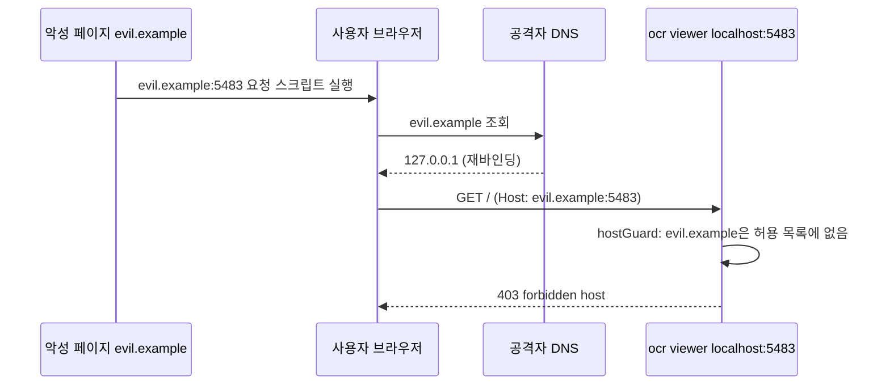
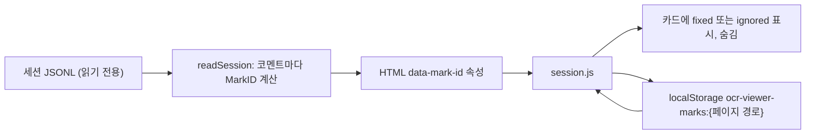

세션 뷰어 서버와 로컬 보안, 코멘트 상태 관리를 다룬다.

## 세션 뷰어 서버

`ocr viewer`는 `~/.opencodereview/sessions/`를 읽어 HTML로 보여 주는 로컬 웹 서버다. 기본 주소는 `localhost:5483`이고([viewer_cmd.go L37](https://github.com/alibaba/open-code-review/blob/e74f2c6bd4422bd1e12d257d1725bcce1d6b9ddd/cmd/opencodereview/viewer_cmd.go#L37)), 템플릿과 정적 파일은 `embed.FS`로 바이너리에 들어 있다. 별도 색인이나 데이터베이스 없이 요청마다 디렉터리와 JSONL을 다시 읽는다.

| 경로 | 화면 | 핸들러 |
|---|---|---|
| `GET /` | 세션이 있는 저장소 목록 | `handleRepos` |
| `GET /r/{repo}` | 저장소의 세션 목록 (최신순) | `handleSessions` |
| `GET /r/{repo}/{sessionID}` | 세션 상세. `?tab=analysis`이면 analysis 탭 | `handleSession` |
| `GET /r/{repo}/compare?before=&after=` | 두 세션 비교 (CLI와 같은 `session.Compare`) | `handleCompare` |
| `GET /static/` | 내장 CSS, JS | `http.FileServer` |

### 코드 분석: 처리기 사슬

파일: `internal/viewer/server.go`, [server.go L53-L61](https://github.com/alibaba/open-code-review/blob/e74f2c6bd4422bd1e12d257d1725bcce1d6b9ddd/internal/viewer/server.go#L53-L61)

라우터 바깥에 두 겹의 보호 계층을 씌운다.

```go
	// Wrap the mux with a Host-header allowlist. Without this, any web page
	// the user visits can DNS-rebind its origin to 127.0.0.1 and read the
	// session JSONL exposed by this viewer (which contains LLM request bodies
	// = source code being reviewed and the LLM's analysis of it).
	allowed := resolveAllowedHostsFromEnv(addr)
	guarded := hostGuard(allowed, mux)

	// Outermost layer: set defense-in-depth security headers on every response.
	handler := securityHeaders(guarded)
```

요청은 보안 헤더 설정, Host 헤더 검사, 라우터 순서로 지나간다. 보안 헤더가 가장 바깥이므로 Host 검사로 거부된 403 응답에도 헤더가 붙는다. 라우터는 모든 경로를 `GET` 패턴으로만 등록한다([server.go L106-L112](https://github.com/alibaba/open-code-review/blob/e74f2c6bd4422bd1e12d257d1725bcce1d6b9ddd/internal/viewer/server.go#L106-L112)). 다른 메서드는 핸들러에 도달하기 전에 `ServeMux`가 405로 돌려주며, 테스트 `TestMux_HasNoWriteRoutes`가 쓰기 경로가 없음을 확인한다. 뷰어가 세션 파일을 바꾸는 경로는 구조적으로 없다.

경로 조각은 [`unsafeSegment`](https://github.com/alibaba/open-code-review/blob/e74f2c6bd4422bd1e12d257d1725bcce1d6b9ddd/internal/viewer/server.go#L176-L178)가 `..`, `/`, `\`를 포함하면 거부한다. `ServeMux`는 `%2F`를 실제 `/`로 풀어서 넘기므로 이 검사가 필요하다. 비교 화면의 `before`, `after` 쿼리 값도 같은 검사를 거친다. `LoadSession`은 같은 검사를 하는 [`safeSegment`](https://github.com/alibaba/open-code-review/blob/e74f2c6bd4422bd1e12d257d1725bcce1d6b9ddd/internal/viewer/store.go#L460-L465)의 반환값으로 경로를 만든다. 검사한 값을 그대로 쓰게 해서 정적 분석 도구(CodeQL)가 경로 주입을 오탐하지 않게 하려는 형태라고 주석이 밝힌다. analysis 탭의 파일은 `os.OpenRoot`로 연 루트 안에서만 읽고, 보고서 Markdown은 bluemonday 정책으로 허용 태그만 남긴 뒤 렌더링한다([analysis.go L49-L57](https://github.com/alibaba/open-code-review/blob/e74f2c6bd4422bd1e12d257d1725bcce1d6b9ddd/internal/viewer/analysis.go#L49-L57)).

세션 상세 화면은 `session_end`가 나오기 전까지 세션을 "중단됨"(`Aborted`)으로 표시한다([store.go L489](https://github.com/alibaba/open-code-review/blob/e74f2c6bd4422bd1e12d257d1725bcce1d6b9ddd/internal/viewer/store.go#L489)). 실행 중인 세션을 열면 지금까지 기록된 부분까지만 보인다. 시각 표시는 사용자 시간대가 아니라 `Asia/Shanghai`(불러오지 못하면 UTC+8 고정)로 바꿔 출력한다([server.go L180-L190](https://github.com/alibaba/open-code-review/blob/e74f2c6bd4422bd1e12d257d1725bcce1d6b9ddd/internal/viewer/server.go#L180-L190)). 사용자 문서(Session Viewer)에는 이 시간대가 적혀 있지 않다.

`ocr session export`는 같은 템플릿에 CSS, JS를 인라인으로 넣어 단일 HTML을 만든다([export.go L27-L86](https://github.com/alibaba/open-code-review/blob/e74f2c6bd4422bd1e12d257d1725bcce1d6b9ddd/internal/viewer/export.go#L27-L86)). 렌더링을 메모리에서 끝낸 뒤 한 번에 쓰므로 중간 실패로 잘린 파일이 남지 않는다.

## 뷰어의 로컬 보안

세션 파일에는 리뷰한 소스 코드와 LLM 대화 전문이 들어 있다. 뷰어가 localhost에만 열려 있어도, 사용자가 방문한 악성 웹 페이지가 DNS rebinding으로 자기 도메인을 127.0.0.1로 바꾸면 브라우저가 그 페이지 출처로 뷰어를 읽을 수 있다. OCR은 Host 헤더 검사와 보안 헤더 두 가지로 이 경로를 막는다.



### 코드 분석: Host 헤더 검사

파일: `internal/viewer/hostguard.go`, [hostguard.go L88-L105](https://github.com/alibaba/open-code-review/blob/e74f2c6bd4422bd1e12d257d1725bcce1d6b9ddd/internal/viewer/hostguard.go#L88-L105)

모든 요청의 Host 헤더에서 포트를 떼고 허용 목록과 비교한다.

```go
func hostGuard(allowed map[string]struct{}, next http.Handler) http.Handler {
	return http.HandlerFunc(func(w http.ResponseWriter, r *http.Request) {
		host := hostOnly(r.Host)
		if host == "" {
			http.Error(w, "forbidden host", http.StatusForbidden)
			return
		}
		if isLoopbackHost(host) {
			next.ServeHTTP(w, r)
			return
		}
		if _, ok := allowed[host]; ok {
			next.ServeHTTP(w, r)
			return
		}
		http.Error(w, "forbidden host", http.StatusForbidden)
	})
}
```

DNS rebinding은 IP만 바꿀 뿐 브라우저가 보내는 Host 헤더는 공격자 도메인 그대로이므로 이 검사로 막힌다. 허용 목록은 [`buildAllowedHosts`](https://github.com/alibaba/open-code-review/blob/e74f2c6bd4422bd1e12d257d1725bcce1d6b9ddd/internal/viewer/hostguard.go#L61-L82)가 만든다. 기본값은 `localhost`, `127.0.0.1`, `::1`이고, `--addr`에 구체적인 호스트를 주면 그 호스트를 더한다. `:3000`, `0.0.0.0`, `::` 같은 와일드카드 바인딩은 자동으로 더하지 않는다. 모든 인터페이스에 열면서 LAN 주소로 접속하려면 `OCR_VIEWER_ALLOWED_HOSTS`에 이름을 직접 적어야 하며, 노출 사실을 사용자가 명시적으로 인정하게 하려는 설계라고 주석이 설명한다. 출력하는 URL은 요청한 주소의 호스트로 만든다([server.go L164-L170](https://github.com/alibaba/open-code-review/blob/e74f2c6bd4422bd1e12d257d1725bcce1d6b9ddd/internal/viewer/server.go#L164-L170)). 리스너가 해석한 IP로 URL을 만들면 `--addr box.local:5483`일 때 IP 주소 URL이 열려 자기 허용 목록에 걸리기 때문이다.

> **주의**: 사용자 문서(Session Viewer)는 루프백 허용 목록을 `localhost`, `127.0.0.1`, `::1`로 적는다. 코드의 [`isLoopbackHost`](https://github.com/alibaba/open-code-review/blob/e74f2c6bd4422bd1e12d257d1725bcce1d6b9ddd/internal/viewer/hostguard.go#L42-L52)는 이보다 넓어서 `127.0.0.0/8` 대역의 모든 IPv4 리터럴과 `0:0:0:0:0:0:0:1` 표기도 받는다. IP 리터럴은 DNS rebinding의 대상이 아니므로 보안상 차이는 없다(추정).

### 코드 분석: 보안 헤더

파일: `internal/viewer/securityheaders.go`, [securityheaders.go L14-L37](https://github.com/alibaba/open-code-review/blob/e74f2c6bd4422bd1e12d257d1725bcce1d6b9ddd/internal/viewer/securityheaders.go#L14-L37)

모든 응답에 붙는 헤더 다섯 개다.

```go
const contentSecurityPolicy = "default-src 'self'; " +
	"script-src 'self'; " +
	"style-src 'self'; " +
	"img-src 'self' data:; " +
	"object-src 'none'; " +
	"base-uri 'none'; " +
	"frame-ancestors 'none'; " +
	"form-action 'none'"

// securityHeaders wraps a handler and sets defense-in-depth response headers on
// every reply. These harden the local viewer's browser-facing surface (the
// session JSONL exposed here contains reviewed source code and the LLM's
// analysis of it). HSTS is intentionally omitted: the viewer serves plain HTTP
// on loopback, where HSTS is meaningless and would wrongly pin localhost.
func securityHeaders(next http.Handler) http.Handler {
	return http.HandlerFunc(func(w http.ResponseWriter, r *http.Request) {
		h := w.Header()
		h.Set("Content-Security-Policy", contentSecurityPolicy)
		h.Set("X-Content-Type-Options", "nosniff")
		h.Set("X-Frame-Options", "DENY")
		h.Set("Referrer-Policy", "no-referrer")
		h.Set("Permissions-Policy", "geolocation=(), camera=(), microphone=()")
		next.ServeHTTP(w, r)
	})
}
```

| 헤더 | 막는 위험 |
|---|---|
| `Content-Security-Policy` | 외부 스크립트와 인라인 스크립트 실행. LLM이 만든 문자열이 HTML 이스케이프를 벗어나도 실행되지 않음 |
| `X-Content-Type-Options: nosniff` | 브라우저의 MIME 추측으로 JSON이나 텍스트가 스크립트로 해석되는 일 |
| `X-Frame-Options: DENY`, `frame-ancestors 'none'` | 다른 페이지가 뷰어를 iframe에 넣는 clickjacking |
| `Referrer-Policy: no-referrer` | 외부 링크를 열 때 세션 URL(저장소 경로가 들어 있음) 유출 |
| `Permissions-Policy` | 위치, 카메라, 마이크 API 사용 |

CSP에 `'unsafe-inline'`이 없으므로 세션 화면의 스크립트도 인라인이 아니라 `static/session.js` 파일로 분리되어 있다. HSTS는 루프백 HTTP에서 의미가 없고 localhost를 잘못 고정할 수 있어 넣지 않았다. `http.Server`에는 `ReadHeaderTimeout` 같은 시간 제한을 설정하지 않는다([server.go L63-L65](https://github.com/alibaba/open-code-review/blob/e74f2c6bd4422bd1e12d257d1725bcce1d6b9ddd/internal/viewer/server.go#L63-L65)). 로컬 단일 사용자 도구라는 전제로 보인다(추정).

## 코멘트 fixed, ignored 상태

뷰어의 코멘트 카드에는 Fixed, Ignored, Clear 버튼이 있다. 리뷰 결과를 처리하면서 확인한 지적을 표시하고, 기본으로 켜진 "Hide marked"로 표시한 카드를 숨긴다. 이 상태는 세션 파일에 쓰지 않는다. 서버는 읽기 전용이므로 브라우저의 `localStorage`에만 저장한다.



### 코드 분석: 코멘트 식별자

파일: `internal/viewer/store.go`, [store.go L746-L757](https://github.com/alibaba/open-code-review/blob/e74f2c6bd4422bd1e12d257d1725bcce1d6b9ddd/internal/viewer/store.go#L746-L757)

표시 상태를 다시 불러오려면 코멘트마다 다시 읽어도 같은 ID가 필요하다.

```go
func commentMarkID(recordUUID string, commentIndex int, rc *ReviewComment, occurrences map[string]int) string {
	if recordUUID != "" {
		return fmt.Sprintf("%s#%d", recordUUID, commentIndex)
	}
	sum := sha256.Sum256([]byte(fmt.Sprintf("%s\x00%s\x00%s\x00%s\x00%d\x00%d\x00%s\x00%s",
		rc.FilePath, rc.Content, rc.SuggestionCode, rc.ExistingCode,
		rc.StartLine, rc.EndLine, rc.Category, rc.Severity)))
	key := hex.EncodeToString(sum[:])
	n := occurrences[key]
	occurrences[key] = n + 1
	return fmt.Sprintf("%s#%d", key, n)
}
```

체크포인트 레코드의 `uuid`와 레코드 안의 코멘트 순번을 합친 값이 기본이다. 세션 파일은 쓰고 나면 바뀌지 않으므로 이 값은 다시 읽어도 같다. `uuid`가 없는 예전 레코드는 코멘트 필드 전체의 SHA-256에 출현 횟수를 붙여, 완전히 같은 코멘트 두 개도 서로 다른 ID를 갖게 한다.

### 코드 분석: 브라우저 저장

파일: `internal/viewer/static/session.js`, [session.js L209-L218](https://github.com/alibaba/open-code-review/blob/e74f2c6bd4422bd1e12d257d1725bcce1d6b9ddd/internal/viewer/static/session.js#L209-L218)

허용 상태 목록과 저장 키를 정의하는 부분이다.

```javascript
    const knownMarkStates = ['fixed', 'ignored'];

    // Null-prototype maps: ids come back out of localStorage, and a hostile
    // `__proto__` key must replay as inert data, never reach a prototype.
    function emptyMarks() {
        return Object.create(null);
    }

    function marksStorageKey() {
        return 'ocr-viewer-marks:' + window.location.pathname.replace(/\/$/, '');
    }
```

저장 키는 세션 페이지 경로라서 표시 상태는 "세션 하나, 브라우저 하나"에 묶인다. 다른 브라우저나 다른 컴퓨터에서는 표시가 없고, 브라우저 저장소를 지우면 사라진다. `ocr session export`로 만든 HTML 파일은 `file://` 출처가 달라 같은 표시를 공유하지 않는다(추정). 상태 목록을 객체가 아니라 배열로 둔 이유는 `toString`, `constructor` 같은 프로토타입 속성이 유효한 상태로 통과하지 않게 하려는 것이고, 저장된 맵을 `Object.create(null)`로 만드는 것도 `__proto__` 키를 무해한 데이터로 다루기 위해서다. 비어 있는 맵은 `removeItem`으로 키를 지워 방문한 세션마다 빈 항목이 쌓이지 않게 하고, 저장에 실패하면 툴바에 경고를 띄운다([session.js L253-L269](https://github.com/alibaba/open-code-review/blob/e74f2c6bd4422bd1e12d257d1725bcce1d6b9ddd/internal/viewer/static/session.js#L253-L269)).

이 설계 때문에 fixed, ignored 표시는 `ocr session compare`의 Resolved 판정과 관계가 없다. 비교는 두 실행의 실제 지적만 보고, 브라우저 표시는 사람이 작업 목록을 정리하는 용도에 그친다.
