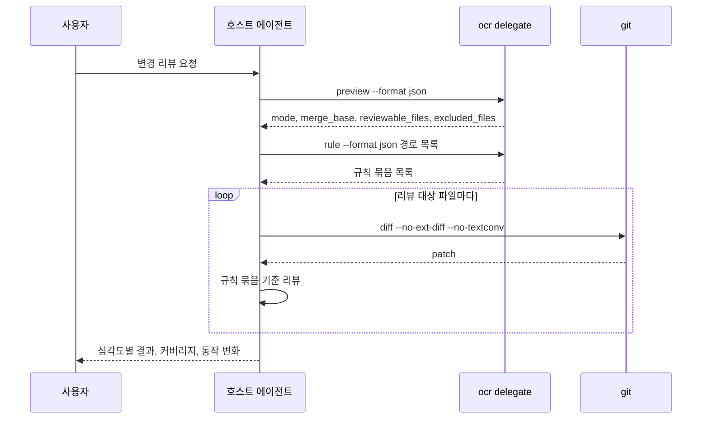
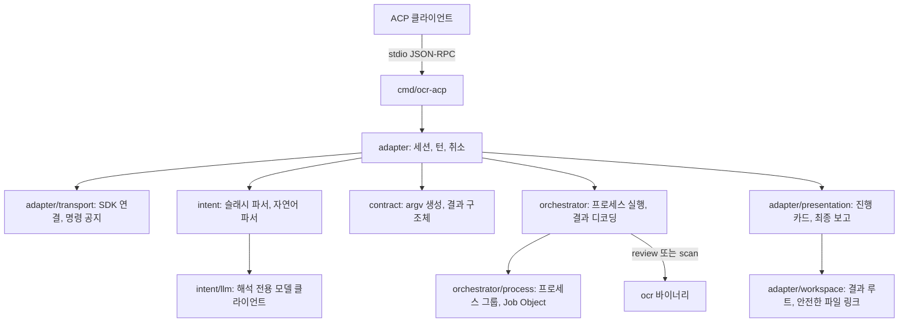

위임 모드의 역할 분담과 ACP 어댑터 구조를 다룬다.

## 위임 모드: OCR과 호스트 에이전트의 역할 분담

위임 모드(delegation mode)는 OCR이 LLM을 호출하지 않는 실행 방식이다. Claude Code나 Codex 같은 호스트 에이전트가 자기 모델로 리뷰를 수행하고, OCR은 리뷰할 파일 목록과 적용할 규칙만 deterministic하게 계산해 준다. README는 "OCR's CLI and skill together provide the review pipeline and guardrails"라고 설명하고, 별도 API 키가 없으면 이 모드로 시작하라고 권한다.

| 단계 | 담당 | 수단 |
|---|---|---|
| 리뷰 대상 파일 선별, 제외 사유 | OCR | `ocr delegate preview` |
| merge-base 계산 | OCR | preview 출력의 `merge_base` |
| 파일별 규칙 해석과 묶기 | OCR | `ocr delegate rule <path...>` |
| diff 읽기, 문맥 탐색 | 호스트 | skill이 지정한 `git` 명령 |
| 결함 판단, 위치 지정 | 호스트 | 호스트 모델 |
| 커버리지 집계, 보고서 작성 | 호스트 | skill의 Step 6 형식 |

네이티브 모드의 리뷰 에이전트(6장), 위치 보정과 반성 필터(9장)는 실행되지 않는다. skill 문서도 "OCR's native review agent, positioning, and reflection modules do not run in delegation mode"라고 적는다.



### 코드 분석: delegate preview

[delegate_cmd.go L130-L139](https://github.com/alibaba/open-code-review/blob/e74f2c6bd4422bd1e12d257d1725bcce1d6b9ddd/cmd/opencodereview/delegate_cmd.go#L130-L139)

```go
func (dc *delegateContext) preview(ctx context.Context) (*agent.DiffPreview, error) {
	return agent.Preview(ctx, agent.Args{
		RepoDir:    dc.cc.RepoDir,
		From:       dc.opts.from,
		To:         dc.opts.to,
		Commit:     dc.opts.commit,
		FileFilter: dc.cc.FileFilter,
		GitRunner:  dc.cc.GitRunner,
	})
}
```

네이티브 `--preview`와 같은 `agent.Preview`를 쓰지만 `Template`을 넘기지 않는다. 바로 위 주석은 그 결과 파일별 diff 크기 상한이 꺼진다고 설명한다. 호스트 에이전트는 자기 context 창으로 리뷰하므로 OCR의 `max_tokens`가 적용될 이유가 없다는 판단이다. 즉 네이티브 모드에서 "너무 커서 제외"되는 파일도 위임 모드에서는 리뷰 대상에 남는다.

preview의 JSON 스키마 버전은 `"1"`이며, `reviewable_files`와 `excluded_files`를 나눠 담는다([delegate_cmd.go L252-L278](https://github.com/alibaba/open-code-review/blob/e74f2c6bd4422bd1e12d257d1725bcce1d6b9ddd/cmd/opencodereview/delegate_cmd.go#L252-L278)). range 모드에서만 `merge_base`를 계산한다.

### 코드 분석: GroupRules

`ocr delegate rule`은 여러 경로를 받아 해석된 규칙이 같은 파일끼리 묶는다. 파일 수십 개에 같은 규칙 본문이 반복 출력되는 것을 막아 호스트의 context를 아낀다.

[rulegroup.go L46-L58](https://github.com/alibaba/open-code-review/blob/e74f2c6bd4422bd1e12d257d1725bcce1d6b9ddd/internal/delegate/rulegroup.go#L46-L58)

```go
		key := source + "\x00" + pattern + "\x00" + text
		idx, exists := keyIndex[key]
		if !exists {
			idx = len(groups)
			keyIndex[key] = idx
			groups = append(groups, RuleGroup{
				ID:      idx + 1,
				Source:  source,
				Pattern: pattern,
				Text:    text,
			})
		}
		groups[idx].Files = append(groups[idx].Files, path)
```

`source`, `pattern`, `text`는 바로 앞에서 해석기가 `DetailResolver`를 구현하면 `ResolveDetail`로, 아니면 `Resolve`와 `system`, `default` 기본값으로 채운다([rulegroup.go L33-L44](https://github.com/alibaba/open-code-review/blob/e74f2c6bd4422bd1e12d257d1725bcce1d6b9ddd/internal/delegate/rulegroup.go#L33-L44)).

묶음 키는 규칙 본문만이 아니라 출처(`custom`, `project`, `global`, `system`)와 일치한 glob 패턴까지 포함한다. 본문이 같아도 출처가 다르면 다른 묶음이 된다. 그래야 묶음의 `source`와 `pattern` 메타데이터가 그 안의 모든 파일에 대해 정확하다(5장의 규칙 해석 참고). text 출력은 `### Rule Group N: source / pattern` 제목과 `Applies to:` 목록, `#### Content` 본문 순서의 Markdown이다([format.go L12-L28](https://github.com/alibaba/open-code-review/blob/e74f2c6bd4422bd1e12d257d1725bcce1d6b9ddd/internal/delegate/format.go#L12-L28)).

### skill이 정하는 호스트 쪽 규약

위임 모드의 품질은 skill 문서의 지시에 달려 있다. 주요 규약은 다음과 같다([skills/open-code-review-delegate/SKILL.md](https://github.com/alibaba/open-code-review/blob/e74f2c6bd4422bd1e12d257d1725bcce1d6b9ddd/skills/open-code-review-delegate/SKILL.md)).

- 모든 Git 호출에 `--no-pager`를 붙이고, diff는 `--no-ext-diff --no-textconv --no-color`로 읽는다. 사용자 diff 설정이 patch 모양을 바꾸지 못하게 한다.
- `(path, status)`를 체크리스트 식별자로 쓴다. workspace 모드에서는 staged 삭제와 untracked 재생성으로 같은 경로가 두 번 나올 수 있다.
- 모든 `reviewable_files` 항목은 `reviewed` 또는 이유가 있는 `skipped`로 끝나야 하며, 요약에 `total_files`, `reviewed_files`, `skipped_files`, `coverage_rate`를 넣는다.
- 결함과 별개로, 의도된 변경이라도 사용자 흐름이 달라지면 전후 동작을 보고한다. 단 `ocr review --analysis`는 실행하지 말라고 명시한다. 12장의 Analysis를 호스트가 직접 흉내 내되, 네이티브 Analysis를 호출하지는 않는 구조다.
- `--format`은 v1.9.0부터 있다. `unknown flag: --format` 오류일 때만 text로 다시 실행하고, text를 JSON처럼 파싱하거나 없는 필드를 지어내지 말라고 한다.

## ACP 어댑터 구조

ACP(Agent Client Protocol)는 Zed 같은 편집기가 외부 코딩 에이전트를 stdio JSON-RPC로 띄우고 대화하는 프로토콜이다. `acp/`는 OCR CLI를 ACP 에이전트로 노출하는 별도 Go 모듈(`ocr-acp`)이다. README는 상태를 "experimental and currently unstable"이라고 밝히고, 소스에서 직접 빌드해야만 쓸 수 있다고 적는다([acp/README.md](https://github.com/alibaba/open-code-review/blob/e74f2c6bd4422bd1e12d257d1725bcce1d6b9ddd/acp/README.md)).

어댑터는 OCR의 리뷰 엔진을 가져다 쓰지 않는다. `ocr` 바이너리를 하위 프로세스로 실행하고 그 JSON 출력과 stderr 진행 줄을 읽는다. 따라서 이 장 앞 절들의 출력 계약이 곧 어댑터의 입력 계약이다.



### 코드 분석: Prompt 처리 순서

ACP의 `session/prompt` 한 번이 어댑터의 한 턴이다.

[prompt.go L57-L62](https://github.com/alibaba/open-code-review/blob/e74f2c6bd4422bd1e12d257d1725bcce1d6b9ddd/acp/internal/adapter/prompt.go#L57-L62)

```go
	var args []string
	if r.Review != nil {
		args, e = contract.BuildReviewArgs(r.Review)
	} else {
		args, e = contract.BuildScanArgs(r.Scan)
	}
```

이 블록 앞에서 파서 호출(`Parse`, [prompt.go L35](https://github.com/alibaba/open-code-review/blob/e74f2c6bd4422bd1e12d257d1725bcce1d6b9ddd/acp/internal/adapter/prompt.go#L35))과 취소, 오류, 되묻기, 거절 처리가 끝난다.

1. 입력 텍스트가 `/`로 시작하면 deterministic 슬래시 파서, 아니면 자연어 파서로 보낸다([parser.go L84-L93](https://github.com/alibaba/open-code-review/blob/e74f2c6bd4422bd1e12d257d1725bcce1d6b9ddd/acp/internal/intent/parser.go#L84-L93)). 자연어 파서는 해석 전용 모델에 `submit_intent` tool call 하나를 강제하며, 키워드 표나 정규식 대체 경로는 없다.
2. 결과는 실행 가능한 의도, 되묻기, 거절 중 하나다. 되묻기 상태는 세션에 잠시 보관되어 다음 입력과 합쳐진다.
3. 의도는 `contract`가 argv로 바꾼다. 이때 허용 플래그 목록 검사가 일어난다.
4. review는 `git rev-parse --show-toplevel`로 Git 루트를, scan은 세션 cwd를 결과 루트로 정한다([root.go L19-L38](https://github.com/alibaba/open-code-review/blob/e74f2c6bd4422bd1e12d257d1725bcce1d6b9ddd/acp/internal/adapter/workspace/root.go#L19-L38)). 결과 위치를 파일 링크로 바꿀 때 이 루트 밖은 링크로 만들지 않는다.
5. orchestrator가 `ocr`을 실행하고, presentation이 진행 줄을 ACP 도구 카드 하나로, 최종 JSON을 Markdown 보고서로 바꾼다.

거절과 시간 초과는 ACP의 `refusal` 정지 사유를 쓰지 않고 `end_turn`에 `_meta.ocr.kind`를 붙인다([prompt.go L109-L139](https://github.com/alibaba/open-code-review/blob/e74f2c6bd4422bd1e12d257d1725bcce1d6b9ddd/acp/internal/adapter/prompt.go#L109-L139)). 주석은 Zed가 `refusal`을 받으면 그 턴의 메시지를 지워 안내문이 보이지 않는다고 이유를 적는다.

### 코드 분석: argv 계약

[contract/intent.go L23-L26](https://github.com/alibaba/open-code-review/blob/e74f2c6bd4422bd1e12d257d1725bcce1d6b9ddd/acp/internal/contract/intent.go#L23-L26)

```go
// fixedArgs are the integration flags the adapter owns. They are appended last
// because flag parsing is last-wins, so a flag that slipped past the whitelist
// still could not override them.
var fixedArgs = []string{"--format", "json", "--audience", "human", "--color", "never"}
```

`--audience human`과 `--format json` 조합을 고른 이유는 앞의 라우팅 표에 있다. 이 조합에서 stdout에는 JSON 문서 하나만, stderr에는 진행 줄이 나온다. 어댑터는 stderr를 실시간 진행 표시로, stdout을 최종 결과로 쓴다. 고정 인자를 맨 뒤에 붙이는 이유는 주석대로 cobra 플래그 파싱이 마지막 값을 쓰기 때문이다.

사용자 입력에서 전달할 수 있는 추가 플래그는 명령별 허용 목록으로 제한된다([contract/intent.go L65-L82](https://github.com/alibaba/open-code-review/blob/e74f2c6bd4422bd1e12d257d1725bcce1d6b9ddd/acp/internal/contract/intent.go#L65-L82)).

| 명령 | 전달 가능한 플래그 |
|---|---|
| `review` | `--effort`(low, medium, high), `--no-filter`, `--background`, `--background-file` |
| `scan` | `--batch`(none, by-language, by-directory), `--no-plan`, `--no-dedup`, `--no-summary`, `--background` |

이 목록에 `--analysis`는 없다. 따라서 ACP 경로에서는 12장의 Analysis를 실행할 수 없다. 또 range review는 `--from`과 `--to`를 둘 다 요구한다([contract/intent.go L106-L112](https://github.com/alibaba/open-code-review/blob/e74f2c6bd4422bd1e12d257d1725bcce1d6b9ddd/acp/internal/contract/intent.go#L106-L112)). CLI는 `--from`만 주면 `--to`를 `HEAD`로 채우지만, 어댑터의 계약 계층은 이를 받아들이지 않는다.

### 프로세스와 결과 디코딩

orchestrator는 출력량에 상한을 둔다([orchestrator/types.go L16-L23](https://github.com/alibaba/open-code-review/blob/e74f2c6bd4422bd1e12d257d1725bcce1d6b9ddd/acp/internal/orchestrator/types.go#L16-L23)).

| 항목 | 기본값 |
|---|---|
| stdout 보관 상한 | 10 MiB |
| stderr 보관 상한 | 1 MiB |
| stderr 한 줄 상한 | 64 KiB |
| 진행 이벤트 큐 | 64개, 느리면 버림 |
| 종료 유예 | 2초 |

stdout은 정확히 JSON 문서 하나여야 한다. `decodeOne`은 첫 문서를 디코딩한 뒤 남은 입력이 EOF가 아니면 "multiple JSON documents" 오류를 낸다([orchestrator/decode.go L46-L59](https://github.com/alibaba/open-code-review/blob/e74f2c6bd4422bd1e12d257d1725bcce1d6b9ddd/acp/internal/orchestrator/decode.go#L46-L59)). 성공으로 보는 `status` 값은 review와 scan이 다르다. review는 `partial`을 성공으로 받아 부분 결과를 보여 주지만, scan의 성공 목록에는 `partial`이 없다([orchestrator/decode.go L61-L74](https://github.com/alibaba/open-code-review/blob/e74f2c6bd4422bd1e12d257d1725bcce1d6b9ddd/acp/internal/orchestrator/decode.go#L61-L74)). scan JSON은 manifest가 없고 `completed_with_errors`나 `completed_with_warnings`로 부분 실패를 표현하므로(앞의 status 결정 규칙), 두 목록의 차이는 출력 계약의 차이를 반영한 것으로 보인다(추정).

결과 구조체는 코멘트의 `thinking` 필드를 일부러 정의하지 않는다. README는 "reasoning cannot leak by accident"라고 이유를 적는다. 모델의 추론 내용이 편집기 화면으로 넘어가지 않는다.
