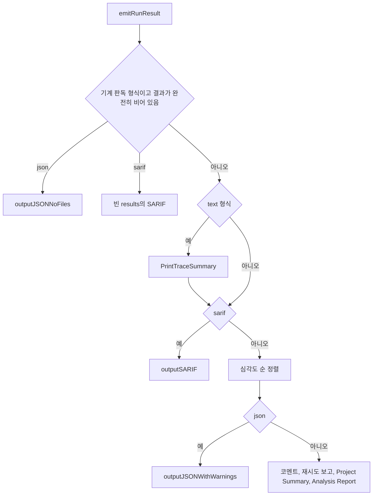

리뷰 결과는 사람의 터미널, 다른 에이전트, CI 시스템, 관측 백엔드라는 서로 다른 소비자에게 전달된다. 이 장은 OCR이 하나의 실행 결과를 text, JSON, SARIF로 바꾸는 출력 계층과, 진행 로그를 stdout에서 분리하는 `--audience` 설정, 그리고 OCR 바깥과 연결되는 네 가지 통로인 위임 모드, ACP 어댑터, OpenTelemetry, GitHub Action을 코드 기준으로 정리한다.

## 출력 형식 개요와 --format 검증

`ocr review`와 `ocr scan`의 `--format`은 세 값만 받는다. 등록과 검증이 모두 같은 목록을 쓴다.

### 코드 분석: validateOutputFormat

[shared_flags.go L112-L120](https://github.com/alibaba/open-code-review/blob/e74f2c6bd4422bd1e12d257d1725bcce1d6b9ddd/cmd/opencodereview/shared_flags.go#L112-L120)

```go
func validateOutputFormat(format string) (string, error) {
	normalized := strings.ToLower(strings.TrimSpace(format))
	switch normalized {
	case "text", "json", "sarif":
		return normalized, nil
	default:
		return "", fmt.Errorf("invalid --format value %q: must be 'text', 'json', or 'sarif'", format)
	}
}
```

대소문자와 앞뒤 공백은 정규화되므로 `--format JSON`도 받아들인다. 명령과 조합에 따라 허용 범위는 더 좁아진다.

| 명령 또는 조합 | 허용 형식 | 근거 |
|---|---|---|
| `ocr review`, `ocr scan` | `text`, `json`, `sarif` | [shared_flags.go L35](https://github.com/alibaba/open-code-review/blob/e74f2c6bd4422bd1e12d257d1725bcce1d6b9ddd/cmd/opencodereview/shared_flags.go#L35) |
| `ocr review --analysis` | `text`, `json` | [analysis.go L38-L41](https://github.com/alibaba/open-code-review/blob/e74f2c6bd4422bd1e12d257d1725bcce1d6b9ddd/cmd/opencodereview/analysis.go#L38-L41) |
| `--preview` | `text`, `json` (sarif 미지원) | CLI 문서의 `--preview` 설명 |
| `ocr delegate preview`, `ocr delegate rule` | `text`, `json` | [shared_flags.go L205-L207](https://github.com/alibaba/open-code-review/blob/e74f2c6bd4422bd1e12d257d1725bcce1d6b9ddd/cmd/opencodereview/shared_flags.go#L205-L207) |

`markdown`이라는 `--format` 값은 없다. `markdown.go`와 `markdown_table.go`는 출력 형식이 아니라, text 출력 안의 Project Summary와 Analysis 보고서처럼 모델이 Markdown으로 쓴 본문을 터미널에 렌더링하는 코드다(이 장의 터미널 렌더링 절에서 다룬다). 위임 모드의 text 출력도 Markdown 모양의 문서지만 별도 형식 이름은 없다.

### 코드 분석: emitRunResult의 분기

리뷰가 끝나면 `emitRunResult`가 형식에 따라 출력 함수를 고른다. 분기 순서가 중요하다.

[shared.go L871-L875](https://github.com/alibaba/open-code-review/blob/e74f2c6bd4422bd1e12d257d1725bcce1d6b9ddd/cmd/opencodereview/shared.go#L871-L875)

```go
	if outputFormat == "sarif" {
		return outputSARIF(comments, Version, ag.Warnings(), manifest, out)
	}
	comments = inCommentSeverityOrder(comments, comments)
	if outputFormat == "json" {
```



- 기계 판독 형식에서 manifest도 코멘트도 리뷰 파일도 Analysis도 없으면, 빈 문서를 바로 출력한다([shared.go L844-L849](https://github.com/alibaba/open-code-review/blob/e74f2c6bd4422bd1e12d257d1725bcce1d6b9ddd/cmd/opencodereview/shared.go#L844-L849)). 변경이 없는 PR에서도 소비자가 파싱 가능한 문서를 받는다.
- text 형식에서만 `[ocr] Summary: ...` 한 줄 요약을 찍는다. JSON과 SARIF는 같은 정보를 문서 안에 담으므로 생략한다.
- SARIF는 자체적으로 심각도 순 정렬을 하고(`sarifResults` 끝의 `inCommentSeverityOrder`), json과 text는 분기 직전에 정렬한다. 순서는 CLI 문서대로 `low`, `medium`, `high`, `critical` 순이며 알 수 없는 심각도는 `low`보다 앞에 온다.

결과 문서는 `--output` 경로가 있으면 그 파일에, 없으면 `os.Stdout`에 쓴다. 진행 로그는 이 경로를 쓰지 않고 `stdout.Writer()`를 거친다. 두 경로가 분리되어 있다는 점이 다음 절의 핵심이다.

## 정리

- `--format`은 `text`, `json`, `sarif` 세 값뿐이며, `--analysis`와 위임 모드는 `text`, `json`만 받는다. Markdown은 형식 이름이 아니라 text 출력 안에서 모델 본문을 표시하는 터미널 렌더러다.
- 진행 줄은 `internal/stdout`의 전역 writer를 거치고 결과 문서는 `os.Stdout`에 직접 쓰인다. `--audience agent`는 진행 줄을 버리고, `json`이나 `sarif`에 `human`이면 진행 줄이 stderr로 이동한다.
- SARIF 출력은 8개 카테고리 규칙, 3단계 level, 경로와 카테고리와 기존 코드로 만든 지문을 쓴다. 수정 제안은 유효한 줄 범위가 있을 때만 `fixes`로 나간다.
- 위임 모드에서 OCR은 파일 선별과 규칙 묶음만 deterministic하게 제공하고, diff 읽기와 판단과 보고는 호스트 에이전트가 skill 규약에 따라 수행한다. diff 크기 상한은 적용되지 않는다.
- ACP 어댑터는 `ocr`을 하위 프로세스로 실행하며 `--format json --audience human --color never`를 고정 인자로 붙인다. 허용 플래그에 `--analysis`가 없어 ACP에서는 Analysis를 쓸 수 없다.
- 텔레메트리는 환경 변수가 설정 파일보다 우선하며, 문서에 없는 `TRACEPARENT` 연결을 지원한다. review 1회에서 duration과 코멘트 수 metric이 두 곳에서 기록되는 점은 코드 읽기로 확인한 것이다. GitHub Action은 JSON 출력을 PR 코멘트로 바꾸며 SARIF와 Analysis는 쓰지 않는다.
