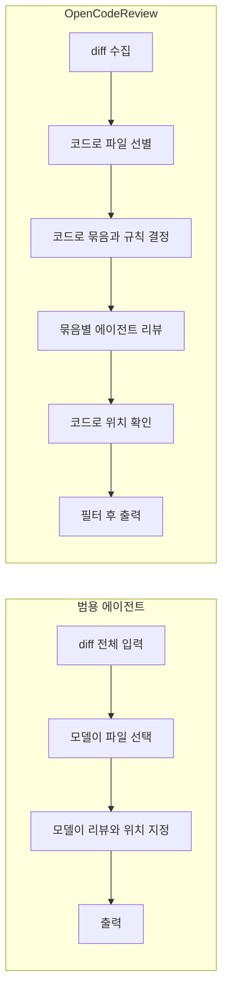
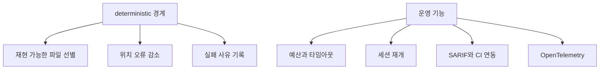

OpenCodeReview의 설계는 "범용 에이전트에 리뷰를 맡기면 생기는 문제를 코드로 막는다"는 한 문장으로 요약된다. 이 장은 앞 장에서 확인한 구현을 기준으로 범용 에이전트 리뷰, 위임 모드와 비교하고, 코드를 읽으며 발견한 장점, 한계, README와 코드가 다른 곳을 정리한다.

## 범용 에이전트 리뷰와의 차이점

README가 비교 대상으로 삼은 것은 Claude Code 같은 범용 코딩 에이전트에 리뷰 Skill을 붙인 구성이다. 같은 모델을 쓴다는 전제에서 두 방식이 갈리는 지점은 "리뷰 과정의 어느 단계를 누가 결정하는가"다.

| 단계 | 범용 에이전트 + Skill | OpenCodeReview | 근거 장 |
|---|---|---|---|
| 리뷰할 파일 결정 | 모델이 diff를 보고 판단 | `selectFiles`가 확장자, 제외 패턴, 비밀 경로, 크기로 결정 | 04장 |
| 작업 분할 | 모델이 한 컨텍스트에서 순서대로 처리 | 묶음 단위 sub-agent, 기본 동시 실행 8 | 04장, 06장 |
| 리뷰 기준 | Skill 문서 전체를 매번 읽음 | 파일 경로와 언어에 맞는 규칙만 골라 system prompt에 결합 | 05장 |
| 계획 수립 | 모델 재량 | 변경 줄 수 기준(파일 50줄, 묶음 100줄)을 넘을 때만 계획 호출 | 06장 |
| 컨텍스트 관리 | 호스트 에이전트의 일반 압축 | 리뷰 전용 압축 prompt, 묶음마다 독립 대화 | 07장 |
| 도구 | 범용 셸, 파일 편집 포함 | 읽기 전용 리뷰 도구(파일 읽기, diff 읽기, 검색, 코멘트) | 08장 |
| 줄 위치 | 모델이 적은 줄 번호를 그대로 사용 | 인용 코드로 줄 번호를 다시 계산, 실패하면 파일 간 재배치, 마지막에 LLM 재판정 | 09장 |
| 오탐 제거 | 없음 또는 모델 자체 판단 | 라운드마다 `REVIEW_FILTER_TASK` | 09장 |
| 커버리지 기록 | 없음 | manifest에 파일별 완료, 재사용, 실패 사유 기록 | 06장, 13장 |

범용 에이전트에서는 모델이 결정하는 단계가 이어져 있어 한 단계의 실수가 다음 단계로 그대로 넘어간다. OpenCodeReview는 모델이 결정하는 구간을 묶음 리뷰 하나로 좁히고, 그 앞뒤를 코드로 감쌌다. README가 말한 "불완전한 커버리지, 위치 어긋남, 품질 불안정"은 각각 파일 선별과 manifest, 위치 재계산, 규칙 선택과 필터로 대응된다(01장).

### 토큰 사용량 차이의 구조

README의 "토큰 약 1/9"(자체 발표)는 단일 장치에서 나오지 않는다. 코드에서 확인되는 절감 장치는 다음과 같다. 각 장치의 기여도는 공개되지 않았다.

| 장치 | 절감 방식 | 위치 |
|---|---|---|
| 규칙 선택 | 언어별 규칙 문서 중 해당 파일에 맞는 것만 prompt에 결합 | 05장 |
| 조건부 계획 | 작은 변경은 계획 호출 생략 ([`PlanRequired`](https://github.com/alibaba/open-code-review/blob/e74f2c6bd4422bd1e12d257d1725bcce1d6b9ddd/internal/config/template/template.go#L70-L82)) | 06장 |
| 묶음별 독립 대화 | 다른 묶음의 탐색 기록이 컨텍스트에 쌓이지 않음 | 06장 |
| 도구 호출 상한 | `MAX_TOOL_REQUEST_TIMES` 100 ([task_template.json L40-L47](https://github.com/alibaba/open-code-review/blob/e74f2c6bd4422bd1e12d257d1725bcce1d6b9ddd/internal/config/template/task_template.json#L40-L47)) | 07장 |
| 대화 압축 | 리뷰 전용 압축 prompt로 이전 기록 요약 | 07장 |
| 리뷰 전용 도구 | 범용 셸 대신 범위를 제한한 읽기 도구 | 08장 |
| prompt cache 키 | 대화 단위 session key로 프로바이더 prompt cache 재사용 | 06장, 10장 |

## 위임 모드와 네이티브 모드의 차이점

위임 모드(`ocr delegate`)는 "별도 API 키 없이" 쓰는 경로다. README도 밝히듯 위임 모드는 OCR의 전체 파이프라인을 돌리지 않는다. 두 모드를 단계별로 나누면 다음과 같다(14장).

| 단계 | 네이티브 모드 | 위임 모드 |
|---|---|---|
| 파일 선별 | OCR | OCR |
| 규칙 해석 | OCR | OCR (`ocr delegate rule`) |
| 묶음 구성 | OCR | 없음 |
| 리뷰 분석 | OCR 리뷰 에이전트 | 호스트 에이전트 |
| 줄 위치 확인 | OCR (3단계 보정) | 호스트 에이전트 |
| 반성 필터 | OCR | 없음 |
| 출력 형식 | text, json, sarif | text, json ([shared_flags.go L267](https://github.com/alibaba/open-code-review/blob/e74f2c6bd4422bd1e12d257d1725bcce1d6b9ddd/cmd/opencodereview/shared_flags.go#L267)) |
| 모델과 인증 | OCR 프로바이더 설정 | 호스트 에이전트 설정 |

위임 모드는 앞 절 표에서 "코드가 결정하는" 칸 중 파일 선별과 규칙 해석만 가져간다. 01장에서 본 설계 원칙 중 위치 보정과 반성 모듈은 위임 모드에서 작동하지 않으므로, README의 벤치마크 수치를 위임 모드에 그대로 적용할 수 없다. 위임 모드의 가치는 "어떤 파일을 어떤 규칙으로 봐야 하는지"를 호스트 에이전트에게 강제하는 데 있다.

## 장점

- **모델 판단 구간이 좁다.** 파일 선별과 `--preview`가 같은 함수를 쓰므로 미리 본 목록과 실제 리뷰 목록이 같다(01장, 04장). 리뷰 결과가 흔들려도 원인을 묶음 리뷰 단계로 좁혀 조사할 수 있다
- **위치 보정이 보수적이다.** 문자열 일치를 먼저 쓰고, 여러 파일에서 같은 코드가 발견되면 추측하지 않는다([resolver.go L76-L101](https://github.com/alibaba/open-code-review/blob/e74f2c6bd4422bd1e12d257d1725bcce1d6b9ddd/internal/diff/resolver.go#L76-L101)). 틀린 위치에 코멘트가 붙는 경우를 줄이는 대신 일부 코멘트를 잃는다
- **실패가 기록된다.** manifest가 파일마다 완료, 재사용, 실패 종류를 남기고, 예산 초과로 멈춘 리뷰도 부분 결과와 사유를 낸다(06장, 13장). CI에서 "리뷰가 조용히 일부만 돌았다"를 구별할 수 있다
- **운영 기능이 갖춰져 있다.** 토큰 예산, 작업 타임아웃, 세션 재개, 재시도 보고서, SARIF, GitHub Action, OpenTelemetry가 모두 본체에 들어 있다(10장, 13장, 14장)
- **프로바이더 계층이 넓다.** OpenAI 호환, Anthropic 호환, Responses API, Bedrock, ChatGPT OAuth를 한 인터페이스로 다룬다(10장)
- **읽기 전용 경계가 분명하다.** 리뷰 도구와 동작 영향 분석은 저장소 코드를 실행하지 않고, 분석 산출물 폴더도 저장소 밖을 요구한다(08장, 12장)

## 한계와 주의 사항

- **Recall을 낮춘 설계다.** README가 직접 밝힌 선택이다. 반성 필터는 코멘트를 지우는 방향으로만 작동하고, 위치를 확정하지 못한 코멘트는 남지 않는다(09장). 결함을 하나라도 더 찾는 것이 목적이면 `--no-filter`와 범용 에이전트 병행을 검토할 만하다
- **규칙 매칭은 템플릿 엔진이 아니다.** README의 "template-engine-based rule matching"은 실제로 glob 매칭과 문자열 치환이다. 동작은 예측 가능하지만 조건 분기 같은 표현력은 없다(05장)
- **비밀 경로 차단은 리뷰 배정에만 적용된다.** 04장에서 다룬 것처럼 선별 전 전체 diff가 diff 읽기 도구에 주입되므로, 비밀 경로로 분류된 파일의 diff도 도구 응답을 통해 모델에 전달될 수 있다. 리뷰 도구 쪽(`file_read`, `file_read_diff`, `code_search`)에는 비밀 경로 검사가 없고, 동작 영향 분석만 읽기 단계에서 비밀 경로를 막는다. 민감한 저장소에서는 제외 설정을 확인해야 한다(04장, 08장, 12장)
- **기본 템플릿의 언어 지시가 일부 작업에만 붙는다.** 응답 언어 설정은 MAIN, PLAN, MEMORY_COMPRESSION 작업에만 적용된다(05장)
- **토큰 계산은 근사다.** 내장 BPE 파일은 `cl100k_base` 하나라 다른 인코딩을 쓰는 모델의 토큰 수는 근사값이다(10장). 예산 판정은 프로바이더가 돌려준 실제 사용량을 기준으로 하지만, 사전 추정과 prompt 크기 검사는 이 근사값을 쓴다
- **세션 뷰어의 시간대가 고정이다.** 뷰어는 시각을 사용자 시간대가 아니라 `Asia/Shanghai`로 표시한다([server.go L181](https://github.com/alibaba/open-code-review/blob/e74f2c6bd4422bd1e12d257d1725bcce1d6b9ddd/internal/viewer/server.go#L181))
- **ACP 어댑터는 실험 단계다.** 소스에서 직접 빌드해야 하고, README가 불안정하다고 밝힌다(14장)

## README와 코드가 다른 곳

각 장에서 발견한 차이를 모았다. 모두 기준 커밋 `e74f2c6`의 코드 기준이며, 이후 버전에서 고쳐졌을 수 있다.

| 항목 | 문서 설명 | 코드 동작 | 장 |
|---|---|---|---|
| Git 버전 | README는 Git 2.41 이상을 전제 조건으로 적음 | 버전이 낮으면 경고만 출력하고 실행 | 02장 |
| 재개 범위 | README Quick Start는 range, commit 리뷰 재개만 설명 | workspace 재개도 허용 | 02장, 13장 |
| workspace diff | CLI 문서는 `git diff HEAD`가 비면 `--staged`로 대체한다고 설명 | 대체 경로 없이 한 번만 실행 | 03장 |
| JS 테스트 제외 패턴 | 문서는 `js, jsx, ts, tsx`만 나열 | `mts`, `cts`도 포함 | 04장 |
| 규칙 매칭 방식 | README는 "template-engine-based" | glob 매칭과 `strings.ReplaceAll` 치환 | 05장 |
| `FileFilter` 병합 | 주석은 모든 계층 패턴을 병합한다고 설명 | 가장 높은 계층 하나만 사용 | 05장 |
| `--timeout` | 도움말은 "concurrent task budget in minutes" | 리뷰는 이 값에 라운드 수를 곱함. 동작 영향 분석은 곱하지 않고 실행 전체 기한으로 사용 | 06장, 12장 |
| 내장 도구 수 | 문서는 6개라고 설명 | `tools.json`에 8개. `context_read`, `submit_analysis`는 동작 영향 분석 전용 | 08장 |
| 반성 모듈 범위 | `CommentWorkerPool` 주석은 reflection과 제안 검증도 처리한다고 설명 | 풀은 위치 계산과 재위치만 처리. 필터는 동기 실행 | 09장 |
| 필터 실행 시점 | 설계 문서는 메인 루프가 끝난 뒤라고 설명 | 라운드마다 실행 | 09장 |
| `retry_codes` 위치 | 문서는 `llm`, `custom_providers` 아래만 설명 | 내장 프로바이더의 `providers.<name>` 아래도 허용 | 10장 |
| o200k 인코딩 | 로더가 네 인코딩을 매핑 | 내장 파일은 `cl100k_base` 하나 | 10장 |
| 뷰어 루프백 | 문서는 `localhost`, `127.0.0.1`, `::1`만 허용한다고 설명 | `127.0.0.0/8` 전체 허용 | 13장 |
| 텔레메트리 우선순위 | 문서는 환경 변수가 설정 파일을 덮어쓴다고 설명 | 환경 변수는 켜는 방향으로만 작동 | 14장 |

차이 대부분은 기능 오류가 아니라 문서가 코드 변경을 따라가지 못한 경우다. 다만 `--timeout`과 텔레메트리 우선순위는 사용자가 문서를 믿고 설정하면 의도와 다른 결과가 나오므로, 운영에 넣기 전에 해당 장의 설명을 확인하는 것이 좋다.

## 도입 판단 기준

| 상황 | 권장 경로 | 이유 |
|---|---|---|
| CI에서 PR마다 자동 리뷰 | 네이티브 모드 + SARIF 또는 GitHub Action | 커버리지 기록, 예산, 위치 보정이 모두 작동 |
| API 키 없이 개인 개발 환경에서 사용 | 위임 모드 | 호스트 에이전트의 모델 사용. 위치 보정과 필터는 없음 |
| diff 없는 레거시 코드 감사 | `ocr scan` | 파일 전체 리뷰와 배치 예산 지원 (11장) |
| 변경의 동작 영향까지 조사 | `ocr review --analysis` | 리뷰와 별도 조사, 근거 관찰 기록 (12장) |
| 결함을 최대한 많이 찾아야 하는 감사 | 네이티브 모드 `--no-filter` + 사람 검토 | 필터가 줄이는 Recall을 되돌림 |

## 정리

- OpenCodeReview는 범용 에이전트 리뷰에서 모델이 결정하던 파일 선택, 작업 분할, 위치 지정을 코드로 옮기고, 모델 판단을 묶음 리뷰 하나로 좁혔다
- 토큰 절감은 규칙 선택, 조건부 계획, 묶음별 독립 대화, 도구 상한, 압축이 함께 만든 결과이며 항목별 기여도는 공개되지 않았다
- 위임 모드는 파일 선별과 규칙 해석만 가져가므로 네이티브 모드의 벤치마크 결과를 그대로 기대할 수 없다
- 위치 보정과 반성 필터는 정밀도를 높이는 대신 Recall을 낮추는 방향으로 설계되었다
- 비밀 경로 diff의 도구 노출, `--timeout` 배수, 텔레메트리 우선순위는 운영 전에 확인해야 할 지점이다
- README와 코드의 차이 14건은 대부분 문서 지연이며, 모두 기준 커밋의 코드를 기준으로 정리했다
