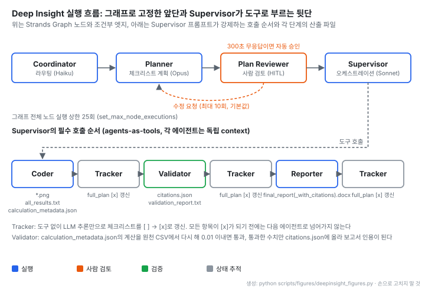
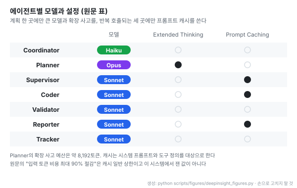

# Deep Insight: 프로덕션 멀티 에이전트가 풀어야 할 5가지 문제와 계층형 설계

- **원문**: [프로덕션 Multi-Agent 시스템이 해결해야 할 5가지 문제 – Deep Insight 아키텍처로 배우는 실전 설계](https://aws.amazon.com/ko/blogs/tech/practical-design-lessons-from-the-deep-insight-arch/) · AWS 기술 블로그 · 2026-04-01
- **저자**: Yoonseo Kim, Jesam Kim, Jiyun Park, Kyutae Park, Gonsoo Moon, Chloe Kwak (AWS Korea 솔루션즈 아키텍트)
- **시리즈**: 4편 중 Part 1(아키텍처). Part 2 Context Engineering, Part 3 하네스 엔지니어링(배포 · 운영), Part 4 Inner Loop 엔지니어링(대화형 분석 챗봇)
- **코드**: [aws-samples/sample-deep-insight](https://github.com/aws-samples/sample-deep-insight) (Python, MIT-0, 2025-11-12 생성, 별 52개, 기여자 9명 · 2026-10-29 GitHub API 기준. 확인 커밋 `d9bc7b0`, 2026-10-19) · [데모 영상](https://youtu.be/zYDGI6X0UhY)
- **스택**: Strands Agents SDK, Amazon Bedrock(Claude Haiku · Opus · Sonnet), Bedrock AgentCore Runtime, ECS Fargate + ALB, DynamoDB, SNS, Cognito
- **읽은 날짜**: 2026-10-29
- **태그**: #MultiAgent #StrandsAgents #AgentCore #HumanInTheLoop #PromptCaching #CodeSandbox #Supervisor

!!! note "핵심 요약"
    CSV와 자연어 요청을 받아 에이전트 8개가 계층으로 협업해 인용 포함 · 미포함 DOCX 보고서 두 종과 PNG 차트를 만드는 데이터 분석 시스템이다. 앞단(라우팅 → 계획 → 사람 검토 → Supervisor)은 Strands의 그래프로 고정하고, 뒷단은 Supervisor가 Coder · Validator · Reporter · Tracker를 도구처럼 부른다. 계획은 체크리스트이고 Tracker가 매 단계 뒤에 `[x]`를 채워 단계 건너뛰기를 막으며, Validator가 원천 데이터에서 다시 계산해 통과한 수치만 보고서 인용으로 쓴다. 모델은 역할별로 나눠(Haiku 라우팅, Opus 계획, Sonnet 실행) 반복 호출되는 세 에이전트만 프롬프트 캐시를 켠다. 시스템 품질 지표(정확도, 비용, 지연)는 공개하지 않았고, 유일한 효과 수치인 고객 사례의 "288배" 는 원문의 시간 수치로 계산하면 144배다.

## 1. 개요

글은 "왜 에이전트가 우리 비즈니스 로직대로 처리하지 않을까", "왜 필수 검증 단계를 건너뛸까", "왜 예외 상황을 감지하지 못할까" 라는 세 질문으로 시작한다. 프롬프트를 고치고 모델을 바꿔도 반복되는 이 문제를 지시문이 아니라 실행 구조로 풀어야 한다는 것이 출발점이고, 결론 문장은 "프로덕션에서 동작하는 에이전트를 만든다는 것은 모델의 능력이 아니라, 아키텍처의 문제입니다." 다.

Deep Insight의 데모는 가상의 식품 판매 데이터(`moon-market-fresh-food-sales.csv`)와 컬럼 정의(`column_definitions.json`)에 "세일즈 및 마케팅 관점으로 분석을 해주고, 차트 생성 및 인사이트도 뽑아서 docx 파일로 만들어줘" 라고 요청하는 것이다. 시스템은 분석 계획을 먼저 보여 주고 승인을 받은 뒤 분석하고, 인용 포함 · 미포함 DOCX 두 종과 PNG 차트를 돌려준다.

배포 형태는 세 가지이고 모두 같은 에이전트 구조를 쓴다.

| 옵션 | 실행 위치 | 대상 |
| --- | --- | --- |
| Self-Hosted | 로컬 CLI. 설정 약 10분, 코드는 로컬 `subprocess.run()`으로 실행 | 개발 · 반복 실험 |
| Web | 브라우저 UI로 업로드, 계획 검토, 보고서 다운로드 | 비개발 사용자 |
| Managed AgentCore | Bedrock AgentCore Runtime, 100% Private VPC, Fargate의 별도 코드 실행기 | 사용자별 격리가 필요한 프로덕션 |

## 2. 5가지 문제와 대응 기술

| # | 문제 | 기술 | 방법 |
| --- | --- | --- | --- |
| 1 | 에이전트 간 실행 흐름 제어 | Strands Agents SDK | Graph 패턴으로 순서와 HITL 분기, Agents as Tools 패턴으로 Supervisor가 전문 에이전트 호출 |
| 2 | 에이전트별 모델 선택 | Amazon Bedrock | 역할별 Claude 배치 (Haiku 라우팅, Opus 계획, Sonnet 실행) |
| 3 | 프로덕션 안정 운영 | Bedrock AgentCore | 관리형 런타임 · 모니터링, 세션 격리, Private VPC |
| 4 | LLM 생성 코드 실행 보안 | Fargate + ALB | 세션별 임시 샌드박스 컨테이너 |
| 5 | 모니터링 · 관리 | DynamoDB + SNS + Cognito | 관리자 대시보드, 장애 알림 |

1 · 2번은 에이전트 설계(3 · 4절), 3 · 4 · 5번은 인프라(5 · 6절)에서 다룬다.

## 3. 에이전트 구조

에이전트 8개를 세 계층으로 나눈다. 1계층 Coordinator → Planner → Plan Reviewer가 요청을 분석해 계획을 세우고, 2계층 Supervisor가 계획을 실행하며, 3계층 Coder · Validator · Reporter · Tracker가 실제 작업을 한다. 각 에이전트는 독립된 context에서 일하고 압축된 결과만 넘긴다.



- 위 줄은 저장소 `builder.py`의 그래프 그대로다. Supervisor로 가는 길은 반드시 사람 검토를 거치고, 되돌아가는 엣지는 검토 → 계획 하나뿐이다
- 아래 줄은 그래프가 아니라 Supervisor 시스템 프롬프트가 강제하는 순서다. 실행 순서의 일부는 코드로, 일부는 프롬프트로 고정돼 있다는 점을 먼저 봐야 한다
- 에이전트 사이 전달은 대화 기록이 아니라 파일(`all_results.txt` 누적, `calculation_metadata.json`, `citations.json`)이다

### Coordinator: 라우팅

모든 요청에 비싼 오케스트레이션이 필요하지는 않다는 판단에서 시작한다. 인사나 자기소개는 직접 답하고, 도구 · 추론 · 다단계 사고가 필요한 요청은 응답에 `handoff_to_planner` 마커를 넣어 Planner로 넘긴다. 분류만 하므로 가장 가벼운 Haiku를 쓴다.

```python
# builder.py
builder.set_entry_point("coordinator")
builder.add_edge("coordinator", "planner", condition=should_handoff_to_planner)
```

### Planner: 체크리스트 계획

Extended Thinking을 켠 Opus가 요청을 "5-10개의 명확한 단계" 로 나누고, 에이전트별 작업을 `[ ]` 체크리스트로 적어 `full_plan` 변수에 저장한다. 원문 예시 계획은 Coder(8항목), Validator(5항목), Reporter(5항목) 세 절로 되어 있다. 큰 작업을 먼저 쪼개 두면 이후 에이전트는 한 번에 한 단계만 처리하므로 각자의 context가 작아진다.

### Plan Reviewer: 사람 검토

계획을 사용자에게 보여 주고 승인이면 Supervisor로, 수정 피드백이면 Planner로 되돌린다. 무한 반복은 수정 횟수 상한 `MAX_PLAN_REVISIONS`로 막는다. 원문은 값을 적지 않았고 저장소 기본값은 10이다(환경 변수로 변경). 그래프 전체 노드 실행 상한은 25회다.

```python
builder.add_edge("plan_reviewer", "planner", condition=should_revise_plan)
builder.add_edge("plan_reviewer", "supervisor", condition=should_proceed_to_supervisor)
builder.set_max_node_executions(25)
```

Web 버전은 모달에 300초 카운트다운을 띄우고, 시간 안에 응답이 없으면 자동 승인한다. 원문이 꼽는 효과는 세 가지다. 사용자가 계획을 고칠 수 있고, 단계별 진행을 실시간으로 볼 수 있고, 실패한 단계만 다시 돌릴 수 있다.

## 4. Supervisor와 전문 에이전트

Supervisor는 `full_plan` 체크리스트를 순서대로 실행하는 오케스트레이터이고, 3계층 에이전트들은 Supervisor의 도구로 등록돼 있다.

```python
# nodes.py
agent = strands_utils.get_agent(
    agent_name="supervisor",
    model_id=os.getenv("SUPERVISOR_MODEL_ID", os.getenv("DEFAULT_MODEL_ID")),
    prompt_cache_info=(True, "default"),
    tool_cache=True,
    tools=[coder_agent_tool, reporter_agent_tool, tracker_agent_tool, validator_agent_tool],
    streaming=True,
)
```

시스템 프롬프트에는 규칙 세 가지가 있다.

- **필수 실행 순서**: Coder → Tracker → Validator → Tracker → Reporter → Tracker. 매 에이전트 뒤에 Tracker를 넣어 진행 상태를 Supervisor가 관리한다
- **섹션 완료 규칙**: 현재 에이전트의 체크리스트가 모두 `[x]`가 될 때까지 다음 에이전트로 넘어가지 않는다
- **컨텍스트 보존**: 각 도구 에이전트에 `clues`와 `full_plan`을 함께 넘긴다

| 에이전트 | 역할 | 도구 | 산출물 |
| --- | --- | --- | --- |
| Coder | 분석 코드 작성 · 실행, 차트, 인사이트 | `write_and_execute_tool`, `bash_tool`, `file_read`, `skill_tool` | `*.png`, `all_results.txt`, `calculation_metadata.json` |
| Validator | 수치 재계산, 인용 생성 | `write_and_execute_tool`, `bash_tool`, `file_read` | `citations.json`, `validation_report.txt` |
| Reporter | DOCX 보고서 | `write_and_execute_tool`, `bash_tool`, `file_read` | `final_report.docx`, `final_report_with_citations.docx` |
| Tracker | 체크리스트 상태 갱신 | 없음 (LLM 추론만) | 갱신된 `full_plan` |

검증 흐름이 이 설계의 핵심이다. Coder가 어떤 값을 어떻게 계산했는지 `calculation_metadata.json`에 남기면, Validator가 그 계산을 원천 데이터에서 다시 수행해 0.01 이내로 맞으면 통과시키고 아니면 오류로 표시한다. 통과한 계산만 `citations.json`에 들어가고, Reporter는 이 파일을 근거로 보고서에 인용 번호를 단다. 숫자가 보고서에 실리려면 독립된 에이전트의 재계산을 통과해야 한다.

## 5. 에이전트별 모델 구성



- 비싼 설정은 한 곳에 몰았다. Opus와 확장 사고(약 8,192토큰)는 계획 단계에만 쓰고, 나머지 실행은 Sonnet, 진입 분류는 Haiku다
- 프롬프트 캐시는 같은 시스템 프롬프트와 도구 정의로 여러 번 불리는 Supervisor · Coder · Reporter에만 켰다. Coordinator는 한 번만 불리고 Validator · Tracker는 매번 다른 context로 불려 효과가 낮다는 이유다
- 원문은 캐시로 "입력 토큰 비용을 최대 90%까지 절감" 한다고 적지만 이는 캐시 가격의 일반 상한이고, 이 시스템에서 잰 비용은 제시하지 않았다

## 6. 프로덕션 배포와 운영

### 코드 실행 샌드박스

Self-Hosted 버전은 Coder의 코드를 로컬에서 바로 실행하지만, AgentCore 버전은 LLM이 만든 코드를 서버에서 직접 돌리지 않는다. 원문이 드는 위험은 시스템 파일 삭제, 무한 루프로 인한 자원 고갈, 다른 사용자 분석 데이터 디렉터리 접근이다.

- **커스텀 이미지**: 한글 폰트, 시스템 라이브러리, Python 패키지를 미리 넣은 실행 환경
- **세션별 컨테이너**: 분석 세션마다 독립 Fargate 컨테이너. Private VPC 서브넷에서 돌고 직접 인터넷 접근이 없다
- **2단계 실행**: 코드를 base64로 인코딩해 HTTP로 보내고, 컨테이너 안에서 파일로 쓴 뒤 subprocess로 실행한다
- **세션 고정**: 한 세션의 여러 실행이 같은 컨테이너로 가도록 ALB sticky session 쿠키를 쓴다
- **정리**: 차트 · 보고서 · 로그는 S3에 올리고, 컨테이너는 1시간 뒤 자동 종료된다

### 운영 가시성

Web UI는 FastAPI로 만들었고 AgentCore Native Protocol(`boto3.invoke_agent_runtime()`)로 백엔드를 부른다. 진행 상황은 SSE로 스트리밍하고, 계획 검토 모달과 보고서 다운로드를 제공하며, 한국어와 영어를 지원한다. 선택 구성인 Ops 대시보드는 에이전트별 상태 · 도구 호출 이력 · 토큰 사용량 · 소요 시간을 DynamoDB에 남기고, 실패하면 SNS로 관리자에게 메일을 보내며, Cognito JWT로 대시보드를 보호한다. AgentCore 쪽에서는 OpenTelemetry 기반 관측을 쓴다.

## 7. 확장 사례

원문은 같은 구조를 다른 도메인에 옮긴 사례 두 개를 든다.

| 사례 | 바꾼 부분 | 원문이 밝힌 결과 |
| --- | --- | --- |
| LG전자 한국영업본부 ChatInsight | Coordinator · Planner · Task Tracking · Supervisor · Coder · Reporter. `all_results.txt` 누적 전달 방식 그대로 | "3일 걸리던 분석이 30분으로 단축되어 생산성이 288배 향상" |
| TechRecon (re:Invent 2025 SNR203) | Coder 대신 Researcher(Tavily 검색, 웹 크롤링)가 주 실행 에이전트. 산출물은 신기술 전체 분석과 특정 기술 심층 분석 두 종 | 수치 없음 |

두 사례 모두 에이전트 역할과 프롬프트만 바꾸고 계층형 오케스트레이션과 context 격리는 유지했다는 것이 원문의 요지다.

## 8. 읽을 때 감안할 것

!!! warning "288배는 원문 수치로 재현되지 않는다"
    3일은 72시간, 즉 4,320분이고 30분으로 나누면 144배다. 288배가 되려면 6일이 30분이 되거나 3일이 15분이 되어야 한다. 원문에 산식이 없고, 같은 문단은 기존 소요를 "2~3주" 로도 적어 기준이 섞여 있다. 수치를 인용한다면 "3일에서 30분" 이라는 시간 자체를 쓰는 편이 안전하다.

- **시스템 품질 지표가 없다.** 보고서 정확도, 실행 비용, 소요 시간을 한 번도 제시하지 않는다. 벤더 글이고 자사 서비스 조합을 소개하는 목적이 앞선다. 저장소에는 이후 규칙 기반 자동 채점 하네스(`eval-harness`)가 추가됐지만 공개된 측정 결과는 아니다
- **캐시 90%는 측정값이 아니다.** 캐시 가격의 일반 상한을 옮긴 표현이다
- **사람 검토의 기본값이 자동 승인이다.** Web 버전은 300초 동안 응답이 없으면 계획을 승인한다. 검토 없이 진행돼도 괜찮은 작업에만 맞는 기본값이고, 결과가 외부로 나가는 작업이면 거꾸로 두는 편이 맞다
- **상태 관리를 LLM에 맡긴다.** Tracker는 도구 없이 LLM 추론만으로 체크리스트를 갱신하고, 실행 순서의 절반은 프롬프트 규칙이다. 오버헤드가 작다는 것은 원문 주장이고 갱신 오류율은 제시되지 않았다
- **검증 허용 오차가 고정값이다.** 0.01 이내면 통과로 보는데 값의 크기와 무관한 절대 오차인지 원문은 설명하지 않는다. 저장소 Validator 프롬프트에는 `< 0.5`, `< 0.01` 같은 절대 허용 오차가 언급된다
- **글과 코드의 작은 불일치.** 본문은 시리즈를 "3회에 걸쳐" 라고 하지만 목록은 4편이다. 예시 계획의 Reporter 절 제목은 "PDF 생성" 인데 체크리스트는 DOCX를 만든다(저장소에는 PDF용 Reporter 프롬프트가 따로 있다). 저장소에는 블로그에 없는 Auditor 등의 프롬프트도 있어 구조가 글 이후 바뀌었을 수 있다

## 9. 가져갈 지점

| 대상 | 가져갈 수 있는 부분 |
| --- | --- |
| 흐름 고정 | 라우팅 → 계획 → 사람 검토 → 실행처럼 반드시 지켜야 할 순서는 그래프 엣지로 고정하고, 실행 단계 안의 유연함만 Supervisor에 맡긴다 |
| 단계 건너뛰기 방지 | 계획을 체크리스트로 만들고 "모든 항목 `[x]` 전 진행 금지" 규칙을 둔다. 상태 갱신은 가능하면 LLM이 아니라 코드로 하는 편이 더 단단하다 |
| 숫자 검증 | 계산 과정을 메타데이터로 남기고, 별도 에이전트가 원천에서 재계산해 통과한 값만 인용으로 쓴다 |
| 모델 배치 | 큰 모델과 확장 사고는 계획 한 곳, 프롬프트 캐시는 같은 접두부로 반복 호출되는 에이전트에만 쓴다 |
| 코드 실행 격리 | 세션별 임시 컨테이너, 인터넷 차단, sticky session, 1시간 TTL, 산출물만 객체 저장소로 |
| 운영 기록 | 에이전트별 토큰 · 시간 · 도구 호출을 한 테이블에 쌓고 실패를 알림으로 보낸다 |

## 10. 결론

Deep Insight Part 1은 멀티 에이전트를 프로덕션에 올릴 때 필요한 구성 요소를 한 장의 지도로 정리한 글이다. 그래프로 고정한 앞단, 도구로 부르는 전문 에이전트, 체크리스트 기반 진행 관리, 재계산 검증과 인용, 세션별 코드 샌드박스는 데이터 분석이 아닌 도메인에도 그대로 옮길 수 있는 설계다. 다만 이 구조가 얼마나 정확하고 얼마에 도는지는 글에 없고, 유일한 효과 수치는 계산이 맞지 않는다. 설계 참고서로 읽고, 성능 근거는 저장소의 평가 하네스나 직접 측정으로 따로 확보해야 한다.
