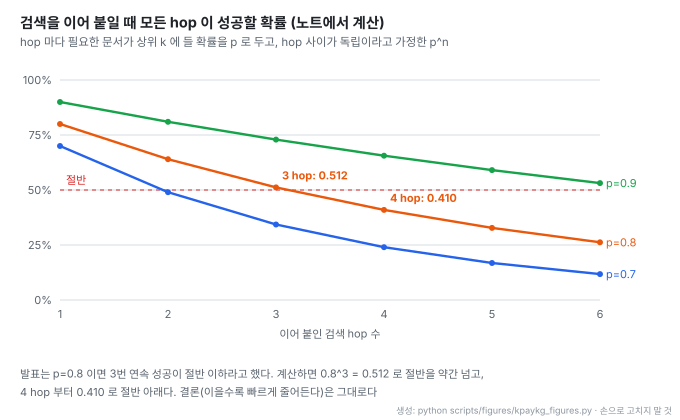
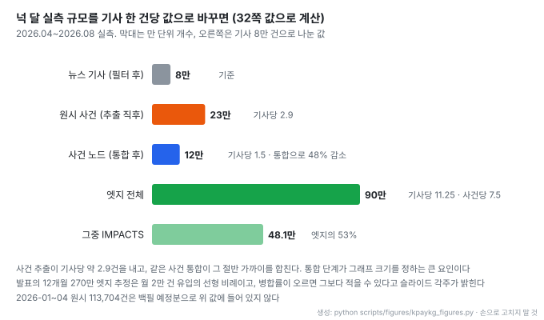

# 카카오페이증권 if(kakao)26: 사건 중심 지식 그래프와 근거·가정을 나눠 말하는 금융 에이전트

- **원문**: ["이 사건, 어디까지 영향을 미칠까?" 지식그래프로 만드는 eXplainable 금융 에이전트](https://if.kakao.com/2026/session/time-table?tab=day2&sessionId=101) · if(kakao)26 2일차 · 2026-10-14 15:00-15:30 · 트랙 Model & Agent · 난이도 초급
- **자료**: [발표 영상](https://www.youtube.com/watch?v=TdmmFWIZ2j0) (kakao tech 채널, 2026-10-30 업로드, 25분 9초) · [발표 슬라이드 PDF](https://t1.kakaocdn.net/service_if_kakao_prod/admin/8b064b9501a100001.pdf) (63쪽)
- **연사**: 민재홍 · 정의정 (카카오페이증권 AI엔지니어). 1부 지식 그래프 구성은 민재홍, 2부 에이전트는 정의정이 발표했다
- **정리 방법**: 슬라이드 텍스트와 YouTube 한국어 자동 자막에서 옮겼다. 자동 자막에는 음성 인식 오류가 있어(레그 = RAG, 피보 = FIBO, 출론 = 추론) 수치는 슬라이드 값을 우선했다. 각 절에 슬라이드 쪽과 영상 시각 링크를 단다
- **읽은 날짜**: 2026-11-10
- **태그**: #KnowledgeGraph #Ontology #FinanceAgent #ExplainableAI #LPG #Groundedness #MultiHopQA

!!! note "핵심 요약"
    "휴머노이드 로봇 양산이 본격화되면 국내 어디까지 영향이 갈까" 같은 질문은 답이 한 기사에 없고, 사건 → 완성품 회사 → 부품사 → 종목으로 이어지는 연결을 따라가야 나온다. 카카오페이증권은 사건(Event)을 핵심 노드로 둔 속성 그래프(LPG, FalkorDB)를 만들고, 회사·종목 같은 기준 정보는 내부 마스터 파일에서, 사건과 영향 관계는 뉴스·공시·어닝콜에서 LLM 추출 → 통합 → 검증 게이트를 거쳐 채웠다. 넉 달 동안 기사 약 8만 건에서 사건 노드 약 12만 개(원시 23만에서 통합), 엣지 약 90만 개가 나왔다. 그 위의 에이전트는 시작점을 실제 노드 ID로 잡고, 과제별 탐색 전략으로 허용된 관계만 따라가며, 찾은 연결은 실선, 못 찾은 연결은 점선으로 조립해 점선 자리를 답변에서 "가정·추정"으로 표시한다. 평가는 질문 37개에 사람이 정한 필요 근거(노드·엣지)를 두고, 근거를 찾지 못하면 답이 맞아도 통과로 치지 않는다. 62회의 개선 실험(26회 되돌림)에서 최종 통과율은 15%에서 78%로 올랐지만, 문제 세트·그래프·모델이 중간에 바뀐 기록이라 한 조건의 비교는 아니다.

## 1. 개요

발표는 두 부분이다. 1부는 왜 지식 그래프인지, 어떤 기술을 골랐는지, 온톨로지를 어떻게 그렸는지, 어떻게 채우고 갱신하는지를 다룬다. 2부는 그 그래프 위 에이전트가 근거를 찾아 답변으로 잇는 과정과 평가를 다룬다.

일반적인 GraphRAG 발표와 갈리는 지점은 목표 설정이다. 발표는 "정확한 답" 보다 "어디까지가 근거이고 어디부터가 가정인지 보이는 답" 을 목표로 둔다. 금융 서비스에서 불확실한 사항을 단정하면 안 된다는 규제 요건이 이 목표를 강제한다. 마지막 슬라이드의 문장이 발표 전체를 요약한다.

> 믿어도 되는 답을 만드는 게 아니라, 어디까지 믿을지 사용자가 정할 수 있는 답을 만든다 ([p.62](https://t1.kakaocdn.net/service_if_kakao_prod/admin/8b064b9501a100001.pdf#page=62))

## 2. 질문과 기존 데이터의 한계

예시 질문은 휴머노이드 로봇 대량 도입 발표의 국내 영향이다. 일반 기사에는 로봇 제조사 A사와 Z사가 나온다. A사에 부품을 대는 1차 부품사 B·C사는 같은 기사에 거의 나오지 않고, 그 공급 관계는 종목 마스터나 공시 같은 다른 문서에 있다. 한 단계 더 가면 2차 부품사, 섹터, 경쟁사, 상장 종목이 이어진다. 답은 여러 소스에서 얻은 지식을 이은 경로다 ([p.5-7](https://t1.kakaocdn.net/service_if_kakao_prod/admin/8b064b9501a100001.pdf#page=7) · [영상 01:29](https://www.youtube.com/watch?v=TdmmFWIZ2j0&t=89s)).

기존 데이터 구조에는 세 가지 한계가 있었다 ([p.8-9](https://t1.kakaocdn.net/service_if_kakao_prod/admin/8b064b9501a100001.pdf#page=9) · [영상 02:19](https://www.youtube.com/watch?v=TdmmFWIZ2j0&t=139s)).

| 한계 | 그래프로 바꾼 방식 |
| --- | --- |
| 회사 · 종목 · 섹터 기준 정보가 소스마다 따로 있어 같은 회사의 식별자가 여러 개 | 표준화된 하나의 노드로 통합 |
| 공급 · 경쟁 · 지분 관계가 소스마다 흩어짐 | 방향과 근거를 가진 엣지로 표현 |
| 매일 들어오는 뉴스 · 공시가 기존 회사 · 종목과 연결되지 않음 | 사건을 노드로 두고 기존 노드에 연결 |

## 3. 금융 서비스 요건

발표는 금융 에이전트의 요건 세 가지를 규제 문서에 근거해 정한다 ([p.10-11](https://t1.kakaocdn.net/service_if_kakao_prod/admin/8b064b9501a100001.pdf#page=11) · [영상 03:13](https://www.youtube.com/watch?v=TdmmFWIZ2j0&t=193s)).

| 요건 | 근거 | 그래프에서 충족하는 방식 |
| --- | --- | --- |
| 설명 가능성 | 금융위원회 「금융분야 AI 가이드라인」(2026, p.26 · p.46) | 지나온 경로가 곧 근거. 엣지마다 원문 문장을 함께 보관 |
| 단정 금지 | 「금융소비자보호에 관한 법률」 제21조 제1호 (불확실한 사항에 대한 단정적 판단 제공 금지) | 없는 관계는 구성하지 않음. 아는 것과 모르는 것의 경계가 구조 안에 생김 |
| 데이터 제약 | 정확도가 높고 출처가 분명한 데이터 사용 | 노드 기준은 내부 마스터, 뉴스 · 공시는 시점 정보로 덧붙임 |

두 번째 행이 이 발표의 설계를 끝까지 끌고 간다. 그래프에 없는 관계를 답에서 단정하지 않으려면, 에이전트가 "그래프에서 확인한 것" 과 "확인하지 못한 것" 을 구분해 들고 있어야 한다. 8절의 실선 · 점선 조립이 그 구현이다.

## 4. 기술 선택

발표는 검토한 기술을 두 축으로 놓는다 ([원문 슬라이드 p.13 기술 지도](https://t1.kakaocdn.net/service_if_kakao_prod/admin/8b064b9501a100001.pdf#page=13) · [영상 04:34](https://www.youtube.com/watch?v=TdmmFWIZ2j0&t=274s)). 가로축은 지식 표현(문서 원문 그대로 ↔ 특정 구조로 정리), 세로축은 지식 연결 시점(질문 시 조합 ↔ 미리 연결)이다. 롱컨텍스트 LLM, 벡터 RAG, 하이브리드 RAG, Text-to-SQL, 파인튜닝이 한쪽에 있고, 온톨로지 기반 지식 그래프는 "구조로 정리 + 미리 연결" 칸에 놓인다.

- 축 두 개로 놓으면 그래프의 위치가 분명하다. 검색을 아무리 다듬어도(하이브리드, 리랭킹, 멀티홉) 세로축은 "질문 시 조합" 에 머문다
- Text-to-SQL 은 구조화 칸에 있지만 "문장 속 관계는 다루지 못함" 으로 적혀 있다. 뉴스 문장에서 나온 영향 관계가 이 시스템의 핵심이라서다

### 벡터 RAG 실험

가장 먼저 검토한 것은 RAG였다. 예시 질문을 그대로 넣어 뉴스 청크를 k=10으로 검색하자 상위 유사도는 0.506, 0.495, 0.487, 0.486 근처였다. 슬라이드는 "로봇제조사 언급된 청크 4 / 10", "1차 부품사 언급된 청크 2 / 86" 으로 요약하고, 3위와 7위가 같은 대형 1차 부품사 2곳을 다룬 청크였다고 표시한다 ([p.15](https://t1.kakaocdn.net/service_if_kakao_prod/admin/8b064b9501a100001.pdf#page=15) · [영상 05:44](https://www.youtube.com/watch?v=TdmmFWIZ2j0&t=344s)). 86 이 무엇의 수인지는 슬라이드와 발표 모두 설명하지 않는다. 결론은 "한 문서 안의 답은 강점, 문서 밖의 연결은 미지수" 다.

### 멀티홉 검색이 막힌 지점

검색 결과에서 부품사 이름을 뽑아 다시 검색하는 멀티홉 방식도 실험했고, 세 군데서 막혔다 ([p.17](https://t1.kakaocdn.net/service_if_kakao_prod/admin/8b064b9501a100001.pdf#page=17) · [영상 06:32](https://www.youtube.com/watch?v=TdmmFWIZ2j0&t=392s)).

1. 다음 검색어가 앞 검색 결과에 먼저 나와야 한다. 1차 부품사 이름이 검색된 문서에 없으면 LLM이 근거 없이 추측한다
2. 매번 필요한 문서가 상위 k 안에 들어야 한다. 게다가 임베딩은 관계의 방향과 종류를 잘 구분하지 못한다. "A가 B에 납품한다" 와 "B가 A에 납품한다" 는 뜻이 반대인데 유사도는 높게 나온다
3. 같은 회사를 문서마다 다르게 부르면 이어지지 않는다 (삼성전기 / SEMCO)

두 번째 항목에 대해 발표는 "한 번 검색해서 찾을 확률이 80%면 세 번 연속으로 찾을 확률은 절반 이하로 떨어진다" 고 말한다 ([영상 06:47](https://www.youtube.com/watch?v=TdmmFWIZ2j0&t=407s)). hop 사이가 독립이라고 두고 계산해 보면 다음과 같다.

$$
P(\text{모든 hop 성공}) = p^{n}, \qquad 0.8^{3} = 0.512, \qquad 0.8^{4} \approx 0.410
$$



- 3 hop 에서 0.512 로 정확히는 절반을 약간 넘는다. 발표 문장은 0.8^3 을 반올림해 말한 것이고, 4 hop 부터 절반 아래로 내려간다. 이을수록 빠르게 줄어든다는 결론은 그대로다
- 실제 hop 은 독립이 아니다. 앞 hop 이 엉뚱한 이름을 가져오면 다음 hop 은 성공해도 의미가 없으므로, 실제 연쇄 성공률은 이 곡선보다 낮을 수 있다(1번 항목의 추측 문제)

### 파인튜닝과 프론티어 모델

파인튜닝은 매일 들어오는 뉴스와 내부 마스터 갱신마다 재학습이 필요해 비용 대비 효율이 낮고, 어느 문장이 근거인지 추적할 수 없다. 프론티어 모델에 관련 문서를 통째로 넣는 방식은 넣을 수 있는 양에 한계가 있고 질문마다 비용이 든다. 발표는 "사내 기준 정보와 오늘의 사건은 어느 자리에도 없음" 으로 정리하고, 모델이 참조할 외부 저장소로 지식 그래프를 택했다 ([p.18](https://t1.kakaocdn.net/service_if_kakao_prod/admin/8b064b9501a100001.pdf#page=18) · [영상 07:33](https://www.youtube.com/watch?v=TdmmFWIZ2j0&t=453s)).

## 5. 온톨로지

### FIBO에서 가져온 범위

출발점은 금융 표준 온톨로지 [FIBO](https://spec.edmcouncil.org/fibo)(EDM Council)다. FIBO는 법인, 증권, 대출 · 채권, 상장 · 거래소, 펀드, 파생상품, 그룹 · 지배구조와 OWL 추론 규칙을 담는다. 발표팀은 이 중 법인 · 증권 · 상장 · 그룹의 분류와 관계 용어(발행 · 상장 · 소속 · 지배)만 가져왔다. 나머지 클래스는 채울 데이터가 아직 적었고, OWL 추론과 형식 질의는 Cypher로 운영하는 방식과 맞지 않아 후순위로 뒀다 ([p.21-22](https://t1.kakaocdn.net/service_if_kakao_prod/admin/8b064b9501a100001.pdf#page=22) · [영상 08:41](https://www.youtube.com/watch?v=TdmmFWIZ2j0&t=521s)). 슬라이드 요약은 "분류와 용어만, 추론 체계는 제외" 다.

### RDF 대신 LPG

| 구분 | RDF | LPG (Labeled Property Graph) |
| --- | --- | --- |
| 표현 | 트리플로 분해 | 노드 · 엣지에 속성 부착 |
| 강점 | 형식 추론 · 엄밀 | 경로 탐색 · 운영 단순 |
| 질의 | SPARQL, 증명 지향 | Cypher, 탐색 지향 |

결정 이유는 엣지 속성이다. 관계마다 영향 방향, 근거 문장, 출처, 유효 기간이 있어야 답변에 근거를 보여 주고 계약이 끝난 관계를 걸러낼 수 있다. RDF에서 관계 하나에 속성을 붙이려면 트리플을 여러 개로 다시 쪼개야 해 다단계 경로 질의가 복잡해진다. LPG는 엣지에 속성을 붙인 채 경로를 따라갈 수 있다 ([p.23](https://t1.kakaocdn.net/service_if_kakao_prod/admin/8b064b9501a100001.pdf#page=23) · [영상 09:27](https://www.youtube.com/watch?v=TdmmFWIZ2j0&t=567s)).

### 사건 중심 스키마

[원문 슬라이드 p.24 온톨로지](https://t1.kakaocdn.net/service_if_kakao_prod/admin/8b064b9501a100001.pdf#page=24) · [영상 10:21](https://www.youtube.com/watch?v=TdmmFWIZ2j0&t=621s)

```
            CAUSES (인과)
  Event ───────────────────▶ Event (이웃 사건)
    │
    ├── IMPACTS (effect = ▲ ▼ ―) ──▶ Stock / Company / Sector
    ├── 관여 (방향값 없음) ─────────▶ 회사 · 인물 · 기관
    └── BELONGS_TO_TOPIC ──────────▶ Topic (클러스터링으로 묶은 상위 주제)
```

- 대부분의 질문이 사건에서 출발한다고 보고 사건을 핵심 노드로 정했다
- 같은 사건도 대상마다 방향이 다르다. "유가 급등" 은 정유에 ▲ POSITIVE, 항공에 ▼ NEGATIVE 다. 그래서 방향을 사건 노드가 아니라 IMPACTS 엣지의 속성으로 둔다. LPG를 고른 이유와 같은 지점이다
- Topic 은 사건을 클러스터링해 만든 상위 개념이고, 특정 기간의 주요 이슈를 보는 데 쓴다

## 6. 적재 파이프라인과 저장소

[원문 슬라이드 p.27-30 뉴스 한 건이 그래프에 들어가기까지](https://t1.kakaocdn.net/service_if_kakao_prod/admin/8b064b9501a100001.pdf#page=30) · [영상 11:17](https://www.youtube.com/watch?v=TdmmFWIZ2j0&t=677s)

```
수집        뉴스 · 공시 · 어닝콜
  ↓
추출        LLM이 허용 범위(온톨로지) 안에서 사건 · 회사 · 관계를 뽑음
  ↓
통합        같은 회사 · 같은 사건을 하나로 모음
  ↓         (보류: 후보가 둘 이상이면 합치지 않고 링크만 중단)
검증        허용 범위 밖 관계, 근거 문장 없는 관계는 폐기
  ↓         (검증 위반은 멈추고 재시도)
적재 · 연결  새 사건 노드는 동적 계층에, 기존 회사 노드(정적 계층)에 IMPACTS 로 연결
            원문은 벡터 저장소에 저장
```

슬라이드 머리는 이 단계를 "LLM 판단 규칙 · 도구 검증 게이트" 로 부른다. 추출은 LLM이 하되 허용 범위(온톨로지)를 벗어난 관계와 근거 문장이 없는 관계는 검증 단계가 버린다. 통합에서 후보가 둘 이상이면 억지로 합치지 않는 보류 규칙이 들어 있다. 잘못 합친 노드는 서로 다른 회사의 관계를 섞어 버리기 때문에, 합치지 못한 채 두는 쪽을 택한 것이다.

계층은 둘이다. 정적 계층은 내부 마스터 파일에서 적재한 회사 · 종목처럼 잘 변하지 않는 노드이고, 동적 계층은 뉴스 · 공시 · 어닝콜에서 매일 들어오는 사건이다. 새 사건은 정적 계층 위에 엣지로 붙는다.

저장소는 셋이다 ([p.31](https://t1.kakaocdn.net/service_if_kakao_prod/admin/8b064b9501a100001.pdf#page=31) · [영상 12:08](https://www.youtube.com/watch?v=TdmmFWIZ2j0&t=728s)).

| 저장소 | 담는 것 | 용도 |
| --- | --- | --- |
| Graph DB (FalkorDB) | 온톨로지, 관계와 방향, 기준 정보 | 엣지 · 경로 탐색 |
| Vector DB | 원문 문장, 임베딩 색인 | 근거 인용의 원본 |
| RDB | 수치 · 시계열, 정형 테이블 | 집계와 순위 |

답변이 근거 문장을 그대로 인용할 수 있는 것은 벡터 저장소가 원문을 갖고 있어서다. 그래프는 "무엇이 무엇에 이어지는가" 를, 벡터 저장소는 "그 말을 어디서 했는가" 를 맡는다.

## 7. 규모

2026년 4월부터 8월까지 넉 달 실측 값이다 ([p.32](https://t1.kakaocdn.net/service_if_kakao_prod/admin/8b064b9501a100001.pdf#page=32) · [영상 12:31](https://www.youtube.com/watch?v=TdmmFWIZ2j0&t=751s)). 뉴스 약 8만 건(필터 후)에서 원시 사건 23만 건이 나왔고, 통합으로 약 12만 개 사건 노드가 됐다. 엣지는 약 90만 개이고 그중 IMPACTS 가 48.1만 개다. 슬라이드는 운영 기간에 따라 엣지가 8개월 약 180만, 12개월 약 270만이 될 것으로 추정한다.



- 통합 단계가 원시 사건의 약 48%를 합친다. 기사 한 건이 평균 2.9개의 사건을 내지만, 같은 사건을 여러 기사가 다루므로 남는 것은 1.5개다. 그래프 크기와 중복 품질을 함께 정하는 단계가 통합이다
- 270만 추정은 월 2만 건 유입의 선형 비례다. 슬라이드 각주는 사건 병합률이 오르면 이보다 적을 수 있다고 밝힌다. 오래 운영할수록 새 기사가 기존 사건에 합쳐질 확률이 높아지므로, 선형 추정은 상한에 가깝다고 읽는 편이 맞다
- 발표는 엣지 수를 줄이는 최적화를 고민 중이라고만 말하고 방법은 밝히지 않는다

## 8. 에이전트: 질문 하나가 답변이 되기까지

2부는 프론티어 모델 응답 사례로 시작한다 ([p.35](https://t1.kakaocdn.net/service_if_kakao_prod/admin/8b064b9501a100001.pdf#page=35) · [영상 13:35](https://www.youtube.com/watch?v=TdmmFWIZ2j0&t=815s)). 첫 문장은 B사가 A사와 휴머노이드용 액추에이터 공급 협력을 발표했다는 내용이고 B사 뉴스룸(2026-01-08) 출처가 붙어 있다. 둘째 문장 "생산이 확대되고 B사의 공급범위가 유지된다면, 액추에이터 물량증가로 연결되는 경로가 비교적 분명합니다" 에는 출처가 없다. 출처가 확인해 주는 것은 공급 협력 발표뿐이고, "B사 직접 수혜" 라는 주장까지는 네 개의 빈자리가 있다 ([p.37-38](https://t1.kakaocdn.net/service_if_kakao_prod/admin/8b064b9501a100001.pdf#page=38)).

1. 이 공급 제품이 휴머노이드에 쓰이는가
2. 실제로 납품 중이며 물량은 얼마인가
3. 양산 증가가 B사의 추가 발주로 이어지는가
4. B사 실적에서 의미 있는 비중인가

그래프는 확보한 관계에서 출발해 이 빈자리를 채울 대상과 사건을 구체적으로 가리킨다. 실선은 확보한 관계, 점선은 아직 확인하지 못한 연결이다.

에이전트는 다섯 단계로 이 일을 한다 ([p.40-50](https://t1.kakaocdn.net/service_if_kakao_prod/admin/8b064b9501a100001.pdf#page=40) · [영상 15:41](https://www.youtube.com/watch?v=TdmmFWIZ2j0&t=941s)).

| 단계 | 하는 일 | 예시 질문에서 |
| --- | --- | --- |
| ① 질문 이해 | 대상 · 조건을 읽어 시작점을 실제 노드 ID로 잡고, 연결된 관계를 미리 조회 | 대상 = 휴머노이드 양산, 조건 = 국내. 시작점은 대량 도입 발표 사건 노드 |
| ② 계획 · 탐색 | 과제로 나누고, 과제마다 탐색 전략에 따라 허용된 관계만 따라감. 앞 과제의 근거를 다음 과제가 이어받음 | 탐색 과제 11개, 확보한 연결 80개 |
| ③ 근거 병합 | 찾으려던 것과 실제 근거를 대응, 트리플 병합, 출처 신뢰도 순 정렬 | 공급 제품 적용 · 추가 발주는 근거 없음 → 가정 |
| ④ 그래프 조립 | 관계 · 방향 · 조건을 지킨 근거 그래프. 확보한 연결은 실선, 못 찾은 연결은 점선 | 발표 → A사 · G사 (영향, 뉴스), B사 → A사 (공급, 기준 정보) |
| ⑤ 답변 구성 | 찾은 범위까지 말하고 점선 자리는 가정 · 추정으로 표시 | "확인할 것: B사는 생산능력 계획까지 확인됐고, 납품개시는 확인되지 않았어요" |

탐색 전략은 질문 유형별로 셋이다 ([p.44](https://t1.kakaocdn.net/service_if_kakao_prod/admin/8b064b9501a100001.pdf#page=44)). "어디까지 영향이 갈까" 는 출발점에서 허용된 관계를 따라 영향 범위를 넓히고, "X가 Y에 미친 영향" 은 두 대상을 잇는 중간 연결을 찾고, "간접 영향은 어디까지" 는 한 단계 더 따라간다. 발표의 표현으로는 "영향이 어느 방향으로 퍼지는지를 모델링해서, 모델링한 경로로 그래프를 탐색" 한다. 예시에서 간접 영향 과제가 근거 97개를 찾았고, 그 결과를 이어받은 공급망 2차 연결 과제가 근거 20개를 회수해 B사 → A사 공급 관계를 발견했다 ([p.45](https://t1.kakaocdn.net/service_if_kakao_prod/admin/8b064b9501a100001.pdf#page=45) · [영상 17:08](https://www.youtube.com/watch?v=TdmmFWIZ2j0&t=1028s)).

[원문 슬라이드 p.43 탐색 과제 11개](https://t1.kakaocdn.net/service_if_kakao_prod/admin/8b064b9501a100001.pdf#page=43)

- 과제 이름(정책 기반 2-hop 영향권, 기간별 뉴스 이벤트, 국내 기업 · 섹터 · 종목 직접 영향, 공급망 2차 연결 등)을 보면 계획이 "어떤 관계를 몇 hop 따라갈지" 의 목록이다. 자유 형식 검색어 생성이 아니다
- 슬라이드 60의 개선 기록에 "v5 · 계획 전에 실제 연결 확인" 이 채택 지점(57%)으로 표시돼 있다. 계획을 세우기 전에 시작 노드에 실제로 붙어 있는 관계를 보여 주는 것이 ① 단계의 "실제 연결을 미리 조회" 다

## 9. 근거 병합과 출처 신뢰도

탐색 결과는 수백 개 이상이라 하나하나 대조하기 어렵다. 그래서 일종의 리랭킹으로 출처 신뢰도와 질문 관련도를 함께 반영해 근거의 우선순위를 정한다 ([p.46-48](https://t1.kakaocdn.net/service_if_kakao_prod/admin/8b064b9501a100001.pdf#page=47) · [영상 17:39](https://www.youtube.com/watch?v=TdmmFWIZ2j0&t=1059s)). 같은 관계는 하나로 합치고 신뢰도가 높은 쪽을 남긴다.

| 출처 | 신뢰도 가중치 |
| --- | --- |
| 기준 정보 (내부 마스터) | 1.0 |
| 공시 | 0.8 |
| 뉴스 | 0.5 |

찾으려던 것과 실제 근거를 대응한 결과는 다음과 같다.

| 찾으려던 것 | 실제 근거 | 처리 |
| --- | --- | --- |
| 영향받는 완성 로봇사 | 발표 → 영향 → A사, G사 (뉴스) | 확보 |
| 부품 공급사 | B사 → 공급 → A사 (기준 정보) | 확보 |
| B사 직접 영향 | 위 두 관계로 채워짐 | 확보 |
| 공급 제품 적용 | 근거로 확인되지 않음 | 가정 |
| 추가 발주 | 근거로 확인되지 않음 | 가정 |

가중치 세 개는 슬라이드에 적힌 값 그대로이고, 어떻게 정했는지와 관련도 점수와 어떻게 합치는지는 발표에 없다.

## 10. 어려웠던 점과 선택

발표는 시행착오를 두 문장으로 정리한다 ([p.52-53](https://t1.kakaocdn.net/service_if_kakao_prod/admin/8b064b9501a100001.pdf#page=52) · [영상 19:18](https://www.youtube.com/watch?v=TdmmFWIZ2j0&t=1158s)).

- 좋은 근거를 찾는 일: "많이 찾는 것보다, 어디서 시작해 어떤 경로를 남기느냐가 근거의 품질을 정했다". 넓고 깊게 탐색한다고 좋은 게 아니었다
- 근거대로 말하는 일: 출처가 붙어 있어도 어디까지가 원문이고 어디부터 답변이 덧붙인 것인지 판단되지 않았고, 원문보다 세게 말하거나 확인되지 않은 조건을 숨긴 채 결론을 내렸다. "찾은 만큼만 말하고, 어디까지가 근거인지 보이게 한다"

[원문 슬라이드 p.54 선택과 감수한 것](https://t1.kakaocdn.net/service_if_kakao_prod/admin/8b064b9501a100001.pdf#page=54) · [영상 20:19](https://www.youtube.com/watch?v=TdmmFWIZ2j0&t=1219s)

| 항목 | 선택 | 감수한 것 |
| --- | --- | --- |
| 시작점 | 확실히 아는 대상에서만 시작하고, 아니면 사건에서 시작 | 잘 모르는 대상은 건너뛰니, 관련 사건부터 찾아 들어가야 함 |
| 경로 | 영향이 퍼지는 방향으로 탐색 | 넓게 다 보지 않으니, 전략 밖 연결은 못 봄 |
| 근거 정리 | 그래프 값 그대로, 필요한 것만 선별 | 근거를 만들어 내지 않으니, 고르는 데 LLM 1회가 더 듦 |
| 인용 | 문장마다 근거 | 출처 없는 서술을 두지 않으니, 근거 없는 문장은 다시 씀 |
| 표현 | 원문이 말한 단계까지만 | 단정하지 않으니, 답이 조심스러워짐 |
| 가정 | 확인되지 않음을 드러냄 ("~만 확인된다면") | 답이 길어짐 |

- "잘 모르는 대상" 의 기준이 각주에 있다. 동명 회사를 가르지 못하거나 이름을 못 찾으면 회사 노드에서 시작하지 않고 사건에서 시작한다. 엔티티 연결이 불확실할 때 틀린 노드에서 출발하는 것보다 우회하는 쪽을 택했다
- 모든 행이 같은 방향의 거래다. 재현율과 답변 길이, 비용을 내주고 근거 밖으로 나가지 않는 것을 산다

## 11. 평가 설계

발표는 답을 믿기 어려운 이유를 둘로 나누고, 평가도 그 둘로 한다 ([p.56-57](https://t1.kakaocdn.net/service_if_kakao_prod/admin/8b064b9501a100001.pdf#page=57) · [영상 21:12](https://www.youtube.com/watch?v=TdmmFWIZ2j0&t=1272s)).

| 기준 | 보는 것 | 한쪽만 높은 답의 예 |
| --- | --- | --- |
| 근거성 (groundedness) | 문장 뒤 근거가 그 문장을 실제로 뒷받침하는가, 근거보다 강하게 말하지 않았는가 | "B사는 2026년 1월 8일 A사와 액추에이터 공급협력을 발표했어요 [출처]. 그 이상은 확인되지 않았어요." 문장마다 근거는 있지만 국내 어디까지 영향인지는 답하지 않음 |
| 충분성 (sufficiency) | 질문에 필요한 연결을 다 찾아 답했는가 | "완성로봇사 A사 · G사, 부품사 B사까지 영향이 이어져요. B사는 독점공급계약을 체결한 상태라 직접수혜예요." 물은 것엔 다 답했지만 '계약 체결 · 직접 수혜' 는 원문에 없는 말 |

한쪽만 보면 답이 지나치게 소극적이거나 단정적으로 흐르므로 두 기준을 함께 보며 고쳤다.

시험 문제는 질문 37개다 ([p.58-59](https://t1.kakaocdn.net/service_if_kakao_prod/admin/8b064b9501a100001.pdf#page=59) · [영상 22:18](https://www.youtube.com/watch?v=TdmmFWIZ2j0&t=1338s)). 질문마다 기대 답변과 찾아야 할 노드 · 엣지를 사람이 미리 정해 두어 답변뿐 아니라 탐색 경로도 채점한다.

| 유형 | 문항 수 | 묻는 것 |
| --- | --- | --- |
| 사실 | 5 | 정확한 대상 · 수치 |
| 관계 | 10 | 관계와 조건의 교집합 |
| 인과 | 15 | 사건에서 영향 경로 |
| 시장 전반 | 7 | 넓은 범위의 묶음 · 비교 |

채점은 문항마다 이 순서로 한다.

1. 필요한 근거를 찾았나: 사람이 정해 둔 노드 · 엣지 회수 (Evidence · Event Recall / Precision)
2. 근거대로 말했나: 근거성
3. 물은 것에 다 답했나: 충분성
4. 답이 맞고 모순이 없나: correctness · no-contradiction

원칙은 "답이 맞더라도 필요한 근거를 찾지 못했으면 통과로 치지 않는다" 다. 최종 통과율은 1번과 4번을 모두 만족한 문항 비율이다.

## 12. 개선 기록

[원문 슬라이드 p.60 62회의 평가 개선 기록](https://t1.kakaocdn.net/service_if_kakao_prod/admin/8b064b9501a100001.pdf#page=60) · [영상 23:03](https://www.youtube.com/watch?v=TdmmFWIZ2j0&t=1383s)

에이전트를 고칠 때마다 37문항을 다시 돌렸다. 62회 실행 중 26회는 시도했지만 되돌렸고, 채택된 변경만 선으로 이었다. 최종 통과율은 첫 실행(그래프 없이 LLM만) 15%에서 마지막 78%까지 올랐다. 평균 응답 시간은 첫 실행 21초에서 152초까지 늘었다가 마지막 구간에서 45 · 56초로 내려왔다.

- 그래프에 표시된 단계 순서(v2 전략을 코드로 → v3 계획은 LLM이 세움 → v4 깊이 탐색 → v5 계획 전에 실제 연결 확인 → 그래프 v7 재적재 · 문제 재작성 → 채점 기준 고침 · 37문 → 근거는 그래프 값 그대로 → 문장마다 근거 · 원문 단계까지 → 문단마다 검증)가 곧 8 · 10절 설계가 생긴 순서다
- 중간에 28%로 크게 떨어진 지점은 그래프 v7 재적재와 문제 재작성 시점이다. 에이전트가 나빠진 것이 아니라 시험이 바뀐 것이다. 슬라이드 캡션도 "문제 세트 · 그래프 · 모델이 중간에 바뀌어 한 조건의 비교가 아닌 기록" 이라고 밝힌다
- 발표는 78%가 실제보다 낮게 잡혔을 수 있다고 말한다. 같은 질문에 타당한 근거와 경로가 여럿일 수 있는데, 사전에 정한 노드 · 엣지만 인정하기 때문이다. 이런 경우도 인정하도록 기준을 보완하고 있다고 했다 ([영상 23:21](https://www.youtube.com/watch?v=TdmmFWIZ2j0&t=1401s))

마지막 슬라이드는 처음 사례의 답변을 다시 보여 준다 ([p.61](https://t1.kakaocdn.net/service_if_kakao_prod/admin/8b064b9501a100001.pdf#page=61) · [영상 23:51](https://www.youtube.com/watch?v=TdmmFWIZ2j0&t=1431s)). B사의 미국 연 35만 개 규모 액추에이터 양산 라인 계획, 증권사의 2028~2032년 약 100만 개 이상 물량 전망과 2028년 매출 5천억 원 안팎 · 2030년 1조 원대 전망을 문장마다 뉴스 출처와 함께 제시하고, "대형 공급사로 도약할 수 있다" 는 종합 문장에는 "추정" 표시를 붙인다. 오른쪽 근거 그래프는 생산 계획은 확인됐고 실제 납품 개시와 실적 영향은 아직 확인하지 못했음을 점선으로 보여 준다. 슬라이드 각주에 따르면 이 예시는 현재 버전 출력의 문장 틀에 기사 근거를 붙여 재구성한 것이고 실명은 익명화했다.

## 13. 해석 시 주의

!!! warning "읽을 때 감안할 것"
    - **78%는 37문항 기준이다.** 문항 유형별 통과율, 근거성 · 충분성 점수, 채점자가 사람인지 LLM인지는 발표에 없다
    - **기준선 비교가 없다.** 첫 실행 15%는 "그래프 없이 LLM만" 이지만 그 뒤 문제 세트와 모델이 바뀌어, 그래프의 기여분을 같은 조건에서 뗄 수 없다. 4절의 RAG 실험도 질문 하나에 대한 예시다
    - **추출 품질 수치가 없다.** LLM 추출 · 통합 · 검증 단계의 정밀도나, 통합 보류 · 검증 폐기 비율은 공개되지 않았다. 사건 노드 12만 개 중 잘못 합쳐진 비율도 알 수 없다
    - **신뢰도 가중치(1.0 · 0.8 · 0.5)의 근거가 없다.** 슬라이드에 값만 있다
    - **멀티홉 확률 발언은 근사다.** 0.8^3 = 0.512 로 절반을 약간 넘는다(4절 그림). 결론에는 영향이 없다
    - **자막 기반 정리다.** 발표 문장 인용은 자동 자막을 옮긴 것이라 표현이 실제 발화와 조금 다를 수 있다. 자막은 실험 횟수를 "예순일곱" 으로 받아 적었지만 슬라이드는 62회이므로 슬라이드를 따랐다

## 14. 관련 노트

- [OntoSmith](../repos/[20261022]%20Dongbumlee_ontosmith_온톨로지우선_판정게이트_지식그래프빌더.md): 같은 "온톨로지 먼저, 추출은 게이트 통과분만" 구조를 오픈소스로 만든 빌더. 이 발표의 검증 게이트(허용 범위 · 근거 문장)와 OntoSmith의 verbatim 증거 인용 게이트가 같은 발상이고, OntoSmith는 그 정밀도를 표본 판정으로 측정해 공개한다
- [edgextract](../repos/[20261003]%20raphaelmansuy_edgextract_닫힌질문_결정모델로_지식그래프추출.md): 닫힌 질문과 결정 모델로 관계를 추출하는 다른 방식
- [OntoBricks로 이해하는 온톨로지 ①](./[20261015]%20OntoBricks_온톨로지_개념_지식그래프_첫걸음.md): 온톨로지 · 시맨틱 레이어 · 지식 그래프 개념 정리. 이 발표가 FIBO에서 분류와 용어만 가져오고 OWL 추론을 뺀 선택을 읽는 배경이 된다
- [GraphRAG-Bench](../papers/[20260929]%20GraphRAG-Bench_When_to_use_Graphs_in_RAG.md) · [RAGSearch](../papers/[20260928]%20RAGSearch_Do_We_Still_Need_GraphRAG.md): 그래프가 일반 RAG보다 나은 질문 유형(다단계 추론)을 벤치마크로 다룬다. 이 발표의 "한 문서 안의 답은 RAG, 문서 밖 연결은 그래프" 판단과 같은 결론이다

## 15. 결론

이 발표의 가치는 그래프 자체보다 그래프를 "아는 것과 모르는 것의 경계" 로 쓰는 방식에 있다. 엣지가 있으면 실선으로 말하고 출처를 붙이며, 엣지가 없으면 점선으로 남겨 답변에서 가정으로 표시한다. 그래프에 없는 관계를 단정하지 않는다는 규제 요건이 스키마(방향과 근거를 엣지 속성으로), 적재(근거 문장 없는 관계 폐기), 에이전트(점선 = 가정), 평가(근거를 못 찾으면 실패) 전부를 같은 방향으로 맞추게 만들었다. 비슷한 시스템을 만든다면 가져갈 것은 세 가지다. 사건을 핵심 노드로 두고 영향 방향을 엣지 속성으로 두는 스키마, 계획 전에 시작 노드의 실제 연결을 보여 주는 단계, 그리고 근거 회수를 정답 판정보다 먼저 거는 채점 규칙이다. 다만 공개된 수치는 37문항 통과율과 그래프 규모뿐이고, 추출 품질과 같은 조건의 기준선 비교는 아직 없다.
