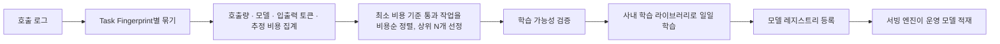
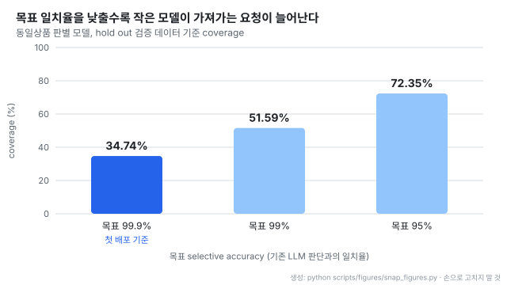
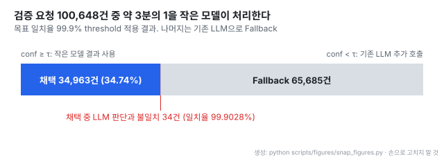
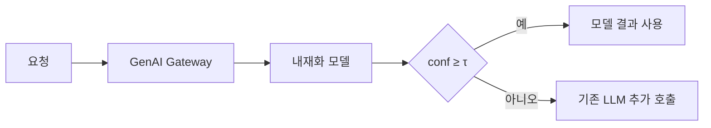

# 토스 SNAP: 작은 모델이 자신 있는 요청만 가져가 LLM 비용 줄이기

- **출처**: [손가락 튕기기로 LLM 비용 줄이기](https://toss.tech/article/snap-llm-cost-reduction)
- **저자**: 김형찬, 박민우, 임민섭 (토스)
- **발행**: 2026-10-27, 토스 기술 블로그
- **대상 작업**: 텍스트 기반 동일상품 판별. 두 상품의 이름과 옵션을 비교해 같은 판매 단위인지 분류한다
- **환경**: 약 110M 파라미터 분류 모델, Airflow 일일 배치, 사내 학습 라이브러리, 모델 레지스트리, GenAI Gateway. 부하 테스트는 L4 GPU 1장
- **읽은 날짜**: 2026-10-28
- **태그**: #LLMCost #SelectivePrediction #ModelCascade #Fallback #Confidence #토큰효율 #GenAIGateway

!!! note "핵심 요약"
    SNAP(Selective Native AI Processing)은 LLM 호출을 한 번에 자체 모델로 바꾸지 않는다. 작업별 소형 모델이 자신 있는 요청만 처리하고, 나머지는 기존 LLM으로 넘긴다(Fallback). 기준선은 hold out 검증 데이터에서 "기존 LLM 판단과의 일치율 99.9%" 를 지키는 threshold다. 첫 적용인 동일상품 판별에서 검증 요청의 34.74%를 작은 모델이 가져갔다. 운영 6일 동안 일별 약 33~37%를 처리해 입력 토큰 약 76억 개, 출력 토큰 약 4,520만 개를 줄였다. L4 1장으로 실제 처리량 초당 1,203건에서도 p99 15.23ms를 냈다.

## 1. 문제 제기

토스는 정책 읽기, 상품 비교, 문서 요약, 정형 값 추출 같은 업무에 LLM을 쓴다. 프롬프트 튜닝을 마치고 대용량 호출을 시작하면 비용과 Latency가 문제가 된다.

상용 LLM 대신 자체 모델로 내재화하면 비용을 크게 줄일 수 있다. LoRA 같은 Adapter 학습이나 Full Fine-Tuning을 검토할 수 있고, 토스에도 Fine-Tuning으로 비용을 크게 줄인 사례가 있다(수치는 공개하지 않았다).

그런데 모든 호출이 범용 LLM의 능력을 필요로 하지는 않는다. 두 상품이 같은지, 정해진 카테고리 중 무엇인지 고르는 작업은 전통 ML이나 작업 특화 소형 모델로 충분할 수 있다. 원문의 관점은 "중요한 것은 모델의 크기보다, 주어진 작업에 필요한 품질을 확보할 수 있느냐" 다.

## 2. SNAP의 3가지 규칙

SNAP은 해결해야 할 작업의 요청 전부를 한 번에 옮기지 않고, 작은 모델이 높은 신뢰도로 처리할 수 있는 트래픽부터 처리한다. 이름은 타노스의 손가락 튕기기(SNAP)에서 따왔다.

| # | 규칙 |
| --- | --- |
| 1 | 비교적 쉬운 요청은 작업별 소형 내재화 모델이 처리한다 |
| 2 | 어렵거나 애매한 요청은 기존 LLM으로 Fallback한다 |
| 3 | Fallback 기준은 내재화 모델의 Confidence와 Offline 검증 결과로 정한다 |

## 3. 작업 구분: Task Fingerprint

LLM 호출 로그에는 이질적인 요청이 섞여 있다. 같은 API Key, 같은 Endpoint로 호출해도 같은 작업이라는 보장이 없다.

토스가 본 로그에서는 많은 Workflow가 System Prompt 앞부분에 Role과 작업 정의를 두었고, Few-shot 예제가 바뀌어도 이 부분은 대체로 유지됐다. SNAP은 system prompt 앞부분을 해시해 작업 구분용 Fingerprint로 쓴다. 해시하는 앞부분의 길이는 원문에 없다.

## 4. 후보 발굴부터 학습까지 자동화

작업은 짧은 기간에 생기고 사라진다. LLM으로 PoC를 한 뒤 작업을 바꾸거나 프로젝트를 중단하기 때문이다. 사람이 하나씩 후보를 고를 수 없어 전 과정을 일일 배치로 자동화했다.

- **후보 선정**: 최근 일정 기간 추정 비용이 최소 기준을 넘는 작업만 비용순으로 정렬해 정해진 수만큼 고른다. 원문 Table 1은 상위 30개를 고른 예시이며 비용은 설명용 가상 값이다
- **학습 가능성 검증**: 응답이 정형화돼 있어 레이블을 안정적으로 뽑을 수 있는지, 레이블별 데이터가 충분한지, 학습과 평가 데이터를 분리할 수 있는지 본다. 통과한 작업만 학습으로 넘어간다
- **소요 시간**: 기준을 통과한 작업은 Airflow 일일 배치로 하루 안에 학습된 모델을 얻는다

## 5. 첫 적용 모델과 평가 구성

첫 대상은 동일상품 판별이다. 브랜드, 모델명, 용량, 색상, 구성품의 차이를 읽고 같은 상품인지 분류한다. 입출력 범위가 명확하고 기존 LLM 응답이 충분히 쌓여 있어 소형 분류 모델에 맞았다.

| 항목 | 내용 |
| --- | --- |
| 모델 크기 | 약 110M 파라미터 (아키텍처 이름은 원문에 없음) |
| 입력 | `상품1: {상품 텍스트 1}\n상품2: {상품 텍스트 2}` 하나의 시퀀스. 최대 256토큰, 초과분 잘라냄 |
| 데이터 | 매일 학습 대상 일자 데이터에서 1M건 샘플링. 90%를 학습에, 최근 7일 데이터에서 따로 떼어 둔 약 10%를 hold out 검증에 사용 |
| 평가 레이블 | 기존 LLM 응답에서 추출한 pseudo label. 사람이 검수한 정답이 아닌 LLM 판단과의 일치 여부로 평가 |
| Confidence | logit에 softmax를 적용한 뒤 가장 높은 클래스 확률 |
| threshold 선택 기준 | selective accuracy 99.9% 이상인 구간 중 coverage가 가장 큰 공통 threshold |

## 6. Confidence로 채택 범위 정하기

Confidence가 0.95라고 정답률이 95%라는 뜻은 아니다. 그래서 점수 자체를 믿지 않고, 검증 데이터에서 threshold를 바꿔 가며 두 값을 잰다.

모델의 Confidence는 다음과 같다. $z$ 는 모델이 낸 클래스별 logit이다.

$$
\mathrm{conf} = \max_k \, \mathrm{softmax}(z)_k
$$

threshold $\tau$ 이상인 요청의 집합을 $A(\tau) = \{\, i : \mathrm{conf}_i \ge \tau \,\}$, 검증 요청 수를 $N$ 이라 하면 두 값은 다음과 같다(원문 정의를 식으로 옮겼다).

$$
\mathrm{coverage}(\tau) = \frac{|A(\tau)|}{N}, \qquad
\mathrm{selective\ accuracy}(\tau) = \frac{\#\{\, i \in A(\tau) : \hat{y}_i = y_i^{\mathrm{LLM}} \,\}}{|A(\tau)|}
$$

목표 일치율 $\alpha$ 를 먼저 정하고, $\mathrm{selective\ accuracy}(\tau) \ge \alpha$ 를 지키는 $\tau$ 가운데 coverage가 가장 큰 값을 고른다. 학습 중 저장한 체크포인트들도 같은 방식으로 비교해 모델과 threshold를 함께 정한다.

첫 배포의 목표 일치율은 99.9%다. 검증 요청 100,648건 중 34,963건을 채택해 coverage 34.74%를 얻었다. 채택한 결과 중 LLM 판단과 다른 것은 34건으로, 실제 일치율은 99.9028%다.

- 목표를 99.9%에서 99%로 한 단계 낮추면 coverage가 34.74%에서 51.59%로 오른다. 요구 품질이 곧 절감 폭을 정한다
- 진한 막대가 첫 배포 기준이다. 품질 요구가 느슨한 작업이라면 같은 모델로 72.35%까지 가져갈 수 있다

- Fallback 65,685건은 100,648건에서 채택 34,963건을 뺀 값이다(원문에 직접 적힌 수는 아니다)
- 빨간 띠가 채택 중 LLM과 어긋난 34건이다. 채택분 안의 비율이라 막대에서는 거의 보이지 않는다

## 7. 운영 라우팅

클라이언트는 GenAI Gateway를 거쳐 내재화 모델을 먼저 호출한다. Gateway 자체는 [토스 AI Platform: GenAI Gateway](%5B20261013%5D%20토스_AI_Platform_GenAI_Gateway.md) 노트에 정리돼 있다.

Fallback된 요청은 내재화 모델 호출 시간이 LLM 호출 앞에 더해진다. 아래 부하 테스트 기준으로 p50 수 ms 수준이다(원문에 명시된 설명은 아니고 노트의 해석이다).

## 8. 첫 배포 결과

배포 후 약 6일간 동일상품 판별 작업에서 내재화 모델이 처리한 요청은 일별 약 33~37%였다. 오프라인 coverage 34.74%와 비슷해, 검증 데이터에서 정한 구간이 운영에서도 그대로 통했다.

| 6일간 줄어든 LLM 토큰 | 양 |
| --- | --- |
| 입력 토큰 | 약 76억 개 |
| 출력 토큰 | 약 4,520만 개 |

금액 환산과 기존에 쓰던 LLM 모델명은 원문에 없다.

부하 테스트는 L4 GPU 1장에서 목표 요청량을 초당 10건부터 1,200건까지 올리며 클라이언트 측 응답 시간을 쟀다. 운영 피크는 초당 약 500건이다.

| 실제 처리량 | p50 | p99 |
| --- | --- | --- |
| 초당 598건 (운영 피크 초과) | 7.24ms | 원문 기재 없음 |
| 초당 1,203건 | 9.02ms | 15.23ms |

모든 테스트 구간에서 실패하거나 드롭된 요청은 없었다.

## 9. 전체 전환 대비 부분 적용

전체 요청을 내재화하려면 넓은 범위에서 요구 품질을 맞춰야 한다. 어려운 요청까지 처리하려고 개발과 학습을 반복하면 투자가 커지고, 목표 품질에 못 미치면 운영 적용이 미뤄진다. 토스도 유사한 분류 작업을 전체 내재화할 때 여러 버전의 테스트셋으로 반복하느라 1~2개월이 걸렸다.

SNAP은 후보 발굴과 학습을 자동화하고 검증 기준을 통과한 요청부터 적용한다. 모든 요청을 해결하는 모델이 나오기 전에 LLM 호출을 줄이기 시작한다. 원문은 작업이 빠르게 바뀌는 환경에서는 최종 전환율뿐 아니라 얼마만큼의 자원으로 얼마나 빨리 적용하는지가 중요하다고 본다.

향후 계획으로 도메인 팀과 실제 오류와 요구 품질을 살피며 적용 범위를 넓히고, JEV처럼 특정 판단 문제에 맞춘 Decision Engine 형태 모델도 SNAP에 쓸 수 있는지 실험 중이다. JEV가 무엇인지는 원문에 설명이 없다.

## 10. 관련 연구

원문은 아래 연구를 인용하지 않는다. 구조가 같아 함께 읽을 만한 자료다.

| 자료 | 관계 |
| --- | --- |
| [Selective Classification for Deep Neural Networks](https://arxiv.org/abs/1705.08500) (Geifman & El-Yaniv, 2017, arXiv:1705.08500) | 목표 오류율을 정하고 그 아래에서 coverage를 최대화하는 threshold를 고르는 틀. SNAP의 threshold 선택과 같은 구조다 |
| [FrugalGPT](https://arxiv.org/abs/2305.05176) (Chen, Zaharia, Zou, 2023, arXiv:2305.05176) | 싼 모델부터 호출하고 점수가 낮으면 더 비싼 모델로 넘기는 LLM cascade. SNAP은 자체 소형 모델에서 상용 LLM으로 가는 2단계 cascade다 |
| [LLM 비용 64% 절감: Prompt Caching](%5B20260707%5D%20무신사_LLM비용_64절감_Prompt_Caching.md) (같은 레포) | 무신사는 같은 LLM 호출의 입력을 캐시해 줄이고, SNAP은 호출 자체를 작은 모델로 옮겨 줄인다 |
| [Logits as Confidence](%5B20260609%5D%20Medium_Logits_as_Confidence_LLM_VLM.md) (같은 레포) | logit 기반 confidence를 판단 근거로 쓰는 다른 사례 |

## 11. 해석 시 주의

!!! warning "결과 해석 시 주의 사항"
    - **99.9%는 정답률이 아니다.** 기존 LLM 판단과의 일치율이다. LLM이 틀린 요청에서 작은 모델이 같은 오답을 내면 일치로 센다. 원문 표도 "사람이 검수한 정답이 아니라" 고 밝힌다
    - **34.74%는 hold out 검증 기준이다.** 운영 6일 처리 비율 33~37%가 이를 뒷받침하지만, 그 이후 데이터 분포가 바뀔 때의 추이는 원문에 없다
    - **토큰 절감량은 6일 합계이고 금액 환산이 없다.** 출력 토큰이 입력의 약 0.6%로 작은 것은 분류형 응답이라 출력이 짧기 때문으로 보인다(노트의 해석)
    - **원문 Table 1의 비용, Figure 3의 분포는 설명용 가상 값이다**

## 12. 다른 시스템에 옮길 때의 순서

LLM 호출 중 분류, 라우팅, 정형 추출 같은 판정형 단계가 있는 시스템이면 같은 틀을 쓸 수 있다. 아래 순서는 원문 구성을 일반화한 것이며 원문에 이 형태로 적혀 있지는 않다.

1. system prompt 앞부분 해시로 호출 로그를 작업 단위로 묶는다
2. 비용순으로 후보를 고르고, 응답이 정형인 작업만 남긴다
3. LLM 응답을 pseudo label로 소형 분류기를 학습한다
4. hold out에서 목표 일치율을 지키는 threshold를 고른다
5. Gateway에서 confidence 기반 Fallback을 건다

선행 조건은 호출 로그가 작업을 구분할 수 있게 남아 있고 응답이 정형이라는 것이다. 생성형 답변 단계에는 그대로 쓰기 어렵다.

## 13. 결론

SNAP의 핵심은 "작은 모델이 LLM만큼 잘해야 쓴다" 는 전제를 버린 것이다. 품질 기준(LLM 일치율 99.9%)을 고정하고 그 기준을 지키는 요청만 떼어 내면, 모델이 완성되기 전부터 비용이 줄기 시작한다. 목표 일치율을 조정하면 같은 모델로 절감 폭을 34.74%에서 72.35%까지 바꿀 수 있어, 작업별 요구 품질에 맞춰 품질과 비용을 직접 맞바꾸는 손잡이가 생긴다.
