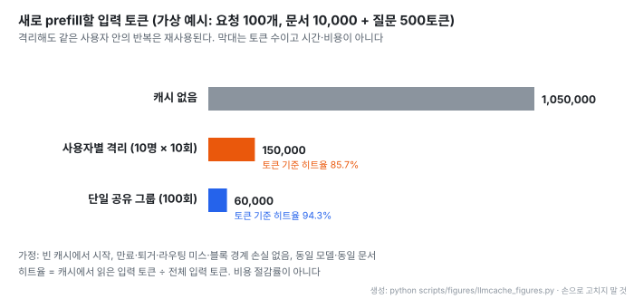
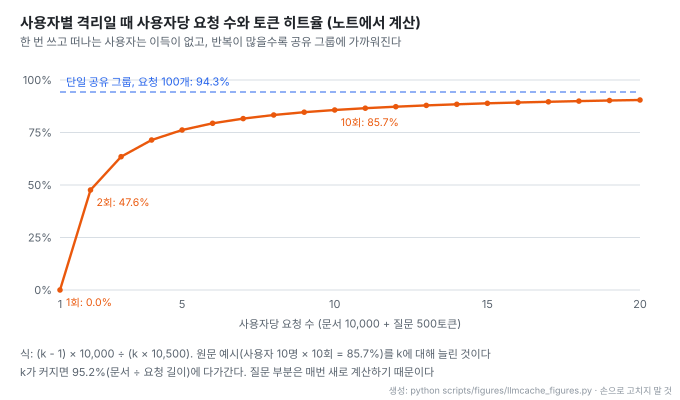

# LLM 캐시는 어떻게 작동할까: 프리픽스 캐싱, 캐시 고려 라우팅, 사용자 격리

- **원문**: [LLM 캐시는 어떻게 작동할까: 앤트로픽 S-1 보고서로 읽는 AI 인프라 효율화](https://roboco.io/posts/how-llm-caching-works/) · 로보코 블로그 · 2026-10-28
- **저자**: 정도현 (로보코 수석 컨설턴트)
- **형식**: 그림 7장과 각주 9개로 된 해설 글. 그림은 vLLM · SGLang · LMCache 공개 기술로 일반 원리를 설명한 것이고 Anthropic 내부 구성이 아니라고 원문이 밝힌다
- **읽은 날짜**: 2026-10-29
- **태그**: #PromptCaching #PrefixCaching #KVCache #vLLM #LMCache #CacheAwareRouting #MultiTenant

!!! note "핵심 요약"
    프롬프트 캐시는 같은 입력 앞부분을 처리하며 만든 KV 캐시를 다음 요청이 이어 쓰는 기술이고, 답을 꺼내 주는 캐시가 아니다. 효과는 앞부분이 바이트 단위로 얼마나 길게 일치하느냐에 달려 있어, 매번 바뀌는 값(시각, 세션 ID)을 앞에 두면 재사용이 깨진다. 규모가 커지면 블록 단위 공유(vLLM), 캐시 위치와 부하를 함께 보는 라우팅(SGLang), GPU 밖 메모리 계층(LMCache)이 필요해진다. 글의 후반은 격리를 다룬다. 사용자별로 캐시를 나눠도 같은 사용자 안의 반복은 재사용되고(가상 예시에서 토큰 히트율 85.7%, 단일 공유 그룹이면 94.3%), 해시 일치는 권한이 아니며, GPU 밖으로 옮긴 캐시와 타이밍 부채널까지 같은 경계를 지켜야 한다. 글의 수치는 S-1 인용과 가상 예시뿐이고 실측은 없다.

## 1. S-1이 보여주는 변화

글은 2026-10-26 공개된 [Anthropic S-1](./[20261026]%20Anthropic_S-1_상장신고서_요약.md)에서 출발한다. S-1은 같은 성능에 필요한 추론 연산을 줄이는 연구와 연산 자원 활용을 높이는 운영 최적화를 함께 설명한다(「Compute Efficiency」). 글은 S-1의 플랫폼 설명을 인용해 긴 프롬프트에 캐싱을 적용하면 비용이 최대 약 97%, 지연이 약 60% 줄어든다고 적는다(S-1 원문에서 직접 확인하지 않음, 미검증).

글이 바로 덧붙이는 단서가 중요하다. 이 수치는 긴 프롬프트에 대한 조건부 효과이며, Anthropic 전체 운영비가 그만큼 줄었다거나 효율 개선이 모두 캐시 덕이라는 뜻이 아니다.

## 2. prefill과 decode, 그리고 KV 캐시

LLM 추론은 두 단계다. prefill은 입력 전체를 처리해 답을 만들 때 참조할 내부 상태를 계산하고, decode는 그 상태를 참조하며 답을 토큰 단위로 만든다. 이때 어텐션이 쓰는 key와 value 배열을 보관한 것이 KV 캐시다. 같은 요청 안에서는 다음 토큰을 만들 때 이전 토큰을 다시 계산하지 않게 해 준다([PagedAttention](https://arxiv.org/abs/2309.06180)).

이 재사용을 요청 사이로 넓힌 것이 프롬프트 캐싱(프리픽스 캐싱)이다([vLLM Automatic Prefix Caching](https://docs.vllm.ai/en/stable/features/automatic_prefix_caching/)). 새 요청이 이전 요청과 같은 입력으로 시작하면 앞부분의 KV를 가져와 이어서 계산한다. 줄어드는 것은 공통 앞부분의 prefill이고, 새 질문의 처리와 답 생성은 그대로 남는다. 글은 "지난번과 비슷한 답을 꺼내준다" 와는 동작이 다르다고 강조한다.

## 3. 앞부분이 일치해야 하는 이유

자기회귀 트랜스포머에서 한 토큰의 내부 상태는 앞 토큰 전부의 영향을 받는다. 같은 문서라도 앞에 다른 지침이 붙으면 다른 계산이 된다. 그래서 재사용 범위는 "내용이 같은가" 가 아니라 "처음부터 어디까지 같은가" 로 정해진다.

| 배치 | 결과 |
| --- | --- |
| 요청 맨 앞에 매번 다른 시각 · 세션 ID | 뒤의 설명서가 같아도 이전 계산과 이어지지 않음 |
| 공통 지침과 문서를 앞에, 새 질문을 뒤에 | 공통 경로가 길어져 재사용 증가 |
| 에이전트가 도구 정의 · 지침 · 대화를 유지하고 새 결과만 뒤에 추가 | 재사용 증가 |
| 대화 이력을 요약본으로 교체, 공통 지침 수정 | 바뀐 지점 이후 재계산 |

글은 이것이 "문장을 짧게 만들기" 와 다른 최적화라고 짚는다. 입력이 길어도 대부분이 안정적으로 반복되면 재사용할 계산이 많다.

## 4. 블록 단위 공유

동시에 진행되는 대화가 많아지면 KV 캐시를 놓을 메모리 관리가 문제가 된다. PagedAttention은 KV 캐시를 블록으로 나눠, 공통 부분은 한 벌을 함께 참조하고 요청마다 다른 부분만 따로 둔다.

vLLM은 블록을 찾을 때 그 블록의 토큰과 앞 블록의 해시를 함께 쓴다([vLLM prefix caching 설계](https://docs.vllm.ai/en/stable/design/prefix_caching/)). 앞부분까지 식별에 묶이므로 같은 단어가 나와도 문맥이 다른 계산을 섞지 않는다. 메모리가 부족하면 지금 쓰는 블록은 두고, 사용이 끝나 재사용을 기다리는 블록 중에서 교체 대상을 고른다. 캐시 관리는 결국 미래의 재사용 기회와 지금의 메모리 수요를 맞바꾸는 일이다.

## 5. 캐시 고려 라우팅

서버가 여러 대면 "어디로 보낼까" 가 재계산량을 정한다. 요청 수만 균등하게 나누면 다른 서버에 있는 캐시를 놓친다. 그래서 라우터는 누가 이 앞부분을 재사용할 수 있는지와 그 서버에서 얼마나 기다려야 하는지를 함께 본다. 캐시가 있는 서버의 대기열이 너무 길면 다른 서버가 새로 계산하는 편이 빠를 수 있다. 공개 구현으로 [SGLang Model Gateway](https://docs.sglang.io/docs/advanced_features/sgl_model_gateway)가 캐시와 부하를 고려하는 정책을 제공한다. 캐시 전송이나 공유 계층이 없다면 캐시는 그 서버에 있을 때만 의미가 있다.

## 6. GPU 밖 메모리 계층

GPU 메모리는 빠르지만 작다. [LMCache](https://docs.lmcache.ai/)처럼 KV 캐시를 CPU 메모리, 로컬 저장소, 원격 저장소로 옮겨 두는 계층을 둘 수 있다. 다만 가져오는 데 시간과 네트워크가 든다. 가져오는 비용이 다시 계산하는 비용보다 낮을 때만 이득이므로, 짧은 입력은 새로 계산하는 편이 나을 수 있고 긴 공통 문서는 가져오는 편이 유리할 수 있다.

## 7. 재사용 규모의 가상 예시

글은 실측이 아닌 가상 예시로 규모 효과를 보여 준다. 요청 100개가 모두 같은 10,000토큰 문서와 서로 다른 500토큰 질문을 보낸다.

- 캐시가 없으면 10,500 × 100 = 1,050,000토큰을 prefill한다. 한 그룹이 모두 공유하면 10,000 + 500 × 100 = 60,000토큰으로, 새로 prefill할 입력이 약 94.3% 준다
- 사용자 10명이 각자 10번씩 보내고 사용자끼리 캐시를 나누지 않아도 900,000토큰을 캐시에서 읽어 토큰 히트율 약 85.7%가 나온다(8절)
- 글이 직접 강조하는 해석 범위: 토큰 수 비교이지 시간 · 비용이 아니다. 캐시 읽기, 보관 메모리, 전송, 모든 답 생성이 남고 연산량은 토큰 수에 단순 비례하지 않는다. 만료 · 퇴거 · 라우팅 미스가 없다고 가정했다

## 8. 효율과 사용자 컨텍스트 격리

글의 답은 "가능하다, 다만 격리 범위를 좁힐수록 재사용할 수 있는 요청도 줄어든다" 이다. 저장 위치(GPU · CPU · 저장소)와 재사용 경계(공개 · 조직 · 사용자 · 세션)는 별개의 축이다. GPU에 있다고 격리가 보장되지 않고, 같은 원격 저장소를 써도 사용자별 접근은 나눌 수 있어야 한다.

| 컨텍스트 | 재사용 범위 | 효율과 격리의 절충 |
| --- | --- | --- |
| 공개 지침 · 공개 설명서 | 서비스가 허용한 공유 그룹 | 넓게 재사용할 기회가 있음 |
| 회사 내부 문서 | 해당 조직에서 같은 권한을 가진 사용자 | 같은 회사라도 문서별 권한 확인 |
| 개인 대화 · 개인화 정보 | 해당 사용자 또는 세션 | 범위는 좁지만 그 안의 반복은 재사용 |

### 해시는 권한이 아니다

내용이 일치한다는 식별값과 그 내용을 쓸 자격은 다른 문제다. 엔진이 이 경계를 자동으로 나눠 주지도 않는다. vLLM의 `cache_salt`는 첫 블록의 해시에 들어가고 그 경계가 뒤 블록 식별로 이어지므로, 사용자별로 다른 salt를 쓰면 같은 공개 문서까지 사용자마다 따로 계산 · 보관하게 될 수 있다. "공개 앞부분은 공유하고 개인 부분부터만 격리" 하려면 엔진이 구간별 공유와 접근 통제를 지원하는지 따로 확인해야 하고, 지원하지 않으면 사용자별 또는 권한 그룹별로 캐시 전체를 나누는 것이 현실적이다.

### 격리해도 같은 사용자 안의 반복은 남는다

- 글의 예시(사용자 10명 × 10회)를 사용자당 요청 수에 대해 늘려 계산한 그림이다. 한 번만 요청하고 떠나는 사용자는 히트율 0%이고, 두 번째 요청부터 47.6%, 10번이면 85.7%가 된다
- 반복이 많을수록 단일 공유 그룹(94.3%)에 가까워지지만, 질문 부분은 매번 새로 계산하므로 95.2%(문서 ÷ 요청 길이)를 넘지 못한다
- 격리 단위를 정할 때 "몇 명이 공유하나" 와 함께 "그 단위 안에서 얼마나 반복되나" 를 봐야 한다. 요청마다 다른 격리값을 붙이면 이 반복 이득까지 사라진다

글은 히트율을 캐시에서 읽은 입력 토큰을 전체 입력 토큰으로 나눈 값으로 정의하고, 캐시를 조금이라도 읽은 요청 비율이나 비용 절감률과 다르다고 밝힌다.

### 캐시가 있다는 사실도 정보다

캐시 적중 시 응답이 빨라지는 차이를 반복 관찰하면 특정 입력이 이전에 쓰였는지 추정할 단서가 생긴다(타이밍 부채널, [PrefixWall, arXiv:2603.10726](https://arxiv.org/abs/2603.10726)). 다른 사용자의 대화가 내 요청에 섞이는 문제와 사용 흔적이 드러나는 문제는 따로 막아야 한다. 캐시 키 정확성 검증이 보안 검증을 대신하지 못하는 이유다.

관리형 API의 격리 범위도 확인 대상이다. 글은 Claude API가 워크스페이스 단위로 캐시를 격리하지만, 한 워크스페이스로 여러 고객을 처리하는 서비스의 개별 사용자를 나눠 주지는 않는다고 짚는다([Anthropic prompt caching 문서](https://platform.claude.com/docs/en/build-with-claude/prompt-caching#cache-storage-and-sharing), 원문 2026-10-28 확인).

### 다층 캐시의 운영 조건

| 조건 | 내용 |
| --- | --- |
| 경계 결정 | 인증된 사용자와 문서 권한으로 서버가 재사용 범위를 정한다. 클라이언트가 보낸 사용자 ID나 salt만 믿지 않는다 |
| 경계 유지 | GPU 블록 조회뿐 아니라 CPU 캐시, 원격 저장소, 서버 간 전송, 캐시 위치 목록에도 같은 구분을 유지한다 |
| 접근 통제와 암호화 구분 | 저장 · 전송 암호화와 별도로, 복호화할 수 있는 서비스가 누구의 자료를 꺼내 줄 수 있는지 제한한다 |
| 권한 변경과 삭제 | 권한이 회수되면 캐시가 남아 있어도 다음 사용을 막는다. GPU 밖 복사본에도 보관 기한 · 삭제 정책을 적용한다 |

[LMCache 저장 암호화 문서](https://docs.lmcache.ai/mp/serde.html)가 이 차이를 보여 준다. 테넌트별 salt로 키를 나눠도 공통 마스터 키를 가진 서버는 모든 테넌트를 복호화할 수 있어, 그것만으로 테넌트 간 접근 격리가 성립하지 않는다고 문서가 직접 적는다.

## 9. 읽을 때 감안할 것

- **실측이 없는 해설 글이다.** 수치는 S-1 인용(97%, 60%, 이 노트에서는 미검증)과 가상 예시뿐이다. 실제 히트율은 공통 입력 길이, 재사용 빈도, 메모리 여유, 라우팅, 만료에 따라 달라진다
- **비율은 모두 토큰 기준이다.** 94.3%와 85.7%는 새로 prefill할 입력 토큰의 감소율과 히트율이지 비용 · 지연 감소율이 아니다. 글이 직접 여러 번 강조한다
- **Anthropic의 구조가 아니다.** 그림은 공개 오픈소스 기술로 그린 일반 원리다
- **구간별 공유는 엔진 지원이 전제다.** 그림 7의 "공통 앞부분 공유 + 개인 부분 분리" 는 설계 개념이고 vLLM 기본 방식(요청 전체에 salt)과 다르다고 글이 밝힌다

## 10. 가져갈 지점

| 대상 | 가져갈 수 있는 부분 |
| --- | --- |
| 프롬프트 배치 | 변하지 않는 지침 · 도구 정의 · 문서를 앞에, 매번 바뀌는 값과 새 질문을 뒤에 둔다. 앞부분에 시각이나 요청 ID를 넣지 않는다 |
| 에이전트 대화 관리 | 대화를 요약본으로 교체하면 그 지점 이후 캐시가 깨진다. 요약 시점과 캐시 비용을 함께 고려한다 |
| 효과 측정 | 토큰 히트율, 요청 단위 적중률, 비용 절감률을 구분해 보고한다 |
| 격리 설계 | 격리 단위를 권한 기준으로 정하고, 그 단위 안의 반복 빈도로 기대 히트율을 계산한다. 요청마다 새 salt를 붙이지 않는다 |
| 보안 검증 | 권한이 다른 사용자 사이의 조회 · 재사용이 거부되는지, 캐시 적중 지연 차이가 정보가 되지 않는지 별도로 검증한다 |

같은 주제의 실무 사례로 [무신사의 Prompt Caching 비용 절감기](./[20260707]%20무신사_LLM비용_64절감_Prompt_Caching.md)가 있고, 앞부분을 바이트 단위로 고정해 캐시를 노리는 설계는 [Graphicle의 cache layout pack](../repos/[20261014]%20Graphicle-AI_graphicle_코딩에이전트용_코드그래프_메모리.md)에서도 볼 수 있다.

## 11. 결론

프롬프트 캐시의 원리는 단순하다. 이미 한 계산을 보관하고 다음 요청이 그 지점에서 이어 가게 한다. 이 글의 가치는 원리보다 경계를 다루는 후반에 있다. 재사용 범위는 앞부분 일치가 정하고, 공유 범위는 권한이 정하며, 두 축은 따로 설계해야 한다. 사용자별로 격리해도 반복이 많으면 히트율은 충분히 높게 나오므로, 효율 때문에 격리를 포기할 이유는 크지 않다. 다만 글의 수치는 모두 가정 위의 토큰 계산이므로, 실제 서비스에서는 비용과 지연을 따로 측정해야 한다.
