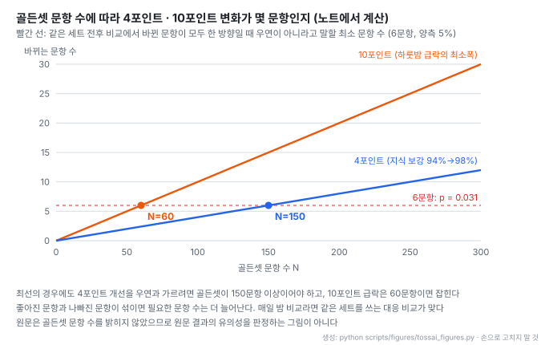
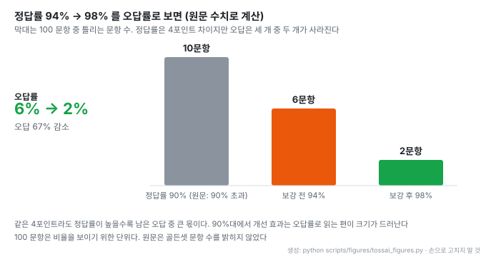

# 토스 AI-Ready Data: 표준 마트 위에 온톨로지를 얹고 골든셋으로 관리하는 데이터 의미 층

- **출처**: [AI-Ready Data의 최전선: 온톨로지와 시맨틱 레이어로 데이터에 의미를 연결하는 일](https://toss.im/career/article/2611_data)
- **형식**: 토스 채용 사이트 아티클(시리즈 Data), 질문과 답으로 구성한 인터뷰. 원문에 구조도나 그림은 없다
- **인터뷰이**: 이기흔 (토스 Data Warehouse Team, Data Analytics Engineer). 인터뷰와 편집 윤석원
- **발행**: 2026-11-09
- **다루는 시스템**: 표준 데이터 마트 위의 온톨로지 · 지식 그래프 · 시맨틱 레이어, MCP와 API로 공개한 데이터 도구, 도메인별 골든셋 야간 평가, 오답 관측 기반 지식 패치 루프
- **읽은 날짜**: 2026-11-10
- **태그**: #KnowledgeGraph #Ontology #SemanticLayer #TextToSQL #GoldenSet #DataLineage

!!! note "핵심 요약"
    토스 데이터 조직은 이미 있는 표준 마트("값이 맞는 데이터") 위에 테이블 · 컬럼 · 지표 · 비즈니스 개념을 노드로 둔 지식 그래프를 얹어 "의미가 연결된 데이터"를 만든다. 에이전트는 MCP와 API로 열린 이 그래프에서 개념을 찾고, 검증된 조인과 합의된 지표 정의를 따라 쿼리를 만든다. 품질은 도메인 팀과 함께 만든 골든셋을 매일 밤 돌려 숫자로 관리한다. 마이데이터 도메인은 정답률 90%를 넘겼고, 지식 보강 하나로 94%에서 98%가 됐다. 반대로 정답률이 하룻밤에 두 자릿수 포인트 이상 떨어진 원인은 지식이 아니라 배포 중 빠진 설정값이었다. 원문은 채용 인터뷰라 골든셋 크기, 도메인 수, 사용량 같은 수치는 대부분 밝히지 않는다.

## 1. 개요

데이터 웨어하우스에는 좋은 데이터가 이미 쌓여 있지만, 그 데이터가 무엇을 뜻하는지는 사람의 머릿속과 흩어진 문서에만 있다. 사람은 헷갈리면 동료에게 묻지만 AI 에이전트에게는 물어볼 동료가 없다. 그래서 비슷한 이름의 테이블 수십 개 앞에서 그럴듯하지만 틀린 쿼리를 자신 있게 내놓는다.

이 글이 기존 데이터 카탈로그나 문서화와 갈리는 지점은 의미 층을 "문서화가 아니라 엔지니어링"으로 다룬다는 점이다. 지식을 담는 스키마를 설계하고, 검색 엔진에 색인하고, 파이프라인에서 리니지(데이터가 어디서 흘러왔는지)를 추출 · 검증하고, 에이전트가 쓰는 도구로 공개하는 것까지 한 과정으로 본다. 그리고 그 결과를 골든셋 정답률로 잰다.

인터뷰이는 원래 데이터 마트를 설계하는 Data Analytics Engineer(DAE)였고, 지금은 그 마트를 AI에게 설명하는 플랫폼을 맡는다. 여러 도메인 팀이 각자의 지식을 이 플랫폼에 올리도록 돕는 일도 함께 한다.

## 2. 용어 구분

원문은 비슷하게 쓰이는 세 용어를 이렇게 나눈다.

| 용어 | 원문 정의 |
| --- | --- |
| 온톨로지 | 개념과 관계의 틀을 정의하는 구조 |
| 지식 그래프 | 그 틀 안에 실제 테이블과 지표를 채워 연결한 결과물 |
| 시맨틱 레이어 | 지표 정의처럼 쿼리로 바로 가져다 쓰는 층 |

온톨로지는 스키마, 지식 그래프는 그 스키마의 인스턴스, 시맨틱 레이어는 쿼리 생성에 직접 쓰이는 지표 정의 층이다. 같은 구분을 개념 수준에서 풀어 쓴 글로 [OntoBricks 온톨로지 노트](%5B20261015%5D%20OntoBricks_온톨로지_개념_지식그래프_첫걸음.md)가 있다.

## 3. 그래프 구성과 자동 추출

노드는 테이블, 컬럼, 지표, 비즈니스 개념 네 가지다. 엣지는 원문이 든 예로 보면 세 종류다.

- 계산: "이 지표는 이 테이블에서 계산된다"
- 흐름(리니지): "이 컬럼은 저 원천에서 흘러왔다"
- 조인: "이 두 테이블은 이 키 값으로 조인한다"

이걸 전부 사람이 적지 않는다. 파이프라인에서 자동으로 뽑을 수 있는 것은 기계가 뽑고, 사람은 검증과 예외에 집중한다. 질문이 들어오면 AI는 그래프를 따라 올바른 테이블을 찾고, 검증된 조인 관계를 따라가고, 합의된 지표 정의로 쿼리를 만든다.

```
자연어 질문
   ↓
온톨로지에서 관련 개념 검색
   ↓
지식 그래프로 테이블 · 지표 관계 확인 (검증된 조인, 합의된 지표 정의)
   ↓
쿼리 생성 · 실행
```

## 4. 표준 마트 위에 얹는 이유

원문은 "표준 마트가 없었다면 온톨로지는 시작조차 못 했을 것"이라고 말한다. 역할이 다르다. 표준 마트는 거래 데이터를 일관된 구조로 제공하지만, "특정 서비스 매출을 집계하려면 어떤 컬럼을 어떤 조건으로 계산하는가"는 여전히 사람의 경험에 있다. 온톨로지는 이 지식을 지표 정의로 적어 테이블과 컬럼에 연결한다. 그러면 같은 질문에 사람마다, 에이전트마다 다른 쿼리를 짜서 결과가 달라지는 문제가 줄어든다.

> 온톨로지의 품질은 그 아래 데이터 모델의 품질을 넘을 수 없어요.

그래서 마트 설계와 온톨로지 설계를 별개 작업으로 두지 않고 하나의 연속된 과정으로 다룬다.

2000년대 시맨틱 웹과의 차이도 짚는다. 당시에는 구축한 지식을 소비할 주체가 없었고 만드는 과정도 전부 수작업이었다. 지금은 쓸 에이전트가 실제로 있고, 지식을 만드는 큰 부분을 파이프라인과 진단 시스템이 맡는다. "우리 회사에서 매출이란 무엇인가" 같은 정의는 모델이 아무리 좋아져도 스스로 추론할 수 없는 사람 간 합의의 결과물이라는 것이 원문의 논지다.

## 5. 에이전트 활용

검토를 거쳐 접근이 허용된 데이터 자산만 MCP(Model Context Protocol)와 API로 열었다. 목표는 데이터 조직이 아닌 구성원도 챗봇에 묻기만 해서 원하는 데이터를 정확히 꺼내 쓰는 것이고, 일부 도메인에서 이미 활발히 쓰인다고 한다(사용량 수치는 없다).

같은 그래프가 질문 응답 밖에서도 쓰인다.

| 용도 | 동작 |
| --- | --- |
| 질문 응답 | 개념 검색 → 그래프로 관계 확인 → 쿼리 생성 · 실행 |
| 원인 추적 | 지표 이상 시 리니지 그래프를 역추적해 원인 데이터 원천 후보를 몇 번의 대화로 좁힌다. 모든 사례에 되지는 않고, 잘 되는 영역부터 넓히는 중이다 |
| 선제 탐지 | 회계 정산 팀 사례. 핵심 지표가 평소와 다르게 움직이면 먼저 감지하고, 리니지로 어느 원천의 어느 구간인지 추적해 담당자에게 알린다 |

이전에는 지표 이상이 생기면 사람이 쿼리 이력과 문서를 뒤지며 상류 테이블을 하나씩 열었다. 원문의 표현으로는 사람이 대시보드에서 뒤늦게 발견하는 대신 "시스템이 먼저 말을 거는" 구조다.

## 6. 골든셋 품질 관리

품질은 감이 아니라 숫자로 관리한다. 도메인마다 "이 질문에는 반드시 이 답이 나와야 한다"는 정답 세트(골든셋)를 그 도메인을 가장 잘 아는 팀과 함께 만들고, 매일 밤 자동 검증을 돌린다. 검색 로직을 바꾸거나 지식을 추가하면 정답률 변화를 숫자로 보고, 떨어지면 바로 원인을 추적한다.

원문이 든 사고 사례는 정답률이 하룻밤 사이 두 자릿수 포인트 이상 떨어진 일이다. 원인은 지식 노후가 아니라 배포 과정에서 빠진 설정값 일부였고, 야간 검증 덕분에 빨리 찾아 원복했다. 원문은 여기서 정답률 하락이 모두 실제 품질 하락은 아니라고 덧붙인다. 채점 기준 자체의 오류, 인프라 문제가 섞이기 때문에 이 요인을 하나씩 분해하는 것부터가 일이다.



- 원문은 골든셋 문항 수를 밝히지 않았다. 그림은 "N문항이면 4포인트 · 10포인트가 몇 문항인가"를 보이는 계산이고, 원문 결과의 유의성을 판정하지 않는다
- 빨간 선 6문항은 같은 세트로 전후를 비교하고 바뀐 문항이 모두 한 방향인 최선의 경우(exact McNemar 양측 검정, 5%)다. 이 조건에서도 4포인트를 우연과 가르려면 150문항 이상이 필요하다
- 10포인트 급락은 60문항이면 잡힌다. 야간 검증이 설정 누락 같은 큰 사고를 잡는 데 강하고, 몇 포인트짜리 개선을 가리는 데는 세트 크기가 받쳐 줘야 한다는 뜻이다

## 7. 자기 진화 루프

온톨로지는 계속 낡는다. 테이블 구조가 바뀌고 새 지표가 추가되면서 어제의 정답이 오늘의 오답이 된다. 사람이 매번 고치는 방식은 지속할 수 없어서, 스스로 진화하는 루프를 실험하고 있다.

```
오답 · 검색 실패 기록 관측
   ↓
지식의 부족한 부분 진단
   ↓
보완 패치 제안
   ↓
골든셋 검증 ── 실패 → 자동 롤백
   ↓ 통과
사람 승인 → 반영
```

- 관측 · 진단 · 검증은 시스템이 맡고, 사람은 판단이 필요한 최종 반영 지점에만 들어간다
- 골든셋도 낡으므로 갱신 프로세스를 따로 둔다. 패치를 만들 때 참고하는 신호와 검증에 쓰는 세트를 분리해, 패치가 검증셋에만 맞춰지는 오버피팅을 막는다
- 같은 구조를 파이프라인 운영에도 넓히고 있다. 장애가 나면 원인을 분석하고 수정 PR 초안까지 올리는 에이전트를 파이프라인 담당자들과 함께 만든다. 오답을 관측 · 진단 · 검증하는 인프라를 공유하기 때문이다

## 8. 연구 도입 기준과 결과

GraphRAG 계열 논문을 계속 읽지만, 논문의 성과 지표는 벤치마크 환경의 숫자일 뿐이라 그대로 믿지 않는다. 새 기법은 내부 골든셋 검증 환경에 올려 실제 질문 패턴에서 정답률이 오르는지 보고, 유의미하게 오른 것만 도입한다. 그래서 검증 환경을 만드는 엔지니어링이 전체 업무의 절반을 차지한다고 한다.

> 측정할 도구가 없으면 연구는 그저 감상으로 끝나거든요.

상용 온톨로지 플랫폼을 들여오지 않고 직접 만든 이유는 이미 갖춘 표준 마트 체계와 데이터 전 구간을 자체 소유한 구조를 활용하는 편이 범용 엔진보다 효과적이라고 판단했기 때문이다. 원문이 공개한 결과 수치는 마이데이터 도메인 하나다. 사용자 질의 골든셋 정답률이 90%를 넘겼고, 지식 보강 하나로 94%에서 98%로 올라 검증 후 반영했다.



- 4포인트 상승은 오답률로 보면 6%에서 2%, 틀리던 문항 세 개 중 두 개가 사라진 것이다
- 90%대에서는 정답률보다 오답률로 읽어야 개선 크기가 드러난다
- 100문항은 비율을 보이기 위한 단위다. 실제 골든셋 크기는 원문에 없다

접은 실험도 하나 소개한다. 지표 설명문을 통째로 색인하면 당연히 좋아질 줄 알았는데, 설명 속 부정어 때문에 엉뚱한 문서가 상위로 올라오는 것을 발견하고 접근을 바꿨다.

## 9. 도메인 온보딩과 역할 분담

플랫폼에는 표준 마트 영역 수십 개가 각각 지식 베이스로 올라와 있다. 결제, 자산관리, 매출 조기경보처럼 성격이 다른 도메인들이다. 먼저 시도한 팀이 부딪혀 찾은 답으로 규약과 가이드를 정리했고, 나중에 합류하는 팀은 그 덕에 훨씬 수월하게 올린다.

| 주체 | 맡는 일 |
| --- | --- |
| 도메인 팀 | 도메인 지식 정의 · 작성, 골든셋 공동 작성 |
| 플랫폼 팀 | 지식을 담는 스키마, 변환기, 자동 검증 도구, 규약 |

플랫폼 엔지니어가 모든 도메인 지식을 알 수는 없지만, 지식이 안전하게 쌓이고 검증되는 구조는 만들 수 있다는 분담이다.

## 10. 필요 역량

원문이 꼽는 순서는 다음과 같다.

1. **데이터 모델링**. 출발점은 LLM이 아니다. 온톨로지 설계는 "도메인의 개념을 어떤 구조로 표현할 것인가"라는 모델링 문제라서, 복잡한 현실을 재사용 가능한 구조로 단순화한 경험과 SQL · 쿼리 엔진 이해가 그대로 쓰인다
2. **엔지니어링**. 검색과 랭킹, 그래프 탐색, 파이프라인 자동화, 필요하면 도구 화면까지. 인터뷰이도 검색 랭킹과 에이전트 도구 설계는 이 일을 하며 처음 다뤘다고 한다
3. **기준을 세우고 설득하는 힘**. "매출" 하나도 팀마다 취소 건을 넣거나 뺀다. 여러 팀의 지식을 한 그래프에 이으려면 누군가 "우리 그래프에서 이 개념의 정의는 이것"이라고 선을 긋고 합의를 만들어야 한다

## 11. 관련 자료

- [NVIDIA auto-ontology](../repos/%5B20260427%5D%20NVIDIA_auto-ontology_에이전트용_시맨틱레이어_TextToSQL.md): DB 메타데이터로 에이전트용 시맨틱 레이어를 자동 생성해 Text-to-SQL에 쓰는 도구. 이 글의 "자동 추출 가능한 것은 기계가 뽑는다"에 해당한다
- [NVIDIA auto-ontology-eval](../repos/%5B20260702%5D%20NVIDIA_auto-ontology-eval_TextToSQL_온톨로지효과_대조평가.md): 온톨로지 유무로 Text-to-SQL 정답률을 대조하는 평가 도구. 숨은 설정 결함이 점수를 바꾼 사례가 이 글의 설정 누락 급락과 같은 종류다
- [OntoSmith](../repos/%5B20261022%5D%20Dongbumlee_ontosmith_온톨로지우선_판정게이트_지식그래프빌더.md): 온톨로지를 먼저 정하고 판정 모델 게이트로 지식을 넣는 빌더. 자기 진화 루프의 "검증 통과 후 반영"과 비교할 만하다
- [카카오페이증권 if(kakao)26](%5B20261014%5D%20카카오페이증권_ifkakao26_지식그래프_설명가능_금융에이전트.md): 같은 시기 국내 금융사의 지식 그래프 에이전트 발표. 그쪽은 뉴스 사건 그래프, 이쪽은 데이터 웨어하우스 메타데이터 그래프다
- [GraphRAG-Bench](../papers/%5B20260929%5D%20GraphRAG-Bench_When_to_use_Graphs_in_RAG.md): 그래프가 RAG에 언제 도움이 되는지 재는 벤치마크. 원문이 말하는 "벤치마크 숫자를 내부 데이터에서 다시 잰다"의 바깥쪽 기준이다

## 12. 해석 시 주의

!!! warning "채용 인터뷰라는 형식"
    원문은 기술 블로그가 아니라 채용 아티클이다. 골든셋 문항 수, 지식 그래프 노드 · 엣지 수, 도메인 수("수십 개"), 사용자 수, 급락 폭("두 자릿수 포인트 이상")의 정확한 값이 없다. 공개된 정답률(90% 초과, 94% → 98%)은 마이데이터 도메인 하나의 값이고, 다른 도메인에 일반화할 근거는 원문에 없다.

- 4포인트 개선이 통계적으로 의미 있는지는 골든셋 크기에 달렸다(6절 그림). 원문은 "유의미한 상승이 있는 기법만 선택적으로 도입"한다고 했지만 유의성 판정 방법은 설명하지 않는다
- 자기 진화 루프는 "실험하고 있다"는 단계다. 자동 패치가 실제로 얼마나 반영됐는지는 나오지 않는다
- 그래프 저장소, 검색 엔진, 임베딩 모델 같은 구현 스택은 밝히지 않았다

## 13. 결론

이 글에서 가져갈 것은 기술 스택보다 운영 순서다. 값이 맞는 표준 마트가 먼저 있고, 그 위에 의미 층을 얹고, 그 층을 골든셋 정답률로 매일 잰다. 새 기법도 지식 보강도 같은 골든셋에서 오른 것만 반영한다. 정답률이 떨어지면 지식, 채점 기준, 인프라 중 어디가 원인인지부터 가른다. 의미 층의 가치를 정하는 것은 그래프의 크기가 아니라 이 측정 장치의 신뢰도이고, 그 신뢰도는 골든셋의 크기와 갱신 방식에 달려 있다.
