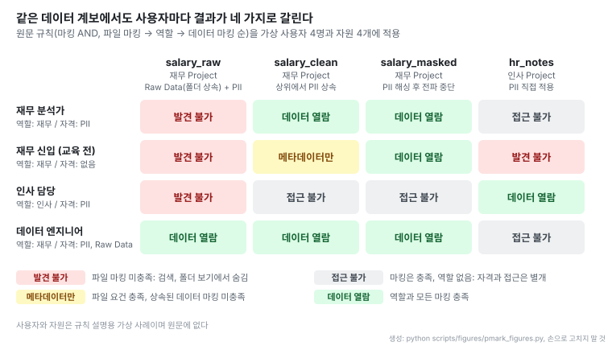

# Palantir Foundry Markings: 데이터를 따라 전파되는 필수 접근 제어

- **출처**: [Markings (Palantir Foundry 문서, Security)](https://www.palantir.com/docs/foundry/security/markings)
- **형식**: 제품 문서. 수치는 없고 원문 그림 12개(화면 캡처와 개념도)가 있다
- **발행**: 페이지에 발행일 표시가 없다. 파일명 날짜는 HTTP `last-modified` 값(2026-11-16)이며, 문서 사이트를 다시 빌드한 시각일 수 있다(미검증)
- **다루는 시스템**: Foundry의 마킹(Marking), 역할(Role)과의 관계, 파일 계층과 데이터 의존을 따라가는 상속, `stop_propagating` 으로 전파 중단, scoped session
- **읽은 날짜**: 2026-11-18
- **태그**: #AccessControl #DataGovernance #MandatoryAccessControl #DataLineage #PII

!!! note "핵심 요약"
    마킹은 Foundry의 파일, 폴더, Project에 붙이는 추가 접근 제어다. 자원에 붙은 마킹 전부에 속해야 접근할 수 있고(AND), 역할이 Owner여도 마킹 요건을 못 채우면 어떤 방식으로도 접근하지 못한다. 역할이 "데이터가 어디에 있는가"에 묶이는 반면 마킹은 데이터를 따라간다. 폴더나 Project 계층으로 내려가고, 데이터 의존을 따라 파생 데이터셋으로 넘어가며, transform 안에서 명시적으로 끊어야 멈춘다. 마킹은 자격을 정할 뿐 접근을 부여하지 않는다. 실제 접근은 Project의 역할로 준다. 원문은 의료(식별 단계 3층), 자금세탁방지 수사(사건별 마킹), 은행(팀별 마킹과 감사 보고서) 세 사례로 구조를 설명한다.

## 1. 개요

Foundry의 기본 권한은 역할이다. Project에 Viewer, Editor, Owner 같은 역할을 받으면 그 안의 자원에 접근한다. 마킹은 그 위에 얹는 두 번째 축이다. 원문 정의는 이렇다.

> Markings provide an additional level of access control for files, folders, and Projects within Foundry. Markings define eligibility criteria that restrict visibility and actions to users who meet those criteria.

마킹의 목적은 데이터 보호 책임자가 "어떤 범주의 데이터를 정확히 누가 볼 수 있는가"를 중앙에서 관리하고 감사하는 것이다. 가장 흔한 예는 개인 식별 정보(PII)다. 정해진 교육을 마친 사용자 그룹만 PII 마킹 자격을 얻고, 관리자가 그 마킹을 민감 데이터셋에 붙이면 PII 접근이 그 그룹 밖으로 새지 않는다. 마킹은 보통 플랫폼 관리자가 관리한다.

원문은 프라이버시 모범 사례로 마킹(자격)과 자원 권한(업무 필요)을 함께 쓰는 최소 권한 방식을 권한다. 자세한 지침은 [privacy and civil liberties in practice](https://www.palantir.com/docs/foundry/privacy-civil-liberties/pcl-in-practice/) 문서로 넘긴다.

## 2. 마킹과 역할의 차이

원문은 두 축을 보안 모델 용어로 구분한다.

> Markings are a mandatory control, while roles are a discretionary control.

| 구분 | 마킹 | 역할 |
| --- | --- | --- |
| 통제 성격 | mandatory: 마킹을 가져야만 접근 | discretionary: 데이터 공유 흐름에서 중앙 제약 없이 확장 |
| 기준 | 데이터 자체를 따라감 | 데이터가 놓인 위치(Project)에 묶임 |
| 확장, 제거 권한 | 마킹 자체의 Expand Access 권한이 있어야 마킹 제거 가능 | Owner 역할이면 다른 사용자, 그룹에 Owner 부여 가능 |
| 판정 | 이진(all-or-nothing), 여러 마킹은 AND | 역할 수준에 따라 할 수 있는 동작이 달라짐 |

원문 예가 둘의 관계를 잘 보여 준다. PII 마킹이 붙은 데이터셋의 Owner라도 그 마킹의 Expand Access 권한이 없으면 마킹을 떼지 못한다. 역할이 아무리 높아도 마킹을 넘어서지 못한다는 뜻이다.

> Access to a marking is binary (all-or-nothing). Regardless of role, a user cannot access a file in any way unless the user satisfies all marking requirements.

## 3. 접근 판정

파일 하나에 접근하려면 원문 화면의 네 요건을 모두 채워야 한다. 역할, 조직(Organizations, 여러 개 중 하나), 파일 마킹, 그리고 상위 데이터에서 상속된 데이터 마킹(전부)이다.

출처: [Palantir Foundry Markings 문서, 데이터 의존 절의 접근 요건 화면](https://www.palantir.com/docs/foundry/security/markings#data-dependency)

- 맨 아래 `Additional data markings` 칸의 PII는 이 데이터셋에 직접 붙은 것이 아니라 상위 데이터셋에서 넘어온 데이터 마킹이다. 파일 마킹 칸은 비어 있다
- 사용자는 Owner 역할인데도 이 화면에서 요건 하나로 표시된다. 역할은 요건 중 하나일 뿐이다

원문에 흩어진 판정 문장을 한 순서로 모으면 결과가 네 가지로 갈린다. 파일 마킹을 못 채우면 자원 존재 자체를 보지 못하고, 파일 요건은 채웠지만 상속된 데이터 마킹을 못 채우면 메타데이터만 본다. 아래 그림은 이 규칙을 가상 사용자 4명과 같은 계보의 자원에 적용해 계산한 것이다.

- 먼저 볼 곳은 "인사 담당" 행의 회색 칸이다. PII 자격이 있어도 재무 Project 역할이 없으면 접근하지 못한다. 원문의 "Markings should not be used to provision access"가 이 칸이다
- "재무 신입" 행의 `salary_clean` 은 노란 칸이다. 역할은 있고 파일 마킹도 없지만 상위 `salary_raw` 에서 넘어온 PII 데이터 마킹 때문에 데이터를 읽지 못한다
- `salary_masked` 열은 PII를 해싱한 뒤 전파를 끊은 결과라서 역할만 있으면 누구나 읽는다. 판정 순서(파일 마킹, 역할, 데이터 마킹)는 원문 화면의 요건을 노트가 정리한 것이고, 사례는 원문에 없다

## 4. 상속: 파일 계층

마킹은 두 경로로 상속된다. 하나는 파일 계층이고 다른 하나는 데이터 의존이다.

> Unlike role-based access, which is based on where data lives in the platform, markings travel with the data.

Project나 폴더에 마킹이 있으면 그 안의 모든 파일과 폴더가 상속한다. 따라서 Project나 폴더의 접근을 제한하면 그 안의 전부가 제한된다.

출처: [Palantir Foundry Markings 문서, 파일 계층 절](https://www.palantir.com/docs/foundry/security/markings#file-hierarchy)

출처: [Palantir Foundry Markings 문서, 파일 계층 절](https://www.palantir.com/docs/foundry/security/markings#file-hierarchy)

- 두 그림은 같은 Project 구조에서 마킹 위치만 바꾼 것이다. 마킹을 붙인 노드 아래가 제한 범위가 된다
- 폴더 B는 그림 2에서 영향을 받지 않는다. 계층 상속은 아래로만 내려간다

출처: [Palantir Foundry Markings 문서, 파일 계층 절](https://www.palantir.com/docs/foundry/security/markings#file-hierarchy)

- 상단 배지의 팝업에 파일 접근(Organizations)과 데이터 접근(Markings, All of) 요건이 나뉘어 표시된다

## 5. 상속: 데이터 의존

데이터셋에 파일 마킹이 있으면 그 데이터셋에 의존하는 모든 데이터셋이 마킹을 상속한다. 이렇게 상속된 마킹을 데이터 마킹(data marking)이라 부른다. transform과 분석 로직을 거쳐도 마킹은 따라가며, 명시적으로 제거하지 않는 한 파생 자원은 모두 마킹을 이어받는다.

출처: [Palantir Foundry Markings 문서, 데이터 의존 절](https://www.palantir.com/docs/foundry/security/markings#data-dependency)

- 입력 두 개 중 마킹이 붙은 하나만 있어도 출력 데이터셋에 마킹이 붙는다. AND 판정이라 입력이 많을수록 출력의 마킹은 누적된다

파일 요건은 채웠지만 상위에서 넘어온 데이터 요건을 못 채운 사용자는 파생 데이터셋의 존재와 파일 메타데이터는 보지만 안의 데이터는 읽지 못한다. 파일 마킹 요건을 못 채워 자원 자체를 발견하지 못하는 경우와 다르다.

출처: [Palantir Foundry Markings 문서, 데이터 의존 절](https://www.palantir.com/docs/foundry/security/markings#data-dependency)

- 미리보기는 실패하지만 왼쪽 컬럼 목록(`passport_id`, `credit_card` 등)은 그대로 보인다. 이 점의 함의는 12절에 적었다

## 6. 마킹 적용과 제거

원문은 적용과 제거를 모두 민감 작업으로 분류한다.

| 작업 | 영향 범위 | 위험 |
| --- | --- | --- |
| 적용 | 모든 파일 계층과 데이터 의존을 따라 즉시 상속 | 하위 사용자가 의도치 않게 접근을 잃는다 |
| 원래 적용한 곳에서 제거 | 하위 파일과 데이터 의존 전체에서 즉시 제거 | 하위 전체가 한꺼번에 열린다 |
| transform 안에서 제거 | 데이터 의존 경로로만 제거 | 그 transform의 출력부터 열린다 |

안전한 절차는 [apply markings](https://www.palantir.com/docs/foundry/platform-security-management/manage-markings/#apply-markings), [remove markings](https://www.palantir.com/docs/foundry/platform-security-management/manage-markings/#remove-markings), [remove inherited markings](https://www.palantir.com/docs/foundry/building-pipelines/remove-inherited-markings/) 문서에 있다. 원문 그림 7과 9에 보이는 `stop_propagating(...)` 이 transform 안에서 전파를 끊는 지점이다.

## 7. 사용 원칙: 제한용이지 부여용이 아니다

> Markings should not be used to provision access.

마킹 요건을 채운 사용자는 마킹과 그에 딸린 자원에 접근할 자격을 얻는다. 그러나 자격이 있다고 항상 접근해야 하는 것은 아니다. 파일 접근은 Project의 역할 권한으로 준다.

원문 예: 직원 PII(주민번호 같은 재무 기록, 나이, 성별, 진단 같은 건강 기록, 이름, 주소)를 담은 데이터에 PII 마킹을 붙였다. 재무 부서 사용자가 교육을 마쳐 PII 마킹 자격을 얻었고, 재무 데이터 Project에 Viewer 역할을 받았다. 이 사용자는 다른 PII 데이터에도 자격은 있지만 실제 접근 수준은 Project 역할이 정한다.

## 8. 마킹 구조 4가지

| 구조 | 방식 | 원문 예 |
| --- | --- | --- |
| 민감 데이터 범주당 마킹 1개 | 가장 흔한 구조. 여러 민감성을 가진 데이터에는 해당 마킹을 전부 붙이고, 모든 범주 자격이 있는 사용자만 접근 | 성별, 나이, 인종 같은 개인 속성이 있으면 PII 마킹 |
| 민감 데이터 소유자당 마킹 1개 | 팀 소유 데이터에 마킹을 붙이고 소유자 재량으로 마킹 접근 부여. 마킹이 전파되므로 파생 자원을 남과 공유하려 해도 소유자가 마킹 접근을 줘야 함 | 영업팀 데이터 전체에 Sales Data 마킹 |
| 파이프라인 단계별 마킹 | 원본 적재 단계에 Raw Data 마킹, 해싱이나 암호화로 PII 제거 후 Raw Data를 떼고 다른 마킹 적용 | Raw Data 마킹 |
| 발견 제한 | all-or-nothing이라 자원 존재를 숨길 때 사용. 마킹 접근이 없으면 검색 결과와 Project, 폴더 보기에 나타나지 않음 | 파일, 폴더, Project 숨김 |

원문은 이 구조들을 섞어 써도 된다고 말한다. 예로 파이프라인 앞단에 Raw Data 마킹을 두고, 처리 후에는 범주별 마킹으로 바꾸는 조합을 든다.

## 9. 사례

### 의료 데이터 (식별 단계 3층)

| 단계 | 마킹 | 내용 |
| --- | --- | --- |
| 가장 낮음 | Synthetic Data | 실제 환자 기록을 흉내 내 만든 합성 데이터 |
| 중간 | De-identified Data | 직접 식별자는 지웠지만 민감 필드가 남아 다른 데이터와 결합하면 환자를 식별할 수 있음 |
| 가장 높음 | Identifiable Data | 환자를 직접 식별하는 식별자를 담을 수 있음 |

이 단계는 계층이다. Identifiable Data 마킹 접근자는 아래 두 마킹에도 접근하고, De-identified Data 접근자는 Synthetic Data에도 접근한다. 식별자 필드를 지우는 transform으로 단계를 내려가며, 마킹 관리자나 데이터 소유자가 transform 로직 변경을 검토해 식별자가 모두 빠졌는지 확인한다. 단계마다 이전 마킹을 떼고 현재 상태를 나타내는 마킹을 붙인다.

출처: [Palantir Foundry Markings 문서, 의료 데이터 사례](https://www.palantir.com/docs/foundry/security/markings#example-protect-healthcare-data)

- 두 갈래 모두 `stop_propagating(Identifiable Data)` 를 거친다. 상위 마킹을 끊는 일과 새 마킹을 붙이는 일이 한 transform 단계에서 짝을 이룬다
- De-identified 쪽은 이름과 주민번호 컬럼이 빠지고 ID와 성별만 남는다. Synthetic 쪽은 같은 컬럼 구조에 가짜 값을 채운다

### 수사 데이터 (자금세탁방지)

한 사건의 데이터는 다른 사건과 섞이면 안 되고, 수사관이 다른 사건을 검토하는 동안에도 보이면 안 된다. 사건마다 고유 마킹 `Case - xxxxxx`(사건 번호)를 붙이고, 그 사건 담당 수사관만 마킹 접근을 받는다. 수사관 한 명이 여러 사건을 맡을 수 있지만 접근은 사건별 마킹으로 구분된다.

출처: [Palantir Foundry Markings 문서, 수사 데이터 사례](https://www.palantir.com/docs/foundry/security/markings#example-protect-investigation-data)

- 파일, 분석, 보고서, 시트, 워크북처럼 종류가 달라도 같은 사건이면 같은 마킹을 단다. 마킹 단위가 자원 종류가 아니라 사건이다

### 은행 데이터 (팀별 마킹과 감사)

각 팀이 자기 데이터를 누구에게 열지 정한다. 예에서는 Consumer Finance, Internal Compliance, Marketing 세 팀이 각자 같은 이름의 마킹을 가진다.

1. Consumer Finance 팀과 Marketing 팀이 Internal Compliance 팀에 각자의 마킹 접근을 준다. Internal Compliance 팀은 데이터가 사전 승인된 업무에만 쓰이는지 확인하고 분기 감사를 한다
2. 감사 결과 보고서는 다른 두 마킹을 떼고 Internal Compliance 마킹만 단다. Internal Compliance 팀만 볼 수 있다
3. 보고서를 DPO(Data Protection Office)와 공유하려면 Internal Compliance 팀이 DPO에게 Internal Compliance 마킹 접근을 준다

출처: [Palantir Foundry Markings 문서, 은행 데이터 사례](https://www.palantir.com/docs/foundry/security/markings#example-protect-banking-data)

- `consumers_clean`, `markerting_clean` 은 각 팀 마킹을 상속한 상태다(배지 앞 상속 아이콘). Q4 Audit으로 넘어가는 선에서 팀 마킹 전파를 끊는다
- 끊지 않으면 `compliance_data` 에 세 마킹이 모두 붙어 세 마킹 자격을 다 가진 사용자만 감사 데이터를 볼 수 있다. AND 판정 때문이다

## 10. Scoped session

Scoped session은 사용자가 미리 정의된 마킹 중 일부만 골라 그 세션 동안 그 범위로만 접근하게 하는 기능이다. 서로 다른 종류의 작업을 눈으로 구분하려는 용도다. 조직에서 켜 두면 로그인 직후 세션을 고르게 된다.

출처: [Palantir Foundry Markings 문서, scoped session 절](https://www.palantir.com/docs/foundry/security/markings#use-scoped-sessions)

출처: [Palantir Foundry Markings 문서, scoped session 절](https://www.palantir.com/docs/foundry/security/markings#use-scoped-sessions)

출처: [Palantir Foundry Markings 문서, scoped session 절](https://www.palantir.com/docs/foundry/security/markings#use-scoped-sessions)

- 세션을 바꾸면 페이지가 새로 고쳐지고 새 세션 범위로 제한된다. 수사 사례처럼 사건별 마킹을 쓰는 환경에서 한 화면에 여러 사건이 섞이지 않게 하는 장치로 읽힌다(노트의 해석)
- 일부 사용자는 Unscoped access session을 골라 제한 없이 자기 마킹 전부에 접근할 수 있다. 설정 방법은 [Configure scoped sessions](https://www.palantir.com/docs/foundry/administration/configure-scoped-sessions/) 문서에 있다

## 11. 관련 자료

- [Projects and roles](https://www.palantir.com/docs/foundry/security/projects-and-roles/#roles): 마킹과 짝을 이루는 역할 권한
- [Manage markings](https://www.palantir.com/docs/foundry/platform-security-management/manage-markings/): 마킹 생성, 적용, 제거 관리 절차
- [Remove inherited markings](https://www.palantir.com/docs/foundry/building-pipelines/remove-inherited-markings/): 파이프라인에서 데이터 의존 경로의 마킹을 끊는 방법
- [Privacy and civil liberties in practice](https://www.palantir.com/docs/foundry/privacy-civil-liberties/pcl-in-practice/): 마킹과 권한을 결합하는 최소 권한 지침

## 12. 해석 시 주의

!!! warning "제품 문서라는 형식"
    원문은 개념 설명 문서라 판정 순서, 성능, 대규모 계보에서 전파 비용 같은 구현 세부는 다루지 않는다. 3절 그림의 판정 순서와 사례는 원문 문장을 노트가 한 흐름으로 정리한 것이다. 발행일은 페이지에 없어 HTTP 헤더 값을 썼다.

!!! warning "메타데이터 노출"
    데이터 마킹만 못 채운 사용자도 파생 데이터셋의 존재와 컬럼 이름을 본다(원문 그림 6). 원문은 존재 자체를 숨기려면 마킹으로 발견을 제한하라고 하지만, 데이터 의존으로 상속된 데이터 마킹은 파일 마킹이 아니어서 이 숨김이 적용되지 않는다. 컬럼 이름이 민감한 데이터는 파생 데이터셋에도 파일 마킹을 따로 붙여야 한다(노트의 해석, 원문 근거는 데이터 의존 절의 문장).

## 13. 결론

Foundry 마킹의 설계는 세 문장으로 요약된다. 마킹은 AND로 판정하는 이진 자격이고, 역할은 그 위에서 실제 접근 수준을 정하며, 마킹은 데이터 위치가 아니라 데이터 계보를 따라간다. 이 때문에 민감 데이터에서 파생된 결과물이 어디로 옮겨지든 제한이 함께 가고, 그 제한을 푸는 일은 transform 안의 명시적 `stop_propagating` 이나 Expand Access 권한을 가진 사람의 결정으로만 일어난다. 원문 세 사례는 모두 "단계를 넘어갈 때 이전 마킹을 끊고 새 마킹을 붙인다"는 같은 패턴을 쓴다. 데이터 거버넌스를 설계하는 쪽에서는 마킹 단위(범주, 소유자, 파이프라인 단계, 사건)를 먼저 정하고, 전파를 끊는 지점을 검토 대상 transform으로 관리하는 것이 핵심이다.
