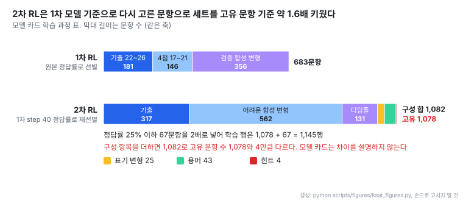
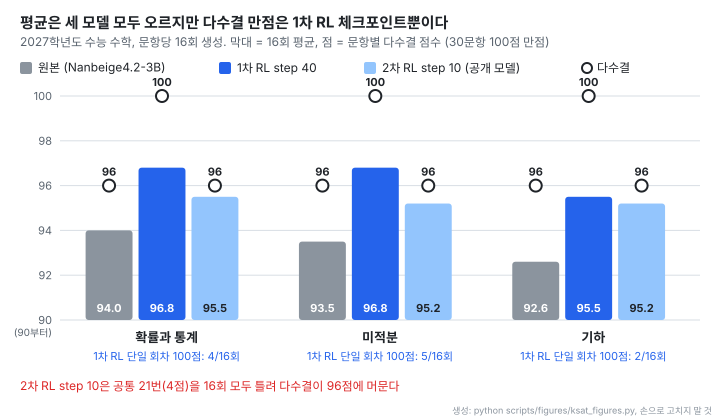

# Sionic AI: 3B 모델이 GRPO로 2027학년도 수능 수학 다수결 만점에 도달한 과정

- **원문**: [3B 모델이 수능 수학 만점에 도달하기까지 (Sionic Tech Blog)](https://www.sionic.ai/blog/ksat-math-rl-3b), 2026-11-20 발행, 작성 Sionic AI
- **함께 읽은 자료**: [sionic-K-SAT-MATH-3B 모델 카드 (Hugging Face)](https://huggingface.co/sionic-ai/sionic-K-SAT-MATH-3B), 커밋 `4066e88`, 2026-11-19 생성, Apache-2.0. 학습 설정 수치와 체크포인트별 점수 표는 블로그가 아니라 모델 카드에 있다
- **원본 모델**: [Nanbeige/Nanbeige4.2-3B](https://huggingface.co/Nanbeige/Nanbeige4.2-3B) (Apache-2.0)
- **실험 환경**: GRPO, 학습기 [veRL](https://github.com/volcengine/verl), 풀이 생성 [SGLang](https://github.com/sgl-project/sglang), 8xB300. 평가는 서버 BF16, temperature 0.6, top_p 0.95, top_k 20, thinking on, 최대 65,536토큰, 문항당 16회 생성
- **읽은 날짜**: 2026-11-20
- **태그**: #GRPO #RLVR #SmallLM #MathReasoning #DynamicSampling #OnDevice

!!! note "핵심 요약"
    Sionic AI가 3B 모델 Nanbeige4.2-3B에 수능, 모의평가, 학력평가 수학 문항과 검증한 합성 변형 문항으로 GRPO를 두 단계 적용했다. 보상은 최종 답 정답 여부 하나이고, 학습 문항은 그때그때의 정책 모델로 8번 풀어 1~7번 맞힌 것만 골랐다. 시험 뒤 공개된 2027학년도 수능에서 1차 RL 체크포인트(step 40)가 확률과 통계, 미적분, 기하 모두 문항별 다수결 100점을 받았다. 16회 평균은 95.5~96.8점이고 단일 회차 만점은 16회 중 2~5회다. 반면 저장소에 올라간 공개 모델은 2차 RL step 10이고, 평균은 원본보다 1.5~2.6점 높지만 공통 21번을 16회 모두 틀려 다수결이 96점이다. SFT, 큰 모델 증류, Python 도구 사용은 이번 조건에서 기준 모델보다 검증 성능이 낮았다.

## 1. 개요

블로그는 "작은 모델이 어려운 수학 문제를 얼마나 풀 수 있는가, 강화학습으로 남은 오답을 줄일 수 있는가"를 묻는다. 대상은 휴대폰과 엣지 기기에서 돌릴 수 있는 3B급 모델이고, 시험은 수능 수학이다. 수능 수학은 객관식과 단답형이라 정답이 명확해 자동 채점 보상을 만들기 쉽고, 어려운 문항은 여러 단계의 추론을 요구한다.

결과보다 먼저 볼 것은 평가 시점이다. 모델은 2027학년도 수능 시행 전에 학습을 마쳤고, 사회적 영향을 고려해 시험이 끝난 뒤에 공개 저장소로 전환했다. 평가 세트는 2026년 11월 19일 문제와 정답이 공개된 뒤에 만들었다. 학습 데이터에 섞일 수 없는 새 시험이라 오염 걱정이 적은 평가다.

같은 크기 안에서도 사전학습 데이터, 구조, 사후학습 방법에 따라 풀 수 있는 문제가 달라지고, 추론 토큰 수와 답 집계 방법도 최종 점수를 바꾼다는 것이 블로그의 전제다. 그래서 이 노트는 다수결 만점이라는 한 숫자보다 평균, 단일 회차, 체크포인트 간 차이를 함께 본다.

## 2. 학습 데이터 구성과 문항 선별

기출은 2017~2026학년도 수능, 6월과 9월 모의평가, 교육청 학력평가(3, 4, 7, 10월) 수학이다. 시험지 PDF에서 문항을 분리해 이미지 전사와 대조 교정을 거치고, PDF 텍스트 레이어의 한글과 숫자를 비교해 전사 오류를 점검했다. 정답은 공식 정답표에서만 가져왔다. 그림이 있는 문항은 텍스트 설명으로 옮겨 넣었다.

합성 변형 문항은 기출을 더 어렵게, 쉽게(디딤돌), 표기만 바꿔, 수학 용어 문항으로 바꾼 네 종류다. 생성 모델이 내놓은 답을 정답으로 쓰지 않고, 같은 모델이 문제의 답을 모르는 상태에서 4회 독립적으로 풀어 3회 이상 답이 일치한 것만 채택했다. 정답표가 없는 문항에 self-consistency로 라벨을 붙인 셈이다.

출처: [Sionic Tech Blog 그림 1](https://www.sionic.ai/blog/ksat-math-rl-3b)

- 아래 칸 "정답과 오답이 함께 나오는 문항"이 선별 기준이다. 모델 카드 기준으로는 정책 모델로 문항당 8회 풀어 1~7회 맞힌 문항이다
- 맨 아래 되돌이 화살표가 2차 RL의 근거다. 1차로 학습한 모델로 난이도를 다시 재면 처음 골랐던 문항 상당수가 "늘 맞힘"으로 빠진다

평가 누수 차단도 명시했다. 2026학년도 수능은 평가용, 2026학년도 9월 모의평가는 검증용으로 떼어 두고, 이 두 시험과 이를 시드로 만든 모든 변형 문항을 모든 단계에서 제외했다. 최종 평가는 학습 이후 공개된 2027학년도 수능이다.

## 3. GRPO와 결과 보상

학습 알고리즘은 [DeepSeekMath (arXiv 2402.03300)](https://arxiv.org/abs/2402.03300)가 PPO 변형으로 제안한 GRPO다. 같은 문항에서 풀이 여러 개를 생성하고, 각 풀이의 보상을 그룹 안에서 비교해 정책을 업데이트한다. 보상은 최종 답이 정답과 일치하면 1, 아니면 0이다. 풀이 문장마다 사람이 점수를 매기는 과정 보상이나, 교사 모델 풀이를 따라 쓰게 하는 지도학습과는 다른 방식이다.

출처: [Sionic Tech Blog 그림 2](https://www.sionic.ai/blog/ksat-math-rl-3b)

- 가운데 줄의 정답 1, 오답 0 칸이 보상의 전부다. 보상 모델이나 풀이 채점기가 없다
- 맨 아래 칸 "veRL 학습기에서 생성 엔진으로 가중치 반영"은 블로그가 따로 짚은 운영 확인 사항이다. 학습기가 정상 업데이트돼도 SGLang이 이전 가중치로 계속 풀이를 만들면 의도한 정책을 학습하는 것이 아니다

결과 감독 GRPO에서 풀이 $i$ 의 advantage(평균보다 얼마나 나은지)는 그룹 보상을 정규화한 값으로, 그 풀이의 모든 토큰에 같은 값을 준다(DeepSeekMath 4.1.2절. 본문 수식은 이 노트에서 확인하지 않았다).

$$
\hat{A}_i = \frac{r_i - \operatorname{mean}(r_1,\dots,r_G)}{\operatorname{std}(r_1,\dots,r_G)}
$$

$G$ 는 그룹 크기(여기서 rollout 8개), $r_i \in \{0, 1\}$ 은 최종 답 정답 여부다. 8개가 모두 맞거나 모두 틀리면 분자가 전부 0이라 advantage도 0이고, 그 문항은 업데이트에 아무 기여를 하지 않는다. 블로그가 "일부 풀이만 정답에 도달하는 문항"에 학습을 모은 이유가 이 식에 있다. 정답이 $k$ 개인 그룹에서 정답 풀이는 $(1 - k/8)/\operatorname{std}$ 만큼 밀어 올려지므로, 드물게 맞히는 문항일수록 정답 풀이 하나가 받는 신호가 크다.

## 4. 두 단계 학습 설정

모델 카드 표를 옮긴다. 두 단계 모두 64문항 x rollout 8개/step, step당 업데이트 4회, lr 1e-6, 응답 최대 32,768토큰이다.

| 항목 | 1차 RL (원본 → step 40) | 2차 RL (1차 step 40 → step 10) |
| --- | --- | --- |
| 선별 기준 모델 | 원본 모델 정답률 | 1차 step 40 정답률 |
| 학습 문항 | 683개 | 1,145행 (고유 1,078문항) |
| 손실 설정 | KL 없음, clip 0.2/0.28, token-mean loss, rollout 보정(token TIS, cap 2.0), rollout temperature 0.8 | clip-high 0.28 → 0.2, DAPO 동적 샘플링, 새 optimizer |
| 규모 (8xB300) | 40 step (4 epoch), 약 8.7시간 | step당 약 36분, step 10까지 약 6시간 |

- 1차는 기출 위주(327개)에 합성 변형 356개를 얹었다. 2차는 1차 모델 기준으로 다시 재서 어려운 합성 변형 562개가 절반을 차지한다. 1차 모델이 기출 대부분을 이미 "늘 맞힘"으로 넘겼다는 뜻으로 읽힌다(모델 카드가 직접 말한 해석은 아니다)
- 2차의 정답률 25% 이하 67문항은 두 번 넣어 epoch당 rollout 16개를 받게 했다. 난이도 측정이 덜 끝난 768문항은 측정 결과에서 학습 가치가 높게 나온 문항 번호대만 골라 넣었다
- 빨간 줄의 구성 합 1,082와 고유 1,078의 차이 4는 모델 카드 수치 그대로다. 힌트 문항 4개와 같은 수라 집계 방식 차이일 수 있지만 확인되지 않았다

2차에서 clip-high를 0.28에서 0.2로 낮춘 이유는 1차 학습 중 entropy가 0.12에서 0.20으로 올랐기 때문이다. 1차의 하한과 상한이 다른 clip(0.2/0.28)은 [DAPO (arXiv 2503.14476)](https://arxiv.org/abs/2503.14476)가 이름에 넣은 decoupled clip 계열 설정이다(상한을 넓혀 탐색을 유지한다는 설명은 DAPO 본문 기준이며 이 노트에서 확인하지 않았다). 3B 모델에서는 entropy가 오르자 대칭 clip으로 되돌렸다. 동적 샘플링은 DAPO가 이름을 붙인 기법이다. 학습 중에도 전부 정답이나 전부 오답 그룹을 버리고 배치를 다시 채워, 3절의 advantage 0 그룹이 배치를 차지하지 않게 한다.

## 5. 응답 길이 상한과 잘린 풀이

응답 상한은 48k로 시작했다가 32k로 낮췄다. 48k에서는 평균 풀이가 2.8만 토큰까지 길어져 step당 55분이 걸렸다. 32k에서 잘린 풀이 700개를 분석한 결과는 다음과 같다.

| 항목 | 값 |
| --- | --- |
| 같은 문장 반복으로 분류 | 1.4% |
| 반복이 아닌, 비효율적으로 길어진 풀이 | 98.6% |
| 같은 문항을 다른 샘플에서는 맞힌 비율 | 60% |

잘린 풀이는 최종 답이 없으니 0점이다. 모델 카드는 이 0점이 "더 짧은 경로로 풀라"는 신호로 작동했고, 실제로 평가 시 풀이 길이가 줄었다고 쓴다. 블로그는 같은 관찰에서 두 방향의 결론을 함께 낸다. 생성 한도를 늘린다고 해결된다고 단정할 수 없고(풀 수 있는 문제에서도 비효율적 경로를 고르면 예산을 다 쓴다), 짧게 쓰는 형식만 학습한다고 추론 능력이 유지되지도 않는다.

2차 RL 중간 체크포인트가 그 예다. 2026학년도 수능(평가용)에서는 1차보다 평균 생성 길이가 줄면서 점수가 올랐지만, 2027학년도 수능에서는 같은 방향의 향상이 나오지 않았다. 블로그의 결론은 풀이 길이, 정답률, 새로운 문항 성능을 함께 봐야 학습 효과를 해석할 수 있다는 것이다.

## 6. 2027학년도 수능 결과

평가는 공통 22문항과 선택과목별 8문항을 합친 고유 46문항에 대해 문항마다 16개 풀이를 생성했다. 선택과목 점수는 공통 문항과 해당 선택 문항을 합친 30문항, 100점 만점 기준이다. 평균은 16회 점수의 평균이고, 다수결은 문항별로 가장 많이 나온 답을 골라 채점한 점수다.

출처: [Sionic Tech Blog 그림 3](https://www.sionic.ai/blog/ksat-math-rl-3b)

- 원문 그림은 1차 RL의 다수결 점수만 보여 준다. 원본과 공개 모델(2차 step 10)의 점수, 16회 평균은 모델 카드 표에만 있다
- 블로그 문장 그대로 "다수결 만점은 여러 번 생성한 답을 집계하는 추가 추론 비용까지 포함하여 얻은 결과"다

- 세 모델 모두 다수결이 평균보다 높다. 16번 중 다수가 맞히는 문항은 다수결이 건지고, 평균은 틀린 회차를 그대로 깎는다. 원본도 다수결 96점이라 RL이 올린 것은 마지막 4점이다
- 1차 RL이 평균에서도 세 과목 모두 가장 높다. 단일 회차 만점은 16회 중 확률과 통계 4회, 미적분 5회, 기하 2회라, 한 번만 풀게 하면 만점 확률은 12.5~31% 정도다
- 저장소에 올라간 모델은 2차 step 10이다. 전체 문항 정답률은 원본 93.8%에서 97.0%로 올랐지만 공통 21번(4점)을 16회 모두 틀려 다수결이 원본과 같은 96점이다. 만점 체크포인트의 Q8_0 GGUF 저장소는 2026-11-20 확인 시 공개되어 있지 않았다(HTTP 401)

## 7. 효과가 없었던 대안

블로그는 GRPO 외에 세 가지를 시험했고, 이번 조건에서는 모두 기준 모델보다 검증 성능이 낮았다.

| 시도 | 결과 |
| --- | --- |
| 1차 모델의 정답 풀이를 모은 지도학습 | 기준 모델보다 검증 성능 낮음 |
| 더 큰 모델의 추론 과정 증류 | 기준 모델보다 검증 성능 낮음 |
| Python 도구 사용 | 기준 모델보다 검증 성능 낮음. 잘못된 코드와 호출 실패가 추가 오류 원인 |

블로그는 이 결과를 "지금 규모의 모델에서는 큰 모델의 풀이와 외부 도구가 있다는 사실만으로 성능 향상이 보장되지 않았다"고 정리하고, 모델 규모와 백본에 따라 가능한 능력과 문제 해결 방식을 달리할 필요가 있을 가능성을 시사한다고 표현한다. 세 시도의 데이터 양, 설정, 점수는 공개하지 않아 어느 정도 낮았는지는 알 수 없다.

## 8. 모바일 실행

3B 규모는 기기 안 추론을 가능하게 한다. 블로그는 Galaxy Z Fold7에서 llama.cpp로 **원본 모델**의 4비트 양자화 파일(2.54GB)을 실행했고, 외부 서버 연결이 필요 없었다고 쓴다. RL 모델을 기기에서 돌린 결과나 풀이 속도, 기기 위 정확도는 싣지 않았다.

8비트 양자화와 NPU, GPU 가속을 쓰면 원본 대비 거의 손실 없는 정확도와 실시간 풀이 수준 속도에 도달할 것이라는 문장은 블로그 스스로 "예측"이라 하고 추가 테스트 후 갱신할 예정이라고 적었다(미검증). 모델 카드 쪽 사실은 다음과 같다.

| 항목 | 모델 카드 내용 |
| --- | --- |
| 배포 파일 | `sionic-K-SAT-MATH-3B-Q8_0.gguf`, 4.13 GiB |
| Q8_0 손실 | 같은 방식의 1차 모델에서 F16 대비 KL 0.0010 |
| 권장 설정 | 컨텍스트 32k, KV 캐시 q8_0 |
| llama.cpp 토크나이저 | 특수 토큰 뒤에 `▁` 를 붙이는 버그로 학습 시점과 입력이 달라짐. 패치 적용 필요, GGUF에 `add_bos_token=false` 설정 |
| transformers | 5.x에서 RoPE `inv_freq` 버퍼가 초기화되지 않아 NaN. 4.x를 쓰거나 로드 뒤 재계산 |

모델 카드가 가리키는 모바일 실행 안내와 토크나이저 패치 파일은 2026-11-20 기준 Hugging Face 저장소 파일 목록에 없다.

## 9. 해석 시 주의

!!! warning "점수를 읽을 때"
    - 만점은 **다수결, 1차 RL 체크포인트** 조건이다. 단일 풀이 만점은 16회 중 2~5회이고, 공개 저장소의 모델은 다수결 96점이다
    - 평가는 2027학년도 수능 한 회차, 과목별 30문항이다. 4점 한 문항이 만점과 96점을 가른다. 체크포인트 비교의 차이도 문항 한두 개 수준이다
    - 그림 문항은 텍스트 설명으로 바꿔 넣었다. 실제 그림을 보는 조건이 아니다
    - 평가는 서버 BF16, 최대 65,536토큰이다. 모바일에서 실행한 것은 원본 모델의 4비트 파일이고, RL 모델의 기기 위 점수와 속도는 아직 없다
    - SFT, 증류, 도구 사용이 낮았다는 결과는 수치 없이 서술만 있다

블로그 결론도 같은 방향이다. 과거에 작은 모델이 풀지 못한 문제를 기준으로 지금의 소형 모델을 판단하면 능력을 낮게 보게 되고, 반대로 시험 성적만 보고 기기 안 응답 시간과 정확도까지 확보했다고 판단해서도 안 된다고 쓴다.

## 10. 관련 연구

| 이름 | 관계 |
| --- | --- |
| [DeepSeekMath (arXiv 2402.03300)](https://arxiv.org/abs/2402.03300) | GRPO 제안. 초록 표현으로 PPO 변형이며 PPO의 메모리 사용을 줄인다 |
| [DAPO (arXiv 2503.14476)](https://arxiv.org/abs/2503.14476) | Decoupled Clip and Dynamic sAmpling Policy Optimization. decoupled clip과 dynamic sampling을 포함한 네 기법, verl 기반 공개. 블로그가 동적 샘플링의 출처로 든다 |
| [veRL](https://github.com/volcengine/verl) | 이 글의 RL 학습기 |
| [SGLang](https://github.com/sgl-project/sglang) | 이 글의 rollout 생성 엔진, 모델 카드 권장 서빙 엔진 (`--reasoning-parser nanbeige`) |
| [Nanbeige4.2-3B](https://huggingface.co/Nanbeige/Nanbeige4.2-3B) | 원본 모델. RL 전 이미 다수결 96점 |

## 11. 결론

이 글이 보여 주는 것은 "3B가 수능을 풀었다"보다 좁고 구체적이다. 원본 3B 모델이 이미 다수결 96점을 받는 상태에서, 정답표로 검증된 문항과 합의로 걸러 낸 합성 문항 중 **현재 모델이 가끔만 맞히는 문항**에 결과 보상 GRPO를 집중해 마지막 4점을 다수결로 채웠다. 핵심 장치는 정책 기준 난이도 재선별, 동적 샘플링, 잘린 풀이 0점이 주는 길이 압력이고, 셋 모두 "advantage가 0인 그룹을 줄인다"는 같은 목표를 향한다.

동시에 글은 한계를 숨기지 않는다. 만점 체크포인트와 공개 체크포인트가 다르고, 2차 학습은 평가용 시험에서 얻은 향상이 새 시험으로 이어지지 않았으며, 모바일 실행은 아직 원본 모델의 4비트 파일 실행 확인과 속도 예측 단계다. 검증 가능한 보상이 있는 좁은 영역에서 작은 모델의 남은 오답을 RL로 줄이는 사례로 읽고, 기기 위 서비스 가능성은 후속 측정을 기다려야 한다.
