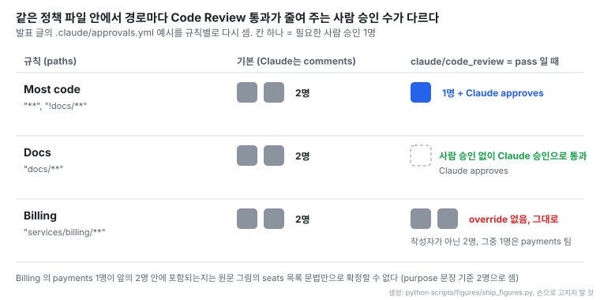
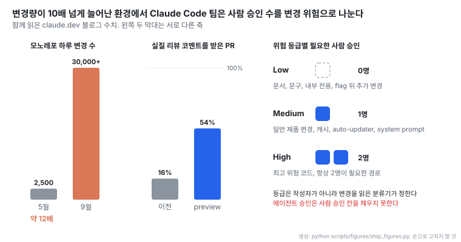

# Anthropic Claude Ship: PR 리뷰, 수정, 승인을 정책 파일로 묶은 세 에이전트

- **원문**: [Introducing Claude Ship (Claude 블로그)](https://claude.com/ko/resources/articles/introducing-claude-ship), 2026-11-23 발행, 작성 Anthropic, Product updates
- **함께 읽은 자료**: [How the Claude Code team does code review (claude.dev 블로그)](https://claude.dev/blog/solving-code-review-at-anthropic/). 발표 글이 "병합 PR 2배 이상" 수치의 근거로 거는 글이고, 위험 등급과 리뷰 왕복 수치는 이 글에 있다
- **문서**: [Claude Ship 문서](https://code.claude.com/docs/ko/claude-ship), [Code Review 설정 가이드](https://code.claude.com/docs/ko/code-review-setup), [Code Review GA 발표](https://claude.com/ko/resources/articles/code-review-is-now-generally-available)
- **상태**: Code Review는 GA, PR Steward와 Claude Approvals는 beta. Claude Team, Enterprise 플랜의 GitHub 저장소 대상
- **읽은 날짜**: 2026-11-25
- **태그**: #CodeReview #CodingAgent #ClaudeCode #DevOps #PolicyAsCode

!!! note "핵심 요약"
    Claude Ship은 PR이 열린 뒤의 세 단계를 에이전트 셋에 나눠 맡긴다. Code Review가 여러 관점으로 문제를 찾아 교차 검증한 뒤 PR에 게시하고, PR Steward가 실패한 CI, merge conflict, 리뷰 피드백을 고쳐 push하며, Claude Approvals가 저장소의 `.claude/approvals.yml` 정책에 따라 승인 여부를 정한다. PR Steward는 승인과 병합을 하지 않도록 설계했고, 승인 권한은 정책 파일이 정한 범위 안에서만 Claude Approvals에 있다. 근거로 든 수치는 Claude Code 팀의 6월에서 9월 사이 병합 PR 2배 이상, revert 비율 40% 이상 감소인데, 원문 스스로 Claude 리뷰는 "더 넓은 프로세스의 한 층"이라고 밝혀 단독 효과로 읽을 수는 없다. 과금은 토큰 기준이고, Claude 리뷰를 조건으로 쓰는 정책은 observe 모드에서도 과금되는 Code Review를 실행한다.

## 1. 개요

원문은 PR을 연 사람이 겪는 흐름에서 시작한다. 다음 작업을 시작하면 리뷰가 돌아오고, 예전 코드로 돌아가 수정을 push하고, 리뷰가 다시 돌기를 기다리고, 승인해 줄 사람을 찾는다. 사람이 모든 줄을 쓸 때는 이 흐름이 감당되지만, 에이전트가 코드 대부분을 쓰면 PR 이후 단계가 병목이 된다는 것이 문제의식이다. 원문은 목표를 한 문장으로 적는다: "The goal: ship code as fast as teams write it."

기존 방식과 갈리는 지점은 승인이다. 이전 Code Review 발표는 "PR 승인은 여전히 사람이 판단한다"는 입장이었고, 함께 읽은 블로그도 이를 그대로 인용한다: "Code Review's announcement said approving a pull request is still a human call; the product posts findings, not approvals." Claude Ship은 이 선을 팀이 쓴 정책 파일로 옮긴다. 일상적인 변경은 정책이 허락하면 Claude가 승인하고, 정해 둔 경로와 상황에는 사람 승인을 요구한다.

## 2. 세 에이전트의 분담

출처: [Introducing Claude Ship 개요 그림](https://claude.com/ko/resources/articles/introducing-claude-ship)

- 위 두 줄 사이를 오가는 점선이 핵심이다. 수정 push가 다시 리뷰를 시작하고, findings가 0건이 된 뒤에야 Approve 줄로 내려간다. [문서 개요 그림](https://code.claude.com/docs/ko/claude-ship)도 "a fix can start another review"와 병합은 "your branch rules"를 따른다고 같은 구조로 그린다
- 그림 아래 문구 "Claude Ship uses AI and may miss bugs, security vulnerabilities, or other issues."는 원문이 모든 그림에 붙인 단서다
- 그림의 Ready to merge는 병합 자체가 아니다. 실제 병합 가능 여부는 기존 branch protection과 required checks가 정한다

| 에이전트 | 상태 | 맡는 일 | 하지 않는 일 |
| --- | --- | --- | --- |
| Code Review | GA | 여러 관점 리뷰, findings 교차 검증, 분류, PR 게시 | 수정, 승인 |
| PR Steward | beta | 실패 CI, merge conflict, 리뷰 피드백 처리 후 push | 승인, 병합 (설계상 제외) |
| Claude Approvals | beta | 저장소 정책 파일로 승인 판정, CI check와 approving review 게시 | 정책 밖 승인 |

## 3. Code Review: 찾고, 교차 검증하고, 분류한다

원문 설명은 짧다. 코드베이스 전체를 기준으로 여러 관점에서 PR을 리뷰하고, findings를 모아 "adversarially verifies them", 분류해 PR에 게시한다. 저장소마다 Quick, Standard, Deep 리뷰 수준을 고른다.

함께 읽은 블로그가 내부 구조를 더 적는다. 여러 에이전트가 동시에 버그를 찾고, 별도 그룹이 finding마다 투표해 충분히 동의한 것만 게시한다. 스타일, 진단, cleanup에 그치는 finding은 버리고, 남은 것은 Important, Nit, Pre-existing으로 태그한다. Pre-existing 태그는 PR이 만든 버그가 아닌 것이 작성자 탓처럼 보이지 않게 하려는 장치다. 1,000줄 넘는 PR은 대부분 findings가 나오고 작은 PR은 대부분 clean으로 돌아온다고 한다.

출처: [Introducing Claude Ship Code Review 예시](https://claude.com/ko/resources/articles/introducing-claude-ship)

- "Why this was flagged" 아래의 `Verification:` 줄이 교차 검증의 흔적이다. 이름으로 추측하지 않고 `sleep.ts:3`이 guard 없이 `setTimeout`을 부른다는 파일, 줄 근거를 붙인다
- 각 finding에 Finding ID가 붙는다. 이 ID를 PR Steward와 Claude Approvals가 이어받는 구조로 보인다 (원문이 ID 연결을 직접 설명하지는 않는다)

## 4. PR Steward: PR을 green으로 유지한다

PR Steward는 실패한 CI 검사, merge conflict, 리뷰 피드백에 개입한다. 피드백 출처는 Code Review만이 아니라 다른 리뷰 도구와 팀원도 포함한다. push할 때마다 무엇을 바꿨고 어떻게 되돌리는지 댓글로 남긴다. 개발자는 `@claude <지시>`로 방향을 바꾸거나 `@claude stop`으로 물러나게 할 수 있다.

원문이 명시한 경계는 "designed not to approve or merge pull requests"다. 수정하는 주체와 승인하는 주체를 분리했다는 뜻이다. 문서는 시작 시점 설정을 Manual(`@claude steward`)로 시작하라고 권하고, 사용자가 지출 한도를 정하기 전에는 PR Steward 자체 한도가 없다고 적는다.

출처: [Introducing Claude Ship PR Steward 예시](https://claude.com/ko/resources/articles/introducing-claude-ship)

- 두 번째 댓글의 "To undo it, revert 3f9c2ab41, or remove the claude-pr-steward-watching label to stop me entirely."가 원문이 말한 push마다의 되돌리기 안내다. 중지 수단이 라벨이라 GitHub 화면만으로 끌 수 있다
- Steward는 코드뿐 아니라 "아직 지연 없음을 기대하는 테스트"까지 같이 고친다고 적는다. 테스트를 고치는 수정은 리뷰어가 따로 봐야 할 지점이다

## 5. Claude Approvals: 정책 파일로 승인 범위를 정한다

Claude Approvals는 팀이 저장소에 파일로 쓴 승인 정책을 적용한다. 정책이 허락하면 일상 변경을 Claude가 직접 승인하고, 특정 상황에서는 사람의 더 깊은 승인을 요구한다. 원문 표현은 "It works like a smarter CODEOWNERS file."이다. 판단 신호로 Code Review findings와 팀이 자연어로 쓴 분류기를 쓸 수 있다. 원문은 대부분의 고객에게 observe-only 모드로 먼저 켜서 신뢰를 쌓은 뒤 branch protection에서 Claude Approvals 통과를 필수로 거는 순서를 권한다.

출처: [Introducing Claude Ship 정책 파일 예시](https://claude.com/ko/resources/articles/introducing-claude-ship)

- 규칙마다 `purpose` 문장, `paths`, 기본 `verdict`, 조건부 `override`가 있다. `verdict`는 Claude의 역할(`comments` 또는 `approves`)과 사람 `seats` 수를 함께 정한다
- Billing 규칙은 `"!pr/authors"`로 작성자를 승인자에서 빼고 `acme/payments` 팀 소속을 요구한다. CODEOWNERS가 경로별 소유자만 정하는 것과 달리 조건과 사람 수를 함께 쓴다

예시 파일을 규칙별로 다시 세면 Code Review 통과가 줄여 주는 사람 승인 수가 경로마다 다르다.

- 같은 `claude/code_review = pass` 조건이 일반 코드에서는 2명을 1명으로, 문서에서는 0명으로 줄인다. 문서 경로는 Claude 승인만으로 통과한다
- Billing에는 override가 없어 리뷰 결과와 상관없이 사람 2명이 필요하다. 위험한 경로를 자동 승인에서 빼는 방법이 "override를 쓰지 않는 것"이다

출처: [Introducing Claude Ship 정책 충족 PR 예시](https://claude.com/ko/resources/articles/introducing-claude-ship)

- Claude Approvals는 두 가지를 남긴다. Required로 걸린 CI check 통과와 GitHub approving review다. branch protection은 이 check를 기존 required check처럼 다룬다
- 댓글에 커밋 해시와 Decision record ID가 있고 "This comment updates in place."라고 적혀 있다. 판정이 특정 커밋에 묶인다는 뜻으로 읽힌다. 함께 읽은 블로그의 "An approval covers one specific commit." 원칙과 같은 방향이다

## 6. 시작 방법: /ship과 저장소 단위 설정

개발자는 Claude Code의 `/ship` 명령으로 자기 PR에 먼저 써 볼 수 있다. 변경이 준비되면 `/ship`을 실행하고, Claude가 push, PR 생성, 리뷰, 피드백과 실패 검사 처리를 이어서 한다. 병합 가능 범위는 개발자 권한과 저장소 branch rules가 정한다. `/ship`은 일반 Claude Code 사용량으로 계산된다.

출처: [Introducing Claude Ship /ship 예시](https://claude.com/ko/resources/articles/introducing-claude-ship)

- "watches the pull request for up to 7 days, in this session"과 "Keep this session open, this computer awake, and this branch checked out."이 `/ship`의 실행 조건이다. 저장소 단위 설정과 달리 로컬 세션에 묶여 있다
- 감시를 끝내는 명령은 `/ship stop`이다

관리자는 저장소 단위로 켠다. 원문이 적은 설정 항목은 다음과 같다.

| 항목 | 내용 |
| --- | --- |
| 실행 위치 | 관리자가 저장소마다 Code Review와 PR Steward를 켬 |
| Approvals 시작 조건 | 연결된 저장소의 default branch에 정책 파일이 있으면 시작, 관리자가 끌 수 있음 |
| 저장소별 설정 | 리뷰 수준(Quick, Standard, Deep), 리뷰 실행 시점, 지출 한도 |
| 기존 도구 | 기존 branch protection, required checks와 함께 동작 |
| 권장 도입 순서 | 저장소 하나, 리뷰 수준과 실행 시점 선택, 월 지출 한도, 정책은 observe 모드 |

문서는 정책 파일이 Approvals를 시작시키므로 누가 그 파일을 켤 수 있는지 먼저 확인하라고 적는다. default branch에 파일을 병합할 수 있는 사람이 곧 자동 승인 범위를 정하는 사람이 되기 때문이다.

## 7. Claude Code 팀 사례와 근거 수치

원문 사례는 문서 수정이다. 고객이 Analytics API 문서를 보고 Admin key로 Pro, Team 사용량을 가져올 수 있다고 오해했다. PM이 [Claude Tag](https://claude.com/ko/product/tag)에 수정이 진행 중인지 묻자 Claude Tag가 PR을 열었고, Code Review는 차단할 문제를 찾지 않았고, 문서 리뷰어가 서명했고, Claude Approvals가 통과해 같은 날 저녁 병합됐다. 원문이 강조하는 변화는 고객 피드백에 대응할 수 있는 사람이 개발자에서 PM으로 넓어졌다는 점이다.

정량 근거는 한 문장이다. Claude 리뷰가 더 넓은 프로세스의 한 층인 Claude Code 팀에서 6월부터 9월까지 병합 PR이 2배 이상 늘었고 revert된 비율은 40% 이상 줄었다. 함께 읽은 블로그가 배경 수치를 더 준다.

- 왼쪽 막대는 Anthropic 모노레포 기준이고 Claude Code 저장소는 별도다. 블로그는 Claude Code 저장소도 같은 압력을 받는다고만 적는다
- 오른쪽 위험 등급이 Claude Approvals 정책 파일의 원형으로 보인다. Low는 자동 리뷰와 보안 검사가 green이면 사람 승인 0명, Medium 1명, High 2명이다
- 블로그는 에이전트 승인이 사람 승인 칸을 채우지 못하고, 신뢰 목록에 있는 작성자만 가벼운 경로를 탄다고 적는다. Claude Ship 정책 예시에는 신뢰 작성자 조건이 보이지 않는다

## 8. 과금과 제약

| 항목 | 원문 내용 |
| --- | --- |
| 과금 기준 | 토큰. PR 수와 크기, 리뷰 수준, 리뷰 빈도, PR Steward 작업량에 따라 달라짐 |
| 지출 한도 | Code Review와 PR Steward에 설정 가능 |
| Claude Approvals | 기본 요금 없음. 정책 안 분류기는 사용 토큰만큼 과금 |
| observe 모드 | Claude 리뷰를 쓰는 정책은 observe 모드에서도 과금되는 Code Review를 실행 |
| /ship | 일반 Claude Code 사용량 |
| 사용 불가 조직 | Zero Data Retention, HIPAA 구성, 고객 관리 암호화 키 사용 조직 |
| 프로모션 | 대상 Enterprise 조직은 최소 $10,000 크레딧, 청구 후 30일 안에 사용, 2027-01-15까지 청구 ([약관](https://support.claude.com/en/articles/17603594-free-code-review-promotional-credits-for-claude-enterprise)) |

observe 모드는 "판정만 기록하는 무료 시험"이 아니다. 정책 조건에 `claude/code_review`를 쓰면 PR마다 Code Review가 실제로 돈다. 리뷰 수준을 Deep으로 두고 observe를 오래 돌리면 승인은 하나도 하지 않으면서 리뷰 비용은 그대로 나간다.

## 9. 리뷰 왕복이 수렴해야 하는 이유

PR Steward와 Code Review를 함께 켜면 에이전트가 고치고 에이전트가 다시 리뷰하는 고리가 생긴다. 원문 그림 1은 이 고리가 세 번 만에 끝나는 경우를 그렸지만, 함께 읽은 블로그는 수렴하지 않는 경우를 적는다. 한 CLI PR은 작성자가 멈출 때까지 밤새 50회 넘게 리뷰와 수정을 오갔다. 리뷰어가 계속 지적한 것을 git blame으로 보니 약 59%가 리뷰어 첫 패스 때부터 있던 코드였다. 새 버그를 찾은 게 아니라 매번 예전 버그를 몇 개씩 더 찾은 것이다.

블로그는 사람은 nit를 몇 초 만에 넘기지만 에이전트는 고치고, 고치면 커밋과 리뷰가 한 번 더 생긴다고 적는다. 그래서 잡음의 비용은 작성자가 에이전트일 때 더 크다. 팀이 바꾼 재리뷰 규칙은 다음 넷이다.

1. 3회 뒤에는 리뷰어가 작성자에게 접근 자체를 다시 생각하라고 요청한다
2. 처음 몇 회 뒤에는 새 diff만 다시 리뷰한다
3. 한 줄이 아니라 버그 종류를 지적해 같은 종류를 한 번에 고치게 한다
4. 이미 게시한 finding을 반복하지 않는다

발표 글은 Claude Ship에 이런 왕복 상한이 있는지 말하지 않는다. 지출 한도가 사실상의 상한 역할을 하므로, 도입 초기에는 PR Steward를 Manual로 두라는 문서 권고가 이 문제와 맞닿아 있다.

## 10. 종합: 무엇이 자동화되고 무엇이 사람에게 남는가

| 단계 | 자동화 범위 | 사람에게 남는 것 |
| --- | --- | --- |
| 리뷰 | 여러 관점 리뷰, 교차 검증, 분류 | finding마다 수정 또는 이유를 달아 resolve |
| 수정 | CI 실패, conflict, 리뷰 피드백 처리 후 push | `@claude` 지시, 중지, 테스트 수정 검토 |
| 승인 | 정책이 허락한 경로의 승인 | 정책 파일 작성, override 없는 위험 경로 승인 |
| 병합 | 없음 (기존 branch rules) | branch protection 설정 |

함께 읽은 블로그는 사람에게 남는 일을 다섯 가지로 적는다. 무엇을 만들지 결정, 결제와 auto-updater와 CI workflow 같은 위험 코드 리뷰, 다른 사람이 따라 할 패턴을 정하는 아키텍처 리뷰, 증거 읽기, 결과에 대한 책임이다. 블로그는 revert와 incident 수치가 움직이면 승인을 자동으로 조이는 circuit breaker가 아직 없고, 엔지니어들이 사람 승인 0명 병합을 늘리기 전에 그것을 원한다고 적는다.

미결 과제:

- 리뷰와 수정 왕복의 상한을 제품 설정으로 둘 수 있는지 원문에 없다
- 정책 예시에는 블로그의 "신뢰 작성자만 가벼운 경로" 조건과 "에이전트 승인은 사람 칸을 채우지 못함" 원칙이 어떻게 표현되는지 보이지 않는다
- 자연어 분류기를 정책 신호로 쓸 때 그 분류기의 오판을 어떻게 평가하는지 원문에 없다

## 11. 관련 연구와 자료

- [How the Claude Code team does code review](https://claude.dev/blog/solving-code-review-at-anthropic/): 이 노트 7, 9, 10절 수치의 출처. 7개 층(검증, AI 리뷰, 보안 리뷰, 자동 검사, 위험 기반 사람 승인, merge queue와 flag, 빠른 감지와 rollback)으로 리뷰를 설명한다
- [Code Review GA 발표](https://claude.com/ko/resources/articles/code-review-is-now-generally-available): Claude Ship의 첫 단계. "findings, not approvals" 입장의 원래 글
- [Claude Ship 문서](https://code.claude.com/docs/ko/claude-ship): 에이전트별 설정, 청구, 끄는 방법
- [Claude Tag](https://claude.com/ko/product/tag): 7절 사례에서 PM이 PR을 연 도구

## 12. 해석 시 주의

- 병합 PR 2배, revert 40% 감소는 Claude Code 팀 한 곳의 6월에서 9월 수치이고, 원문 스스로 Claude 리뷰를 "one layer of a broader process"라고 밝힌다. Claude Ship 도입 효과로 바로 옮길 수 없다. 같은 기간 변경량 자체가 크게 늘었다
- 고객 인용(TELUS, Carvana)은 정성 평가다. 수치가 없다
- PR Steward와 Claude Approvals는 beta다. 정책 파일 문법은 원문 그림 한 장에서 옮긴 것이고 전체 문법은 이 노트에서 확인하지 않았다
- 원문의 모든 그림에 "may miss bugs, security vulnerabilities, or other issues" 단서가 붙는다. 자동 승인 경로를 넓히는 것은 이 위험을 팀이 정책으로 받아들이는 일이다

## 13. 결론

Claude Ship의 새로움은 리뷰 품질보다 권한 분리에 있다. 찾는 에이전트, 고치는 에이전트, 승인하는 에이전트를 나누고, 고치는 쪽에는 승인 권한을 주지 않고, 승인하는 쪽은 저장소에 커밋된 정책 파일 범위 안에서만 움직이게 했다. CODEOWNERS가 "누가"만 정했다면 `approvals.yml`은 경로, 리뷰 결과, 팀 소속, 사람 수를 조건으로 함께 쓴다. 도입할 때 볼 것은 세 가지다. 정책 파일을 병합할 수 있는 사람이 곧 자동 승인 범위를 정하는 사람이라는 점, observe 모드도 Code Review 비용이 나간다는 점, 에이전트끼리의 리뷰와 수정 왕복이 수렴하도록 상한을 두어야 한다는 점이다.
