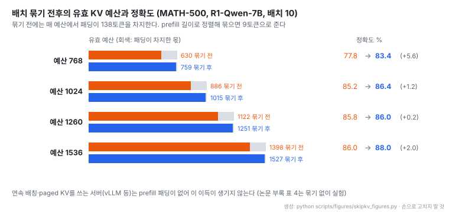
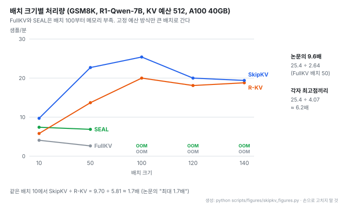
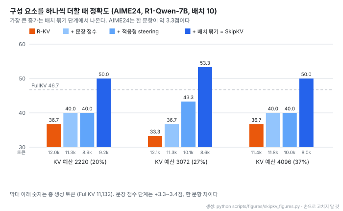

# SkipKV: 추론 모델의 KV 캐시를 문장 단위로 지우고 생성 자체를 줄이기

- **원문**: [SkipKV: Selective Skipping of KV Generation and Storage for Efficient Inference with Large Reasoning Models](https://proceedings.mlsys.org/paper_files/paper/2026/file/45c1f6a8cbf2da59ebf2c802b4f742cd-Paper-Conference.pdf), MLSys 2026 (9th MLSys Conference, Bellevue). 파일명 날짜는 PDF 생성일 2026-04-18
- **저자**: Jiayi Tian, Seyedarmin Azizi, Yequan Zhao, Erfan Baghaei Potraghloo, Sean McPherson, Sharath Nittur Sridhar, Zhengyang Wang, Zheng Zhang, Massoud Pedram, Souvik Kundu (UC Santa Barbara, Intel Labs, USC, 10명). 1저자가 Intel 인턴십 중 수행
- **코드**: [TTTTTTris/SkipKV](https://github.com/TTTTTTris/SkipKV) (Apache-2.0, Python. 2026-02-06 생성, 별 13개, 마지막 커밋 2026-10-26 · 2026-10-29 기준). vLLM 연동 폴더와 steering vector를 함께 공개
- **실험 환경**: DeepSeek-R1-Distill-Qwen-7B · Qwen-14B · Llama-8B, AIME-24 · LiveCodeBench · MATH-500 · GSM8K, 최대 생성 8,192~16,384토큰, 배치 10(14B는 들어가는 최대), 단일 A100 40GB, pass@1
- **읽은 날짜**: 2026-10-29
- **태그**: #KVCache #ReasoningModel #Eviction #ActivationSteering #ChainOfThought #Throughput

!!! note "핵심 요약"
    긴 사고 과정을 쓰는 추론 모델에서 KV 캐시를 고정 예산으로 지우면, 토큰 단위 제거가 문맥을 조각내 모델이 재검증을 반복하고 생성이 오히려 길어진다. SkipKV는 지우는 단위를 문장으로 올려 마지막 층 hidden state로 잰 유사도가 높은 앞 문장을 통째로 먼저 지우고(저장 건너뛰기), "Wait" 같은 비실행 사고가 쌓일수록 세지는 steering vector로 그런 문장이 덜 생기게 하며(생성 건너뛰기), 배치를 prefill 길이순으로 묶어 패딩이 예산을 먹지 않게 한다. AIME24(R1-Qwen-7B)에서 R-KV 대비 13.3~20.0점 높고 생성은 23~30% 짧으며, GSM8K 처리량은 같은 배치에서 R-KV의 약 1.7배다. 다만 가장 큰 정확도 증가는 배치 묶기(패딩 제거)에서 나오고, 처리량 "9.6배" 는 FullKV의 느린 점을 기준으로 한 값이다(최고점끼리는 약 6.2배).

## 1. 서론

추론 모델(LRM)은 사고 과정(CoT)이 길어 KV 캐시가 생성 길이에 비례해 커진다. 논문의 예로 R1-Distill-Llama-8B는 어려운 수학 문제 하나에 32K 토큰 이상을 쓰고, 배치 10이면 KV 캐시가 모델 가중치의 약 2.5배가 된다. KV가 커지면 메모리뿐 아니라 메모리 대역에 묶인 디코딩 처리량도 떨어진다.

기존 KV 압축(H2O, SnapKV, StreamingLLM, Quest)은 긴 입력(prefill)을 압축하는 데 맞춰져 있어 긴 CoT에서는 효과가 떨어진다. R-KV(Cai et al., NeurIPS 2025)가 처음으로 CoT의 중복 토큰을 지우는 방식을 내놓아 80% 이상 압축을 보였지만, 논문은 R-KV가 다중 배치에서 정확도가 떨어지고 토큰 단위로 지우다 보니 추론이 길어진다고 지적한다. 논문은 지운 토큰을 다시 쓰지 않는 영구 제거 방식만 다룬다. 그래야 실제로 메모리가 줄기 때문이다.

서론의 대표 결과는 R1-Qwen-14B · AIME-24에서 SOTA 대비 정확도 6.7점 높고 생성 22% 짧으며 KV를 2배 덜 쓴다는 것이다. 그림 1에서 읽은 값으로는 R-KV가 5.6GB에 53.3%, SkipKV가 2.8GB에 60.0%(FullKV 18.5GB와 같은 정확도)다.

## 2. 관련 연구

| 구분 | 방법 | 논문의 평가 |
| --- | --- | --- |
| 어텐션 기반 제거 | H2O(누적 어텐션), SnapKV(prefill 후 1회), ChunkKV(청크 단위) | 긴 입력에는 좋지만 CoT 압축에서는 정확도가 낮음 |
| 중복 기반 제거 | R-KV | CoT에서 SOTA지만 다중 배치 정확도 하락, 생성 길어짐 |
| 선택적 로딩 | Quest | 전체 KV를 유지하므로 KV가 여전히 선형 증가 |
| 양자화 | KIVI, GEAR, ThinKV | 직교하는 방향. 추론 성능을 떨어뜨린다는 보고가 있음 |
| 공유 · 조기 종료 · steering | KVSharer, DEER, SEAL | 생성 길이는 줄지만 고정 KV 예산을 지키지 못함 |

## 3. 동기 사례

논문은 기존 방식의 한계를 세 가지 관찰로 정리한다.

- **관찰 1. 다중 배치에서 정확도가 떨어진다.** R1-Llama-8B · MATH-500에서 배치 1과 10을 비교하면 H2O와 R-KV 모두 배치 10에서 정확도가 낮고 예산이 작을수록 심하다. 원인으로 패딩을 든다. 배치 안 입력 길이를 맞추려고 넣은 패딩 토큰이 고정 예산의 일부를 차지해 유효 예산이 줄고, 어텐션 분포도 흐트러진다. MATH-500은 한 배치 안에서 prefill 길이 차이가 400토큰을 넘기도 한다
- **관찰 2. 예산을 줄이면 압축하지 않을 때보다 생성이 길어진다.** R1-Qwen-7B · MATH-500(배치 10)에서 R-KV는 모든 예산에서 FullKV보다 긴 출력을 낸다. 지운 문맥을 되찾으려고 추론 단계를 다시 만드는 것으로 해석한다
- **관찰 3. 토큰 단위 제거가 단어를 조각낸다.** 복소수 계산 예시에서 모델은 8번 재검증하며 1,517토큰을 썼다. 남은 토큰이 `6 + 12i - 3i`에서 `+2i`만, 최종 답 `(6, 9)`에서 `(, 9)`만 남는 식이라, 모델이 부분 결과를 다시 확인하느라 추론이 길어진다

## 4. 방법

먼저 출력의 문장 단위 성질을 본다. 두 문장의 임베딩 코사인 유사도를 PSS(pairwise sentence similarity)라 하고, BERT 문장 임베딩으로 PSS ≥ 0.95인 쌍을 "유사" 로 센다. 문장은 실행 사고(답에 직접 필요한 계산)와 비실행 사고(검증 · 전환용 문장)로 나눈다(SEAL의 정의).

| AIME24 | 유사 문장 비율 (정답 / 오답) | 비실행 사고 비율 (정답 / 오답) |
| --- | --- | --- |
| R1-Qwen-7B | 51.3% / 78.8% | 14.7% / 38.0% (약 2.6배) |
| R1-Llama-8B | 44.3% / 76.5% | 13.0% / 23.9% (약 1.8배) |

틀린 답일수록 비슷한 문장을 되풀이하고 검증 문장이 많다(관찰 4, 5). SkipKV의 세 장치는 각각 이 성질과 관찰 1을 겨냥한다.

### 4.1 문장 단위 점수로 KV 저장 건너뛰기

디코딩 중에 별도 문장 임베딩 모델을 돌리는 것은 비싸므로, 마지막 층 hidden state $H$를 문장 구간에서 평균해 문장 벡터로 쓴다. 문장 경계는 구두점 기반 구분자로 정한다.

$$
v_i = \mathrm{mean}\left(H[k]_{b_i:e_i}\right), \qquad \lambda_{i,j} = v_i^\top v_j, \qquad P = \{\, i : \lambda_{i,j} > \tau,\ i \le j \,\}
$$

여기서 $b_i, e_i$는 문장 $i$의 시작과 끝 위치, $\tau$는 유사도 문턱(0.95~0.99)이다. 비슷한 쌍이면 앞 문장 $i$를 중복으로 표시하고 뒤 문장 $j$를 남긴다.

토큰마다 두 점수를 더 계산한다. 중요도 $I$는 SnapKV처럼 최근 질의 창이 그 토큰에 주는 어텐션이고(GQA 헤드 묶음에서 maxpool), 중복도 $R$은 R-KV처럼 정규화한 key끼리의 유사도다. 둘 다 패딩 마스크를 반영한다. 최종 점수는 다음과 같고 낮은 순으로 예산까지 지운다.

$$
I_{\mathrm{final}} =
\begin{cases}
\sigma I - (1-\sigma) R - \lambda_{i,j}, & i \in P \\
\sigma I - (1-\sigma) R, & \text{그 밖}
\end{cases}
$$

$\sigma = 0.1$이다. 중복 문장의 유사도(0.95 이상)가 토큰 점수(약 0.1)보다 한 자릿수 크므로, 중복 문장은 통째로 먼저 지워지고 그다음에 토큰 단위 제거가 일어난다.

구현에서 까다로운 부분은 문장 위치 추적이다. 128 디코딩 스텝마다 압축하므로, 생성된 순서의 위치(생성 공간)와 압축 뒤 캐시 안의 위치(캐시 공간)가 계속 어긋난다. 논문은 문장 구간을 생성 공간에서 캐시 공간으로 옮기는 매핑을 두고, 압축 전에는 새 문장 구간을 추가하고, 압축 뒤에는 살아남은 토큰 인덱스로 구간을 다시 맞춘다. 문장의 토큰이 하나도 남지 않으면 그 구간을 버린다.

### 4.2 적응형 steering으로 KV 생성 건너뛰기

지우는 것과 별개로 비실행 사고가 덜 생기게 한다. SEAL처럼 MATH 학습셋 1,000개로 실행 사고와 비실행 사고의 평균 hidden state 차이를 steering vector $v$로 만들고, 줄바꿈 구분자가 나올 때마다 특정 층의 hidden state에 더한다.

$$
H_k \leftarrow H_k + \alpha_t\, v, \qquad \alpha_t = \alpha_0 + \gamma\, N_o
$$

$N_o$는 지금까지 나온 비실행 사고 수다. 비실행 키워드는 "Wait", "Alternatively", "again" 세 개다. 기존 steering은 강도를 고정했지만 SkipKV는 샘플이 망설일수록 강도를 키운다. 설정값은 $\alpha_0 = 1$ 또는 1.25, $\gamma = 0.02$, 층은 R1-Qwen-7B · R1-Llama-8B 20번째, R1-Qwen-14B 35번째다. 부록에 따르면 $\alpha_0 = 1.0$이면 비실행 사고 수가 최대 약 1,000개에서 약 50개로 줄고 $\alpha_t$는 1~2 사이에 머문다.

원문은 실행 · 비실행 구분을 "statistical rather than causal" 이라고 적는다. 비실행 사고를 없애려는 것이 아니라 정답에서 더 자주 보이는 쪽으로 살짝 기울이는 장치라는 뜻이다.

### 4.3 다중 배치용 배치 묶기

샘플 하나의 유효 예산은 전체 예산에서 패딩 토큰 수를 뺀 값이다.

$$
B' = B - \Delta_{\mathrm{pad}}, \qquad \Delta_{\mathrm{pad}} = N_p^{\max} - N_p
$$

$N_p$는 그 샘플의 prefill 길이, $N_p^{\max}$는 배치 안 최대 prefill 길이다. 모든 샘플을 prefill 길이순으로 정렬한 뒤 배치 크기만큼 끊어 묶으면 배치 안 길이 차이가 줄어 패딩이 거의 사라진다.

- 묶기 전에는 네 예산 모두에서 평균 138토큰이 패딩에 쓰였고, 묶은 뒤에는 9토큰이다. 예산이 작을수록 이 차이가 정확도에 크게 나타난다(768 예산에서 +5.6점)
- 이 이득은 배치마다 prefill 길이를 맞추는 정적 배칭에서만 생긴다. 연속 배칭과 paged KV를 쓰는 서버(vLLM 등)는 원래 prefill 패딩이 없다. 논문도 vLLM 실험(부록 표 4)에서는 배치 묶기를 빼고 돌렸다

## 5. 실험

KV 예산 비율은 할당 예산을 FullKV의 평균 생성 길이로 나눈 값이다(R-KV와 같은 정의). 비교 대상은 H2O, R-KV, SEAL, FullKV다.

### 5.2 주요 결과

- **정확도**: AIME-24 R1-Qwen-14B에서 FullKV와 같은 정확도를 KV 6.7배 적게 쓰고 달성한다(그림 11에는 6.6배로 표기). 세 모델 모두 4배 이상 적은 KV로 FullKV 정확도를 낸다. LiveCodeBench R1-Qwen-7B에서는 KV 2배 적게 쓰며 FullKV보다 5.2% 높고, AIME-24 R1-Qwen-14B에서는 2.5배 적게 쓰며 10% 높다
- **생성 길이**: 토큰 단위 제거 방식은 모든 경우에서 FullKV보다 길게 생성하고, SkipKV는 FullKV보다 최대 28% 짧다(그림 10 캡션은 30%). R-KV 대비로는 R1-Qwen-7B 32%, R1-Qwen-14B 39%, R1-Llama-8B 48% 적게 생성해 지연이 1.5~2배 줄어든다고 한다
- **SEAL 대비**: SEAL은 생성을 약 10% 줄이는 데 그쳐 KV 절감이 작다. SkipKV는 SEAL보다 정확도가 최대 13.3% 높고 KV는 6.6배 적다

| AIME-24 (그림 11) | FullKV | SEAL | SkipKV (예산별) |
| --- | --- | --- | --- |
| R1-Qwen-7B | 5.9GB, 46.7% | 5.2GB, 43.3% | 1.2GB 50.0% / 1.6GB 53.3% / 2.2GB 50.0% |
| R1-Qwen-14B | 18.5GB, 60.0% | 18.0GB, 56.7% | 2.8GB 60.0% / 5.6GB 60.0% / 7.5GB 70.0% |
| R1-Llama-8B | 13.6GB, 40.0% | 12.0GB, 46.7% | 3.3GB 46.7% / 3.8GB 43.3% / 5.0GB 43.3% |

막대 값과 정확도 값의 대응은 PDF 텍스트 순서로 읽은 것이다.

### 처리량

GSM8K, R1-Qwen-7B, KV 예산 512(SkipKV와 R-KV 모두 FullKV에 가까운 정확도를 내는 예산), FlashAttention-2, 최대 생성 8,192토큰 조건이다.

- FullKV와 SEAL은 배치 100부터 메모리 부족이다. 고정 예산 방식(R-KV, SkipKV)은 2.8배 더 큰 배치로 가서 처리량을 올린다. SkipKV는 배치 100에서 가장 높고(25.4 샘플/분) 그 뒤로는 떨어진다
- 논문의 "FullKV 대비 9.6배" 는 SkipKV 최고점을 FullKV의 배치 50 값(2.64)으로 나눈 것이다. FullKV는 배치 10에서 4.07로 더 빨랐으므로 각자 최고점끼리 비교하면 약 6.2배다. FullKV가 배치를 키울수록 느려지는 이유는 설명되지 않았다
- 같은 배치 10에서 R-KV 대비 1.7배(9.70 대 5.81)가 초록의 "처리량 최대 1.7배" 에 해당한다. 짧아진 생성 길이에서 오는 차이다

### 5.3 구성 요소 기여

- R-KV에서 시작해 장치를 하나씩 더하면 최종적으로 정확도가 13.3 · 20.0 · 13.3점 오르고 생성은 23 · 29 · 30% 줄어든다(예산 20 · 27 · 37%)
- 문장 점수만 더했을 때 정확도 증가는 3.3~3.4점이다. AIME24는 한 문항이 약 3.3점이므로 한 문항 차이다. 생성은 적응형 steering 단계에서 가장 많이 준다(최대 26%)
- 정확도가 가장 크게 오르는 것은 배치 묶기 단계(세 예산 모두 +10.0점)다. 즉 이 실험 조건에서 정확도 향상의 절반 이상은 패딩 제거에서 나온다

### 부록 결과

vLLM(연속 배칭, paged KV, 배치 묶기 미적용, 예산 512, GSM8K)에서도 R-KV와 비교했다.

| 배치 | 64 | 32 | 16 | 8 |
| --- | --- | --- | --- | --- |
| 지연 R-KV (분) | 51 | 55 | 72 | 117 |
| 지연 SkipKV (분) | 44 | 52 | 68 | 112 |
| 정확도 R-KV (%) | 73.8 | 81.7 | 85.3 | 87.1 |
| 정확도 SkipKV (%) | 84.4 | 86.8 | 88.2 | 88.6 |

R-KV는 배치가 커질수록 정확도가 떨어지고 SkipKV는 비교적 유지된다. 패딩이 없는 환경에서도 문장 단위 제거가 효과가 있다는 근거지만, 이 표에는 FullKV 기준값이 없다. 부록 분석에서는 SkipKV가 FullKV 대비 비실행 사고를 정답에서 약 4배, 오답에서 약 8배 줄이고, R-KV는 오답의 유사 문장을 최대 11%만 줄이는 데 비해 SkipKV는 2배 이상 줄인다고 보고한다.

## 6. 결론과 7. 논의

논문은 문장 중심 KV 제거와 비실행 사고 수에 따라 세지는 steering, 배치 묶기로 정확도와 생성 길이, 처리량을 함께 개선했다고 정리한다. 스스로 밝힌 한계는 배치 묶기가 요청 길이 분포에 의존한다는 점이다. 길이 변동이 아주 크거나 문맥이 아주 길면 남는 패딩이 효율을 제한하고, 동적으로 묶는 방식은 후속 과제로 남겼다.

## 8. 읽을 때 감안할 것

!!! warning "처리량 9.6배의 기준점"
    9.6배는 SkipKV의 최고 처리량(배치 100, 25.4)을 FullKV의 배치 50 처리량(2.64)으로 나눈 값이다. FullKV는 배치 10에서 4.07로 더 빨랐다. 배포에서 각 방식의 가장 좋은 설정끼리 비교한다면 약 6.2배이고, R-KV 대비로는 같은 배치에서 최대 1.7배다.

- **정확도 향상의 큰 몫은 패딩 제거다.** 구성 요소 실험에서 배치 묶기 단계가 세 예산 모두 +10.0점을 냈다. 정적 배칭 환경에서 측정한 효과라, 연속 배칭 서버로 옮기면 이 몫은 원래 없다. vLLM 결과는 R-KV보다 낫다는 것까지만 보여 준다
- **AIME-24는 문항이 적다.** 30문항이라 한 문항이 약 3.3점이고(문항 수는 공개 벤치마크 기준, 논문에 미기재), 시드나 반복 횟수 표기가 없다. 3.3점 차이는 한 문항이다
- **초록의 "최대 26.7%" 는 본문 표에서 찾을 수 없다.** 그림 9 · 13의 어느 지점으로 보이지만 확인하지 못했다(미검증)
- **수치 표기가 조금씩 다르다.** KV 절감 6.7배(본문)와 6.6배(그림), 생성 감소 28%(본문)와 30%(그림 캡션)
- **비교 범위.** H2O, R-KV, SEAL과만 실험 비교했다. SnapKV, ChunkKV, 양자화와의 직접 비교는 없다. 모델은 R1 증류 3종(7B~14B), 하드웨어는 A100 40GB 한 장이다
- **steering vector의 출처와 평가가 겹친다.** MATH 학습셋으로 만든 vector를 수학 벤치마크로 평가했다. 코드 벤치마크(LiveCodeBench)에서도 효과를 보여 전이를 일부 확인했다
- **문장 유사도 계산 비용은 다루지 않았다.** 모든 문장 쌍을 비교하면 문장 수의 제곱으로 늘지만 비용 분석은 없다(미검증)

## 9. 가져갈 지점

| 대상 | 가져갈 수 있는 부분 |
| --- | --- |
| 제거 단위 | 지우는 단위를 의미 단위(문장)로 올리면 조각난 문맥이 재검증을 부르는 현상을 줄일 수 있다. 추가 임베딩 모델 없이 마지막 층 hidden state 평균으로 충분하다고 본 점도 실용적이다 |
| 평가 지표 | 고정 예산 KV 압축은 정확도만 보지 말고 생성 길이와 다중 배치 정확도를 함께 봐야 한다. 압축이 생성을 늘리면 메모리 절감이 상쇄된다 |
| 패딩과 예산 | 정적 배칭에서 고정 KV 예산을 쓰면 패딩이 예산을 먹는다. 정렬 후 묶기로 거의 없앨 수 있다 |
| 배수 읽기 | 처리량 배수는 기준이 되는 설정(배치 크기)이 어디인지 확인한다. 각자 최고점끼리 비교한 값이 배포 판단에 맞다 |
| 적응형 개입 | steering 강도를 생성 중 관찰 신호(망설임 키워드 수)로 키우는 방식은 다른 생성 제어에도 응용할 수 있다 |

## 10. 결론

SkipKV는 추론 모델의 KV 압축을 "어떤 토큰을 지울까" 에서 "어떤 생각을 지우고 어떤 생각을 덜 하게 할까" 로 옮긴 논문이다. 문장 단위 제거와 적응형 steering은 압축이 생성을 늘리는 역효과를 직접 겨냥했고, 생성 길이를 함께 보고한 점이 좋다. 반면 정확도 향상의 큰 몫이 정적 배칭의 패딩 문제를 푼 데서 나오고, 처리량 배수의 기준점이 유리하게 잡혀 있어 수치를 그대로 옮기기는 어렵다. 연속 배칭 서빙 환경이라면 부록의 vLLM 결과를 출발점으로 직접 재는 것이 맞다.
