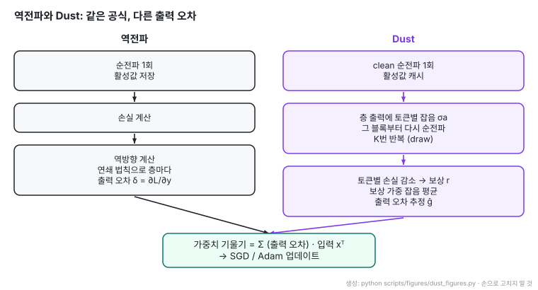
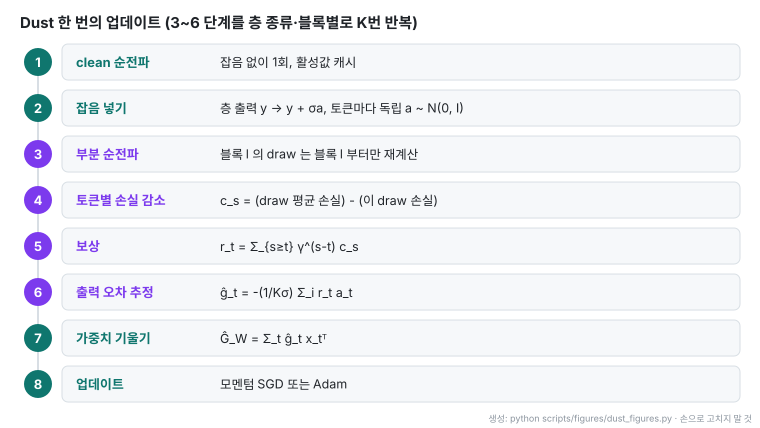
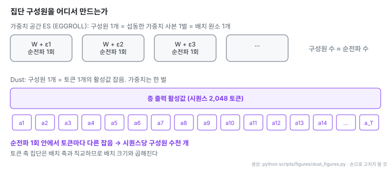
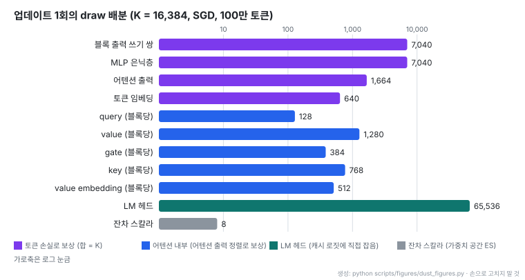
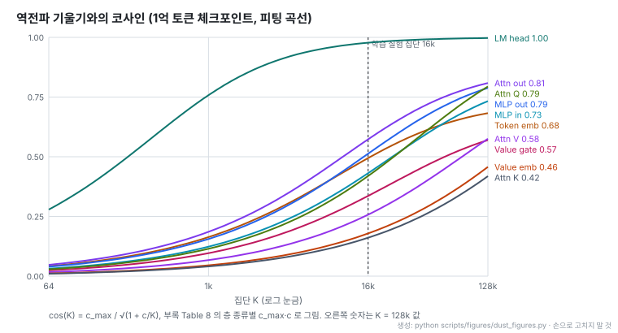
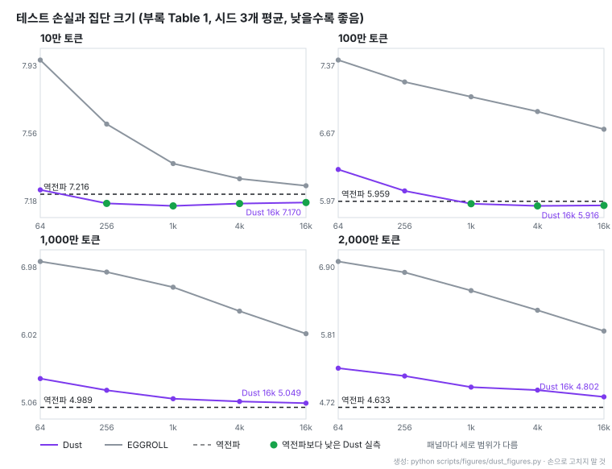

# Dust: 역전파 없이 트랜스포머를 사전학습하기

- **원문**: [Dust: Pretraining Transformers Without Backpropagation](https://qlabs.sh/research/dust) ([부록](https://qlabs.sh/research/dust/appendix.html)), Q Labs Research, 2026-10. arXiv 없이 자사 사이트에 게시
- **저자**: Samip Dahal, Bishwas Mandal, Serdar Gülbahar, Akshay Vegesna (Q Labs, 4명)
- **코드**: [qlabs-eng/dust](https://github.com/qlabs-eng/dust) (MIT, Python. 2026-10-02 생성, 별 278개, 2026-10-27 기준). README 스스로 "최소 구현"이라 하며 논문 실험의 실행 최적화는 빠져 있다
- **실험 환경**: modded-nanoGPT 계열 디코더(8층, 너비 512, 8헤드, 37.7M 파라미터), FineWeb, BPE-4096, 배치 16k 토큰(2,048토큰 × 8), 1 epoch, 모멘텀 SGD(상수 학습률), 칸마다 시드 3개
- **읽은 날짜**: 2026-10-27
- **태그**: #ZerothOrder #NodePerturbation #EvolutionStrategies #Pretraining #EGGROLL

!!! note "핵심 요약"
    가중치 대신 선형층 출력 활성값에 토큰마다 독립 가우시안 잡음을 주입하고, 각 토큰의 손실 변화량을 해당 잡음의 보상으로 산출한다. 단일 순전파에서 각 토큰이 독립적인 집단 구성원으로 기능하므로 순전파 1회당 수천 개의 후보군을 동시에 평가하는 가상 집단을 형성한다. 이 추정량을 통해 역방향 계산(backward pass) 없이 트랜스포머 모델을 처음부터 사전학습했다. 실측 테스트 손실에서 역전파를 앞선 구간은 10만 토큰 및 100만 토큰 환경이며, 1,000만 및 2,000만 토큰 환경에서는 집단 16k 기준 역전파 대비 0.06~0.17 높은 손실을 기록했다. 동일한 0차 최적화 계열인 EGGROLL 대비 현저히 우수한 학습 성능을 달성했다.

## 1. 개요: 역전파와 Dust의 구조적 분기점

역전파와 Dust는 가중치 기울기 행렬을 도출하는 기본 수식 형태가 동일하다. 두 방식 모두 층 출력 오차 벡터와 층 입력 벡터의 외적을 계산한 후 시퀀스 내 토큰 축에 걸쳐 누적 합산한다.

두 방식이 갈리는 단일 지점은 층 출력 오차 벡터를 도출하는 경로다. 역전파는 최종 손실 지점에서 입력 방향으로 연쇄 법칙을 적용하여 각 층의 국소 미분값을 거꾸로 누적 곱셈한다. 반면 Dust는 모델의 순전파만을 반복 실행한다. 선형층 출력에 주입한 무작위 가우시안 잡음과 그에 따른 토큰별 손실 변화량 사이의 상관관계를 집단 표본 평균으로 산출하여 출력 오차를 통계적으로 추정한다.

원문은 이를 다음과 같이 기술한다: "Backprop forms the same outer product with the same input. The only difference is that it gets the output error from the chain rule and we get it from the population."

결과적으로 Dust는 역방향 계산 경로를 일체 수행하지 않으며, 전진 방향으로 모델을 실행하여 손실을 측정하는 연산만으로 가중치를 갱신한다.

- 좌측 역전파 파이프라인의 연쇄 법칙 기반 오차 전달 경로와 우측 Dust 파이프라인의 순전파 잡음 보상 집계 경로의 구조적 차이 확인
- 두 방식이 최종 가중치 갱신 단계에서 출력 오차 벡터와 입력 벡터의 외적 연산 형태로 수렴하는 공통 메커니즘 확인
- 역방향 계산 모듈의 완전한 제거 여부가 두 최적화 체계의 근본적인 분기점임을 파악

## 2. 역전파의 수행 연산: 대체 대상

선형층 연산이 $y_t = W x_t$ ($t$는 시퀀스 내 토큰 위치 인덱스, $x_t$는 층 입력 벡터, $W$는 가중치 행렬, $y_t$는 층 출력 벡터)로 정의될 때, 가중치 행렬 $W$에 대한 손실 함수 $\mathcal{L}$의 실제 기울기는 다음과 같다:

$$
\frac{\partial \mathcal{L}}{\partial W} = \sum_t \frac{\partial \mathcal{L}}{\partial y_t} x_t^T
$$

입력 벡터 $x_t$는 순전파 실행 과정에서 이미 산출되어 메모리에 캐시된다. 역전파 알고리즘에서 가장 큰 계산 비용이 소모되는 영역은 층 출력 오차 벡터인 $\frac{\partial \mathcal{L}}{\partial y_t}$를 계산하는 과정이다. 이 연산은 최상단 손실 함수에서 시작하여 네트워크 각 층을 역방향으로 통과하며 자코비안 행렬 형태의 국소 미분값을 순차적으로 곱하는 연쇄 법칙에 의존한다.

이러한 고전적 역전파 구조는 네트워크를 구성하는 모든 연산 단위가 미분 가능해야 한다는 제약을 전제한다. 원문 서론에 따르면, 딥러닝의 모델 아키텍처, 옵티마이저 알고리즘, 전용 가속 하드웨어 생태계 전체가 1차 미분 가능성이라는 강한 귀납 편향을 중심으로 발전해 왔다.

저자들은 Sutton의 연구인 「쓰라린 교훈(The Bitter Lesson)」과 AlphaGo Zero의 발전 과정을 논거로 제시한다. 인간의 기보라는 특정 편향으로 출발한 알고리즘보다, 계산 자원의 확장에 비례하여 성능이 향상되는 범용 탐색 알고리즘이 궁극적으로 우위를 점했다는 사실을 지적한다. 동일한 맥락에서 미분 가능성과 역전파 역시 계산 자원이 제한된 환경에서 유효했던 최적화 편향일 수 있으며, 연산 자원이 풍부해지는 환경에서는 탐색 가능한 모델 아키텍처의 폭을 불필요하게 제한하는 제약으로 작용할 수 있다고 주장한다.

다만 저자들은 현시점에서 역전파를 완전히 대체할 수준의 연산 효율성을 달성하는 것이 이번 연구의 목적이 아님을 명시한다. 외부 프로그램이 결합된 비미분 네트워크나 장기 반복 연산을 수행하는 복잡한 트랜스포머 아키텍처 등은 본 실험 대상에 포함하지 않았으며, 표준적인 트랜스포머 디코더 구조에서의 가능성 검증에 집중했다.

## 3. 단일 업데이트 단계별 절차

Dust가 1회 가중치 업데이트를 수행하기 위해 순전파를 통해 기울기를 생성하는 절차는 8단계로 구성된다.

1. **기준 순전파(clean forward pass) 1회 수행**: 잡음이 주입되지 않은 정상 상태의 배치를 모델에 통과시키고 각 층의 기본 활성값을 캐시한다. 부록 E에 따르면 업데이트 1회당 GPU마다 기준 순전파는 1회만 실행된다.
2. **토큰별 독립 잡음 주입**: 섭동을 부여할 대상 선형층을 지정하고, 해당 층 출력에 독립 가우시안 잡음을 더한다. 토큰 $t$에 대한 섭동은 다음과 같이 정의된다:

    $$
    y_t \to y_t + \sigma a_t, \quad a_t \sim \mathcal{N}(0, I)
    $$

    여기서 $\sigma$는 사전에 정의된 잡음 크기 스케일 매개변수다. 전체 토큰에 독립 잡음을 1회 주입하는 단위를 1회의 draw로 정의한다.

3. **캐시 기반 부분 순전파 실행**: 블록 $l$의 선형층에 잡음을 주입한 경우, 기준 순전파에서 캐시해 둔 이전 활성값을 재활용하여 블록 $l$부터 출력층까지만 순전파를 다시 실행한다. 전체 네트워크를 처음부터 재실행하지 않으므로 draw 1회의 계산량은 전체 순전파 대비 절감된다.
4. **토큰별 중심화 손실 감소량 산출**: 토큰 $s$에서의 손실 감소량 $c_s$는 동일 배치 순전파에서 함께 평가된 전체 draw들의 토큰 $s$ 평균 손실에서 해당 draw의 손실을 차감하여 구한다:

    $$
    c_s = \overline{\ell}_s - \ell_s
    $$

    여기서 $\ell_s$는 해당 draw에서 측정된 토큰 $s$의 교차 엔트로피 손실값이며, $\overline{\ell}_s$는 동일 집단 표본들의 평균 손실값이다. 평균값을 차감함으로써 기준선(baseline)을 중심화한다.

5. **어텐션 기구 기반 보상 계산 (식 1)**: 토큰 $t$에 주입된 잡음은 인과적 어텐션 기구를 통해 이후 위치의 토큰 $s \ge t$ 손실에도 연쇄적인 영향을 미친다. 따라서 미래 토큰들의 손실 감소량을 감쇠율 $\gamma$로 할인 합산하여 최종 보상 $r_t$를 도출한다:

    $$
    r_t = \sum_{s \ge t} \gamma^{s - t} c_s
    $$

    감쇠율 $\gamma = 0$으로 설정하면 자기 자신의 토큰 위치에서 발생한 손실 변화량만 반영한다.

6. **층 출력 오차 추정 (식 2)**: 집단 크기 $K$회(총 draw 수) 동안 누적된 보상 가중 잡음 벡터의 평균을 계산하여 토큰 $t$에서의 층 출력 오차 추정 벡터 $\hat{g}_t$를 계산한다:

    $$
    \hat{g}_t = -\frac{1}{K \sigma} \sum_{i=1}^K r_t^{(i)} a_t^{(i)}
    $$

    여기서 $r_t^{(i)}$와 $a_t^{(i)}$는 $i$번째 draw에서 도출된 보상 스칼라값과 주입된 가우시안 잡음 벡터다.

7. **가중치 기울기 행렬 도출 (식 3)**: 추정된 출력 오차 벡터 $\hat{g}_t$와 기준 순전파에서 캐시된 입력 벡터 $x_t$의 외적을 구하고 전체 토큰에 걸쳐 합산한다:

    $$
    \hat{G}_W = \sum_t \hat{g}_t x_t^T
    $$

    토큰 임베딩 층의 경우 입력 $x_t$가 원핫(one-hot) 벡터이므로, 해당 토큰 인덱스 행에 $\hat{g}_t$ 벡터를 누적 가산하는 scatter-add 연산으로 처리된다.

8. **파라미터 갱신**: 도출된 가중치 기울기 추정 행렬 $\hat{G}_W$를 모멘텀 SGD 또는 Adam 옵티마이저에 전달하여 모델 파라미터를 갱신한다.

- 기준 순전파 활성값 캐시 생성부터 대상 블록 이후 부분 순전파로 이어지는 연산 절차 확인
- 토큰별 중심화 손실 감소량에 미래 감쇠율을 곱하여 보상을 누적하는 흐름 파악
- 보상 가중 잡음 평균으로 층 출력 오차 벡터를 추정하고 입력 외적을 통해 기울기 행렬을 완성하는 순서 확인

## 4. 가상 집단: 토큰별 활성값 섭동 원리

진화 전략(Evolution Strategies, ES)은 가중치 매개변수에 무작위 섭동을 가한 여러 후보 개체(집단 구성원)를 생성하고 각 개체의 순전파 손실을 평가하여 개선 방향을 탐색한다. 그러나 기존 ES는 구성원 1개를 평가할 때마다 서로 다른 가중치 사본과 별도의 순전파 실행이 필요하므로 집단 크기 확장에 따른 계산 병목이 심각하다.

최신 가중치 공간 ES 연구인 EGGROLL(Sarkar 외, arXiv 2511.16652)은 저랭크 섭동 기법을 도입하여 가중치 사본 생성 비용을 줄였다. 그러나 집단 구성원 1개가 여전히 배치(batch) 내 시퀀스 원소 1개에 대응되므로, 집단 규모는 GPU가 감당할 수 있는 순전파 횟수에 종속된다.

Dust는 가중치를 직접 흔드는 대신 선형층의 출력 활성값에 토큰 단위의 독립 잡음을 주입한다. 특정 토큰 위치에서 활성값에 잡음을 더하는 연산은 해당 층 가중치 행렬에 저랭크 섭동을 부여한 것처럼 동작하지만, 실제 가중치 사본을 메모리에 생성하지 않는다. 원문은 이를 가상 집단(virtual population)으로 명명한다.

시퀀스 1개는 수천 개의 토큰으로 구성되므로, 단 1회의 순전파 실행만으로 시퀀스당 수천 개의 집단 구성원을 동시에 평가할 수 있다. 원문에 따르면 현대 트랜스포머 환경에서 순전파 1회는 가중치 공간 ES 대비 최소 세 자릿수(1,000배) 이상 큰 집단 구성원을 평가하는 효율성을 갖는다. 논문의 기본 실험 환경은 2,048개 토큰으로 구성된 시퀀스 8개를 배치(총 16,384개 토큰)로 사용한다.

활성값에 무작위 잡음을 주입하여 오차 신호를 획득하는 발상 자체는 노드 섭동(node perturbation, Widrow & Lehr 1990, Werfel 외 2003)이라는 고전적 방법론에 기반한다.

일반적인 신경망 연구에서는 "활성값 차원($d_{\text{out}}$)이 가중치 매개변수 차원($d_{\text{out}} \times d_{\text{in}}$)보다 작기 때문에 활성값 탐색이 유리하다"는 논리를 자주 제시한다. 그러나 저자들은 트랜스포머 환경에서 이러한 통념이 성립하지 않는다고 지적한다. 시퀀스 1개에 주입되는 전체 활성값 잡음 텐서의 크기는 $T \times d_{\text{out}}$이므로, 시퀀스 길이 $T \ge d_{\text{in}}$인 조건에서는 활성값 잡음의 원소 수가 가중치 매개변수 원소 수를 초과한다. Dust의 본질적인 이점은 차원 축소가 아니라, 배치 축을 사용하는 EGGROLL과 완전히 직교하는 **토큰 축 가상 집단**을 형성한다는 점에 있다.

예외적으로 트랜스포머 블록 간 잔차 연결에 사용되는 $2L$개의 잔차 혼합 스칼라 매개변수($L$은 층 수)는 활성값 섭동 대신 표준 가중치 공간 ES를 사용하여 별도로 최적화한다.

- 상단 가중치 공간 ES가 배치 원소마다 개별 가중치 사본을 배정하는 방식 확인
- 하단 Dust가 단일 순전파 내에서 시퀀스의 각 토큰 활성값에 독립 잡음을 인가하여 가상 집단을 형성하는 구조 비교
- 토큰 축을 통해 순전파 1회당 수천 개의 후보군을 동시에 평가함으로써 연산 집약도를 확보하는 원리 파악

## 5. 기울기 추정 원리와 1차 근사 유도

단일 draw에서 획득하는 보상 가중 잡음 벡터는 "실제 손실 기울기 방향 성분"과 "특정 방향성이 없는 무작위 통계 오차 성분"의 합으로 표현된다. 독립 draw를 집단 크기 $K$만큼 누적 합산하면 실제 기울기 성분은 $K$에 비례하여 선형적으로 증가하지만, 무작위 오차 성분은 표준편차 법칙에 따라 $\sqrt{K}$에 비례하여 증가한다. 따라서 집단 크기가 증가할수록 상대적인 추정 오차 비율이 감소한다. 다만 실측 코사인의 상한 $c_{\max}$는 층 종류에 따라 1보다 작다(8절).

이 과정이 실제 기울기로 수렴하는 원리는 1차 테일러 전개(Taylor expansion)를 통해 유도할 수 있다. 이 유도는 원문에 수식으로 명시되어 있지 않으나 표준적인 진화 전략의 기대치 도출에 기반하며, 기술적 이해를 돕기 위해 작성자가 덧붙인 내용이다.

주입되는 잡음 크기 $\sigma$가 충분히 작다고 가정할 때, 섭동된 활성값에 대한 손실 함수 $\ell(y + \sigma a)$의 1차 테일러 전개는 다음과 같다:

$$
\ell(y + \sigma a) \approx \ell(y) + \sigma a^T \nabla_y \ell
$$

여기서 $\nabla_y \ell$은 출력 벡터 $y$에 대한 손실 함수의 국소 기울기 벡터($\frac{\partial \ell}{\partial y}$)다. 기준선 평균 손실 $\ell(y)$를 차감하여 중심화한 손실 감소량 $c$는 다음과 같이 근사된다:

$$
c = \ell(y) - \ell(y + \sigma a) \approx -\sigma a^T \nabla_y \ell
$$

잡음 벡터 $a$가 표준 정규분포 $\mathcal{N}(0, I)$를 따르므로, $a$의 기댓값은 0이며 공분산 행렬은 단위 행렬이다 ($\mathbb{E}[a] = 0$, $\mathbb{E}[a a^T] = I$). 따라서 중심화 손실 감소량 $c$와 잡음 벡터 $a$의 외적에 대한 통계적 기댓값은 다음과 같이 전개된다:

$$
\mathbb{E}[c a] \approx \mathbb{E}\left[ \left(-\sigma a^T \nabla_y \ell\right) a \right] = -\sigma \mathbb{E}\left[ a a^T \right] \nabla_y \ell = -\sigma I \nabla_y \ell = -\sigma \nabla_y \ell
$$

이 기댓값 식의 양변을 $-\sigma$로 나누면 손실 기울기 벡터를 얻는다:

$$
\mathbb{E}\left[ -\frac{1}{\sigma} c a \right] \approx \nabla_y \ell = \frac{\partial \ell}{\partial y}
$$

따라서 미래 토큰 보상을 쓰지 않는 경우($\gamma = 0$, 보상 $r = c$), 집단 크기 $K$개의 독립 draw에 걸쳐 평균을 취한 추정량 $\hat{g}$의 기댓값은 1차 근사에서 역전파가 연쇄 법칙으로 산출하는 층 출력 오차 벡터와 같아진다:

$$
\mathbb{E}[\hat{g}] = \mathbb{E}\left[ -\frac{1}{K \sigma} \sum_{i=1}^K c^{(i)} a^{(i)} \right] \approx \frac{\partial \mathcal{L}}{\partial y}
$$

역전파가 미분 계산식을 통해 참값을 결정론적으로 계산한다면, Dust는 "활성값을 흔들었을 때 손실이 개선되었다면 해당 섭동 방향이 최적화 방향과 정렬되어 있다"는 탐색 표본을 다수 수집하여 평균화하는 확률론적 방식을 취한다.

## 6. 간섭 완화 장치와 자원 배분

현실적인 유한 집단 크기 환경에서 Dust 최적화의 최대 장애 요인은 다중 섭동 간의 상호 간섭(interference)이다. 단일 순전파 내에서 복수의 층과 복수의 토큰을 동시에 흔들 경우, 특정 토큰에 할당되는 손실 변화량에 네트워크 내 다른 모든 섭동의 영향이 중첩되어 신호 대 잡음비(SNR)가 급격히 저하된다.

원문 2.3절은 간섭을 억제하기 위해 세 가지 구조적 완화 장치를 도입한다.

1. **층 유형별 및 블록별 독립 순전파 실행**: 서로 다른 종류의 층과 블록을 단일 순전파에서 동시에 흔들지 않고 분리하여 실행한다. 기준 순전파 활성값을 캐시해 두므로, 블록 $l$을 흔드는 draw는 해당 블록 $l$부터만 순전파를 다시 수행하여 계산 낭비를 방지한다.
2. **어텐션 내부 층 전용 국소 점수 체계 도입**: query, key, value, gate, value embedding 등 어텐션 블록 내부 매개변수는 출력층의 최종 토큰 손실에 미치는 직접적 신호 강도가 매우 약하다. 따라서 최종 교차 엔트로피 손실 대신, 해당 블록의 어텐션 출력 오차 추정치와의 벡터 정렬도를 국소 손실 감소량으로 정의한다 (식 4):

    $$
    c_s = -\langle \hat{g}_s, \Delta o_s \rangle
    $$

    여기서 $\Delta o_s$는 내부 섭동으로 인해 발생한 토큰 $s$에서의 어텐션 모듈 출력 벡터 변화량이며, $\hat{g}_s$는 식 (2)를 통해 기추정된 해당 어텐션 출력의 오차 벡터다. 이 내적 점수를 식 (1)에 대입하여 헤드별 보상을 산출한다.

3. **LM 헤드 전용 고속 부분 평가**: 언어 모델 출력 헤드(LM head)는 전체 순전파를 다시 돌리지 않고 캐시된 최종 로짓 벡터에 직접 잡음을 주입한다. 또한 draw마다 전체 어휘가 아닌 256개 로짓 조각에 대해서만 교차 엔트로피 손실을 계산한다. 연산 단가가 극히 낮기 때문에 LM 헤드에는 전체 집단보다 훨씬 많은 draw를 할당한다.

토큰 간 인과 관계에 따른 감쇠율 $\gamma$의 최적화 결과, 미래 토큰의 보상 반영($\gamma > 0$)이 실질적인 이득을 가져오는 계층은 key, value, gate, value embedding 층에 국한된다 ($\gamma = 0.98$, 대규모 환경 일부 $0.99$). 이 네 층은 미래 위치의 토큰들이 어텐션 기구를 통해 참조하는 정보를 생성하기 때문이다. 반면 query 층 및 최종 손실을 직접 추적하는 선형층들은 $\gamma = 0$이 최적으로 확인되었다.

다음 표는 집단 크기 $K = 16,384$, 모멘텀 SGD 옵티마이저, 100만 토큰 학습 환경 기준의 1회 업데이트당 draw 및 잡음 크기 배분 구조다 (부록 E Table 3).

| 대상 위치 | draw 1회의 재실행 범위 | SGD draw 수 | Adam draw 수 | 잡음 크기 ($\sigma$) |
|---|---|---|---|---|
| 블록 출력 쓰기 쌍 (writer pair) | 해당 블록부터 네트워크 끝단까지 재실행 | 7,040 | 4,096 | 0.2 |
| MLP 은닉층 | 해당 블록부터 네트워크 끝단까지 재실행 | 7,040 | 4,096 | 0.2 |
| 어텐션 출력 | 해당 블록부터 네트워크 끝단까지 재실행 | 1,664 | 6,144 | 0.2 (심층 절반 블록 0.4) |
| 토큰 임베딩 | 네트워크 전체 재실행 | 640 | 8,192 | 0.2 (Adam 조건 0.4) |
| query (블록당) | 해당 블록 어텐션 모듈 재실행 | 128 | 128 | 0.05 |
| value (블록당) | 해당 블록 어텐션 모듈 재실행 | 1,280 | 1,280 | 0.05 |
| gate (블록당) | 해당 블록 어텐션 모듈 재실행 | 384 | 384 | 0.05 |
| key (블록당) | 해당 블록 어텐션 모듈 재실행 | 768 | 768 | 0.05 |
| value embedding (블록당) | 해당 블록 어텐션 모듈 재실행 | 512 | 512 | 0.05 |
| LM 헤드 | 로짓 조각 1개의 교차 엔트로피 재계산 | 65,536 | 49,152 | 0.05 |
| 잔차 스칼라 | 네트워크 전체 2회 재실행 | 8 | 8 | 0.03 |

- 상위 4개 행(블록 쓰기 쌍, MLP 은닉층, 어텐션 출력, 토큰 임베딩)의 SGD draw 수 합계가 기본 집단 크기 $K = 16,384$를 구성
- 어텐션 내부 층과 LM 헤드의 draw는 연산 FLOPs 점유율이 낮아 기본 집단 $K$의 카운트에서 제외 처리
- 심층부 절반 블록의 어텐션 출력 잡음 크기를 0.4로 높인 사유는 0.2 조건에서 손실 변화 신호가 불충분하기 때문
- 블록별 draw 배분은 네트워크 전단부에 집중 배치 (100만 토큰 기준 블록 1의 쓰기 쌍 draw는 2,432개, 블록 7과 8은 각 128개 배정)

- 손실 기반 평가를 받는 주력 층과 국소 정렬 목표를 적용받는 어텐션 내부 층 간의 draw 배분 격차 확인
- 심층부 블록 대비 입력단 전면부 블록에 더 많은 탐색 draw가 집중되는 계층별 기울기 배분 경향 파악
- 단위 연산 비용이 낮은 LM 헤드에 대규모 집단이 배정되는 자원 할당 우선순위 확인

## 7. 하이퍼파라미터 탐색 방식

Dust 파이프라인의 핵심 하이퍼파라미터는 계층별 잡음 크기($\sigma$), 어텐션 내부 감쇠율($\gamma$), 계층별 draw 배분 비율이다. 저자들은 두 가지 탐색 접근법을 병용했다.

- **방법 A (소규모 예산 실학습 격자 탐색)**: 축소된 토큰 예산 환경에서 실제 모델 학습을 수행하여 검증 손실을 직접 평가한다. 결과의 신뢰성은 높으나 연산 비용 소모가 크다.
- **방법 B (단일 배치 역전파 코사인 유사도 최대화)**: 단일 데이터 배치 환경에서 Dust 기울기 추정치와 역전파 실제 기울기 간의 코사인 유사도를 측정하여 이를 최대화하는 설정을 선별한다. 학습을 진행하지 않으므로 탐색 속도가 매우 빠르다.

단일 배치에서 역전파 기울기와의 코사인 유사도가 높다고 해서 장기 학습 후의 최종 검증 손실이 반드시 최적화되지는 않는다. 따라서 저자들은 방법 B를 통해 1차 후보군을 빠르게 선별한 후, 방법 A의 실학습을 통해 최종 설정을 확정하는 2단계 절차를 적용했다.

이렇게 도출된 하이퍼파라미터 설정은 토큰 예산이나 집단 크기가 달라져도 재튜닝 없이 대부분 안정적으로 일반화되었다. 유일한 예외는 1,000만 및 2,000만 토큰 예산의 최대 집단(16k) 환경으로, 이 조건에서는 감쇠율 $\gamma$를 더 완만하게 설정하고 draw 할당을 어텐션 모듈 방향으로 추가 배분하는 것이 성능 개선에 유리했다(부록 F).

튜닝 단계의 방법 B에서 역전파 기울기를 비교 기준으로 활용하지만, 모델의 실제 학습 과정에서는 역전파 알고리즘을 전혀 사용하지 않는다.

## 8. 역전파 기울기 방향 근사도

저자들은 역전파로 사전학습된 모델 체크포인트(학습 토큰 수 1,000만, 1억, 10억 개 시점)를 준비하고, 동일 배치 데이터에 대해 Dust 기울기 추정치와 역전파 실제 기울기 간의 코사인 유사도를 계층 종류별로 측정했다. 평가 집단 크기 $K$는 64부터 131,072(128k)까지 확장했다.

실험 결과 모든 계층 유형과 모든 학습 단계에서 집단 크기 $K$가 커짐에 따라 코사인 유사도가 단조 증가했다. 이 곡선은 2개 매개변수를 갖는 스케일링 법칙(식 5)에 매우 정밀하게 부합했다:

$$
\cos(K) = \frac{c_{\max}}{\sqrt{1 + \frac{c}{K}}}
$$

여기서 $c_{\max}$는 집단 크기가 무한대로 확장될 때 도달하는 이론적 코사인 유사도 상한선이며, $c$는 유사도가 상한선의 $\frac{1}{\sqrt{2}}$에 도달하는 기준 집단 크기 매개변수다. 전체 계층 유형에서 모델 적합도 오차는 RMSE 0.06 미만을 기록했다.

다음 표는 1억 토큰 체크포인트에서 7개 집단 측정 지점(64~131,072)을 기반으로 도출한 계층별 피팅 계수다 (부록 Table 8).

| 계층 종류 | $c_{\max}$ (상한선) | $c$ (수렴 기준 집단) | RMSE |
|---|---|---|---|
| MLP out | 0.8779 | 31,623 | 0.0081 |
| MLP in | 0.8577 | 48,417 | 0.0065 |
| Attn out | 0.8729 | 21,627 | 0.0093 |
| Attn Q | 1.0000 | 76,736 | 0.0356 |
| Attn K | 1.0000 | 616,595 | 0.0191 |
| Attn V | 0.8776 | 173,780 | 0.0269 |
| Value gate | 0.6657 | 47,863 | 0.0367 |
| Value emb | 1.0000 | 495,450 | 0.0247 |
| Token emb | 0.7318 | 19,498 | 0.0083 |
| LM head | 1.0000 | 759 | 0.0032 |

- 연쇄 법칙 계산을 전혀 적용하지 않고도 대규모 표본 추출만으로 역전파 기울기와 높은 정렬도를 갖는 방향성이 생성됨을 증명
- 동일한 순전파 횟수 조건에서 EGGROLL을 평가한 결과 128k 집단에서도 LM 헤드를 제외한 전 계층의 코사인 유사도가 0.05 미만에 정체
- 대규모 집단 조건에서 코사인 유사도 수준은 1,000만 토큰부터 10억 토큰에 이르는 넓은 구간 동안 평탄하게 유지됨
- 10억 토큰 조건은 역전파로 학습된 체크포인트 상에서 기울기 정렬도만 측정한 것이며, Dust 자체로 10억 토큰 사전학습을 수행한 것은 아님. Dust 학습의 10억 토큰 확장성은 미검증

저자들은 코사인 유사도가 1.0에 도달하지 않는 현상을 결함이 아닌 잠재적 강점으로 해석한다. 역전파와 유사하면서도 미세하게 상이한 탐색 방향이 손실 지형 내에서 차별화된 최적화 경로를 유도하며, 특정 조건에서는 역전파보다 유리한 지점으로 모델을 유도할 가능성이 있다는 관점이다. 다만 구체적인 역학 메커니즘은 규명되지 않았다.

- 집단 크기 $K$의 확장에 따라 역전파 기울기와의 코사인 유사도가 계층별 상한선($c_{\max}$)으로 수렴하는 궤적 확인
- 계층 종류별로 상한선 도달에 필요한 집단 크기 매개변수 $c$의 차이 비교
- 고전적 ES(EGGROLL)의 정체 현상과 대비되는 Dust의 독자적 기울기 근사 특성 파악

## 9. 모델 사전학습 손실 결과

사전학습 벤치마크는 modded-nanoGPT 계열 트랜스포머 디코더(8층, 은닉 너비 512, 8개 어텐션 헤드, 총 3,770만 파라미터), FineWeb 데이터셋, BPE-4096 토크나이저 환경에서 수행되었다. 배치는 16k 토큰(2,048토큰 시퀀스 8개), 1 epoch, 모멘텀 SGD(상수 학습률) 조건이며 각 실험 칸마다 3개의 무작위 시드를 평균했다.

다음 표는 부록 Table 1에 수록된 토큰 예산별 테스트 손실 실측치 및 외삽 결과다.

| 최적화 기법 및 집단 | 10만 토큰 | 100만 토큰 | 1,000만 토큰 | 2,000만 토큰 |
|---|---|---|---|---|
| Dust 64 | 7.240 | 6.290 | 5.397 | 5.265 |
| Dust 256 | 7.165 | 6.067 | 5.231 | 5.139 |
| Dust 1k | 7.151 | 5.934 | 5.111 | 4.960 |
| Dust 4k | 7.164 | 5.911 | 5.072 | 4.912 |
| Dust 16k | 7.170 | 5.916 | 5.049 | 4.802 |
| Dust $\infty$ (멱법칙 피팅 극한) | 7.161 | 5.892 | 5.013 | 4.431 |
| EGGROLL 64 | 7.961 | 7.428 | 7.056 | 6.987 |
| EGGROLL 16k | 7.263 | 6.708 | 6.033 | 5.865 |
| **역전파 (Backpropagation)** | **7.216** | **5.959** | **4.989** | **4.633** |

- **역전파 대비 실측 우위 달성 구간**: 10만 토큰 조건에서는 집단 크기 256 이상부터, 100만 토큰 조건에서는 집단 크기 1k 이상부터 Dust의 실측 테스트 손실이 역전파보다 낮게 나타남.
- **1,000만 토큰 구간**: Dust 16k 집단의 실측 손실은 5.049로 역전파(4.989) 대비 0.060 높으며, 피팅 극한값(5.013) 역시 역전파 손실을 상회하여 곡선이 평탄화됨.
- **2,000만 토큰 구간**: 실측 최선인 16k 집단 손실은 4.802로 역전파(4.633) 대비 0.169 높음. 다만 집단 증가에 따른 손실 강하 곡선이 지속되고 있어 멱법칙 피팅 극한값은 4.431(95% 부트스트랩 신뢰구간 3.89~4.58)로 산출됨. 원문 저자들은 이 피팅이 엄밀히 구속되지 않은 상태("loosely constrained")라고 밝히며, 확정된 한계치가 아니라 격차가 축소되는 경향성을 보여주는 참고 자료로 해석해야 한다고 기술함.
- **EGGROLL 대비 효율**: EGGROLL은 Dust 최소 집단(64)의 256배에 달하는 16k 집단 조건에서도 Dust 64의 손실에 미치지 못함. Dust 64 수준을 달성하기 위해 요구되는 EGGROLL 집단 규모를 외삽한 결과 64의 약 3,000~23,000배로 도출됨 (논문 요약의 "10^3~10^4배 효율" 주장은 역전파 대비가 아닌 EGGROLL 대비 외삽 수치임).
- **Adam 옵티마이저 실험 (100만 토큰)**: Adam 환경에서 Dust 피팅 극한 손실은 5.248(95% 구간 5.17~5.30), 역전파는 5.361을 기록함. EGGROLL은 Adam 적용 시에도 SGD 대비 손실 개선이 0.01 이내에 그침. Adam 실험의 Dust는 토큰 임베딩 draw를 추가 배분하여 실제 총 draw가 표기 수치의 약 1.4배로 실행됨.

모델 파라미터 크기 확장에 따른 스케일링 특성을 검증하기 위해 1,000만 토큰 고정 조건에서 4가지 모델 규모를 평가했다 (부록 Table 1 이전의 초기 실험 규약 적용 데이터).

| 집단 크기 | 2.0M 파라미터 | 7.3M 파라미터 | 38M 파라미터 | 243M 파라미터 |
|---|---|---|---|---|
| 64 | 5.705 | 5.556 | 5.558 | 5.719 |
| 256 | 5.486 | 5.362 | 5.358 | 5.419 |
| 1k | 5.265 | 5.161 | 5.158 | 5.214 |
| 4k | 5.189 | 5.095 | 5.053 | 5.124 |
| 16k | 5.171 | 5.065 | 5.036 | 5.086 |
| 역전파 | 5.180 | 5.066 | 5.015 | 5.048 |

- 1k 집단 이상 구간에서 38M 및 243M 대규모 모델은 2M 및 7M 소규모 모델 대비 약 30% 더 큰 폭의 손실 개선을 달성함
- 모델 규모가 클수록 탐색 공간의 기하학적 용량이 넓어져 대규모 집단 표본을 효율적으로 흡수함을 시사
- 주의: 본 모델 규모 실험은 3.2절 벤치마크 규약 확정 이전에 수행된 초기 실험으로 학습률 설정이 상이하여, 3.2절 표의 1,000만 토큰 수치(역전파 4.989)와 직접 수치 대조를 하지 않음

- 10만 및 100만 토큰 소규모 데이터 환경에서 Dust가 역전파 곡선 아래로 내려가는 교차 구간 확인
- 1,000만 및 2,000만 토큰 환경에서 실측 곡선의 상대적 열세와 외삽 극한값의 추세 확인
- 전 구간에 걸쳐 기존 가중치 공간 ES(EGGROLL) 대비 압도적인 손실 격차를 유지하는 성능 우위 확인

## 10. 역전파 대비 종합 비교와 미결 과제

다음 표는 역전파, Dust, 그리고 가중치 공간 ES(EGGROLL)의 핵심 메커니즘을 비교한 내용이다.

| 비교 항목 | 역전파 (Backpropagation) | Dust | EGGROLL (가중치 공간 ES) |
|---|---|---|---|
| 출력 오차 도출 방식 | 연쇄 법칙 기반 결정론적 역방향 계산 | 활성값 잡음과 손실 상관관계의 집단 표본 평균 | 가중치 섭동과 시퀀스 점수 간 상관관계 |
| 역방향 연산 단계 | 필수 수행 | 완전 배제 (순전파만 수행) | 완전 배제 (순전파만 수행) |
| 섭동 주입 대상 | 섭동 없음 (해석적 미분) | 선형층 출력 활성값 (토큰별 독립 주입) | 모델 가중치 행렬 (저랭크 섭동) |
| 집단 구성원 1개의 단위 | 해당 없음 | 시퀀스 내 단일 토큰 1개 | 배치 내 시퀀스 원소 1개 |
| 네트워크 전구간 미분 가능성 | 필수 요구 | 불필요 (비미분 구조 수용 가능) | 불필요 (비미분 구조 수용 가능) |
| 가중치 기울기 수식 구조 | $\delta \cdot x^T$ (해석적 오차와 입력 외적) | $\hat{g} \cdot x^T$ (추정 오차와 동일 입력 외적) | 섭동 행렬의 적합도 가중 평균 |

논문이 기술하는 핵심 제약과 미결 과제는 세 가지로 요약된다.

- **연산 효율성의 미흡**: 저자들은 현 수준의 계산 자원 환경에서 Dust가 역전파를 실질적으로 대체하기 위해서는 수 자릿수(orders of magnitude) 이상의 연산 효율성 개선이 선행되어야 함을 분명히 인정한다.
- **실행 비용 실측 데이터 결여**: 동일 손실에 도달하기까지 소요되는 실제 하드웨어 실행 시간(벽시계 시간), 전력 소비량, 메모리 점유율에 대한 역전파 대비 실측 비교 데이터는 원문에 수록되지 않았다.
- **실험 규모의 한계**: 실제 사전학습이 검증된 최대 규모는 모델 파라미터 243M, 학습 데이터 2,000만 토큰에 한정된다.

원문 결론은 후속 연구를 위한 열린 질문으로 다음을 제시한다:
1. 대규모 집단 조건에서 Dust가 손실 지형의 고차 곡률을 암묵적으로 탐색하여 평탄한 극소점으로 유입되는지 여부 및 그 구체적 메커니즘 규명.
2. 미분 가능성 제약이 제거됨에 따라 시간 역전파가 불가능했던 순환 구조나 외부 이산 프로그램 결합 구조로의 아키텍처 확장 가능성.
3. 실용적 적용을 위한 급진적인 순전파 연산 효율화 방안 확보.

## 11. 관련 연구 비교

원문 6절에 기술된 관련 연구 계열과 Dust 간의 기술적 차별점은 다음과 같다 (각 논문 원문은 EGGROLL 및 ES at Scale 초록 수준에서 대조 완료).

| 계열 구분 | 주요 참조 연구 | Dust와의 핵심 기술적 차이점 |
|---|---|---|
| 0차 사전학습 (Zeroth-Order Pretraining) | Allaire 외 2025 (ICPRAM), KronZO (Allaire 외 2026) | 가중치 공간 직접 섭동 방식 채택. KronZO는 크로네커 곱 구조 섭동으로 메모리 절감을 도모하나 가중치 섭동 한계 유지 |
| 가중치 공간 진화 전략 (Weight-Space ES) | [EGGROLL](https://arxiv.org/abs/2511.16652) (Sarkar 외, arXiv 2511.16652) | 저랭크 가중치 섭동을 통해 GPU 효율을 개선했으나 배치 축 종속. Dust는 토큰 축 가상 집단으로 순전파당 표본 수를 1,000배 확장 |
| 0차 미세조정 (Zeroth-Order Fine-Tuning) | MeZO (Malladi 외 2023), [ES at Scale](https://arxiv.org/abs/2509.24372) (Qiu 외, arXiv 2509.24372, ICML 2026), Neural Thickets (Gan & Isola 2026) | 사전학습 완료 모델의 가중치 주변 국소 탐색 수행. Dust는 모델 표현 자체를 영점에서부터 처음 사전학습 |
| 활성값 및 출력 섭동 (Activation/Output Perturbation) | Node Perturbation (Werfel 외 2003), GEMINI (Le Cun 외 1988), Zoop (Hu 외 2025), Scaling Forward Gradient (Ren 외 2023) | 고전적 노드 섭동 이론에 기반하되, 토큰별 독립 보상 할당 및 어텐션 출력 국소 목표 점수 체계를 결합 |
| 국소 학습 동역학 (Local Learning Dynamics) | PC-ALM (Seely & Gould, Sakana AI, arXiv 2605.31022) | 계층별 국소 미분 연산을 활용하며 이미지 분류 과제에서 검증. Dust는 미분을 배제한 순전파 추정 기반 트랜스포머 언어모델 학습 |

## 12. 결과 해석 시 주의 사항

!!! warning "결과 해석 시 주의 사항"
    1. **"역전파 능가" 주장의 유효 범위**: 실측 테스트 손실에서 Dust가 역전파보다 낮게 나타난 영역은 10만 토큰 및 100만 토큰의 초기 소규모 데이터 환경에 국한된다. 2,000만 토큰 조건의 4.431 수치는 아직 하강 중인 곡선을 외삽한 추정치에 불과하며, 실제 측정값(4.802)은 역전파(4.633)보다 열세다.
    2. **동일 연산량 기준 비교의 부재**: 집단 16k 조건은 가중치 갱신 1회당 16,384회의 주력 draw와 65,536회의 LM 헤드 draw를 소모한다. 동일 손실 도달 기준의 실제 소요 시간, 전력 소비, 메모리 풋프린트 실측치는 제공되지 않았다.
    3. **"10^3~10^4배 효율"의 기준 대상**: 해당 효율 격차는 역전파 대비 수치가 아니며, 이전 세대 가중치 공간 ES인 EGGROLL 대비 요구되는 집단 규모를 외삽 비교한 결과다.
    4. **검증 규모의 제약**: 논문에서 실증된 최대 모델 크기는 243M 파라미터, 최대 데이터 규모는 2,000만 토큰 수준이다. 현대 대규모 언어 모델(LLM) 사전학습 스케일에서의 유효성은 미검증 상태다.
    5. **수동 하이퍼파라미터 튜닝 부담**: 층별 draw 배분, 블록별 기울기, 잡음 크기 $\sigma$, 감쇠율 $\gamma$ 등이 정교하게 조정된 상수에 의존한다. 기본 설정이 대체로 일반화된다고 기술되어 있으나, 최대 집단 조건에서는 추가 튜닝이 요구되었다.

## 13. 적용 가능 영역과 한계

사전학습 밖에서 생각해 볼 수 있는 영역은 **미분 불가능한 보상 기반의 소규모 모델 미세조정(Fine-Tuning)** 이다. 판정기의 불연속 점수나 질의 성공 여부처럼 기울기 역전파가 불가능한 비미분 신호를 통해 모델을 미세조정할 때, 가중치 복제 없이 활성값 잡음만으로 대규모 후보군을 평가하는 가상 집단 메커니즘은 메모리 절감 관점에서 유의미한 시사점을 제공한다.

그러나 Dust의 가상 집단 구조는 시퀀스 내 각 위치마다 독립적인 토큰별 손실 함수가 정의되어야 성립한다. 텍스트 생성 완료 후 시퀀스 끝단에서 단일 스칼라 점수만 주어지는 일반적인 강화학습형 미세조정 과제에는 Dust의 토큰 축 보상 할당 구조를 직접 적용하기 어렵다. 해당 문제 영역에는 시퀀스 수준 최적화를 다루는 ES at Scale 계열의 방법론이 더 적합하다.

## 14. 파생 연구와 커뮤니티 논의

### Noise: 역전파 배제 사전학습 공개 스피드런

Dust 발표 직후 Q Labs는 공개 경쟁 프로젝트인 Noise 저장소를 개설했다 ([qlabs-eng/noise](https://github.com/qlabs-eng/noise), MIT 라이선스, 2026-10-12 개설, 2026-10-27 기준 별 415개, 포크 54개).

- **고정 실험 환경**: Dust의 3,770만 파라미터 모델, FineWeb 3,000만 토큰, Dust 검증 데이터셋 교차 엔트로피 손실, 단일 노드 8xH100 GPU, 1 epoch.
- **경쟁 규칙**: 파이토치 autograd 및 수기 작성된 역방향 연산 전면 금지. 모든 오차 신호는 순전파로만 측정해야 하며, 비선형 모듈은 최대 1단계까지만 통과 가능.

다음 표는 2026-10-27 기준 Noise 저장소 README에 공식 기록된 벤치마크 결과다.

| 최적화 기법 구분 | 검증 교차 엔트로피 손실 | 실행 소요 시간 |
|---|---|---|
| 역전파 Adam | 3.419 | 원문 기재 없음 |
| 역전파 ANVIL II + Adam | 3.340 | 원문 기재 없음 |
| Dust 원형 알고리즘 + Adam (집단 24k) | 3.767 | 5시간 17분 |
| 트랙 1 최고 기록 (국소 기여도 복합 기법) | 3.338 | 56분 |

3,000만 토큰 실측 환경에서 원형 Dust 알고리즘의 손실은 3.767로 역전파 Adam(3.419) 대비 0.348 높은 격차를 보였다. 역전파 최고 수준(3.340)에 근접한 트랙 1 최고 기록(3.338)은 Dust 원형이 아니라 Boost, Cut, future-token probe 등 다양한 국소 기여도 기법을 추가 결합한 커뮤니티 산출물이며, 단일 시드(seed 0) 1회 실행 결과다.

### "4,000배 가속" 주장에 대한 사실 검증

Q Labs의 저자 Samip Dahal은 SNS(X)를 통해 "Noise 공개 10일 만에 학습 소요 시간이 1.76시간에서 1.6초로 단축되었다"고 언급했다 (2026-10-22 작성, X 원문 미확인).

[explainx 팩트체크](https://explainx.ai/blog/q-labs-dust-noise-pretrain-transformers-without-backpropagation-4000x-claim-verified-2026)에 따르면, 1.76시간과 1.6초라는 수치 자체는 보관된 1,000만 토큰 실험 기록 데이터에 실제로 존재한다. 그러나 해당 벤치마크의 목표 손실 기준선은 4.2로 설정되어 있어, 역전파 Adam의 정상 수렴 손실인 3.769 대비 지나치게 완화된 조건이다. 더욱이 1.6초를 기록한 알고리즘은 Dust 원형 방식이 아니다. 따라서 이를 "역전파 대비 4,000배 빠른 최적화 달성"으로 읽으면 안 된다.

### 기술 커뮤니티 주요 논의

[Hacker News 49970871](https://news.ycombinator.com/item?id=49970871) (280점, 댓글 82개)과 [GeekNews 34868](https://news.hada.io/topic?id=34868)에서 제기된 엔지니어들의 핵심 논점은 네 가지로 정리된다.

- **기울기 유용성 관점**: 일반적인 딥러닝 목적함수는 국소적으로 매끄럽기 때문에 1차 미분 기울기를 직접 계산하는 것이 최적화 효율 면에서 여전히 압도적이라는 회의론.
- **0차 최적화의 유효 영역**: 미분 계수가 정의되지 않는 외부 블랙박스 시뮬레이터 연동 환경이나, 계층 간 역방향 동기화 대기를 제거하여 깊이 방향 파이프라인 병렬화를 극대화하려는 분산 시스템 환경에서 가치가 있다는 평가.
- **혼합 최적화 전략 제안**: 거친 손실 지형에서 0차 탐색 기법으로 초기 유망 영역을 탐색한 후, 1차 역전파를 적용하여 정밀하게 수렴시키는 2단계 하이브리드 파이프라인 구상.
- **공정한 평가 벤치마크 수립 요구**: 동일 스텝이나 동일 토큰 수가 아니라, 동일 손실 값에 도달하는 데 소모된 총 하드웨어 연산 시간, 전력 에너지, 메모리 사용량을 표준 지표로 삼아야 한다는 지적.

## 15. 결론

Dust 연구가 제시하는 핵심 가치는 현업 도입 수준의 연산 효율성이 아니라 0차 최적화의 근본적 가능성을 보여준 **개념 증명(Proof of Concept)**에 있다.

트랜스포머의 토큰 축에 착안한 가상 집단(virtual population) 메커니즘을 통해 0차 방법론의 치명적 약점이었던 집단 생성 비용을 대폭 축소했다. 또한 무작위 섭동과 손실 변화량의 상관관계를 통계적으로 집계하여 역전파와 동일한 형태의 "출력 오차 추정치와 입력 벡터의 외적" 구조를 순전파만으로 도출해 냈다. 그 결과 기존 가중치 공간 진화 전략(EGGROLL)과는 완전히 차별화된 학습 성능을 입증했다.

역전파와의 상대 비교 관점에서 Dust는 초기 10만 및 100만 토큰 소규모 데이터 환경에서만 경쟁력을 입증했다. 학습 데이터가 확장될수록 요구되는 집단 규모가 급격히 팽창하며, 3,000만 토큰 실측 환경에서는 원형 알고리즘 기준 역전파 대비 0.35 수준의 손실 열세를 보인다.

따라서 Dust를 인용할 때는 "초기 소규모 데이터 환경에서 역전파 대체 가능성을 입증했으나, 2,000만 토큰 역전 수치는 외삽에 기반하며 대규모 데이터셋 환경에서는 여전히 상당한 연산 격차가 존재함"을 객관적으로 명시해야 한다.
