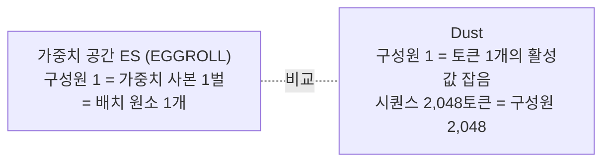

# Dust: 역전파 없이 트랜스포머를 사전학습하기

- **원문**: [Dust: Pretraining Transformers Without Backpropagation](https://qlabs.sh/research/dust) ([부록](https://qlabs.sh/research/dust/appendix.html)), Q Labs Research, 2026-10. arXiv 없이 자사 사이트에 게시
- **저자**: Samip Dahal, Bishwas Mandal, Serdar Gülbahar, Akshay Vegesna (Q Labs, 4명)
- **코드**: [qlabs-eng/dust](https://github.com/qlabs-eng/dust) (MIT, Python. 2026-10-02 생성, 별 278개, 2026-10-27 기준). README 스스로 "최소 구현"이라 하며 논문 실험의 실행 최적화는 빠져 있다
- **실험 환경**: modded-nanoGPT 계열 디코더(8층, 너비 512, 8헤드, 37.7M 파라미터), FineWeb, BPE-4096, 배치 16k 토큰(2,048토큰 × 8), 1 epoch, 모멘텀 SGD(상수 학습률), 칸마다 시드 3개
- **읽은 날짜**: 2026-10-27
- **태그**: #ZerothOrder #NodePerturbation #EvolutionStrategies #Pretraining #EGGROLL

## 한 줄 요약

가중치 대신 **선형층 출력(활성값)에 토큰마다 독립 잡음**을 넣고, 각 토큰의 손실 변화를 그 잡음의 보상으로 삼는다. 토큰 하나가 집단 구성원 하나가 되므로 순전파 한 번이 수천 개 후보를 평가한다(가상 집단). 이 추정기로 역전파 없이 트랜스포머를 처음부터 학습했다. 실측으로 역전파를 이긴 곳은 **10만·100만 토큰**뿐이고, 1,000만·2,000만 토큰에서는 집단 16k에서도 역전파보다 0.06~0.17 높다. 같은 0차 계열인 EGGROLL보다는 훨씬 낫다.

## 읽는 방식

원문 절 순서를 따라간다. 부록에서 본 내용은 해당 절에 붙였다. 마지막 네 절(주의할 점, 우리 쪽과의 거리, 파생 자료, 결론)만 읽는 쪽에서 덧붙인 것이다.

## 1. Introduction: 왜 탐색으로 학습하려 하는가

- 저자들의 출발점은 Sutton의 「쓰라린 교훈」이다. 연산이 많아지면 귀납 편향보다 연산과 함께 커지는 범용 방법이 이긴다. 예로 AlphaGo Zero를 든다. 사람 기보로 시작한 쪽이 초반엔 빨랐지만 자기 대국만 한 쪽이 결국 넘어섰다.
- 같은 논리로 미분 가능성과 역전파도 **연산이 적은 구간의 좋은 편향**일 뿐이고, 연산이 많은 구간에서는 쓸 수 있는 아키텍처를 제한한다고 주장한다.
- 가중치 대신 활성값을 탐색하는 이유로는 해석 가능성 연구를 든다. 추론은 활성값에 있으니, 활성값 탐색은 잠재 추론에 대한 탐색이 될 수 있다는 것이다(Vegesna & Dahal 2025, arXiv 2509.10973. 저자들의 이전 논문).
- 하지 않는 것도 처음부터 밝힌다. "We do not attempt to make it compute-efficient enough to replace backprop today." 외부 프로그램이 들어간 네트워크나 많은 단계를 반복하는 트랜스포머처럼 역전파가 어려운 구조도 이번에는 학습하지 않았다.

## 2. Method

### 2.1 활성값 섭동과 가상 집단

- 진화 전략(ES)의 병목은 집단 크기다. 구성원마다 가중치 사본과 순전파가 필요하다. EGGROLL은 저랭크 섭동으로 사본을 싸게 만들었지만, 구성원 하나가 여전히 배치 원소 하나라서 집단은 감당할 수 있는 순전파 수에 묶인다.
- Dust는 활성값에 토큰마다 독립 잡음을 넣는다. 그 토큰에서는 그 층 가중치에 저랭크 섭동을 준 것처럼 동작하지만, 섭동이 가중치로 만들어지지는 않는다. 이것이 **가상 집단**이다. 활성값에 잡음을 넣는 방식 자체는 오래된 node perturbation(Widrow & Lehr 1990, Werfel 외 2003)이다.
- 저자들은 흔히 쓰는 "활성값 차원이 가중치보다 작다"는 논리가 트랜스포머에서는 성립하지 않는다고 짚는다. 시퀀스 하나의 잡음은 T × d_out이라 T ≥ d_in이면 가중치보다 크다. 진짜 이득은 EGGROLL이 쓰는 **배치 축과 직교하는 토큰 축 집단**이다.
- 예외: 잔차 혼합 스칼라 2L개만 일반 가중치 공간 ES로 학습한다.

### 2.2 기여도 할당

선형층 `y_t = W x_t`의 출력에 잡음을 넣는다: `y_t → y_t + σ a_t`, `a_t ~ N(0, I)`.

| 식 | 내용 |
|---|---|
| `c_s = mean(ℓ_s) − ℓ_s` | 토큰 s의 중심화한 손실 감소량. 같은 배치 순전파에서 함께 평가한 draw들의 평균 손실을 뺀다 |
| (1) `r_t = Σ_{s≥t} γ^(s−t) c_s` | 토큰 t 잡음의 보상. 어텐션으로 뒤 토큰에도 영향을 주므로 뒤 토큰 손실 감소를 할인해 더한다. γ = 0이면 자기 토큰만 본다 |
| (2) `ĝ_t = −(1/Kσ) Σ_i r_t^(i) a_t^(i)` | 보상 가중 잡음의 평균 = 층 출력 오차 추정. K는 집단(draw 수) |
| (3) `Ĝ_W = Σ_t ĝ_t x_tᵀ` | 가중치 기울기 추정. 입력 x_t는 순전파에서 이미 계산돼 있다 |

- **역전파와 다른 점은 출력 오차를 어디서 얻느냐 하나다.** 외적 형태와 입력은 같다. 역전파는 연쇄 법칙으로, Dust는 집단으로 얻는다. 임베딩 층은 x_t가 원-핫이라 해당 토큰 행에 ĝ_t를 더하기만 하면 된다.
- 왜 수렴하는가: draw마다 "기울기 + 방향 없는 오차"다. draw를 쌓으면 기울기는 선형으로, 오차는 제곱근으로 커지므로 비율이 줄고 집단이 무한이면 간섭이 사라진다.

### 2.3 간섭 줄이기와 튜닝

현실적인 집단에서 가장 큰 비용은 **간섭**이다. 한 순전파 안에서 여러 층, 여러 토큰을 동시에 흔들면 한 토큰의 보상에 다른 섭동의 효과가 섞인다. 세 가지로 줄인다.

1. **층 종류별, 블록별로 순전파를 따로 돈다.** clean 순전파를 캐시해 두고, 블록 l을 흔드는 draw는 블록 l부터만 다시 돌린다. 그래서 draw 하나가 전체 순전파보다 싸다.
2. **어텐션 내부(Q, K, V, 게이트, 값 임베딩)는 따로 흔든다.** 토큰 손실에는 이 잡음이 거의 안 보이므로, 손실 대신 어텐션 출력 오차 추정과의 정렬로 점수를 매긴다: (4) `c_s = −⟨ĝ_s, Δo_s⟩`. 헤드별로 계산한다.
3. **LM 헤드는 캐시한 로짓에 직접 잡음**을 넣고, draw마다 어휘 일부(256개 로짓 조각)의 교차 엔트로피만 다시 계산한다. 순전파의 작은 비율 비용이라 헤드는 훨씬 큰 집단을 쓴다.

**하이퍼파라미터 튜닝**(층별 잡음 크기, 어텐션 내부의 γ, 층별 draw 배분)은 두 방법을 쓴다.

- 작은 토큰 예산으로 실제 학습해 격자 탐색. 믿을 만하지만 비싸다.
- 배치 하나에서 **역전파 기울기와의 코사인을 최대화**하는 격자 탐색. 학습이 필요 없다. 다만 코사인이 높다고 학습 후 손실이 꼭 낮지는 않아서, 코사인으로 후보를 고르고 학습으로 정한다.

이 튜닝은 대부분 한 번이면 토큰 예산과 집단 크기를 넘어 일반화됐다. 예외는 1,000만·2,000만 토큰의 집단 16k로, γ를 더 느리게 하고 draw를 어텐션 쪽으로 옮기는 것이 더 이득이었다(부록 F). 학습된 설정을 보면 미래 토큰 기여가 필요한 층은 **K, V, 게이트, 값 임베딩뿐**이다(γ = 0.98~0.99). 이 넷은 뒤 토큰이 어텐션으로 읽어 가는 값이다.

**draw 배분**(부록 E, K = 16,384, SGD, 100만 토큰 기준):

| 위치 | draw 하나가 다시 돌리는 범위 | draw 수 | 잡음 크기 |
|---|---|---|---|
| 블록 출력 쓰기 쌍 | 그 블록부터 끝까지 | 7,040 | 0.2 |
| MLP 은닉층 | 그 블록부터 끝까지 | 7,040 | 0.2 |
| 어텐션 출력 | 그 블록부터 끝까지 | 1,664 | 0.2 (깊은 절반 0.4) |
| 토큰 임베딩 | 네트워크 전체 | 640 | 0.2 |
| Q / V / 게이트 / K / 값 임베딩 (블록당) | 그 블록의 어텐션 | 128 / 1,280 / 384 / 768 / 512 | 0.05 |
| 헤드 | 로짓 조각 하나의 교차 엔트로피 | 65,536 | 0.05 |
| 잔차 스칼라 | 네트워크 전체 2회 | 8 | 0.03 |

- 위 네 행이 손실 보상 draw이고 합이 K다. 헤드와 어텐션 내부 draw는 K에 세지 않는다. 연산 비율이 작다는 것이 저자들의 설명이다.
- 블록별로는 앞 블록에 몰아 준다. 100만 토큰 기준 쓰기 쌍 draw가 블록 1은 2,432, 블록 7·8은 128이다. 2k draw에서 배분을 좌표 하강으로 찾은 결과다.

## 3. Pretraining Without a Backward Pass

### 3.1 설정

- Dust와 역전파는 같은 모멘텀·학습률 격자를 쓴다. EGGROLL은 같은 트랜스포머 구조로 구현해(EGGROLL-Transformer) 자체 격자(스텝 크기, 모멘텀, 잡음 크기, fitness shaping)로 튜닝했다.
- 검증·테스트는 각 544 시퀀스. 검증 손실이 가장 좋은 체크포인트의 테스트 손실을 보고한다.
- 집단 세는 단위가 다르다. Dust는 draw 수, EGGROLL은 배치 순전파 수다. 저자들은 256 이상에서 같은 집단이면 Dust가 EGGROLL보다 연산을 덜 쓰므로 비교가 EGGROLL에 유리하다고 쓴다.
- 튜닝 규약(부록 F): 시드 42로 12점 격자를 돌리고, 최선점과 0.02 이내 점에 시드 43·44를 추가한다. 최선점이 격자 끝이면 격자를 넓힌다. NaN이 나거나 균등 예측 손실 ln V를 넘으면 그 설정은 버린다.

### 3.2 주요 결과 (부록 Table 1, 테스트 손실, 시드 3개 평균)

| 집단 | 10만 | 100만 | 1,000만 | 2,000만 |
|---|---|---|---|---|
| Dust 64 | 7.240 | 6.290 | 5.397 | 5.265 |
| Dust 256 | 7.165 | 6.067 | 5.231 | 5.139 |
| Dust 1k | **7.151** | 5.934 | 5.111 | 4.960 |
| Dust 4k | 7.164 | **5.911** | 5.072 | 4.912 |
| Dust 16k | 7.170 | 5.916 | 5.049 | 4.802 |
| Dust ∞ (멱법칙 피팅) | 7.161 | 5.892 | 5.013 | 4.431 |
| EGGROLL 16k | 7.263 | 6.708 | 6.033 | 5.865 |
| **역전파** | 7.216 | 5.959 | **4.989** | **4.633** |

- **역전파보다 낮은 실측**: 10만 토큰은 집단 256부터, 100만 토큰은 1k부터.
- **1,000만 토큰**: 피팅 극한(5.013)도 역전파(4.989) 위다. 곡선이 평평해졌다.
- **2,000만 토큰**: 실측 최선은 16k의 4.802로 역전파보다 0.169 높다. 곡선이 아직 내려가는 중이라 피팅 극한이 4.431(95% bootstrap 구간 3.89~4.58)로 역전파 아래에 찍힌다. 저자들도 "the fit is loosely constrained"라며 **측정된 한계가 아니라 격차가 계속 줄어든다는 근거**로만 읽는다.
- **EGGROLL**: 집단 16k(Dust 최소의 256배)로도 Dust 64에 못 미친다. 10만 토큰에서 0.02 이내, 나머지에서 0.4~0.6 높다. Dust 64를 따라잡는 데 필요한 집단을 세 가지 피팅으로 외삽하면 64의 **약 3,000~23,000배**다(부록 Table 2). 요약의 "10³~10⁴배 효율"은 이 외삽에서 나온다.

### 3.3 Adam에서의 Dust (100만 토큰)

- 세 방법 모두 Adam으로 다시 튜닝했다. EGGROLL은 Adam으로 거의 나아지지 않았다(모든 집단에서 SGD와 0.01 이내).
- Dust와 역전파는 둘 다 좋아졌다. Dust 피팅 극한 5.248(95% 구간 5.17~5.30), 역전파 5.361. Adam 실험의 Dust는 토큰 임베딩에 draw를 더 줘서 실제 총 draw가 표기 집단의 약 1.4배다. 시드는 Dust·역전파 5개, EGGROLL 3개.
- 저자들은 역전파용으로 다듬어진 최적화기에서도 Dust 추정이 통한다고 보고, Dust에 맞춘 최적화기를 공동 설계하면 더 나아질 것으로 추측한다.

## 4. Search in High-Dimensional Space

### 4.1 과매개변수화: 큰 모델이 집단을 더 잘 쓴다

통념은 0차 방법이 큰 네트워크를 못 다룬다는 것이다(Lillicrap 외 2020). 순전파가 스칼라 하나만 돌려주므로 흔드는 차원이 늘수록 추정 분산과 필요한 집단이 커진다(Nesterov & Spokoiny 2017). 1,000만 토큰 고정으로 네 크기를 돌렸다(테스트 손실, 굵게는 행별 최선).

| 집단 | 2.0M (L2/d128) | 7.3M (L4/d256) | 38M (L8/d512) | 243M (L16/d1024) |
|---|---|---|---|---|
| 64 | 5.705 | **5.556** | 5.558 | 5.719 |
| 256 | 5.486 | 5.362 | **5.358** | 5.419 |
| 1k | 5.265 | 5.161 | **5.158** | 5.214 |
| 4k | 5.189 | 5.095 | **5.053** | 5.124 |
| 16k | 5.171 | 5.065 | **5.036** | 5.086 |
| 역전파 | 5.180 | 5.066 | 5.015 | 5.048 |

- 256 이상에서는 2M → 7M → 38M으로 갈수록 손실이 내려가고 243M은 조금 나쁘다. 120배 큰 모델(243M)이 64에서는 2M과 비슷하고 나머지 집단에서는 낫다.
- 1k를 넘으면 38M·243M이 2M·7M보다 약 30% 더 개선된다. 작은 모델은 일찍 포화한다.
- 저자 해석: 모델 크기는 **탐색 공간의 크기와 기하**다. 클수록 큰 집단을 활용할 공간이 있고, 손실 지형 조건이 더 좋을 수 있다.
- 단서 두 가지. 같은 크기에서 역전파와의 격차는 모델이 클수록 조금 벌어진다(16k 기준 38M 0.021, 243M 0.038). 이 실험은 3절 규약 이전에 돌린 것이라 학습률 설정이 달라 3.2절 표의 1,000만 토큰 수치(역전파 4.989)와 맞지 않는다(부록 F).

### 4.2 역전파 같은 기울기의 출현

- 역전파로 학습한 체크포인트(1,000만, 1억, 10억 토큰)에서 같은 배치의 Dust 추정과 역전파 기울기 사이 코사인을 층 종류별로 쟀다. 집단은 64~128k.
- 모든 층 종류, 모든 학습 단계에서 집단과 함께 코사인이 오르고, 두 파라미터 법칙 (5) `cos(K) = c_max / sqrt(1 + c/K)`에 RMSE 0.06 미만으로 맞는다. c_max는 천장, c는 천장의 1/√2에 닿는 집단이다.
- EGGROLL은 같은 순전파 수에서 128k까지 가도 헤드를 빼면 코사인 0.05 미만이다. 저자들은 이것이 3.2절에서 EGGROLL 학습이 진전하지 못한 이유일 수 있다고 본다.
- 큰 집단에서 코사인이 토큰 수 두 자릿수 범위(1,000만~10억)에 걸쳐 평평하다. 그래서 집단이 충분히 크면 "토큰이 늘수록 필요한 집단도 커지는" 경향이 멈출 수 있다고 추측한다. **10억 토큰은 역전파 체크포인트에서 방향만 잰 것**이고 Dust로 그만큼 학습하지는 않았다.
- 코사인이 1로 수렴하지 않는 것을 저자들은 오히려 장점으로 본다. 비슷하지만 다른 방향이라 최적화 경로가 달라지고, 그 경로가 역전파보다 나을 때가 있다는 해석이다.

## 5. Conclusion의 열린 질문

1. Dust가 손실 지형을 암묵적으로 탐색해 고차 곡률을 잡고 평탄한 영역으로 끌리는지. 큰 집단에서 역전파 아래로 내려가는 결과가 그 단서지만 **메커니즘은 모른다**고 쓴다.
2. 끝까지 미분 가능할 필요가 없으므로 아키텍처 탐색 공간이 넓어진다. 반복 구조처럼 시간 역전파가 힘든 곳에서 나을 수 있다.
3. 연산 효율. "We must have orders of magnitude more compute efficiency before Dust becomes a practical alternative to backprop."

## 6. Related Work

| 계열 | 원문이 든 자료 | Dust와의 차이 |
|---|---|---|
| 0차 사전학습 | Allaire 외 2025 (ICPRAM), KronZO (Allaire 외 2026, SN Computer Science 7) | 가중치 섭동. KronZO는 크로네커 구조 섭동으로 메모리 절감 |
| 가중치 공간 ES | [EGGROLL](https://arxiv.org/abs/2511.16652) (Sarkar 외, arXiv 2511.16652) | 저랭크 섭동으로 큰 집단을 GPU에서 효율화. Dust의 직접 비교 대상 |
| 0차 미세조정 | MeZO (Malladi 외 2023, NeurIPS 36), [ES at Scale](https://arxiv.org/abs/2509.24372) (Qiu 외, arXiv 2509.24372, ICML 2026), Neural Thickets (Gan & Isola, arXiv 2603.12228) | 사전학습 모델 주변 탐색. Dust는 표현 자체를 처음부터 학습 |
| 활성값·출력 섭동 | node perturbation (Werfel 외 2003), GEMINI (Le Cun 외 1988), Zoop (Hu 외 2025), Scaling Forward Gradient with Local Losses (Ren 외 2023, ICLR) | Dust는 토큰별 보상과 어텐션 출력 국소 목표를 조합 |
| 국소 학습 동역학 | PC-ALM (Seely & Gould, Sakana AI, arXiv 2605.31022) | 국소 미분 사용, 이미지 분류에서 평가 |

목록은 원문 6절 그대로다. 각 논문 원문은 EGGROLL과 ES at Scale 초록만 확인했다.

## 읽을 때 주의할 점

1. **요약의 "역전파를 넘는다"는 표의 일부 칸 얘기다.** 실측으로 앞선 칸은 10만·100만 토큰뿐이다. 2,000만 토큰의 4.431은 아직 내려가는 곡선의 외삽이고, 실측 4.802는 역전파보다 높다.
2. **같은 연산량 비교가 아니다.** 집단 16k는 업데이트마다 손실 보상 draw 16,384회에 헤드 draw 65,536회가 더 붙는다. 동일 손실 기준의 실행 시간, 에너지, 메모리 비교는 없다.
3. **"10³~10⁴배 효율"은 EGGROLL 대비 외삽이다.** 역전파 대비가 아니다.
4. **실험 규모**: 학습은 최대 243M 파라미터, 2,000만 토큰.
5. **튜닝 부담**: 층별 draw 배분, 블록별 기울기, 잡음 크기, γ가 모두 손으로 고른 상수다. 한 번 고르면 일반화된다고 하지만, 가장 큰 칸은 따로 다시 튜닝했다.

## 우리 쪽과의 거리

당장 가져갈 것은 없다. 우리는 사전학습을 하지 않고 공개 모델을 서빙·평가한다. 연결점은 하나다.

- **미분할 수 없는 보상으로 하는 미세조정**: 판정기 점수나 그래프 조회 성공 여부처럼 기울기가 없는 보상으로 작은 모델을 조정할 때, 가중치를 복제하지 않고 활성값 잡음으로 후보를 늘리는 발상은 메모리 면에서 의미가 있다. 다만 Dust는 토큰별 손실이 있어야 토큰 축 집단이 성립한다. 시퀀스 끝에 보상 하나만 있는 경우는 실험하지 않았고, 그 자리에는 [ES at Scale](https://arxiv.org/abs/2509.24372)이 더 가깝다.

## 파생 자료 (2026-10-27 확인)

### Noise: 역전파 없는 사전학습 스피드런

Dust 공개 후 Q Labs가 연 공개 경쟁이다. [qlabs-eng/noise](https://github.com/qlabs-eng/noise) (MIT, 2026-10-12 생성, 별 415개, 포크 54개). 소개 페이지는 [qlabs.sh/noise](https://qlabs.sh/noise).

- **고정 조건**: Dust의 37.7M 모델, FineWeb 3,000만 토큰(10-22 이전에는 Dust의 1,000만 토큰), Dust 검증셋 교차 엔트로피, 8xH100 1노드, 1 epoch.
- **규칙**: autograd와 손으로 쓴 역방향 계산 금지. 오차 신호는 순전파로 재고, 비선형 부분을 최대 한 단계만 거칠 수 있다.

| 구분 | 검증 손실 | 시간 |
|---|---|---|
| 역전파 Adam | 3.419 | |
| 역전파 ANVIL II + Adam | 3.340 | |
| Dust 원 방식 + Adam, 집단 24k | 3.767 | 5시간 17분 |
| 트랙 1 최고 (국소 기여도 기법 조합) | 3.338 | 56분 |

- 3,000만 토큰 실측에서 원 Dust는 역전파보다 0.35 높다.
- 역전파 수준에 닿은 기록은 Dust 위에 국소 기여도 기법(Boost, Cut, future-token probe)을 얹은 공동체 기록이다. 역전파 최선과의 차이 0.002는 seed 0 한 번 돌린 결과다.

### "4,000배 빨라졌다" 주장

- Samip Dahal이 X에서 "Noise 공개 10일 만에 1.76시간이 1.6초가 됐다"고 썼다(2026-10-22, X 원문 미확인).
- [explainx 팩트체크](https://explainx.ai/blog/q-labs-dust-noise-pretrain-transformers-without-backpropagation-4000x-claim-verified-2026)에 따르면 두 숫자는 보관된 1,000만 토큰 표에 있다. 다만 목표 손실 4.2는 역전파 Adam의 3.769보다 훨씬 느슨하고, 1.6초 기록은 Dust 원 방식이 아니다. "역전파보다 4,000배 빠르다"로 읽으면 안 된다.

### 토론

- [Hacker News 49970871](https://news.ycombinator.com/item?id=49970871): 280점, 댓글 82개.
- [GeekNews 34868](https://news.hada.io/topic?id=34868) 댓글:
  - 회의론: 목적함수가 대체로 매끄러워 기울기가 유용하다.
  - 0차 방법이 맞는 자리: 시뮬레이터처럼 기울기가 없는 환경, 깊이 방향 파이프라인 병렬화.
  - 혼합안: 0차로 후보를 찾고 1차로 정착시키기.
  - 비교 기준 제안: 동일 손실에서 실행 시간·에너지·메모리를 비교해야 한다.

## 결론

Dust의 기여는 효율이 아니라 **가능성 증명**이다. 토큰 축 가상 집단으로 0차 방법의 집단 비용 문제를 크게 줄였고, 기울기를 "출력 오차를 집단으로 추정 → 입력과 외적"으로 만들어 역전파와 같은 자리에 꽂았다. 그 결과 같은 0차 계열인 EGGROLL과는 차원이 다른 성능을 냈다.

역전파 대비로는 아직 작은 데이터에서만 앞선다. 데이터가 커질수록 필요한 집단이 커지고, 3,000만 토큰 Noise 실측에서는 원 방식이 역전파보다 0.35 높다. 인용할 때는 "작은 데이터에서 역전파와 경쟁, 2,000만 토큰 우위는 외삽"까지 함께 적는다.
