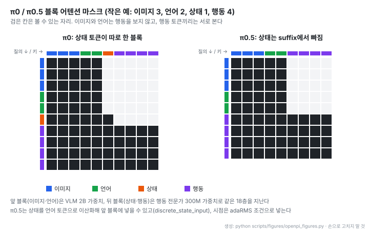
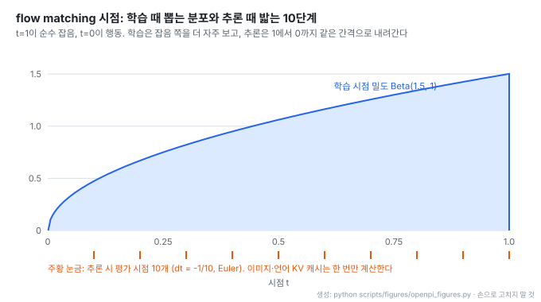
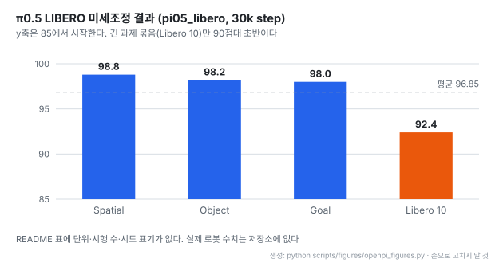

# openpi: Physical Intelligence의 VLA 로봇 정책 π0 · π0-FAST · π0.5 공개 구현

- **레포**: [Physical-Intelligence/openpi](https://github.com/Physical-Intelligence/openpi)
- **제작**: Physical Intelligence. GitHub 기여자 31명 (2026-10-29 GitHub API 기준)
- **공개**: 2024-10-21 저장소 생성일 (공개 이력의 첫 커밋은 2025-02-03). Python, Apache-2.0 (Gemma 가중치는 `LICENSE_GEMMA.txt` 별도), 별 14,443개 · 2026-10-29 기준
- **읽은 판**: 커밋 `215abfb` (2026-08-25), 커밋 215개, 태그·릴리즈 없음. 2026년 커밋은 의존성 · 문서 · 배칭 수정 위주다
- **구현**: JAX(원본) + PyTorch(2025-09 추가, π0 · π0.5만). uv로 의존성 관리, Ubuntu 22.04에서만 시험
- **모델 소개**: [π0](https://www.physicalintelligence.company/blog/pi0) · [FAST 토크나이저](https://www.physicalintelligence.company/research/fast) · [π0.5](https://www.physicalintelligence.company/blog/pi05) · [knowledge insulation](https://www.physicalintelligence.company/research/knowledge_insulation)
- **읽은 날짜**: 2026-10-29
- **태그**: #VLA #Robotics #FlowMatching #PaliGemma #JAX #LeRobot #ActionChunking

!!! note "핵심 요약"
    로봇 데이터 10,000시간 이상으로 사전학습한 VLA(vision-language-action, 카메라 이미지와 언어 지시를 받아 로봇 행동을 내는 모델) 세 종의 기반 체크포인트와, 이를 자기 로봇 데이터로 미세조정 · 서빙하는 코드를 공개한 저장소다. π0와 π0.5는 PaliGemma 2B 위에 300M 행동 전문가를 얹고, 같은 18층을 가중치만 나눠 지나가며 flow matching으로 행동 묶음(기본 50스텝)을 10단계에 만든다. π0-FAST는 행동을 토큰으로 바꿔 자기회귀로 생성한다. 공개된 성능 수치는 시뮬레이션 LIBERO 하나(π0.5 미세조정 평균 96.85)이고, 사전학습 코드와 데이터, 실제 로봇 수치는 없다. README 스스로 "π0 may or may not work for you" 라고 적는다.

## 1. 개요

openpi는 모델 논문의 부록 코드가 아니라 "가져다 미세조정해서 내 로봇에 붙이는" 용도의 저장소다. 공개 범위는 기반 체크포인트 세 개, 특정 로봇 · 과제에 맞춘 미세조정 체크포인트 일곱 개, 데이터 변환 · 정규화 통계 · 학습 · 정책 서버 · 경량 클라이언트 코드다. 사전학습 절차와 데이터는 들어 있지 않다.

README는 기대치를 낮추는 문장으로 시작한다. π0는 자사 로봇용으로 개발했고 ALOHA나 DROID 같은 널리 쓰이는 플랫폼과 다르므로, 다른 플랫폼에 옮기는 시도가 모두 성공하리라 기대하지 않는다고 적는다.

| 시기 | 변경 |
| --- | --- |
| 2025-06 | 전체 DROID 데이터셋 학습 지침 (pi0-FAST-DROID 학습 파이프라인의 근사 공개 구현) |
| 2025-09 | π0.5 공개, PyTorch 지원, DROID 학습용 idle filter 개선 |
| 2026 | 의존성 정리, 문서, 출력 배칭 지원 등 유지보수 |

GPU 요구량은 단일 GPU 기준이고 `fsdp_devices`로 여러 GPU에 나눌 수 있다. JAX 학습 스크립트는 멀티 노드를 지원하지 않는다.

| 모드 | 메모리 | 예시 GPU |
| --- | --- | --- |
| 추론 | > 8 GB | RTX 4090 |
| LoRA 미세조정 | > 22.5 GB | RTX 4090 |
| 전체 미세조정 | > 70 GB | A100 80GB, H100 |

## 2. 모델 3종과 체크포인트

| 모델 | 행동 생성 방식 | 비고 |
| --- | --- | --- |
| π0 | flow matching | VLM + 행동 전문가 |
| π0-FAST | FAST 토크나이저로 행동을 토큰화해 자기회귀 생성 | PyTorch 구현 없음 |
| π0.5 | flow matching | open-world 일반화를 높인 개선판. 이 저장소는 학습 · 추론 모두 flow matching head만 지원 |

기반 체크포인트는 `pi0_base`, `pi0_fast_base`, `pi05_base`이고 모두 `gs://openpi-assets/checkpoints/`에서 내려받아 `~/.cache/openpi`에 둔다. 미세조정 체크포인트는 다음과 같다.

| 체크포인트 | 용도 | 내용 |
| --- | --- | --- |
| `pi0_fast_droid` | 추론 | DROID Franka 로봇에서 새 장면의 탁상 조작을 0-shot으로 수행 |
| `pi0_droid` | 미세조정 | FAST-DROID보다 추론이 빠르지만 언어 지시를 덜 따름 |
| `pi0_aloha_towel` | 추론 | 자사 ALOHA 데이터, 수건 개기 |
| `pi0_aloha_tupperware` | 추론 | 자사 ALOHA 데이터, 용기에서 음식 꺼내기 |
| `pi0_aloha_pen_uncap` | 추론 | 공개 ALOHA 데이터, 펜 뚜껑 열기 |
| `pi05_libero` | 추론 | LIBERO 벤치마크 |
| `pi05_droid` | 추론 · 미세조정 | DROID + knowledge insulation. 빠른 추론과 좋은 언어 따르기 |

README는 미세조정 체크포인트가 작은 데이터셋으로 만들어져 다른 환경에 일반화되지 않을 수 있지만, 특히 DROID 체크포인트는 실제로 꽤 넓게 일반화됐다고 적는다.

## 3. 구조: VLM과 행동 전문가

π0 계열은 PaliGemma(SigLIP 이미지 인코더 + Gemma 언어 모델)를 백본으로 쓰고, 행동을 담당하는 작은 Gemma를 하나 더 둔다. 두 모델은 따로 돌지 않는다. 같은 18층 트랜스포머를 지나되, 앞쪽 토큰(이미지 · 언어)은 VLM 가중치로, 뒤쪽 토큰(상태 · 행동)은 행동 전문가 가중치로 계산하고 어텐션은 한 시퀀스로 함께 한다.

| 구성 | width | depth | MLP | 헤드 (KV 헤드) | head_dim |
| --- | --- | --- | --- | --- | --- |
| VLM `gemma_2b` | 2048 | 18 | 16,384 | 8 (1) | 256 |
| 행동 전문가 `gemma_300m` (코드 주석 311M) | 1024 | 18 | 4,096 | 8 (1) | 256 |

기본 설정은 행동 차원 32(로봇마다 남는 차원은 채움), 행동 길이 50, 언어 토큰 최대 48(π0) 또는 200(π0.5)이다. 정보가 어느 방향으로 흐르는지는 블록 어텐션 마스크가 정한다.

- 마스크 규칙은 big_vision에서 가져온 `make_attn_mask` 그대로다. 토큰마다 "새 블록 시작" 표시를 두고, 누적값이 자기 이하인 토큰만 본다. 그래서 블록 안은 양방향, 블록 사이는 앞 블록만 본다
- 이미지와 언어가 행동을 보지 않으므로, 추론 때 이 부분은 한 번만 계산해 KV 캐시로 두고 행동 쪽만 반복 계산할 수 있다(4절)
- π0는 연속 상태를 투영한 토큰 하나를 별도 블록으로 둔다. π0.5는 이 토큰을 빼고, 상태를 언어 토큰으로 이산화해 앞 블록에 넣을 수 있으며(`discrete_state_input`), 시점 정보를 adaRMS 조건으로 넣는다

## 4. flow matching 학습과 추론

행동 묶음 $A$(행동 길이 × 행동 차원)를 잡음에서 출발해 만들어 낸다. 코드는 확산 모델 쪽 관례를 따라 $t=1$을 순수 잡음, $t=0$을 목표 행동으로 둔다. 학습 때는 잡음 $\epsilon \sim \mathcal{N}(0, I)$과 시점 $t$를 뽑아 둘을 섞은 $x_t$를 만들고, 모델이 그 지점의 속도 $v_\theta$를 맞히게 한다.

$$
x_t = t\,\epsilon + (1-t)\,A, \qquad u_t = \epsilon - A, \qquad \mathcal{L} = \lVert v_\theta(x_t, t, o) - u_t \rVert^2
$$

여기서 $o$는 관측(이미지 · 언어 · 상태)이다. 시점은 균등하게 뽑지 않고 $t = 0.999\,s + 0.001$, $s \sim \mathrm{Beta}(1.5, 1)$로 뽑는다.

추론은 $t=1$의 잡음에서 시작해 Euler 방법으로 기본 10단계 내려간다($\Delta t = -1/10$).

$$
x_{t+\Delta t} = x_t + \Delta t \, v_\theta(x_t, t, o)
$$

- Beta(1.5, 1)의 밀도는 $1.5\sqrt{s}$라서 잡음 쪽($t$가 1에 가까운 쪽)에서 더 자주 학습한다. 잡음이 큰 구간에서 행동의 큰 윤곽을 잡는 일이 더 어렵다는 선택으로 읽힌다(코드에 이유는 적혀 있지 않다)
- 10단계 동안 이미지 · 언어 쪽은 다시 계산하지 않는다. 앞 블록의 KV 캐시를 한 번 만든 뒤, 매 단계 행동 토큰(행동 전문가 300M 쪽)만 다시 통과시킨다
- 시점은 사인 · 코사인 임베딩(주기 0.004~4.0)으로 넣는다. π0는 이를 행동 토큰과 이어 붙여 MLP에 통과시키고, π0.5는 별도 MLP를 거쳐 행동 전문가의 정규화 층 조건(adaRMS)으로 쓴다

π0-FAST는 이 과정 대신 행동을 FAST 토크나이저로 토큰화해 언어 모델처럼 다음 토큰을 예측한다. 기본값은 행동 차원 32, 행동 길이 32, 토큰 최대 250이다. 설정 주석은 토큰 최대 길이를 단일 팔 로봇이면 약 180, 양팔이면 약 250으로 잡으라고 권한다.

## 5. 미세조정 흐름과 설정

README는 π0.5를 LIBERO 데이터로 미세조정하는 예를 따라간다.

1. **데이터 변환**: 로봇 데이터를 LeRobot 데이터셋 형식으로 바꾼다. LIBERO 변환 스크립트를 고쳐 쓰는 것을 권한다
2. **설정 정의**: 환경 ↔ 모델 입출력 매핑(`LiberoInputs` · `LiberoOutputs`, 학습과 추론이 함께 씀), 데이터 처리 설정, 학습 설정(`TrainConfig`)을 만든다
3. **정규화 통계 계산**: `scripts/compute_norm_stats.py --config-name pi05_libero`
4. **학습**: `XLA_PYTHON_CLIENT_MEM_FRACTION=0.9 uv run scripts/train.py pi05_libero --exp-name=...`. JAX가 기본 75% 대신 GPU 메모리의 90%까지 쓰게 한다
5. **서빙**: `scripts/serve_policy.py`로 정책 서버(포트 8000)를 띄우고 평가 스크립트나 로봇 런타임이 질의한다

| 설정 | 값 |
| --- | --- |
| `TrainConfig` 기본 | 배치 32, 30,000 step, 1,000 step마다 저장, 5,000 step 단위 보존, EMA 0.99 |
| `pi05_libero` 모델 | π0.5, 행동 길이 10, 이산 상태 입력 끔 |
| `pi05_libero` 학습 | 배치 256, cosine 스케줄(warmup 10,000, peak 5e-5, 감쇠 후 5e-5), AdamW(기울기 노름 1.0 제한), EMA 0.999, 30,000 step |
| 행동 길이 | `pi0_droid` 10, `pi0_fast_droid` 10(행동 차원 8), `pi05_droid` 15, `pi0_libero` 50, `pi0_fast_libero` 10(행동 차원 7), `pi05_libero` 10 |
| LoRA 저메모리 | `*_low_mem_finetune` 설정이 `freeze_filter`로 LoRA 외 가중치를 고정하고 EMA를 끔 |

정규화 통계를 다루는 방식이 실용적이다. 상태와 행동은 학습 데이터 통계로 정규화하고, 그 통계를 체크포인트 자산으로 함께 둔다. 대상 로봇이 사전학습 혼합에 있던 로봇이면 사전학습 통계를 다시 쓰면 행동이 모델에 더 "familiar" 해 성능에 도움이 될 수 있다고 안내한다. 반대로 학습이 발산하면 거의 쓰이지 않는 차원의 `q01` · `q99` · `std`가 너무 작아 정규화 뒤 값이 커진 경우가 있으니 손으로 조정하라고 적는다.

## 6. 원격 추론

정책을 로봇 밖의 GPU 서버에 두고 웹소켓으로 행동을 보내는 구조를 기본으로 제공한다. 로봇 쪽 소프트웨어와 모델 의존성이 섞이지 않게 하려는 목적이다.

- 로봇 쪽에는 의존성이 적은 `openpi-client` 패키지만 설치한다. 관측은 msgpack으로 직렬화하고, 이미지는 클라이언트에서 학습 때와 같은 크기 · uint8로 바꿔 보내 대역폭을 줄인다
- 서버는 압축 없이, 메시지 크기 제한 없이 웹소켓을 연다
- 행동은 묶음으로 받는다. LIBERO 예제는 행동 10개를 받아 앞 5개만 실행하고 다시 질의한다(`replan_steps = 5`). 클라이언트의 `action_chunk_broker`가 묶음을 한 스텝씩 내보낸다

## 7. PyTorch 구현

2025-09에 π0와 π0.5의 PyTorch 구현이 추가됐고 LIBERO에서 추론과 미세조정을 검증했다고 한다. JAX 체크포인트를 변환 스크립트로 바꿔 같은 API로 쓴다.

- 미지원: π0-FAST, 혼합 정밀도 학습, FSDP, LoRA, EMA
- 정밀도: 추론은 JAX와 같이 대부분 bfloat16(일부 float32). 학습은 전체 bfloat16(기본) 또는 전체 float32이고, bfloat16은 메모리를 덜 쓰는 대신 손실이 더 높다
- torch.compile을 쓰면 추론 속도가 JAX와 비슷하다고 적지만 수치는 없다

!!! warning "transformers 패치가 uv 캐시를 바꾼다"
    PyTorch 구현은 transformers 4.53.2에 패치 파일을 덮어써야 한다(AdaRMS 지원, 활성값 정밀도 제어, KV 캐시를 갱신 없이 쓰기). README는 uv 기본 하드링크 모드에서는 이 변경이 uv 캐시의 transformers에 영구히 남고 다른 프로젝트로 번질 수 있다고 경고한다. 되돌리려면 `uv cache clean transformers`를 실행해야 한다.

## 8. 결과

저장소에 실린 성능 수치는 π0.5를 `pi05_libero` 설정으로 30,000 step 미세조정한 LIBERO 시뮬레이션 결과 하나다.

- 공간 · 물체 · 목표 묶음은 98점대이고, 여러 단계를 이어야 하는 긴 과제 묶음(Libero 10)이 92.4로 가장 낮다
- README는 "state-of-the-art performance" 라고 적지만 비교 대상 표는 없다. 표에 단위 · 시행 수 · 시드도 적혀 있지 않다(성공률 %로 보인다)
- 공개 체크포인트로 재현하라고 안내한다. 실제 로봇에서 잰 수치는 저장소에 없다

## 9. 읽을 때 감안할 것

- **공개 범위가 미세조정까지다.** 기반 체크포인트와 미세조정 · 추론 코드는 있지만 사전학습 코드와 10,000시간 데이터는 없다. 기반 모델이 무엇을 보고 배웠는지는 블로그 설명에 기댈 수밖에 없다
- **π0.5는 일부만 들어 있다.** flow matching head만 지원하고, knowledge insulation으로 학습했다고 표기한 것은 `pi05_droid` 체크포인트다
- **성능 근거가 시뮬레이션 하나다.** 실제 로봇 성공률, 추론 지연 수치가 없다. 다른 플랫폼에서는 될 수도 안 될 수도 있다고 README가 직접 말한다
- **환경 제약.** Ubuntu 22.04만 시험했고 JAX 학습은 단일 노드다. 전체 미세조정은 70GB 이상 GPU가 필요하다
- **PyTorch 경로의 부작용.** transformers 패치가 uv 캐시를 바꾼다(7절)
- **유지보수 단계.** 태그 · 릴리즈가 없고, 2026년 변경은 의존성과 문서 수정이 대부분이다

## 10. 가져갈 지점

| 대상 | 가져갈 수 있는 부분 |
| --- | --- |
| 백본 + 작은 전문가 | 큰 VLM은 관측만 읽고, 출력은 작은 전문가가 만드는 구조. 같은 층을 지나며 가중치만 나누고 어텐션은 공유한다 |
| 블록 어텐션 마스크 | 블록별 "새 블록 시작" 표시 하나로 정보 흐름 방향을 고정한다. 관측이 출력을 보지 않으니 관측 쪽 KV 캐시를 재사용할 수 있다 |
| 행동 묶음과 재계획 | 여러 스텝을 한 번에 만들고 일부만 실행한 뒤 다시 질의한다. 지연과 반응성 사이를 묶음 길이와 재계획 간격으로 조절한다 |
| 정규화 통계를 자산으로 | 통계를 체크포인트와 함께 두고 같은 로봇이면 재사용한다. 발산 원인을 통계의 작은 분산에서 먼저 찾는다 |
| 서버 · 클라이언트 분리 | 무거운 모델 환경과 로봇 런타임을 웹소켓으로 분리하고, 클라이언트는 의존성을 최소로 둔다 |

## 11. 결론

openpi는 VLA 연구 결과를 "내 로봇에 붙여 보는" 단계까지 끌어내린 저장소다. VLM과 행동 전문가를 한 트랜스포머에서 나눠 쓰는 구조, 블록 마스크와 KV 캐시를 이용한 10단계 flow matching 추론, 정규화 통계와 정책 서버까지 실제로 돌릴 수 있는 형태로 정리돼 있다. 반면 사전학습은 공개되지 않았고 성능 근거는 LIBERO 하나뿐이라, 자기 로봇에서 통할지는 직접 미세조정해 봐야 안다. README가 먼저 그렇게 말한다는 점에서 기대치를 정직하게 잡은 공개 사례이기도 하다.
