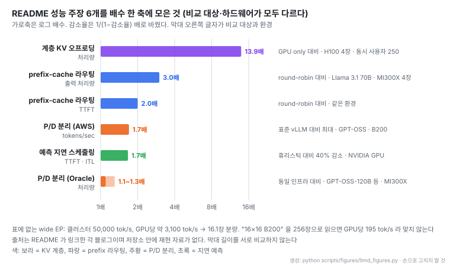
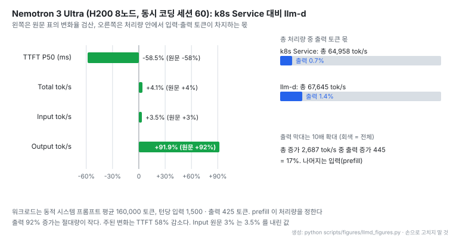

# llm-d: Kubernetes 위 분산 LLM 추론 스택 (KV 인식 라우팅, P/D 분리, 계층 KV 캐시)

출처: [llm-d README Architecture 그림](https://github.com/llm-d/llm-d/blob/abffd56119e27c412be15a0e8ae34bd7b25eb322/README.md)

- **레포**: [llm-d/llm-d](https://github.com/llm-d/llm-d) · [문서 사이트](https://llm-d.ai) · [아키텍처 문서](https://llm-d.ai/docs/architecture) · [벤치마크 Prism](https://prism.llm-d.ai)
- **제작**: Red Hat, Google Cloud, IBM Research, CoreWeave, NVIDIA가 세운 CNCF Sandbox 프로젝트(2026-03 합류). GitHub 기여자 245명
- **공개**: 2025-04-29 저장소 생성일. Apache-2.0, 별 5,094개 · 포크 898개 (2026-10-30 기준)
- **읽은 판**: `v1.0.0` (2026-10-20), 커밋 `abffd56` (2026-10-29)
- **구현 범위**: 이 저장소는 가이드 · Helm 값 · kustomize 매니페스트 · 아키텍처 문서 모음이다. 라우터 본체(EPP와 플러그인)는 Go 저장소 [llm-d-router](https://github.com/llm-d/llm-d-router)에 있다. GitHub 언어 표시는 Python이다
- **지원 환경**: Kubernetes. 모델 서버는 vLLM(기본) · SGLang · TensorRT-LLM. NVIDIA · AMD · Intel GPU, Google TPU, CPU 등 가속기별 오버레이
- **읽은 날짜**: 2026-10-30
- **태그**: #DistributedInference #vLLM #Kubernetes #PrefixCaching #PDDisaggregation #KVCache

!!! note "핵심 요약"
    llm-d는 vLLM · SGLang 같은 모델 서버를 고치지 않고, 그 앞단에 LLM을 아는 라우터를 붙여 Kubernetes 위의 여러 복제본을 하나의 추론 풀로 묶는다. Envoy 같은 L7 프록시가 요청을 붙잡고 ext-proc으로 EPP(Endpoint Picker)에 물으면, EPP가 prefix 캐시 위치 · 토큰 부하 · 우선순위를 보고 파드를 고른다. 그 위에 prefill과 decode를 다른 파드로 나누는 P/D 분리, KV 캐시를 CPU · 파일시스템으로 내리는 계층 오프로딩, 테넌트별 공정 큐(flow control)를 얹는다. README는 prefix 라우팅으로 처리량 3배, 계층 KV 오프로딩으로 13.9배 같은 수치를 내세우지만 모두 외부 블로그의 서로 다른 환경 값이다. 저장소 안에 결과표가 있는 것은 Nemotron 3 Ultra 레시피 하나로, 동시 코딩 세션 60에서 TTFT P50이 58% 줄었고 총 처리량은 4% 늘었다.

## 1. 개요

README는 역할을 이렇게 나눈다. 모델 서버는 가속기에서 모델을 효율적으로 돌리고, llm-d는 "orchestration and optimizations above model servers" 를 맡는다. 단일 서버 안의 PagedAttention이나 배칭은 건드리지 않고, 서버 여러 대 사이에서 요청을 어디로 보낼지, 언제 보낼지, KV를 어디에 둘지를 정한다.

기존 방식과 갈리는 지점은 로드밸런서다. 쿠버네티스 Service는 라운드로빈으로 파드를 고르므로 같은 시스템 프롬프트를 가진 요청이 매번 다른 파드에 떨어져 prefix 캐시를 다시 계산한다. 원문은 LLM 요청을 "Slow"(한 요청이 1분 넘게 생성)이고 "Non-uniform"(추론 토큰 수천 개부터 10만 토큰 넘는 문맥까지)이라고 설명하며, 그래서 부하와 캐시 위치를 아는 라우팅이 필요하다고 본다.

기능은 여섯 주제로 묶인다: 지능형 라우팅, KV 캐시 관리, 대형 모델 서빙(P/D 분리 · wide EP), 에이전트 인식 서빙, 운영(멀티테넌트 QoS · 무중단 업그레이드 · 오토스케일), 배치 처리. 각 주제를 "well-lit path" 라는 검증된 가이드(Helm 차트 + 매니페스트)로 제공하고, README는 대부분 사용자가 Optimized Baseline부터 시작한다고 안내한다.

## 2. 아키텍처 7영역

[아키텍처 문서](https://github.com/llm-d/llm-d/blob/abffd56119e27c412be15a0e8ae34bd7b25eb322/docs/architecture/README.md)는 구성을 일곱 영역으로 나눈다.

| 영역 | 구성 요소 | 역할 |
|---|---|---|
| Router | Proxy, EPP, InferencePool CRD, Latency Predictor | 요청마다 파드 선택, 큐잉, 정책 적용 |
| Model Servers | vLLM, SGLang, TensorRT-LLM | 실제 forward 실행 |
| Disaggregation | P/D 분리, Wide Expert Parallelism | prefill과 decode 분리, MoE 다노드 분산 |
| KV Cache Management | prefix 라우팅, KV indexer, KV 오프로딩, P2P 공유 | 캐시 재사용 극대화 |
| Model Server Orchestration | LeaderWorkerSet, DisaggregatedSet | 다노드 파드 묶음, P/D 역할 동시 롤아웃 |
| Autoscaling | KEDA + EPP 지표, SLO-aware, WVA(deprecated) | 큐 깊이 · 지연 여유로 복제본 수 조정 |
| Batch and Async | Batch Gateway, Async Processor | OpenAI 호환 `/v1/batches`, 메시지 큐 소비 |

원문 그림 1에서 먼저 볼 것은 두 갈래 입구다. 지연에 민감한 요청은 바로 Proxy로 가고, 지연을 견디는 요청은 llm-d Batch를 거쳐 저우선 트래픽으로 같은 Proxy에 들어간다. Inference Pool 안에서는 Variant A(prefill)와 B(decode) 사이에 NIXL로 KV를 넘기는 공유 prefix 캐시가, 아래에는 파드별 독립 prefix 캐시(LMCache, 호스트 메모리 등)가 있다.

## 3. 라우터: Proxy와 EPP의 분업

출처: [llm-d EPP 문서 Request Flow 그림](https://github.com/llm-d/llm-d/blob/abffd56119e27c412be15a0e8ae34bd7b25eb322/docs/architecture/router/epp.md)

- 라우터는 프록시를 새로 만들지 않는다. 원문 표현은 "without reimplementing a full-featured network proxy" 이고, TLS · 연결 관리는 Envoy · Istio · 클라우드 L7 로드밸런서에 맡긴다
- 지능은 EPP 한 곳에 모인다. 그림의 6단계(도착 → ext-proc → 요청 파싱 → flow control → 스케줄링 → 프록시 전달) 중 사용자가 바꾸는 곳은 가운데 세 단계의 플러그인이다
- 아래쪽 Data Layer는 요청 경로 밖에서 비동기로 돈다. k8s API로 파드 목록을, 모델 서버 지표로 큐 · KV 사용률을 모으고 prefix 트리를 유지한다

Proxy는 요청을 "parks" 한 채 Envoy의 External Processing(ext-proc) 프로토콜로 EPP를 부르고, EPP가 돌려준 파드 주소로 원래 요청을 보낸다. 지원하는 ext-proc 본문 모드는 `FULL_DUPLEX_STREAMED` 하나뿐이다. EPP 설정(`EndpointPickerConfig` YAML)은 시작할 때 한 번만 읽으므로 바꾸면 EPP를 재시작해야 한다.

InferencePool은 Gateway API Inference Extension(GAIE)의 CRD로, 라벨 셀렉터로 모델 서버 파드를 모으고 어느 EPP에 ext-proc을 붙일지 선언한다. EPP는 두 가지를 맡는다: 요청을 어느 파드로 보낼지(라우팅), 그리고 지금 어느 요청을 보낼지(공정성 · 우선순위).

## 4. 스케줄러: Filter, Score, Pick

[스케줄러 문서](https://github.com/llm-d/llm-d/blob/abffd56119e27c412be15a0e8ae34bd7b25eb322/docs/architecture/router/scheduling.md)의 골격은 Filter → Score → Pick이다. ProfileHandler가 이번 요청에 돌릴 프로필을 고르고, 각 프로필이 필터로 후보를 줄이고, 가중 scorer 점수를 더해, picker가 고른다. scorer는 0.0~1.0을 돌려주고 가중치를 곱해 더한다. 원문 예는 scorer A(가중 2.0)가 0.8, B(가중 1.0)가 0.5면 최종 점수가 $0.8 \times 2.0 + 0.5 \times 1.0 = 2.1$ 이다.

| 단계 | 주요 플러그인 |
|---|---|
| Filter | `prefix-cache-affinity-filter`(확률적 sticky + TTFT load gate), `slo-headroom-tier-filter`, `prefill-filter` · `decode-filter` · `encode-filter`, `label-selector-filter` |
| Scorer | `prefix-cache-scorer`, `token-load-scorer`, `queue-scorer`, `kv-cache-utilization-scorer`, `latency-scorer`, `lora-affinity-scorer`, `session-affinity-scorer`, `no-hit-lru-scorer`, `running-requests-size-scorer` |
| Picker | `max-score-picker`(기본, 1개 반환), `random-picker`, `weighted-random-picker` |
| ProfileHandler | `single-profile-handler`(기본), `disagg-profile-handler`(prefill · decode 두 프로필) |

`no-hit-lru-scorer`가 눈에 띈다. 캐시 적중이 0인 요청은 그런 요청을 한 번도 받지 않은 파드, 그다음 가장 오래전에 받은 파드를 고른다. 무거운 prefill을 클러스터에 고르게 펴려는 장치이고, 적중이 있는 요청에는 모든 파드에 같은 점수를 줘서 영향이 없다.

[Optimized Baseline 가이드](https://github.com/llm-d/llm-d/blob/abffd56119e27c412be15a0e8ae34bd7b25eb322/guides/optimized-baseline/README.md)의 기본 조합은 둘이다. `prefix-cache-affinity-filter`가 prefix 재사용이 큰 "sticky" 파드로 후보를 좁히되 파드가 포화되면 override로 부하를 펴고, `token-load-scorer`가 파드별 prefill 토큰 부하로 점수를 매긴다. 기준 환경은 Qwen3-32B, H100 80GB, TP=2 복제본 2개(GPU 4장)이고, 포화 판단에 쓰는 `peakPrefillThroughput`은 이 환경 값이다. 다른 모델 · 가속기에서는 보정 레시피로 직접 재야 하며, 잘못 잡으면 override가 걸리지 않아 일부 파드만 뜨거워진다고 원문이 경고한다.

## 5. Prefix-cache 인식 라우팅: 근사와 정밀

출처: [llm-d 아키텍처 자산 prefix-aware-routing.svg](https://github.com/llm-d/llm-d/blob/abffd56119e27c412be15a0e8ae34bd7b25eb322/docs/assets/prefix-aware-routing.svg)

- 같은 prefix를 이미 가진 파드로 보내면 그만큼 prefill을 건너뛴다. 모델 서버가 요청 간 KV 재사용(vLLM Automatic Prefix Caching 등)을 지원해야 한다
- llm-d는 이 판단을 두 방식으로 구현한다. 차이는 "누가 캐시 상태를 아는가" 다

| 항목 | 근사 (Approximate) | 정밀 (Precise) |
|---|---|---|
| 정밀도 | 문자 수로 토큰을 근사 | 실제 토큰 ID 기준 100% |
| 상태 원천 | EPP가 "보냈으니 있겠지" 라고 가정한 로컬 LRU 인덱스 | 모델 서버가 ZMQ로 보내는 `KVEvents` |
| 추가 의존성 | 없음 | vLLM render 엔드포인트, ZMQ 연결 |
| 맞는 곳 | 단순하고 동질적인 워크로드 | 대규모 운영, P/D 분리 |

근사 방식은 프롬프트를 64토큰(문자 수로 근사) 블록으로 잘라 롤링 해시 체인을 만들고, 일치한 블록 비율로 점수를 준다. 라우팅한 뒤에는 그 파드가 해당 prefix를 갖게 됐다고 가정하고 인덱스를 고친다. 그래서 파드가 메모리 압박으로 블록을 축출하면 실제와 어긋난다.

정밀 방식은 `token-producer`가 `/v1/completions/render`로 정확한 토큰 ID를 얻고, KV-Cache Indexer가 모델 서버의 블록 추가 · 축출 이벤트를 구독해 전역 인덱스를 유지한다. 라우팅 결정과 다음 이벤트 도착 사이의 공백은 "Speculative Indexing", 즉 라우팅 직후 예상 항목을 먼저 넣는 방식으로 메운다.

## 6. Prefill/Decode 분리와 Wide EP

출처: [llm-d Disaggregated Serving 문서](https://github.com/llm-d/llm-d/blob/abffd56119e27c412be15a0e8ae34bd7b25eb322/docs/architecture/disaggregation/pd-disaggregation.md)

- prefill은 연산(FLOPs)에, decode는 메모리 대역폭에 묶인다. 나누면 각각 다른 TP로 맞출 수 있고, 긴 prefill이 진행 중인 decode를 막는 간섭이 사라진다
- 요청은 decode 파드의 routing sidecar로 먼저 간다. sidecar가 prefill 워커에 `max_tokens=1`, `do_remote_decode=True`로 보내고, 돌아온 `KVTransferParams`로 decode 워커가 NIXL RDMA로 KV를 당겨 온다
- RDMA가 없으면 NIXL이 TCP로 떨어지며, 원문은 이를 테스트 · 개발용으로만 쓰라고 한다

EPP 쪽에서는 `disagg-profile-handler`가 decode 프로필을 먼저 돌려 D 파드를 고르고, decider가 "D에 이미 캐시된 양을 보면 분리할 가치가 있는가" 를 판단한다. 캐시 안 된 뒷부분이 크면 prefill 프로필도 돌려 P 파드를 고르고, 아니면 D 하나에서 끝낸다. decode 엔드포인트가 주 목적지가 되고 prefill 엔드포인트는 헤더로 실려 간다.

원문은 P/D 분리가 모든 워크로드용이 아니라고 못 박는다. 효과가 큰 조건은 "long-context workloads (e.g. 10:1 ISL:OSL) and medium-to-large models" 이고, 예로 10k 입력 · 1k 출력은 맞고 200 · 200은 아니라고 든다. 튜닝 예는 gpt-oss-120b의 5k 입력 · 250 출력 워크로드에 TP=1 prefill 8개와 TP=4 decode 2개(GPU 16장)다. prefill은 병렬도를 낮추고 복제본을 늘리며, decode는 병렬도를 높이고 복제본을 줄인다.

출처: [llm-d Wide Expert Parallelism 문서](https://github.com/llm-d/llm-d/blob/abffd56119e27c412be15a0e8ae34bd7b25eb322/docs/architecture/disaggregation/wide-expert-parallelism.md)

- MoE 모델은 attention을 데이터 병렬로, expert MLP를 전문가 병렬로 여러 노드에 펼친다. 원문은 DP/EP 배치에서 P/D 분리가 파이프라인 거품을 피하는 데 "essential" 이라고 쓴다
- 다노드 파드 묶음은 LeaderWorkerSet이 gang 스케줄링과 전부 재시작 방식으로 관리한다

## 7. 계층 KV 오프로딩

출처: [llm-d KV-Cache Offloading 문서](https://github.com/llm-d/llm-d/blob/abffd56119e27c412be15a0e8ae34bd7b25eb322/docs/architecture/kv-management/kv-offloader.md)

- HBM에서 밀려난 KV 블록을 CPU RAM, 다시 공유 파일시스템 · 객체 저장소 · 피어로 내린다. 쓰기는 백그라운드라 추론을 막지 않고, 읽기는 기다려야 한다
- 원문 수치는 "loading cached blocks is typically faster than recomputing them—up to 16x faster for long prompts" 다. 조건이 긴 프롬프트이고 "up to" 라는 점을 함께 읽는다

구현은 두 갈래다. vLLM 내장 `OffloadingConnector`를 쓰거나, LMCache · Mooncake · NVIDIA KVBM 같은 외부 캐시 엔진을 모델 서버의 KV 커넥터 API로 붙인다. 원문은 HBM과 CPU RAM 계층을 항상 켜고, 작업 집합이 그보다 커지면 파일시스템 계층을 더하라고 권한다.

원문이 쓰는 "receptive field" 는 요청이 끝난 뒤 KV가 재사용 가능한 시간이다. 오프로딩이 없으면 후속 요청이 오기 전에 KV가 HBM에서 밀려나 prefill을 다시 계산하고, 오프로딩이 있으면 CPU RAM에서 다시 올린다. 도구 실행으로 수십 초씩 쉬는 에이전트 세션에서 이 차이가 커진다. 오프로딩이 각 파드의 캐시를 키운다면, 5절의 라우팅은 그 캐시를 가진 파드를 찾아가는 쪽이다.

## 8. Flow Control: RPS 대신 용량으로 막기

출처: [llm-d Flow Control 문서](https://github.com/llm-d/llm-d/blob/abffd56119e27c412be15a0e8ae34bd7b25eb322/docs/architecture/router/flow-control.md)

- 요청은 `(FairnessID, Priority)` 로 이뤄진 FlowKey마다 따로 큐에 들어간다. FairnessID는 `x-llm-d-inference-fairness-id` 헤더(예: 테넌트 ID)에서 온다
- 꺼내는 순서는 3단이다. 우선순위 밴드는 높은 쪽부터 고정(플러그인 아님), 같은 밴드 안에서는 Fairness 정책이 테넌트를, 그 테넌트 큐 안에서는 Ordering 정책(FIFO, SLO 기반 등)이 요청을 고른다

일반 API 게이트웨이는 초당 요청 수로 제한하지만, LLM은 요청마다 자원 소비가 몇 자릿수씩 다르다. 원문은 이 상황에서 생기는 문제를 넷으로 든다: 한 테넌트의 거대한 프롬프트가 KV와 큐를 독차지하는 Noisy Neighbor, 모델 서버 로컬 큐에 들어간 요청은 EPP가 다시 옮길 수 없는 Scheduling Regret, 실시간 요청이 대형 배치 뒤에 갇히는 Priority Inversion, 긴 문맥 하나가 짧은 요청 수백 개보다 자원을 더 쓰는 Resource Asymmetry. 해법은 풀이 포화되면 요청을 모델 서버로 보내지 않고 EPP의 중앙 큐에 붙잡아 두는 것이다. 이 기능은 `flowControl` 기능 게이트로 켜야 한다.

## 9. v1.0.0에서 바뀐 것

[v1.0.0 릴리스 노트](https://github.com/llm-d/llm-d/releases/tag/v1.0.0)(2026-10-20)의 주제는 "성능이 나오는 스택" 에서 "운영을 견디는 스택" 으로의 전환이다.

| 주제 | 내용 |
|---|---|
| 멀티테넌트 QoS | 우선순위 · 공정성 인식 flow control, 확률적 admitter, program-aware fairness, turn-priority 점수. 설정을 `flowControl` 아래로 통합 |
| 무중단 운영 | 라우터 HA(hot standby), `DisaggregatedSet`으로 prefill · decode를 한 단위로 동시 롤아웃 |
| 안정 API | 라우터 설정 API가 `v1`으로 졸업, Responses API `previous_response_id` 지원 |
| 에이전트 인식 | session-state-producer 플러그인, 세션 affinity로 다중 턴 대화를 캐시 근처에 유지 |
| 이미지 | 자체 추론 이미지 빌드를 중단하고 upstream vLLM 이미지로 이동, `llm-d-rocm` 이미지 deprecated. vLLM 기준 이미지 `v0.26.0` → `v0.30.0` |
| 버전 | 조직 안 모든 컴포넌트 버전을 `v1.0.0`으로 맞춤 |

## 10. README 성능 주장 모아 보기

- 여섯 막대는 비교 대상(round-robin, 표준 vLLM, GPU only, 휴리스틱)과 모델 · 하드웨어가 모두 다르다. 막대 길이를 서로 비교해 "오프로딩이 라우팅보다 4배 낫다" 고 읽으면 안 된다
- 13.9배는 동시 사용자 250명에서 잰 값이다. HBM만으로는 캐시가 계속 밀려나는 부하라서 배수가 커진 것으로 읽힌다(노트 해석). P/D 분리는 같은 기법인데도 출처에 따라 1.1~1.7배로 갈린다
- wide EP 주장(클러스터 50,000 tok/s, GPU당 약 3,100 tok/s)은 나눗셈하면 GPU 16장 분량이다. 표기 "16×16 B200" 을 256장으로 읽으면 GPU당 약 195 tok/s라 맞지 않는다. prefill 16 · decode 16 구성일 수 있으나 블로그 원문은 확인하지 않았다(미검증)

README의 각 수치는 [Tesla · Red Hat](https://llm-d.ai/blog/production-grade-llm-inference-at-scale-kserve-llm-d-vllm), [Google](https://llm-d.ai/blog/predicted-latency-based-scheduling-for-llms), [AWS](https://aws.amazon.com/blogs/machine-learning/introducing-disaggregated-inference-on-aws-powered-by-llm-d/), [Oracle](https://blogs.oracle.com/ai-and-datascience/llm-inference-at-scale-with-llm-d-on-oci), [llm-d v0.5](https://llm-d.ai/blog/llm-d-v0.5-sustaining-performance-at-scale) 블로그로 링크된다. 저장소 안에는 이 수치를 재현하는 결과 파일이 없어 이 노트에서는 모두 미검증으로 둔다.

## 11. Nemotron 3 Ultra 레시피: 저장소 안의 실측

[Nemotron 3 Ultra 가이드](https://github.com/llm-d/llm-d/blob/abffd56119e27c412be15a0e8ae34bd7b25eb322/guides/models/nemotron-3-ultra/README.md)는 저장소 안에서 결과표를 가진 유일한 모델 레시피다. DeepSeek-V4와 GLM-5.2(현재 라우터 설정)는 결과가 "TODO" 이고, Qwen3.5-397B는 수집 중이다.

| 항목 | 값 |
|---|---|
| 모델 | NVIDIA-Nemotron-3-Ultra-550B-A55B-FP8-block (가중치 ~563 GB, Mamba-hybrid) |
| 하드웨어 | H200 8노드, 노드당 8장 |
| 구성 | P/D 분리 prefill 6 + decode 2 복제본, TP=8, EP, FP8 KV |
| KV 오프로드 | CPU DRAM 복제본당 200 GiB (합 ~1.6 TB) |
| 워크로드 | 공유 시스템 프롬프트 3,000 토큰, 동적 시스템 프롬프트 평균 160,000 토큰, 턴당 입력 평균 1,500 · 출력 평균 425 토큰, 도구 지연 평균 15초 |

| 지표 (동시 코딩 세션 60) | k8s Service | llm-d | 원문 Δ |
|---|---|---|---|
| TTFT P50 (ms) | 49,462 | 20,543 | 58% 감소 |
| Total tokens/sec | 64,958 | 67,645 | 4% 증가 |
| Input tokens/sec | 64,474 | 66,716 | 3% 증가 |
| Output tokens/sec | 484 | 929 | 92% 증가 |

- 원문 변화율은 다시 계산해도 맞는다. Input의 3%는 3.5%를 내린 값이다
- 이 워크로드는 입력이 총 처리량의 98% 이상이다. 출력 92% 증가는 절대량으로 445 tok/s이고, 총 증가 2,687 tok/s 중 17%에 그친다
- 그래서 이 표에서 읽을 변화는 처리량이 아니라 TTFT다. 같은 하드웨어에서 첫 토큰까지 시간이 절반 아래로 줄었다

출처: [Nemotron 3 Ultra 가이드 Latency Profiles](https://github.com/llm-d/llm-d/blob/abffd56119e27c412be15a0e8ae34bd7b25eb322/guides/models/nemotron-3-ultra/README.md#latency-profiles)

- 동시성 5~80 전 구간에서 llm-d 쪽 TTFT가 낮지만, 80 세션에 가까워지면 두 선이 다시 붙는다. 용량 자체가 차면 라우팅으로 줄일 여지가 줄어든다
- 점과 추세선이 꽤 떨어진 지점(40, 50 세션)이 있다. 원문은 실행 반복 횟수를 밝히지 않으므로 구간별 차이를 정밀하게 읽지 않는다

출처: [Nemotron 3 Ultra 가이드 Latency Profiles](https://github.com/llm-d/llm-d/blob/abffd56119e27c412be15a0e8ae34bd7b25eb322/guides/models/nemotron-3-ultra/README.md#latency-profiles)

출처: [Nemotron 3 Ultra 가이드 Latency Profiles](https://github.com/llm-d/llm-d/blob/abffd56119e27c412be15a0e8ae34bd7b25eb322/guides/models/nemotron-3-ultra/README.md#latency-profiles)

- 처리량 곡선은 동시성이 낮을 때 llm-d 쪽이 더 높고, 40 세션 이상에서는 두 곡선이 거의 같은 높이로 모인다. 표의 "총 처리량 4%" 는 포화 구간의 차이다
- 지연 대 처리량 그림에서는 같은 처리량을 더 낮은 TTFT로 내는 쪽이 llm-d다. 이 레시피의 이득이 처리량보다 지연에 있다는 위 판단과 맞는다

설정 중 `VLLM_PREFIX_CACHE_RETENTION_INTERVAL=0`은 이 모델이 Mamba-hybrid라서 켤 수 있다. vLLM은 full-attention 모델에서 이 플래그를 거부한다. 또 원문은 이 레시피의 엔드포인트 피커와 분리 라우팅 sidecar가 개발 이미지라서 운영에 쓰기 전에 릴리스 이미지로 고정하라고 경고한다.

## 12. 해석 시 주의

!!! warning "읽을 때 걸리는 지점"
    - README 성능 수치는 외부 블로그의 서로 다른 모델 · 하드웨어 · 비교 대상 값이다. 저장소 안에서 재현 가능한 결과는 Nemotron 표 하나다
    - Nemotron 비교 대상은 라운드로빈 k8s Service다. vLLM 단독 최적 배치나 다른 라우터와 비교한 값이 아니다
    - 기본 `peakPrefillThroughput`은 H100 + Qwen3-32B 값이다. 다른 하드웨어에서 보정하지 않으면 포화 override가 동작하지 않는다
    - P/D 분리는 RDMA 인터커넥트가 전제다. 짧은 입력 · 짧은 출력 워크로드에는 원문도 권하지 않는다
    - 정밀 prefix 라우팅은 모델 서버가 KVEvents를 내보내야 쓸 수 있다
    - 이 저장소는 매니페스트 · 가이드 저장소다. 스케줄링 동작을 코드로 확인하려면 llm-d-router를 따로 읽어야 한다

## 13. 관련 노트 · 도구

- [로보코 LLM 캐시 작동 원리](../blogs/[20261028]%20로보코_LLM캐시_작동원리_프리픽스캐싱과_격리.md): 5절 prefix 캐시 재사용이 모델 서버 안에서 어떻게 동작하는지
- [DeepInfer: DeepSeek 전용 추론 엔진과 vLLM 비교](./[20261016]%20deepseek-ai_DeepInfer_DeepSeek전용_추론엔진_vLLM비교.md): llm-d 아래층인 단일 엔진 쪽 최적화
- [EKS 위 vLLM 콜드스타트 최적화](../blogs/[20260910]%20AWS블로그_EKS_vLLM_Gemma4_콜드스타트_최적화.md): Kubernetes에서 모델 서버 파드를 띄우는 비용
- [Gateway API Inference Extension](https://github.com/kubernetes-sigs/gateway-api-inference-extension): InferencePool CRD와 Endpoint Picking Protocol의 원천
- [llm-d-router](https://github.com/llm-d/llm-d-router): EPP와 플러그인 구현
- [inference-perf](https://github.com/kubernetes-sigs/inference-perf) · [llm-d-benchmark](https://github.com/llm-d/llm-d-benchmark): Nemotron 결과를 낸 벤치마크 도구

## 14. 결론

llm-d의 설계 선택은 모델 서버와 프록시를 그대로 두고, 둘 사이에 EPP라는 판단 지점 하나를 끼우는 것이다. prefix 캐시 위치, 토큰 부하, 테넌트 우선순위처럼 일반 로드밸런서가 모르는 신호를 EPP가 모으고, P/D 분리 · KV 오프로딩 · flow control은 그 판단 지점 위에 플러그인과 CRD로 얹힌다. 덕분에 vLLM · SGLang 버전이 바뀌어도 라우팅 계층은 독립적으로 움직인다.

쓰기 전 조건도 분명하다. 이득이 큰 곳은 긴 공유 문맥(시스템 프롬프트, 에이전트 다중 턴)이 반복되고, 복제본이 여러 개이며, RDMA가 있는 클러스터다. 저장소 안의 실측은 TTFT 58% 감소, 총 처리량 4% 증가 하나뿐이다. README의 배수들은 각자 환경에서 다시 재야 하는 출발점으로 읽는다.
