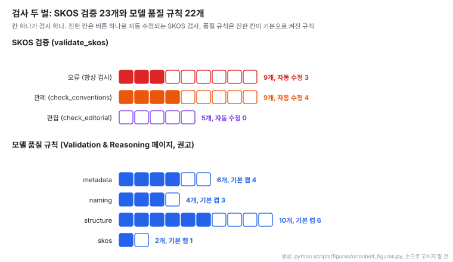
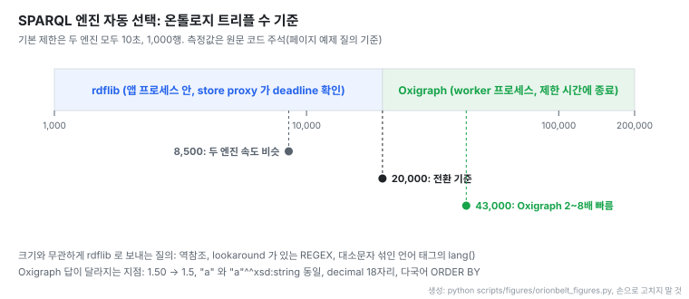

# OrionBelt Ontology Builder: Java 없이 브라우저에서 쓰는 OWL, SKOS 온톨로지 워크벤치

- **원문**: [ralforion/orionbelt-ontology-builder](https://github.com/ralforion/orionbelt-ontology-builder) (설명: "Browser-based ontology workbench for OWL ontologies and SKOS vocabularies. Streamlit + rdflib, no Java, no Protégé."), [호스팅 데모](https://orionbelt.streamlit.app/), [CHANGELOG](https://github.com/ralforion/orionbelt-ontology-builder/blob/6929408ab69aa9d861fb775e79cd3ad28362736c/CHANGELOG.md)
- **제작**: RALFORION d.o.o.
- **저장소 생성**: 2025-11-25 (첫 커밋 "Initial commit: OrionBelt Ontology Builder"). 읽은 커밋 `6929408` (2026-11-19, v1.33.0 다음 커밋 1개), 커밋 476개
- **릴리즈**: [`v1.33.0`](https://github.com/ralforion/orionbelt-ontology-builder/releases/tag/v1.33.0) (2026-11-18, API와 MCP 서버 추가). v1.0.0은 2026-03-30, 태그 84개. 읽은 커밋의 README는 아직 릴리즈되지 않은 SKOS-XL 변경(#574)까지 반영한다
- **코드**: Business Source License 1.1 (2030-03-30에 Apache 2.0으로 전환), Python 3.12+. 패키지 소스(테스트 제외) 42,181줄, 테스트 파일 172개에 test 함수 2,557개. 별 229개, 포크 24개, 기여자 2명(2026-11-23 GitHub API 기준)
- **의존성**: streamlit, rdflib, owlrl, pyshacl, pyoxigraph, networkx, streamlit-ace
- **검증 범위**: README, CHANGELOG, 소스를 읽어 쓴 것이다. 품질 규칙 수와 편집 연산 수는 소스를 import해 센 값이고, 테스트와 앱은 직접 돌리지 않았다
- **읽은 날짜**: 2026-11-23
- **태그**: #Ontology #OWL #SKOS #SHACL #SPARQL #MCP #KnowledgeGraph

!!! note "핵심 요약"
    OrionBelt는 OWL 온톨로지와 SKOS 어휘를 브라우저에서 만드는 Streamlit 앱이다. 핵심은 rdflib 위의 `OntologyManager`(9,410줄)이고, 앱은 그 위의 얇은 화면이라 같은 기능을 Python 라이브러리로도 쓴다. 특징은 세 가지다. 첫째, **고치기 전에 보여 준다.** 편집마다 diff 기반 undo 지점이 생기고, 삭제는 영향 범위를, import는 diff와 충돌 표를 먼저 보여 준다. 둘째, **검사 두 벌을 출처와 함께 둔다.** SKOS 검증 23개는 SKOS Reference 조항, qSKOS, 관행 중 어디서 왔는지 밝히고, 그중 7개만 버튼 하나씩으로 고친다. 모델 품질 규칙 22개와 SHACL(공리에서 shape 자동 생성)이 따로 있다. 셋째, v1.33.0부터 **로컬 API와 MCP 서버**로 에이전트가 열린 온톨로지를 조회하고 고친다. 변경은 `dry_run`, `expected_revision`, 전부 아니면 전무 batch, undo 1단계로 묶인다. 반대로 OWL 전용이라 순수 RDFS 어휘는 패널에 나오지 않고, 그래프를 메모리에 올리는 구조라 크기 상한이 RAM이며, BUSL이라 상용 제품에 넣으려면 별도 라이선스가 필요하다.

## 1. 개요

README는 스스로의 위치를 Protégé와 비교해 이렇게 적는다.

> "It's not trying to be Protégé. It's meant for people who want something lighter: a workbench that's easy to pick up, hard to break things with, and good enough for real ontology work."


출처: [OrionBelt README 스크린샷](https://github.com/ralforion/orionbelt-ontology-builder#readme)

- 왼쪽 사이드바에 페이지 메뉴, Undo와 Redo, 자동 저장 상태, 전역 검색, 언어 팩이 항상 붙어 있다. 어느 페이지에서든 되돌리기가 한 번에 닿는다
- 오른쪽은 Visualization 페이지다. 한 노드에 focus를 걸어 3홉 안만 남긴 상태이고, 아래쪽 줄에서 선택한 클래스의 레이블과 주석을 보고 "Open full editor"로 편집기로 넘어간다
- 원문이 내세우는 차이는 기능 수보다 설치 비용이다. Java와 데스크톱 설치 없이 `pip install` 또는 `docker run`으로 뜬다

"hard to break things with"가 이 도구의 설계 방향을 요약한다. 기능 대부분에 미리보기, 되돌리기, 시간 제한이 붙어 있고, 각 장치가 왜 필요한지를 코드 주석과 README가 측정값이나 이슈 번호로 설명한다.

| 페이지 | 역할 |
|---|---|
| Dashboard | 개수, 문서화 비율, 클래스 계층, 검사 요약. Settings 탭에 메타데이터, base URI, imports, prefix |
| Classes, Properties, Individuals | 계층, CRUD, bulk 작업 |
| Relations, Restrictions, Advanced | 클래스, 속성, 개체 관계와 OWL 제약, cardinality |
| Annotations | RDFS, SKOS, DC, 사용자 정의 주석, 언어 팩, bulk 편집, 이름 변경 |
| SKOS Vocabulary | concept scheme, concept, 계층, SKOS 검증 |
| Import / Export | merge 검토가 붙은 import, export, 새 온톨로지, 템플릿 |
| Source, SPARQL | 요청 시 생성하는 Turtle 원문, 읽기 전용 SPARQL 콘솔 |
| Validation & Reasoning | 검증, 모델 품질, SHACL, 추론 |
| Visualization | vis-network 그래프(OWL과 SKOS), 계층 트리, 통계 |

## 2. 엔진과 라이브러리 사용

앱은 `OntologyManager`의 얇은 래퍼다. Streamlit 없이 import해서 스크립트, 노트북, CI에서 온톨로지를 만들 수 있다. 클래스, 속성, 개체, 클래스 표현식, SKOS, 추론, export가 모두 이 클래스의 메서드다.

```python
from orionbelt_ontology_builder.ontology_manager import OntologyManager

ont = OntologyManager()
ont.add_class("Question")
entries = ont.parse_bulk_text("1,,Question\n1a,,1", default_columns=["name", "label", "parent"])
result = ont.bulk_add_classes(entries)
print(result["errors"])          # bulk 메서드는 예외 대신 항목별로 보고한다
ont.save_to_file("out.ttl")      # 형식은 확장자로, 원자적으로 쓴다
```

README가 따로 짚는 주의점은 두 가지다.

- bulk 메서드는 예외를 던지지 않고 `{"created": [...], "errors": [...], "skipped": [...]}`를 돌려준다. `errors`를 보지 않는 스크립트는 거부된 입력이 있어도 성공한 것처럼 보인다
- 행이 부모로 참조만 하고 자기 행이 없는 이름은 bare `owl:Class`로 선언된다. 그래서 20행에서 21개 클래스가 나올 수 있다

대상은 **OWL 온톨로지**다. 클래스는 `owl:Class`, 속성은 `owl:ObjectProperty`, `owl:DatatypeProperty`로 선언된 것만 Classes, Properties 패널에 나온다. schema.org처럼 `rdfs:Class`, `rdf:Property`만 쓰는 순수 RDFS 어휘는 현재 패널에 나오지 않는다.

시작점으로 템플릿 5종(Organization, Product Catalog, Event, Person/Contact, SKOS Thesaurus), 상위 온톨로지 2종([gist](https://www.semanticarts.com/gist/)는 약 100개 클래스와 약 100개 속성을 모듈 단위로 선택, [gUFO](https://nemo-ufes.github.io/gufo/)), 참조 어휘 3종(PROV-O, FOAF, GoodRelations)을 번들로 준다. 내려받는 참조 어휘는 고정한 SHA256으로 검증한 뒤 디스크에 캐시한다.

## 3. 편집, 되돌리기, 저장

| 장치 | 동작 |
|---|---|
| undo | 편집마다 이름 붙은 checkpoint. `UndoManager(max_history=50)`는 편집이 추가, 삭제한 트리플 diff만 저장한다(issue #437). 그래프 전체를 직렬화하지 않아 큰 온톨로지에서 50단계가 그래프 50벌이 되지 않는다. prefix 바인딩은 diff 대상이 아니다 |
| 삭제 | 확인 전에 무엇이 깨지는지 보여 준다 |
| bulk | 여러 항목을 한 번에 넣어도 undo 1단계 |
| import | 빈 온톨로지면 바로 적용. 아니면 diff 요약, 충돌 표, prefix 변경, 전략 선택(replace, merge, merge-overwrite), 변경 보고서 다운로드 |
| 형식 | Turtle, RDF/XML, N-Triples, N3, JSON-LD 입출력 |

로컬로 띄우면 브라우저 저장소 대신 디스크에 저장한다. 연결 파일이 없으면 변경마다 `~/.orionbelt_ontology_builder/recovery.nt`에 쓴다. N-Triples를 고른 이유는 큰 온톨로지에서 Turtle보다 약 6배 빨리 써지기 때문이다. "Linked working file"을 지정하면 그 파일이 저장소가 되고, 동기화 폴더를 가리키면 그대로 외부 백업이 된다. 저장은 실제 편집이 있을 때만, debounce 후 임시 파일에 쓰고 원자적으로 바꿔 넣는다. 시작할 때 파일을 읽지 못하면 자동 저장을 멈춰, 읽지 못한 파일을 덮어쓰지 않는다.

업로드 기본 상한은 Streamlit의 `maxUploadSize` 200 MB다. 파싱은 메모리에서 하므로 실제 상한은 호스트 RAM이다.

## 4. SKOS 검증과 자동 수정

SKOS 검증은 23개 검사를 세 등급으로 나눈다. 결과마다 안정적인 `type`, `severity`, 대상 concept과 URI가 붙어 `validate_skos()`로 Python에서도 같은 목록을 받는다. 검사마다 근거를 밝힌다. SKOS Reference에 명시된 조건이면 조항 번호(S13, S14, S27, S48, S52 등), [qSKOS](https://github.com/cmader/qSKOS) 품질 기준이면 qSKOS, 규범이 아닌 시소러스 관행이면 "Practice"다.



- 오류 등급은 항상 검사하고, 관례와 편집 등급은 `check_conventions=False`, `check_editorial=False`로 끈다. 큰 어휘를 import했을 때 권고성 경고에 묻히지 않게 하는 장치다
- 자동 수정은 7개뿐이고 편집 등급에는 하나도 없다. 원문 이유는 "There is deliberately no 'fix everything' button." 순환을 끊거나 중복 엣지를 지우는 일도 작성자가 의도한 것을 버릴 수 있어, 수정마다 버튼 하나와 undo 1단계를 둔다
- 개념의 뜻이나 어느 scheme에 속하는지처럼 작성자만 정할 수 있는 것은 고치지 않고 보고만 한다. 원문은 "guessing would be worse than reporting"이라고 적는다

검증과 별개로 편집 시점에 막는 것도 있다. concept을 자기 조상으로 만드는 broader 엣지는 저장할 때 거부된다.

SKOS-XL(레이블을 `skosxl:Label` 리소스로 두는 방식)도 다룬다. 레이블이 리소스라 레이블 자체에 주석, 날짜, 다른 레이블 링크를 달 수 있고, AGROVOC과 EuroVoc이 이 형식으로 배포한다. 텍스트를 고쳐도 리소스는 유지되어 레이블에 달린 진술이 남는다. 언어당 prefLabel 하나 규칙은 두 형식을 합쳐 적용한다(SKOS Reference S55~S57: SKOS-XL 레이블은 같은 텍스트의 plain 레이블을 함의한다). 어휘 전체를 plain과 SKOS-XL 사이에서 변환할 수 있고, 각 변환은 undo 1단계다. 이 기능과 `xl_literal_form`, `xl_label_disjoint` 검사는 아직 릴리즈되지 않은 CHANGELOG Unreleased(#574) 항목이다. 저장소 설명의 "22 SKOS validation checks"와 README의 23개 차이는 이 추가 때문으로 보인다(추정).

concept scheme에는 Dublin Core 메타데이터를 편집한다. 날짜는 입력한 정밀도대로(`YYYY`, `YYYY-MM`, `YYYY-MM-DD`) 타입을 붙여 연도만 아는 어휘가 월, 일을 지어내지 않게 하고, 라이선스와 출처는 텍스트가 아닌 IRI 리소스로 저장한다.

## 5. 모델 품질 규칙과 SHACL

**모델 품질 규칙**은 검증과 따로 있는 권고 규칙이다. 레지스트리에 22개(Q001~Q023, Q015 없음)가 metadata, naming, structure, skos 범주로 등록되어 있고 14개가 기본으로 켜져 있다. 레이블과 정의 누락, placeholder 텍스트, 중복과 유사 레이블, 명명 규칙, 계층 순환과 중복 subclass 엣지, 끊긴 클래스 섬, `owl:inverseOf` 없는 반대 속성, deprecated 리소스 사용을 본다. 설명 없는 약어, 모호하거나 순환하는 정의 같은 규칙은 기본으로 꺼져 있고 해당 프로필에서 켜진다.

- 의도한 finding은 이유와 함께 suppress한다. 숨겨지되 개수로 남고, export에는 이유와 함께 나온다. suppress 정보는 품질 설정에 저장하고 온톨로지 파일에는 넣지 않는다
- 기본은 온톨로지 자신의 리소스만 검사하고, import한 어휘는 선택해야 검사한다

**SHACL**은 [pySHACL](https://github.com/RDFLib/pySHACL)로 데이터를 closed-world로 검사한다.

| 기능 | 내용 |
|---|---|
| 온톨로지 안 shape | 자동으로 찾아 검사한다. shape 자체를 데이터로 검사하지는 않는다 |
| 추가 shape | 붙여넣기, 업로드. SHACL meta-shape로 먼저 검사한 뒤 저장(undo 1단계)하거나 한 번만 쓴다 |
| 내장 shape | OrionBelt quality policy(레이블 누락, 정의 누락, 언어당 prefLabel 하나 규칙을 SHACL로 옮긴 것, 테스트로 규칙과 일치를 유지), [skohub-shapes](https://github.com/skohub-io/skohub-shapes)의 SKOS integrity와 best practice |
| 공리에서 생성 | cardinality 제약은 최소, 최대 개수로, `someValuesFrom`은 그 클래스 값 필수로, `allValuesFrom`은 모든 값의 클래스로, `hasValue`는 필수 값으로, functional 속성은 값 최대 1개로, range는 값의 클래스나 datatype으로 바꾼다. 검사마다 새로 만들고 저장하지 않으며, finding마다 출처 공리를 밝힌다 |
| 추론 먼저 | 생성 shape 검사는 기본으로 복사본에 OWL RL 추론을 먼저 적용한다. 그래서 `hasValue`가 함의하는 값을 누락으로 읽지 않는다. 끄면 적힌 것만 검사한다 |
| 실행 제한 | 시간 제한, `owl:imports` 해석 안 함, 다른 서버로 가는 `SERVICE` 제약 금지 |

공리에서 shape를 만드는 방식은 OWL의 open-world 공리와 SHACL의 closed-world 검사를 잇는다. 모델은 OWL로 적고, 개체 데이터가 그 모델을 따르는지는 SHACL로 확인한다.

## 6. 추론

RDFS 추론은 자체 구현이고 200,000 트리플에서도 수 초가 걸린다고 원문은 적는다. 모든 RDFS 그래프가 함의하는 자명한 트리플을 빼는 lean 옵션이 있다. OWL RL은 [owlrl](https://owl-rl.readthedocs.io)을 쓴다. 프로필은 `rdfs`, `rdfs-lean`, `owl-rl`, `owl-rl-ext` 네 가지다.

- 추론은 별도 프로세스에서 진행 표시와 함께 돌고, 제한 600초(`REASONING_DEADLINE_SECONDS`)와 취소 버튼이 있다. 긴 closure가 앱을 멈추지 않게 하는 장치다
- 고정점까지 반복하는 상한은 5회(`REASONING_MAX_PASSES`)이고, 코드 주석에 따르면 번들 샘플은 모두 2회 안에 수렴한다

## 7. 읽기 전용 SPARQL 콘솔

SELECT, ASK, CONSTRUCT, DESCRIBE만 받고 INSERT, DELETE, LOAD, CLEAR, DROP은 거부한다. 수정은 편집 페이지로만 해서 checkpoint와 undo를 거치게 하려는 것이다. 온톨로지의 prefix를 미리 선언해 `PREFIX` 줄 없이 `owl:Class`, `:Person`을 쓸 수 있고, 예제 질의 8개가 붙어 있다. 기본 제한은 10초, 1,000행이다.



- 2만 트리플부터 Oxigraph로 넘긴다. 코드 주석의 근거는 페이지 예제 질의로 잰 값이다: 8,500 트리플에서는 비슷하고 43,000에서는 Oxigraph가 2~8배 빠르다. 결과 화면에 어느 엔진이 답했는지 표시하고, 설정으로 한쪽 엔진에 고정할 수 있다
- 두 엔진은 답이 다를 수 있다. 차이가 눈에 띄지 않는 질의(Python `re` 문법의 역참조, lookaround REGEX와 소문자가 아닌 언어 태그의 `lang()`)는 크기와 무관하게 rdflib로 보낸다. Oxigraph는 앞의 REGEX에 오류 없이 아무것도 매칭하지 않고, 언어 태그를 소문자로 바꾼다
- 나머지 차이는 페이지에 적어 둔다. 숫자 정규형(`1.50` → `1.5`), `"a"`와 `"a"^^xsd:string`을 같은 값으로 취급, decimal 나눗셈 18자리, 다국어 레이블의 ORDER BY 순서

시간 제한의 구현은 코드 주석이 가장 자세히 설명하는 부분이다. rdflib 질의는 앱 프로세스 안에서 돌고, store proxy가 트리플 몇백 개마다 `monotonic()`으로 deadline을 확인한다. 행 상한만으로는 부족한 이유를 원문은 측정으로 보인다.

> "measured on a 300-triple graph, a three-way cartesian product under ORDER BY produced no first row at all after 8 seconds, while the store deadline stopped the same query at 3.05s."

rdflib의 `evalUnion`은 generator가 아니라 두 branch를 리스트로 다 모은 뒤 돌려준다. 그래서 UNION이 든 질의는 첫 행이 나오기 전에 전부 평가되고, 행 상한으로는 막을 수 없다. proxy 비용은 같은 질의 72.1ms 대 72.3ms로 측정했다. 서브프로세스를 쓰지 않은 이유도 밝힌다. Streamlit ScriptRunner 스레드에서 fork하는 것은 CPython 3.12부터 deprecated이고(Docker 이미지는 3.14), proxy는 fork, 시그널, 메인 스레드가 필요 없다. Oxigraph worker는 새 인터프리터로 띄우므로 fork가 필요 없다. 트리플 패턴 없이 큰 `VALUES` 블록끼리 곱하는 질의는 store를 거치지 않아 proxy가 막을 수 없으므로, 질의 준비 단계에서 미리 거부한다.

## 8. 시각화와 경로 검색

vis-network(저장소에 포함한 사본) 그래프에서 클래스 필터, 노드 상한, 노드 클릭 시 편집기 이동, Ctrl/Cmd 클릭으로 이웃만 남기는 focus, 두 엔티티 사이 최단 경로 검색을 한다. 경로는 hop 단위 문장으로도 쓰고 그래프에 강조한다.

경로 검색은 BFS로 최단 경로를 찾고 다음 경로까지 최대 5개(`PATH_MAX_ROUTES`)를 나열한다. 한 번의 탐색은 엔티티 50,000개(`PATH_MAX_VISITED`)에서 멈추고, 두 번째 이후 경로들은 그 10배를 함께 나눠 쓴다. 경로마다 따로 예산을 주면 큰 그래프의 긴 경로에서 몇 초씩 걸렸기 때문이다(PR #532 리뷰). 시간이 아닌 개수로 제한해 같은 입력이면 매번 같은 목록이 나온다.

상한에 걸리면 "연결 없음"으로 답하지 않고 `PathSearchLimitError`를 낸다. 원문 주석은 "reporting a bounded search as 'these are not connected' is a wrong answer rather than a missing one."이다. 탐색을 다 못 한 것과 연결이 없는 것을 다른 사실로 구분한다.

## 9. API와 MCP 서버

v1.33.0(2026-11-18)에서 추가됐다. `api` extra를 설치하고 `--api`로 띄우면 앱에 열린 온톨로지를 `http://127.0.0.1:8765`로 내보낸다. 시작할 때마다 URL과 새 bearer token을 `~/.orionbelt_ontology_builder/api.json`(소유자만 읽기)에 쓴다. MCP 서버 `orionbelt-ontology-builder-mcp`는 이 API의 클라이언트로 별도 프로세스이고, 호출마다 이 파일을 다시 읽어 앱을 재시작해도 따라간다.

| 조회 8개 | 변경 4개 |
|---|---|
| `ontology_overview`, `find_entities`, `list_entities`, `describe_entity`, `get_hierarchy`, `find_paths`(두 엔티티의 연결, 기본 3개 경로, edge 종류 8가지로 제한 가능), `sparql_query`(읽기 전용, 기본 200행, 10초), `check_ontology` | `edit_ontology`(타입이 있는 연산 29종의 atomic batch), `merge_turtle`(큰 조각을 Turtle로), `infer`(기본은 미리보기, `apply=true`면 추론 트리플을 undo 1단계로 추가, 기본 60초), `undo_redo` |

열린 온톨로지 전체는 `current_ontology` 리소스(Turtle)로 읽는다. 변경 쪽 규칙은 세 가지다.

- **`dry_run`**: 추가, 삭제될 트리플 diff만 돌려주고 아무것도 남기지 않는다
- **`expected_revision`**: 읽은 뒤 온톨로지가 바뀌었으면 거부한다. 에이전트가 낡은 상태를 보고 고치는 일을 막는다
- **전부 아니면 전무**: batch와 merge는 모두 적용되거나 하나도 적용되지 않고, 적용된 것은 UI와 같은 undo 이력의 1단계가 된다. 사용자가 사이드바 Undo 버튼으로 에이전트의 변경을 되돌린다

UI와 API는 프로세스 잠금 하나를 나눠 쓴다. Streamlit 실행 전체와 위젯 callback이 잠금을 잡고, API 호출도 같은 잠금을 잡는다. 시간 안에 잡지 못하면 줄 서지 않고 `Busy`로 실패한다. API 변경이 있으면 열린 페이지가 2초 주기로 이를 확인해 다시 그리고, toast에 "add_class Employee (+3 / −0 triples)"처럼 변경을 적으며, 사이드바 "Agent changes"에 최근 10개를 남긴다. 브라우저 탭이 여럿이면 마지막으로 실행된 탭의 온톨로지가 API 대상이고, 앱을 한 번 열기 전에는 busy로 답한다.

README는 gUFO를 연 상태에서 Claude와 나눈 세션을 캡처로 보여 준다.


출처: [OrionBelt README "A session with an agent"](https://github.com/ralforion/orionbelt-ontology-builder#a-session-with-an-agent)


출처: [OrionBelt README "A session with an agent"](https://github.com/ralforion/orionbelt-ontology-builder#a-session-with-an-agent)


출처: [OrionBelt README "A session with an agent"](https://github.com/ralforion/orionbelt-ontology-builder#a-session-with-an-agent)

- "Customer, Contract, Order를 일반적인 속성과 함께 추가"라는 요청에 에이전트가 기존 gUFO namespace를 건드리지 않고 별도 namespace를 만든 뒤, 적용 전에 dry run으로 182 트리플과 충돌 없음을 확인한다
- 결과 보고에 클래스마다 gUFO 타입, 상위 클래스, 제약이 나온다. Customer는 RoleMixin이자 `gufo:Object` 하위, Contract는 Kind이자 `gufo:Relator` 하위, Order는 EventType이자 `gufo:Event` 하위이고, "Order는 정확히 1명의 Customer가 낸다" 같은 cardinality 제약이 함께 들어갔다. 에이전트는 변경 뒤 검증을 돌려 새 부분에 문제가 없다고 보고한다
- 원문 세션은 시연이다. 같은 요청이 다른 온톨로지에서 얼마나 맞게 나오는지는 원문에 측정이 없다(미검증)


출처: [OrionBelt README "A session with an agent"](https://github.com/ralforion/orionbelt-ontology-builder#a-session-with-an-agent)


출처: [OrionBelt README "A session with an agent"](https://github.com/ralforion/orionbelt-ontology-builder#a-session-with-an-agent)

- 에이전트 변경이 앱 쪽에서 어떻게 보이는지가 요점이다. 변경 하나가 사이드바 한 줄이자 undo 한 단계라서, 사람이 그래프로 확인하고 마음에 들지 않으면 되돌린다
- 새 클래스 세 개 사이에 `isCustomerIn`, `hasCustomer`, `placedOrder`, `governsOrder` 같은 역관계 쌍이 생겼고, 각각 gUFO의 Object, Relator, Event 아래로 subClassOf 엣지가 이어진다. 상위 온톨로지가 에이전트의 모델링 선택지를 좁혀 준다

API 설정은 `--api-port`, `--api-host`(기본 127.0.0.1)와 `ORIONBELT_*` 환경 변수, `.env` 파일로 준다. 환경 변수가 `.env`보다, 명령줄 플래그가 둘 다보다 우선한다. 호스팅 데모와 Docker 이미지에는 API가 없다.

## 10. GitHub Actions 고정 검사

개발 절에서 공급망 대응을 자세히 적는다. 워크플로의 모든 `uses:`는 40자 커밋 SHA와 정확한 patch 릴리즈 주석(`# v7.0.1`)으로 고정한다. `scripts/check-action-pins.sh`가 SHA 형식, `ALLOWED_OWNERS` 목록, 주석의 태그를 `git ls-remote`로 조회해 고정된 커밋과 같은지를 확인하고, CI의 `pins` job과 두 릴리즈 워크플로의 첫 단계로 돈다. 이 검사가 없으면 PR이 fork의 해시로 바꾸고 주석은 `# v7.0.1`로 둔 채 평범한 Dependabot 갱신처럼 보일 수 있다.

원문은 검사가 못 하는 것도 적는다. 악성 릴리즈라도 해시가 자기 태그와 맞으면 통과하고, 실제 존재하는 오래된 버전으로의 다운그레이드를 막지 못하며, `actions/checkout`은 검사보다 먼저 돌 수밖에 없다.

## 11. 한계와 주의

- **라이선스가 BUSL 1.1이다.** 운영 사용을 포함해 쓸 수 있지만, 상용 제품에 넣거나 상용 서비스의 일부로 제공하려면 상용 라이선스를 사야 한다. 2030-03-30에 Apache 2.0으로 바뀐다. 기여는 CLA 동의가 필요하다
- **OWL 전용이다.** 순수 RDFS 어휘(schema.org 등)의 클래스와 속성은 패널에 나오지 않는다
- **그래프를 메모리에 올린다.** rdflib 그래프 하나가 앱 상태이고, 업로드 상한은 설정할 수 있지만 실제 상한은 RAM이다. 수백만 트리플 규모의 동작은 원문에 수치가 없다(미검증). RDFS 추론 수 초는 200,000 트리플 기준이다
- **API는 세션 하나에 묶인다.** 마지막으로 실행된 브라우저 탭의 온톨로지가 대상이고, 다중 사용자 서버를 위한 구조가 아니다. 호스트를 127.0.0.1 밖으로 열면 토큰 하나만으로 보호된다
- **두 SPARQL 엔진의 답이 다를 수 있다.** 2만 트리플 전후로 엔진이 바뀌므로, 온톨로지가 커지면서 같은 질의의 숫자 표기나 정렬이 바뀔 수 있다
- **개발이 사실상 한 조직이다.** 기여자 2명이고, 이슈 대부분을 외부 사용자 한 명이 올렸다고 README 감사 절이 밝힌다
- **README 일부는 아직 릴리즈되지 않은 기능이다.** SKOS-XL 편집과 검사 2개는 v1.33.0 이후 커밋에만 있다

## 12. 가져올 수 있는 부분

| 대상 | 가져올 수 있는 부분 |
|---|---|
| 에이전트 쓰기 경로 | `dry_run`으로 diff 먼저 받기, `expected_revision`으로 낡은 읽기 거부, batch 전부 아니면 전무, 에이전트 변경을 사람의 undo 이력 1단계로 합치기. 변경마다 추가, 삭제 트리플 수 알림과 최근 목록 |
| UI와 API 공존 | 프로세스 잠금 하나를 나눠 쓰고, 못 잡으면 큐 대신 `Busy`로 바로 실패. 클라이언트가 매 호출 discovery 파일을 다시 읽어 서버 재시작을 따라가는 방식 |
| 검사 설계 | 검사마다 규범 조항, 외부 품질 기준, 관행 중 근거를 표시. 등급별로 끌 수 있게 해 큰 어휘에서도 쓸 수 있게 하기. 자동 수정은 의미를 잃지 않는 것만, 하나씩, undo 단위로 |
| OWL과 SHACL 연결 | cardinality, someValuesFrom, allValuesFrom, hasValue, functional, range 공리에서 SHACL shape를 매번 생성하고 finding에 출처 공리를 붙이기. 검사 전에 복사본에 추론 적용 |
| 질의 시간 제한 | 행 상한만으로 못 막는 질의(UNION, ORDER BY 아래 곱)를 store 접근 지점에서 deadline으로 끊기. 엔진을 크기로 고르되, 답이 조용히 달라지는 질의는 원래 엔진으로 보내고 나머지 차이는 화면에 명시 |
| 탐색 상한의 의미 | 상한에 걸린 탐색을 "없음"이 아니라 "다 못 찾음"으로 보고. 시간 대신 방문 개수로 제한해 결과를 재현 가능하게 |
| undo 비용 | 그래프 스냅샷 대신 편집이 추가, 삭제한 트리플 diff를 저장 |

## 13. 결론

OrionBelt는 온톨로지 편집기라는 오래된 범주를 Python과 브라우저로 다시 만든 도구다. 기능 목록보다 눈에 띄는 것은 **실수를 되돌릴 수 있게 만드는 장치의 밀도**다. 편집, import, 자동 수정, 추론 적용, 에이전트 변경이 모두 미리보기와 undo 1단계를 거치고, 질의와 추론과 경로 검색에는 시간이나 개수 상한이 있으며, 상한에 걸린 결과를 정상 결과처럼 보고하지 않는다. v1.33.0의 MCP 서버는 이 장치들 위에 올라가 있어, 에이전트에게 온톨로지 쓰기 권한을 주면서도 사람이 확인하고 되돌릴 수 있다. 반면 단일 세션, 메모리 그래프 구조라 큰 운영 그래프의 저장소로 쓰는 도구는 아니고, BUSL이라 상용 제품에 넣으려면 라이선스를 따로 확인해야 한다.
