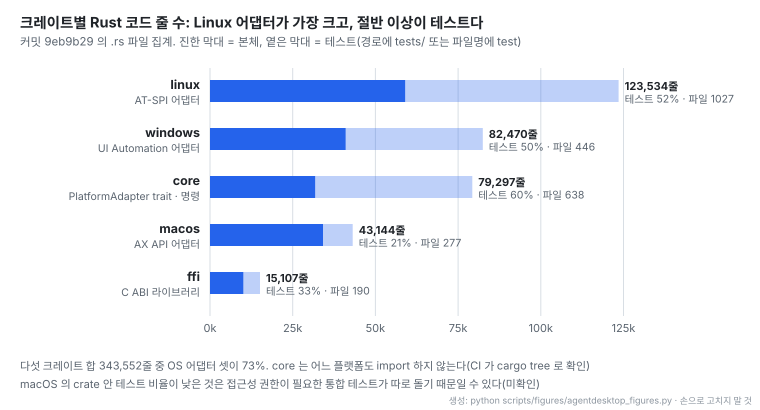
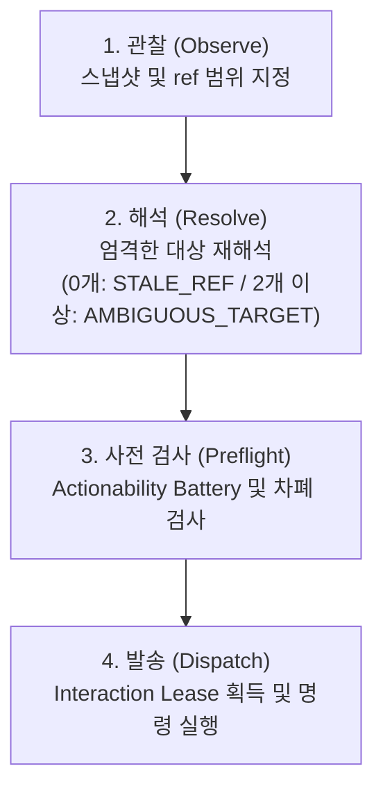
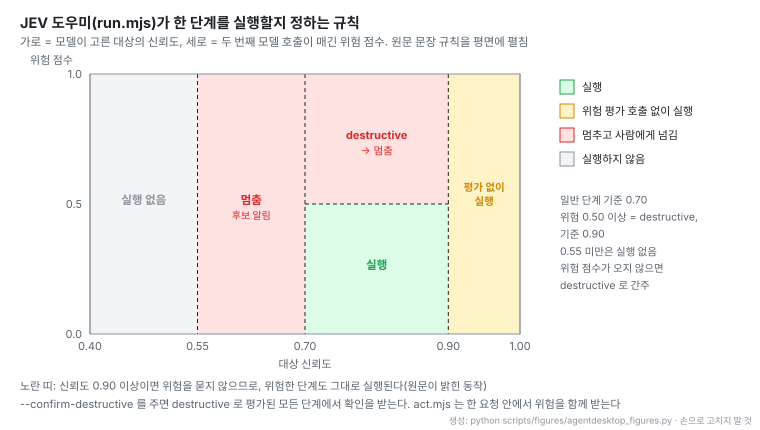

# agent-desktop: OS 접근성 트리 기반 데스크톱 앱 조작 프레임워크


출처: [agent-desktop README 배너](https://github.com/vercel-labs/agent-desktop/blob/9eb9b296192fcb70bda25e918cd6dd66abfa3d0d/README.md)

- 데스크톱 애플리케이션의 핵심 동작인 관찰(Observe), 클릭(Click), 드래그(Drag), 입력(Type), 스크롤(Scroll)을 OS 수준에서 지원함을 나타낸다.
- 아래 세 OS 로고가 지원 범위다. 세 OS 모두 1.0.0 부터 같은 CLI 와 C 라이브러리로 묶였다

- **레포**: [vercel-labs/agent-desktop](https://github.com/vercel-labs/agent-desktop) · [문서 사이트](https://agent-browser.dev/desktop)
- **제작**: Vercel Labs. GitHub 기여자 9명
- **공개**: 2026-02-19 저장소 생성일. Apache-2.0, 별 7,338개 · 포크 535개 · 커밋 317개 (2026-11-02 기준)
- **읽은 판**: `v1.0.2` (2026-10-30), 커밋 `9eb9b29` (2026-10-31)
- **구현 범위**: CLI 및 C FFI 라이브러리(`libagent_desktop_ffi`). Rust 기반 코어(`crates/core`)와 플랫폼 어댑터(`macos`, `windows`, `linux`), 내장 스킬, probes 검증 도구, npm 패키지(`agent-desktop`) 배포
- **지원 환경**: macOS(AX API), Windows(UI Automation, Windows 10 1809+ / Server 2019+), Linux(AT-SPI, x86_64 / aarch64, glibc 2.35+)
- **읽은 날짜**: 2026-11-02
- **태그**: #ComputerUse #AccessibilityTree #DesktopAutomation #AIAgent #Rust

!!! note "핵심 요약"
    agent-desktop은 AI 에이전트가 화면 픽셀 매칭이나 비전 모델의 좌표 추정에 의존하지 않고, OS 네이티브 접근성 트리(Accessibility Tree)를 직접 읽어 데스크톱 애플리케이션을 조작하도록 설계된 Rust 기반 프레임워크다. 스냅샷마다 조작 가능한 요소에 `@snapshot_id:ref` 식별자를 부여하고, 관찰과 동작, 재검증 루프를 에이전트 내부에서 완결한다. 과거 관찰 시점의 ref를 네이티브 핸들이 아닌 증거로 취급하여 UI 변경 시 누락되거나 모호한 대상을 즉시 거부(fail closed)하며, 속성을 Known / Absent / Unknown의 증거 3상태로 관리해 부정 오판을 방지한다. 기본 헤드리스(headless) 모드로 포인터 이동이나 포커스 탈취 없이 백그라운드 조작을 수행하고, macOS, Windows, Linux 전반에서 단일한 JSON 계약과 전송 의미론(delivery semantics)을 보장한다. C FFI(`libagent_desktop_ffi`)와 내장 스킬, 컨텍스트 압축용 JEV 도우미를 제공하며, 공개 8개월 만에 3개 OS를 통합한 v1.0.0 및 v1.0.2에 도달했다.

## 1. 개요 (픽셀 대신 접근성 트리)

agent-desktop은 Vercel Labs가 공개한 AI 에이전트용 데스크톱 제어 도구다. 원문은 프로젝트의 역할을 "Computer use for AI agents: read and operate desktop apps through the OS accessibility tree." 로 정의한다. 기존 비전 기반 Computer Use가 화면 스크린샷을 모델에 전달하고 픽셀 좌표를 추론해 마우스를 이동시키는 방식이었다면, agent-desktop은 OS 네이티브 접근성 API를 통해 구조화된 UI 트리를 직접 조회하고 조작한다.

원문은 핵심 동작 방식을 "The agent acts on a ref and snapshots again to check, with no pixel matching; the loop stays in your agent." 로 명시한다. 화면 캡처나 픽셀 매칭 없이 `snapshot` 명령이 반환하는 JSON 데이터에서 행동 가능한 요소마다 부여된 ref를 기반으로 명령을 내리며, 검증 또한 다음 스냅샷을 통해 수행한다. 스크린샷 기능(`screenshot`)은 별도 명령으로 제공되지만 일반 관찰 루프의 필수 조건이 아니다.

명령 체계는 전체 60개 명령 이름 중 56개가 실제 동작으로 구현되어 있다. 나머지 4개 명령(`key-down`, `key-up`, `mouse-down`, `mouse-up`)은 누른 키나 버튼을 자동으로 해제해 줄 상주 데몬이 없어 안전을 위해 실행을 명시적으로 거부한다. 명령 그룹은 아래와 같이 분류된다.

- **Observe**: snapshot, find, get, is, screenshot, list-surfaces
- **Act on a ref**: click, double-click, triple-click, right-click, type, set-value, clear, focus, select, toggle, check, uncheck, expand, collapse, scroll, scroll-to (16개)
- **Keyboard and mouse**: press, hover, drag, mouse-move, mouse-click, mouse-wheel, key-down, key-up, mouse-down, mouse-up
- **Apps and windows**: launch, close-app, list-apps, list-windows, list-displays, focus-window, resize-window, move-window, minimize, maximize, restore, open-system-surface
- **Notifications**: list-notifications, dismiss-notification, dismiss-all-notifications, notification-action
- **Clipboard**: clipboard-get, clipboard-set, clipboard-clear
- **Wait**: wait
- **Sessions**: session, trace, cursor-overlay
- **System**: status, permissions, version, batch, skills

실행에 요구되는 시스템 권한은 플랫폼마다 다르다. macOS는 Accessibility(손쉬운 사용) 권한이 필수다. Windows는 조작 대상 애플리케이션과 동일한 무결성 수준(integrity level)에서 실행될 경우 별도 권한이 불필요하다. Linux는 `at-spi2-core` 패키지에 의존한다.

macOS 환경에서는 snapshot namespace 및 바이너리 빌드별로 격리된 전용 커맨드 호스트(private command host) 프로세스를 재사용한다. 이 호스트는 네이티브 접근성 객체를 메모리에 유지함으로써 "a removed row cannot silently resolve to a surviving row with the same identifier" 원칙을 실현한다. 즉, 화면에서 삭제된 행의 식별자가 살아남은 다른 행으로 은밀히 대체 매핑되는 결함을 방지한다. 커맨드 호스트는 15분 동안 유휴 상태가 지속되면 자동 종료되며, 보안을 위해 `TMPDIR` 디렉터리에 `0700` 권한을 요구한다.

바이너리 자체에 문서가 내장되어 있어 `agent-desktop skills get desktop|platform|ffi` 명령으로 사용법을 즉시 확인할 수 있다. 또한 프로세스 외부 CLI 호출 오버헤드를 제거하기 위해 C 라이브러리(`libagent_desktop_ffi`, C ABI major 5)를 제공하므로 에이전트 프로세스 내부에서 직접 함수를 호출할 수 있다.

## 2. 관찰-동작 루프와 ref


출처: [agent-desktop 저장소 튜토리얼 GIF](https://github.com/vercel-labs/agent-desktop/blob/9eb9b296192fcb70bda25e918cd6dd66abfa3d0d/assets/Tutorial.gif)

- macOS 에서 터미널의 코딩 에이전트가 `agent-desktop type`, `agent-desktop press cmd+...` 같은 명령을 이어 실행해 TextEdit 문서에 글을 쓰고 서식을 바꾸는 장면이다
- 에이전트 쪽에는 화면 이미지가 아니라 명령과 JSON 결과만 오간다. 루프는 에이전트 안에 있고 도구는 관찰과 실행만 맡는다

agent-desktop의 기본 상호작용은 스냅샷 생성에서 시작된다. `snapshot` 명령을 호출하면 단일 envelope JSON이 반환된다. 반환 데이터에는 envelope 버전(`"2.5"`), 성공 여부(`ok: true`), 실행 명령(`command`), 그리고 세부 데이터(`data`)가 포함된다. `data` 객체는 현재 대상 애플리케이션(`app`), 활성 창 정보(`window{id, title}`), 스냅샷 고유 식별자(`snapshot_id`), 조작 가능한 요소 개수(`ref_count`), 트리 완성 여부(`complete: true`), 계층 트리(`tree`)로 구성된다.

```json
{
  "version": "2.5",
  "ok": true,
  "command": "snapshot",
  "data": {
    "app": "Finder",
    "window": { "id": "w-204749", "title": "Downloads" },
    "snapshot_id": "s8f3k2p9",
    "ref_count": 59,
    "complete": true,
    "tree": {
      "role": "window",
      "name": "Downloads",
      "children": [
        { "role": "treeitem", "name": "Documents", "ref_id": "@s8f3k2p9:e8", "available_actions": ["Click"] }
      ]
    }
  }
}
```

각 요소의 식별자(ref)는 `@s8f3k2p9:e8`과 같이 스냅샷 ID로 한정된다. 스냅샷 ID가 누락된 bare ref 형태(`@e8`)는 `INVALID_ARGS` 오류로 즉시 거부된다 (v0.10.0에서 bare ref 지원이 제거되었다). 데스크톱 UI가 변경되면 기존 ref는 `STALE_REF` 또는 `AMBIGUOUS_TARGET` 오류를 발생시키므로 에이전트는 즉시 새로운 스냅샷을 생성해 트리를 갱신해야 한다. 화면에 창이 여러 개 열려 대상이 명확하지 않은 경우에도 `AMBIGUOUS_TARGET` 오류가 발생하며, 이 때 `error.details` 필드에 후보 창 ID 목록이 제공된다.

UI 요소가 지나치게 밀집된 애플리케이션에서는 전체 트리를 한 번에 조회할 경우 모델의 컨텍스트를 과도하게 소모한다. 이를 방지하기 위해 `snapshot --skeleton ... -i --compact` 명령으로 UI 골격 지도를 먼저 확인한 후, 특정 영역의 ref를 루트로 지정하는 `--root @ref` 옵션을 사용해 필요한 영역만 단계적으로 드릴다운(drill-down)할 수 있다.

상호작용은 기본적으로 헤드리스(headless) 모드로 수행된다. ref를 대상으로 한 동작은 접근성 API를 통해 직접 실행되므로 마우스 포인터가 화면에서 이동하지 않으며 사용자의 포커스를 탈취하지 않는다. 실제 물리적 마우스 및 키보드 조작이 필요한 시나리오에서는 `--headed` 플래그를 명시해 물리 입력을 활성화한다.

접근성 트리에서 고유 ref를 부여받는 역할(role)은 총 18종으로 한정된다.

`button`, `textfield`, `checkbox`, `link`, `menuitem`, `tab`, `slider`, `combobox`, `treeitem`, `cell`, `radiobutton`, `incrementor`, `menubutton`, `switch`, `colorwell`, `dockitem`, `listbox`, `option`

## 3. 아키텍처

소프트웨어 구조는 Rust 워크스페이스 기반으로 크레이트(crate) 간 의존성을 분리한다.

- `crates/core`: 핵심 인터페이스인 `PlatformAdapter` trait을 정의하며, 각 명령을 파일 단위로 분리해 구현한다.
- `crates/macos`: macOS의 AX(Accessibility) API 구현체다.
- `crates/windows`: Windows의 UI Automation 구현체다.
- `crates/linux`: Linux의 AT-SPI 구현체다.
- `crates/ffi`: C 언어 바인딩을 위한 cdylib 및 C 헤더(`libagent_desktop_ffi`)를 제공한다.
- `src`: 바이너리 실행부로 CLI 인자 처리, 디스패치, 배치 실행, 커맨드 호스트 관리를 담당한다.
- `skills`: 바이너리 내부로 컴파일되어 번들링되는 에이전트 스킬 모음이다.
- `probes`: 각 플랫폼별 실제 동작 특성을 측정하는 검증 도구이며, 여기서 도출된 `FINDINGS.md`가 코드의 기술적 근거가 된다.

프로젝트는 의존성 역전 원칙(Dependency Inversion)을 "non-negotiable" 규칙으로 규정한다. `crates/core`는 플랫폼 구현 크레이트(`macos`, `windows`, `linux`)를 전혀 참조하지 않으며, 플랫폼 크레이트 상호 간에도 참조가 금지된다. CI 빌드 과정에서 `cargo tree -p agent-desktop-core` 명령을 실행해 플랫폼 크레이트가 출력에 포함되면 빌드가 즉시 실패하도록 강제한다. 플랫폼 어댑터는 컴파일 타임에 `#[cfg(target_os)]` 지시자를 통해 정적으로 선택되며, `PlatformAdapter` trait의 메서드 기본 구현은 `not_supported`를 반환하도록 설계되어 있다.

아래 그림은 커밋 `9eb9b29` 에서 크레이트별 `.rs` 줄 수를 센 것이다. 파일 경로에 `tests/` 가 있거나 파일명에 `test` 가 들어간 파일을 테스트로 집계했다(노트 기준).



- 크레이트별 전체 Rust 코드 줄 수 대비 테스트 코드 줄 수의 규모와 비중을 비교한다.
- 규모는 Linux 가 가장 크다. 테스트 비중은 core 가 60%로 가장 높고, linux · windows 도 절반 남짓이 테스트다
- macOS 크레이트의 테스트 비율(21%)이 낮은 것은 접근성 권한이 필요한 통합 테스트가 따로 돌기 때문일 수 있다(미확인)

코드 분석 결과, 가장 큰 코드 규모를 가진 크레이트는 v1.0.0에서 추가된 Linux다. 반면 macOS 크레이트는 코드 줄 수가 가장 적고 테스트 코드 비율이 21% 수준으로, 다른 크레이트(33%~60%)에 비해 낮게 나타난다. 벤치마크 README가 실제 앱 측정은 "privileged macOS integration suite" 에 속한다고 적은 만큼, macOS 검증의 일부는 크레이트 밖에서 돈다. 크레이트 안 테스트 비율만으로 구현 완성도를 판정하지 않는다.

## 4. ref 재식별과 증거 3상태

agent-desktop은 데스크톱 환경의 비결정적 특성을 다루기 위해 엄격한 식별 및 해석 규약을 유지한다.

### 증거 3상태 (Evidence Tri-State)

모든 UI 속성은 boolean 대신 `Known`, `Absent`, `Unknown`의 3가지 상태로 평가된다.

- **Known**: 속성값을 정상적으로 확인한 상태
- **Absent**: 시스템에 질의하여 해당 속성이 명시적으로 없다는 응답을 확인한 상태
- **Unknown**: 질의에 대한 유효한 응답을 획득하지 못한 상태

이 상태 체계를 단순한 boolean 값으로 축약하면 부정 평가 위치에서 "확인할 수 없음(I could not tell)"이 "확실히 없음(definitely not)"으로 왜곡되는 치명적 오류가 발생한다. 따라서 판단이 불가능한 상태를 부재로 오인하지 않도록 3상태를 유지한다.

### Ref의 특성과 엄격한 해석 (Strict Ref Resolution)

스냅샷에서 발급된 ref는 해당 스냅샷 내부에서만 결정적이며 데스크톱 UI가 갱신되면 지속성을 보장하지 않는다. 원문은 "A ref from an earlier observation is evidence, not a native handle." 로 정의한다. 과거 관찰 시점에 획득한 ref는 요소를 다시 식별하기 위한 증거일 뿐 네이티브 OS 핸들 그 자체가 아니다.

`RefMap`은 재식별에 필요한 요소의 위치 경로와 속성 근거를 저장한다. 동작 실행 시 과거의 관찰 데이터와 현재 화면 상태가 어긋나 대상 매칭 결과가 0개면 `STALE_REF`, 2개 이상이면 `AMBIGUOUS_TARGET`을 반환하며 임의로 추측하지 않고 실행을 즉시 중단(fail closed)한다. 원문은 이를 "the boundary between an old observation and a live desktop mutation" 으로 규정한다.

재식별은 단계적 해석(Graded Resolution)을 거친다. 먼저 저장된 위치 경로를 확인하고, 불일치 시 제한된 범위의 확장 탐색을 수행한다. 확인 순서는 요소 식별자, 역할 조건부 안정 텍스트(role-conditional stable text), 그리고 식별 정보가 전무한 경우에 한해 유일한 위치 좌표(geometry)를 검증한다. 이때 텍스트 입력 필드의 내용과 같이 수시로 변하는 가변 값(volatile value)은 식별 근거로 채택하지 않는다(Stable Text Identity).

### 창 및 프로세스 식별 (Window Identity)

창 식별은 단순 윈도우 핸들에 의존하지 않고 윈도우 핸들과 프로세스 생성 시각 기반의 토큰을 조합해 검증한다. OS가 프로세스 종료 후 동일한 핸들을 재활용하더라도 토큰 대조를 통해 fail closed 원칙에 따라 이전 창에 대한 잘못된 접근을 차단한다. 또한 데스크톱 세션 유지에 필수적인 시스템 프로세스는 강제 종료 요청을 수락하지 않고 보호 프로세스로 분류해 `INVALID_ARGS` 및 `not_delivered` 상태를 반환한다(Protected Process).

### 웹 래퍼 최적화와 관찰 결과

Chromium이나 Electron 기반 애플리케이션에서 발생하는 수많은 익명 컨테이너 체인(anonymous container chain)은 트리의 논리적 깊이(logical depth)를 소비하지 않도록 자동으로 건너뛴다. 이 과정을 생략하면 기본 깊이 한도 안에서 도달 가능한 내용이 10배 단위로("by an order of magnitude") 과소 보고된다.

요소 조회 결과(Read Outcomes)는 4가지로 분류되어 불필요한 재시도를 억제한다.

- `Settled Absence`: 부재가 확정된 상태로 재시도를 수행하지 않음
- `Retryable Failure`: 대상이 아니라 전송 계층의 실패(시간 초과, 오류). 작업 기한까지 같은 읽기를 반복할 가치가 있음
- `Unavailable Element`: 요소 자체가 사라졌다는 보고. 이미 해석한 대상이면 stale ref 로, 트리 순회 중이면 그 가지만 미완료로 처리
- `Terminal Failure`: 정의된 복구가 없는 실패(거부, 분류되지 않은 코드). 재시도 루프로 추측하지 않고 그대로 올림

보안 필드(Secure Field) 정책에 따라 비밀번호 입력 필드의 실제 값은 스냅샷, 관찰 속성, 동작 실행 결과 등 어떠한 출력 envelope에도 절대 포함되지 않는다.

### 상호작용 제어와 격리

- **Interaction Lease**: 기계 전체의 입력 장치에 대한 독점 권한이다. 오직 dispatch가 실행되는 짧은 구간 동안만 획득하며, 획득 대기 중에 해석된 대상 요소는 lease를 잡은 직후 라이브 상태에서 다시 해석(re-resolve)된다.
- **Interaction Policy**: `headless`(기본값), `headed`(`--headed`), `focus fallback`(CLI 플래그로 지정 불가)의 3가지 모드를 지원한다. Windows 플랫폼에서는 UI Automation API에 커서 위치 기반 텍스트 삽입 쓰기 인터페이스가 존재하지 않아 `type` 명령의 headless 경로가 지원되지 않는다. 따라서 Windows headless 환경에서는 텍스트 입력 시 `set-value`를 사용해야 한다.
- **Agent Cursor Overlay**: 사용자에게 에이전트의 동작 위치를 시각적으로 보여주는 표시 전용 가상 커서다. `--multi-agent` 옵션을 활성화하면 `(session, agent-id)` 쌍별로 독립된 커서를 렌더링하며, 물리 입력은 Interaction Lease를 통해 단일 큐로 직렬화된다.
- **상태 및 아티팩트 보관**: 모든 세션 데이터는 `~/.agent-desktop` 경로에 저장된다. 프로세스별 실행 추적 로그는 JSONL 형식의 Trace Segment로 기록되며, `session start --screenshots` 로 켜면 조작 전후 PNG 스크린샷도 보관된다. 이때 스크린샷은 화면 가림 처리(redaction) 없이 원본 그대로 저장되므로 취급에 주의해야 한다.

## 5. 동작 신뢰성 계약 (actionability, delivery, headless/headed)

데스크톱 자동화의 안정성을 보장하기 위해 agent-desktop은 2026-07-11 기술 문서("Build desktop actions as an observe-resolve-preflight-dispatch contract")에 정의된 4단계 동작 계약을 강제한다.



### Actionability Battery 검사

명령을 발송하기 전, 대상 요소가 즉각적인 조작을 수용할 수 있는지 7가지 사전 조건을 검증한다.

1. **visible**: 화면에 시각적으로 노출되어 있는가
2. **stable**: 요소의 위치나 크기가 동적으로 흔들리지 않고 안정적인가
3. **enabled**: 조작 가능한 활성 상태인가
4. **supported action**: 요청한 동작을 해당 요소가 지원하는가
5. **policy**: 설정된 상호작용 정책(headless 또는 headed)에 부합하는가
6. **editable**: 텍스트 입력 동작 시 편집 가능한 상태인가
7. **receives events**: 이벤트가 대상 요소에 도달 가능한가

이벤트 수신 가능 여부(`receives events`)는 요소의 중심점과 상하좌우 4분면을 포함한 총 5개 기준 지점 중 단 하나라도 이벤트가 도달하면 통과로 판정한다.

동시에 차폐 게이트(Occlusion Gate)가 작동하여 대상 요소가 상위 레이어나 타 창에 가려졌는지 검사한다. 판정 결과는 `ReachesTarget`, `InterceptedBy`, `Unknown` 중 하나로 반환되며, 차폐 여부를 확정할 수 없는 `Unknown` 상태인 경우 작업 중단을 막기 위해 fail open 정책을 적용하여 통과시킨다.

동작 실행 시 대상 요소가 준비될 때까지 기다리는 Auto-Wait 메커니즘의 기본 대기 시간은 5000ms다. 단, 텍스트 입력(`type`) 명령은 입력할 글자당 30ms가 추가로 가산된다. 즉시 실행이 필요한 경우 `--timeout-ms 0` 옵션을 지정한다.

### 전송 의미론 (Delivery Semantics)

명령의 성공 여부를 단순한 API 반환값으로 판단하지 않고 대상 요소로의 실제 전송 여부를 기준으로 구분한다.

Windows 환경에서 `SendInput` API가 보고하는 주입 이벤트 개수는 전송 성공의 증거로 채택하지 않는다. UIPI(User Interface Privilege Isolation)로 인해 입력이 차단되더라도 Windows OS가 API 호출 자체를 성공으로 보고하기 때문이다.

또한 쓰기 동작의 실패를 전송 상태로 분류하는 Mutation Classifier를 운용한다. 읽기 작업에서 사용하는 `retryable` 오류 코드를 쓰기 작업에 동일하게 적용하면 명령이 대상 애플리케이션에 중복 전달(double-delivery)되는 심각한 부작용을 초래할 수 있으므로, 쓰기 실패는 전달 판정 체계와 엄격히 분리된다.

### Headless 및 Headed 인터랙션 제약

기본 모드인 headless 상태에서는 접근성 API를 통해 동작을 주입한다. 그러나 물리 입력이 수반되는 상황에서는 플랫폼별로 아래와 같은 제약 계약이 적용된다.

- macOS headed 모드에서 `click`, `right-click`, `type`, `clear`, `scroll`은 물리 입력을 우선 사용한다.
- macOS에서 `double-click`, `triple-click`, `hover`, `drag`는 물리 조작으로만 수행 가능한 물리 전용 동작이다. 따라서 `--headed` 플래그가 지정되지 않은 headless 호출에서는 안전을 위해 fail closed 원칙에 따라 실행을 즉시 거부한다.

## 6. JSON 계약과 오류

agent-desktop의 모든 명령 출력은 표준화된 단일 JSON envelope 형식으로 반환된다.

성공과 실패 여부에 상관없이 최상위 envelope는 항상 동일한 구조를 유지하며, 오류 발생 시 `error` 객체에 상세 내역이 기록된다.

```json
{
  "version": "2.5",
  "ok": false,
  "command": "click",
  "error": {
    "code": "STALE_REF",
    "message": "@s8f3k2p9:e7 not found in current RefMap",
    "suggestion": "Re-run a snapshot to obtain fresh refs, then retry with the new ref (CLI: snapshot [--skeleton]; FFI: ad_snapshot then pass the printed qualified ref to ad_execute_by_ref)",
    "recovery": {
      "strategy": "refresh_snapshot_then_retry_original",
      "retryable": true,
      "requires_fresh_snapshot": true
    },
    "disposition": {
      "delivery": "not_delivered",
      "retry": "safe"
    }
  }
}
```

### 처리 상태 (Disposition) 계약

`error` 객체는 항상 `code`, `message`, `disposition` 필드를 포함한다. 복구 제안(`recovery`)은 오직 `disposition.retry` 값이 `safe`일 때만 제공된다.

- **disposition.delivery**: 명령의 전달 상태를 나타낸다.
    - `unknown`: 전달 여부 불명
    - `not_delivered`: 대상에 도달하지 않음이 확인됨
    - `delivery_uncertain`: 전달 여부가 불확실함
    - `delivered_unverified`: 전달되었으나 사후 효과가 검증되지 않음
    - `delivered_verified`: 전달되었으며 사후 효과가 정상 검증됨
- **disposition.retry**: 재시도 안전 여부를 명시한다.
    - `unknown`: 재시도 가능 여부 불명
    - `safe`: 즉시 재시도해도 안전함
    - `unsafe`: 재시도 시 중복 실행 등 위험이 존재함

원문은 에이전트의 재시도 규칙을 "retry only when error.disposition.retry is safe" 로 엄격히 규정한다. 또한 `ok: true` 는 명령이 전달됐거나 이미 충족된 상태였다는 뜻이지, 애플리케이션에서 효과가 확인됐다는 뜻이 아니다. `delivered_verified` 판정은 플랫폼 어댑터가 동작 실행 후 사후 조건(post-condition)을 다시 읽어 확인했을 때만 부여된다.

창 geometry 허용 오차는 OS 렌더링 특성에 따라 다르게 설정되어 있다.

- macOS: 2 points
- Windows: 8 px
- Linux: 2 pixels

### 에러 코드 16종과 프로세스 종료 코드

프레임워크가 반환하는 구조화된 오류 코드는 16종으로 정의되어 있다.

| 에러 코드 | 원인 및 설명 |
|---|---|
| PERM_DENIED | 접근성 권한이 없음 |
| ELEMENT_NOT_FOUND | ref 나 질의에 맞는 요소가 없음 |
| APP_NOT_FOUND | 앱이 실행 중이 아니거나 창이 없음. 아무것도 보내기 전에 실패했으므로 `not_delivered` |
| STALE_REF | 라이브 UI 에서 ref 를 다시 식별하지 못함 |
| AMBIGUOUS_TARGET | ref 복구가 그럴듯한 대상 여럿에 맞음 |
| SNAPSHOT_NOT_FOUND | 스냅샷 ID 가 없거나 만료됨 |
| POLICY_DENIED | 물리 입력(headed) 경로가 정책으로 막힘 |
| ACTION_FAILED | 동작이 거부됐거나, 관찰된 결과가 요청과 모순됨 |
| ACTION_NOT_SUPPORTED | 대상이 요청한 동작을 노출하지 않음 |
| APP_UNRESPONSIVE | 해당 앱이 응답을 멈춤 |
| PLATFORM_NOT_SUPPORTED | 이 플랫폼에서 어댑터 메서드가 구현되지 않음 |
| TIMEOUT | 대기 조건이 만료됐거나, 라이브 식별 읽기가 기한까지 끝나지 않음 |
| INVALID_ARGS | 전달된 인자 형식이나 값이 유효하지 않음 |
| WINDOW_NOT_FOUND | 요청한 창이 없음(`screenshot --window-id` 불일치 포함). `not_delivered` |
| NOTIFICATION_NOT_FOUND | 요청한 시스템 알림을 찾을 수 없음 |
| INTERNAL | 예상하지 못한 오류 또는 잡힌 panic |

프로세스 종료 코드(Exit Code)는 아래와 같이 구분된다.

- `0`: 정상 성공
- `1`: 구조화 오류 (API 동작 실패 및 플랫폼 오류)
- `2`: 인자 파싱 오류 (잘못된 CLI 플래그 및 파라미터)

## 7. 플랫폼 지원

macOS, Windows, Linux 전반에 걸쳐 제공되는 세부 기능 지원 매트릭스는 아래와 같다.

| 기능 항목 | macOS | Windows | Linux |
|---|---|---|---|
| 접근성 트리 | 지원 | 지원 | AT-SPI 지원 |
| 클릭 / 입력 / 키보드 | 지원 | 지원 | AT-SPI 지원, X11 / GNOME 키 입력 |
| 마우스 조작 | 지원 | 지원 | X11 환경 지원, --headed 필요 |
| 스크린샷 | 지원 | 지원 | X11 창 지원, Wayland portal 지원 |
| 클립보드 | 지원 | 지원 | Wayland 환경은 wl-clipboard 필요 |
| 앱 · 창 관리 | 지원 | 지원 | 프로세스 실행 및 목록 지원, X11 창 제어 |
| 알림 관리 | 지원 | 지원 | GNOME Shell 지원 |
| open-system-surface | 개발 예정(Planned) | 지원 | GNOME tray 및 Action Center 지원 |

### 플랫폼별 환경 요구사항

- **macOS**: OS의 손쉬운 사용(Accessibility) 권한 설정이 필요하다. 바이너리 빌드 및 스냅샷 네임스페이스별 격리된 private command host를 운용하며, 15분 유휴 시 프로세스가 정리된다. 임시 디렉터리는 `0700` 권한의 `TMPDIR` 환경이 강제된다.
- **Windows**: Windows 10 1809 이상 및 Windows Server 2019 이상을 지원한다 (v0.10.0부터 지원). 터미널과 같은 무결성 수준(integrity level)의 앱이면 별도 권한 부여가 필요 없다.
- **Linux**: v1.0.0에서 공식 추가되었으며 x86_64 및 aarch64 아키텍처와 glibc 2.35 이상 환경을 요구한다. 접근성 조작을 위해 `at-spi2-core` 패키지가 사전에 구성되어 있어야 한다. 디스플레이 서버에 따라 X11 과 Wayland 에서 지원 범위가 달라진다(스크린샷은 Wayland portal, 클립보드는 `wl-clipboard`).

## 8. 릴리스 경과

2026-02-19 저장소가 생성된 이래 총 47개의 CHANGELOG 항목(v0.1.1 2026-02-23부터 집계)을 거치며 안정화되었다.

### 주요 릴리스 이력

- **v0.10.0 (2026-10-18, BREAKING 변경)**:
    - C ABI major 5 도입.
    - snapshot ID가 없는 bare ref(`@eN`) 지원을 완전히 제거하고 `@snapshot_id:eN` 형태를 필수로 강제.
    - `get --property text` 명령의 반환 의미를 수정.
    - 기존 `PermissionDenied` 오류명을 구조화 규약에 맞추어 `PERM_DENIED`로 변경.
    - 화면에서 사라진 요소에 대한 조작 시 발생하던 오류를 기존 `TIMEOUT`에서 `STALE_REF` 및 `AMBIGUOUS_TARGET`으로 분리하여 원인을 명확화.
    - Windows 10 1809+ 및 Windows Server 2019+ 지원 개시.
- **v1.0.0 (2026-10-27 CHANGELOG 작성, 10-28 GitHub 릴리스 게시)**:
    - Linux 플랫폼 공식 지원 추가로 3대 데스크톱 OS 지원을 통합한 1.0 도달.
    - npm 패키지(`agent-desktop`) 내부에 네이티브 사전 컴파일 바이너리 번들링.
    - 릴리스 아티팩트의 provenance(출처 증명) 검증 체계 구축.
- **v1.0.2 (2026-10-30)**:
    - npm 이 설치 스크립트를 막아 Node 런처가 매 호출을 느리게 만들 때, 네이티브 바이너리를 연결하는 명령을 한 번 안내.
    - macOS 환경의 `permissions --guide` 도움말 가이드 개선.

## 9. JEV 도우미

저장소 내부의 `skills/jev-desktop/SKILL.md`에는 TypeSafe 모델 계열을 활용하는 에이전트 도우미 스킬이 포함되어 있다. 이 스킬은 저장소 전용(repository-only) 자산이며 npm 설치 패키지에는 포함되지 않는다.

도우미의 핵심 목적은 "keep a 150-element JSON tree out of your context" 로 명시되어 있다. 즉, 요소 150개짜리 JSON 접근성 트리 전체를 언어 모델의 컨텍스트 윈도우에 직접 적재하지 않고 선별된 요약 정보만 처리하도록 돕는다. 실행 스크립트는 목표 하나를 부여받아 관찰, 판단, 실행을 자율 수행하는 `run.mjs`와 단일 단계를 처리하는 `act.mjs`로 구성된다.

### 원격 모델 전송 및 지원 연산

실행 시 `TYPESAFE_API_KEY` 환경 변수가 요구된다. 매 턴마다 화면의 상태를 요약한 정보(요소의 역할, 이름, 최대 60자로 제한된 값, 활성 상태, 창 제목, 최근 조작 이력)를 `api.typesafe.ai`로 전송한다. 민감 정보 유출을 차단하기 위해 `--no-values` 플래그를 설정하여 값 전송을 제외할 수 있다. 네이티브 CLI는 외부 네트워크 연결 없이 로컬에서 동작하지만, JEV 도우미를 사용할 때는 외부 API 통신이 발생한다.

지원하는 조작 연산은 총 12개다.

`CLICK`, `TYPE_TEXT`, `CHECK`, `UNCHECK`, `EXPAND`, `COLLAPSE`, `SCROLL`, `DRILL`, `WIDEN`, `WAIT`, `DONE`, `BLOCKED`

조작 대상은 각 연산별로 해당 동작을 명시적으로 광고(advertise)하는 접근성 요소 중에서만 선별되므로, 동사와 대상이 어긋나는 오류(verb-target mismatch)가 사전에 방지된다. 또한 입력 텍스트는 모델이 임의로 생성하지 않고 사용자가 `--text` 옵션을 통해 직접 공급한다. 텍스트 주입은 `set-value`를 우선 시도하며, 거부되고 `retry: safe` 판정이 나오면 클립보드에 복사한 후 붙여넣기(`cmd+v`, macOS)를 수행한다. 글자 단위의 개별 물리 키 입력은 사용하지 않는다.

### 신뢰도 및 위험도 게이트 (Confidence and Risk Gate)

판단 오류로 인한 파괴적 동작을 방지하기 위해 2단계 신뢰도 판정을 적용한다.

대상 신뢰도를 $c$ (target confidence), 위험도를 $r$ (destructive risk)이라고 할 때, 각 조건은 아래와 같이 평가된다.

- **일반 단계**: $c \ge 0.70$ 충족 시 실행
- **위험 단계 ($r \ge 0.50$)**: $c \ge 0.90$ 충족 시 실행
- **실행 없음**: $c < 0.55$ 이면 아무것도 실행하지 않는다
- 기준을 넘지 못하면 실행을 멈추고, 실행하려던 후보를 알려 사람이 결정하게 한다

`run.mjs`의 내부 평가 절차는 신뢰도 구간에 따라 차등화되어 있다.

1. $0.70 \le c < 0.90$ 구간: 위험도를 정밀 측정하기 위해 두 번째 모델 호출을 실행하여 $r \ge 0.50$ 여부를 평가한다.
2. $c \ge 0.90$ 구간: 위험 평가 호출을 하지 않으므로, 파괴적인 단계도 평가 없이 실행된다.
3. 모델 응답에서 위험 점수가 누락된 경우, 안전을 위해 파괴적 작업(destructive)으로 간주한다.
4. `--confirm-destructive` 옵션을 지정하면 모든 파괴적 작업에 대해 사용자 명시 확인을 거치도록 강제한다.



- 대상 신뢰도(Confidence)와 작업 위험도(Risk) 축으로 구성된 2차원 공간에서 각 결정 영역을 나타낸다.
- 신뢰도 0.55 미만은 즉각 차단되며, 0.70~0.90 구간에서 2차 모델 호출을 통해 위험도(0.50 기준)를 평가하고, 0.90 이상은 즉시 실행되는 판정 구조를 보여준다.
- 위험도 평가가 누락된 결손 상황에서는 안전을 위해 destructive로 간주하여 차단하는 정책이 적용됨을 확인한다.

### 자동 정지 조건

세션은 아래 조건 중 하나라도 충족되면 즉시 종료된다.

- 연산 결과가 `DONE` 또는 `BLOCKED`에 도달한 경우
- 위험 대비 신뢰도가 기준에 못 미친 경우
- 누적 조작 연산이 40회에 도달한 경우
- 외부 모델 호출 횟수가 80회에 도달한 경우
- 화면 변화가 없는 턴이 3연속 지속된 경우
- 연산이 실패한 경우(`action_failed` 로 정지)
- 화면에 조작 가능한 요소가 전무한 경우

## 10. 해석 시 주의

!!! warning "해석 및 적용 시 주의점"
    - **벤치마크 수치 미공개**: 저장소 내부에는 locator 벤치마크 실행 가이드만 존재하며 실제 측정된 결과 수치는 공개되어 있지 않다 (미검증).
    - **접근성 미지원 애플리케이션의 한계**: 3D 게임이나 캔버스 기반 그래픽 도구처럼 OS 접근성 트리를 노출하지 않는 앱은 접근성 기반 방식으로는 정상적인 조작이 불가능하다 (노트 자체의 일반론적인 기술 판단이며 원문에 명시된 제약은 아님).
    - **빠른 계약 변경 이력**: 기여자 9명, 저장소 생성 8개월 만에 v1.0.0 이다. 바로 전 v0.10.0 에서 C ABI 와 ref 형식이 깨지는 변경이 있었으므로, 1.x 에서 semver 를 지키는지 지켜볼 필요가 있다.
    - **코드 통계 기준의 성격**: 본 문서의 크레이트별 코드 줄 수는 파일 경로에 `tests/`가 포함되거나 파일명에 `test`가 들어간 파일을 기준으로 집계한 노트 자체 기준이다.
    - **보안 및 개인정보 유출 위험**: `snapshot` 결과, 클립보드 데이터, 스크린샷, 콘솔 출력, 재생 아티팩트(PNG 이미지)에는 화면의 개인정보가 가림 처리 없이 그대로 포함된다. 따라서 해당 산출물을 공개 로그나 외부 저장소에 무단 게시해서는 안 된다. 네이티브 CLI는 외부와 통신하지 않지만 JEV 도우미를 사용할 경우 화면 요약 정보가 `api.typesafe.ai`로 전송된다.

## 11. 관련 노트

- [realZachi/pg-jev: Postgres 자연어조건 행판정 확장](./[20260917]%20realZachi_pg-jev_Postgres_자연어조건_행판정_확장.md): 동일한 TypeSafe Jev 모델 체계를 바탕으로 데이터베이스 레코드 조건을 자연어로 평가하는 확장 모듈
- [JEV-as-a-Judge: Confidence Cascade](../papers/[20260928]%20JEV-as-a-Judge_Confidence_Cascade.md): 같은 Jev 모델을 LLM 판정기로 평가한 논문. 확신도가 낮을 때만 다른 판정으로 넘기는 구성은 9절의 '신뢰도가 낮으면 멈추고 사람에게 넘긴다' 설계와 같은 발상이다

## 12. 결론

agent-desktop은 스크린샷을 모델에 보여 주고 좌표를 추정하게 하는 방식 대신, OS 네이티브 접근성 트리를 관찰과 조작의 원천으로 삼는다. 스냅샷 기반의 단기 ref 발급, 증거 3상태(Evidence Tri-State) 관리, 그리고 관찰-해석-사전검사-발송으로 이어지는 4단계 신뢰성 계약으로 "무엇을 확인했고 무엇을 모르는가" 를 출력에 그대로 드러낸다. 다만 이 설계가 실제 작업 성공률을 얼마나 올리는지 보여 주는 수치는 저장소에 없다.

특히 모호한 매칭이나 만료된 참조에 대해 추측 대신 실행을 즉각 거부하는 fail closed 설계와, 읽기와 쓰기를 엄격히 분리한 전송 의미론은 자동화 에이전트의 오동작 위험을 제어하는 핵심 장치다. 다만 접근성 트리를 정상 노출하지 않는 그래픽 중심 애플리케이션에 대한 대응 한계와, 아직 외부에 공개되지 않은 벤치마크 정량 수치는 실제 도입 검토 시 직접 테스트를 거쳐야 할 검증 영역으로 남아 있다.
