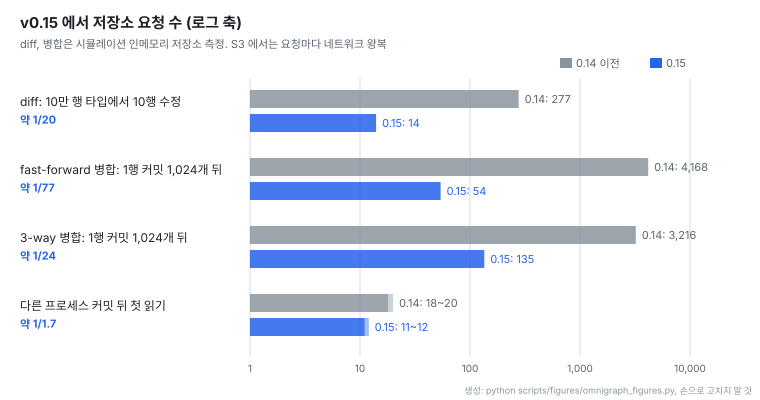
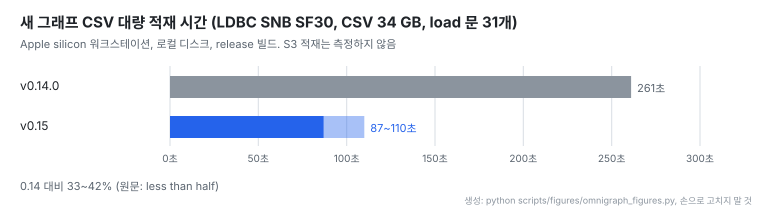

# Omnigraph: 에이전트가 브랜치로 쓰는 타입 그래프 DB

- **레포**: [ModernRelay/omnigraph](https://github.com/ModernRelay/omnigraph) (설명: "Object-storage native graph database with branching and typed ontology"), [웹사이트](https://omnigraph.dev), [예제 그래프](https://github.com/ModernRelay/omnigraph-cookbooks), [Studio](https://github.com/ModernRelay/omnigraph-studio)
- **제작**: ModernRelay (기여자 20명, 익명 포함, 2026-11-18 기준)
- **코드**: 저장소 생성 2026-04-10, Rust, MIT, 별 2,996개, 포크 334개 (2026-11-18 GitHub API 기준)
- **읽은 판**: 릴리즈 [`v0.15.0`](https://github.com/ModernRelay/omnigraph/releases/tag/v0.15.0) (2026-11-09), main 커밋 `d20eba7` (2026-11-18)
- **읽은 날짜**: 2026-10-16 (v0.13.0, 커밋 `32aa366`), 2026-11-18 갱신 (v0.15.0. 그 사이 커밋 237개, v0.14.0 2026-10-22 포함)
- **태그**: #GraphDB #Ontology #GraphRAG #HybridSearch #Branching #Lance #MCP #AgentMemory

!!! note "핵심 요약"
    여러 에이전트가 **타입이 정해진 하나의 도메인 모델(온톨로지)을 공유하며** 읽고 쓰는 그래프 DB다. 그래프 탐색, 벡터 검색, 전문 검색(BM25), RRF 융합을 질의 하나에서 하고, 에이전트는 main에 바로 쓰지 않고 Git처럼 브랜치에 쓴 뒤 병합한다. 데이터는 Lance 열 지향 포맷으로 로컬 디스크나 S3 호환 저장소에 둔다. v0.14에서 CLI가 `--target`, `--config` 체계로 바뀌고 "게시 전 커밋(`as commit`)"과 브랜치 검토 명령이 생겼다. v0.15에서는 새 그래프 CSV 적재가 261초에서 87~110초로 줄고, diff와 병합이 바뀐 행만 읽어 1,024커밋 뒤 fast-forward 병합의 저장소 요청이 4,168에서 54로 줄었다(시뮬레이션 저장소 측정). MCP는 플래그 없이 Cedar 정책 하나로 에이전트가 쓸 수 있는 작업을 정한다. 아직 0.x이고 판마다 업그레이드 조치가 있다.

## 1. 개요

README는 이 DB가 겨냥하는 부하를 이렇게 적는다.

> "Omnigraph is engineered for the new workload introduced by long-horizon agents: multiple agents sharing a typed world model to continuously retrieve and update context and coordinate work."

| 기능 | 내용 |
|---|---|
| 타입 온톨로지 | `.pg` 스키마로 노드, 엣지 타입, 키, 제약을 선언하고 쓰기마다 엔진이 강제 |
| 통합 검색 | 그래프 탐색 + 벡터 근사 최근접(ANN) + 전문 검색 + RRF를 한 질의 안에서 실행 |
| 브랜치 | 에이전트, 작업마다 브랜치, 3-way 병합, 그래프 전체 시점 조회(time travel) |
| 설정을 코드로 | `cluster.yaml`에 그래프, 스키마, 저장 질의, 임베딩 공급자, 정책을 선언. `cluster plan`으로 미리 보고 `cluster apply`로 반영 (Terraform 방식) |
| 권한을 코드로 | Cedar 정책을 서버에서 모든 쓰기마다 검사. 그래프별, 브랜치별, 서버 전체 범위 |
| 저장소 | 로컬, S3 호환(RustFS, MinIO, AWS S3, R2), Azure(미리보기). 열린 포맷 Lance, Blob 값 포함 |
| 클라이언트 | CLI, HTTP(OpenAPI), TypeScript SDK, 내장 MCP, 데스크톱 앱 Studio. Python SDK는 없다 |

README가 내세우는 용도는 회사 전체 지식을 모은 그래프(company brain), 에이전트 메모리, 의사결정 이력 그래프(context graph), 이슈와 의존성 그래프(dev graph), 실험 데이터 계층이다. 관리형 Omnigraph Cloud는 비공개 미리보기 단계다.

## 2. 스키마 언어 (`.pg`)

```pg
node Person {
  email: String @key
  display_name: String
  age: I32?
  @range(age, 0..150)
}

node Company {
  slug: String @key
  name: String
}

edge WorksAt: Person -> Company @card(0..) {
  role: String?
  @unique(@src, @dst)
}
```

| 제약 | 의미 |
|---|---|
| `@key` | 이 속성 조합으로 id를 만든다. 같은 키로 넣으면 같은 노드가 된다 |
| `@unique` | 같은 값 조합 금지 (엣지는 `@src`, `@dst` 포함 가능). v0.15부터 리스트, 벡터 속성에는 걸 수 없다 |
| `@range`<br>`@check` | 숫자 범위, 문자열 정규식 |
| `@card(min..max)` | 엣지 개수 제한. v0.15부터 최소값을 **모든 쓰기에서** 검사 |
| `@index` | 색인 선언. v0.14부터 String 속성에 전문 검색 함수를 쓰려면 필요 |

- 타입: 문자열, 정수, 실수, 날짜, `Vector(N)`, `Blob`, `enum(...)`, 리스트, null 허용(`T?`)
- `interface`로 공통 속성을 재사용하고, `@rename_from`으로 이름을 바꿔도 id와 이력을 유지한다
- 단일 속성 선언에는 색인이 자동으로 붙는다: 정렬 가능한 값은 스칼라 색인, 자유 텍스트는 전문 색인, 벡터는 벡터 색인. 복합 선언과 엣지 속성 선언은 받기만 하고 색인을 만들지 않는다 ([스키마 문서](https://github.com/ModernRelay/omnigraph/blob/d20eba74b7218ef235bc8effcdd70aa640bc9b4e/docs/user/schema/index.md))

v0.15에서 `@card` 최소값 검사가 엄격해진 점이 실무에 크다. `WorksAt: Person -> Company @card(1..)`이면 이제 `Person`을 넣거나 고치는 모든 쓰기가 검사를 받는다. 새 노드는 엣지와 **한 mutation 또는 한 JSONL 적재 안에서** 함께 들어와야 하고, 노드 CSV에는 엣지가 없으므로 `load csv`로는 그런 노드를 넣을 수 없다. 0.14는 고용주 없는 사람을 넣게 허용해서 그래프가 자기 스키마를 어긴 노드를 가질 수 있었다고 원문이 적는다.

반대로 스키마 변경은 유연해졌다. `schema apply`가 null 허용 속성을 필수로 바꾸고, 이미 행이 있는 타입에 `@unique`를 추가할 수 있다. 저장된 행을 먼저 검사하고 null이나 중복이 있으면 아무것도 바꾸지 않는다. 이전에는 내보내고 다시 만드는 방법뿐이라 커밋 이력을 잃었다.

## 3. 질의 언어 (`.gq`)

이름과 타입이 있는 질의를 파일에 저장하고 이름으로 부른다.

```gq
query engineers($title: String) @description("People with a title") {
  match {
    $p: Person { title: $title }
    $p worksAt $c
  }
  return { $p.name, $c.name as company }
  order { company asc, $p.name asc }
  limit 50
}
```

- 탐색: `$a knows{1,3} $b`(1~3홉), `$a (knows | likes) $b`(엣지 종류 선택), `$a <related> $b`(방향 무시), `not { }`, `exists { }`, `count { } > 2`, `sum(...) { }`
- 여러 홉 탐색은 상한을 반드시 적어야 하고, 홉 수는 시작 노드에서의 최단 거리다
- v0.14에서 `return distinct`, `count(distinct ...)`, 집계값에 대한 불리언 비교가 들어왔다
- `@description`, `@instruction`을 달면 MCP 같은 클라이언트가 저장 질의를 **도구로 노출**할 때 그대로 쓴다
- 브랜치 조작, 실행 계획 확인(`explain`), CSV 적재(`load csv`)도 같은 언어의 문장이다
- v0.15의 `--format toon`은 행들이 같은 필드를 가질 때 필드 이름을 한 번만 적어, 같은 결과가 LLM 프롬프트에서 차지하는 자리를 줄인다

### 한 질의 안의 하이브리드 검색

```gq
query hybrid($vector: Vector(4), $text: String) {
  match { $d: Document }
  return { $d.slug, $d.title }
  order { rrf(nearest($d.embedding, $vector), bm25($d.body, $text)) }
  limit 10
}
```

| 함수 | 의미 |
|---|---|
| `nearest` | 벡터 L2 거리 순위. 텍스트를 넣으면 설정한 임베딩 공급자가 벡터로 바꾼다 |
| `search`<br>`fuzzy`<br>`match_text` | 전문 검색 (오타 허용 포함) |
| `bm25` | BM25 점수 |
| `rrf(a, b, k)` | 두 순위를 RRF로 융합. 기본 k = 60 |

- `match` 안의 그래프, 속성 조건을 **순위 매기기 전에** 적용한다. `limit 10`은 조건을 만족한 것 중 상위 10개다
- 탐색 조건이 후보를 많이 줄이면 그 후보만 먼저 골라 검색 범위를 좁힌다. 기본 게이트는 전체 대비 10% 미만, 10만 개 이하다 (`OMNIGRAPH_RRF_GATE_RATIO`, `OMNIGRAPH_RRF_GATE_MAX_IDS`)
- 벡터 검색은 IVF 파티션을 색인 조각마다 기본 20개까지만 읽고(`ann_nprobes`), 결과가 모자라면 4배 → 상한 없음 → 색인 끝까지 넓힌다. 그래프 조건이 후보를 떨어뜨려 `limit`이 안 차면 후보를 4배, 16배로 요청한 뒤 타입 전체를 정확하게 한 번 정렬한다 ([검색 문서](https://github.com/ModernRelay/omnigraph/blob/d20eba74b7218ef235bc8effcdd70aa640bc9b4e/docs/user/search/index.md))
- Omnigraph가 만든 IVF_FLAT L2 색인만 쓴다. 다른 도구가 만든 HNSW나 양자화 색인은 쓰지 않고 전체를 정렬한다
- v0.15부터 순위 읽기는 `ranking` 객체로 검색 종류, 점수 방향, 점수 열, **전수 탐색 여부(`exhaustive`)**를 돌려준다. `exhaustive: false`면 더 가까운 행이 있을 수 있다는 뜻이다
- 임베딩 공급자: OpenAI 호환(기본, OpenRouter의 `openai/text-embedding-3-large`), OpenAI, Gemini(`gemini-embedding-2`)

## 4. 브랜치와 병합

```bash
omnigraph branch create --from main agent/ingest-42
omnigraph branch diff agent/ingest-42 --target production
omnigraph branch merge agent/ingest-42 --into main --dry-run --target production
omnigraph branch merge agent/ingest-42 --into main
```

- 공통 조상(merge base)을 기준으로 양쪽 변경을 비교하는 3-way 병합이다. v0.14에서 `branch diff`, `branch merge-base`, `--dry-run`, 보존된 커밋에서 시작하는 `branch create --from-commit`이 들어왔다
- 충돌은 구조화된 목록으로 돌려주고(HTTP 409) **아무것도 반영하지 않는다**

| 충돌 종류 | 의미 |
|---|---|
| `divergent_insert` | 양쪽이 같은 id를 다른 값으로 넣음 |
| `divergent_update` | 같은 엔티티를 양쪽이 다르게 수정 |
| `delete_vs_update` | 한쪽은 삭제, 한쪽은 수정 |
| `orphan_edge` | 끝점이 삭제된 엣지가 남음 |
| `unique_violation`<br>`cardinality_violation`<br>`value_constraint_violation` | 병합 결과가 스키마 제약 위반 |

- 엣지를 양쪽에서 같이 넣었을 때의 결과가 선언에 따라 다르다. 선언이 없으면 둘 다 남고, `@unique(@src, @dst)`면 충돌, `@key(@src, @dst)`면 하나로 합쳐진다. **같은 사실을 여러 에이전트가 넣는 경우를 스키마로 정한다**

### 게시 전 커밋 (v0.14)

mutation이나 merge 끝에 `as commit`을 붙이면 대상 브랜치를 움직이지 않은 결과가 생긴다. 커밋 id로 들여다본 뒤 `commit publish`로 브랜치를 옮기거나 `commit drop`으로 버린다. `as unattached branch`는 이어서 쓸 수는 있지만 게시할 수 없는 스냅숏을 만든다. 둘 다 대상 브랜치가 그대로일 때만 유효하고, 그사이 브랜치가 움직이면 만료된다. 원문은 이 점을 분명히 적는다.

> "it is not a durable approval queue"

에이전트가 제안한 쓰기를 사람이 보고 승인하는 흐름을 짤 때, 승인 대기열을 이 기능에 맡길 수는 없고 같은 브랜치 머리에서 검토와 게시를 끝내야 한다는 뜻이다.

### 바뀐 것만 읽는 diff와 병합 (v0.15)

이전에는 diff가 바뀐 타입의 모든 행을, 병합이 테이블의 모든 데이터 파일을 읽었다. v0.15는 Lance가 행마다 유지하는 안정 ID와 그 행을 마지막으로 쓴 버전을 이용해 버전이 다른 행만 읽는다.



- 10만 행 타입에서 10행을 고친 diff가 277요청 6.9 MB에서 14요청 27 KB로 줄었고, 이 값은 4,000행 타입과 같다. 비용이 테이블 크기가 아니라 바뀐 양을 따른다
- diff와 병합 수치는 Omnigraph의 **시뮬레이션 인메모리 저장소**에서 센 요청 수다. S3에서는 요청마다 네트워크 왕복이 붙으므로 실제 시간 이득은 저장소에 따라 다르다(시간은 원문에 없음)
- 양쪽 브랜치가 모두 움직인 diff, merge commit을 가로지르는 diff, Blob 속성이 있는 테이블의 병합은 여전히 전부 비교한다

## 5. 쓰기와 동시성

### CSV 대량 적재 (v0.14, v0.15)

v0.14에서 GQ `load csv`로 스키마 타입이 정해진 노드, 엣지 원본을 적재하고, 덮어쓰기 적재는 병렬로 파싱하면서도 그래프 게시는 한 번만 한다. v0.15는 이를 파이프라인으로 바꿨다. 파싱 스레드마다 원본을 8 MiB 조각으로 직접 읽고, 행이 들어오는 대로 키와 엣지 끝점을 검사하며, 다음 행을 파싱하는 동안 데이터 파일을 쓴다. 새 그래프에서는 실패할 수 없는 검사를 건너뛰고, 거부된 적재는 아무것도 남기지 않는다.



- 측정 조건은 LDBC SNB SF30(CSV 34 GB, load 문 31개)을 새 그래프에 넣는 경우, Apple silicon 워크스테이션 로컬 디스크, release 빌드다. S3에서의 적재는 원문이 측정하지 않았다
- `append`, `merge` 적재는 여전히 원본 전체를 읽은 뒤 파싱하므로 이 이득은 초기 적재와 내보낸 그래프 재구축에 해당한다
- v0.14 개요는 원문에서 "This release does not promise a fixed time for an arbitrary row count"라고 적는다. 처리량은 입력, 하드웨어, 저장소에 따라 다르다

### 읽기가 쓰기를 기다리지 않음 (v0.15)

이전에는 커밋이 저장소 왕복 동안 잠금을 쥐고 있어서 같은 프로세스의 읽기가 기다렸다. S3에서는 그 왕복이 네트워크 요청이다. v0.15는 그래프의 현재 상태를 원자 포인터 뒤의 불변 값으로 두고 쓰기가 포인터를 한 번에 바꾼다. 그래서 같은 프로세스 안에서 읽기가 쓰기를 기다리지 않는다. 노드 타입과 엣지처럼 여러 테이블을 건드리는 쓰기는 테이블을 병렬로 커밋해 커밋 왕복이 테이블마다 2회에서 전체 2회가 됐다. 다른 프로세스가 커밋한 뒤 첫 읽기의 저장소 요청은 18~20회에서 11~12회로 줄었다.

### S3 클러스터의 단일 쓰기 주체 (v0.15)

S3 클러스터는 한 번에 한 서버만 쓰게 하고, 그 서버는 10초마다 임대를 갱신한다(기본 임대 30초). 0.15 이전에는 임대를 넘겨 멈췄던 서버가 깨어나 후임과 나란히 쓰거나, 재시작하는 서버가 느린 저장소 응답을 침묵으로 오인해 살아 있는 소유자의 잠금을 가져갈 수 있었다. 이제 모든 저장소 요청 전에 임대 기한을 확인하고, 소유자가 갱신을 멈췄다는 것이 저장소에 보일 때만 잠금이 넘어가며, 잠금을 잃은 서버는 쓰기를 멈추고 종료 코드 2로 끝나 오케스트레이터가 다시 띄우게 한다.

### 실패의 효과를 알려 주는 오류 (v0.14)

API 오류는 고정된 `code`와, 효과가 있었는지와 다음 행동을 알려 주는 `disposition`을 함께 준다. MCP 도구 실패도 같은 본문을 싣고, CLI 쓰기 명령은 같은 분류로 종료 코드를 고른다. 원문 규칙은 "An uncertain write must be reconciled, not blindly submitted again"이다. 에이전트가 쓰기 실패를 만났을 때 다시 보낼지, 확인부터 할지를 오류가 정해 준다.

## 6. 구조

[`docs/dev/architecture.md`](https://github.com/ModernRelay/omnigraph/blob/d20eba74b7218ef235bc8effcdd70aa640bc9b4e/docs/dev/architecture.md) 기준이다.

```
CLI, omnigraph-server (HTTP, MCP), 내장 SDK, Studio
        │  모든 쓰기가 같은 Cedar 정책 검사를 지남
engine ── compiler (.pg/.gq 파싱, 타입 검사) ── planner (실행 계획)
   │
catalog, core, storage
   │
Lance 데이터셋 (노드, 엣지 타입마다 따로) ── 로컬 / S3 / Azure
```

- 노드, 엣지 타입마다 Lance 데이터셋이 따로 있고, Omnigraph가 그 위에 **그래프 전체 단위의 스냅숏**을 만든다. 쓰기가 성공하면 영향을 받은 타입이 한꺼번에 보이고, 읽는 쪽은 절반만 반영된 커밋을 보지 않는다
- 버전, 브랜치, 색인은 Lance 기능을 쓰고, Omnigraph는 스키마, 그래프 의미, 정책, 배포 상태를 더한다
- 설계 결정을 RFC로 남긴다. `docs/rfcs/`에 89개가 있다(템플릿 제외. v0.13 시점 78개)
- v0.15에서 `index build --branch`가 생겨 브랜치의 테이블에도 색인을 만든다. 이전에는 main에서 `optimize`를 돌려야만 만들어져 브랜치 읽기는 병합 전까지 전체를 훑었다

## 7. Studio

README가 소개하는 데스크톱 앱 Studio는 각 타입을 표로 보고, 관계를 캔버스에서 따라가고, 컴파일러 오류를 보면서 질의를 쓰고, 병합 전에 브랜치가 바꾸는 내용을 검토한다. v0.15에서 `omnigraph studio --target NAME`으로 설정된 서버를 바로 연다. Zed가 쓰는 GPUI 프레임워크로 만든 Rust 앱이고 macOS, Windows, Linux를 지원한다.


출처: [Omnigraph README](https://github.com/ModernRelay/omnigraph/blob/d20eba74b7218ef235bc8effcdd70aa640bc9b4e/README.md#studio)

- 4절의 `branch diff`를 사람이 보는 화면이다. 에이전트가 브랜치에 쓰고 사람이 검토해 병합하는 흐름에서 검토 쪽 도구가 생긴 셈이다
- 그림은 웹사이트의 포스터 이미지라 커밋으로 고정되지 않는다

## 8. 에이전트 연동

- **MCP 서버**: 서버 내장 `/mcp`는 HTTP API와 같은 핸들러, 같은 정책을 쓴다. v0.14부터 `omnigraph mcp --target production --graph knowledge`로 stdio 클라이언트를 붙이면 클라이언트는 서버 토큰을 받지 않는다
- **v0.15: 정책 하나로 결정**: MCP 에이전트가 diff, merge base, 게시 전 커밋 게시와 폐기, 저장 mutation 실행까지 모든 그래프 작업을 쓸 수 있다. Blob 내용과 내보내기 같은 바이트 스트림만 HTTP, CLI 전용이다. 쓰기 도구를 숨기던 `--mcp-allow-writes`, `--mcp-allow-adhoc` 플래그는 없어졌고 붙이면 서버가 뜨지 않는다. 정책이 없는 그래프의 정적 토큰은 읽기만 된다. `read` 도구는 `query`로 바뀌었다
- 제한: 요청 64 KiB, 결과 1 MiB, 읽기 대기 30초, 쓰기 대기 30초(대기가 끝나도 쓰기는 계속), 동시 실행 16개 ([MCP 문서](https://github.com/ModernRelay/omnigraph/blob/d20eba74b7218ef235bc8effcdd70aa640bc9b4e/docs/user/operations/mcp.md))
- **에이전트 스킬 내장**: `omnigraph skill export ~/.claude/skills/omnigraph --force`로 설치된 CLI 버전과 맞는 작업 지침을 내보낸다. v0.15부터 `omnigraph`, `omnigraph help`가 처음 쓰는 에이전트에게 스키마나 질의를 쓰기 전에 스킬부터 읽으라고 안내한다
- **에이전트에게 설치를 맡기는 길**: README는 온보딩 문서 URL을 에이전트에 붙여 넣으면 CLI 설치, 용도 질문, 작은 로컬 그래프 생성과 질의까지 에이전트가 진행한다고 적는다
- 실행 계획(`explain`)과 진단 문서가 따로 있어, 에이전트가 질의가 왜 느린지, 왜 비었는지 확인할 수 있다

!!! warning "v0.15로 올리기 전에 MCP 권한 확인"
    v0.14에서는 `--mcp-allow-writes` 없이 띄운 서버의 MCP 에이전트가 쓰기 도구를 보지 못했다. v0.15에서는 플래그를 한 번도 설정하지 않았어도 에이전트가 자기 자격 증명의 정책이 허용하는 쓰기를 할 수 있다. 원문 권고는 에이전트를 읽기 전용으로 두려면 정책을 좁히고, 사람이나 다른 서비스와 자격 증명을 공유하고 있으면 먼저 에이전트 전용 자격 증명을 주라는 것이다.

## 9. 판마다 필요한 업그레이드 조치

| 판 | 그래프 재구축 | 주요 조치 |
|---|---|---|
| v0.14.0 (2026-10-22) | 불필요 | 운영 설정을 이름 붙은 target으로 다시 작성(자동 변환 없음)<br>CLI, 서버, SDK를 함께 올림 (HTTP 계약 `0.14`)<br>String 전문 검색에 `@index` 추가<br>이전 `omnigraph embed` 오프라인 임베딩 재생성<br>브랜치 이름 앞뒤 공백 거부 |
| v0.15.0 (2026-11-09) | 불필요 | MCP 에이전트 정책 점검, 플래그 제거<br>`@card` 최소값을 어기는 노드에 엣지 보충 (`not { $p worksAt $c }`로 찾기)<br>리스트, 벡터 속성의 `@unique` 제거<br>Rust 저장 실행 계획 재생성 (봉투 버전 11) |

- 두 판 모두 저장 포맷은 그대로라 기존 그래프를 다시 만들 필요는 없다. 대신 같은 루트에 판이 다른 프로세스를 섞어 띄우지 말라고 원문이 적는다
- v0.15는 null 허용 속성을 같은 필터에서 두 번 `=`, `!=`, `in`으로 검사하면 null 행까지 일치하던 버그를 고쳤다. 그런 필터로 `update`, `delete`를 돌렸다면 해당 속성이 null인 행을 확인하라고 원문이 적는다

## 10. 한계와 주의

- **아직 0.x다.** v0.12.0(2026-10-05)부터 v0.15.0(2026-11-09)까지 약 5주에 판이 네 번 나왔고, 0.14와 0.15 모두 운영 설정, 클라이언트 계약, 스키마 검사 규칙이 바뀌었다. HTTP 계약 판이 서버와 맞아야 한다.
- **Python SDK가 없다.** Python 쪽은 HTTP(OpenAPI)로 붙어야 한다.
- **임베딩 공급자가 좁다.** OpenAI 호환, OpenAI, Gemini만 있다. 로컬 모델은 OpenAI 호환 엔드포인트로 띄워야 한다.
- **`cleanup`은 이력을 지운다.** 오래된 저장 버전을 영구 삭제해 이전 커밋을 못 읽게 될 수 있다. `optimize`와 다르다.
- **Azure는 미리보기다.** 쓰기 프로세스가 전용 승인 래퍼를 거쳐야 한다.
- **복합 속성, 엣지 속성 색인은 아직 만들어지지 않는다.** 선언은 받지만 성능에 반영되지 않는다.
- **v0.15 성능 수치는 제작사 측정이다.** 적재 시간은 로컬 디스크 한 환경, diff와 병합은 시뮬레이션 저장소의 요청 수다. S3 위 실제 시간은 원문에 없다(미검증).

## 11. 가져올 수 있는 부분

| 대상 | 가져올 수 있는 부분 |
|---|---|
| 지식그래프 스키마 | `@key`로 id를 속성에서 만들고, `@card`, `@unique`, `@range`로 제약을 **쓰기 시점에** 강제하는 방식. v0.15처럼 최소 개수 제약을 쓰기 경로와 무관하게 똑같이 검사해야 스키마가 실제 데이터를 설명한다 |
| GraphRAG 검색 | 그래프 조건으로 후보를 먼저 거르고, 벡터, BM25 순위를 RRF로 합치는 흐름을 **질의 하나**로 표현. 결과에 `exhaustive` 여부를 같이 돌려 근사 검색이 놓쳤을 수 있음을 호출자에게 알리는 방식 |
| 에이전트 쓰기 안전장치 | 에이전트가 main 대신 브랜치에 쓰고, 검토 후 병합하는 흐름. 충돌을 구조화된 종류로 돌려주고 하나라도 있으면 아무것도 반영하지 않는 규칙. 게시 전 커밋으로 결과를 먼저 보여 주는 단계 |
| 실패 처리 | 오류에 "효과가 있었는가, 다음에 무엇을 할 것인가"를 담아, 불확실한 쓰기를 재전송하지 않고 확인하게 하는 규칙 |
| 같은 사실의 중복 적재 | 엣지 identity 선언(`없음` / `@unique` / `@key`)으로 여러 에이전트가 같은 관계를 넣을 때의 결과를 미리 정하는 방식 |
| MCP 도구 설계 | 저장 질의에 `@description`, `@instruction`을 달아 그대로 도구로 노출. 권한은 MCP 계층이 아니라 엔진 한 곳의 정책에서만 결정 |
| 이력 있는 저장소의 비용 | 행마다 마지막으로 쓴 버전을 두고 diff와 병합이 그 버전이 다른 행만 읽게 하면, 비용이 테이블 크기와 이력 길이가 아니라 변경량을 따른다 |
| 에이전트 지침 배포 | CLI가 자기 버전에 맞는 스킬을 내보내는 방식(`skill export`). 판이 자주 바뀌는 도구일수록 지침과 도구의 판이 어긋나지 않는 것이 중요하다 |
