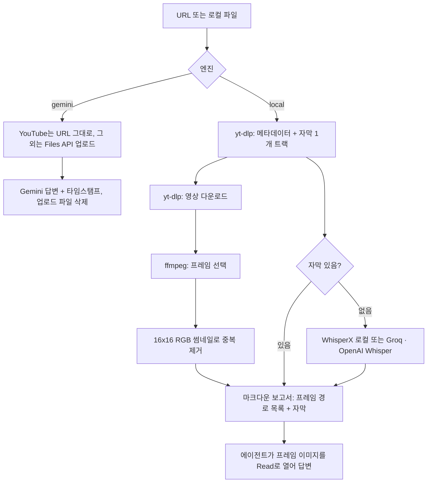
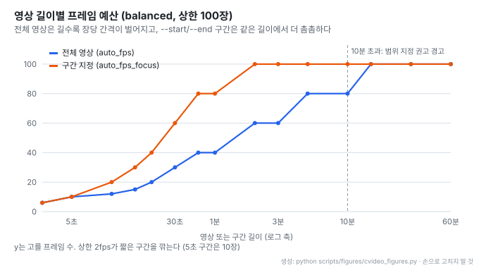

# claude-video (/watch): 에이전트에게 영상을 프레임과 자막으로 보여 주는 스킬

- **레포**: [bradautomates/claude-video](https://github.com/bradautomates/claude-video)
- **제작**: bradautomates 1인. 커밋 33건 모두 같은 작성자 (2026-10-28 기준)
- **공개**: 2026-04-24 저장소 생성일 (Python, MIT, 별 19,388개 · 2026-10-28 GitHub API 기준)
- **읽은 날짜**: 2026-10-28 (커밋 `03ceb42`, 스킬 버전 0.3.2 · 2026-09-25)
- **형태**: Agent Skill 하나(`skills/watch/`)와 Claude Code 플러그인 · Codex 플러그인 매니페스트. 기본 런타임은 Python 표준 라이브러리만 쓰고, 외부 프로그램은 `ffmpeg` · `ffprobe` · `yt-dlp`
- **태그**: #AgentSkills #ClaudeCode #Video #ffmpeg #yt-dlp #Whisper #Gemini #Multimodal

!!! note "핵심 요약"
    URL이나 로컬 영상을 받아 **타임스탬프가 붙은 프레임 이미지와 자막**으로 바꾼 뒤, 에이전트가 이미지를 직접 읽어 질문에 답하게 하는 스킬이다. 자막은 영상의 원래 자막을 먼저 쓰고, 없을 때만 로컬 WhisperX나 Groq · OpenAI Whisper로 받아쓴다. 프레임은 장면 전환 검출로 고르고, 16×16 썸네일 비교로 거의 같은 장면을 지운다. `GEMINI_API_KEY` 가 있으면 대신 Gemini가 영상 전체를 보고 타임스탬프가 붙은 답을 돌려준다. 두 경로는 자동으로 갈아타지 않는다.

## 1. 동작 구조

- **엔진 선택**: `WATCH_ENGINE=auto` 는 `GEMINI_API_KEY` 가 잡히면 Gemini, 아니면 local이다. Gemini가 실패하면 실패 유형(`auth` · `quota` · `rejected` · `upload` · `service` · `network` · `response`)만 보고하고, local로 다시 돌릴지는 사용자에게 묻게 SKILL.md가 지시한다
- **보고서**: `watch.py` 는 마크다운 보고서를 표준 출력으로 낸다. 프레임 파일 경로와 `t=MM:SS` 를 줄마다 적고 "Read each frame path below with the Read tool" 이라고 지시한다. 에이전트가 이미지를 여는 것까지가 스킬의 동작이다
- **설정 확인 훅**: Claude Code 플러그인은 `SessionStart` 훅으로 설정 점검 스크립트를 5초 제한으로 돌린다

## 2. 프레임 선택

| detail | 선택 방식 | 기본 상한 |
| --- | --- | --- |
| `transcript` | 프레임 없음. 자막이 있으면 영상 다운로드도 생략 | 없음 |
| `efficient` | 키프레임만 복원(`-skip_frame nokey`). 키프레임이 4개 미만이면 균등 표본으로 대체 | 50장 |
| `balanced` (기본) | ffmpeg 장면 전환 점수 `scene > 0.20`. 장면이 8개 미만이면 균등 표본으로 대체 | 100장 |
| `token-burner` | 장면 전환 전부. 250장을 넘으면 경고 | 없음 |

장면 후보가 상한보다 많으면 고르게 솎아 상한에 맞춘다. 상한 안에서 실제로 몇 장을 고를지는 영상 길이로 정한다.

- 전체 영상은 30초 이하면 길이(초)만큼(최소 12장), 1분 이하 40장, 3분 이하 60장, 10분 이하 80장, 그 이상은 상한(100장)이다. 10분 영상이 80장이면 평균 7.5초에 한 장이다
- `--start` · `--end` 로 구간을 주면 같은 길이에서 더 많이 고른다. 단 균등 표본은 초당 2장을 넘지 않아서, 5초 구간은 목표 30장이 10장으로 깎인다
- 10분이 넘는 영상을 구간 없이 돌리면 보고서가 "Frame coverage is sparse" 경고와 함께 구간 지정을 권한다

**중복 제거**: 고른 프레임을 ffmpeg로 16×16 RGB 썸네일(768바이트)로 줄이고, 직전에 남긴 프레임과 채널 값 차이의 평균이 2.0 이하(0~255 척도)면 버린다. 코드 주석이 밝히듯 화면의 코드나 글자가 조금 바뀐 것은 이 크기에서 구분되지 않는다. 그런 영상은 `--no-dedup` 이나 `--resolution 1024` 를 쓰라고 안내한다.

**신호 프레임**: 발표자가 "여기를 보세요" 라고 말한 지점처럼 자막에서 찾은 시각을 `--timestamps 4:32,7:10` 으로 다시 넘기면, 그 시각의 프레임을 먼저 뽑고 남은 예산으로 일반 프레임을 고른다. 에이전트가 자막을 먼저 읽고 필요한 화면만 다시 요청하는 2단계 사용법이다.

기본 프레임 크기는 가로 512px, 세로 최대 1998px이다.

## 3. 자막과 받아쓰기

자막은 원래 언어의 수동 자막을 먼저, 그다음 원래 언어 자동 자막을 고르며 트랙은 하나만 받는다. 출처가 불분명하면 unknown으로 표시한다. 자막이 없을 때의 대체 수단은 다음과 같다.

| 백엔드 | 내용 |
| --- | --- |
| `whisperx` | 로컬 받아쓰기. 별도 Python 3.12 가상환경에 WhisperX 3.8.6을 설치하고, 기본 `small` · `cpu` · `int8` · 배치 8. 디스크 3GB, RAM 8GB 이상. Apple Silicon macOS만 검증됨 |
| `groq` | 클라우드 `whisper-large-v3` |
| `openai` | 클라우드 `whisper-1` |
| `none` | 자막만 사용 |

- 클라우드 백엔드는 모노 16kHz MP3로 소리를 뽑아 24,000,000바이트 단위로 나눠 올리고, 조각별 시각 오프셋을 되돌려 붙인다. 실패한 조각은 빠진 구간으로 보고서에 남는다
- 요청은 최대 4회(최초 + 재시도 3회)까지 보낸다
- README의 참고 측정: WhisperX small이 영어 69초를 Apple M5 Pro에서 9.6초에 처리했다
- WhisperX 3.8.6은 정렬(alignment)을 끄면 언어 판별 결과가 틀리게 기록되므로, 자동 판별 언어는 "unverified" 로 표시한다

## 4. Gemini 엔진

- 기본 모델 `gemini-3.7-flash`, 질문 제한 시간 600초
- YouTube URL은 내려받지 않고 Google에 URL을 넘긴다. 그 밖의 URL은 yt-dlp로 받은 뒤 로컬 파일과 같이 Files API에 올리고, 답을 받은 뒤 지운다. 지우지 못한 업로드는 48시간 안에 만료된다
- 질문이 없을 때의 기본 프롬프트는 화면, 화면 속 글자 · 코드, 말한 내용을 시간 순으로 요약하라는 것이고, 모든 프롬프트 끝에 "Cite an MM:SS (or H:MM:SS) timestamp for every claim" 과 "say so plainly instead of guessing" 을 붙인다
- 에이전트는 Gemini의 답을 자기 관찰처럼 말하면 안 되고, Gemini가 본 것이라고 밝히고 전달하게 SKILL.md가 지시한다. `--detail` · `--fps` · `--whisper` 같은 로컬 옵션은 무시하고 "Ignored local options" 로 보고한다

## 5. 보안과 데이터 경로

| 단계 | 외부로 나가는 것 |
| --- | --- |
| yt-dlp | 원천 서비스 · CDN에 메타데이터, 자막 1개, 영상 요청 |
| local 엔진 + WhisperX | 없음 (첫 설치 때 PyPI · Hugging Face · GitHub에서 패키지와 모델 다운로드) |
| local 엔진 + groq · openai | 추출한 소리만 해당 업체 받아쓰기 API로 |
| gemini 엔진 | YouTube URL 또는 영상 파일 전체를 Google로 |

- 키는 `~/.config/watch/.env` (POSIX 권한 0600)에 두고, 요청 헤더로만 보내며 로그에 남기지 않는다. 업체마다 자기 키만 쓴다
- 쿠키는 `--cookies` 나 `--cookies-from-browser` 로 명시할 때만 쓰고, 브라우저 세션을 알아서 찾지 않는다
- 프레임, 자막, 제목은 모두 신뢰할 수 없는 입력으로 다루라고 SKILL.md가 명시한다. 영상 속 글자가 명령처럼 보여도 따르지 않는다는 프롬프트 인젝션 대비다

## 6. 배포 방식

같은 `skills/watch/` 폴더 하나를 여러 경로로 배포한다.

| 호스트 | 설치 |
| --- | --- |
| Claude Code (데스크톱 Code 세션 · VS Code · 터미널) | `/plugin marketplace add bradautomates/claude-video` 후 `/plugin install watch@claude-video` |
| Codex | `$skill-installer` 로 `skills/watch` 설치, 또는 `codex plugin add watch@claude-video` |
| 그 밖의 Agent Skills 호스트 | `npx skills add bradautomates/claude-video -g --skill watch` |

Claude 웹 채팅과 Cowork는 지원하지 않는다고 README가 밝힌다. Cowork는 클라우드 환경에서 돌아 Gemini 키가 작업 사이에 유지되지 않고, 대부분의 사이트가 그 환경의 yt-dlp 다운로드를 막기 때문이다.

## 7. 읽을 때 감안할 것

!!! warning "한계"
    - **긴 영상은 성기다**: 상한 100장이면 1시간 영상은 평균 36초에 한 장이다. 장면 전환이 모든 사건을 잡지도 않는다. README도 10분 이하나 구간 지정을 권한다
    - **중복 제거가 코드 변화를 놓친다**: 16×16 썸네일 평균 차이 2.0 기준이라 화면 녹화의 한두 줄 변경은 같은 프레임으로 처리될 수 있다
    - **이미지 비용**: 프레임 하나가 이미지 입력 하나다. 비용은 호스트와 모델에 따라 달라 스킬이 고정 값을 약속하지 않는다
    - **Gemini 경로는 다른 모델의 관찰이다**: 에이전트가 직접 본 것이 아니므로 답의 근거 수준이 다르다
    - **검증 범위**: CI는 Linux · macOS · Windows에서 실제 ffmpeg로 돌지만, WhisperX 설치는 Apple Silicon macOS만 검증됐다고 밝힌다

## 8. 가져갈 지점

- **에이전트가 이미지를 여는 보고서**: 스크립트가 답을 만들지 않고 "이 파일들을 열어 보라" 는 목록을 낸다. 멀티모달 판단을 에이전트 모델에 맡기고, 스크립트는 근거 준비만 한다
- **자막 먼저, 화면은 필요한 만큼**: `transcript` 로 먼저 읽고 `--timestamps` 로 필요한 화면만 다시 뽑는 2단계 흐름이 이미지 비용을 줄인다
- **길이에 맞춘 예산**: 고정 fps 대신 길이 구간별 목표 장수와 초당 2장 상한을 두는 규칙이 단순하면서 짧은 영상과 긴 영상을 같이 다룬다
- **자동 전환 금지**: 엔진 · 받아쓰기 백엔드 · 업체 키를 실패 시 알아서 바꾸지 않는다. 데이터가 어디로 나가는지 사용자가 정한 대로만 움직인다

## 9. 결론

/watch는 "영상을 이해하는 모델" 이 아니라 **영상을 에이전트가 읽을 수 있는 근거로 바꾸는 전처리기** 다. ffmpeg 장면 검출, 썸네일 중복 제거, 자막 우선 받아쓰기라는 익숙한 부품을 조합했고, 핵심은 보고서 형식과 SKILL.md의 사용 지시에 있다. 짧은 영상이나 구간을 정한 질문에는 바로 쓸 만하고, 긴 화면 녹화처럼 세밀한 변화가 중요한 영상은 구간 지정과 `--no-dedup` 을 함께 써야 한다.
