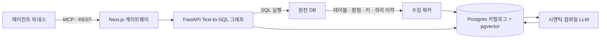
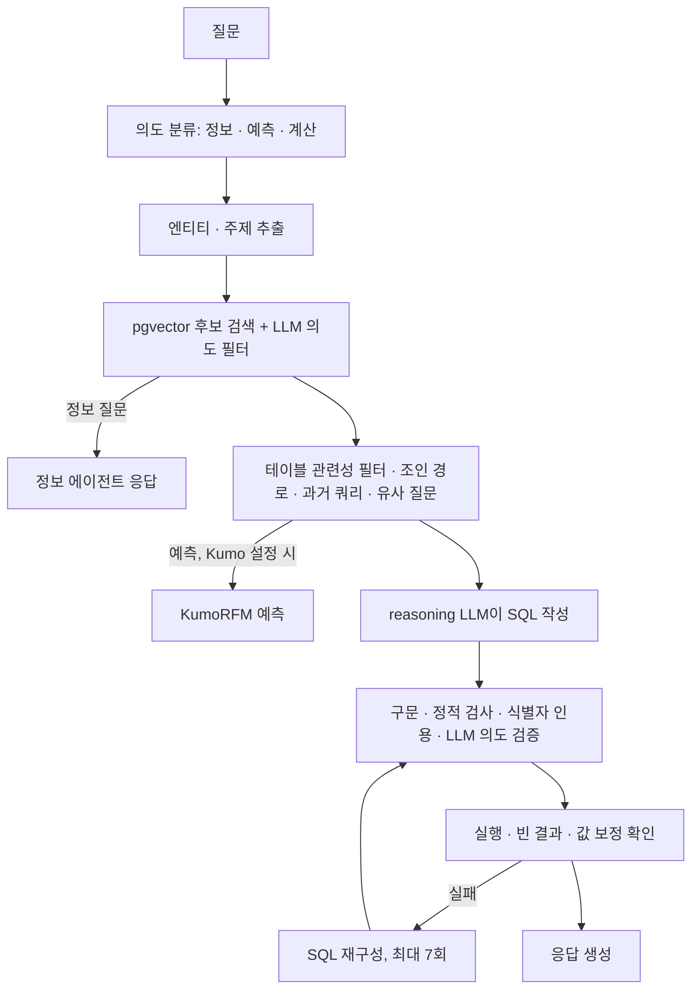
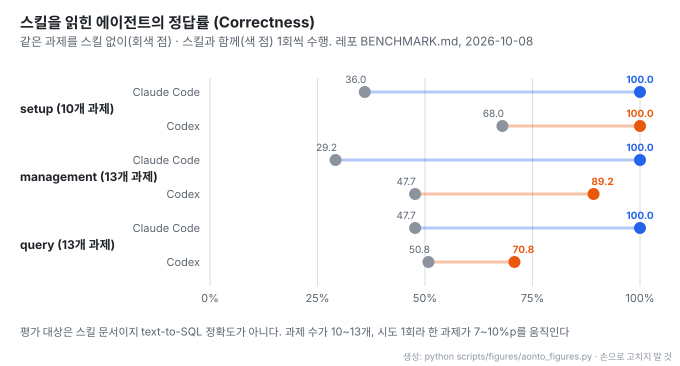

# NVIDIA Auto Ontology: DB 메타데이터로 만드는 에이전트용 시맨틱 레이어와 Text-to-SQL

- **레포**: [NVIDIA/auto-ontology](https://github.com/NVIDIA/auto-ontology) · 평가 도구 [NVIDIA/ontology-sql-eval](https://github.com/NVIDIA/ontology-sql-eval)
- **제작**: NVIDIA. GitHub 기여자 12명 (2026-10-28 GitHub API 기준). 외부 기여는 받지 않는다고 README에 밝혔다
- **공개**: 2026-04-27 저장소 생성일 (Python, Apache-2.0, 별 344개 · 2026-10-28 기준)
- **읽은 날짜**: 2026-10-28 (커밋 `eb8dd06`, 2026-10-25)
- **형태**: FastAPI 백엔드 + Next.js 프론트 + 수집 워커 + Postgres(pgvector) + 선택 Vault. Docker Compose 또는 Helm. 읽기 전용 MCP 서버와 에이전트 스킬 3종 포함
- **태그**: #Ontology #SemanticLayer #TextToSQL #KnowledgeGraph #MCP #pgvector #LangGraph #AgentSkills

!!! note "핵심 요약"
    연결한 DB의 테이블 · 컬럼 · 키 · 쿼리 이력에서 **시맨틱 레이어**(업무 용어 Term, 컬럼 속성, SQL 식으로 정의한 속성, 추론한 외래키)를 LLM으로 만들어 Postgres에 쌓는다. 에이전트는 MCP · CLI · REST로 이 레이어를 읽고, 내장 Text-to-SQL 그래프가 질문을 SQL로 바꿔 실행한다. README는 "deterministic query generation" 을 내세우지만 코드에서 SQL은 reasoning LLM이 쓰고, 결정적인 부분은 쓴 뒤의 구문 검사 · 정적 검사 · 자동 수정이다. 레포에 공개된 수치는 Text-to-SQL 정확도가 아니라 **스킬 문서 평가**(스킬을 읽힌 에이전트의 정답률)뿐이다.

## 1. 구성

| 구성 요소 | 기술 | 역할 | 기본 포트 |
| --- | --- | --- | --- |
| Frontend | Next.js 16, Better Auth, Prisma | 웹 UI, 인증, API 게이트웨이 | 3000 |
| Backend | FastAPI, LangChain | 채팅 · NL-to-SQL, 카탈로그, 데이터소스 API | 3001 |
| Ingestion worker | FastAPI | 테이블 데이터 수집과 임베딩 기록 | 3002 |
| Postgres + pgvector | | 앱 메타데이터, 카탈로그 · 온톨로지, 벡터 저장소 | 5432 |
| HashiCorp Vault | 선택 | 연결 자격 증명 보관 | |

- 커넥터: Postgres, Snowflake, Databricks, ClickHouse, Trino, Kyuubi, HeavyDB, MySQL, SQLite, DuckDB
- 모델은 역할마다 `<PREFIX>_ENDPOINT` · `_API_KEY` · `_MODEL` 세 변수로 지정한다. `REASONING`(SQL 작성), `NON_REASONING`(나머지 LLM 호출), `EMBED`, `RERANK`. 비운 칸은 `DEFAULT_MODELS_*` 로 채운다
- 기본 모델: `nvapi-` 키면 LLM `nvidia/nemotron-3-nano-30b-a3b`, 임베딩 `nvidia/nemotron-3-embed-1b`, 리랭크 `nvidia/llama-nemotron-rerank-vl-1b-v2`. `sk-` 키면 reasoning `bedrock-claude-opus-4-8`, non-reasoning `bedrock-claude-sonnet-5-5`
- UI에서 추가한 연결은 Vault를 켜지 않으면 **비밀번호를 포함해 평문으로 Postgres에 저장**된다고 README가 밝힌다

## 2. 수집: 카탈로그와 쿼리 이력

모든 커넥터가 같은 인터페이스로 테이블, 컬럼, 뷰, 기본키, 외래키, 쿼리 이력(`get_queries(hours=24)`)을 내놓는다. 쿼리 이력을 실제로 돌려주는 커넥터는 Postgres(`pg_stat_activity`), Snowflake(`QUERY_HISTORY`), ClickHouse(`system.query_log`), DuckDB(샘플 CSV)뿐이고 나머지는 빈 목록이다.

- **SQL 파싱**: sqlglot으로 방언을 차례로 시도해 파싱하고, 참조 테이블 · 컬럼, `JOIN … ON/USING` 의 등호 조인 컬럼 쌍, UNION 컬럼 쌍을 뽑아 `column__join`, `table__join`, `column__union` 엣지로 저장한다. 별칭은 풀어서 원래 테이블에 붙인다
- **중복 쿼리 제거**: 테이블 · 컬럼 · AST 크기 · 조인 수 · UNION 수 다섯 가지를 먼저 비교하고, 통과한 것만 구조 비교를 한다
- **PII 탐지**: 정규식 규칙을 먼저 적용하고 애매하면 LLM에 묻는다. 프롬프트는 "uncertainty must be treated as PII" 다. 점수 0.9 이상이면 `PII` 태그를 자동으로 붙인다
- **주기**: 수집과 시맨틱 컴파일 모두 24시간마다 다시 돈다

!!! warning "사용 빈도 점수가 항상 0"
    쿼리 이력의 월별 사용 횟수를 쓰는 쪽은 `count_{month}_{year}` 로 기록하고 읽는 쪽은 `count_monthly_YYYY_MM` 을 찾는다. 그래서 SQL 속성 후보의 사용 빈도 점수가 늘 `0.0` 이다. 코드 주석에 "Known bug, preserved on purpose" 라고 적혀 있다 (커밋 `eb8dd06` 기준).

## 3. 시맨틱 컴파일: 온톨로지 생성

시맨틱 레이어의 객체는 다음과 같다.

| 객체 | 뜻 |
| --- | --- |
| Term | 업무 용어 (이름, 표시 이름, 동의어, 연결 컬럼) |
| ColumnAttribute | 컬럼 하나에 붙은 의미 |
| SqlAttribute | 이름 + SQL 식. 지표 역할을 한다 (원천은 `manual` · `sql` · `table` · `bridgeTable`) |
| Semantic FK | 선언되지 않은 외래키를 추론한 것. `use_in_join_paths` 로 조인 경로 사용 여부를 정한다 |
| CustomAnalysis | 사람이 이름을 붙여 저장한 SQL |
| PqlAnalysis | 검증된 질문과 KumoRFM 예측 질의(PQL) 쌍 |

관계 종류는 HAS_ATTRIBUTE, PART_OF, PROPERTY_OF, IS_A, ROLE, REPRESENTS, SEMANTIC_FK가 있다. 태그 · 규칙 · 존은 따로 두는 거버넌스 객체이며, 규칙은 저장한 검색과 그 결과에 붙일 태그 묶음이다.

컴파일은 Term이 아직 없는 테이블마다 다음 순서로 돈다.

1. **프로파일링**: 최대 1,000행 표본, 상위 값 5개, 서로 다른 값이 25개 이하인 텍스트 컬럼은 `DISTINCT` 로 전수 확인. 날짜 형식과 유일성도 추정한다
2. **외래키 · 연결 테이블 판정**: 테이블마다 LLM이 외래키 후보와 연결 테이블(외래키로만 된 테이블) 여부를 낸다
3. **컬럼 설명**: 외래키 컬럼은 규칙으로 빼고, 나머지는 15개씩 묶어 LLM이 한 문장 설명을 쓴다
4. **Term 추출**: LLM이 Term 이름 · 동의어 · 연결 컬럼을 낸다. 이름 충돌은 고정된 테이블 순서로 커밋해 결정적으로 푼다
5. **Semantic FK 해석**: 선언된 외래키가 있으면 그대로 쓴다. 없으면 컬럼을 임베딩해 ColumnAttribute 상위 5개를 찾고 LLM이 하나를 고른다("If unsure, return null"). LLM이 고르지 않으면 실제 DB에서 표본 값이 맞는지 확인한다
6. **SqlAttribute 제안**: 쿼리 이력의 식을 Term마다 10개까지 모아 LLM이 속성으로 올릴지 판정한다
7. **연결 테이블 SQL**: 연결 테이블은 LLM이 조인 SQL을 쓰고, 리랭커가 어느 Term에 붙일지 1개를 고른다

추출 · 파싱 · 프로파일링 · 커밋 순서 · 선언 외래키 경로는 결정적이고, 설명 · Term · 외래키 선택 · 속성 판정 · 연결 SQL은 LLM이 정한다. 인증(certification)은 `certified` · `name_certified` · `description_certified` 불리언 칸이며, Term 상태는 `certified` · `partial` · `pending` 으로 집계된다. 스킬 문서도 이 칸이 "not an atomic review/promotion system" 이라고 밝힌다.

시맨틱 레이어는 YAML로 내보내고 가져올 수 있다. 문서는 `data_layer`(DB, 외래키, 조인)와 `semantic_layer`(Term, Semantic FK, SqlAttribute, CustomAnalysis), `zones` 로 나뉘고, 가져오기는 한 트랜잭션이며 `imported_id` 로 같은 문서를 두 번 넣어도 결과가 같다.

## 4. Text-to-SQL 그래프

LangGraph 그래프가 질문 하나를 다음 순서로 처리한다.

- **후보 검색 개수**: CustomAnalysis 3개, SqlAttribute 3개(질문 전체로 검색), 근거 문장마다 ColumnAttribute 3개, 엔티티마다 ColumnAttribute 2개, 주제로 Term 1개. 이 경로에는 리랭커를 쓰지 않는다
- **조인 경로**: 컬럼↔테이블, 컬럼↔속성, Semantic FK 엣지를 모은 `join_path_edge` 뷰 위에서 찾는다
- **SQL 검증**: 카탈로그에 없는 테이블만 참조하면 거부하고, 항상 거짓인 조건이나 빠진 집계를 정적으로 잡고, 식별자 인용을 규칙으로 고친 뒤 LLM이 의도와 맞는지 본다. 리터럴 값 · 조인 경로 · JSONB 경로는 DB에 직접 물어 확인하고 각자 규칙으로 고친다
- **재시도 상한**: SQL 재구성 7회, 5회 이후에는 LLM 의도 검증이 막지 않는다. 전체 파이프라인은 2회까지 돌고, 그래도 실패하면 결정적 검증을 통과한 마지막 SQL을 돌려준다
- **모델 분담**: SQL 작성만 reasoning 모델이고 나머지 노드는 non-reasoning 모델이다
- **대화**: 같은 `conversation_id` 의 최근 완료 턴 5개(12,000자 이내)를 읽어 "8월은?" 같은 질문을 독립 질문으로 바꾼 뒤 그래프에 넣는다

README의 "Validate: check generated queries against certified definitions and lineage" 와 달리, 코드의 검증은 카탈로그와 조인 엣지를 기준으로 하며 retrieval 코드에서 `certified` 칸을 참조하는 곳은 찾지 못했다 (grep 기준).

## 5. 저장 구조

| 묶음 | 테이블 |
| --- | --- |
| 카탈로그 | `catalog_database`, `catalog_schema`, `catalog_table`, `catalog_column`, `column__foreign_key`, `column__join`, `column__union`, `table__join` |
| 쿼리 로그 | `sql_query`, `sql_query__table`, `sql_query__column` |
| 시맨틱 | `term`, `table__term`, `column_attribute`, `column_attribute__term`, `column__has_attribute`, `column__semantic_fk`, `sql_attribute`, `sql_attribute__sql`, `sql_attribute__term`, `text_attribute` |
| 분석 | `analysis`, `custom_analysis`, `custom_analysis__sql`, `pql_analysis` |
| 거버넌스 | `tag`, `tag_target`, `rule`, `rule__tag`, `zone`, `zone_target` |

그래프 DB를 따로 두지 않는다. 노드와 엣지는 Postgres 관계 테이블이고, 벡터는 `vdb` 스키마의 `data_objects_layer` · `semantic_layer` 컬렉션에 `halfvec` HNSW 코사인 인덱스로 둔다.

## 6. MCP와 에이전트 스킬

MCP 서버는 Next.js 공개 API의 HTTP 클라이언트이며 자격 증명을 따로 갖지 않는다. 도구는 `ask_question`, `check_answerable`, `check_readiness`, `search_terms`, `get_term`, `get_term_columns`, `get_term_sql_attributes`, `get_sql_attribute`, `describe_table` 9개이고 문서는 "Everything here reads" 라고 적는다. 다만 `ask_question` 은 대화를 이어 쓰므로 대화 쓰기 권한이 필요하다. 쓰기는 MCP가 아니라 REST(`/api/...`)로만 한다.

스킬은 `nvidia-ontology-setup`(설치 · 연결 · 준비 확인), `nvidia-ontology-management`(모델링 · 수정 · 게시), `nvidia-ontology-query`(질의와 SQL · 결과 검증) 3종이다. 스킬마다 NVSkills 평가 보고서(`BENCHMARK.md`)가 붙어 있다.

- 회색 점이 스킬 없이, 색 점이 스킬과 함께 같은 과제를 푼 정답률이다. Claude Code는 세 스킬 모두 100.0%에 도달했고 Codex는 query에서 70.8%에 머물렀다
- 과제 10~13개를 1회씩 돌린 결과라 과제 하나가 7~10%p를 움직인다. 평가 대상은 스킬 문서이며 Text-to-SQL 정확도가 아니다

| 스킬 (과제 수) | 에이전트 | Overall | Security | Effectiveness |
| --- | --- | --- | --- | --- |
| setup (10) | Claude Code | 95.6% | 90.0% → 100.0% | 42.8% → 95.5% |
| setup (10) | Codex | 89.5% | 60.0% → 85.0% | 54.5% → 88.5% |
| management (13) | Claude Code | 94.9% | 100.0% → 100.0% | 42.4% → 89.3% |
| management (13) | Codex | 85.3% | 84.6% → 76.9% | 33.9% → 81.1% |
| query (13) | Claude Code | 95.3% | 100.0% → 100.0% | 55.5% → 96.0% |
| query (13) | Codex | 80.4% | 84.6% → 92.3% | 48.8% → 68.5% |

평가일은 2026-10-08, 에이전트는 Claude Code(`bedrock-claude-opus-4-8`)와 Codex(`gpt-5.5`)다. Codex의 management Security는 스킬을 읽힌 뒤 오히려 7.7%p 내려갔다.

## 7. Text-to-SQL 평가 도구

[ontology-sql-eval](https://github.com/NVIDIA/ontology-sql-eval)은 같은 질문을 두 갈래로 돌린다. 스키마만 받은 LLM(대조군)과 Auto Ontology로 근거를 받은 에이전트(실험군)이다. 채점은 LLM 판정 없이 실행 결과 일치로 하고, BIRD · BEAVER는 각 벤치마크의 공식 규칙을 따른다. 결과는 두 갈래의 차이 하나로 보고하며, 과제의 5% 넘게 오류(호출 한도 초과 등)가 나면 대표 수치를 출력하지 않는다.

데이터셋은 WideWorldImporters, BIRD(Dev · Mini-Dev), FDABench-Lite, BEAVER를 지원한다. **두 레포 어디에도 측정 결과 수치는 공개돼 있지 않다** (2026-10-28 기준).

## 8. 읽을 때 감안할 것

!!! warning "README 주장과 코드의 차이"
    - **"Deterministic query generation"**: SQL은 LLM이 쓴다. 결정적인 것은 그 뒤의 검사와 자동 수정이다
    - **"Validate against certified definitions"**: 검증 기준은 카탈로그와 조인 엣지이고, 인증 칸은 검색 · 검증 경로에서 쓰이지 않는다 (grep 기준)
    - **"Learn: fold certified corrections back"**: 인증은 불리언 칸이고, 승격 · 게시 상태 기계는 없다
    - **쿼리 이력 활용**: 이력을 주는 커넥터가 넷뿐이고, 사용 빈도 점수는 위 버그로 0이다
    - **성능 수치**: Text-to-SQL 정확도는 공개되지 않았다. 공개된 것은 스킬 평가뿐이다

## 9. 비슷한 접근과의 차이

| 자료 | 차이 |
| --- | --- |
| [Open Ontologies](%5B20260309%5D%20fabio-rovai_open-ontologies_온톨로지_변경계획과_검증가능한_추론.md) (같은 레포 노트) | RDF/OWL 온톨로지의 변경 계획과 추론 증명이 중심이다. Auto Ontology는 RDF를 쓰지 않고 관계형 DB 메타데이터에서 시작해 Text-to-SQL까지 간다 |
| [OntoBricks로 이해하는 온톨로지](../blogs/%5B20261015%5D%20OntoBricks_온톨로지_개념_지식그래프_첫걸음.md) (같은 레포 노트) | 시맨틱 레이어 · 온톨로지 · 지식 그래프의 개념 구분을 다룬다. Auto Ontology의 Term · 속성 · Semantic FK가 그 구분에서 시맨틱 레이어 쪽에 해당한다 |

## 10. 결론

Auto Ontology는 "에이전트에게 DB를 그냥 주지 말고, 업무 용어와 조인 규칙을 먼저 만들어 주자" 는 접근이다. 메타데이터 수집, LLM 기반 용어 · 외래키 추론, 검색과 SQL 검증 루프까지 한 저장소에 갖췄고, 그래프 DB 없이 Postgres 테이블과 pgvector로 끝낸 점이 단순하다. 다만 README가 앞세우는 결정적 생성 · 인증 정의 검증 · 학습 루프는 코드에서 아직 그 이름만큼 강하지 않다. 공개된 정확도 수치도 없으니, 도입을 검토한다면 평가 도구로 직접 대조군 대비 차이를 재 보는 것이 먼저다.
