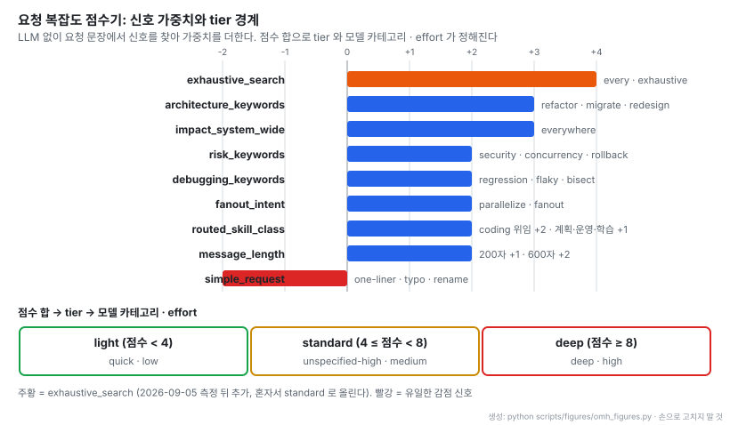
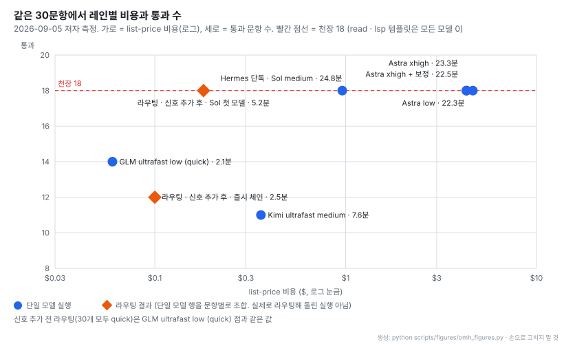
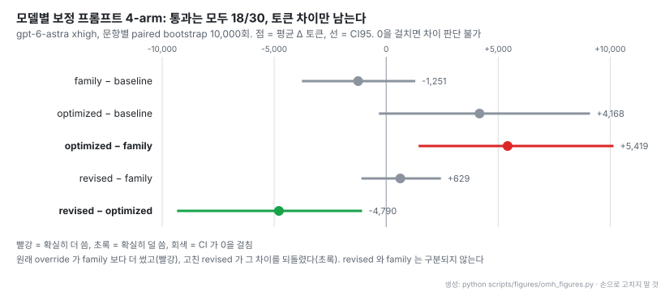

# oh-my-hermes: Hermes Agent 위에 얹는 작업 분할 · 모델 라우팅 · 증거 게이트 계층

- **원문**: [rlaope/oh-my-hermes](https://github.com/rlaope/oh-my-hermes) (설명: "The coding harness with Hermes Agent wired into IDE.") · [웹 사이트](https://omher.app/)
- **문서**: [Architecture](https://github.com/rlaope/oh-my-hermes/blob/83c2f61109d81dc1b6f5c51c01ed535c84b594e1/docs/ARCHITECTURE.md) · [Direction](https://github.com/rlaope/oh-my-hermes/blob/83c2f61109d81dc1b6f5c51c01ed535c84b594e1/docs/DIRECTION.md) · [모델 벤치마크와 측정 결과](https://github.com/rlaope/oh-my-hermes/blob/83c2f61109d81dc1b6f5c51c01ed535c84b594e1/benchmarks/live-model-tools/v1/README.md) · [Capability Impact](https://github.com/rlaope/oh-my-hermes/blob/83c2f61109d81dc1b6f5c51c01ed535c84b594e1/docs/CAPABILITY_IMPACT.md) · [Project Memory](https://github.com/rlaope/oh-my-hermes/blob/83c2f61109d81dc1b6f5c51c01ed535c84b594e1/docs/MEMORY.md)
- **바탕**: [Hermes Agent](https://github.com/NousResearch/hermes-agent) (Nous Research). oh-my-hermes(이하 OMH)는 Hermes 를 고치거나 바꾸지 않고 그 위에 얹는다
- **저장소 생성**: 2026-06-03. 태그 27개 (v1.0.0 2026-06-09 → v2.0.1 2026-09-05 → v3.0.1 2026-10-07 → v4.0.1 2026-10-22 → v4.0.6 2026-11-05). 읽은 커밋 `83c2f61` (2026-11-05)
- **코드**: MIT, Python. 별 5,131 · 포크 412 (2026-11-05 기준), 기여자 30명, 커밋 6,913개. `src` 아래 .py 1,241개 · 575,807줄, 테스트 .py 1,168개. `skills/` 153개 · `agent-skills/` 121개. README 는 AI agent 두 개(Friren, Kami)를 공동 작업자로 표기한다
- **설치**: 설치 스크립트, Homebrew, npm, Bun, Hermes skill tap
- **읽은 날짜**: 2026-11-05
- **태그**: #AgentHarness #ModelRouting #MultiAgent #EvidenceGate #AgentMemory

!!! note "핵심 요약"
    OMH는 Hermes Agent 위에 얹는 운영 계층이다. 사용자는 계속 Hermes와 대화하고, OMH는 요청마다 workflow와 모델 카테고리(모델 체인 + reasoning effort)를 고르고, 큰 일은 write scope가 겹치지 않는 노드 그래프로 쪼개 병렬로 돌린 뒤 별도 노드로 검증한다. 상태는 `Plan · not run` / `Code · reported done` / `Test · verified`처럼 단계와 확신도를 함께 표기해, executor가 "끝났다"고 말한 것과 테스트가 통과한 것을 구분한다. 저자 측정(고정 30문항)에서 문장 신호만 보는 deterministic 점수기로 모델을 나눴을 때, 기본 설정(Sol medium)과 같은 18/30을 비용 19%, 시간 21%로 냈다. 다만 그 라우팅 결과는 단일 모델 실행 기록을 문항별로 조합한 것이고, 18/30은 이 코퍼스에서 어떤 모델도 넘지 못한 천장이다. 모델별 보정 프롬프트는 통과 수를 바꾸지 못했다. "Hermes 단독 대 Hermes + OMH" 비교는 아직 측정 결과가 없다.

## 1. 개요

OMH가 푸는 문제는 범용 agent 하나에게 코딩 작업을 맡겼을 때 생기는 세 가지다. 모든 요청이 같은 모델과 같은 effort로 돌아 비싸고 느리다. 큰 작업을 한 흐름으로 돌리면 병렬화가 안 되고, 병렬로 돌리면 같은 파일을 동시에 고친다. executor가 "완료"라고 말한 것이 실제 검증인지 구분되지 않는다. README는 마지막 문제를 제품 원칙으로 적는다.

> "It never patches or replaces Hermes, and it never reports planned work as done."

방향 문서는 기능을 프롬프트에 숨기지 않고 계약으로 올리는 것을 설계 원칙으로 둔다.

> "Raise the product's capability level by strengthening contracts, not by hiding more behavior behind prompts."

그래서 OMH의 대부분은 LLM 호출이 아니라 deterministic 코드다. 라우팅 점수, 카탈로그에서 생성한 skill 문서, 상태 카드, handoff 계약, 메모리 입력 판정이 모두 코드와 고정 데이터로 정해지고, 저장소에는 그 동작을 고정하는 테스트가 1,168개 파일로 붙어 있다.

## 2. 역할 분담

Architecture 문서의 구성은 네 주체로 나뉜다.

| 주체 | 맡는 것 |
| --- | --- |
| Hermes Agent | 대화, 질문 확인, 조사, 계획, 상태 서술 |
| OMH 로컬 계약 계층 | playbook, 라우팅, 계획, handoff, 상태 카드 (deterministic) |
| 선택된 coding executor | 실제 구현과 검증 (Claude Code, Codex 등) |
| runtime artifact | 관찰된 증거 (실행 · 결과 · 검증 기록) |

이 분리 때문에 "OMH가 handoff를 준비했다"는 사실과 "executor가 실행했다"는 사실이 다른 기록에 남는다. 문서 표현으로는 "a prepared handoff is not execution evidence"다.

workflow는 `ulw-` 접두어가 붙은 10종이다. `ulw-interview`(한 번에 한 질문), `ulw-plan`(선택지 비교 · 위험 · 완료 기준), `ulw-work`(같은 파일을 건드리지 않는 병렬 레인), `dag-ulw`(노드 그래프 실행), `ulw-loop`(게이트 통과까지 plan → build → review 반복), `ulw-qa`, `ulw-perf`, `ulw-research`, `ulw-context`, `ulw-maestro`(Claude Code나 Codex에 위임)가 있다. 전체 흐름은 Understand → Research → Decide → Plan → Execute → Verify → Operate → Learn 8단계로 적혀 있다.

출처: [oh-my-hermes README](https://github.com/rlaope/oh-my-hermes/blob/83c2f61109d81dc1b6f5c51c01ed535c84b594e1/README.md)

- 레인마다 다른 모델이 붙는다. 한 작업 안에서 모델을 섞는 것이 이 도구의 기본 동작이다
- 화면의 accepted는 레인 판정이다. 아래 4절의 증거 단계와 같은 축으로 읽는다

## 3. dag-ulw: 노드 그래프 실행

`dag-ulw`는 목표를 작은 노드로 쪼개고, 의존이 풀린 노드를 병렬로 돌린다. 원칙은 세 가지다. 동시에 도는 노드는 write scope(쓰는 파일 범위)를 공유하지 않는다. 각 노드는 자기 카테고리의 모델과 effort로 돈다. 목표 검증은 별도 노드가 하고, 실패한 노드는 보고 전에 수리한다.

출처: [oh-my-hermes docs/CODING-OBSERVABILITY.md](https://github.com/rlaope/oh-my-hermes/blob/83c2f61109d81dc1b6f5c51c01ed535c84b594e1/docs/CODING-OBSERVABILITY.md)

- 노드마다 카테고리(`quick`, `unspecified-high`, `writing`)와 모델 · effort가 박스에 찍힌다. 같은 frontier의 세 레인이 서로 다른 카테고리를 받는다
- 실패한 레인(빨강)이 있어도 검증 노드는 세 레인을 모두 기다린다. 실패를 건너뛰고 "완료"로 올리지 않는 구조다

## 4. 증거 단계 표기

OMH의 상태 표기는 단계와 확신도 두 칸이다.

| 표기 | 뜻 |
| --- | --- |
| `Plan · not run` | 프롬프트나 계획이 준비됐다. 아무것도 실행되지 않았다 |
| `Code · running` | executor가 실행 중이고 OMH가 관찰하고 있다 |
| `Code · reported done` | executor가 끝났다고 말했다. 아무도 결과를 확인하지 않았다 |
| `Test · verified` | 테스트, 리뷰, CI 게이트가 실제로 통과했다 |

> "A run counts as verified only when a test, review or CI gate actually passed."

같은 원칙이 비용과 능력 보고에도 적용된다. 단가표로 계산할 수 없는 실행의 비용은 `$0`이 아니라 `unknown`으로 표기한다. 능력 보고서(`Capability Impact`)는 종합 점수를 두지 않고 여섯 차원을 따로 보고하는데, 이유를 이렇게 적는다.

> "A single percentage would make strong local routing evidence look interchangeable with an unavailable video provider or an unrun comparative benchmark."

여섯 차원 중 "다른 설정보다 결과가 나은가"는 `requires_external_evaluator`, 즉 아직 증명되지 않음으로 표시돼 있다.

## 5. 모델 카테고리와 체인

모델은 직접 고르지 않고 카테고리로 고른다. 카테고리는 `ultrabrain`, `deep`, `architect`, `unspecified-high`, `unspecified-low`, `quick`, `writing`, `visual-engineering`, `artistry` 등이고, 각 카테고리에 모델 체인(순서 있는 모델 목록)과 reasoning effort가 붙는다. 사용자는 `omh model`로 체인을 고친다.

체인의 동작 규칙은 하나다. provider가 모델을 거부하면 다음 모델로 넘어가고, 조용히 낮은 모델로 떨어지지 않는다("instead of silently downgrading"). 일을 하지 않은 child는 초록 행이 아니라 `failed`로 표시된다.

## 6. 요청 복잡도 점수기

요청을 어느 카테고리로 보낼지는 `request_complexity` 모듈이 정한다. LLM을 부르지 않고 요청 문장에서 이름 붙은 신호를 찾아 가중치를 더한다. 점수는 신호 가중치의 합과 정확히 같고, 결과에 어떤 신호가 어떤 근거로 켜졌는지 함께 남는다.

- 가중치는 작은 정수이고, 깎는 신호는 `simple_request`(-2) 하나다. 길이 신호는 최대 +2로 묶여 있다. 원문 주석은 "length is corroboration, never a tier on its own"이다
- `exhaustive_search`(+4)는 7절 측정 뒤에 추가됐다. "find every reference" 같은 요청이 light로 분류돼 가장 싼 모델로 가던 것을 혼자서 standard로 올린다
- tier가 모델 이름이 아니라 카테고리를 가리키므로, 실제 모델은 사용자의 체인 설정에서 정해진다

## 7. 라우팅 측정

저자는 고정 코퍼스 30문항(템플릿 10종 × seed 3)으로 레인별 통과 수와 비용을 쟀다. 템플릿은 edit(RENAME, BUGFIX), read(PRECEDENCE, CALLFLOW), search(REFERENCES, PREDICATE), lsp(DEFINITION, DIAGNOSTICS), routing(SCALE, EXPLICIT) 다섯 종류다. 통과는 controller 쪽 validator가 판정하고, 비용은 OMH 단가표의 list-price로 환산한다.

- 원문 해석: 라우팅에서 standard 클래스 첫 모델을 Sol로 두면 기본 설정(Sol medium)과 같은 18/30을 비용 19%, 시간 21%로 낸다. flagship(Astra xhigh) 대비로는 비용 4%, 시간 22%다
- 주황 점(라우팅 결과)은 OMH가 실제로 라우팅해서 돌린 실행이 아니다. 점수기가 문항마다 고른 레인의 단일 모델 기록을 가져와 조합한 값이다. 원문 표현은 "compose an OMH-routed outcome per task from the single-model rows"다
- 천장 18은 read와 lsp 템플릿을 어떤 모델도 통과하지 못해서 생긴다. 원문도 "no routing can raise pass rate here"라고 적고, 통과율 주장에는 헤드룸이 있는 코퍼스가 필요하다고 밝힌다

측정에서 나온 사실이 두 개 더 있다. 첫째, 싼 `quick` 모델(GLM ultrafast)은 10개 템플릿 중 8개에서 flagship과 같은 통과 수를 냈고, exhaustive search 두 템플릿에서만 졌다(REFERENCES 2/3, PREDICATE 0/3). `exhaustive_search` 신호는 이 결과에서 나왔다. 둘째, 출시 체인처럼 standard 첫 모델이 Kimi ultrafast이면 검색 6문항을 0/6으로 놓쳐, 신호를 추가한 뒤에 오히려 12/30으로 떨어진다. Sol과 Astra는 6/6, GLM은 2/6이었다. 그래서 신호와 체인 첫 모델이 함께 맞아야 한다. 2026-10-13 출시 표부터는 GPT 계열이 그 자리 첫 모델이다. Astra의 effort를 low와 xhigh로 바꿔도 통과 · 토큰 · 시간이 같아, 저자는 effort 라우팅에 대한 주장을 하지 않는다.

## 8. 모델별 보정 프롬프트 측정

OMH는 모델 계열과 세대별로 프롬프트 보정 블록을 둔다. 저자는 gpt-6-astra 전용 override를 네 조건으로 비교했다: 보정 없음(baseline), 계열 블록 상속(family), 원래 override(optimized), 고친 override(revised). 네 조건 모두 18/30이라 McNemar p = 1.0이었고, 판단은 토큰 비용으로 넘어갔다.

- 원래 override는 family 블록보다 문항당 평균 5,419 토큰을 더 썼다(CI가 0을 걸치지 않음). 늘어난 토큰은 BUGFIX와 DIAGNOSTICS에 몰렸다. 통과하지 못한 문항에서도 모델이 계속 작업했기 때문이다
- 원인으로 지목된 문장은 "carry them to completion instead of pausing for sign-off" 하나다. 이 문장을 "nothing outside them is owed"로 바꾼 revised는 family와 구분되지 않는다
- 네 조건을 한 번씩 순서대로 돌렸고 순서를 섞지 않았다(counterbalance 없음). 원문도 이 점을 밝힌다

2026-08-14 측정에서도 보정은 통과 수를 올리지 못했다. Sol 17 → 17, Kimi ultrafast 11 → 10, GLM ultrafast 14 → 13이다. 같은 날 Sol baseline 두 번이 무효 처리됐는데, 하나는 프롬프트가 child에 전달되지 않아 0/30, 다른 하나는 작업 디렉터리 변수가 새어 모델이 사용자 홈의 파일을 고쳐 2/30이었다. 저자는 이를 "harness bugs, not model results"로 분류하고 기록을 감사용으로만 남겼다.

## 9. 측정 절차

벤치마크 문서에서 반복되는 절차는 네 가지다.

1. 코퍼스를 digest로 고정하고, 결과는 그 코퍼스 · OMH 버전 · Hermes 버전 · 모델 ID 조건에서만 유효하다고 적는다. 원문 표현은 "They do not establish universal model superiority."다
2. 통과는 controller 쪽 validator만 판정한다. child 프로세스가 정상 종료한 것은 통과가 아니다
3. 토큰과 비용을 측정하지 못하면 `null`로 둔다. 추정으로 채우지 않는다
4. 변경을 머지하기 전에 판정 기준(gate)을 먼저 적고 돌린다. 중간에 기준을 바꾸면 "Amendment"로 시각과 이유를 남기고, 실패한 측정도 그대로 기록한다

라우팅 질문 벤치도 같은 방향이다. 라우터 판단을 후보 중 하나 고르기(Choice + none)와 후보별 yes/no로 나눠 묻고, 둘이 어긋나도 맞추지 않고 그대로 보고한다.

## 10. 프로젝트 메모리

메모리는 Hermes 내부 메모리를 읽지도 고치지도 않는 별도 저장소다. 새 사실은 네 가지 중 하나로 판정된다.

| 판정 | 대상 |
| --- | --- |
| Remember | 범위가 정해진 durable 후보 한 건 |
| Refuse | secret, raw log, transcript, prompt injection 형태의 지시, 임시 진행 상황 |
| Retrieve instead | 지난 대화 이력. Hermes 세션 검색으로 그때그때 찾는다 |
| Defer | 출처 · 범위 · 보존 기간이 불확실한 것. 리뷰로 넘긴다 |

이력을 메모리에 넣지 않는 이유를 문서는 한 문장으로 적는다. "every retained record is context each later turn pays for." 보존 등급은 volatile(1~7일, 기본 7일), standard(episode 30일), durable(TTL 없음) 셋이고, 리뷰 주기 기본값은 90일이다.

쓰기 결과도 4절과 같은 방식으로 단계를 나눈다. `candidate_persisted` → `approved_record_persisted` → `indexes_refreshed` → `replay_ready` 순서이고, 앞 단계에 도달했다고 뒤 단계를 주장하지 않는다. 후보가 디스크에 써졌어도 리뷰를 통과하지 못하면 다음 대화의 recall pack에 들어가지 않는다.

## 11. 해석 시 주의

!!! warning "측정 범위"
    모든 수치는 저자 측정이고, 30문항 단일 코퍼스에서 문항당 한 번 실행한 결과다. 라우팅 결과는 단일 모델 실행 기록을 조합한 값이다. 18/30이 모든 모델의 천장이라, 이 코퍼스로는 통과율 향상을 보일 수 없다.

!!! warning "제품 효과는 미측정"
    "Hermes 단독 대 Hermes + OMH" 제품 A/B는 코퍼스와 오프라인 파일럿만 있고, 원문이 "No measured run has been published yet."라고 적는다. Capability Impact 문서도 비교 결과 품질을 증명되지 않음으로 둔다.

- 규모: 5개월 동안 커밋 6,913개, Python 57만 줄이다. README는 AI agent 두 개를 공동 작업자로 표기한다. 문서 · 테스트 · 계약이 촘촘한 대신, 그 양만큼 읽고 검토하는 비용이 크다
- 모델 이름(GPT-6 Astra, GPT-5.6 Sol, Kimi K3, GLM 5.2 등)과 가격은 측정 시점의 provider 구성에 묶여 있다. 다른 provider 구성에서는 체인 첫 모델을 다시 재야 한다

## 12. 적용 가능한 조건

도구 전체를 쓰려면 Hermes Agent가 대화 표면이어야 한다. 그렇지 않은 시스템에도 옮길 수 있는 설계는 네 가지다.

| 설계 | 옮길 수 있는 조건 |
| --- | --- |
| 단계 + 확신도 상태 표기 | 실행 agent가 "완료"를 보고하고, 그 뒤에 별도 확인 단계(테스트, 재조회)가 있는 시스템 |
| deterministic 복잡도 점수기 → 모델 카테고리 | 성능과 비용이 다른 모델을 두 개 이상 서빙하고, 요청 문장만으로 난이도 신호를 셀 수 있는 시스템 |
| 통과율이 같으면 비용으로 고르는 paired 비교 | 프롬프트나 모델 변경을 고정 평가셋으로 반복 비교하는 팀. 단, 천장이 없는 평가셋이 먼저 있어야 한다 |
| 메모리 입력 판정과 쓰기 영수증 | 장기 메모리에 무엇을 넣을지 정책이 필요한 대화형 agent |

## 13. 관련 노트

- [Hermes Agent](https://github.com/NousResearch/hermes-agent): OMH가 얹히는 바탕 agent
- [edgextract: 닫힌 yes/no 질문과 결정 모델로 지식 그래프 추출]([20261003] raphaelmansuy_edgextract_닫힌질문_결정모델로_지식그래프추출.md): 9절의 Choice + yes/no 분리 질문과 같은 방향의 닫힌 질문 판정
- [Carrel: 온톨로지 증강 에이전트용 셀프호스팅 지식베이스]([20260928] FengZhenfei_carrel_온톨로지증강_에이전트용_지식베이스.md): agent 검색 스킬의 추가 질의가 답 완결률과 비용을 함께 올린 측정

## 14. 결론

OMH에서 가져갈 것은 기능 목록보다 측정과 보고의 태도다. "끝났다"와 "확인됐다"를 다른 표기로 나누고, 비용을 모르면 `unknown`으로 쓰고, 통과율이 같으면 비용으로 고르고, 실패한 측정과 harness 버그까지 기록에 남긴다. 반대로 라우팅이 비용을 크게 줄인다는 결과는 조합된 값이고 천장이 걸린 코퍼스에서 나왔으므로, 제품 A/B 결과가 나오기 전까지는 가능성을 보여 준 예비 결과로 읽는 것이 맞다.
