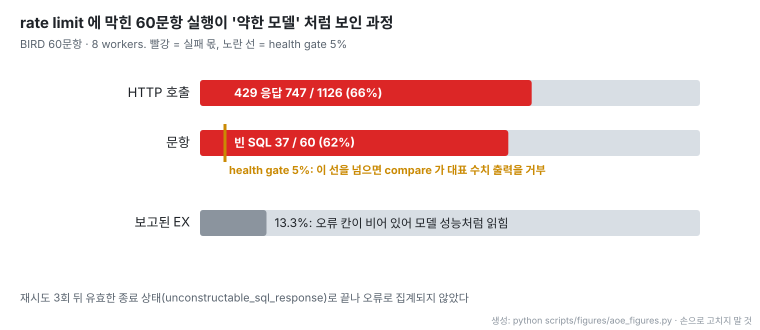
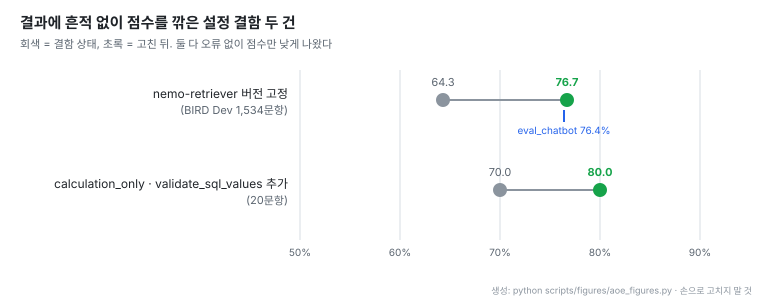

# auto-ontology-eval: 온톨로지가 Text-to-SQL 정확도를 얼마나 올리는지 재는 대조 평가 도구

- **원문**: [NVIDIA/auto-ontology-eval](https://github.com/NVIDIA/auto-ontology-eval) (이전 이름 `ontology-sql-eval`). 설명: "LLM-powered Text-to-SQL evaluation toolkit: schema ingestion, retrieval eval, and standalone SQL judge/re-scorer."
- **문서**: [두 arm · 채점 규칙 · 단계](https://github.com/NVIDIA/auto-ontology-eval/blob/ec41b2c5b795637759297b90c1d19b42693200f9/resources_servers/README.md) · [Extra prompts](https://github.com/NVIDIA/auto-ontology-eval/blob/ec41b2c5b795637759297b90c1d19b42693200f9/docs/extra-prompts.md) · [BIRD-Interact](https://github.com/NVIDIA/auto-ontology-eval/blob/ec41b2c5b795637759297b90c1d19b42693200f9/scripts/bird_interact/README.md)
- **평가 대상**: [NVIDIA/auto-ontology](https://github.com/NVIDIA/auto-ontology). Git 리비전 `dd78d06`으로 고정해 같은 프로세스 안에서 import 해 돌린다
- **저장소 생성**: 2026-07-02. 태그 없음, 커밋 372개. 읽은 커밋 `ec41b2c` (2026-11-03)
- **코드**: Apache-2.0, Python. 별 77 · 포크 16 (2026-11-06 기준), 기여자 10명. 파일 154개, `.py` 17,353줄, test 함수 62개, CI 는 ruff 와 pytest. 외부 PR 은 받지 않는다. 커밋 372개 중 99개 본문에 `Co-Authored-By: Claude` 가 있다
- **실행 기반**: [NeMo Gym](https://github.com/NVIDIA-NeMo/Gym) resources server 두 개. 유지보수자 설정은 두 arm 모두 `azure/anthropic/claude-opus-5-5`, 임베딩 `nvidia/nvidia/nemotron-3.5-embed-1b-nvfp4`
- **원문 그림**: 레포에 이미지가 없다. 아래 그림은 모두 문서와 커밋 본문의 수치로 새로 그렸다
- **읽은 날짜**: 2026-11-06
- **태그**: #TextToSQL #Evaluation #Ontology #BIRD #NeMoGym

!!! note "핵심 요약"
    Auto-Ontology 의 온톨로지가 Text-to-SQL 정확도를 "얼마나 더하는가"를 재는 평가 도구다. 같은 질문을 같은 모델에 두 번 묻는다. 한 번은 스키마 dump 만 준 대조군, 한 번은 Auto-Ontology agent 가 스스로 근거를 찾는 실험군이다. 두 SQL 을 LLM 판정 없이 BIRD · BEAVER 공식 실행 일치 규칙으로 채점해 정확도 차이 하나와 "고친 질문 / 망친 질문" 목록을 낸다. 이 레포에서 배울 것은 수치가 아니라 평가를 믿을 수 있게 만드는 장치다. rate limit 으로 66% 호출이 실패한 실행이 13.3% 라는 그럴듯한 점수를 냈던 사고 뒤로, 무출력 비율이 5% 를 넘으면 대표 수치 출력을 거부한다. 커밋 본문에는 오류 없이 점수만 깎은 설정 결함이 두 건 기록돼 있다. 의존성 버전이 어긋나 BIRD Dev 실행 일치가 64.3% 에 머물렀다가 고친 뒤 76.7% 가 된 건과, agent 설정 두 키가 빠져 20문항에서 14/20 이 16/20 이 된 건이다. 다만 최종 대조군 대 실험군 차이는 README 에도 커밋에도 공개돼 있지 않다.

## 1. 개요

README 의 첫 주장은 "A trustworthy accuracy number needs a control."이다. 온톨로지를 붙인 agent 의 정확도만 재면 그 숫자가 온톨로지 덕인지 모델 덕인지 가를 수 없다. 그래서 질문은 하나로 좁힌다: 같은 모델에게 데이터베이스 스키마만 줬을 때보다 온톨로지가 얼마나 더하는가.

출발점은 커밋 `e53dbc0`(2026-09-15)에 적혀 있다. 그전 하네스는 온톨로지 agent 한 갈래만 돌릴 수 있었고, "past A/B work swapped GSF branches and diffed CSVs by hand"였다. 이 커밋이 두 arm 을 NeMo Gym 환경으로 만들었고, 2026-09-23 커밋 `1430392`가 전체 파이프라인의 평가 단계를 이 대조 비교로 바꿨다.

## 2. 실행 단계와 두 arm

`main.py` 하나가 세 단계를 순서대로 돌린다.

1. **Ingest**: 원본 DB 스키마를 Auto-Ontology 의 catalog 와 pgvector 저장소로 옮긴다. 데이터셋이 주면 테이블 설명과 예시 분석도 넣는다
2. **Compile**: 수집한 catalog 위에 온톨로지를 만든다
3. **Benchmark**: 모든 질문을 두 arm 에 돌리고 비교한다

| Arm | 서버 | 모델이 받는 것 |
|---|---|---|
| Control (대조군) | `schema_only_sql` | 질문 + schema dump, 한 프롬프트, 도구 없음 |
| Treatment (실험군) | `auto_ontology_sql` | 질문만. Auto-Ontology agent 가 온톨로지에서 근거를 스스로 찾음 |

실험군은 Gym 의 policy 모델을 쓰지 않는다. agent 를 직접 돌리고 policy 출력은 버리므로(`policy_output_ignored`), policy 호출을 `--max-output-tokens 16`으로 묶어 rate limit 을 agent 에 양보한다. agent 는 질문당 약 19번 모델을 부르고, 원문은 전체 호출의 "roughly 19 of every 20"이 agent 쪽이라고 적는다. 대조군은 호출 한 번이라 비용 구조가 크게 다르다.

## 3. 두 arm 을 같은 조건으로 맞추는 규칙

대조 실험의 핵심은 독립변수 외에는 같게 두는 것이다. 원문은 이를 "Anything that changes what the model is told must land on **both** arms or neither."로 쓴다.

| 규칙 | 이유 |
|---|---|
| 두 arm 에 같은 모델 | 차이가 온톨로지만 재도록 |
| "Return exactly the requested output fields and NO others" 를 대조군 system prompt 와 실험군 `shorten_answer=True` 양쪽에 | 여분 컬럼은 `set(gold) == set(pred)`에서 바로 실패한다. 한쪽에만 주면 "projection guidance rather than ontology grounding"을 재게 된다 |
| schema dump 를 전체 실행 동안 고정 | "The schema dump *is* the control arm's independent variable." 바꾸면 "schema-only"의 뜻이 조용히 바뀐다 |
| 임베딩 모델을 수집과 실험군에서 같게 | README 모델 표 |
| Extra prompts(아래 7절)는 기본 꺼짐 | 대조군에 대응 입력이 없다 |

출력 컬럼 규칙을 더한 대가도 밝힌다. 대조군 첫 문장은 NeMo Gym `bird_sql` 원래 프롬프트 그대로지만 규칙이 붙어 공개 BIRD 수치와 완전히 같은 조건은 아니다. 원문은 이를 "internal comparability over comparability to published BIRD numbers"라는 선택으로 적는다.

## 4. 채점: LLM 판정 없는 실행 일치

두 arm 은 같은 verifier 로 같은 DB 에서 채점한다. 예측 SQL 과 정답 SQL 을 실행해 결과 행 집합을 비교한다. "Scoring is deterministic, with no LLM judge." BIRD 의 효율 점수(VES)는 계산하지 않는다.

| 데이터셋 | 문항 | 엔진 | 비교 규칙 |
|---|---|---|---|
| BIRD | 1,534 (Dev), 500 (Mini-Dev) | SQLite | `set(gold_rows) == set(pred_rows)`. 행 순서 · 중복 무시, 여분 컬럼 실패 |
| BEAVER | `dw` 표본 100문항 | MySQL | BEAVER `ex_acc`: 값을 문자열로 바꾸고 공백 제거 후 비교 |
| FDABench-Lite | 169 | SQLite | BIRD 규칙 |
| Wide World Importers | 41 | Postgres | BIRD 규칙 |
| BIRD-Interact | ~300 (Lite), 600 (Full) | Postgres | 두 arm 비교에 넣지 않음 (multi-turn, 별도 실행기) |

벤치마크마다 공식 규칙을 따르는 이유는 각자의 leaderboard 와 비교할 수 있게 하기 위해서다. 두 규칙은 실제로 갈린다. BEAVER 는 `1`과 `"1"`을 같게 보지만 `Decimal("150.250")`과 `Decimal("150.25")`는 다르게 본다. 원문은 MySQL 코퍼스에서 이것이 "a common case, not an exotic one"이라고 쓰고, 공식 평가기를 포팅해 테스트로 대조한다.

실행 방식도 공식 평가기를 따른다.

- **BIRD**: 예측과 정답 쿼리를 합쳐 30초 한도 하나(예측 먼저). 정답 쿼리가 실패하면 0점으로 분모에 남는다. Mini-Dev 701번은 정답 쿼리가 약 157초 걸려 어떤 예측도 맞힐 수 없고, 518번은 약 26초라 예측에 몇 초만 남아 기계 부하에 따라 결과가 바뀐다
- **BEAVER**: 쿼리 타임아웃 10초 고정, 넘으면 빈 결과. 오류 · 타임아웃 · 무출력을 모두 빈 결과로 보므로, 정답이 빈 결과인 문항은 아무것도 안 낸 예측도 맞는다. 그래서 빈 정답 문항을 뺀 정확도(`nonempty_gold`)를 함께 내고 "the more honest of the two"라고 부른다
- **그 밖**: 더 엄격하다. 실패한 예측은 오답, 쿼리마다 전체 한도, 정답 쿼리가 실패하면 그 과제를 뺀다

## 5. Health gate: 수치를 내기 전에 실행이 성했는지 본다

- 60문항 BIRD 실행을 8 workers 로 돌렸더니 실행 일치가 13.3% 로 나왔다. 실제로는 HTTP 호출 1,126개 중 747개가 429(rate limit)였다. Auto-Ontology 는 세 번 재시도한 뒤 유효한 종료 상태로 끝나 오류 칸이 비었고, 그래서 "The run looked like a weak model."
- 이 사고로 두 장치가 생겼다. 하나는 "모델 출력 없음"(`no_model_output`)을 "틀린 SQL"(`wrong_result`)과 다른 실패 코드로 세는 것, 다른 하나는 한 arm 이라도 무출력 · 알 수 없는 오류 비율이 5%(`HEALTH_THRESHOLD = 0.05`)를 넘으면 비교 스크립트가 대표 수치 출력을 거부하는 것이다. 결과가 빠진 문항이 있어도 거부한다
- `unknown_error`도 health 에 넣었다. 그러지 않으면 모든 과제가 실패한 arm 이 "0% accuracy with every health counter green"으로 게시될 수 있었다

실패 코드는 `none` · `no_model_output` · `wrong_result` · `no_sql_extracted` · `execution_error` · `execution_timeout` · `gold_execution_error` · `gold_execution_timeout` 등으로 나뉜다. 커밋 `b03bd9f`는 `wrong_result`(실행은 됐는데 행이 다름)가 rollout 의 약 70% 라 실행 오류와 섞으면 실패 분석이 쓸모없어진다고 적는다.

동시성은 기본 3이다. 10 은 "measured-safe"로 기록돼 있다. 1,534문항 전체 실행 두 번을 10 workers 로 돌려 rate limit 실패가 0이었기 때문이다. 원문은 이 한도가 코드가 아니라 API 키의 성질이라고 강조한다: "Size `max_concurrency` against the model endpoint's rate limit, not against CPU."

## 6. 결과에 흔적 없이 점수를 깎은 설정 결함

- **의존성 drift (커밋 `13205a2`)**: Gym 이 서버 venv 를 만들 때 `uv.lock`을 무시해, 버전을 고정하지 않은 nemo-retriever 가 이틀 앞선 HEAD 로 설치됐다. 새 버전이 임베딩 모델 이름을 거부했고 관련 테이블 조회 함수가 예외를 삼켜 빈 목록을 돌려줬다. 전체 실행에서 vector search 가 10,471번 실패했는데 결과에는 낮은 점수만 남았다. 고정한 뒤 실패 0, BIRD Dev 실행 일치가 64.3% 에서 76.7% 로 올라 기존 하네스(eval_chatbot)의 76.4% 와 맞았다. 이 수치는 실험군 한 갈래의 점수이고 대조군 대비 차이가 아니다
- **설정 키 누락 (커밋 `2a46224`)**: 실험군이 실제 운영 설정의 두 키를 빠뜨렸다. `calculation_only`는 의도 분류를 계산(SQL 실행)으로 고정하고, `validate_sql_values`는 필터 값을 DB 에 대조하는 노드를 켠다. 1,534 rollout 에서 이 노드가 0번 발동했다. 20문항 slice 에서 두 키를 넣자 14/20 이 16/20 이 됐고 회귀는 없었다. 원문 표현은 "not visible in the rollouts, only in the node trace, and cost about two points"다
- 같은 계열의 결함이 더 있다. openai 2.45.0 은 `cache_write_tokens`를 필수로 바꿔 gateway 응답을 모두 거부하게 만들었다. control arm 이 timeout 태그를 처리하지 않아 `gold_execution_timeout` 카운터가 구조적으로 항상 0이었던 적도 있다. 이 마지막 패치는 ruff 가 소스를 재포맷한 뒤라 조용히 적용되지 않았는데 스크립트는 성공을 보고했다

이 절이 이 레포에서 가장 쓸모 있는 부분이다. 평가 파이프라인의 버그는 대부분 예외를 던지지 않고 점수를 낮춘다. 낮은 점수는 "모델이 약하다"로 읽히기 쉽다. 기존 하네스와 같은 질문에서 점수가 맞는지 대조한 것이 의존성 drift 를 찾은 계기였다.

## 7. Extra prompts: 실험군에만 주는 입력은 따로 밝힌다

BIRD 에는 실험군에만 줄 수 있는 선택 입력이 두 개 있다. 기본은 꺼짐이다.

| 입력 | 내용 |
|---|---|
| SQL exemplars | 이 질문에 필요한 SQL 과 구조가 같은 train 질문. 기본 질문당 5개 |
| Value anchors | 질문 속 문구가 저장된 컬럼과 실제 저장 철자 |

대조군에는 대응 입력이 없으므로 "a difference measured with them covers those inputs as well as the ontology"다. 그래서 각 rollout 이 `sql_examples_used`, `value_anchors_used`를 기록해, 설정이 아니라 실제로 받은 입력을 증명하게 했다.

Exemplar 를 고르는 쪽에도 측정이 있다. 커밋 `d511409`(2026-10-04)에 따르면 다섯 칸이 모두 한 예측 skeleton 에서 나와 97.4% 질문이 join 수가 같은 exemplar 다섯 개를 받았다. join 수는 가장 흔한 오류 축이다. 같은 구조의 train exemplar 가 있었는데 못 가져온 306문항 중 37.9% 가 join 수 차이였다. 그래서 스키마 표시, 여러 해석 예측, 반복 샘플을 선택 옵션으로 두고 칸을 round-robin 으로 채운다.

## 8. BIRD-Interact

BIRD-Interact 는 agent 가 사용자에게 되묻고(clarify), 답한 뒤 후속 질문에 다시 답하는 multi-turn 벤치마크다. 두 arm 은 구조상 한 번에 끝나는 실행이라 이 벤치마크를 넣을 수 없어 "deliberately absent"로 뺐다. 대신 c-Interact 하네스에서 Auto-Ontology 하나만 query 범주 과제로 돌린다. Lite 는 약 300과제 · DB 18개, Full 은 600과제 · DB 22개다.

흐름은 `init → Phase 1 (clarify loop + SQL 생성 → 실패 시 debug 재시도) → Phase 2 (후속 질문 병합 + SQL 생성 → 실패 시 재시도)`다. 되묻기는 Phase 1 에만 있고, 답을 받을 때마다 원 질문에 병합해 SQL 생성 단계가 흩어진 문답이 아니라 하나의 질문을 보게 한다.

## 9. 해석 시 주의

!!! warning "최종 대조 수치는 공개되지 않았다"
    README · 문서에 데이터셋별 대조군 대 실험군 차이가 없다. `results/` 디렉터리는 2026-08-25, 09-01, 10-18 커밋에서 추적이 해제됐다. 커밋 본문에 남은 수치(64.3 → 76.7, 14/20 → 16/20, 13.3%)는 모두 디버깅 과정의 단편이고, "온톨로지가 몇 점을 더한다"는 결론으로 읽으면 안 된다.

!!! warning "비교 기준은 공개 leaderboard 가 아니다"
    대조군 프롬프트에 출력 컬럼 규칙을 더했으므로 대조군 점수를 공개 BIRD 수치와 바로 비교할 수 없다. 원문이 스스로 택한 trade-off 다.

- 실험군은 질문당 모델을 약 19번 부르고 대조군은 1번 부른다. 정확도 차이가 나와도 비용 차이는 이 도구가 보고하지 않는다
- 데이터셋 표의 문항 수에도 정정 이력이 있다. 커밋 `d6a581a`는 기본 BIRD 가 500문항 Mini-Dev 가 아니라 1,534문항 Dev 라고 바로잡았다

## 10. 쓸 수 있는 조건

- **검색 · 온톨로지 계층을 붙인 Text-to-SQL 을 운영하는 경우**: "같은 모델 + 스키마만"을 대조군으로 두는 설계와 두 arm 공통 지시 규칙을 그대로 가져갈 수 있다. 정확도 하나보다 고친 질문 / 망친 질문 목록이 개선 방향을 더 잘 보여 준다
- **LLM 호출이 많은 평가를 외부 API 로 돌리는 경우**: 무출력을 오답과 다른 코드로 세고, 비율이 임계값을 넘으면 수치를 내지 않는 health gate 는 작은 비용으로 가장 큰 오보를 막는다
- **평가 하네스를 새로 만들거나 갈아탈 때**: 기존 하네스와 같은 질문에서 점수가 맞는지 먼저 대조한다. 이 레포의 64.3% → 76.7% 사례는 그 대조가 없었으면 "새 구조가 12점 나쁘다"로 결론 났을 결함이다
- **MySQL 계열 데이터**: 숫자 표현(Decimal 자릿수) 때문에 BIRD 식 집합 비교와 BEAVER 식 문자열 비교가 다른 답을 낸다. 어느 규칙을 쓸지 먼저 정해야 한다

## 11. 관련 노트

- [NVIDIA Auto Ontology: DB 메타데이터로 만드는 에이전트용 시맨틱 레이어와 Text-to-SQL]([20260427] NVIDIA_auto-ontology_에이전트용_시맨틱레이어_TextToSQL.md): 이 도구가 평가하는 대상. 그 노트 7절이 이 레포를 옛 이름으로 짧게 다뤘다
- [Opik: LLM 관측 · 평가 플랫폼과 Langfuse 비교]([20230510] comet-ml_opik_LLM관측평가_플랫폼_Langfuse비교.md): 평가 결과와 실행 trace 를 운영하는 도구
- [JEV-as-a-Judge: 확신하면 받고, 모르면 넘기는 판정기](../papers/[20260928]%20JEV-as-a-Judge_Confidence_Cascade.md): 이 레포가 피한 LLM 판정을 쓸 때 판정을 믿을 만하게 만드는 방법

## 12. 결론

auto-ontology-eval 은 "온톨로지가 몇 점을 더하나"라는 질문에 답하려고 만든 도구지만, 지금 공개된 것은 답이 아니라 답을 믿을 수 있게 만드는 장치들이다. 같은 모델의 스키마 전용 대조군, 두 arm 공통 지시, 벤치마크별 공식 채점 규칙, 무출력 5% health gate, 실험군 전용 입력의 기록이 그것이다.

커밋 본문에 남은 기록이 특히 값지다. 평가 파이프라인 버그는 예외 없이 점수만 깎는다. rate limit 은 13.3% 라는 그럴듯한 점수로, 의존성 drift 는 64.3% 라는 낮은 점수로, 빠진 설정 키는 약 2점 손실로 나타났다. 어느 것도 rollout 에 오류로 남지 않았다. 점수가 낮게 나오면 모델보다 먼저 하네스를 의심하라는 것이 이 레포가 보여 주는 교훈이다.
