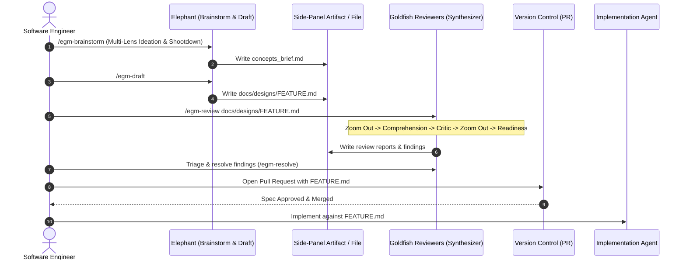
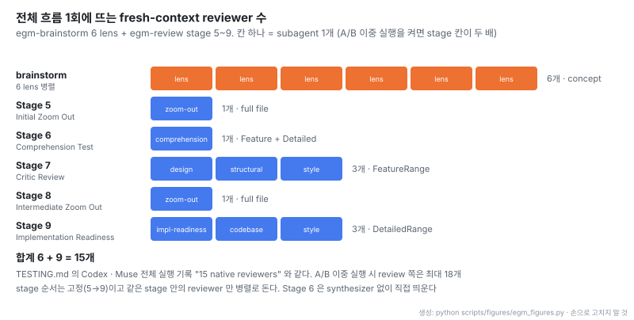
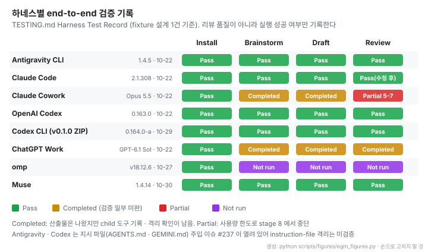

# Elephant-Goldfish Model: fresh-context 리뷰어로 설계 문서를 검증하는 에이전트 스킬

- **원문**: [google/elephant-goldfish-model](https://github.com/google/elephant-goldfish-model) (설명: "Open-source skills for designing and reviewing software with AI agents") · [사이트](https://egm.dev)
- **사상 원천**: Dave Rensin, [Elephants, Goldfish, and the New Golden Age of Software Engineering](https://medium.com/@drensin/elephants-goldfish-and-the-new-golden-age-of-software-engineering-c33641a48874) (Medium, 2026). 본문은 접속 차단으로 읽지 못했고, 이 노트는 레포 문서만 근거로 한다
- **저장소 생성**: 2026-09-13 (GitHub created_at). 공개 git 이력의 첫 커밋은 2026-10-21 "feat: initial open-source release of Elephant-Goldfish Model (EGM)"
- **코드**: 라이선스 Apache-2.0, 별 11,362개 (2026-11-04 기준), 기여자 28명, 커밋 148개. 본체는 Markdown 스킬과 persona 프롬프트이고 Python 은 테스트 · 패키징 스크립트다
- **릴리스**: v0.1.0 (2026-10-27). README 는 "This is not an officially supported Google product." 라고 밝힌다
- **지원 하네스**: Antigravity, Claude Code (2.1.271 이상), Codex, Claude Cowork, ChatGPT Work 외
- **읽은 커밋**: `113a3af` (2026-11-03)
- **읽은 날짜**: 2026-11-04
- **태그**: #AgentWorkflow #SpecDrivenDevelopment #Subagent #DesignReview #ClaudeCode

!!! note "핵심 요약"
    EGM 은 설계 문서를 두 종류의 에이전트로 다룬다. 프로젝트 맥락을 다 가진 Elephant 가 사람과 대화하며 spec 을 쓰고, 그 대화를 전혀 모르는 Goldfish 리뷰어들이 문서와 문서가 링크한 자료만 읽고 검토한다. 리뷰는 Zoom Out, Comprehension, Critic, Zoom Out, Implementation Readiness 의 5개 stage 로 고정된 순서를 따르고, 한 번 전체를 돌리면 brainstorm 6개와 review 9개, 합쳐 15개의 fresh-context subagent 가 뜬다. Claude Code 에서는 리뷰어를 `Read · Grep · Glob` 만 쓰고 `CLAUDE.md` 도 읽지 않는 subagent 로 띄워 맥락 오염을 막는다. 하네스 8곳의 실행 기록은 있지만 모두 fixture 설계 1건으로 "끝까지 돌았는가" 만 확인했고, 결함을 더 찾았는지 · 재작업이 줄었는지는 측정하지 않았다. README 의 "Thousands of Google engineers use EGM" 도 근거 수치가 없다.

## 1. 개요

EGM 이 겨냥하는 문제는 한 LLM 스레드가 요구사항 인터뷰, 설계, 구현을 모두 맡을 때 생긴다. 아키텍처 문서는 이를 네 가지로 정리한다. 대화가 쌓일수록 추측이 사실처럼 굳는 Hallucination Cascades & Context Pollution, 설계 없이 가까운 파일부터 고치는 Premature Implementation("Weeds Syndrome"), 긴 설계안을 채팅창에 쏟아 내는 Chat Dump Fatigue, 그리고 처음 쓴 설계 문서가 코드와 멀어지는 Documentation Drift 다. 첫 번째 문제의 핵심은 다음 문장이다.

> "The model validates its own faulty assumptions instead of detecting errors."

해법은 역할을 맥락의 양으로 나누는 것이다. README 의 정의를 그대로 옮기면 Elephant 는 "holds your project context and drafts the specification", Goldfish 는 "examine the draft and referenced source material without the earlier conversation", 사람은 "make the architectural trade-offs and approve the specification before implementing" 을 맡는다. 같은 스레드 안에서 리뷰 프롬프트를 이어 돌리는 방식은 "Severe context degradation and confirmation bias; the model validates its own mistakes." 라는 이유로 버렸다.

적용 범위도 README 가 직접 좁힌다. "Use it when a feature needs design decisions before implementation. For a small, clear bug fix, use your normal coding workflow." FAQ 역시 "EGM is one of the ways teams are making LLMs work better. It is not *the* way." 라고 쓴다.

## 2. 구성과 흐름

레포는 네 층으로 나뉜다. `skills/` 에 스킬 7개, `agents/` 에 리뷰어 persona 9개 파일, `resources/document_standards/` 에 리뷰 기준(rubric) 5개, `docs/` 에 사용 안내와 EGM 자신의 설계 문서가 있다. 승인된 설계 문서는 `docs/designs/` 에 체크인해 코드와 함께 관리한다(Living Specifications).

아래는 아키텍처 문서의 원문 sequence diagram 이다 (Apache-2.0, 원문 그대로).

출처: [EGM Architecture & System Lifecycle](https://github.com/google/elephant-goldfish-model/blob/113a3afc44e8f4f54722d7150d5701f65cc8ef7f/docs/designs/architecture.md)

- 구현 단계(Coder)에는 전용 스킬이 없다. 승인된 설계 문서가 충분히 자세하면 일반 코딩 에이전트에 넘기면 된다는 입장이다.
- 앞의 네 단계는 spec 과 리뷰 산출물만 쓰고 제품 코드는 건드리지 않는다고 정해 두었지만, 원문 스스로 "This is a convention, and nothing enforces it." 라고 적는다.
- 긴 산출물은 채팅이 아니라 파일(`concepts_brief.md`, `design_draft.md`, 각 stage 리포트)로 쓰고 채팅에는 경로만 남긴다. Chat Dump Fatigue 에 대한 대응이다.

## 3. 스킬 7개

| 스킬 | 역할 | 산출물 | SKILL.md 줄 수 |
|---|---|---|---|
| egm-brainstorm | idea 를 6개 lens 로 공격해 방향 확정 | `concepts_brief.md` | 269 |
| egm-draft | brief 를 설계 문서로 변환, 절마다 멈춰 피드백 수렴 | `design_draft.md` | 321 |
| egm-review | 5 stage 리뷰 오케스트레이션 | stage 별 리포트 | 424 |
| egm-review-loop | 지정한 reviewer 묶음 병렬 실행 | `goldfish_review_report.md` | 199 |
| egm-resolve | finding 을 PROPOSE FIX · CONTEST · ESCALATE · DECLINE 으로 분류 후 승인분 반영 | 수정된 설계 문서 | 187 |
| egm-bootstrap | 기존 코드베이스의 README 계층 생성 | 디렉터리별 README | 427 |
| egm-drift-report | 체크인된 설계 문서와 현재 코드 비교 | drift 리포트 | 67 |

모든 스킬의 frontmatter 에 `disable-model-invocation: true` 가 있어 모델이 알아서 발동시키지 않는다. 사람이 `/egm:egm-review` 처럼 직접 불러야 한다. Claude Code 의 Skill 툴도 이 스킬을 거부하므로, review 도중 `egm-resolve` 같은 하위 스킬은 SKILL.md 를 읽어 같은 스레드에서 따르게 되어 있다.

## 4. Brainstorm: 6개 lens 로 idea 공격

egm-brainstorm 은 먼저 사람과 대화하며 문제 정의를 좁힌 뒤, synthesizer 가 6개 Goldfish 를 병렬로 띄워 idea 를 "shootdown" 한다. 각 lens 는 하나의 질문 축만 맡는다.

| Lens | 대표 질문 (원문 요지) |
|---|---|
| Contrarian / YAGNI | 이 기능이 꼭 있어야 하는가, 기존 라이브러리 · 서비스로 90% 를 해결할 수 없는가 |
| Cost, Quota & Token Economics | peak QPS, 메모리, DB 부하, LLM token budget 이 quota 한계에 닿는가 |
| UX & Developer Ergonomics | API · CLI 가 생태계 관례와 맞는가, 오류 메시지가 행동으로 이어지는가 |
| Migration & Backward Compatibility | 기존 데이터 · 클라이언트가 어떻게 넘어오는가, 중간 rollback 은 어떻게 하는가 |
| Observability & SRE Debuggability | 새벽 3시 장애를 oncall 이 trace · metric 으로 판별할 수 있는가 |
| Long-Term Tech Debt & Maintenance | 2년 뒤 유지보수를 괴롭힐 결합 · 상태 기계가 생기는가 |

결과는 Overview, Analysis, Goals vs. Non-Goals, Alternatives Weighed, Key Decisions 절로 `concepts_brief.md` 에 정리된다. lens 를 병렬로 돌리는 이유를 원문은 "to prevent sequential bias" 로 설명한다. 앞 리뷰어의 결론이 뒤 리뷰어의 시야를 좁히지 않게 하려는 것이다.

## 5. Review: 5개 stage 와 리뷰어 배치

egm-review 는 설계 문서를 `## Detailed Implementation Plan` 헤더(또는 `## Implementation Plan` 같은 동의어) 기준으로 둘로 나눈다. 위쪽이 FeatureRange(설계), 아래쪽이 DetailedRange(구현 계획)다. 이 semantic split 덕분에 설계 리뷰어는 구현 세부를, 구현 리뷰어는 아키텍처 논쟁을 보지 않는다.

- stage 는 5 → 9 순서로 고정이고 같은 stage 안의 reviewer 만 병렬로 돈다. Zoom Out 이 두 번(5, 8) 들어가는 이유는 Comprehension 과 Critic 단계에서 덧붙인 내용이 다시 과설계가 되지 않았는지 보려는 것이다.
- Stage 6 Comprehension 만 synthesizer 를 거치지 않고, 사람이 고른 참고 자료(GoldfishContext)도 받지 않는다. 문서 하나만으로 이해되는지가 시험 대상이기 때문이다.
- 15라는 합계는 원문 테스트 기록의 "15 native reviewers" 와 맞는다. synthesizer 의 A/B 이중 실행("to maximize finding recall")을 켜면 review 쪽만 18개까지 늘어난다.

리뷰 결과는 Blocker, Major, Nit 세 등급으로 묶이고 중복이 합쳐진다. 실패한 리뷰어는 한 번 재시도하고, 다시 실패하면 `not run` 으로 표시한다. 원문은 "Never count it as a reviewer with zero findings." 라고 못박는다. 같은 stage 를 다시 돌리는 것은 한 번까지만 허용하고(1-Audit Convergence Cap), 그 뒤에 남은 finding 은 accepted trade-off 로 기록한다. 리뷰가 끝없이 반복되는 것을 막는 장치다.

실행 모드는 네 가지다. stage 마다 멈추는 Interactive, 멈추지 않고 `consolidated_review_report.md` 하나로 모으는 Consolidated, stage 5~8 만 도는 Feature spec only, stage 9 만 도는 Implementation plan only.

리뷰 스킬의 행동 규칙은 sycophancy 를 직접 겨냥한다. "Never agree by default.", "No Glazing", "Critique First", "Banned Apologies" 가 번호를 달고 들어 있고, 사람에게 묻는 게이트는 한 번에 질문 하나(`len(questions) == 1`)만 허용하며 선택지에 `(Recommended)` 를 붙이지 못하게 한다. subagent 를 만들 수 없는 환경이면 리뷰를 멈춘다. "a review in the same context is not a Goldfish review."

## 6. Comprehension Goldfish: paraphrase 로 연결 끊김 찾기

다섯 persona 중 가장 독특한 것은 Comprehension 이다. 프로젝트를 처음 보는 팀원 역할로, 용어 정의를 확인하기 전에 먼저 문서가 무엇을 제안하는지와 기존 시스템이 어떻게 동작하는지를 자기 말로 2~5문장씩 다시 쓴다(Paraphrase First). 다시 쓰지 못하는 절은 그 자체로 Blocker 다.

> "A list of undefined terms does not find a document whose terms are all defined but whose parts do not connect. The paraphrase does."

paraphrase 는 리포트 맨 앞에 그대로 실리고, 저자가 자기 의도와 비교한다. "A wrong paraphrase is a finding." 용어 검사의 기준도 분명하다. "You do not know **this project**. You do know software." 일반 엔지니어링 용어는 지적하지 않고, 이 프로젝트에서만 쓰는 말이 정의 없이 나올 때만 지적한다.

정규식이나 용어 사전으로는 "모든 용어가 정의돼 있지만 절끼리 이어지지 않는 문서" 를 잡을 수 없다. paraphrase 는 그 빈틈을 사람이 바로 대조할 수 있는 형태로 꺼내 놓는다. 이 기법은 EGM 전체를 쓰지 않아도 따로 떼어 쓸 수 있다.

## 7. 리뷰 기준 문서

리뷰어는 persona 와 별개로 versioned rubric 을 읽는다. 다섯 개 중 성격이 뚜렷한 두 개는 다음과 같다.

- **Zoom Out Standard**: "solves the root problem in the simplest possible way" 를 통과 조건으로 둔다. YAGNI, Premature Optimization(병목이 증명되기 전의 캐시 · 샤딩 · 비동기 큐), Anti-Weeds(설계 절에 helper 함수 수준 세부가 들어오는 것), Leverage Existing(기존 유틸리티 재사용)을 본다. 0번 항목 Context Sufficiency 는 목적을 알 수 없으면 리뷰를 바로 실패시킨다.
- **Implementation Readiness Standard**: 핵심은 "The Zero-Decision Rule" 이다. 구현자(사람이든 fresh AI 세션이든)에게 DB 스키마, API 경로, 의존성 선택 같은 설계 결정을 하나도 남기지 않아야 통과한다. 계획에는 만들고 고칠 파일 경로 목록(Target Scope & File Boundary)이 있어야 하고, 이 목록이 구현 단계의 쓰기 허용 범위가 된다. 단계마다 빌드 · 테스트 가능한 상태로 끝나야 한다.

나머지는 Critic 이 쓰는 feature-spec-standard, 요구 수준이 더 높은 re-implementation-standard, 그리고 heilmeier-standard 다.

## 8. Claude Code 에서의 격리 방식

Goldfish 가 정말 금붕어가 되려면 이전 대화와 프로젝트 지시 파일을 모두 못 봐야 한다. Claude Code 판은 이를 subagent adapter 의 frontmatter 로 구현한다.

| 대상 | tools | 그 밖의 설정 |
|---|---|---|
| reviewer 7종 | `Read, Grep, Glob` | `omitClaudeMd: true`, `model: inherit`, memory 없음 |
| synthesizer | `Agent, Read, Grep, Glob, Write` | shell · MCP 없음, 리뷰어를 띄우고 리포트를 씀 |
| bootstrap orchestrator | `Agent, Bash, Read, Grep, Glob, Write, Edit` | 디렉터리 README 생성용 |

- `omitClaudeMd` 는 user · project · local 지시 파일을 뺀다. 그래서 Claude Code 2.1.271 미만은 검증된 격리 환경으로 치지 않는다. 조직 managed policy 는 그대로 적용된다.
- 원문이 직접 한계를 적는다. "This is context and tool isolation, not filesystem isolation: reviewers can read accessible files." 리뷰어가 접근 가능한 파일은 읽을 수 있으므로, 필요한 제약은 task 에 명시하고 관련 없는 로그 · 기록은 넘기지 않는다.
- 리뷰어는 URL 을 열지 못한다. 참고 웹 문서는 파일로 저장해 경로를 넘긴다.
- 산출물은 세션 scratchpad 가 아니라 작업 디렉터리에 쓴다. 다른 위치를 쓰려면 지시 파일에 `EGM artifact directory: <path>` 한 줄을 둔다.

## 9. 검증 기록

TESTING.md 는 "brainstorm · draft · review 가 플러그인 설치 상태에서 끝까지 돌았는가" 를 하네스별로 기록한다.

- 8곳 모두 설치는 통과했고, review 까지 Pass 로 끝난 곳은 5곳이다. Claude Code 는 처음 실행에서 stage 순서가 어긋나 수정 후 9-reviewer 재실행으로 통과했다.
- 모든 기록은 fixture 설계 1건 기준이다. 리뷰가 실제 결함을 몇 개 찾았는지, 구현 재작업이 줄었는지 같은 효과 측정은 레포 어디에도 없다.
- unit test 18개 파일은 frontmatter, 링크, 패키징 같은 형식 검사다. 리뷰 품질 평가가 아니다.

FAQ 도 효과를 장담하지 않는다. 속도에 대해서는 "Completing the EGM workflow alone does not demonstrate a productivity improvement." 라고 쓰고, 설계 리뷰가 새 병목이 될 수 있으니 "What's important now?" 에만 쓰라고 권한다.

## 10. 비슷한 방식과의 비교, 적용 조건

fresh-context subagent 로 설계를 검토하는 발상 자체는 새롭지 않다. 예를 들어 [superpowers](https://github.com/obra/superpowers) 의 brainstorming 스킬은 설계 문서를 쓴 뒤 "Builder check: dispatch a fresh subagent with builder-check-prompt.md" 단계에서 fresh subagent 하나가 구현자 입장에서 질문한다. EGM 이 다른 점은 세 가지다.

| 항목 | 단일 builder check | EGM |
|---|---|---|
| 리뷰어 수 · 관점 | 1개, 구현자 관점 | stage 5개에 9개, persona 와 rubric 이 분리 |
| 격리 수준 | 대화 이력만 제외 | 대화 이력 + 지시 파일 제외, 읽기 전용 도구 |
| 문서 범위 분리 | 없음 | FeatureRange / DetailedRange 로 나눠 리뷰어별 범위 지정 |

적용이 맞는 조건은 원문 FAQ 와 구조에서 읽힌다.

- **맞는 경우**: 설계 결정이 여럿 걸린 기능, 여러 사람이 리뷰할 설계 문서, 구현을 다른 에이전트나 사람에게 넘길 때. Zero-Decision Rule 이 그대로 handoff 품질 기준이 된다.
- **안 맞는 경우**: 작은 버그 수정, 이미 방향이 정해진 변경. 한 번에 subagent 15개가 뜨므로 token 비용과 대기 시간이 리뷰 가치보다 클 수 있다.
- **부분 도입**: Comprehension 의 paraphrase 검사와 Zero-Decision Rule 은 독립적으로 쓸 수 있다. 기존 문서 검수 흐름에 fresh subagent 하나로 paraphrase 를 받아 의도와 대조하는 것만으로도 "용어는 맞지만 이어지지 않는 문서" 를 잡을 수 있다.

## 11. 해석 시 주의

!!! warning "원문 주장과 근거의 거리"
    - README 첫 문장 "Thousands of Google engineers use EGM" 은 수치나 출처가 없다. 사용 규모의 근거로 쓰지 않는다.
    - 하네스 기록은 실행 성공 여부다. "리뷰가 설계 품질을 올린다" 는 이 레포에서 측정되지 않았다.
    - 격리는 context · tool 격리다. 파일 시스템 격리가 아니고, write boundary 는 관례일 뿐 강제되지 않는다.
    - v0.1.0, 공개 2주 남짓 된 pre-1.0 이다. 원문 릴리스 문서는 1.0 전까지 스킬 이름 · 파라미터 · 산출물 경로가 바뀔 수 있다고 적는다.

## 12. 결론

EGM 의 기여는 새로운 알고리즘이 아니라 역할 분리를 구체적인 운영 규칙으로 고정한 데 있다. 맥락을 가진 쪽이 쓰고 맥락이 없는 쪽이 읽는다는 원칙을 stage 순서, 리뷰어별 문서 범위, 읽기 전용 도구, 지시 파일 제외, 재검토 상한 같은 설정값으로 바꿔 놓았다. 그중 paraphrase 로 연결 끊김을 찾는 Comprehension 검사와 구현자에게 결정을 남기지 않는 Zero-Decision Rule 은 EGM 전체를 들이지 않아도 바로 가져다 쓸 수 있다. 다만 효과는 측정되지 않았으므로, 도입한다면 자기 작업에서 찾은 finding 수와 재작업 시간을 직접 비교해야 한다. FAQ 가 권하는 방법도 그것이다.
