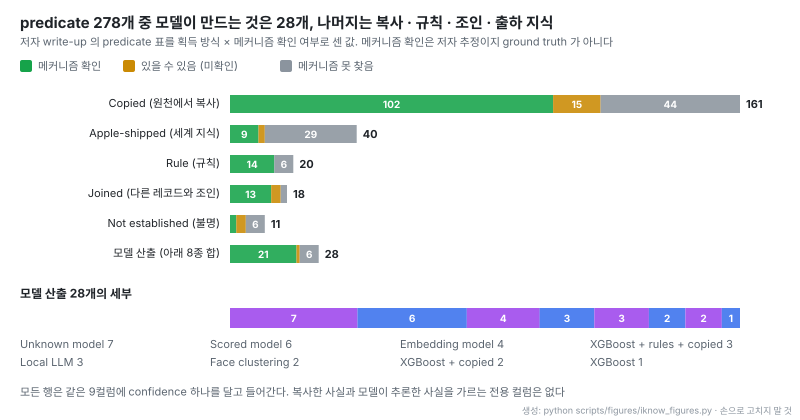
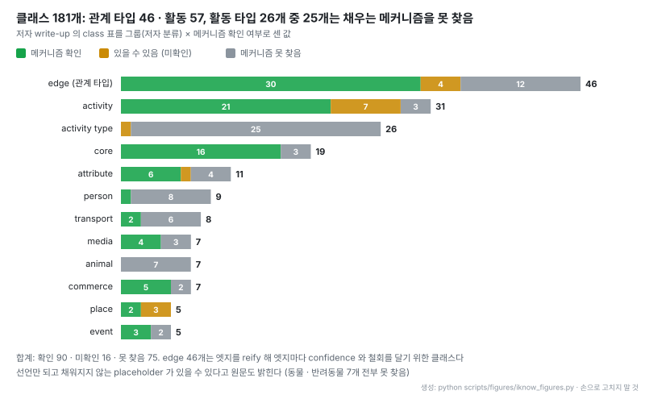

# iKnow: macOS가 사용자에 대해 쌓는 개인 지식 그래프를 읽기 전용으로 열어 보는 도구

출처: [iKnow README](https://github.com/8rank/iKnow/blob/2737128455d5df56b32a89e61844574ae0184dc5/README.md) (Apache-2.0). README는 "No name, number or count in it is real."이라고 밝힌다

- **원문**: [8rank/iKnow](https://github.com/8rank/iKnow) (설명: "Viz. Apple IntelligencePlatform store")
- **저자 write-up**: [Anatomy of Apple's Personal Knowledge Graph](https://8rank.ai/game/apple-intelligence-personal-knowledge-graph), the Eighth Rank, 2026-10-28, Dario Pasquini · Michał Bazyli
- **에이전트용 문서**: [MANUAL_FOR_YOUR_AGENT.md](https://github.com/8rank/iKnow/blob/2737128455d5df56b32a89e61844574ae0184dc5/MANUAL_FOR_YOUR_AGENT.md)
- **저장소 생성**: 2026-09-15 (첫 공개 커밋 2026-10-21). 읽은 커밋 `2737128` (2026-11-08), 커밋 4개
- **코드**: 라이선스 Apache-2.0, Python 표준 라이브러리 서버 + 바닐라 JS, 별 436개 · 포크 24개 (2026-11-09 기준), 기여자 2명. 서버 570줄, `api/` 모듈 13개, 화면 코드까지 합쳐 25,175줄. README 끝에 "iKnow is fully LLM-generated and may not be 100% accurate."라고 적혀 있다
- **테스트 환경**: macOS 26.6.2 · 26.7.1 · 27.0.1 (27은 일부 페이지 불완전)
- **읽은 날짜**: 2026-11-09
- **태그**: #KnowledgeGraph #PersonalKnowledgeGraph #Provenance #Privacy #Ontology

!!! note "핵심 요약"
    macOS는 `knowledgeconstructiond` · `intelligenceplatformd` 두 데몬으로 연락처 · 사진 · 캘린더 · 메시지 메타데이터를 엮어 사용자와 주변 사람에 대한 triple store를 만든다. 클래스 181개, predicate 278개의 온톨로지를 쓰고, 엣지는 reify되어 엣지마다 confidence · 출처 비트마스크 · 원천 레코드 목록을 갖는다. iKnow는 이 저장소를 `mode=ro`로만 열어 127.0.0.1 대시보드로 보여 주는 도구다. 저자 집계로 predicate 278개 중 161개는 원천에서 복사한 값이고 모델이 만드는 것은 28개다(가족 판정 XGBoost, 동일인 판정 임베딩, 온디바이스 LLM 등). 문제는 복사한 사실과 추론한 사실이 같은 9컬럼에 섞여 confidence 하나로만 구분되고, 그 confidence조차 "어느 ingest가 썼는가"를 주로 반영한다는 점이다. 철회한 사실은 지워지지 않고 `expired_*` 표로 옮겨지며, 가족 점수표는 그래프가 지운 사람을 하루 넘게 계속 채점한다. 도구 자체보다 더 쓸모 있는 것은 그래프를 읽을 때 틀리는 17가지 함정을 정리한 에이전트용 매뉴얼과, 위상은 남기고 이름만 바꾸는 fail-closed 가리기 모드다.

## 1. 개요

write-up은 macOS에 들어 있는 데몬 하나의 man 페이지에서 출발한다. 공식 설명은 "analyzes the content on this device to help build a knowledge graph representing the device and the user" 수준이 전부다. 저자들은 2026년 8월 이 저장소를 직접 마주쳤고, 같은 데이터베이스를 먼저 다룬 [Nic Lydon의 글](https://dev.to/niclydon/i-built-a-personal-knowledge-graph-apple-had-already-built-one-on-my-laptop-54l8)과 iPhone 쪽을 본 [iLEAPP](https://github.com/abrignoni/iLEAPP)의 [분석 글](https://leapps.org/blog-post?post=apple-intelligence-platform-knowledge-graph)을 선행 작업으로 든다. Apple은 그래프 구축 기법 자체를 [Growing and Serving Large Open-domain Knowledge Graphs](https://arxiv.org/pdf/2305.09464)(SIGMOD 2023)로 공개했지만, 어느 버전에서 무엇을 모으고 무엇을 추론하는지는 문서화하지 않았다는 것이 저자들의 문제 제기다.

iKnow는 그 빈칸을 채우는 열람 도구다. README가 정한 성격은 분명하다.

> "The code carries the queries; your Mac carries the answers."

코드에는 데이터가 하나도 없고, 페이지를 열 때마다 저장소에 질의해 그린다. 추출이나 복사 단계도 없다.

## 2. 저장소 구성

데몬들은 `~/Library/IntelligencePlatform`에 SQLite 51개를 평문으로 둔다. 보호 장치는 TCC Full Disk Access 하나다. 핵심 파일과 역할은 다음과 같다.

| 파일 | 내용 |
|---|---|
| `graph.db` | 그래프 본체. `stable_graph`(사람 · 조직 · 장소 · 그룹 · 앱 · 소유자), `event_graph`(캘린더 이벤트 · 예약), 철회 행을 담는 `expired_*`, `graph_state` |
| `ontology.db` | `class`, `predicate` 표. 모든 코드를 해석한다 |
| `entityTagging.db` | 관계 점수표. 사람당 1행, 관계 컬럼 17개 |
| `siri/remembers/view.db` | 상호작용 로그. 메시지와 통화의 메타데이터만, 본문 없음 |
| `internal/views.db` | handle · 사진 인물 id 매핑, 별칭, 행동 이벤트 스트림 |
| `entityRelevanceInferences.db` | 관련도 순위와 Apple 자신의 기여도 설명 JSON |
| `globalKnowledge.db` | 개인 데이터가 아닌 Apple 참조 지식과 기기 밖 조회 캐시 |

그래프는 연락처(AddressBook), 사진(Photos.sqlite), 캘린더, 메시지(chat.db) 네 원천 저장소를 가리키는 참조로 바깥과 이어진다. 매뉴얼에 따르면 빌드는 하루에 한 번쯤, 전원이 연결됐을 때, 원천별 단계로 돈다.

## 3. 트리플 스키마와 reification

`stable_graph` · `event_graph`와 `expired_` 쌍은 같은 9컬럼을 쓴다.

| 컬럼 | 뜻 |
|---|---|
| `subject` | 엔티티 id (signed 64-bit) |
| `predicate` | 온톨로지 코드 (`PS33`, `nm_bundleID` 등) |
| `relationshipId` | 0이면 단순 속성, 아니면 reify된 statement의 id |
| `relationshipPredicate` | statement의 facet 이름 |
| `object` | 값. 무엇을 담든 TEXT |
| `sources` | 이 행을 쓴 ingest의 비트마스크 |
| `confidence` | 0~1 |
| `sourceDuplicates` | 근거 원천 레코드 목록, `char(30)` 구분 |
| `timestamp` | 행을 쓴 시각 (사건 시각 아님) |

엣지는 행 하나가 아니다. write-up의 예에서 "소유자의 고용주는 Halden Labs"라는 엣지 하나는 `relationshipId`를 공유하는 두 행으로 저장된다. 한 행은 facet `PS1`에 관계 타입 `CS165`(employment)를, 다른 행은 facet `PS45`에 조직 엔티티 id를 담는다. 관계 타입 클래스 46개가 바로 이 reification을 위해 존재하고, 덕분에 엣지가 자기 confidence를 갖고 나중에 따로 철회될 수 있다. 대가는 집계다. 매뉴얼은 "Counting rows counts facets, not facts."라고 경고한다.

다른 엔티티 참조는 `md:<id>` 문자열이고, 바깥 저장소 참조는 `cnContact:` · `phPerson:` · `ekEvent:` 같은 접두어로 구분한다. `ekEvent:`와 앱을 가리키는 `lsBundleRecord:`는 원래 식별자의 salt 없는 SHA-256을 base64로 쓴 값이라 원천에서 다시 계산하면 그대로 맞는다. 매뉴얼의 표현으로 "pseudonymous, not anonymous"다. 네임스페이스를 `:`로 쪼개 찾으면 안 된다는 점도 실측으로 든다. 콜론이 들어 있지만 참조가 아닌 object가 stable 층에 118개, event 층에 1,167개 있었다(캘린더 설명, JSON 날짜, URL).

## 4. 출처 표시: confidence, sources, sourceDuplicates

모든 행에 confidence가 붙지만, 매뉴얼은 이 값을 확실성으로 읽지 말라고 한다. 확인한 저장소에서 confidence는 쓴 ingest를 주로 따라갔다. 연락처 1.0, 사진 0.9, 나머지 대부분 0.7~0.8이다.

> "A 0.8 may mean 'written by a 0.8 source'."

출처를 더 직접 말해 주는 것은 `sources` 비트마스크다. 저자들이 경험적으로 맞춘 비트는 0 연락처, 1 Intents, 5 사진 얼굴 클러스터, 8 캘린더, 10 Suggestions 연락처, 11 Suggestions 이벤트, 13 Family Sharing, 15 앱 카탈로그다. 비트마스크라서 `GROUP BY sources`로 묶으면 조합마다 따로 세어져 틀린다. 가장 직접적인 답은 `sourceDuplicates`로, 그 행을 만든 원천 레코드들이 들어 있다.

`certainty` 페이지는 이 구분 문제를 정면으로 다룬다. 모듈 설명이 요점을 담는다.

> "An inferred fact and a copied one live in the same table, in the same nine columns, with the same predicate vocabulary."

그래서 페이지는 confidence를 구간으로 묶지 않고 원래 해상도로 그리고, 1.0을 기준으로 저장소를 둘로 나눈 뒤 그 아래 쪽을 predicate별로 정렬해 보여 준다.

## 5. 무엇이 어떻게 채워지는가

write-up은 predicate 278개 전부에 대해 무엇을 기록하는지, 어느 원천에서 오는지, 어떻게 얻는지를 표로 정리했다. 그 표를 획득 방식과 메커니즘 확인 여부로 다시 센 것이 아래 그림이다.

- 절반 넘게(161개)가 원천에서 그대로 복사한 값이고, 40개는 Apple이 출하한 세계 지식, 38개는 규칙과 조인이다. 모델이 만드는 predicate는 28개다
- 모델 28개에는 동일인 판정(`PS102`, 임베딩), 별칭, 추정 생일, 장소 용도(집 · 체육관), 이름 없는 얼굴에 붙이는 추정 이름, 소유자와의 추정 관계가 들어간다. `nm_inferenceFeedbackID`는 원문 표현으로 "handle marking a machine-made claim"이다
- "메커니즘 확인"은 저자들이 해당 값을 채우는 코드를 찾았다는 뜻이고, 원문도 ground truth가 아니라 추정이라고 밝힌다

모델 쪽 설명은 이렇다. XGBoost 이진 분류기 두 개(`EntityTagging_Family`, `EntityTagging_FamilyAndFriends`)가 144개 feature로 가족 여부를 판정하고, 임베딩 모델 두 개는 동일인 판정 신호 10개 중 하나로 쓰인다. 사진 쪽 분석기 12개가 함께 찍힌 사진을 근거로 partner · parent · child · coworker · friend 점수를 매기고, Apple Intelligence가 켜져 있으면 온디바이스 LLM이 메시지를 읽어 얼굴에 이름과 관계를 붙인다.

## 6. 온톨로지 클래스

- 클래스 181개 중 46개가 관계 타입(3절의 reification용)이고, 57개가 활동과 활동 타입이다. write-up은 "nearly a third of the vocabulary went on what you are doing"이라고 정리한다
- 활동 타입 26개 중 25개, 동물 · 반려동물 7개 전부는 채우는 메커니즘을 찾지 못했다. 선언만 되고 쓰이지 않는 placeholder일 수 있다고 원문도 적는다
- 그룹 이름(core, edge, activity 등)은 저자 분류이고, id와 라벨은 Apple 것이다

## 7. 가족 점수표

가족 점수는 triple store가 아니라 `entityTagging.db`에 따로 있다. 사람당 1행, family부터 mother · coworker까지 관계 컬럼이 17개이고 매일 다시 계산된다. 그중 shipped 모델이 뒤에 있는 것은 2개뿐이고 나머지 15개를 무엇이 채우는지는 추적하지 못했다고 저자들은 쓴다.

144개 feature의 이름은 모델 메타데이터에 평문으로 있다. 구성은 신원 20개, 소통 40개, 사진 84개다. 같은 성(`sameLastName`), 같은 집 주소, iCloud 가족 여부 같은 신원 feature는 작은 쪽이고, 나머지는 누구와 언제 어떻게 연락하는지와 사진에 누가 함께 나오는지를 요일 · 시간대 · 장소로 나눈 값이다. write-up이 예로 드는 feature 이름은 `photosPersonPosteriorProbabilityGivenSaturdayNight`다.

`kinship` 페이지는 이 표를 설명하지 않고 잰다.

- 모든 컬럼이 0인 죽은 컬럼과 서로 똑같은 컬럼을 벡터 비교로 찾는다
- 어떤 컬럼이 다른 컬럼들의 정확한 합인지를 부분집합 전수 탐색으로 확인한다(어머니 · 아버지 → 부모 같은 rollup을 가정하지 않고 검사)
- 0이 아닌 값이 몇 단계로 양자화되어 있는지 센다. fixture 설명 기준으로 0.125, 0.25, 0.5, 0.96 정도이고 대부분은 기본값 하나에 몰린다
- feature 증거를 풀 때 "평가됐다"와 "참으로 나왔다"를 구분한다
- 서로 다른 표 9곳(partner 컬럼, 합성 점수, household 그룹, Family Sharing 토큰, iCloud 가족 플래그, 12개월 최다 연락, 사진 얼굴 클러스터, 연락처 레코드, 연락 가능한 handle)이 같은 사람을 가리키는지 세어 수렴도를 보여 준다. fixture에서 어머니는 9곳 중 8곳, 아버지와 partner는 7곳이 일치했다

저자들의 실제 Mac에서는 어머니만 최고값에 닿았고, 나머지 몇 사람은 모든 가족 라벨에 작은 값을 하나씩 받았다고 write-up은 적는다. 화면의 점수는 실제보다 후한 가짜 값이다.

## 8. 철회는 삭제가 아니다

철회된 행은 DELETE되지 않고 `expired_stable_graph` · `expired_event_graph`로 INSERT된다. 같은 9컬럼에 기본키가 없고, 믿어지던 동안의 confidence와 출처 비트마스크를 그대로 갖는다. `retractions` 페이지는 각 철회 행을 살아 있는 층과 대조해 넷으로 나눈다.

| 분류 | 조건 |
|---|---|
| reasserted | 같은 subject · predicate · facet · 값이 지금 살아 있음 |
| superseded | 같은 subject · predicate는 살아 있고 값이 바뀜 |
| withdrawn | subject는 살아 있고 그 predicate만 사라짐 |
| entity gone | subject 자체가 사라짐 |

매뉴얼은 "Many expired rows are rewrites, not deletions."라고 정리한다. 보관 기간은 `graph_state.expiredTriplesPruneTimestamp`가 정하고 측정한 곳에서는 48시간이었지만, write-up은 자기 Mac에서 아주 오래된 레코드도 읽혔다고 적어 둘이 어긋난다. 원문도 얼마나 남는지 분명하지 않다고 쓴다.

더 눈에 띄는 것은 파생 표의 지연이다. 그래프가 전날 지운 두 사람(둘 다 캘린더 초대로만 알려진 사람)을 가족 점수표는 계속 채점하고 있었다. 점수표에는 timestamp가 없어서, 매뉴얼은 `mdid`가 `stable_graph`에 아직 행을 갖는지 먼저 확인하라고 한다. macOS 27.0.1로 올렸을 때는 그래프가 연락처 · 캘린더 · Suggestions · Family Sharing · 앱 카탈로그에서 만든 행 대부분을 철회했다가 다음 날 다시 지었다.

## 9. iKnow의 구조

| 결정 | 내용 |
|---|---|
| 실행 | Python 표준 라이브러리 단일 프로세스. 의존성 · 빌드 · CDN 없음 |
| 바인딩 | 127.0.0.1 고정, 바꾸는 플래그 없음. 기본 포트 8765 |
| 접근 토큰 | 시작마다 `secrets.token_urlsafe(32)`. 링크로 한 번 열면 HttpOnly · SameSite=Lax 쿠키로 바꾸고 주소창에서 지운다. 비교는 `hmac.compare_digest` |
| 기타 차단 | Host 헤더 allowlist로 DNS rebinding을, Content-Security-Policy로 외부 요청을 막는다 |
| 읽기 | 모든 SQLite 핸들 `mode=ro`, 요청 스레드마다 연결. 값은 디스크 · 로그에 남지 않는다 |
| 확장 | `api/*.py` 중 `ROUTES` dict를 가진 모듈을 자동 마운트. 페이지를 더해도 서버를 고치지 않는다 |
| 권한 | 터미널 앱에 Full Disk Access. 시작할 때 저장소마다 `ok` / `DENY`를 찍고, 끝낼 때 권한을 다시 끄라고 안내한다 |

README는 토큰의 한계도 적는다. 루프백이 다른 기기를 막고 토큰이 다른 프로그램 · 계정 · 브라우저 안 웹 페이지를 막지만, 같은 사용자로 돌면서 터미널이나 브라우저 기록에 접근하는 프로그램은 막지 못한다. "It is not a sandbox"라는 문장으로 정리한다.

빈 결과 처리 규칙도 눈여겨볼 만하다. 열 수 없는 저장소나 이 버전 스키마로 돌지 않는 질의는 페이지를 죽이지 않고 빈 값으로 내려가되, 요청마다 읽지 못한 것을 ledger(`begin()`, `gaps()`)에 모아 페이지 제목 아래에 표시한다. 이유는 한 문장이다.

> "an empty panel would otherwise read as a measured zero"

Apple이 macOS 버전마다 컬럼을 더하고 이름을 바꾸기 때문에, 다른 사람의 Mac에서는 저장소 모양이 코드가 가정한 것과 다른 것이 정상이라는 전제다. `exposure` 모듈도 같은 태도로 함정 두 개를 막는다. 한 번도 실행되지 않은 리스너의 시각 0.0은 NULL이 아니라 2001-01-01로 찍히고, `errorMessage`는 NULL이 아니라 빈 문자열인 경우가 많다.

## 10. 페이지 구성

write-up이 묶은 순서대로 정리하면 다음과 같다.

| 묶음 | 페이지 | 보여 주는 것 |
|---|---|---|
| 시작 | 랜딩 · 소셜 그래프 | 소유자 주변 사람 그래프, 공유 회의 · 그룹 채팅 · 친밀도로 묶은 원 |
| 결론 | 가족 점수표 · 얼굴 · 추론 여부 | 7절의 점수표, 사진만으로 만든 얼굴 공동 출현 그래프, confidence 분포 |
| 기록 | 1년 연락 · 캘린더 · 철회 | 사람별 수신 · 발신 · 통화, 요일 × 시간 히트맵, 미래 일정, 8절 |
| 기계 장치 | 저장소 · 기기 지문 · 누가 읽는가 | 실제 행 두 개를 펼친 구조, 앱 목록과 SHA-256 토큰 재계산, 그래프를 구독하는 view와 사본 |

소셜 그래프는 저장소에 있던 그룹과 요청 시점에 계산한 클러스터를 한 그림에 그리되, 모든 클러스터와 엣지에 `origin`을 `stored` 또는 `derived`로 붙인다. 묶는 기준값(Jaccard 0.5, 친밀도 0.5, 공유 handle 2개)은 요청 파라미터이고, 응답은 실제로 적용된 값을 돌려주며 기준을 바꿨을 때 원 개수가 어떻게 움직이는지도 함께 준다.

얼굴 그래프는 연락처 · 메시지 · 캘린더 없이 사진 한 가지만으로 만든다. 이름은 거의 붙지 않지만(fixture에서 29개 중 3개), 누가 누구 옆에 자주 서고 어떤 무리가 한 번도 같이 찍히지 않는지는 이름 없이도 드러난다는 것이 write-up의 지적이다. 연락 히트맵도 같은 논리다. 수면 시간을 저장한 곳은 없지만 1년 치 타임스탬프를 한 주로 접으면 매일 새벽 1시부터 7시까지 빈 띠가 나온다.

## 11. 에이전트용 매뉴얼

`MANUAL_FOR_YOUR_AGENT.md`는 셸을 가진 코딩 에이전트에게 주는 문서다. 저장소 위치, 읽기 전용으로 여는 법, 표와 코드의 뜻, 원천 저장소로 조인하는 법, 오해를 부르는 컬럼을 담는다. 구성이 그 자체로 그래프용 에이전트 문서의 좋은 본보기다.

| 절 | 내용 |
|---|---|
| §0 먼저 묻기 | 읽기 전에 모델과 제공자를 밝히고, 정해진 질문을 그대로 묻고, 명시적 yes를 기다린다. "Until the answer is yes, read nothing" |
| §1 규칙 | 쓰기 금지, `ATTACH`도 `mode=ro` URI로, `immutable=1` 금지(WAL의 최신 사실을 숨김), 디스크 복사 금지, 질문에 필요한 만큼만, "Measure, don't repeat" |
| §4~5 스키마와 어휘 | 9컬럼, reification, 네임스페이스 표, 출처 비트, 자주 쓰는 코드 |
| §6~7 레시피 | 사람 찾기, 한 엔티티 전부, 점수표, 소통, 캘린더, 철회, 원천 저장소 조인 SQL |
| §8 함정 17개 | 에러 없이 틀린 답을 내는 경우만 모음 |
| §11 답하는 법 | 어느 층(복사된 연락처 카드, 추론된 점수표, 상호작용 로그)에서 온 답인지 밝히고, 분모를 주고, "the store says"로 말하고, 없다는 것도 결과로 보고한다 |

§8의 함정은 개인 그래프에만 해당하지 않는다. 비트마스크를 `GROUP BY`하기, JSON 날짜를 숫자로 캐스팅해 모든 이벤트가 2001-01-01에 떨어지기, 행을 쓴 시각을 사건 시각으로 읽기, 2^53을 넘는 id를 JavaScript 숫자로 다루기, 1초 차이로 읽은 두 저장소를 한 스냅샷으로 보기, 고정된 컬럼 목록을 가정하기 같은 항목은 reify된 triple store나 여러 원천을 조인하는 그래프라면 어디서든 생긴다.

write-up은 이 매뉴얼을 줄 때 "Please point a self-hosted model at it, not a cloud one."이라고 덧붙인다. 대시보드는 아무것도 기기 밖으로 보내지 않지만, 에이전트는 읽은 내용을 모델 제공자에게 보내기 때문이다.

## 12. 화면 공유 모드

사이드바 스위치를 켜면 모든 API 요청에 `redact=1`이 붙고, 서버가 직렬화 전에 응답을 바꾼다. 사람 이름 · 전화번호 · 메일 · 주소만 `Person 17`, `Phone 4` 같은 번호 대역으로 바꾸고, 숫자 · id · 날짜 · predicate · 온톨로지 라벨은 그대로 둔다. 그래서 그래프 모양과 모든 개수가 유지된다. 실제 문자열은 프로세스 밖으로 나가지 않으므로 공유 화면의 브라우저는 그 값을 갖지 않는다.

| 규칙 | 이유 |
|---|---|
| 고유 문자열 하나에 대역 하나, 공유하지 않음 | 달랐던 라벨이 가린 뒤에도 달라, 라벨로 키를 잡은 표나 그래프가 행을 합치지 않는다. 대가로 "Mario Rossi"와 "Mario"는 같은 사람이어도 대역 두 개가 된다 |
| 문자열만 바꾸고 숫자는 건드리지 않음, dict 키도 같은 함수로 | handle로 키를 잡은 맵이 그대로 조회된다 |
| 온톨로지 단어 · 월 · 요일과 같은 별칭은 목록에서 뺌 | "mother", "May" 같은 라벨과 날짜가 깨지지 않는다 |
| 일반 영단어와 같은 한 단어 이름은 긴 텍스트 안에서 대문자일 때만 바꿈 | 주변 문장이 살아남는다 |

대역 번호는 섞은 순서로 매겨 순위 정보를 담지 않고, 프로세스가 살아 있는 동안만 메모리에 있다. 대상 목록을 만들지 못하면 그대로 내보내지 않고 예외를 낸다. 원문 표현으로 "this mode fails closed"다.

## 13. 누가 이 그래프를 읽는가

매뉴얼은 확인된 것과 확인되지 않은 것을 나눠 적는다. 그래프를 읽는 프로그램은 `com.apple.private.intelligenceplatform.*` 비공개 entitlement를 가진 것들이고, 각자 읽을 수 있는 view 목록을 갖는다. Siri 추론 데몬이 가장 넓고, Apple Intelligence 런타임(`generativeexperiencesd`)이 그래프 층을 읽을 수 있다. 서드파티 프로그램에서는 찾지 못했지만 `/Applications`의 앱은 확인하지 않았다.

그래프 내용이 동기화되거나 업로드된다는 증거는 찾지 못했다. 매뉴얼은 이것을 "an open negative, not a clean one"이라고 부른다. 백업에 포함되는지는 결론을 내지 못했고, TCC와 FileVault 말고 별도 암호화는 없으며, 사용자가 추론을 고치거나 지울 수 있는 화면도 없다. 원천에서 연락처 · 일정 · 사진을 지우면 다음 실행에서 파생 사실이 빠지지만 점수표는 늦게 따라간다(8절).

## 14. 해석 시 주의

!!! warning "수치를 읽기 전에"
    - **한두 대의 Mac에서 잰 값이다.** 51개 데이터베이스, confidence 분포, 48시간 보관 같은 수치는 저자들이 본 저장소 기준이고, macOS 버전마다 스키마가 바뀐다. 이 노트는 도구를 직접 실행해 확인하지 않았다
    - **"메커니즘 확인"은 저자 추정이다.** 클래스 90개 · predicate 161개의 "implemented" 표시는 채우는 코드를 찾았다는 뜻이지 실제로 채워진다는 증명이 아니다
    - **출처 비트는 경험적으로 맞춘 것이다.** 0 · 1 · 5 · 8 · 10 · 11 · 13 · 15번 비트 외에는 해석하지 못했고, 점수표 내부 임계값과 행동 히스토그램 BLOB도 풀지 못했다
    - **화면 수치는 가짜 데이터다.** README · write-up의 스크린샷과 가족 점수, 9곳 중 8곳 일치 같은 값은 fixture 기준이고 실제보다 후하다
    - **코드는 LLM이 생성했다.** README가 그렇게 밝히고 정확성을 보장하지 않는다. 커밋 4개, 기여자 2명의 젊은 저장소다
    - **권한 범위가 넓다.** Full Disk Access는 iKnow만이 아니라 그 터미널 앱에서 돌리는 모든 것에 적용된다

## 15. 관련 노트

- [OntoSmith](./[20261022]%20Dongbumlee_ontosmith_온톨로지우선_판정게이트_지식그래프빌더.md): 모든 트리플을 근거 span까지 거슬러 올라갈 수 있게 짓는 빌더. iKnow가 보여 주는 저장소는 반대로 복사와 추론이 confidence 하나로만 갈린다
- [kgdiff](./[20261101]%20iiwish_kgdiff_지식그래프_버전간_의미diff_리뷰.md): 그래프 버전 사이 차이를 리뷰하는 도구. iKnow의 철회 분류(reasserted · superseded · withdrawn · entity gone)와 같은 문제를 빌드 쪽에서 다룬다
- [Graphicle](./[20261014]%20Graphicle-AI_graphicle_코딩에이전트용_코드그래프_메모리.md): 코딩 에이전트용 그래프 메모리. 에이전트가 그래프를 읽게 할 때 무엇을 문서로 줘야 하는지 비교할 수 있다

## 16. 결론

iKnow는 개인 비서용 지식 그래프가 실제로 어떤 모양인지 보여 주는 드문 사례다. reify된 엣지, 엣지마다 붙는 confidence와 출처 비트마스크, 원천 레코드 목록, 철회 행을 보관하는 별도 표까지 설계 요소는 갖춰져 있다. 그런데도 읽는 쪽에서는 복사한 사실과 추론한 사실을 가를 수 없고, confidence는 쓴 ingest의 고정값에 가깝고, 파생 점수표는 원본 그래프보다 늦게 지워진다. 출처 컬럼을 두는 것과 그 컬럼이 "누가 단정했고 무엇이 추론인가"에 답하게 만드는 것은 다른 문제라는 점이 이 저장소에서 가장 분명하게 드러난다.

도구 쪽에서 가져갈 것은 세 가지다. 읽지 못한 것을 0과 구분해 화면에 밝히는 gaps ledger, 위상과 개수는 남기고 개인 식별 문자열만 바꾸되 실패하면 내보내지 않는 가리기 모드, 그리고 에러 없이 틀린 답을 내는 함정만 모은 에이전트용 매뉴얼이다. 여러 원천을 조인하는 그래프를 사람이나 에이전트가 직접 질의하게 하는 시스템이라면 이 세 가지는 대상 데이터와 상관없이 옮겨 쓸 수 있다.
