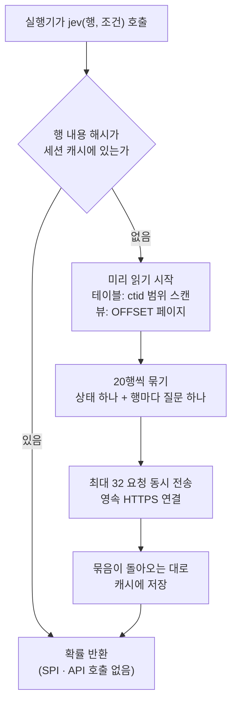
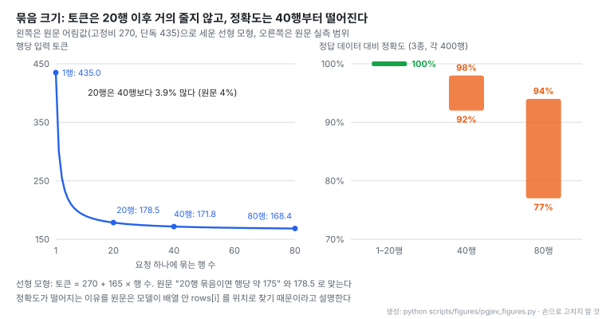
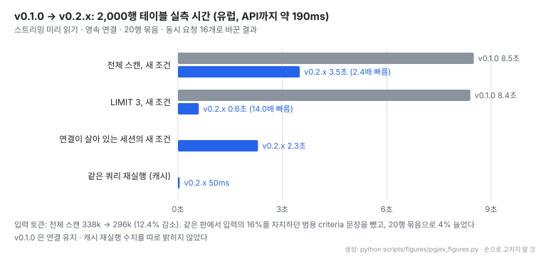

# pg-jev: Postgres 테이블에 자연어 조건을 거는 확장과 행 묶음 판정 파이프라인


출처: [pg-jev README 머리 그림](https://github.com/realZachi/pg-jev/blob/e3450d44f7f6745aa2d728c9289b9ca4a6feda9a/README.md)

- **레포**: [realZachi/pg-jev](https://github.com/realZachi/pg-jev) · [문서 사이트](https://pgjev.com) · [How it works](https://pgjev.com/docs/how-it-works) · [PGXN](https://pgxn.org/dist/jev/)
- **제작**: Zachi 개인 프로젝트, GitHub 기여자 2명, 커밋 13개. README는 TypeSafe와 관계없는 프로젝트라고 밝힌다
- **공개**: 2026-09-17 저장소 생성일. PostgreSQL License, 별 1,230개 · 포크 104개 (2026-10-30 기준)
- **읽은 판**: `v0.2.1` (2026-10-03), 커밋 `e3450d4` (2026-10-06)
- **구현 범위**: 확장 본체는 PL/Python(`plpython3u`) 함수를 담은 SQL 파일 하나(566줄)다. GitHub 언어 표시는 Shell이지만 실제 로직은 그 파일 안 Python이다. 회귀 테스트 4종은 결정적 모의 API로만 돈다
- **지원 환경**: PostgreSQL 14–17, `plpython3u`, superuser. Supabase · Neon · RDS 같은 관리형 DB에서는 설치할 수 없다
- **읽은 날짜**: 2026-10-30
- **태그**: #SemanticSQL #Postgres #Batching #Calibration #LLMasJudge #CostModel

!!! note "핵심 요약"
    `WHERE jev(people, 'the name is European')`처럼 SQL 조건 자리에 자연어 문장을 쓰면, 행마다 TypeSafe의 Jev 모델이 그 조건을 만족할 확률을 돌려주고 임계값(기본 0.5)으로 참 거짓을 정한다. 인덱스 · 임베딩 · 벡터 열이 없고 설계상 전체 스캔이다. 그래서 핵심은 판정 자체가 아니라 호출 비용을 줄이는 실행 방식에 있다. 테이블을 물리 순서로 미리 읽어 20행씩 한 요청에 묶고, 요청 32개를 영속 연결로 동시에 보내고, 답을 세션에 캐시한다. 2,000행 기준 첫 실행이 v0.1.0의 8.5초에서 3.5초로, `LIMIT 3`은 8.4초에서 0.6초로 줄었고 비용은 약 $0.012다. 반대로 행 내용이 외부 API로 나가고, 서브쿼리나 CTE 위에서는 미리 읽기가 안 돼 행마다 요청이 하나씩 나간다. 수치는 모두 저자 한 사람이 유럽에서 잰 값이다.

## 1. 개요

README 첫 문장은 "Write the condition the way you would say it. Postgres does the rest." 다. 확장을 설치하면 함수 열 개가 생기고, 그중 `jev()`는 평범한 boolean 함수라서 `AND age > 40`, 조인, `GROUP BY`, `LIMIT`, `ORDER BY jev_prob(...)`와 그대로 섞인다.

```sql
SELECT * FROM people WHERE jev(people, 'the name is European');

SELECT subject, jev_prob(tickets, 'the customer is angry') AS p
FROM tickets ORDER BY p DESC LIMIT 20;

SELECT jev_choice(tickets, 'which team should handle this?',
                  ARRAY['billing', 'technical', 'security', 'sales']) AS team, count(*)
FROM tickets GROUP BY 1;
```

자연어로 DB를 다루는 흔한 방식은 LLM이 SQL을 써 주는 text-to-SQL이다. pg-jev는 방향이 반대다. SQL은 사람이 쓰고, 열 값만으로는 정할 수 없는 의미 판단(이 고객이 화났는가, 이 이름이 유럽식인가)만 모델에 맡긴다. 판정 단위는 쿼리가 아니라 행이다.

## 2. 판정 모델: 생성하지 않고 확률을 돌려주는 Jev

행 판정은 [TypeSafe의 Jev](https://docs.typesafe.ai)가 맡는다. 저장소 문서는 이 모델을 "System One" 모델이라 부르고 "it does not generate text, it returns calibrated probabilities for typed questions over a JSON state" 라고 설명한다. 요청은 JSON 상태 하나와 유형이 붙은 질문 여러 개로 이뤄지고, 답은 문장이 아니라 확률이다.

| 질문 유형 | 돌려주는 값 | 쓰는 함수 |
| --- | --- | --- |
| noul (예/아니오) | 조건을 만족할 확률 하나 | `jev`, `jev_prob` |
| choice | 선택지별 확률, 가장 높은 선택지 | `jev_choice`, `jev_confidence` |
| score | 순서 있는 단계별 확률을 가중 평균한 위치 (0..n-1) | `jev_score`, `jev_score_norm` |

요금은 입력 100만 토큰당 $0.042이고 출력은 무료다(jev-1.13 정가). 같은 Jev 1.13.0을 LLM 판정기로 평가한 [JEV-as-a-Judge 노트](../papers/[20260928]%20JEV-as-a-Judge_Confidence_Cascade.md)도 같은 가격을 적었고, 그 논문은 확률 형태로 나온다고 보정이 보장되지는 않으며 보정 상태는 과제마다 다르다고 짚는다. pg-jev 문서가 "confidence values are real rather than self-reported" 라고 쓴 부분은 생성형 모델이 말로 밝힌 확신도와 비교한 주장이고, 과제별 보정 품질은 따로 확인해야 한다.

## 3. 함수와 설정

| 함수 | 반환 | 용도 |
| --- | --- | --- |
| `jev(row, condition [, threshold])` | boolean | `WHERE` 술어. 임계값은 인자 → `jev.threshold` → 0.5 순서로 결정 |
| `jev_prob(row, condition)` | float8 | 조건 만족 확률 0..1 |
| `jev_score(row, question, levels)` | float8 | 단계 확률의 가중 위치 |
| `jev_score_norm(row, question, levels)` | float8 | 위 값을 0..1로 정규화 |
| `jev_choice(row, question, options)` | text | 가장 그럴듯한 선택지 |
| `jev_confidence` · `jev_eval` | float8 · jsonb | choice · score 답의 확신도, 원본 답 전체 |
| `jev_stats()` · `jev_cache_clear()` | jsonb · void | 세션 요청 · 토큰 · 추정 비용 · 캐시 적중 집계, 캐시 비우기 |

공개 함수는 모두 얇은 SQL 함수이고, 실제 일은 내부 함수 하나 `_jev_eval(행 타입, to_json(행), 질문, 유형, 선택지)`가 한다. `jev()`는 `jev_prob() >= 임계값`일 뿐이다.

| 설정 | 기본값 | 역할 |
| --- | --- | --- |
| `jev.batch_size` | 20 | 요청 하나에 묶는 행 수 |
| `jev.concurrency` | 16 | 동시 요청 수. 실행기 앞에 최대 두 배까지 대기 |
| `jev.max_prefetch_rows` | 5000 | 미리 읽기가 찾아 나아가는 거리와 건너뛴 행 보관 수. 캐시 크기 제한이 아님 |
| `jev.timeout` · `jev.keepalive` | 30초 · 600초 | 요청 제한 시간, 쉬는 연결을 재접속하기 전 유지 시간 |
| `jev.model` | `jev-latest` | `jev-1.13.0`처럼 판을 고정할 수 있음 |
| `jev.api_url` | TypeSafe 엔드포인트 | 같은 계약을 따르는 로컬 서버로 바꿀 수 있음 |
| `jev.max_rows_per_statement` · `jev.max_chars_per_statement` | 0 (끔) | 문장 하나가 보낼 행 수 · 문자 수 상한 |

## 4. 실행 파이프라인

`jev()`는 행 하나를 받아 확률 하나를 돌려주는 함수처럼 보이지만, 행마다 API를 부르면 2,000행에 요청 2,000개가 나간다. pg-jev는 첫 호출에서 그 테이블을 통째로 미리 읽어 묶음 요청을 띄워 두고, 실행기가 다음 행을 물을 때는 이미 도착한 답을 캐시에서 꺼내 준다.



1. **행 입력과 캐시 키.** 행을 `to_json`으로 직렬화하고 sha1 해시를 만든다. 캐시는 (관계 타입, 질문, 유형, 선택지) 별 버킷 안에 행 내용 해시를 키로 둔다. 적중하면 SPI 호출도 API 호출도 없이 바로 돌아간다. 키가 행 위치가 아니라 내용이라서, 내용이 같은 행은 한 번만 판정된다.
2. **미리 읽기.** 테이블과 물리화 뷰는 `ctid >= (lo,0) AND ctid < (hi,0)` 범위 스캔으로, 뷰 · 파티션 테이블 · 외부 테이블은 `OFFSET/LIMIT`으로 SPI 페이지당 1,000행씩 물리 순서대로 읽는다. 테이블 전체를 먼저 메모리에 올리지 않으므로 테이블 크기와 관계없이 메모리가 일정하다.
3. **묶기.** 20행을 상태 하나 `{"condition": ..., "rows": [...]}`에 넣고, 행마다 "Does the record `rows[i]` satisfy the condition stated in `condition`?" 질문을 하나씩 붙인다. 모델은 상태 하나 위에서 질문 20개를 한 번에 답한다.
4. **동시 요청.** 세션별 스레드 풀이 최대 2 × 16 = 32 요청을 띄운다. 연결은 재사용하고 TCP keepalive(30초 쉬면 10초 간격 3회 탐지)를 건다. 각 행은 자기 묶음이 돌아오는 즉시 답을 받으므로, 실행기는 테이블 전체를 기다리지 않는다.
5. **순서 밖 행.** 인덱스 스캔 · 조인 · 역방향 스캔처럼 실행기가 물리 순서와 다르게 행을 물으면, 미리 읽기가 지나쳐 보관해 둔 이웃 행과 함께 묶어 보낸다.
6. **익명 record.** 서브쿼리나 CTE가 만든 행은 관계 이름이 없어 미리 읽을 수 없다. 이때는 행마다 요청이 하나씩 나간다. 문서는 이것을 "the single most common reason for a slow pgjev query" 라고 적는다.

이 구조 덕에 SQL의 평가 순서가 그대로 비용 절감 장치가 된다. `WHERE age > 60 AND jev(...)`에서 앞 조건이 거른 행은 `jev()`까지 오지 않아 판정되지 않고, `LIMIT`이 차면 실행기가 더 묻지 않아 미리 읽기도 동시 요청 창(32 요청) 뒤에서 멈춘다. 회귀 테스트도 이를 확인한다. 2,500행 테이블 전체 스캔은 정확히 요청 125개로 끝나고, `LIMIT 1`은 20~160행만 판정한다.

대기는 250ms 단위로 끊어 그 사이마다 `SELECT 1`을 실행한다. 그래서 `statement_timeout`과 취소 요청이 HTTP 제한 시간을 기다리지 않고 250ms 안에 먹힌다. 408 · 429 · 529 · 5xx는 `Retry-After`를 존중하며 최대 7회 재시도하고, 오래 쉰 연결은 보내기 전에 살아 있는지 확인해 끊긴 소켓에 요청을 보내지 않는다.

## 5. 20행 묶음의 근거

묶음을 크게 할수록 요청 고정비(약 270토큰)가 더 많은 행에 나뉘어 싸진다. 그런데 저자는 기본값을 40에서 20으로 내렸다. 이유는 정확도다. "Jev has to find `rows[i]` by position in the array, and that gets unreliable in long arrays."



- 오른쪽이 결정 근거다. 직함 · EU 회원국 여부 · 자유 텍스트 속 문구, 세 가지 정답 데이터(각 400행)에서 1–20행 묶음은 100% 맞았고 40행은 92–98%, 80행은 77–94%로 떨어졌다
- 왼쪽은 원문 어림값(고정비 약 270, 1행 단독 약 435, 20행이면 행당 약 175)이 서로 맞는지 노트가 선형 모형 `270 + 165 × 행 수`로 검산한 것이다. 20행은 178.5, 40행은 171.8토큰으로 원문 "20행이 40행보다 4% 더 든다"와 맞는다. 모형은 노트가 세운 것이고 원문이 밝힌 식이 아니다
- 20행 이후에는 토큰이 거의 줄지 않으니, 정확도를 내주고 묶음을 키울 이유가 없다. 문서는 요청 지연이 크기와 거의 무관해 속도도 같다고 적는다

행 너비를 1,000자로 늘려도 20행에서는 차이가 없었고, 행에 위치 번호 대신 이름을 붙이는 방법은 효과가 없었다고 한다. 즉 한계는 입력 길이가 아니라 배열 안에서 몇 번째 원소를 찾는 일 자체에 있다. 세 과제 · 400행씩이라는 표본은 작고, 과제가 모두 열 값에서 답이 거의 정해지는 구조적 판정이라 자유 서술 판정에서도 같은 경계가 나올지는 원문으로 알 수 없다.

## 6. v0.1.0에서 v0.2.x로 바뀐 것

v0.1.0(2026-09-17)은 테이블 전체를 `max_prefetch_rows`(5,000행)까지 먼저 읽은 뒤 40행씩 6개 동시 요청으로 보냈고, 5,000행을 넘는 행은 한 행씩 판정했다. 하루 뒤 나온 v0.2.0이 파이프라인을 스트리밍으로 바꿨다.



- 가장 크게 준 것은 `LIMIT`이다. 예전에는 테이블을 다 읽고 다 판정한 뒤에야 첫 행을 돌려줬으므로 `LIMIT 3`도 전체 스캔(8.4초)과 같았다. 스트리밍 뒤에는 0.6초다
- 연결 재사용 효과는 따로 재 있다. 요청마다 TLS 연결을 새로 맺으면 880ms, 재사용하면 300ms다. 새 연결의 첫 요청은 0.9–1.9초 걸려서, 연결이 살아 있는 세션의 새 조건(2.3초)이 처음 실행(3.5초)보다 빠르다
- 토큰이 12% 준 데는 질문마다 붙던 범용 criteria 문장("the record satisfies the condition")을 뺀 것이 들어 있다. 이 문장이 입력의 16%를 차지하면서 답을 하나도 바꾸지 않았다고 한다

| 변경 | v0.1.0 | v0.2.x |
| --- | --- | --- |
| 미리 읽기 | 테이블 전체를 먼저 읽음 | 물리 순서 스트리밍, 메모리 일정 |
| `batch_size` | 40 | 20 |
| `concurrency` | 6 | 16 ("The API handles 16 parallel requests without queueing") |
| `timeout` | 90초 | 30초, 250ms 안에 취소 가능 |
| 연결 | 요청마다 새 TLS | 영속 연결 + TCP keepalive |
| 직렬화 | `to_jsonb` (키를 길이순 정렬) | `to_json` (열 순서 보존) |

v0.2.1(2026-10-03)은 한 가지를 바꿨다. `jev.api_url`이 `*.typesafe.ai`가 아니면 API 키 없이 요청을 보낸다. [stuntd](https://github.com/bladedevoff/stuntd)나 laya-server처럼 같은 `POST /v1/systemone` 계약을 따르는 로컬 서버를 쓰면 행이 네트워크 밖으로 나가지 않고 행당 요금도 없다. 다만 `jev_stats()`의 비용 추정은 어느 서버든 TypeSafe 정가로 계산하므로, 로컬 서버에서는 실제 비용이 아니다.

## 7. 실측과 비용

| 상황 (2,000행, 유럽, API까지 약 190ms) | 결과 |
| --- | --- |
| 새 조건 첫 실행 | 약 3.5초, 요청 100개, 입력 약 296k 토큰, 약 $0.012 |
| 같은 쿼리 재실행 | 약 50ms (캐시) |
| 새 조건 `LIMIT 3` | 약 0.6초 |
| 연결이 살아 있는 세션의 새 조건 | 약 2.3초 |

비용은 `입력 토큰 × $0.042 / 100만`이다. 문서의 어림 규칙은 행당 약 175토큰, 즉 1,000행 약 $0.007, 10만 행 약 $0.7이다. 실측 296k 토큰을 2,000행으로 나누면 행당 148토큰이라 어림값보다 작다. 측정에 쓴 표의 열 구성이 공개되지 않아 차이의 원인은 확인할 수 없다(미검증). 비용은 행 수와 행 너비에 비례하므로, 문서가 권하듯 판단에 필요한 열만 고른 뷰를 만들어 그 뷰에 `jev()`를 거는 것이 가장 직접적인 절감 방법이다. 뷰도 테이블처럼 미리 읽고 묶는다.

공유 환경에서는 지출 상한 두 개가 있다. `jev.max_rows_per_statement`와 `jev.max_chars_per_statement`를 넘길 묶음이면 보내기 전에 오류로 문장을 멈춘다.

## 8. 조건을 잘 쓰는 법

문서의 요령은 짧다. Jev는 쓴 조건을 문자 그대로 판정한다.

- 조건을 구체적으로 쓴다. `'the customer threatens to leave, dispute a charge, or take legal action'`이 `'churn risk'`보다 낫다
- 산술 · 날짜 · 정확한 일치는 SQL에 두고 의미 판단만 모델에 맡긴다
- 임계값을 정하기 전에 `jev_prob()` 분포를 본다. 문서는 애매한 경우가 실제로 0.5 근처에 모인다고 적는다
- 보고서에 들어갈 결과면 `jev.model = 'jev-1.13.0'`으로 판을 고정한다. 모델 판이 바뀌면 답도 바뀔 수 있다

## 9. 해석 시 주의

!!! warning "운영 전에 확인할 점"
    - **행 내용이 외부로 나간다.** TypeSafe API를 쓰면 판정할 행이 HTTPS로 전송된다. 공유하면 안 되는 데이터에는 쓰지 말거나 로컬 호환 서버를 쓴다
    - **untrusted 언어.** `plpython3u` 함수는 DB 서버 프로세스의 OS 권한으로 돈다. superuser만 설치할 수 있다
    - **캐시는 세션마다 따로다.** 백엔드 세션의 PL/Python 전역(`GD`)에 쌓이고 `max_prefetch_rows`가 크기를 제한하지 않는다. 커넥션 풀은 세션마다 캐시를 새로 데우고, 오래 사는 세션에서 조건을 계속 바꾸면 메모리가 계속 는다
    - **함수 변동성.** 함수가 `STABLE`로 선언돼 있어 같은 문장 안에서는 같은 답을 가정하는데, 실제 답은 외부 모델이 정한다. 캐시가 있어 세션 안에서는 일관되지만, 세션이 바뀌거나 모델 판이 바뀌면 같은 쿼리가 다른 행을 고를 수 있다
    - **수치의 출처.** 시간 · 토큰 · 정확도는 모두 저자가 한 지역에서 한 번 잰 값이고 재현 스크립트는 저장소에 없다. 회귀 테스트는 모의 API로 묶음 수와 건너뛰기 동작만 확인한다

## 10. 관련 연구 · 도구

- [JEV-as-a-Judge (arXiv 2609.26550)](https://arxiv.org/abs/2609.26550) · [노트](../papers/[20260928]%20JEV-as-a-Judge_Confidence_Cascade.md): 같은 Jev 1.13.0을 판정기로 평가했다. 확신도가 높으면 받고 낮으면 비싼 LLM으로 넘기는 구성이 GPT-6 정확도의 99%를 유지했다. pg-jev에서 `jev_prob()` 분포의 애매한 구간만 다른 판정으로 넘기는 설계로 이어 볼 수 있다
- [stuntd](https://github.com/bladedevoff/stuntd): Jev API 계약을 따르는 로컬 서버. 답을 기록해 질문별 헤드를 학습한다고 README가 소개한다
- [TypeSafe Noul 문서](https://docs.typesafe.ai/primitives/noul): 예/아니오 질문 유형의 정의
- [Jev 1.13 판정 특성 문서](https://docs.typesafe.ai/model-jaggedness/jev-1.13): 조건 작성 요령의 원천으로 README가 가리키는 문서

## 11. 결론

pg-jev가 보여 주는 것은 "SQL 안의 LLM 호출"이 실제로 쓸 만해지려면 모델보다 실행기 쪽 설계가 중요하다는 점이다. 행 단위 함수라는 SQL의 인터페이스를 그대로 두면서, 안에서는 미리 읽기 · 묶기 · 동시 요청 · 내용 기반 캐시로 요청 수를 행 수의 1/20로 줄이고, 앞선 술어와 `LIMIT`이 비용을 자르도록 했다. 묶음 크기를 정확도 실측으로 정하고 기본값을 내린 판단도 설득력이 있다.

한계도 분명하다. 설계상 전체 스캔이라 큰 테이블에는 SQL로 먼저 줄인 뒤에만 쓸 수 있고, 데이터가 외부로 나가며, superuser와 `plpython3u`가 필요해 관리형 DB에서는 막힌다. 성능 수치는 저자 한 사람의 측정이다. 행마다 의미를 판정해야 하는 분류 · 선별 작업을 SQL 안에서 끝내고 싶은 자체 운영 Postgres라면 시도해 볼 만하고, 이때 판을 고정하고 `jev_prob()` 분포를 먼저 보는 습관이 필요하다.
