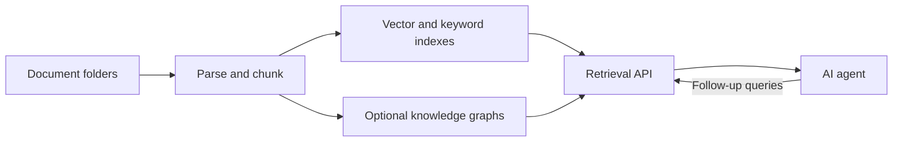
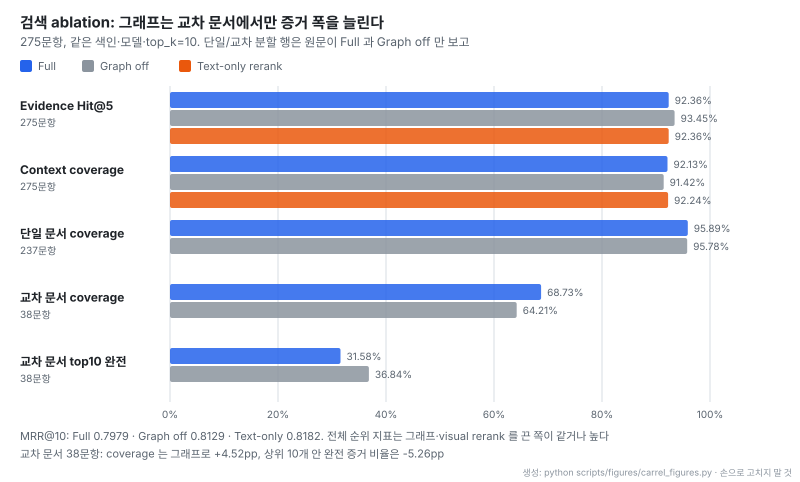
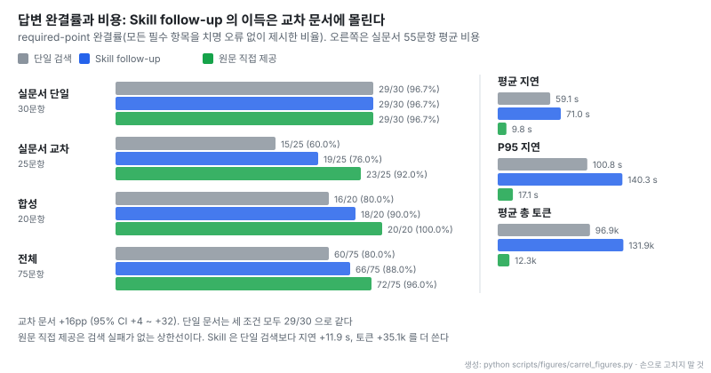
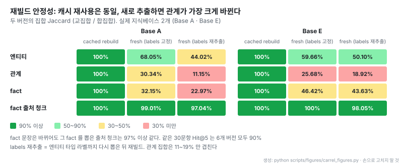

# Carrel: 온톨로지 증강 에이전트용 셀프호스팅 지식베이스

- **원문**: [FengZhenfei/carrel](https://github.com/FengZhenfei/carrel) (설명: "Ontology-Augmented Generation for AI agents.")
- **평가 보고서**: [0.4.0 capability evaluation](https://github.com/FengZhenfei/carrel/blob/7c449b7c33787a204efa91684f237dbe42f37ba2/docs/evaluations/capability-evaluations-0.4.0.md) · [아키텍처](https://github.com/FengZhenfei/carrel/blob/7c449b7c33787a204efa91684f237dbe42f37ba2/docs/architecture.md) · [검색 스킬](https://github.com/FengZhenfei/carrel/blob/7c449b7c33787a204efa91684f237dbe42f37ba2/skills/carrel-search/SKILL.md)
- **저장소 생성**: 2026-09-28 (GitHub created_at 2026-09-28T11:13:02Z, 첫 커밋 "Carrel 0.1.0: Ontology-Augmented Generation for AI agents")
- **코드**: 라이선스 MIT, 언어 Python, 별 738개 (2026-11-04 기준), 기여자 1명, 커밋 78개. 테스트를 뺀 Python 136개 파일 51,424줄, 테스트 59개 파일 37,145줄
- **릴리스**: v0.1.0 (2026-09-28) → v0.2.0 (10-04) → v0.3.0 (10-26) → v0.4.0 (2026-11-03). 읽은 커밋 `7c449b7`
- **스택**: MinerU · native parser (파싱), Qdrant (벡터), OpenSearch (키워드), Neo4j (그래프 질의), SQLite (파일 · 작업 상태). 영어 · 중국어 문서
- **읽은 날짜**: 2026-11-04
- **태그**: #KnowledgeGraph #Ontology #GraphRAG #HybridRetrieval #AgentSkill

!!! note "핵심 요약"
    Carrel은 문서 폴더를 파싱 · 청크 · 색인하고, 선택적으로 온톨로지 기반 지식 그래프를 만들어 에이전트에게 검색 API로 증거만 돌려주는 셀프호스팅 지식베이스다. 답 생성은 호출한 에이전트가 하고, 서비스는 증거 회수 · rerank · 배치만 한다. 그래프는 LinkML schema와 upper class 8개 위에서 엔티티 · 관계 · fact를 출처 · 시간 · 충돌 표시와 함께 저장하고, 범위가 정해진 교정(correction) API로 사람이 고칠 수 있다. 저자 자체 평가(지식베이스 5개, 파일 3,587개, 275문항)에서 증거 Hit@5는 92.36%지만 그래프를 켜도 전체 Hit@5 · MRR은 오르지 않았고, 교차 문서 38문항의 증거 포함 비율만 64.21%에서 68.73%로 올랐다. 에이전트가 검색 스킬로 추가 질의를 하면 교차 문서 25문항 완결률이 60%에서 76%로 올랐지만 지연과 토큰도 늘었다. 그래프를 새로 추출하면 관계 집합이 11~30%만 겹친다. 평가는 모두 저자 측정이다.

## 1. 개요

Carrel은 제품 문서, 연구 자료, 계약서, 회의록처럼 계속 바뀌는 파일 묶음을 에이전트가 쓸 수 있게 만드는 지식베이스다. README는 역할 분담을 이렇게 적는다.

> "Agents use its API to retrieve source passages, images, and related facts, then generate their own answers."

일반적인 RAG 서비스와 갈리는 지점은 두 가지다. 첫째, 서버는 답을 만들지 않는다. 검색 스킬 문서는 "The service only recalls, reranks and arranges evidence and does no generation."이라고 못박는다. 답을 쓰고, 증거가 모자란 곳을 골라 다시 묻는 것은 에이전트 쪽 일이다. 둘째, 그래프를 "답을 대신 말해 주는 구조"가 아니라 출처 · 시간 · 충돌을 붙든 증거 저장소로 다룬다. 기본 검색은 과거 · 미래 주장까지 남겨 두고, 시간을 명시한 질의만 그 시점 증거를 고른다.

저장소에는 한 가지 미완성 조각이 크게 표시돼 있다. 기업 온톨로지를 계속 학습하고 사람에게 확인 질문을 하며 교정 규칙을 유지하려는 Agent Loop 플러그인은 "in development and not yet implemented" 상태다. 지금 있는 것은 그 루프가 쓸 저장 · 검색 · 교정 인터페이스다.

## 2. 구조

README의 흐름도를 그대로 옮긴다.

출처: [Carrel README "How it works"](https://github.com/FengZhenfei/carrel/blob/7c449b7c33787a204efa91684f237dbe42f37ba2/README.md#how-it-works) (MIT)

- 에이전트에서 검색 API로 돌아가는 `Follow-up queries` 화살표가 이 설계의 핵심이다. 한 번의 검색으로 끝내지 않고 에이전트가 빈 곳을 골라 다시 묻는다
- 그래프는 `Optional`이다. 지식베이스마다 켜고 끈다. 파싱 · 색인과 그래프 구성이 따로 유지돼, 그래프를 다시 만들 때 파싱 결과와 청크를 재사용한다

| 구성 요소 | 역할 |
|---|---|
| SQLite | 파일 등록, 설정, 큐, 청크, 그래프 빌드 상태 |
| MinerU · native parser | 문서 구조와 내용 추출 |
| 모델 endpoint | 임베딩, 이미지 설명, 그래프 추출, 선택적 rerank |
| Qdrant | 청크 벡터와 버전이 붙은 그래프 증거 collection |
| OpenSearch | 키워드 색인 (`cjk` analyser) |
| Neo4j | 그래프 projection과 관계 질의 |
| 웹 콘솔 (9800) · 검색 API (9810) | 운영 설정 · 에이전트용 증거 검색 |

## 3. 수집 파이프라인

수집은 다섯 단계다.

1. **폴더 스캔**: 기록된 메타데이터와 체크섬을 비교해 새 파일과 바뀐 파일을 큐에 넣는다. 막 쓰이는 중인 파일은 미룬다. 삭제는 색인 수명주기로 넘어간다
2. **형식별 파싱**: PDF · DOCX · PPTX는 MinerU, 스프레드시트는 native table reader, HTML · Markdown은 문서 구조를 유지하고, 소스 코드는 심볼 단위로 나눈다. 그림과 독립 이미지는 별도 vision-language 모델이 설명을 붙인다
3. **청크**: 호환되는 텍스트 · 목록 · 쪼개진 표를 먼저 합친 뒤 토큰 한도로 자른다. 섹션 경로, 표 헤더, 페이지 · 슬라이드 · 행 위치를 보존한다
4. **임베딩과 색인**: 텍스트 임베딩에 문서와 섹션 맥락을 함께 넣는다
5. **상태 유지**: parser version이 바뀌면 재처리 대상이 되고, lease · retry · cache로 중단된 작업을 이어 간다

R, Jupyter Notebook, TeX, JSONL, Nextflow · CWL · WDL 같은 연구용 형식 reader가 따로 있는 점이 눈에 띈다. 노트북은 셀 번호와 저장된 출력까지, JSONL은 줄 번호까지 남긴다. 표에서 원문 텍스트가 비어 있으면 화면 캡처 기반 검토로 채우되, 행 정체성 · 값 · 단위가 맞지 않으면 원래 표를 그대로 둔다.

## 4. 그래프 구성과 온톨로지

그래프 구성은 여섯 단계다.

| 단계 | 내용 |
|---|---|
| Schema preparation | 버전이 붙은 LinkML schema. upper class 8개, 상속 타입, identity scope, 관계 정의 |
| Extraction | 청크를 extraction unit으로 묶어 엔티티 · 관계 · 구조화 fact를 출처와 함께 수집 |
| Deterministic routes | 코드 · 설정 구조는 LLM 없이 직접 추출. 표는 열 역할을 추론해 행을 엔티티와 qualified fact로 변환 |
| Merge and reconciliation | 엔티티와 속성 개념을 resolve, 단위 정규화, 충돌 증거와 시간 정보 보존 |
| Derived views | 주제 · 타임라인 · 출처 페이지를 fact와 관계에서 컴파일 |
| Publication | 버전이 붙은 Qdrant graph collection과 Neo4j projection을 쓰고 실패 · rollback 검사 후 활성화 |

upper class는 `agent`, `entity`, `part`, `property`, `process`, `event`, `concept`, `document` 8개다. 그 아래 타입은 문서 샘플에서 유도한다. 추출 프롬프트는 Microsoft [GraphRAG](https://github.com/microsoft/graphrag) 3.1.2의 record grammar · few-shot · gleaning loop에서 파생해 타입 메뉴와 측정 fact를 더해 다시 썼다고 NOTICE에 밝힌다.

스키마 진화 규칙이 이 저장소의 온톨로지 관점을 가장 잘 보여 준다. 현재 출처가 지지하는 정의는 유지하고, 새로 나타난 주제는 받아들인다. 관계 끝점 제약을 넓히려면 이름과 타입이 있는 끝점과 그에 맞는 원문 인용이 있어야 하고, 사용 빈도만으로는 넓히지 않는다.

> "usage frequency alone does not expand a constraint."

추출 응답은 입력과 설정의 fingerprint로 캐시한다. 증분 빌드는 바뀌지 않은 추출 결과 · merge 결정 · 벡터를 재사용하고, 시간이나 변경량 임계치를 넘으면 라벨까지 새로 뽑는 full rebuild로 넘어간다. 0.4.0은 그래프 버전을 기본 3개 보관하고 버전끼리 비교한다.

사람이 그래프를 고치는 통로는 범위가 정해진 교정 API다. `preview`(쓰지 않고 대상 · 증거만 검증) → `commit` → `revoke` 순서이고, 동작은 7종(`entity.type`, `entity.aliases`, `entity.merge`, `entity.separate`, `entity.reject`, `relation.reject`, `fact.reject`)이다. 레코드는 검토한 그래프 버전, 지식베이스 identity, schema fingerprint, 근거를 함께 들고 있어서, 근거가 바뀌면 지우지 않고 stale로 표시해 다시 검토하게 한다. 원문 청크는 교정과 무관하게 계속 검색된다.

## 5. 검색 경로

질의는 여섯 단계를 거친다.

1. `kbs`를 지정하지 않으면 모든 지식베이스에 벡터 · 키워드 probe를 보낸다
2. 증거 점수로 지식베이스를 고르고, 쓸 만한 결과가 없으면 범위를 넓힌다
3. 그래프와 visual 후보를 더한다
4. reciprocal rank fusion으로 합치고 주제 · 문서 균형을 맞춘 뒤, 텍스트와 이미지 rerank를 병렬로 돌린다. 분기마다 임계치를 적용한 뒤 순위를 다시 융합한다
5. coverage · diversity로 고르고, 인접 청크와 이어지는 표를 붙이고, 토큰 예산을 나눈다
6. 증거 · 출처 · 진단 상태를 반환한다

평가에 쓴 설정은 텍스트 벡터 후보 50, full-text 30, visual 20, 그래프 최대 60이다. 텍스트 rerank는 64개, visual rerank는 8개를 처리하고, 상위 10개를 6,000 토큰 출처 맥락 예산으로 돌려준다.

## 6. 에이전트 검색 스킬

`carrel-search` 스킬은 표준 라이브러리만 쓰는 Python 클라이언트와 127줄짜리 `SKILL.md`로 이뤄진다. 결과의 각 항목에 라벨(S 출처, F fact, P 페이지, E 엔티티, R 관계, H 주제 이웃, N 이웃 관계)을 붙이고, 이후 명령은 ID를 복사하지 않고 `--ref <call id>:<label>`로 가리킨다. `context`(주변 청크 · 문서 전체), `image` · `crop`, `neighbors`, `facts`, `grep`, `docs`가 있고, `--as-of`와 `--history`로 시간 범위를 유지한다.

스킬 본문의 대부분은 언제 멈출지에 대한 규칙이다. 특정 증거 공백을 이름 붙인 뒤에만 다시 묻고, 공백이 없으면 답한다.

> "Usually converge within one or two targeted follow-up rounds after the first search"

> "Usually converge within two hops; avoid revisiting the same entity/relation type or wandering through high-degree hubs."

그래프 관계를 근거로 쓰는 규칙도 보수적이다. "Relations are model-extracted and noisy: do not use a relation the original text does not support", "A correlation is not promoted automatically into causation". 관계는 원문 인용으로 다시 확인하고, 사슬의 한 고리가 비면 거기서 멈추고 그렇다고 말하게 한다.

## 7. 평가 설정

0.4.0 평가 보고서는 코드 `f466d91` 기준이다.

| 항목 | 값 |
|---|---|
| 실제 지식베이스 | 5개, 파일 3,587개, active chunk 100,119개 |
| 출처 기반 질문 | 소스 파일 107개에서 275문항, required evidence group 454개. 164문항은 문서명 명시, 111문항은 열린 질문 |
| 분할 | pilot 57 · held-out 218 (문서 단위, 파일 겹침 없음) |
| 경계 시나리오 | 합성 질문 100개 (시나리오 10종 × 변형 10), 합성 문서 131개 |
| 그래프 자산 | 엔티티 174,458, 관계 348,161, fact 225,802 |
| 임베딩 · reranker | Qwen3-Embedding-0.6B (1,024차원) · Qwen3-Reranker-4B |
| visual 임베딩 · reranker | Qwen3-VL-Embedding-2B · Qwen3-VL-Reranker-2B (2,048차원) |
| 그래프 추출 · 시각 이해 | DeepSeek Flash · Qwen3.8 Flash Next |
| 답변 모델 | Claude Haiku 5.5 (Codex SDK, `xhigh`) |
| 환경 | DGX Spark, vLLM `26.10-py3`, BF16 |

질문은 DeepSeek이 초안을 쓰고 Qwen이 독립 검토한 뒤 AI review agent가 문구와 출처를 다시 보고 증거 청크에 매핑했다. 질문과 증거 annotation은 채점 전에 고정했고, 보고서는 "The production retrieval algorithm was not tuned to these evaluation results."라고 적는다. 다만 질문 생성 · 검토 · 채점 보조가 모두 LLM이고 저자 한 명이 수행한 평가라 외부 재현은 없다.

## 8. 검색 결과와 ablation

275문항을 세 조건(전체, 그래프 끔, 텍스트 rerank만)으로 같은 색인 · 모델 · `top_k=10`에서 돌렸다.

- 위 두 묶음(전체 지표)에서 그래프를 끈 쪽이 Hit@5 · MRR 모두 같거나 높다. 보고서도 "Overall Hit@5 and MRR do not improve when the graph is enabled."라고 쓴다. Hit@5 차이 -1.09pp의 95% 구간은 -2.91 ~ +0.36이라 0을 포함한다
- 그래프 효과는 교차 문서 38문항에서만 보인다. 증거 포함 비율(인접 · 확장 청크 포함)은 +4.52pp 올랐지만, 상위 10개 안에 필요한 증거가 모두 들어온 비율은 오히려 내려갔다. 그래프가 관련 증거의 폭은 넓히되 순위 상단 자리를 빼앗는다는 뜻이다
- visual rerank도 비슷하다. 전체 MRR은 텍스트 rerank만 쓴 쪽이 0.0203 높고(95% 구간 -0.0364 ~ -0.0054), 페이지 이미지 16장으로 문서를 찾는 과제에서는 문서 Hit@5가 9/16 대 14/16으로 visual rerank를 끈 쪽이 이겼다

held-out 218문항만 보면 Hit@5 94.04%, MRR@10 0.8052, 증거 포함 비율 93.06%다. 0.3.0 보고서의 78문항을 같은 0.6B reranker로 다시 돌리면 Hit@5가 88.46%에서 94.87%로, MRR@12가 0.7327에서 0.8251로 올라 버전 간 개선은 같은 조건에서 확인된다.

## 9. 답변 실험과 비용

75문항(실문서 55, 합성 20)을 세 조건으로 답하게 했다. 한 번 검색하고 답하기, 검색 스킬로 빈 곳을 골라 더 묻기, 정답 원문을 직접 주기다. 주 지표는 required-point 완결률로, 미리 정한 필수 항목을 결론을 뒤집는 오류 없이 모두 제시한 답의 비율이다.

- 단일 문서 30문항은 세 조건 모두 29/30이다. 검색 한 번으로 충분한 질문에서는 스킬이 더할 것이 없다
- 차이는 교차 문서 25문항에 몰린다. 60% → 76% (+16pp, 95% 구간 +4 ~ +32). 원문 직접 제공이 92%라 검색이 아직 16pp를 남긴다
- 비용 쪽을 같이 봐야 한다. 실문서 55문항 평균으로 스킬은 단일 검색보다 지연 11.9 s, 토큰 35.1k를 더 쓴다. 교차 문서 25문항만 보면 평균 지연이 75.1 s에서 99.7 s로, 누적 토큰이 114.8k에서 181.1k로 늘었다

스킬 그룹은 75문항에서 search 98회, context 32회, grep 36회, docs 8회, facts 5회, neighbors 4회를 불렀다. 그래프 이웃 조회보다 원문 맥락 읽기와 문자열 검색을 훨씬 많이 썼다는 점은 8절의 결론과 맞물린다. 결론을 뒤집는 치명 오류는 단일 검색 4건, 스킬 2건이었고, 익명 답변을 항목별로 다시 검토해 채점 레코드 31건을 고친 뒤 재집계했다.

## 10. 시간 · 충돌 · qualifier

합성 시나리오로 그래프가 무엇을 보존하고 API가 무엇을 돌려주는지 따로 쟀다.

| 시나리오 | 결과 |
|---|---|
| 출처 + cutoff 날짜를 지정한 fact API 30회 | 모두 이후 레코드를 제외 |
| 같은 조건의 다른 측정값 10쌍 | 모두 두 fact와 충돌 표시를 함께 보존 |
| 버전 · 지역 / 부정 / 계획 상태 각 10 | qualifier 모두 보존. "not yet released"는 8건 보존 |
| 공존하는 역할 3 시나리오 | 충돌로 잘못 표시 (상호 배타인지 구분하지 않고 한 속성에 모음) |
| 본문 속 plan 이름으로 fact 직접 질의 10 | 모두 subject resolve 실패 (파일 제목 이름만 쓰고 alias를 만들지 않음) |
| 등가 단위 10 | fact API 결과 없음. 원문 구절이 38 · 39 토큰이라 narrative fact 추출 임계 40 토큰에 못 미침 |
| 같은 이름, 다른 역할의 엔티티 10 | 모두 한 노드로 병합 (역할 관계는 남음) |

fact API의 날짜 필터는 정확하지만 일반 검색은 같은 cutoff에도 미래 문서를 돌려줄 수 있어, 두 경로의 시간 범위가 아직 맞지 않는다. 답변 쪽에서도 4건이 출처 근거 없이 최신 레코드를 "현재 가격"으로 서술했다. 보고서는 어느 레코드가 이전 것을 대체하는지는 명시적 대체 문장과 업무 규칙이 정하는 것이고, 충돌 표시는 사람이 검토할 위치를 알려 줄 뿐이라고 선을 긋는다.

다중 홉 체인(프로젝트 → 제품 → 자재 ← 공급사)을 세 파일에 나눠 넣은 시나리오에서는 10개 모두 관계 3개의 방향이 맞게 남았다. 그런데 검색 응답의 관계 요약에 `directed` 필드가 빠져 있어 스킬이 이를 무방향으로 해석했다. 그래프 안의 방향과 호출자가 받는 방향 정보가 어긋난 경우다.

## 11. 재빌드 안정성과 온톨로지 진화

실제 지식베이스 2개에서 그래프를 세 방식으로 다시 만들고 원본과 집합 Jaccard(교집합 / 합집합)를 쟀다. 관계 비교는 방향과 qualifier까지, fact 비교는 값 · 날짜 · 조건까지 같아야 같은 것으로 센다.

- 추출 캐시를 재사용하면 엔티티 · 관계 · fact가 모두 100% 같다. 증분 빌드가 deterministic하게 재현된다는 근거다
- LLM으로 새로 추출하면 엔티티 > fact > 관계 순으로 흔들린다. 라벨까지 다시 뽑으면 관계 집합은 11~19%만 겹친다. 반면 fact를 뽑은 출처 청크 집합은 97% 이상 같아, "어디서 뽑았는가"는 안정적이고 "어떻게 표현했는가"가 바뀐다
- 같은 30문항의 Hit@5는 6개 그래프 버전 모두 90%였다. 그래프 내용이 크게 바뀌어도 검색 지표는 거의 안 움직였는데, 8절에서 그래프가 전체 순위에 기여하는 몫이 작았던 것과 같은 이야기다

관계 · fact 160건을 의미 단위로 비교하면 113건은 뜻이 같고, 24건은 qualifier가 바뀌고, 23건은 대응 표현이 없었다. 관계는 80건 중 45건, fact는 80건 중 68건이 보존됐다. 상위 50개 핵심 엔티티는 라벨 고정 재추출에서 43 · 50개, 라벨 재추출에서 40 · 48개가 남았다.

온톨로지 진화 실험은 주제 A만 있다가 B가 들어오고 커진 뒤 A가 돌아오는 4단계 합성 코퍼스로 했다. 미리 정한 엔티티 커버리지는 네 단계 모두 100%였고, 라벨 타입 수는 10 → 15 → 16 → 16으로 늘었다. 초기 타입 2개는 두 주제가 섞이는 단계에서 빠졌다. 스키마를 고정하고 문서 74개로 증분 빌드와 full 빌드를 비교하면 엔티티 491 · 관계 470 · fact 435가 똑같았다.

## 12. 운영 관찰

| 호출 | 요청 수 | 평균 | P95 |
|---|---:|---:|---:|
| 출처 질문: 전체 검색 | 275 | 2.03 s | 4.11 s |
| 출처 질문: 그래프 끔 | 275 | 1.61 s | 3.43 s |
| 출처 질문: 텍스트 rerank만 | 275 | 1.33 s | 3.33 s |
| 페이지 이미지 질의 | 16 | 2.47 s | 5.00 s |

831 요청 중 14건은 일부 채널이 실패한 채 나머지 결과로 응답했다(visual reranker HTTP 오류 8, timeout 2, full-text 3, vector 연결 1). 원인 중 하나는 797×2 픽셀짜리 극단적으로 가는 이미지의 전처리 실패가 같은 batch 후보를 함께 무너뜨린 것이고, full-text 오류는 OpenSearch 질의가 1024 clause를 넘은 것이었다. 수명주기 검사 7개(재스캔, 수동 재파싱, 갱신, 이름 변경, 삭제, 복원, 갱신 후 검색)와 교정 API 검사 6개는 통과했고, 교정을 재빌드에 적용할 때 리스트 순서 때문에 같은 schema를 다른 것으로 판정하는 `stale_schema` 오류 1건이 남았다. 200회 합성 검색에서 지식베이스 간 출처 누출은 없었다. 회귀 테스트는 1,962개다.

## 13. 해석 시 주의

- **모든 수치가 저자 측정이다.** 질문 생성 · 검토 · 채점 보조 모두 LLM이고, 기여자는 한 명이다. 보고서가 신뢰 구간 · held-out 분할 · 실패 사례를 함께 공개한 점은 드물게 정직하지만 외부 재현은 아직 없다
- **"Ontology-Augmented"를 성능 주장으로 읽으면 안 된다.** 이 평가에서 그래프는 전체 순위 지표를 올리지 못했고, 교차 문서 증거 폭만 넓혔다. 그래프의 가치는 순위보다 출처 · 시간 · 충돌 · 교정을 담는 구조 쪽에서 나온다
- **답변 개선의 주역은 그래프가 아니라 추가 질의다.** 스킬 호출 중 neighbors는 4회뿐이었다
- **실험 규모가 작은 칸이 있다.** 교차 문서 답변 25문항, 이미지 위치 16문항, 합성 시나리오 각 10개다. 구간 폭(+4 ~ +32pp)이 그만큼 넓다
- **Agent Loop는 없다.** 온톨로지를 사람과 함께 학습하는 부분은 계획 단계다

## 14. 관련 노트

- [kgdiff: 지식 그래프 버전 간 의미 diff와 리뷰 도구]([20261101] iiwish_kgdiff_지식그래프_버전간_의미diff_리뷰.md): Carrel이 그래프 버전 3개를 보관하고 비교하는 문제를 별도 도구로 푼다. 재추출 시 관계가 크게 바뀌는 11절 결과는 이런 의미 diff가 왜 필요한지 보여 준다
- [Graphicle: 코딩 에이전트용 코드 그래프 메모리]([20261014] Graphicle-AI_graphicle_코딩에이전트용_코드그래프_메모리.md): 에이전트에게 그래프를 도구로 주는 다른 설계. Carrel은 코드를 deterministic route로 추출한다
- [Microsoft GraphRAG](https://github.com/microsoft/graphrag): 추출 프롬프트의 원형
- [MinerU](https://github.com/opendatalab/MinerU) · [LinkML](https://linkml.io): 파서와 schema 언어

## 15. 결론

Carrel은 "지식 그래프로 RAG 정확도를 올린다"는 흔한 주장을 스스로 평가해 반쯤 부정한 저장소다. 275문항에서 그래프는 전체 Hit@5 · MRR을 올리지 못했고, 교차 문서 질문의 증거 폭만 4.52pp 늘렸다. 답 품질을 실제로 올린 것은 에이전트가 증거 공백을 이름 붙여 다시 묻는 스킬이었고, 그 대가로 지연과 토큰이 늘었다. 대신 그래프는 출처 · 시간 · 충돌 · qualifier를 잃지 않고 저장하고, 범위가 정해진 교정을 받아 다음 빌드에 반영하는 증거 계층으로 설계돼 있다. LLM 추출 그래프가 재추출 때마다 관계 수준에서 크게 흔들린다는 측정은, 그래프를 단독 정답원으로 쓰지 말고 원문 청크로 되돌아가 확인하라는 스킬 규칙의 근거가 된다. 문서가 계속 바뀌고 시점별 사실과 충돌 기록을 남겨야 하는 지식베이스라면 이 "서버는 증거만, 판단은 에이전트와 사람" 분담을 참고할 만하다.
