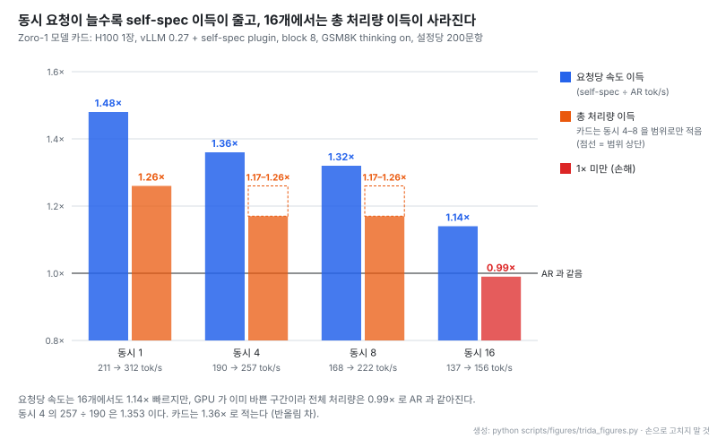
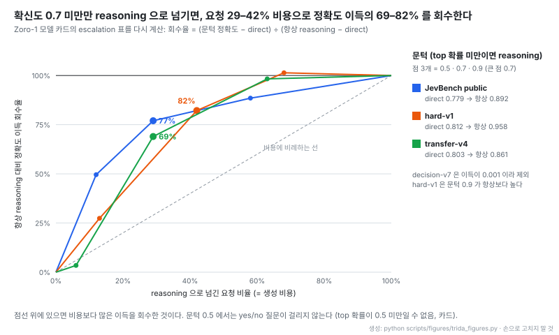

# trida-stack: AR LLM을 block-diffusion LLM으로 바꾸고, 같은 가중치로 self-speculative 생성과 typed decision을 서빙하는 스택


출처: [trida-stack README 머리 그림](https://github.com/trillion-labs/trida-stack/blob/ef46bd5ed543bc5c3785052273d4315774b86ffb/README.md) (Apache-2.0)

- **원문**: [trillion-labs/trida-stack](https://github.com/trillion-labs/trida-stack) (설명: "One repo for turning an autoregressive LLM into a block-diffusion LLM, and for serving it.")
- **모델**: [trillionlabs/Zoro-1](https://huggingface.co/trillionlabs/Zoro-1) (4B, gated, HF 등록 2026-10-15) · [trillionlabs/Zoro](https://huggingface.co/trillionlabs/Zoro) (4B, Apache-2.0, 옛 이름 Trida2.0-4B, HF 등록 2026-09-18). 둘 다 Qwen3.5-4B에서 출발
- **저장소 생성**: 2026-09-28. 읽은 커밋 `ef46bd5` (2026-11-12), 커밋 56개, 태그 v0.1.0 · v0.1.1 · v0.1.2. 0.1.0 첫 공개는 2026-09-30
- **코드**: 라이선스 Apache-2.0. Python 125파일 25,573줄, Swift 58파일 14,394줄(macOS 앱), Shell 42파일 2,131줄, `test_*.py` 23개. 별 23개 · 포크 5개 (2026-11-13 기준), 기여자 5명
- **비상업 의존**: 학습 hybrid 커널, SGLang 패치 백엔드, vLLM block-end readout 커널 세 가지는 upstream이 PolyForm Noncommercial 1.0.0이라 레포에 넣지 않고 `HybridDiffusion@6ca547a`를 받아 패치하는 스크립트만 둔다
- **검증 범위**: README · 하위 README · CHANGELOG · 설정 파일과 두 모델 카드(Zoro-1 카드 2026-11-06 판)를 읽어 썼다. 학습 · 서빙 · 벤치마크는 직접 돌리지 않았고 수치는 모두 원문 값이다
- **읽은 날짜**: 2026-11-13
- **태그**: #DiffusionLM #BlockDiffusion #SpeculativeDecoding #vLLM #TypedDecision #OnDevice

!!! note "핵심 요약"
    trida-stack은 pretrained AR 체크포인트를 diffusion pretraining 없이 block-diffusion SFT만으로 바꾸는 `train/`과, 그렇게 만든 모델 하나를 서빙하는 `inference/zoro-1/`로 나뉜다. 학습할 때 AR auxiliary loss를 같이 걸어 한 가중치 안에 diffusion stream과 causal stream을 함께 살려 두는 것이 핵심이다. 그 덕에 서빙에서는 diffusion stream이 8토큰 블록을 draft하고 같은 forward에서 causal stream이 검증하는 self-speculative decoding이 별도 draft 모델 없이 된다. 출력 분포는 AR과 같고 이득은 forward당 토큰 수다. Zoro-1 카드 기준 H100 한 장에서 동시 요청 1개일 때 요청당 1.48배 빠르지만 16개에서는 1.14배로 줄고 총 처리량 이득은 0.99배로 사라진다. 그래서 저자는 이 모델을 저동시성(온디바이스)용으로 내세운다. 같은 가중치에 kev 방식 pointer head를 공동 학습시켜, 생성 없이 prefill 한 번으로 yes/no · 선택 · 점수 질문에 확률을 돌려주는 typed decision도 한다. 확신도가 낮은 질문만 먼저 reasoning을 생성한 뒤 다시 판정하면, 문턱 0.7에서 요청 29–42%만 생성 비용을 쓰고 정확도 이득의 69–82%를 회수한다. 반면 일반 생성 벤치마크에는 같은 하네스로 잰 기준 모델 수치가 없고, decision 점수 일부는 학습 데이터와 겹치는 split이라 저자 스스로 낙관적이라고 적는다.

## 1. 개요

diffusion LLM을 처음부터 pretraining하는 대신 이미 잘 학습된 AR 모델을 diffusion 쪽으로 옮기는 것이 이 레포의 출발점이다. 루트 README는 이를 "Block-diffusion SFT starting from a *pretrained AR checkpoint* (no diffusion pretraining)"라고 적는다. 방식은 [Fast-dLLM v2](https://arxiv.org/abs/2509.26328)를 따르고, Qwen3.5처럼 linear attention이 섞인 hybrid 모델은 [FLARE](https://arxiv.org/abs/2606.01774)의 two-stream 방식을 쓴다.

block diffusion은 블록 사이는 AR처럼 순서대로, 블록 안은 diffusion처럼 한꺼번에 채운다. 원문 표현으로 "autoregressive **across** blocks but diffusion **within** a block"이다. 이 레포가 다른 변환 레시피와 갈리는 지점은 diffusion 품질만 노리지 않고 AR 능력을 같은 가중치에 남겨 두는 데 있다. 그 AR stream이 서빙에서 검증기 역할을 하고, 다시 typed decision head가 올라타는 자리가 된다.

두 스택은 서로 import하지 않는다("`train/` and `inference/` do not import each other"). `inference/`는 nanoGPT처럼 모델 하나당 작은 서빙 스택 하나를 두는 "nano-inference" 구조이고, 현재는 Zoro-1용 하나뿐이다. 여기에 MLX 위에서 Zoro-1을 로컬 에이전트로 돌리는 macOS 앱(Zoro-1 Chat)이 같이 들어 있다.

## 2. 변환 학습: 한 행에 noised와 clean 응답을 함께 두기

dense 모델(Qwen3)은 한 행을 이렇게 놓는다.

```
[ S (prompt) | x_t (response, noised) | x_0 (response, clean) ]
```

attention mask가 세 구역을 묶는다.

| 구역 | 보는 범위 |
| --- | --- |
| S (prompt) | 자기 안에서 causal. 뒤 구역 모두가 조건으로 참조 |
| x_t 블록 k (noised) | 같은 블록 안은 bidirectional, prompt와 앞 블록들의 clean x_0 참조 |
| x_0 (clean) | 블록 단위 causal. AR aux loss를 켜면 토큰 단위 causal |

loss는 x_t 위치의 masked cross-entropy(diffusion 목적)와 x_0의 next-token CE(AR auxiliary)를 섞는다. AR 가중치를 $w$라 하면

$$
\mathcal{L} = \frac{\mathcal{L}_{\text{diff}} + w\,\mathcal{L}_{\text{AR}}}{1 + w}
$$

이다. Fast-dLLM v2의 complementary masking(서로 반대로 가린 두 view)으로 모든 토큰이 한 번은 감독을 받는다. 조절할 값은 두 개다. `--bd_size`는 블록 길이이고, `--ar_loss_weight`($w$)가 0보다 크면 쓸 만한 causal head가 남아 speculative decoding과 일반 AR 서빙이 같은 체크포인트에서 가능해진다. `--within_block_causal`을 켜면 x_t도 블록 안에서 causal이 되어 모델 전체가 causal이 되고 표준 AR 엔진에 그대로 올릴 수 있지만 draft 품질을 일부 잃는다.

저장 결과는 stock HF causal LM에 `<|mask|>` 토큰 하나와 `block_diffusion.json`(bd_size, mask_id, ar_loss_weight)만 붙은 형태라 `AutoModelForCausalLM.from_pretrained`로 그대로 로드된다. 학습은 native FSDP2이고 DeepSpeed를 쓰지 않는다. `--loss_weighting weighted`를 주면 diffusion CE에 $1/\gamma$ ELBO 가중을 건다($\gamma$는 마스크 비율).

## 3. hybrid 모델: two-stream으로 recurrence를 우회하기

Qwen3.5는 gated-delta linear attention 층과 주기적인 full attention 층이 섞여 있다(MLX README 기준 gated-delta 24층, full attention 8층). recurrent linear layer는 mask로 "블록 안만 bidirectional"을 만들 수 없다. 그래서 hybrid 학습기는 한 층 호출 안에 두 stream을 흘린다. 레이아웃은 `[x0 ; xt_1 ; … ; xt_V]`다.

- **clean x0**: 평범한 causal gated-delta pass. AR loss와 블록마다의 경계 state를 낸다
- **noisy view xt_v**: 각 블록을 앞 블록의 clean 경계 state에서 다시 시작해 블록 안을 bidirectional로 읽는다. V개 complementary view가 clean stream 하나를 공유하고, train README는 이 공유가 "exact, fp32-verified"라고 적는다

서빙에도 같은 차이가 나타난다. linear layer에는 잘라낼 길이 축이 없으므로 speculative rollback을 KV crop이 아니라 conv · recurrent state의 snapshot과 restore로 한다.

패킹은 세 겹으로 문서를 격리한다. `cu_seqlens` 경계마다 recurrence와 short-conv를 리셋하고, flex mask로 attention을 문서 안에 가두고, RoPE 위치를 문서마다 다시 센다. README는 "perturbing one packed document changes the other's logits by exactly 0"이라고 확인 결과를 적는다. 처리량 설정(fused CE, MLP만 compile, 세분한 length bucket)으로 4B · 32k · H100 16장에서 naive 설정 대비 GPU당 supervised tok/s가 약 1.7배라고 하고, padding이 계산의 약 17%였으며 activation offload는 약 20%를 더 쓴다고 적는다.

Zoro(Zoro-1 이전 공개 모델) 카드는 여기서 한 단계를 더 적는다. 기본 SFT(v6, step 18,000) 뒤에 블록을 100% 가리는 full-mask 레시피로 약 2k step을 더 학습해, self-spec draft가 필요로 하는 "블록 전체를 한 번에 예측"하는 능력을 키웠다. 대신 부분 마스크 상태는 학습하지 않으므로 순수 iterative diffusion decoding은 지원하지 않는다. Zoro-1 서빙 README에도 "there is no `diffusion` mode"라고 되어 있다. 이름은 diffusion 모델이지만 실제 서빙은 AR 검증이 붙은 draft 생성기로만 쓴다.

## 4. self-speculative decoding

서빙 모드는 세 가지다.

| `--mode` | 동작 |
| --- | --- |
| `causal` | 일반 AR decoding. 기준선 |
| `self-spec` (기본) | diffusion stream이 블록을 draft하고 같은 forward에서 AR stream이 검증 |
| `decide` | typed decision API(`/v1/decide`)와 OpenAI chat을 한 엔진에서 처리 |

기본 설정 `b15_g8`은 생성 블록 8, 한 forward에 15자리(canvas $2N-1$, $N=8$)를 쓴다. MLX README가 $N=4$일 때의 한 step을 그려 둔다.

```
cold start : [t0,  M,  M,  M,  M,  M,  M ]   clean = row 0, specs = rows 1..3
verify     : [p,  s0, s1, s2,  M,  M,  M ]   s_i checked against row i (exact AR logits)
                                            all accepted -> 4 tokens: s0 s1 s2 + clean(row 3), new specs = rows 4..6
                                            reject at i  -> s_<i + correction; next step is a cold start
```

앞쪽 clean 행들은 지난 step의 draft를 AR logits로 검증하고, 뒤쪽 마스크 행들은 다음 블록을 draft한다. 검증과 다음 draft가 한 forward에 겹친다. sampling에서는 $\min(1, p/q)$ 확률로 받아들이고, 거절하면 $\max(0, p - q)$를 정규화한 분포에서 고친 토큰을 뽑는 표준 speculative sampling 규칙을 쓴다($p$는 AR 분포, $q$는 draft 분포). 그래서 README는 "every committed token is either an accepted draft that equals the AR token, or the AR correction. Its benefit is **tokens per forward**, not a different answer."라고 쓴다. 출력 분포가 AR과 같다는 이 주장은 같은 sampling 설정에서만 성립하고, 양자화하면 기준 모델 자체가 바뀐다(MLX 쪽 OCR 실험에서 q8 · q6는 bf16과 출력이 같았고 q4는 달랐다).

백엔드는 세 가지다. SGLang은 HybridDiffusion upstream을 clone해 패치하는 경로, vLLM은 stock vLLM 0.27.x에 out-of-tree plugin(`trida_diffusion`)을 얹는 경로, MLX는 Apple Silicon용 자체 구현이다. 백엔드마다 기본 블록이 달라(SGLang `b15_g8`, vLLM `SELFSPEC_N=4`) README는 같은 블록 설정에서만 tok/forward와 속도를 비교하라고 적는다.

### 동시 요청 수와 이득

Zoro-1 카드의 논리는 이렇다. 사용자 한 명을 서빙하는 저동시성에서는 decoding이 메모리 대역폭에 묶여 forward마다 가중치 전체를 읽고 토큰 하나만 만든다. 남는 연산을 블록 draft와 검증에 쓰면 가중치를 한 번 읽을 때 여러 토큰을 확정할 수 있다. 반대로 동시 요청이 많은 서버는 이미 연산에 묶여 있어 이득이 작다. 측정 조건은 H100 1장, vLLM 0.27 + self-spec plugin, block 8, GSM8K(thinking on, temperature 1.0 / top-k 50 / top-p 0.95, 8,192토큰), 설정당 200문항이다.



- 요청당 속도(파랑)와 총 처리량(주황)을 함께 봐야 한다. 동시 16개에서 요청 하나는 여전히 1.14배 빠르지만 GPU 전체가 내는 토큰은 AR과 같다. 서버 비용을 줄이는 기술이 아니라 한 사용자의 지연을 줄이는 기술이다
- median latency는 동시 1개에서 2.13초 → 1.19초, 16개에서 3.19초 → 2.42초로 줄어든다. self-spec은 forward당 약 2.0토큰을 확정하고, GSM8K 정확도는 두 모드 모두 87.5–91.5% 범위다
- 카드는 동시 4–8의 총 처리량을 1.17–1.26배라는 범위로만 적어 두 설정을 나눠 그릴 수 없다

full-mask 레시피의 효과는 Zoro 카드에서 보인다. 동시 1개에서 Zoro self-spec은 243 tok/s, forward당 2.59토큰이고 AR은 216 tok/s다. 벤치마크별 forward당 토큰은 GSM8K 3.10, BFCL 2.33, MMLU-Pro 2.33으로 GSM8K에서 가장 높다.

### Mac에서는 블록이 짧을수록 빠르다

MLX 쪽 측정(M3 Pro 18 GB, q8 Trida-2.0-4B-1006, greedy, 512토큰)은 GPU와 반대 방향을 보인다.

| 생성 블록 N (canvas) | causal tok/s | self-spec tok/s | forward당 토큰 | AR step 대비 step 비용 | 속도 이득 |
| --- | ---: | ---: | ---: | ---: | ---: |
| 4 (7) | 26.2 | 52.4 | 2.40 | 1.18× | 2.00× |
| 8 (15) | 25.9 | 43.0 | 2.72 | 1.64× | 1.66× |

속도 이득은 대략 forward당 토큰을 step 비용으로 나눈 값이다($2.40 / 1.18 \approx 2.03$, $2.72 / 1.64 \approx 1.66$). Mac에서는 canvas가 길어지면 step 비용이 크게 늘어 N=8이 더 많이 받아들이고도 진다. 그래서 MLX 기본값은 N=4다. 전용 Metal 커널로 검증 step을 49.8ms에서 44.5ms로 줄여 AR step(39.3ms)의 1.13배까지 낮췄다고 적는다. q8 모델은 약 4.5 GB, bf16은 약 8 GB다.

## 5. typed decision: 같은 가중치에 pointer head 얹기

같은 가중치를 decision model로도 학습할 수 있다. state(임의 JSON, 선택적으로 이미지)와 typed question을 주면 자유 텍스트 대신 확률을 돌려준다.

| 유형 | 질문 형식 | 답 |
| --- | --- | --- |
| `noul` | yes/no | P(yes) |
| `choice` | `{key: description}` | key 위 분포 |
| `score` | 낮은 것부터 나열한 레벨 목록 | 기대 레벨 |

방식은 [kev](https://github.com/jaredpalmer/kev)의 것을 그대로 가져온다. 작은 pointer head가 clean causal stream 위에서 각 option의 `</opt>` 위치 hidden state를 질문의 `<decide>` 위치 state와 비교해 점수를 낸다. 학습은 옵티마이저 step마다 SFT micro-batch를 돌린 뒤 decision micro-batch를 이어 돌리고 decision loss를 가중치 λ로 더한다. decision 행은 two-stream 커널이 아니라 일반 causal 커널로 돈다. 인코딩은 kev와 byte 단위로 같고 forward 확률도 fp32 오차 안에서 일치한다고 확인 도구까지 둔다.

모델 카드는 장점을 이렇게 요약한다. "an answer cannot leave the label set, and a decision costs one prefill, not a generation." 라벨 밖 답이 나올 수 없고 비용은 prefill 한 번이다.

서빙은 패치 없는 stock SGLang 0.5.22 이상에서 돈다. request 행이 causal이므로 option의 hidden state는 "그 option까지 자른 행의 마지막 hidden state"와 같다. 그래서 option이 K개인 질문을 K+1개의 prefix prompt로 바꿔 한 batch에 넣고 `return_hidden_states="last"`로 받은 뒤 head를 돌린다. 공통 prefix는 SGLang prefix cache가 공유한다. transformers 구현과 held-out 200건에서 평균 확률 차가 0.1% 이내였다고 적는다. decision과 chat은 같은 엔진에서 batch되므로, 긴 chat이 생성 중이어도 decision은 수십 ms 안에 돌아온다.

### Zoro-1 decision 점수

kev harness, 보정 온도 1.52 기준이다(괄호는 Brier, 낮을수록 좋음).

| suite | Zoro-1 | 비교 |
| --- | --- | --- |
| transfer-v4 (656) | 0.802 (0.279) | Kev-4B 0.817 (0.243), Jev 0.857 |
| decision-v7, 26개 이하 option (1,184) | 0.864 (0.197) | Kev-4B 0.871 (0.181) |
| hard-v1 (1,083) | 0.812 (0.252) | Jev 0.777 |
| SemIf (144) | 0.910 (0.167) | Jev 0.965 |
| KorNAT common knowledge (6,007) | 0.648 (0.459) | Kev-4B 0.597 (0.517) |
| KorNAT social values (4,000) | 0.503 (0.698) | Kev-4B 0.537 (0.653) |
| CLIcK (1,995) | 0.610 (0.485) | Kev-4B 0.555 (0.519) |
| KMMLU-Pro (2,822) | 0.445 (0.656) | Kev-4B 0.414 (0.665) |
| typed-decisions test (2,000) | 0.731 (0.406) | Kev-4B 0.669 (0.465) |

영어에서는 decision 전용 모델보다 몇 점 낮고, 한국어 · typed-decisions 5개 중 4개에서 Kev-4B를 앞선다. 다만 카드가 직접 단서를 단다.

!!! warning "카드가 밝힌 비교 조건"
    decision-v7과 hard-v1 development split은 kev 공개 학습 데이터와 겹쳐 kev 방식으로 학습한 모델에는 점수가 낙관적일 수 있다. typed-decisions train은 Zoro-1 학습 데이터에 들어 있어 이 점수는 zero-shot이 아니라 "fitted on train" 쪽 표에 속한다. "Jev (published)" 값은 kev README의 공개 수치를 옮긴 것으로 같은 harness에서 돌린 값이 아니다.

decision head를 reranker로도 쓴다. 문서마다 "이 문서가 질의에 답하는 데 도움이 되는가"를 yes/no로 묻고 P(yes)로 정렬한다. BM25 상위 100개를 다시 정렬했을 때 학습에 쓰지 않은 NanoBEIR 5개 셋의 nDCG@10 평균이 0.455에서 0.545로 오른다. NQ(0.483 → 0.699)와 ArguAna(0.374 → 0.507)에서 크게 오르고, SciFact는 0.729에서 0.711로 오히려 내려간다.

## 6. reasoned action: 확신이 낮을 때만 생각하고 판정하기

한 가중치가 생성과 판정을 모두 하므로 "먼저 생각하고 판정"이 가능하다. 판정 요청을 chat 메시지 하나로 렌더해 thinking을 켜고 `</think>`까지 생성한 뒤, 그 reasoning 텍스트를 state에 넣고 head로 다시 판정한다. head는 reasoning이 든 state로 학습한 적이 없는데도 추가 학습 없이 효과가 난다고 카드는 적는다.

| 셋 | direct 정확도 / Brier | reasoned 정확도 / Brier |
| --- | --- | --- |
| JevBench 전체 (231) | 0.779 / 0.304 | 0.892 / 0.189 |
| JevBench hard (111) | 0.550 / 0.585 | 0.784 / 0.346 |
| hard-v1 (1,083) | 0.812 / 0.252 | 0.958 / 0.073 |
| transfer-v4 (656) | 0.803 / 0.279 | 0.861 / 0.217 |
| decision-v7 (1,184) | 0.863 / 0.197 | 0.864 / 0.199 |
| typed-decisions test (2,000) | 0.730 / 0.406 | 0.719 / 0.400 |

계산 · 날짜 · 순서 규칙 · 멀티홉 조회처럼 답을 풀어내야 하는 셋에서 크게 오르고, decision-v7은 그대로이며, 정답이 teacher 모델의 주관적 판단인 typed-decisions에서는 오히려 1점 떨어진다(gold 분포와의 KL 0.135 → 0.195). 카드의 권고는 "Use reasoned action for decisions with a checkable answer, not for matching subjective judgments."다. budget도 중요해서, 32,768토큰에서도 JevBench reasoning의 4%가 한도에 걸렸고 권장 최소는 4,096토큰이다.

reasoning은 생성 비용이 들므로 카드는 escalation을 권한다. 모든 요청을 먼저 direct로 판정하고, 질문 중 하나라도 top option 확률이 문턱 미만이면 그 요청만 reasoning을 생성해 다시 판정한다. reasoning은 요청당 한 번이므로 요청 비율이 곧 생성 비용이다.



- 카드는 문턱 0.7이 "about 70–80 %"를 회수한다고 쓴다. 표에서 다시 계산하면 transfer-v4 69%, JevBench 77%, hard-v1 82%로 서술과 맞는다. 세 셋 모두 점선(비용에 비례하는 회수)보다 위에 있어 낮은 확신 쪽에 이득이 몰려 있다
- 문턱 0.9는 요청 58–68%를 쓰고 거의 전부(88–101%)를 회수한다. hard-v1은 0.9가 항상 reasoning보다 높은데(0.960 대 0.958), 확신 높은 direct 답을 reasoning이 망치는 경우가 있다는 뜻으로 읽힌다(차이 0.002라 노이즈 범위일 수 있음, 원문 해석 아님)
- 문턱 0.5는 가장 싸지만 yes/no 질문은 top 확률이 0.5 미만일 수 없어 choice · score 질문만 걸린다

## 7. Zoro-1 Chat과 온디바이스 에이전트

Zoro-1 Chat은 MLX 스택 위에서 Zoro-1을 로컬 에이전트로 돌리는 SwiftUI 앱이다(Apple Silicon, macOS 14 이상, 클라우드 · API 키 없음). 작업 폴더의 파일 · PDF 읽기, 터미널, 웹 탐색, 이미지 입력을 하고, read-only 명령만 macOS sandbox에서 바로 돌리고 나머지는 사용자에게 묻는다. decision head가 도구 라우팅, 답변 검사, auto 모드 승인 판정, 사용자의 `/decide` 질문을 맡는다. 생성 모델과 분류기를 따로 메모리에 올리지 않고 같은 가중치로 라우팅 · 게이팅 · 분류를 하는 것이 카드가 말하는 온디바이스 이점이다.

CHANGELOG의 미배포(Unreleased) 항목에는 0.6.0으로 대화에서 배우는 개인 knowledge graph가 들어 있다. 답변마다 남길 만한 사실이 있는지 판정하고 `subject —relation→ object` 사실을 제안하며, 웹 · 문서에서 온 사실은 실제 읽은 내용 안의 인용을 요구한다. 사실마다 추가 시각 · 경로 · 출처 · 인용 · 변경 이력을 남기고, functional relation은 옛 사실을 지우지 않고 종료 처리한다.

## 8. 생성 품질 수치

Zoro-1 카드(self-spec `b15_g8`, temperature 1.0 / top-k 20 / top-p 0.95, reasoning on)의 값이다.

| 벤치마크 | Zoro-1 |
| --- | --- |
| GSM8K | 89.9 |
| MMLU-Pro | 62.7 |
| BFCL non-live AST (1,390) | 76.6 |
| FunctionChat singlecall / dialog / call decision | 0.914 / 0.830 / 0.944 |
| Ko-AgentBench L1–L7 (91) | 0.736 |
| tau2 retail (114) / airline (50) / telecom (114) | 0.430 / 0.420 / 0.386 |

이 표에는 비교 대상이 없다. 카드는 "Every model in a table is scored with the same configuration and harness"라고 적지만 실제 표에는 Zoro-1 열 하나뿐이다. 이전 모델 Zoro 카드에도 "A vanilla Qwen3.5-4B baseline is being added."라고만 되어 있다. 변환 과정에서 기반 모델 대비 얼마나 잃거나 얻었는지는 이 원문들로 판단할 수 없다. 참고로 Zoro 카드에서는 GSM8K가 self-spec 84.2, AR 89.3으로 갈려 있어, lossless라는 서빙 주장과 달리 측정상 두 모드 차이가 있었다(조건이 threshold 0.9로 Zoro-1 쪽과 다르고 원인은 원문에 없다).

## 9. 해석 시 주의

- **lossless의 범위**: "AR과 같은 분포"는 같은 sampling 설정, 같은 정밀도에서의 주장이다. 양자화하거나 백엔드 블록 설정이 다르면 비교가 성립하지 않는다. Zoro의 self-spec · AR GSM8K 차이(84.2 대 89.3)처럼 원문 안에서도 두 모드 점수가 갈린 사례가 있다
- **속도 수치는 저동시성 중심**: 이득은 동시 1개에서 가장 크고 16개에서 총 처리량 이득이 없다. 대규모 서빙 비용 절감을 기대하고 쓰면 안 된다. 속도 표는 top-k 50, 품질 표는 top-k 20으로 sampling 설정도 다르다
- **비상업 커널**: Apache-2.0 레포지만 hybrid 학습 · SGLang 서빙 · vLLM readout 커널이 PolyForm Noncommercial이다. 상업 환경에서 Qwen3.5 경로를 그대로 쓰기 어렵다. dense(Qwen3) 경로나 MLX 경로가 이 커널에 기대는지는 README만으로 확인하지 못했다
- **decision 비교 조건**: 일부 split이 학습 데이터와 겹치고, Jev 값은 다른 harness의 공개 수치다. 앞 절 경고 참조
- **벤치마크 디렉터리는 다른 모델 기준**: `benchmark/`의 에이전트 하네스는 아직 레거시 Trida-7B-Preview를 기본값으로 쓰고 Zoro-1 이전은 이슈 #62로 남아 있다
- **이른 단계**: 생성 약 한 달 반, 커밋 56개, 기여자 5명이다. train README상 `train.jev` 같은 옛 import 경로는 0.2.0에서 지운다고 예고돼 있어 API가 아직 움직인다

## 10. 관련 노트

- [pg-jev: Postgres 테이블에 자연어 조건을 거는 확장](%5B20260917%5D%20realZachi_pg-jev_Postgres_자연어조건_행판정_확장.md): 같은 Jev 계열 typed decision을 외부 API로 부르는 쪽. 이 레포는 그 판정을 생성 모델 가중치 안으로 넣었다
- [edgextract: 닫힌 yes/no 질문과 결정 모델로 지식 그래프 추출](%5B20261003%5D%20raphaelmansuy_edgextract_닫힌질문_결정모델로_지식그래프추출.md): 결정 모델에 닫힌 질문을 던져 구조를 뽑는 응용
- [DeepInfer: DeepSeek 자사 추론 엔진과 vLLM 비교](%5B20261016%5D%20deepseek-ai_DeepInfer_DeepSeek전용_추론엔진_vLLM비교.md): 고동시성 서버 쪽 speculative decoding과 대조된다
- [Speculative Decoding 적용기 (네이버 CLOVA)](../blogs/%5B20251219%5D%20네이버클로바_Speculative_Decoding_적용기.md): 별도 draft 모델을 쓰는 일반 speculative decoding
- [Fast-dLLM v2: Efficient Block-Diffusion LLM (arXiv:2509.26328)](https://arxiv.org/abs/2509.26328): 변환 학습 레시피의 원형
- [FLARE: Diffusion for Hybrid Language Model (arXiv:2606.01774)](https://arxiv.org/abs/2606.01774) · [HybridDiffusion 코드](https://github.com/yuchen-zhu-zyc/HybridDiffusion): hybrid two-stream 방식과 비상업 커널의 출처
- [kev](https://github.com/jaredpalmer/kev): typed decision 학습 방식과 평가 harness

## 11. 결론

trida-stack이 보여 주는 것은 "AR 모델을 diffusion으로 바꾸되 AR을 버리지 않는다"는 설계가 서빙에서 무엇을 사 주는가다. AR auxiliary loss 하나로 같은 가중치에 draft 생성기(diffusion stream)와 검증기(causal stream)가 함께 남고, 그 결과 별도 draft 모델 없이 출력 분포를 바꾸지 않는 self-speculative decoding이 된다. 같은 causal stream 위에 pointer head를 얹어 생성 없이 prefill 한 번으로 확률을 돌려주는 판정까지 같은 메모리에서 처리한다.

이득의 위치는 분명하다. 동시 요청 1개에서 요청당 1.48배, 16개에서는 총 처리량 이득이 없다. 한 사용자를 위한 로컬 에이전트처럼 메모리 대역폭에 묶인 환경에서 지연을 줄이는 기술이고, 그 환경에서는 라우팅 · 승인 · 분류를 같은 모델의 decision head로 처리해 분류기를 따로 올리지 않아도 된다는 점이 더해진다. reasoning을 확신 낮은 요청에만 쓰는 escalation은 decision 모델을 쓰는 다른 시스템에도 그대로 옮길 수 있는 운영 규칙이다. 반면 변환 전 기반 모델과의 품질 비교가 원문에 없고, hybrid 경로의 핵심 커널이 비상업 라이선스라는 점이 이 스택을 그대로 가져다 쓰기 전에 확인할 부분이다.
