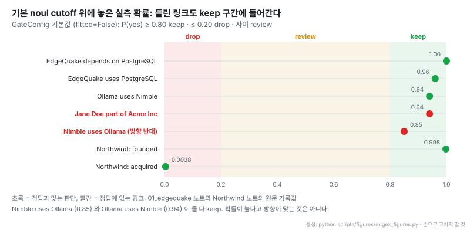
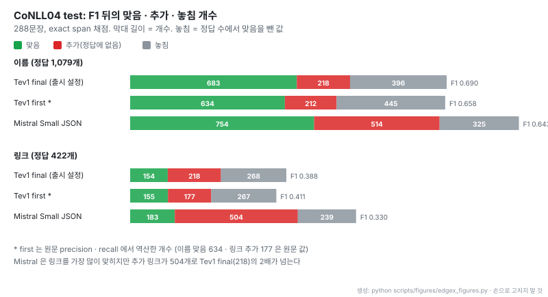
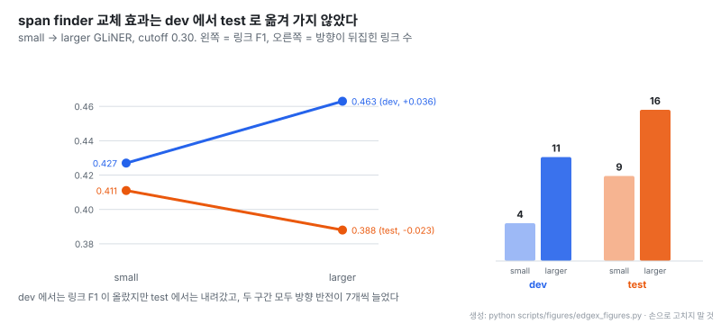

# edgextract: 닫힌 yes/no 질문과 결정 모델로 markdown에서 지식 그래프 추출

- **원문**: [raphaelmansuy/edgextract](https://github.com/raphaelmansuy/edgextract) (설명: "Turn markdown into a knowledge graph with an ontology you write and a cutoff you own. Closed yes/no decisions, not free-form JSON.")
- **문서**: [평가 기록](https://github.com/raphaelmansuy/edgextract/blob/3f08b1dca84ebacffd5152cee37639a62df0fb93/specs/0001-implementation/14-evaluation.md) · [System One 계약](https://github.com/raphaelmansuy/edgextract/blob/3f08b1dca84ebacffd5152cee37639a62df0fb93/specs/0001-implementation/02-contract-systemone.md) · [기사](https://github.com/raphaelmansuy/edgextract/blob/3f08b1dca84ebacffd5152cee37639a62df0fb93/docs/article/article.md) · [브라우저 데모](https://raphaelmansuy.github.io/edgextract/)
- **저장소 생성**: 2026-10-03 (GitHub created_at 2026-10-03T13:24:02Z, 첫 커밋 "Publish edgextract with measured results and a plain-English article."). 마지막 커밋 2026-10-04
- **코드**: 라이선스 Apache-2.0, 별 136개 (2026-11-04 기준), 기여자 1명, 커밋 17개, 태그 없음. Python 라이브러리 4,518줄 + Rust crate 7,708줄 + WASM 웹 데모 (GitHub 언어 표시는 TypeScript). 테스트 파일 15개
- **배포**: crates.io `edgextract`, npm `@raphael.mansuy/edgextract` (WASM), Hugging Face Space
- **요구 환경**: Ollama 0.35+ 의 decision endpoint `POST /v1/systemone` 과 결정 모델(`tev1`, `nimble`). 브라우저에서는 WebGPU로 Tev1 ONNX (~1 GB)
- **읽은 날짜**: 2026-11-04
- **태그**: #KnowledgeGraph #Ontology #InformationExtraction #ClosedDecision #Calibration

!!! note "핵심 요약"
    edgextract는 chat 모델에게 JSON 트리플을 쓰게 하는 대신, 코드가 이름 후보를 제안하고 ontology가 허용하는 쌍만 골라 작은 로컬 결정 모델에게 닫힌 yes/no 질문을 하나씩 던져 확률을 받는다. 확률은 코드의 cutoff로 keep · review · drop으로 나뉘고, 모델은 span을 찾지도 타입을 지어내지도 않는다. CoNLL04 test 288문장에서 링크 F1은 0.388로 학습된 SpERT(0.715)에 크게 못 미치지만, zero-shot chat JSON(Mistral Small, 0.330)보다 높고 정답에 없는 링크를 218개 대 504개로 절반 이하만 남긴다. 저자는 dev에서 좋아 보였던 설정 변경이 test에서 링크 점수를 떨어뜨린 결과까지 그대로 공개했다. cutoff는 아직 보정되지 않았고, 틀린 방향 링크도 0.85 같은 높은 확률로 keep 구간에 들어간다.

## 1. 개요

edgextract가 겨냥하는 문제는 LLM 기반 그래프 추출에서 흔한 "형식은 맞는데 내용은 모르는" 출력이다. README는 이렇게 쓴다.

> "A JSON schema makes the output *well-formed*. It does not make it *true*, and it does not tell you how sure the model was."

해법은 생성을 판별로 바꾸는 것이다. 열린 질문("이 문단의 엔티티와 관계를 JSON으로")을 하지 않고, 코드가 미리 만든 후보마다 닫힌 질문("이 문장에서 A는 B를 founded 했는가?")을 하고 그 답의 확률을 받는다. 확률을 어떻게 쓸지는 모델이 아니라 호출한 코드의 cutoff가 정한다. 스펙 팩은 역할 분담을 세 줄로 요약한다.

> "You own: ontology, spans, pairs, thresholds, lineage, cache / Model owns: a distribution over the labels you listed / Nobody owns: a free-text type name"

README 첫 그림은 실제 실행 결과다. 저자는 다섯 링크 중 하나가 틀린 그래프를 그대로 실었다.

출처: [edgextract README](https://github.com/raphaelmansuy/edgextract/blob/3f08b1dca84ebacffd5152cee37639a62df0fb93/README.md) (Apache-2.0)

- `Acme ACQUIRED Northwind`는 오류다. 원문 문장은 "invested in"이다. 저자는 "We left it in. That is what the review queue and your cutoff are for."라고 쓴다
- 결정 모델이 확률을 주더라도 그 확률이 맞다는 보장은 없다는 점을 첫 화면에서 보여 주는 셈이다. 6절에서 같은 문제를 숫자로 다시 본다

## 2. 설계 원칙

스펙 팩(specs/0001-implementation, 파일 17개)은 원칙 여덟 개를 둔다.

| 원칙 | 내용 |
|---|---|
| FP-1 Closed before the call | 질문과 허용 답을 먼저 선언한다. 모델은 그 안의 값만 돌려준다 |
| FP-2 Propose then decide | span은 ontology 목록, markdown 표시, span finder가 제안한다. 모델은 span을 찾지 않는다 |
| FP-3 Ontology is the schema | domain · range로 불가능한 쌍을 프롬프트가 아니라 코드에서 가지친다 |
| FP-4 Fail closed | 키 누락, 목록 밖 choice, 전송 오류는 트리플을 만들지 않고 예외로 끝낸다 |
| FP-5 Thresholds live in code | `GateConfig.fitted`는 false로 시작한다. 라벨로 보정한다 |
| FP-6 Evidence, not essays | 설명은 원문 문장 그대로다. 결정 모델은 요약하지 못한다 |
| FP-7 Linear work | 호출 수는 문장 수에 비례한다. 문장당 쌍 수에 상한이 있다 |
| FP-8 One decision helper | 클라이언트 · 검증기 · gate는 하나씩만 둔다 |

비목표도 분명하다. 결정 모델로 자유 NER을 하지 않고, coreference를 하지 않으며, Ollama가 돌려주는 확률이 calibrated 되어 있다고 주장하지 않는다.

## 3. 결정 endpoint 계약

결정 모델은 Ollama 0.35.0 이상(저자 확인 0.35.1)의 `POST /v1/systemone`으로 부른다. 요청은 `model`, `state`(문장), `questions` map, 선택적 `images`다. 질문 타입은 세 가지다.

| 타입 | 조건 | 응답 |
|---|---|---|
| choice | 이름 붙은 옵션 2~26개 | `choice`, `probabilities` (합 ≈ 1), `confidence` |
| noul | 선택적 false / true 설명 | `noul` = P(yes) ∈ [0, 1] |
| score | 순서 있는 설명 2~26개 | 기대 수준, 수준별 확률, confidence |

2026-10-03 `nimble` 실측에서 choice 질문의 승자 확률은 약 0.978, confidence는 약 0.891, 출력 토큰은 1개였다. noul과 score를 묶은 요청은 입력 471 토큰, 출력 3 토큰이었다. 생성하는 토큰이 거의 없으니 비용은 입력 길이에 묶인다. 응답 검증은 fail closed다. `answers`가 없거나, choice가 확률 키에 없거나, 확률 합이 1에서 멀거나, noul이 [0, 1] 밖이거나, HTTP 오류나 non-JSON이면 예외를 낸다. 계약 문서는 "Do not send decision models chat, tools, or thinking."이라고 덧붙인다.

## 4. 파이프라인

출처: [edgextract 기사 그림](https://github.com/raphaelmansuy/edgextract/blob/3f08b1dca84ebacffd5152cee37639a62df0fb93/docs/article/article.md) (Apache-2.0)

- 여섯 단계 중 모델이 답하는 단계는 3(모르는 이름의 kind)과 5(링크 yes/no) 둘뿐이다. 나머지는 plain code이고, 마지막 결정은 "your rule"이다
- 4단계에서 ontology가 허용하지 않는 쌍은 질문조차 하지 않는다. README는 "Illegal links are never asked."라고 쓴다
- 5단계는 링크 타입마다 따로 묻는다. "uses"와 "depends on"이 동시에 참일 수 있기 때문이고, 예시에서도 0.96과 1.00 둘 다 keep 되었다

이름 후보는 ontology의 gazetteer(이미 아는 이름 목록), markdown 단서, 선택적 GLiNER span finder에서 나온다. 목록에 있는 이름은 lookup으로 타입을 정하고, 모르는 span만 "이 ontology가 담을 수 있는 이름인가?"를 noul로 물은 뒤 choice로 kind를 고른다. 스펙의 계산량 절은 문장 수 S, 문장당 쌍 상한 k = 24로 최악 O(n + S · k)를 목표로 한다. 문서 전체 언급의 제곱으로 커지지 않게 하려는 것이고, 상한을 넘은 쌍은 버리되 `pairs_truncated`로 개수를 남긴다. 타입이 26개를 넘으면 choice 옵션 한도 때문에 그룹을 먼저 고르고 그 안에서 타입을 고르는 2단계로 간다.

## 5. Ontology

ontology는 YAML 하나다. 타입마다 설명을, 관계마다 설명과 domain · range를 둔다. 기본 `tech_docs`는 타입 6개(PERSON, ORGANIZATION, PRODUCT, TECHNOLOGY, LOCATION, EVENT)와 관계 7개(CREATED_BY, WORKS_AT, USES, PART_OF, LOCATED_IN, DEPENDS_ON, HAPPENED_AT)로 이뤄진다. 한도는 타입 2~50개, 관계 edge 100개 이하, choice 옵션 26개 이하(`NOT_ENTITY` · `NONE` 포함)다. 알 수 없는 domain · range를 적으면 로드 단계에서 오류다.

gazetteer의 위치가 흥미롭다. 스펙은 "Gazetteer names are hints for the proposer, not answers."라고 하지만, 실제 평가에서는 목록에 있는 이름이 lookup으로 바로 타입을 받아 이름 점수를 크게 끌어올린다(7절). `init-ontology`로 주석 달린 초안을 만들고, `validate-ontology`로 허용 링크를 평이한 문장으로 출력해 확인한다. 브라우저 데모에는 회사 뉴스, 기술 문서, 연구 논문, 영화, 의학, 역사, CoNLL04 샘플 ontology 7개가 들어 있다.

## 6. Gate와 cutoff

출처: [edgextract 기사 그림](https://github.com/raphaelmansuy/edgextract/blob/3f08b1dca84ebacffd5152cee37639a62df0fb93/docs/article/article.md) (Apache-2.0)

- 원문 그림은 세 구간의 뜻만 보여 준다. 실제 기본값은 아래 표에 있다
- 원문 캡션 "They start unfitted"가 핵심이다. 기본값은 출발점일 뿐 측정된 정책이 아니다

| GateConfig 필드 | 기본값 | 뜻 |
|---|---|---|
| `fitted` | false | 아직 라벨로 보정하지 않음 |
| `noul_yes` / `noul_no` | 0.80 / 0.20 | P(yes)가 0.80 이상이면 keep, 0.20 이하면 drop |
| `accept_prob` / `accept_confidence` | 0.70 / 0.50 | choice 승자 확률과 confidence가 둘 다 넘으면 keep |
| `reject_prob` | 0.40 | choice 승자 확률이 이 아래면 drop |
| `rotate_below_confidence` | 0.0 | 옵션 순서 편향 재질문은 꺼짐 |

choice에서 `NONE` 같은 null label이 0.70 이상으로 이기면 drop이고, 그 아래면 review로 보낸다. 관계 `weight`는 모델 확률을 그대로 저장한다. 이전 빌드는 0.4 + 0.6 × probability로 다시 매겨 저장했고, 그 때문에 초안이 0.85를 0.91로 인용했다는 정정 기록이 평가 문서에 남아 있다.

원문 그림이 보여 주지 않는 것은 실측 확률이 이 구간 위 어디에 떨어지는가다. 평가 문서와 결과 파일에 적힌 값을 기본 noul cutoff 위에 놓았다.

- 정답에 없는 두 링크(0.94, 0.85)가 모두 keep 구간에 들어간다. 확률이 높다는 사실만으로 오류를 거를 수 없다
- 같은 쌍의 양방향이 둘 다 keep 되는 사례(Ollama uses Nimble 0.94, Nimble uses Ollama 0.85)는 방향을 따로 묻지 않는 한 cutoff로 해결되지 않는다. README의 "Direction can flip" 한계와 같은 이야기다
- 반대로 Northwind 노트의 founded(0.998)와 acquired(0.0038)처럼 명확한 경우는 확률이 양 끝으로 갈라진다. review 구간이 쓸모 있으려면 cutoff를 라벨로 보정해야 한다

## 7. 자체 노트 평가

저자가 만든 기술 노트 `01_edgequake.md` 한 편으로 질문 방식과 모델을 비교했다(2026-10-03). 이 노트의 이름은 모두 ontology 목록에 있어 이름 찾기는 lookup이다.

| 방법 | Names F1 | Links F1 | 시간 |
|---|---|---|---|
| Nimble, 질문당 yes/no, 이름 lookup | 1.00 | 0.38 | 19.0 s |
| Tev1, 같은 질문 | 1.00 | 0.67 | 9.4 s |
| Tev1, 허용 링크 타입마다 yes/no | 1.00 | 0.78 | 7.9 s |
| gemma4 chat JSON (로컬) | 0.95 | 0.89 | 77.8 s |
| Mistral Small JSON (hosted) | 0.89 | 0.80 | 3.9 s |

이 노트에서는 chat 모델의 링크 점수가 더 높다. 같은 로컬 환경에서 Tev1이 gemma4보다 약 10배 빠른 것이 장점이고, Tev1은 모델이 이미 올라간 상태에서 같은 노트를 4.29 s에 처리했다. Tev1은 Apache AGE와 pgvector로 가는 링크를 놓쳤다. 라이브러리 기본 모델은 링크 0.38이 나온 `nimble`이라는 점도 README가 한계로 적는다.

12개 기술 노트 전체(개발 중에 쓴 파일이라 sanity check)에서는 Tev1이 이름 F1 0.966, 링크 F1 0.595, 맞은 링크 11/18, 추가 링크 8개였다. Mistral Small은 같은 날 두 번 돌려 링크 0.426과 0.375, 이름 0.681과 0.796으로 달랐다. 저자는 이 차이를 "a chat model does not answer the same way twice"로 설명한다. 회사 뉴스 노트 2개에서는 두 방법 모두 이름 10/10, 링크 6/6에 추가 링크 1개였다.

## 8. CoNLL04 공개 벤치마크

목록에 없는 이름을 스스로 찾아야 하는 실제 시험은 CoNLL04다. SpERT 논문의 분할을 쓰고, test 288문장을 exact span(문자 경계와 kind가 모두 맞아야 정답)으로 채점했다. 학습 문장으로 훈련한 SpERT가 이름 약 0.89, 링크 약 0.71인데, 저자는 이것을 "a ceiling, not a target we failed"로 둔다.

출처: [edgextract 기사 그림](https://github.com/raphaelmansuy/edgextract/blob/3f08b1dca84ebacffd5152cee37639a62df0fb93/docs/article/article.md) (Apache-2.0)

- 원문 그림은 F1만 보여 준다. zero-shot 세 줄의 링크 F1 차이(0.39, 0.41, 0.33)는 작아 보이지만 오류의 종류는 크게 다르다
- 아래 생성 그림이 F1을 맞음 · 추가 · 놓침 개수로 풀었다

- Mistral Small은 링크를 가장 많이 맞혔지만(183개) 정답에 없는 링크를 504개 남겼다. Tev1 final은 맞음 154개, 추가 218개다. precision으로 보면 0.414 대 0.266이다
- 놓침(회색)은 세 방법 모두 크다. dev 오류 분석에서도 kind 오판(14건)이나 방향 반전(4건)보다 이름 자체를 놓친 경우(341건)가 압도적이었다. 병목은 결정이 아니라 후보 제안에 있다
- Tev1 first의 개수 일부는 원문 precision · recall에서 역산했다. 역산값으로 다시 계산한 F1이 원문 값과 맞는지는 생성기 테스트가 확인한다

CoNLL04에서는 kind 쌍마다 허용 링크가 하나뿐이라, 링크 타입별로 따로 묻는 방식이 추가 질문을 만들지 않는다. 그 방식은 "uses"와 "depends on"이 겹치는 기술 노트에서만 의미가 있다.

## 9. dev에서 test로의 전이

평가 절차는 네 단계로 고정했다. dev 문장에서만 cutoff를 고르고, 실수를 읽고, 그 실수가 정당화하는 변경 하나만 한 뒤, test를 한 번 돌리고 멈춘다. dev 실수가 이름 누락이었으므로 span finder를 작은 모델에서 더 큰 GLiNER(`fastino/gliner2.5-base-v1`)로 바꿨다.

- dev에서는 링크 F1이 0.427에서 0.463으로 올랐다. test에서는 0.411에서 0.388로 내려갔다. 맞힌 이름은 634개에서 683개로 늘었지만 링크로 이어지지 않았다
- 방향이 뒤집힌 링크는 dev와 test 모두 7개씩 늘었다. 더 많은 이름을 찾으면 묻는 쌍이 늘고, 양방향이 모두 keep 되는 6절의 문제가 그만큼 커진다
- 저자는 점수가 낮은 쪽을 기록 수치로 남겼다. "We report both runs and treat the final run as the number of record because it is the shipped configuration, not because it scored higher."

## 10. 브라우저 실행

Rust crate를 WASM으로 컴파일해 Vite + TypeScript 페이지에서 전체 파이프라인을 돌린다. 기본 백엔드는 같은 탭 안의 WebGPU Tev1 ONNX(`raphaelmansuy/tev1-0.8b-onnx-webgpu`, 약 1 GB 브라우저 캐시)이고, Ollama로 바꿀 수도 있다. 텍스트는 사용자가 고른 결정 모델로만 가고 저자 서버로 가지 않는다. 데모 페이지에는 규칙 기반 대체 모드가 없어 백엔드가 답하지 못하면 그래프가 비어 있다.

결과 파일 기준으로 로컬 WebGPU는 모델 로드 28,147 ms 뒤 첫 추출 626 ms, 이후 추출 19 ms였다. 같은 두 질문을 Ollama로 보내면 평균 132.8 ms(질문당 66.4 ms)였고, founded는 0.998로 keep, acquired는 0.0038로 drop이 되어 기대와 일치했다. decision cache가 있어 cutoff 슬라이더를 움직여도 모델에 다시 묻지 않는다. 웹 데모는 deterministic test double 위에서 Playwright 34개 테스트로 검증한다.

## 11. 해석 시 주의

- **모든 수치가 저자 한 사람의 한 컴퓨터 측정이다.** 2026-10-03 하루에 돌렸고, CoNLL04 test는 설정마다 한 번씩이다. 외부 재현은 없다
- **cutoff가 보정되지 않았다.** README가 첫 한계로 적는다. 6절 그림처럼 틀린 링크도 기본 keep 구간에 들어가므로, 라벨로 `edgextract calibrate`를 돌리기 전에는 keep을 신뢰할 근거가 약하다
- **자체 노트 점수는 lookup 덕분이다.** 이름 F1 0.97 수준은 이름이 이미 목록에 있어서다. 목록에 없는 이름의 성능은 CoNLL04의 0.690이 기준이다
- **문장 하나 안에서만 링크를 찾는다.** coreference가 없어 대명사는 건너뛰고, 문장을 넘는 링크는 찾지 못한다
- **결정 endpoint 의존.** Ollama 0.35+의 `/v1/systemone`과 결정 모델이 필요하다. chat 호스트의 `format` · JSON schema는 결정이 아니라고 README가 못박는다
- **학습된 모델이 이긴다.** "A trained joint model beats it if you have labeled sentences in your domain." 라벨이 있는 도메인이라면 edgextract는 우선순위가 아니다

## 12. 관련 노트

- [Carrel: 온톨로지 증강 에이전트용 셀프호스팅 지식베이스]([20260928] FengZhenfei_carrel_온톨로지증강_에이전트용_지식베이스.md): 같은 "ontology 위 추출" 문제를 LLM 자유 추출로 풀고, 재추출 때 관계 집합이 11~30%만 겹친다고 측정했다. edgextract는 닫힌 질문과 decision cache로 같은 입력에 같은 결정을 돌려준다
- [kgdiff: 지식 그래프 버전 간 의미 diff와 리뷰 도구]([20261101] iiwish_kgdiff_지식그래프_버전간_의미diff_리뷰.md): edgextract의 review 대기열과 같은 "사람이 그래프 변경을 검토한다" 축의 도구
- [SpERT](https://github.com/lavis-nlp/spert): CoNLL04 분할과 학습 기준선
- [GLiNER](https://github.com/urchade/GLiNER): span finder

## 13. 결론

edgextract는 그래프 추출에서 LLM에게 맡기는 몫을 "닫힌 질문에 대한 확률"까지로 줄인다. span은 코드가, 타입과 허용 링크는 ontology가, 채택 여부는 cutoff가 정한다. 그 대가로 zero-shot chat JSON보다 링크를 덜 맞히지만, 정답에 없는 링크는 절반 이하로 남긴다. 저자는 dev 개선이 test로 이어지지 않은 결과와 틀린 링크가 남은 그림까지 공개해, 이 방식의 실제 병목이 결정 모델이 아니라 후보 제안과 방향 판별, 그리고 아직 보정되지 않은 cutoff에 있음을 스스로 보여 준다. 정해진 schema가 있고, 정답 라벨은 부족하며, 사람이 검토할 대기열을 운영할 수 있는 추출 파이프라인이라면 "생성 대신 판별, 판단은 코드의 cutoff"라는 이 구조를 참고할 만하다.
