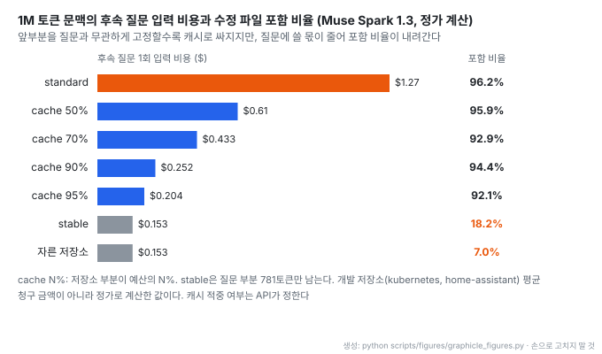
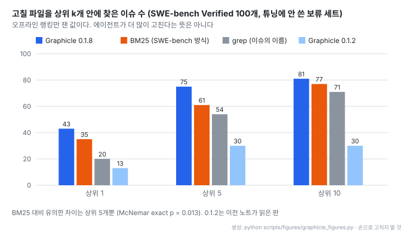
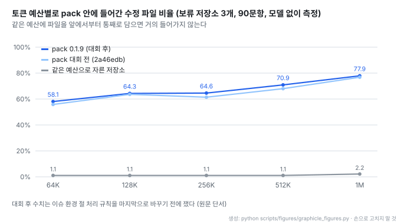

# Graphicle: 코딩 에이전트용 코드 그래프와 프로젝트 메모리, 그리고 긴 문맥 pack

- **레포**: [Graphicle-AI/graphicle](https://github.com/Graphicle-AI/graphicle) · [벤치마크 문서](https://github.com/Graphicle-AI/graphicle/blob/main/docs/benchmarks.md) · [pack 문서](https://github.com/Graphicle-AI/graphicle/blob/main/docs/pack.md) · [해커톤 작업 목록](https://github.com/Graphicle-AI/graphicle/blob/main/HACKATHON.md)
- **제작**: KarLex AI, Inc. GitHub 기여자 3명 (2026-10-29 GitHub API 기준)
- **공개**: 2026-10-14 저장소 생성일 (Rust, Apache-2.0, 별 409개 · 2026-10-29 기준. 2026-10-19에는 297개)
- **읽은 판**: 커밋 `4bbe6cd`, 릴리즈 `v0.1.9` (2026-10-28). 공개 저장소는 릴리즈마다 커밋 하나로 받으므로 개발 이력은 보이지 않는다
- **이전 판**: 2026-10-19에 `v0.1.2`(커밋 `160fb92`) 기준으로 처음 정리했고, 이 판은 `v0.1.9` 기준으로 다시 썼다
- **원형**: 코드 그래프 엔진은 [Graphify](https://github.com/Graphify-Labs/graphify)(Python)의 Rust 이식판이고 Graphify 0.9.95를 따라간다. 메모리 · 메모리 도구 · 앱 · 세션 수집은 자체 구현이다
- **읽은 날짜**: 2026-10-29
- **태그**: #CodeGraph #AgentMemory #MCP #ContextPacking #PromptCache #Benchmark #LocalFirst

!!! note "핵심 요약"
    저장소를 코드 그래프로 만들고 문서 · 결정 · 지난 에이전트 세션을 메모리로 쌓아, 코딩 에이전트에게 파일과 줄 번호가 붙은 발췌를 토큰 예산 안에서 돌려주는 로컬 Rust 프로그램이다. 0.1.2 이후 2주 동안 릴리즈가 일곱 번 나왔고, 변화는 세 갈래다. 오프라인 랭킹이 크게 좋아져 고칠 파일을 상위 5개 안에 찾는 이슈가 30개에서 75개로 늘었다(BM25 61개). 최대 2,000,000토큰까지 저장소를 한 덩어리로 묶는 `pack`이 생겼고, 앞부분을 질문과 무관하게 고정해 프롬프트 캐시로 후속 질문 비용을 낮추는 레이아웃이 붙었다. 모델을 직접 부르는 `ask --pack`, `plan`, `fix`, `review`, `see`, `pixel`이 추가됐다. 다만 새 모델 명령은 실제 API를 한 번도 부르지 않은 대역 시험만 거쳤고, 긴 문맥 벤치마크도 모델 실행 없이 회수율만 쟀다.

## 1. 개요

README 첫 문장은 "Code graph and memory for your coding agents, in one Rust program." 이다. 코드 그래프 도구와 메모리 서버를 따로 띄우는 대신, 그래프 · 메모리 · MCP 서버 하나 · 웹 앱 · CLI를 설치 한 번과 SQLite 파일 하나에 담는다. 계정과 텔레메트리가 없다.

처음 정리한 0.1.2와 지금의 0.1.9는 성격이 꽤 다르다. 0.1.2는 "모델을 부르지 않고 발췌만 돌려주는 도구" 였다. 0.1.9는 그 위에 긴 문맥 모델로 저장소 전체를 읽히는 길(`pack`)과, 모델이 계획 · 수정 · 리뷰까지 하는 명령을 얹었다. 0.1.9 작업 대부분은 Meta Global AI Developer Hackathon(2026-10-26 ~ 11-04, 스타트업 트랙) 기간에 썼고, [HACKATHON.md](https://github.com/Graphicle-AI/graphicle/blob/main/HACKATHON.md)가 대회 전과 대회 중 작업을 커밋 · 시각 단위로 나눠 밝힌다. 그래서 기본 모델 예시가 Meta의 Muse Spark다.

| 판 | 날짜 | 주요 변경 |
| --- | --- | --- |
| 0.1.1 | 2026-10-15 | 코드 그래프, 엔진 데이터 구조, 에이전트 연결 |
| 0.1.2 | 2026-10-18 | 대시보드, MCP Registry 등록 (이전 노트의 기준) |
| 0.1.3 | 2026-10-21 | 컨텍스트 · 리콜 랭킹 개편, 사용량 보고, 확장 인터페이스 |
| 0.1.4 | 2026-10-21 | 연결 정리 |
| 0.1.5 | 2026-10-22 | 대형 프로젝트 질문, 프롬프트 훅, Windows |
| 0.1.6 | 2026-10-24 | Python · TypeScript SDK, 보안 |
| 0.1.7 | 2026-10-25 | 코드 그래프, 명령 · 훅 · 언어 모델, SDK, 보안 |
| 0.1.8 | 2026-10-26 | 대형 프로젝트 질문 속도. 해커톤 시작 전 기준판 |
| 0.1.9 | 2026-10-28 | pack, ask --pack, plan, fix, review, see · pixel, Muse Code 플러그인 |

## 2. 기능

| 기능 | 내용 |
| --- | --- |
| 코드 그래프 | tree-sitter로 파일 · 함수 · 클래스 · 호출 · import를 파싱한다(모델 없음). 심볼 설명, 경로 추적, `graphicle graph affected "retry()"`로 의존 심볼 나열, HTML 그래프 내보내기 |
| 프로젝트 메모리 | 문서(Markdown, PDF, Office, HTML), 검토한 결정 · 절차, 지난 Claude Code · Codex 세션을 코드와 함께 검색 |
| 예산 안의 근거 발췌 | `graphicle context`와 MCP 도구가 모델 호출 없이 출처가 붙은 발췌를 반환. 해석은 에이전트 자신의 모델이 맡음 |
| MCP 서버 하나 | Graphify 도구 이름(`query_graph`, `get_neighbors`, `shortest_path`) + 메모리 도구. `--pull-requests`로 `list_prs`, `get_pr_impact`, `triage_prs` 추가. Claude Code에는 기본 5개만 노출하고 `--tools all`이면 `pack`까지 노출 |
| 여러 저장소 | `graphicle context --workspace`로 워크스페이스 단위 리콜 |
| 항상 최신 | 매 답변 전 바뀐 파일만 동기화, post-commit · post-merge · post-checkout Git 훅 |
| 앱 | `graphicle open`으로 그래프 · 원천 · 메모리 확인, 에이전트가 제안한 메모리 승인 |
| 설치 · 해제 | `graphicle setup`이 색인, 에이전트 연결, 훅, `AGENTS.md` 두 줄을 처리. 바꾸는 파일마다 `<file>.graphicle-bak`로 백업하고 `graphicle disconnect`로 되돌림 |

연결 대상은 Claude Code(`.mcp.json`, 세션 훅은 `.claude/settings.local.json`), Codex(`~/.codex/config.toml`, 훅은 `~/.codex/hooks.json`), Cursor, VS Code, Claude Desktop, Muse Code(미리보기), 그 밖의 MCP 클라이언트다. 0.1.9에서는 Claude Code 샌드박스처럼 `.git/hooks`나 `.mcp.json`을 쓸 수 없는 환경이면 그 파일을 이유와 함께 건너뛰고, 직접 넣을 줄을 요약에 출력하게 바뀌었다([이슈 #15](https://github.com/Graphicle-AI/graphicle/issues/15)).

모델 없이 대부분 동작한다. 모델이 필요한 것은 `ask`의 문장 답, 메모리 제안, 전체 그래프 추출의 문서 · 이미지 해석, 그리고 0.1.9의 모델 명령들이다. Ollama나 OpenAI 호환 서버도 쓸 수 있다. 기본 한도는 프로젝트당 텍스트 파일 100,000개, 텍스트 1 GiB이고 설정으로 올린다.

## 3. pack: 긴 문맥 모델용 저장소 묶음

`graphicle pack [QUESTION]`은 질문 하나에 필요한 코드를 토큰 예산 안의 텍스트 한 덩어리로 모은다. `--budget` 기본값은 128,000, 최대는 2,000,000이다. 짧은 발췌를 돌려주던 `context`와 같은 색인을 쓰고, 새 색인을 만들지 않는다.

pack은 다음 순서로 채운다.

1. 헤더와 포함 목록(manifest). 빠진 상위 파일을 최대 100개까지 적는다
2. 아키텍처 요약
3. 순위가 매겨진 파일. 작은 파일은 통째로, 큰 파일은 심볼 단위 발췌로 넣는다
4. 호출 엣지를 따라 2홉까지의 caller · callee
5. 테스트, 문서, 그 밖의 저장소 내용

랭킹은 `context`의 랭킹(문단 색인, 식별자, 코드 그래프)을 3,000 문단까지 깊게 읽은 것에 두 가지를 더한다. 하나는 질문이 이름으로 가리키는 파일이다. `TextEdit`는 `text_edit.cpp`와 `text_edit.h`를, `FormControl`은 `form_control.ts`를 가리키고, 이런 파일은 상위 5개 바로 뒤에 놓인다(이름당 최대 4파일, 이름 4개, 8파일). 다른 하나는 상위 파일이 쓰는 정의를 담은 파일이다. Go의 import, Python의 같은 폴더 모듈, TypeScript · JavaScript의 상대 경로 · index 파일 · `tsconfig` 경로 별칭을 따라간다. 한 파일이 예산의 10분의 1을 넘지 않는다.

랭킹에서 이슈의 환경 절(시스템 정보, 시험한 버전, OS)과 `<name> version: <value>` 줄은 뺀다. 그래픽 드라이버 · 디스플레이 서버 · 패키지 버전 같은 낱말이 무관한 파일을 끌어올렸기 때문이다. 제목이 버전을 언급하는 경우는 그대로 둔다.

예산은 넘지 않는다. `--tokenizer tokenizer.json`을 주면 Hugging Face 토크나이저로 정확히 세고, 없으면 언어별 바이트당 토큰 수로 추정한다. 추정치는 Muse Spark Open 토크나이저로 보정했고 128,000토큰 pack 22개에서 실제보다 7% 많게 센다. 여기에 여유분을 둔다. 입력이 같으면 출력도 바이트 단위로 같다. 형식은 Markdown, XML, JSON(`graphicle.pack.v1`)이다.

## 4. 모델을 부르는 명령

`graphicle config set model meta`는 Meta Model API(Responses API)의 `muse-spark-1.3` 프로필을 만들고, `meta:muse-wonder-1.0`은 Muse Wonder를 고른다. Meta가 데이터로 학습하는 `-contributor` 모델은 거부한다. `compatible:MODEL --url URL`이면 vLLM이나 SGLang에 올린 Muse Spark Open 같은 OpenAI 호환 서버를 쓴다. 프로필 입력 한도는 최대 1,048,576토큰, 출력은 131,072토큰이다. 가격은 프로그램에 넣지 않고, 프로필에 `price`를 적었을 때만 비용을 보여 준다.

| 명령 | 동작 |
| --- | --- |
| `ask --pack` | 모델 입력 한도를 채우는 pack으로 한 번 호출. 답의 `path:line` 인용을 작업 트리와 대조해 맞지 않는 것을 나열 |
| `plan "변경 요청"` | 단계, 수정할 파일과 줄 범위, 새 파일, 테스트, 위험을 JSON으로 받아 작업 트리와 대조한 뒤 Markdown 또는 JSON으로 출력. 파일은 바꾸지 않음 |
| `fix "issue"` | pack과 plan을 만든 뒤 search-and-replace 블록으로 편집을 받고, HEAD에서 만든 새 worktree · 새 브랜치에 적용. `--test CMD`가 실패하면 출력과 diff를 돌려보내 최대 `--rounds`(기본 3)번 반복 |
| `review` | 브랜치가 추가한 변경을 주변 코드 · caller · callee · 테스트와 함께 리뷰. 바뀐 줄에 달렸고 인용이 맞는 코멘트만 남김. GitHub Action이 PR에 리뷰 하나를 게시 |
| `see` · `pixel` | `see`는 Meta API의 computer use로 웹 앱을 조작해 버그를 재현. `pixel`은 스크린샷 요소를 SAM 3.1로 찾고 비전 모델이 읽은 문자열을 코드에서 찾음. 이어서 `fix --focus`로 그 자리부터 수정 |

`fix`의 격리 장치가 꼼꼼하다.

- 한 라운드의 편집을 경로 · 검색 문자열 · 새 파일까지 한꺼번에 검사해 전부 적용하거나 전부 적용하지 않는다. 쓰다가 실패하면 그 라운드의 파일을 모두 되돌린다
- 저장소 밖을 건드리는 편집(절대 경로, `..`, 어떤 표기든 `.git`, 밖이나 `.git`을 가리키는 심볼릭 링크)을 거부한다. git은 훅을 끄고 실행한다
- 테스트 명령은 모델이 정하지 않는다. 테스트는 모든 프로필의 모델 키 환경 변수를 뺀 상태로 돌고, 출력에서 키 값을 가린다. Linux에서는 테스트 전에 자신을 dump 불가 상태로 만들어 `/proc`로 환경을 읽지 못하게 한다

호출마다 토큰과 비용을 기록하고(`graphicle usage`), 프로필의 비용 상한을 넘는 호출은 거부한다. 입력 한도에 가까운 요청은 Meta API의 `POST /responses/input_tokens`로 정확히 센 뒤 맞지 않으면 pack을 더 작게 다시 만든다.

!!! warning "새 모델 명령은 대역으로만 시험했다"
    CHANGELOG 0.1.9가 기능별로 밝힌다. `ask --pack`, `plan`, `fix`, `review`, `pixel`, `see`는 Meta Model API처럼 응답하는 로컬 테스트 서버와 `demo/mock_meta.py`로만 시험했다. 원문은 "None of them has called the live Meta Model API yet." 라고 적는다. Muse Code 플러그인은 `muse` 대역으로, `review`의 GitHub Action은 `curl` · `graphicle` · `gh` 대역으로 시험했고 GitHub 러너에서는 돌리지 않았다. 데모 앱은 배포하지 않았다.

## 5. 프롬프트 캐시 레이아웃

`graphicle pack --layout cache`는 pack을 공급자의 프롬프트 캐시에 맞게 나눈다. 앞부분(저장소 부분)은 커밋 · 예산 · 설정이 같으면 질문과 상관없이 같은 바이트가 된다. 질문 없는 헤더, 아키텍처 요약, 폴더 지도, 코드 그래프에서 연결이 가장 많은 파일, 상위 문서가 여기 들어간다. 뒷부분(질문 부분)은 manifest, 초점 파일, 호출 경로, 테스트이고 앞부분에 이미 있는 줄은 반복하지 않고 `in the prefix: path lines a-b`로만 가리킨다. `--prefix-share`(기본 0.9)가 앞부분 비율의 상한이고, 1.0이면 질문만 바뀌는 stable layout이다. pack JSON에는 앞부분의 `prefix_sha256`이 남는다.

cache layout 요청에는 프로젝트 · 커밋 · 앞부분 해시로 만든 `prompt_cache_key`(질문은 넣지 않는다)와 24시간 `prompt_cache_retention`을 붙인다. 앞부분 크기는 질문마다 흔들리지 않도록 모델 입력 한도에서 정하고, 공급자가 센 토큰이 추정보다 많으면 0.8, 0.64 배로 단계적으로 줄인다.

- 앞부분 비율이 비용과 회수율 사이의 조절 손잡이다. 90%에서 후속 질문 비용이 standard의 약 5분의 1로 줄면서 수정 파일 포함 비율은 94.4%를 유지한다
- stable은 비용이 가장 낮지만 질문 부분이 781토큰만 남아 포함 비율이 18.2%로 떨어진다. 질문과 무관한 앞부분만으로는 답할 파일을 담지 못한다
- 모두 2026-10-26 정가(Muse Spark 1.3 입력 $1.25/M, 캐시 $0.15/M)로 계산한 입력 비용이고 청구 금액이 아니다. 캐시 적중은 API가 정하며, 24시간 보존은 힌트일 뿐이다

`fix`는 기본으로 standard layout을 쓴다. 한 번 실행에 이슈 하나만 다루므로 공유 앞부분이 이슈에 필요한 파일의 자리만 차지하기 때문이다. 같은 커밋에 질문을 여러 번 할 때 cache layout이 이득이다.

## 6. 메모리를 코드 심볼에 묶는 규칙

[`crates/graphicle/README.md`의 "Memory anchored to code symbols" 절](https://github.com/Graphicle-AI/graphicle/blob/main/crates/graphicle/README.md#memory-anchored-to-code-symbols) 기준이다. 이전 판에서 바뀌지 않았다.

- 검토된 메모리가 코드 일부를 인용하면 그 인용을 감싸는 심볼(함수, 클래스, 메서드)에 연결한다. 심볼 id, 리비전, 경로, 정규 이름을 함께 둔다
- 메모리는 파일이 아니라 심볼 단위로 낡는다. 연결된 심볼의 줄(시작부터 다음 정의 전까지)이 바뀌면 메모리를 내보내지 않는다(`symbol_changed`, 심볼이 사라지면 `symbol_missing`). 같은 파일의 다른 곳이 바뀌면 그대로 유효하다
- 내용이 같은 파일의 이동 · 이름 변경은 따라간다. 그래프를 다시 만드는 동안에는 바뀐 파일의 메모리를 보류한다(`projection_pending`)
- 심볼 밖의 인용, 여러 심볼에 걸친 인용, 코드가 아닌 파일은 파일 단위 규칙을 쓴다

커밋 30개 뒤 메모 30개를 표본 조사했더니 함수가 바뀐 15개만 낡음으로 표시됐고 나머지는 표시되지 않았다. 더 넓은 탐색 점검에서는 잘못 표시된 경우가 일부 있었다고 함께 밝힌다. 문서 속 코드 언급은 그 정의에 연결된다(`graphicle call graph.doc_links`).

## 7. 개인정보와 로컬 동작

- 데이터는 SQLite 하나에 모인다(macOS `~/Library/Application Support/Graphicle`, Linux `~/.local/share/graphicle`). 앱과 HTTP · MCP는 127.0.0.1에서만 연다
- 동기화는 `.gitignore`를 따르고 `.env`, 키, 자격 증명 파일을 건너뛴다. 세션 수집은 `<private>…</private>` 구간을 지우고 자격 증명을 가린다
- 네트워크는 설정한 모델 · 커넥터, 전체 그래프 추출(찾은 API 키의 LLM으로 문서 · 이미지를 보냄), GitHub CLI 작업, `graphicle update`, 하루 한 번 새 버전 확인에만 쓴다. 버전 확인은 기본으로 켜져 있고 `GRAPHICLE_NO_UPDATE_NOTIFIER=1`로 끈다
- 메모리나 세션을 지우면 파생물까지 지우고 해시 체인으로 묶은 삭제 영수증을 준다
- 릴리즈 빌드는 아직 신뢰된 인증서로 서명되지 않았다. Windows판은 SignPath 테스트 인증서 서명이거나 미서명 미리보기다

## 8. 벤치마크

[docs/benchmarks.md](https://github.com/Graphicle-AI/graphicle/blob/main/docs/benchmarks.md) 기준이다. 에이전트 실험에서 95% 신뢰구간이 0을 포함하면 차이를 인정하지 않고 "비김"으로 적는다. 긴 세션과 여러 코딩 세션에 걸친 메모리는 아직 시험하지 않았다.

### 고칠 파일 찾기 (오프라인 랭킹)

[retrieval 벤치마크](https://github.com/Graphicle-AI/graphicle/blob/main/docs/benchmarks/retrieval.md)는 SWE-bench Verified 이슈 중 튜닝에 쓰지 않은 100개로, 수정된 파일이 컨텍스트 결과 상위 k개 안에 들어간 이슈 수를 센다.

- 이전 노트가 읽은 0.1.2는 grep보다도 낮았다. 0.1.3 랭킹 개편에서 상위 5개 기준 30개에서 75개로 뛰었고, 0.1.8도 같은 수준이다(0.1.3 상위 10개만 82개로 1개 많다)
- BM25 대비 유의한 차이는 상위 5개뿐이다(McNemar exact p = 0.013). 상위 1개(p = 0.200)와 상위 10개(p = 0.523)는 유의하지 않다
- 랭킹만 잰 값이다. 이 랭킹으로 에이전트가 이슈를 더 많이 고치는지는 아직 시험하지 않았다. 튜닝에 쓴 개발 세트(2026년 7월 이슈 80개)에서는 0.1.3 상위 5개 63개, BM25와 grep 각 51개였다

### pack 회수율 (모델 없이 측정)

[whole-repo 벤치마크](https://github.com/Graphicle-AI/graphicle/blob/main/docs/benchmarks/whole-repo.md)는 100만 토큰이 넘는 저장소에서 질문 하나에 대해 수정된 파일이 pack 안에(통째, 발췌, 심볼 개요 어느 형태든) 들어간 비율을 잰다. 튜닝에 쓰지 않은 pytorch · vscode · elasticsearch 각 30문항, 총 90문항이다.

- 비교 기준선은 같은 예산으로 파일을 통째로 담은 "자른 저장소" 다. 1M 예산에서도 2.2%만 담아, 큰 저장소에서는 무엇을 넣을지 고르는 단계가 결과를 좌우한다
- 대회 중 TypeScript · Java · C++ 랭킹 조정으로 모든 예산에서 조금씩 올랐다. 저장소별로는 pytorch가 2.3~10.6점 올랐고 vscode는 64K에서 6.6점, 256K에서 0.9점, 512K에서 3.3점 내려갔다
- 대회 후 수치는 이슈 환경 절 처리 규칙을 마지막으로 고치기 전에 쟀다. 개발 문항 200개 결과는 그대로였지만 보류 문항은 다시 재지 않았다. 이 벤치마크의 모델 실행(LLM이 실제로 답하는 단계)은 문항 · 비교군 · 채점기만 고정했고 아직 하지 않았다

### 속도

0.1.8에서 대형 저장소 질문이 빨라졌다. kubernetes(`ca8a2a9e4` 얕은 클론, 30,315파일)에서 이슈 #8의 22문항을 매번 새 프로세스로 돌렸다.

| 조건 | 0.1.7 | 0.1.8 |
| --- | --- | --- |
| `context` 중앙값, 16코어 | 2.99초 | 1.34초 |
| `context` 중앙값, 4코어 | 3.89초 | 1.38초 |
| 4코어, 호출 전 파일 캐시 비움 | 4.55초 | 1.90초 |
| 조회 8건, 16코어 | 2.52초 | 0.96초 |
| 호출 최대 메모리 | 3.5 GB | 0.6 GB |

두 판은 같은 저장소에서 모든 질문에 바이트 단위로 같은 결과를 냈다. Graphify 0.9.91과의 비교(0.1.1 사전 빌드)는 이전 판과 같다. 코드베이스 13개 × 작업 3종 = 39번 측정 모두에서 3.0~22.7배 빨랐고(kubernetes 1분 8초 대 25분 47초), 최대 메모리도 39번 모두 적었다(0.29~0.97배). 두 그래프는 노드 수가 최대 4.7%, 엣지 수가 최대 2.0% 다르다.

### 에이전트 실험

Claude Code 2.1.287, Opus 5.5, effort medium 조건이다.

- **코드 찾기**: SWE-bench Verified 100과제에서 수정된 파일을 모두 찾은 과제 수는 Claude Code만 95, Graphicle 0.1.0 95, Graphify 94로 비겼다. 토큰은 Graphicle이 16%, Graphify가 29% 더 썼고, 에이전트는 Graphicle 도구를 한 번도 부르지 않았다. README는 "we do not claim it saves tokens" 라고 적는다
- **질문 답하기**: Graphify 예시 코퍼스 30문항의 사실 포함률은 Graphicle 0.1.1 99.2%, Claude Code만 94.7%(비김), Graphify 87.8%다. Graphify보다 11.4점 높다(95% CI [4.2, 19.7])

### 에이전트 메모리 비교

대회 전에 메모리 시스템 7종과 비교했다. 비교를 점수 매기기 전에 등록했고, 모든 시스템의 답변자 · 채점자 · 모델로 같은 오픈 모델(Qwen3.8-27B)을 썼다. 개발 세트 결과이고 Graphicle은 배포판에 없는 평가 렌더러(`render_v2.py`)를 쓴 사전 빌드다.

| 시스템 | LoCoMo-10 정확도 [95% CI] | 적재 단계 대화당 모델 호출 (추정) |
| --- | --- | --- |
| Graphicle (사전 빌드) | 87.7 [85.1, 90.2] | 12 |
| Hindsight 0.10.2 | 87.3 [85.6, 89.1] | 160 |
| Mem0 OSS 2.2.1 | 81.9 [79.6, 84.4] | 332 |
| MemMachine 0.4.0 | 79.6 [77.3, 82.0] | 23 |
| Honcho 3.2.2 | 79.2 [76.2, 82.2] | 221 |
| Cognee 1.6.3 | 69.5 [67.3, 71.2] | 206 |
| Graphiti 0.30.2 | 46.5 [44.0, 48.9] | 1,363 |
| Mastra Observational Memory 1.36.0 | 38.6 [33.6, 43.1] | 22 + 질문당 1 |

Hindsight와는 비기고 Mem0보다 높으며, 적재 호출은 Hindsight의 약 13분의 1, Mem0의 약 28분의 1이다. LME-84와 BEAM-100K에서도 어느 시스템에도 뒤지지 않았다. 초기 GPT 실행에서는 Mem0 자체 LoCoMo 프로토콜(GPT-5)로 93.5%를 받아 Mem0 공개 결과 91.6%보다 1.95점 높았다(95% CI [+0.55, +3.55]).

## 9. 읽을 때 감안할 것

!!! warning "검증 범위"
    0.1.9의 새 기능은 실제 모델 API로 돌려 본 적이 없고, 긴 문맥 벤치마크는 모델 없이 회수율만 쟀으며, 비용은 정가 계산이다. 성능 주장으로 읽을 수 있는 것은 오프라인 랭킹, 속도, 0.1.0 · 0.1.1 시점의 에이전트 실험까지다.

- **아직 0.1.x다.** 2주 사이 릴리즈가 일곱 번 나왔다(0.1.2 → 0.1.9). 공개 저장소는 릴리즈 단위 커밋이라 변경 이력을 커밋으로 따라갈 수 없고 CHANGELOG에 기댈 수밖에 없다
- **랭킹 개선이 에이전트 성과로 이어지는지 모른다.** 원문도 오프라인 랭킹이라고 선을 긋는다
- **에이전트가 도구를 부르지 않던 문제.** 0.1.0 실험에서 Claude Code가 Graphicle 도구를 한 번도 부르지 않았다. 0.1.5에서 프롬프트 훅(매 프롬프트 전에 컨텍스트를 넣는 방식)이 들어왔지만, 훅 이후 같은 조건의 에이전트 재실험 수치는 문서에 없다
- **메모리 점수는 출시판 기준이 아니다.** 배포하지 않은 렌더러를 쓴 사전 빌드의 개발 세트 결과다
- **pack 회수율은 마지막 규칙 변경 전 측정이다.** 보류 문항은 다시 재지 않았다
- **setup이 여러 설정 파일을 바꾼다.** `.mcp.json`, `.claude/settings.local.json`, `~/.codex/config.toml`, `AGENTS.md`, Git 훅이다. 백업과 `disconnect`가 있지만 바뀌는 목록을 먼저 확인하는 편이 낫다
- **전체 그래프 추출은 문서를 외부 LLM으로 보낼 수 있다.** 찾은 API 키의 모델로 문서 · 이미지를 보낸다. 외부로 나가면 안 되는 코드에는 `--code-only`를 쓴다
- **기본 모델 예시가 Meta 모델이다.** 해커톤 출품의 결과다. OpenAI 호환 서버나 Ollama로 바꿀 수 있다
- 0.1.9로 올린 뒤에는 프로젝트마다 `graphicle sync`를 한 번 돌려야 한다. 저장된 그래프와 질의 파일이 빌드에 묶여 있다

## 10. 가져갈 지점

| 대상 | 가져갈 수 있는 부분 |
| --- | --- |
| 평가 보고 태도 | 판정 규칙 사전 등록, 신뢰구간이 0을 포함하면 비김, 보류 · 개발 세트 구분. 자기 도구가 grep과 비긴 결과, 에이전트가 도구를 안 불렀다는 사실, 기능별로 대역 시험이었다는 사실까지 적는다 |
| 비용을 정확도 옆에 | 적재 단계 호출 수, 캐시 레이아웃별 후속 질문 비용과 포함 비율을 한 표에 둔다. 점수가 비슷해도 비용 차이가 10~100배일 수 있다 |
| 캐시 친화 프롬프트 | 질문과 무관한 앞부분을 바이트 단위로 고정하고 해시를 남긴다. 질문 부분은 앞부분에 있는 줄을 반복하지 않고 가리키기만 한다. 앞부분 비율을 비용과 회수율의 조절 값으로 노출한다 |
| 인용 검증 | 모델 답의 `path:line` 인용을 작업 트리와 기계적으로 대조해 맞지 않는 것을 표시한다 |
| 자동 수정 격리 | 새 worktree · 새 브랜치, 전부 아니면 전무인 편집 라운드, 모델이 정할 수 없는 테스트 명령, 테스트 환경에서 모델 키 제거 |
| 메모리 무효화 | 메모리를 원천의 가장 작은 단위(심볼)에 묶고 그 단위가 바뀔 때만 낡음으로 표시한다. 문서 기반 RAG라면 청크를 절 · 조항에 묶는 식으로 응용할 수 있다 |
| 설치 도구 | 바꾸는 파일을 모두 나열 · 백업하고 명령 하나로 되돌린다. 쓸 수 없는 파일은 건너뛰고 직접 넣을 줄을 보여 준다 |

## 11. 결론

Graphicle은 2주 만에 "모델 없이 근거 발췌를 주는 로컬 도구" 에서 "긴 문맥 모델에게 저장소를 읽히고 계획 · 수정 · 리뷰까지 시키는 도구" 로 범위를 넓혔다. 랭킹 개선은 보류 세트로 확인된 실질적인 진전이고, cache layout은 긴 문맥 비용 문제를 프롬프트 구조로 푸는 구체적인 설계다. 반면 새 모델 명령과 긴 문맥 벤치마크는 아직 실제 모델로 검증되지 않았다. 지금 시점에서 쓸 만한 것은 코드 그래프 · 메모리 · 발췌 쪽이고, pack과 fix는 공개된 모델 실행 결과가 나온 뒤 판단하는 것이 맞다. 어느 쪽이든 이 저장소의 평가 문서는 도구 자체와 별개로 참고할 가치가 있다.
