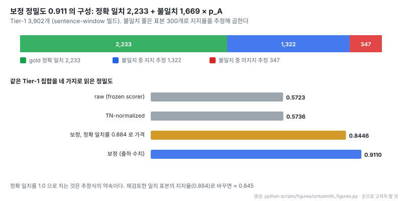
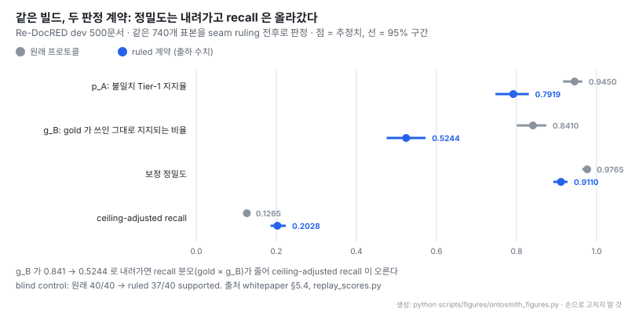
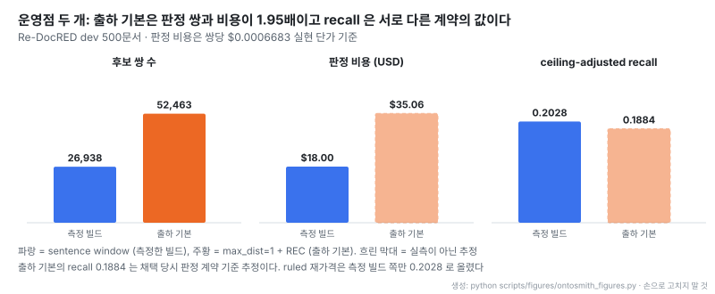

# OntoSmith: 온톨로지를 먼저 정하고 판정 모델 게이트로 지식 그래프를 짓는 빌더

출처: [OntoSmith README](https://github.com/Dongbumlee/ontosmith/blob/9bc8981de162473987e7b1515d9506b37423d2f7/README.md) (MIT)

- **원문**: [Dongbumlee/ontosmith](https://github.com/Dongbumlee/ontosmith) (설명: "A decision-model-based ontology & knowledge-graph builder — builds governed knowledge graphs from your documents, every fact gated and traceable to its evidence.")
- **문서**: [whitepaper](https://github.com/Dongbumlee/ontosmith/blob/9bc8981de162473987e7b1515d9506b37423d2f7/docs/whitepaper.md) · [판정 계약](https://github.com/Dongbumlee/ontosmith/blob/9bc8981de162473987e7b1515d9506b37423d2f7/docs/ADJUDICATION.md) · [Connections](https://github.com/Dongbumlee/ontosmith/blob/9bc8981de162473987e7b1515d9506b37423d2f7/docs/connections.md) · [팩 형식](https://github.com/Dongbumlee/ontosmith/blob/9bc8981de162473987e7b1515d9506b37423d2f7/docs/PACK_DESIGN.md) · [프로젝트 사이트](https://dongbumlee.github.io/ontosmith/)
- **저자**: Dongbum Lee (기여자 1명)
- **저장소 생성**: 2026-10-22 (첫 커밋 2026-10-24, v0.1.0도 같은 날). 읽은 판 `v0.1.9` (2026-11-07), 커밋 `9bc8981`
- **코드**: 라이선스 MIT, Python ≥ 3.11, 별 218개 · 포크 23개 (2026-11-09 기준), 커밋 179개. 파이프라인 모듈 28,730줄, 테스트 71개 파일 19,081줄 (test 함수 935개). PyPI `ontosmith`
- **요구 환경**: Linux (Windows는 WSL2), Neo4j 5.x (빌드에 필수), LLM 연결 하나. profile · inspect · verify · 데모 search는 키 없이 돈다
- **참조 바인딩**: proposer `anthropic/claude-haiku-5.5`, judge `typesafe/jev-1.13`, escalation `anthropic/claude-sonnet-5.5`, embedder `openai/text-embedding-3-large` (3072차원). OpenRouter 키 하나로 네 모델에 닿는다
- **읽은 날짜**: 2026-11-09
- **태그**: #KnowledgeGraph #Ontology #InformationExtraction #LLMasJudge #Neo4j

!!! note "핵심 요약"
    OntoSmith는 모델이 뽑아낸 것에서 그래프를 시작하지 않고, 사람이 승인한 평평한 타입 목록(엔티티 · 관계 타입, 정의, 경계 예시)을 먼저 고정한 뒤 그 아래에서 그래프를 짓는다. 싼 proposer가 후보를 내고, 같은 모델의 두 번째 설정이 열거된 쌍마다 트리플을 만들고, 코드 게이트(증거 인용문 verbatim 확인 등)와 고정된 판정 모델 Jev가 무엇을 기록할지 정한다. 점수 0.50 이상은 Tier-1로 기록되고 0.25~0.50은 사람 검토 구간으로 간다. Re-DocRED dev 500문서 빌드에서 raw 정밀도 0.5723이 기계 판정 표본 보정으로 0.9110이 되지만, recall은 ceiling 보정 후에도 0.2028이고 gold의 57.9%는 후보로 열거조차 되지 않았다. 사전 등록한 기준 6개 중 1개(NONE 손실 비율)가 실패했고, 보정 수치는 처음 0.9765로 냈다가 다른 모델 계열 재판정으로 계약의 빈틈이 드러나 0.9110으로 다시 매겼다. 모든 보정 수치는 사람 감사가 아니라 기계 판정이다.

## 1. 개요

README 첫 문단이 방향을 정한다.

> "Most knowledge-graph tooling starts from whatever a model happens to extract. OntoSmith starts from the ontology"

whitepaper는 LLM이 지은 그래프의 문제를 세 가지로 묶는다. 판단 기준이 될 스키마가 없어 "이 트리플이 맞는가"가 "그럴듯한가"로 바뀌고, 추출한 모델이 결정까지 해서 모델의 확신만이 유일한 게이트가 되고, 품질을 재지 않는다. 세 번째에 대해서는 벤치마크 gold 자체가 불완전하다는 점을 짚는다. Re-DocRED가 DocRED의 누락된 관계를 메우려고 만들어진 데이터셋이니, raw 점수만 내는 빌더는 gold의 구멍까지 자기 품질로 보고하게 된다는 주장이다.

그래서 답은 프롬프트가 아니라 구조라고 말한다. 온톨로지를 데이터로 설계하고, 제안과 판정을 분리하고, 판정기를 고정하고, gold의 불완전성까지 값을 매기는 프로토콜로 결과를 재고, 실패를 포함해 공개한다.

출처: [OntoSmith README](https://github.com/Dongbumlee/ontosmith/blob/9bc8981de162473987e7b1515d9506b37423d2f7/README.md) (MIT, 코퍼스 CUAD CC BY 4.0)

- 목업이 아닌 실제 빌드다. Legal Contract 팩으로 지은 계약 하나의 두 당사자 주변이고 엔티티 42개, Tier-1 트리플 77개가 모두 증거 span과 provenance를 가진다
- README는 계약서의 정의어("the Term")를 문서별 등록부에 모아 이후 "during the Term"이 같은 노드에 붙게 한다고 설명한다. 문자열 매칭이 아니라 정체성으로 다룬다는 뜻이다

## 2. 스키마의 성격: 평평한 추출 계약

OntoSmith가 말하는 온톨로지는 형식 온톨로지가 아니다. 닫힌 엔티티 · 관계 타입 목록과 각 타입의 정의 · 경계 예시로 된 **flat extraction contract**이고, 클래스 계층 · 상속 · 논리 공리 · 추론이 없다. README는 "OntoSmith is not an OWL ontology editor"라고 못 박는다. 엔티티 타입은 날짜 · 금액 · 기간 같은 값 속성을 선언할 수 있고, 이 값도 결정적 코드로 정규화한 뒤 다른 사실과 똑같이 판정을 거쳐 노드 속성으로 기록된다.

평평함을 일부러 고른 이유가 이 설계의 핵심이다.

> "The flatness is the point: judged per-type decisions are what make a build's quality measurable, and hierarchy would blur exactly those decisions."

타입마다 판정이 따로 서야 타입별로 품질을 잴 수 있고, 계층이 들어가면 "상위 타입으로는 맞고 하위 타입으로는 틀린" 경우가 생겨 측정 단위가 흐려진다는 논리다. whitepaper는 같은 지형의 반대쪽 끝으로 [Open Ontologies](https://github.com/fabio-rovai/open-ontologies)를 들며, 그쪽이 OWL 온톨로지의 변경 관리와 기계 검증 증명을 다룬다면 OntoSmith의 검증 가능한 산출물은 증명이 아니라 감사 추적(모든 트리플을 판정 근거 span까지 거슬러 올라갈 수 있음)이라고 구분한다. 표준 형식 직렬화도 없다. 팩은 자체 JSON 형식이고, 내보내는 RDF는 인스턴스 수준 Turtle export 하나다.

## 3. 루프와 두 산출물

사용자 루프는 profile → design → build → inspect → verify → serve 여섯 단계이고, 두 산출물이 이 루프를 받친다.

| 산출물 | 무엇을 기술하나 | 만드는 방법 |
|---|---|---|
| profile | 내 코퍼스: 문서 목록, 관례, 사람이 먼저 정해야 할 결정 지점 | `ontosmith profile`. LLM 없이 결정적으로 돌고 같은 코퍼스는 같은 해시를 낸다 |
| pack | 도메인 온톨로지: 타입 목록, 정의, 경계 예시, 임계값, conformance 기록 | `ontosmith ontology`로 profile에서 초안을 만들거나 외부 온톨로지를 import. sha256으로 고정, 버전 관리, 로드 시 해시가 안 맞으면 거부 |

배치 하나는 profile 하나와 pack 하나를 묶는다. 도메인 내용은 팩에만 있고 코드 분기에는 없다는 것이 팩 형식의 원칙이다. conformance 기록에는 성공뿐 아니라 실패한 fitting도 남아서 같은 시도가 두 번 제안되지 않게 한다.

## 4. 제안과 판정의 분리

출처: [OntoSmith whitepaper 그림 2](https://github.com/Dongbumlee/ontosmith/blob/9bc8981de162473987e7b1515d9506b37423d2f7/docs/whitepaper.md) (MIT)

- 그림 위 두 문구("proposes — never decides", "decides — never proposes")가 슬로건이다. 그런데 본문은 이 슬로건을 스스로 좁힌다(아래)
- Serving store 아래 세 갈래(Search, API, App)는 모두 같은 Neo4j 투영을 읽는다

whitepaper가 정리한 자리는 다섯이다.

| 자리 | 역할 | 쓰기 권한 |
|---|---|---|
| Proposer | 싼 모델이 후보 트리플과 증거 span을 낸다 | 없음 |
| 결정적 게이트 | 증거 인용문이 문서에 verbatim으로 있는지, 스키마에 맞는지, 중복 · 일관성 검사. "These are code, not prompts." | 걸러냄 |
| Jev | 팩 정의에 비춰 후보를 판정하는 고정 구성요소 `typesafe/jev-1.13`. 컴파일러 버전처럼 고정하고 모든 실행 기록에 이름을 남긴다 | 판정 |
| Fitted pair judge | 열거된 쌍마다 1회 호출로 "이 쌍이 트리플을 지지하는가"를 판정하고 지지하면 방향과 함께 트리플을 낸다. 설정 JF-F1 (문장 컨텍스트 + 방향 슬롯) | 후보 생성 |
| 사람 검토 구간 | 수용 · 거부 임계값 사이. 자동화의 실패가 아니라 설계된 자리이고 폭도 측정한 값이다 | 사람 결정 |

여기서 원문이 정직하게 밝히는 지점이 있다. pair judge는 별도 모델이 아니라 **proposer 모델(Haiku 5.5)의 두 번째 설정**이고, 판정과 생성을 한 호출에서 한다. 그래서 이 구조가 실제로 강제하는 분리는 "proposer는 판정하지 않는다"가 아니다.

> "nothing is written on the proposing seat's say-so alone."

변환된 트리플도 결정적 게이트, Jev 판정, ROUTE 임계값을 모두 지나야 그래프에 닿는다는 뜻이다. frontier 모델 escalation은 하네스에 있지만 제품 기본값은 꺼져 있다.

Jev에 대해서는 두 가지를 분명히 해 둔다. 게이트 임계값과 검토 구간은 Jev에 맞춰 fitted 되어 있어서 judge 자리를 다른 모델로 바꾸면 그 실행은 custom binding으로 기록되고 보정 · 품질 기록이 따라오지 않는다. 그리고 Jev가 frontier 판정기보다 낫다는 비교는 없다.

> "no Jev-versus-frontier judgment comparison is in this record, and none should be inferred from it."

Jev 자체를 다룬 측정은 [JEV-as-a-Judge 노트](../papers/[20260928]%20JEV-as-a-Judge_Confidence_Cascade.md)에 있다.

## 5. 배치 파이프라인 8단계

출처: [OntoSmith whitepaper 그림 1](https://github.com/Dongbumlee/ontosmith/blob/9bc8981de162473987e7b1515d9506b37423d2f7/docs/whitepaper.md) (MIT)

- 먼저 볼 곳은 ROUTE의 세 갈래다. 점수 0.50 이상은 Tier-1로 기록, 0.25~0.50은 사람이 정하는 검토 큐, 0.25 미만은 기록은 남지만 버려지는 큐로 간다
- 그림 아래 문구대로 guard 강등(단정되지 않은 진술 등)은 Tier-1 행을 기록 전에 Tier-2로 내린다. 단계별 상태가 배치 아래 남아 실패한 실행은 다시 돈을 쓰지 않고 이어서 돈다
- NER 칸의 "local NER retired"는 GLiNER+spaCy 후보 경로를 2026-10-29에 폐기했다는 뜻이다. 지금 후보 소스는 LLM proposer 하나다

INGEST는 문서 목록 · 문서 수 · 정렬된 문서 id 해시 · profile과 pack 고정값을 담은 불변 매니페스트를 쓴다. roster 단계의 중요성은 실패 해부(8절)에서 드러난다. gold 트리플 17,284개 중 3,670개는 끝점 하나가 roster에 들지 못해 잃었다. 엔티티 해소는 자기 임계값(0.40)으로 돌고, 문서를 넘는 병합은 이름만 같은 병합을 막으려고 p_same ≥ 0.85 하한을 둔다.

비용은 실행 전에 센다. `ontosmith verify project`가 실제 roster에서 후보 쌍을 세고 호출자가 준 단가(`--unit-cost`)로 값을 매긴다. 코드에 요금표는 없다. USD 상한은 `ONTOSMITH_MAX_COST_USD`를 설정했을 때만 걸리고, 넘을 단위는 시작하지 않고 ledger에서 이어서 돈다.

## 6. 온톨로지 빌더와 import

출처: [OntoSmith whitepaper 그림 3](https://github.com/Dongbumlee/ontosmith/blob/9bc8981de162473987e7b1515d9506b37423d2f7/docs/whitepaper.md) (MIT)

- 승인이 초안 해시에 묶여 있어서, 승인 뒤 초안이 바뀌면(stale hash) 초안 단계로 돌아간다
- 내보낸 팩은 등록된 측정이 채택하기 전까지 `emitted_unmeasured` 표시를 단다. 만들었다는 것과 품질이 확인됐다는 것을 상태로 구분한다

외부 OWL/RDF 온톨로지는 import 문으로 들어온다. 클래스 · 속성 인벤토리(IRI, 라벨, 정의, 부모)를 기계적으로 뽑고, 사람이 쓴 scoping spec이 범위 안 모든 개념을 정확히 한 번씩 처리한다(유지 · 병합 · 평탄화, role class는 관계로 바꾸고 datatype property는 강등, 버릴 때는 이유를 적음). 그 뒤는 직접 초안을 쓴 경우와 같은 게이트를 지난다. 원문 표현으로 "Import changes where the schema's content comes from — never what it must pass."

## 7. 팩 다섯 개

| 팩 | 내용 | 측정 코퍼스 |
|---|---|---|
| Bio Medical | 생의학 엔티티 · 관계 스키마, fitted 한정어 | BioRED |
| Legal Contract | 계약 스키마, 라벨 범주 41개, 역할어 · 정의어 규칙 | CUAD |
| FIBO Contracts | FIBO FND Agreements 모듈을 import해 평탄화. 엔티티 15 + 관계 13 타입 | CUAD 대상 coverage 기록만 있음 (41개 범주 중 전용 타입 7, 부분 34, 미포함 0). `emitted_unmeasured` |
| Open Domain | 일반 문서용 스키마, fitted 방향 선언 | Re-DocRED (flagship 기록) |
| Core | 새 코퍼스가 출발하는 도메인 중립 기준 | 교차 도메인 core 기록 |

## 8. 품질 기록: Re-DocRED 500문서

flagship 빌드는 Re-DocRED dev 500문서(gold 17,284개)를 2026-10-21에 돌렸다. 후보 쌍 26,938개를 판정해 Tier-1 3,902개를 냈고, 이후 같은 게이트로 186개를 추가 승격해 출하 판은 4,088개다. 아래 보정 수치는 3,902개 기준이고 승격분은 다시 계산하지 않았다.

| 점수 (FULL-500) | 값 |
|---|---|
| raw P / R / F1 (전수) | 0.5723 / 0.1063 / 0.1793 |
| TN-normalized P / R / F1 (전수) | 0.5736 / 0.1229 / 0.2024 |
| 보정 정밀도 (표본 추정, 기계 판정) | **0.9110** [0.8919–0.9275] |
| ceiling-adjusted recall (표본 추정, 기계 판정) | **0.2028** [0.1856–0.2237] |

두 보정 수치는 두 방향의 표본에서 나온다.

- **방향 A (정밀도)**: Tier-1 중 gold와 정확히 일치하지 않는 1,669개에서 층화 표본 300개를 뽑고(seed 20261022), 정확 일치 40개를 control로 섞어 판정자에게 gold 여부 · 층 · control 표시를 숨겼다. 지지율 $\hat{p}_A$ = 0.7919
- **방향 B (gold 지지율)**: gold 17,284개 전체에서 층화 표본 400개(seed 20261023). gold가 쓰인 그대로 문서에서 지지되는 비율 $\hat{g}_B$ = 0.5244. 기계 판정자가 보기에 gold의 절반 정도만 타입 그대로 성립한다

추정식은 replay 스크립트에 그대로 있다. 정확 일치 트리플 수를 $M_x$ (2,233), 불일치 풀을 $U$ (1,669), Tier-1을 $T$ (3,902), 정확히 맞힌 gold 수를 $M_g$ (1,838), gold 전체를 $G$ (17,284)라 하면

$$
\text{보정 정밀도} = \frac{M_x + \hat{p}_A U}{T}, \qquad
\text{ceiling-adjusted recall} = \frac{M_g}{G \cdot \hat{g}_B}
$$

이다. recall 분모는 "gold 중 실제로 맞힐 수 있는 몫"으로 줄인 값이다. 저장소의 `examples/demo/replay_scores.py`를 Python 3.12로 돌리면 모델 호출 없이 두 판정 세트의 헤드라인이 모두 재현되고 exit 0으로 끝난다(2026-11-09 확인. Python 3.9에서는 `zip(strict=)` 때문에 중간에 멈춘다).

- 0.911은 정확 일치 2,233개를 모두 맞은 것으로 치고, 불일치 1,669개 중 표본 지지율만큼을 더한 값이다. 빨간 347개가 추정 오답이다
- 정확 일치를 1.0으로 치는 것은 추정식의 약속이다. 원문도 재검토한 일치 표본의 지지율(0.884)로 가격하면 ≈ 0.845가 된다고 밝힌다
- raw와 TN-normalized는 거의 같다. 정밀도를 크게 바꾸는 것은 표기 정규화가 아니라 gold에 없는 맞는 트리플을 인정하느냐다

### 실패 해부

출처: [OntoSmith whitepaper 그림 4](https://github.com/Dongbumlee/ontosmith/blob/9bc8981de162473987e7b1515d9506b37423d2f7/docs/whitepaper.md) (MIT)

- 가장 긴 막대는 never enumerated 6,340개다. 두 끝점이 다 roster에 있었지만 문장 창 안에서 함께 나오지 않아 쌍이 만들어지지 않았다. roster missed 3,670개와 합치면 10,010개(57.9%)가 판정 단계에 가 보지도 못했다
- 오른쪽은 각 행방에서 gold가 실제로 지지되는 비율이다. 손실 층마다 0.42~0.53이라, 놓친 gold의 절반 정도는 애초에 타입 그대로는 성립하지 않는다는 기계 판정이다
- 원문은 recall 천장이 두 개라고 정리한다. 열거 범위가 닿을 수 있는 곳을 막고, gold의 타입 지지율이 완벽한 열거로도 인정받을 수 있는 몫을 막는다

## 9. 판정 계약을 다시 쓴 경위

보정 정밀도는 처음 0.9765 [0.9641–0.9847]로 나왔다. 기록을 동결한 뒤 사전 등록한 설계로 740개 판정을 스트레스 테스트했다. 원래 판정 패널(Anthropic 계열)과 다른 계열인 GPT-5.5가 층화 표본 200개를 blind로 다시 판정했더니 일치율이 81.5%로 사전 등록 기준 95%에 못 미쳤고(Cohen's κ ≈ 0.45), 새로 심은 blind control은 29/40이었다. 불일치 37건 중 35건이 "지지 → 미지지" 한 방향이었고, 계약이 정의하지 않았던 여섯 가지 상황에 몰려 있었다.

그 여섯 상황을 명시적 ruling으로 정했다.

| ruling | 판정 |
|---|---|
| 형용사형 값 (demonym, 예: Afghan → Afghanistan) | 수용 |
| 눈에 띄게 제시된 대표작 | 수용 |
| 이웃 관계 (비슷하지만 다른 관계 타입) | 거부 |
| 주어 정체성 이동 | 거부 |
| 빠진 한정어 | 거부 |
| 이행적이지 않은 포함 관계 | 거부 |

플래그된 565건 전부를 더 엄격한 계열이 ruled 계약으로 blind 재판정했고 186건이 바뀌었다(177건이 지지 → 미지지). 같은 추정식으로 다시 매긴 값이 지금의 0.9110이다.

- 같은 빌드, 같은 표본인데 계약만 바꾸자 정밀도는 0.9765 → 0.9110으로 내려갔고 recall은 0.1265 → 0.2028로 올랐다. gold 지지율 $\hat{g}_B$가 0.841 → 0.5244로 떨어지면서 recall 분모가 줄었기 때문이다
- 그래서 "보정"이라는 말이 붙은 두 수치는 판정 계약을 어떻게 쓰느냐에 함께 묶여 있다. 계약이 엄격해지면 빌더 쪽 정밀도와 gold 쪽 천장이 동시에 내려간다
- 2026-10-23 addendum은 원래 계열의 Sonnet 5.5로 새 표본 150개를 ruled 계약에서 판정했다. 비교 가능한 110쌍 일치 0.7727 (κ 0.4271), 결정적 판정 106쌍 0.8019 (κ 0.4723)이고, 불일치는 Sonnet이 관대한 쪽 18건 대 반대 3건이었다. ruling이 계열 간 차이를 줄였지만 없애지는 못했다

## 10. 사전 등록 기준과 게이트

| 기준 | 기준값 | 측정 | 판정 |
|---|---|---|---|
| C-1 변환 η, CONF-440 | ≥ 0.21 | 0.2519 | PASS |
| C-2 도달 gold 중 NONE 손실 비율, CONF-440 | ≤ 0.50 | 0.5128 | **FAIL** |
| C-3 방향 flip 행 | 기록 행의 ≤ 3% | 1.13% | PASS |
| C-4 보정 정밀도 | ≥ 0.55, CI 하한 ≥ 0.48 | 0.9110 | PASS |
| C-5 파싱 실패 · 잘못된 방향 | 각 ≤ 1% | 26,938 중 0 / 0 | PASS |
| C-6 비용 상한, 문서당 비용이 예측의 +25% 이내 | | | PASS |

C-2는 판정기가 도달한 gold 쌍의 51.3%에서 여전히 NONE이라고 답했다는 뜻이고(FULL-500 0.5059), 판정 쪽 최대 손실이다. 설정 변경은 사전 등록 게이트를 통과할 때만 채택한다.

- **JF-F1 (방향 슬롯) 채택**: 변환 η 0.1124 → 0.2596, 방향 flip 131 → 7, 후보 정밀도 0.3464 → 0.8381
- **J3F2 (문서 컨텍스트 판정기, NONE 손실 겨냥) 기각**: 변환 게이트 0.3096에 0.3071로 gold 쌍 약 2개 차이로 못 미쳤고, 재해석 없이 기각했다

## 11. 운영점과 비용

- 측정한 빌드는 문장 창 안의 쌍만 열거했다. 출하 기본값은 문장 거리 1까지 넓히고 결정적 이름 복원(REC)을 더한 `max_dist=1 + REC`라 쌍이 52,463개로 1.95배다
- 출하 기본값의 recall 0.1884는 채택 당시 옛 판정 계약으로 한 추정이고, ruled 재가격은 측정 빌드 쪽만 0.2028로 올렸다. 두 recall을 같은 잣대로 비교할 수 없다는 점을 원문도 밝힌다. 좁은 문장 창은 더 싼 선택지로 남아 있다
- 판정 비용은 실현 단가(쌍당 $0.0006683)를 쌍 수에 곱한 값이다

reference run의 전체 비용은 roster $0.5871, 후보 판정 $18.0029, gates $0.0902로 ledger $18.6802였고, 제공자 키에서 관측한 금액 $18.7980이 기준 수치다(stop-line $21.00 아래, 문서당 $0.0376). ledger와 관측값의 차이 $0.1178도 메타데이터에 남겼다.

## 12. 다른 팩의 기록

**Bio Medical (BioRED dev 100문서, gold 1,162)**: Tier-1 2,058행, 비용 $4.0026. recall 0.5120으로 기준(0.35)을 넘었지만, gold 기준 grounded 정밀도는 0.6625로 기준 0.70에 못 미쳐 FAIL로 남겼다. 같은 기준을 기계 판정 감사로 보정하면 0.9510이다. 가장 큰 개선은 스키마를 proposer 앞에 둔 것이다. 끝점 grounding이 14.8% → 74.6%, recall이 0.0620 → 0.2091로 올랐다. 원문은 이것을 온톨로지가 프롬프트의 덧붙임이 아니라 설계 산출물이어야 하는 실증 근거로 든다. 반면 관계 타입 배정(Association ↔ Correlation 혼동)을 고치려는 다섯 번의 시도는 모두 채택되지 않았다. 한 타입을 고치면 다른 타입이 무너졌다.

**Legal Contract (CUAD 510문서)**: 같은 하네스에서 추출 모델 두 개를 비교했다.

| | DeepSeek | Haiku 5.5 (채택) |
|---|---|---|
| presence precision (micro) | 0.886 | **0.963** |
| presence recall | 0.845 | 0.841 |
| span 게이트 탈락 | 81 (5.0%) | **0** |
| 비용 (계약 80개) | $0.7809 | $0.6507 |

두 모델이 찾은 진짜 사실 수는 비슷하고(TP 886 vs 890), 차이는 FP(114 vs 34)와 지어낸 span이다. 인증 단계의 pinned QA 116문항에서 recall@20은 graph 0.6516, hybrid 0.6314, graph+hybrid 0.7115로, 그래프를 더하면 +0.080이었다. BioRED의 짧은 초록에서는 같은 비교가 정확히 0.00이었다. 원문은 그래프의 검색 이득을 "긴 문서에서"라는 조건과 함께만 인용한다.

## 13. 서빙

v0.1.9부터 `ontosmith search`의 기본은 문장 단위 근거 검색이다. INDEX 단계가 모든 문장을 빌드의 embedder로 색인하고, 질의는 세 채널을 합친다.

| 채널 | 내용 |
|---|---|
| direct | 문장 인덱스에서 가장 가까운 문장 |
| graph pool | 상위 트리플의 증거 인용문을 담은 문장 |
| beam | 질문에서 연결된 엔티티부터 가지치기한 2홉 순회 (frontier 엔티티당 상위 8 트리플, 홉당 최대 24, 인용 단위 최대 16) |

합친 목록을 4,000 토큰 예산 안에 통째로 채운다. `rerank` extra를 깔면 로컬 cross-encoder(BAAI/bge-reranker-base)가 앞부분을 다시 정렬한다. 문장 서빙이 안 되면 chunk 수준 hybrid 검색으로 내려가고 결과에 그 사실을 적는다. 원천은 registry이고 Neo4j는 다시 만들 수 있는 투영이다. 저장소에는 그래프가 하나만 있어서, 다른 온톨로지로 빌드하면 이전 그래프를 대체한다.

## 14. 해석 시 주의

!!! warning "보정 수치를 읽기 전에"
    - **기계 판정이다.** 모든 보정 수치는 사람 감사가 아니라 기계 판정자가 계약에 따라 내린 표본 판정이고, 원문도 "not a human audit"이라고 적는다. flagship 표본에 사람 spot check 라운드는 없다
    - **계약에 따라 움직인다.** 같은 빌드가 계약 문구만으로 0.9765와 0.9110 사이를 오갔다. 계열 간 일치도 κ 0.43~0.47 수준이다
    - **측정한 빌드와 출하 기본값이 다르다.** 보정 수치는 sentence-window 3,902개에 대한 것이고, 출하 기본은 열거 방식이 다르며 승격된 186개는 재계산하지 않았다
    - **Jev 비교가 없다.** 판정기를 frontier 모델과 맞대 본 기록이 없고, judge 자리를 바꾸면 보정이 넘어가지 않는다. Jev는 외부 서비스라 판정 내부는 이 저장소에서 확인할 수 없다
    - **recall이 낮다.** ceiling 보정 후에도 0.2028이고, 사전 등록 기준 C-2가 실패했다
    - **검색 이득은 긴 문서 한정이다.** 116문항 한 세트, 한 코퍼스에서 잰 값이다
    - **저장소가 젊다.** 생성 18일, 기여자 1명이고 CHANGELOG 기준 2주 사이 0.1.0에서 0.1.9까지 열 번 릴리스했다

## 15. 관련 노트

- [edgextract](./[20261003]%20raphaelmansuy_edgextract_닫힌질문_결정모델로_지식그래프추출.md): 같은 문제를 닫힌 yes/no 질문과 로컬 결정 모델로 푼다. edgextract는 cutoff를 사용자에게 맡기고 공개 벤치마크 F1을 내는 반면, OntoSmith는 임계값을 게이트로 fitted 하고 gold 불완전성을 보정해 보고한다
- [JEV-as-a-Judge](../papers/[20260928]%20JEV-as-a-Judge_Confidence_Cascade.md): OntoSmith가 judge 자리에 고정한 Jev 1.13을 외부에서 측정한 논문
- [pg-jev](./[20260917]%20realZachi_pg-jev_Postgres_자연어조건_행판정_확장.md): 같은 Jev를 Postgres 행 판정에 쓰는 확장
- [Open Ontologies](./[20260309]%20fabio-rovai_open-ontologies_온톨로지_변경계획과_검증가능한_추론.md): whitepaper가 형식 온톨로지 쪽 끝으로 언급하는 도구
- [kgdiff](./[20261101]%20iiwish_kgdiff_지식그래프_버전간_의미diff_리뷰.md): OntoSmith whitepaper 6절이 미구현으로 둔 스키마 변경 후 그래프 차이 검토를 다루는 도구

## 16. 결론

OntoSmith에서 배울 것은 판정 모델보다 측정 방식이다. 쓰기 권한을 코드 게이트와 고정 판정기에 두고, 설정 변경은 사전 등록한 기준을 넘을 때만 채택하고, 실패한 기준과 기각한 설정을 기록에 남긴다. 무엇보다 gold의 불완전성을 양방향 표본으로 값을 매긴다는 점이 raw 점수만 내는 추출 도구들과 다르다. 그 결과 raw 0.57이 0.91로 바뀌는 과정을 replay 스크립트로 누구나 다시 계산할 수 있다.

반대로 그 0.91은 판정 계약에 크게 기대는 수치다. 계약의 빈틈 여섯 곳을 메우자 같은 빌드의 정밀도가 6.5%p 내려갔고, 다른 계열 판정자 사이 일치도는 아직 중간 수준이다. recall 0.20과 57.9% 미열거가 보여 주듯 이 파이프라인은 많이 찾기보다 틀리지 않게 쓰는 쪽으로 기울어 있다. 감사 가능한 그래프가 필요하고 스키마가 어느 정도 굳은 도메인이면 맞고, 빠르게 많은 관계를 뽑아 보는 용도라면 원문 스스로 "lighter extraction tools"를 권한다.
