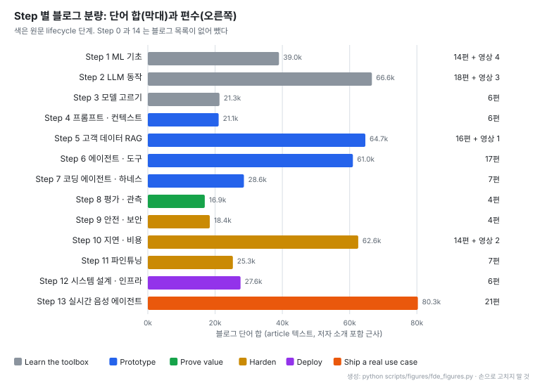
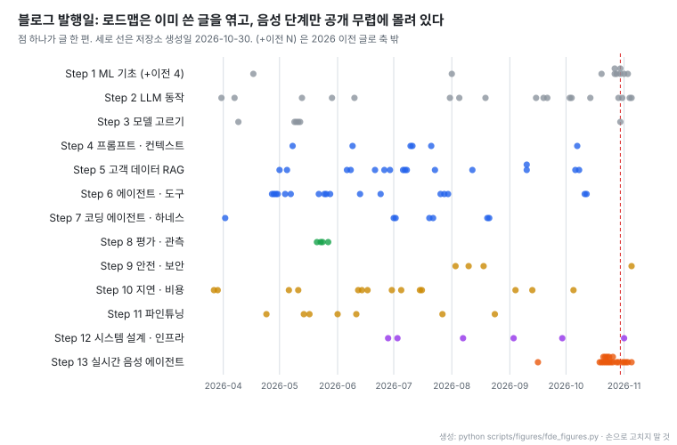
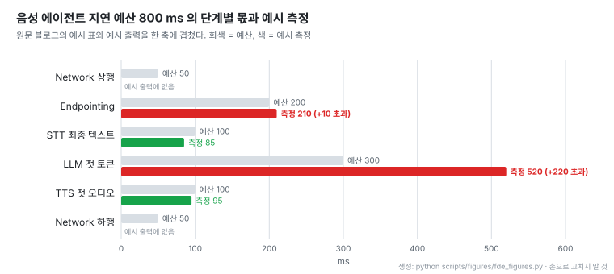

# Forward Deployed Engineer Roadmap: 고객 현장 AI 엔지니어 학습 순서와 블로그 140편

- **원문**: [amitshekhariitbhu/forward-deployed-engineer-roadmap](https://github.com/amitshekhariitbhu/forward-deployed-engineer-roadmap) (설명: "A step-by-step roadmap to become a Forward Deployed Engineer (FDE) in AI, with a blog for every topic.")
- **작성자**: Amit Shekhar ([Outcome School](https://outcomeschool.com) 창업자). 로드맵에 걸린 블로그 140편이 모두 outcomeschool.com 글이고, README 머리와 Step 14 에 같은 기관의 유료 과정 링크가 있다
- **연계 레포**: [ai-system-design](https://github.com/amitshekhariitbhu/ai-system-design) (같은 작성자, 2026-09-25 생성, 별 832). Step 12 와 Step 14 가 이 레포로 넘긴다
- **저장소 생성**: 2026-10-30. 태그·릴리스 없음, 커밋 20개. 읽은 커밋 `6868f0f` (2026-11-05)
- **구성**: Apache-2.0, Markdown. README 357줄 + 배너 이미지 1장이 전부다. 별 220 · 포크 32 (2026-11-06 기준), 기여자 1명
- **원문 그림**: 배너(제목 · 부제 · 기관명 글자) 하나뿐이라 인용하지 않는다. lifecycle 은 원문이 표로 주므로 2절에 표로 옮겼다
- **집계 방법**: 2026-11-06 에 README 의 블로그 링크 140개를 모두 받아 HTTP 상태, `<article>` 안 단어 수, 글 머리의 "Published on" 날짜를 셌다
- **읽은 날짜**: 2026-11-06
- **태그**: #ForwardDeployedEngineer #LearningRoadmap #AIEngineering #VoiceAgent #LLMEvaluation

!!! note "핵심 요약"
    Forward Deployed Engineer(FDE)를 "고객의 실제 시스템 · 데이터 · 업무 안에서 AI 제품을 데모에서 production 으로 옮기는 엔지니어"로 정의하고, 그 일의 흐름(Discover → Learn → Prototype → Prove value → Harden → Deploy → Ship)에 맞춰 Step 0~14 로 블로그 140편과 영상 10편을 엮은 목록이다. 링크 140개는 모두 열리고 글 하나가 중앙값 3,491.5 단어라 입문 글로는 분량이 충분하다. 다만 분량은 고르지 않다. 원문이 "evals are not optional"이라고 강조하는 Prove value(Step 8)와 안전 · 보안(Step 9)은 각 4편으로 가장 얇고, 실시간 음성 에이전트(Step 13)는 21편으로 가장 두껍다. 발행일을 보면 로드맵은 2026-03 부터 쓴 글을 단계로 엮은 것이고, 음성 에이전트 글만 로드맵 공개 무렵(2026-10-19 이후 20편)에 몰려 있다. 공개 뒤 하루 한두 편씩 더해 127편에서 140편이 됐다.

## 1. 개요

이 레포는 코드가 없는 학습 목록이다. 읽을 가치는 두 가지다. 하나는 FDE 라는 직무를 어떤 기술 묶음으로 정의하는지, 다른 하나는 그 묶음을 고객 프로젝트의 진행 순서에 맞춰 배치하고, 각 Step 을 "고객 앞에서 이 단계에 무엇을 결정해야 하는가"로 설명한다는 점이다.

원문은 AI Engineer 와 FDE 를 이렇게 가른다: "An AI Engineer mostly builds the product. An FDE makes the product work for one specific customer, and then brings what they learned back to the product team." FDE 의 역할은 세 가지로 나눈다. 코드를 쓰는 engineer, "turns a vague ask into a clear definition of done" 하는 problem finder, "proves with evals and numbers that the system works" 하는 trust builder 다. 그래서 결론이 "an FDE needs breadth more than depth"다.

각 Step 끝에 스스로 묻는 기준도 같은 관점이다: "If a customer asked me about this tomorrow, could I explain it and make a decision?"

## 2. Engagement lifecycle 과 Step 배치

원문은 FDE 프로젝트가 거의 같은 경로를 밟는다고 보고 Step 순서를 그 경로에 맞췄다.

| 단계 (원문 Phase) | FDE 가 하는 일 | Step |
|---|---|---|
| Discover | 고객 문제 이해, 성공 기준 정의 | 0 |
| Learn the toolbox | AI 가 할 수 있는 것과 없는 것, 그 이유 | 1, 2, 3 |
| Prototype | "Build a working demo on the customer's data in days, not months" | 4, 5, 6, 7 |
| Prove value | evals 로 품질을 재고 숫자로 보여 줌 | 8 |
| Harden | 안전 · 보안 · 속도 · 비용 | 9, 10, 11 |
| Deploy | 전체 시스템 설계, 실행 위치 결정 | 12 |
| Ship a real use case | 하나의 production 시스템에 모두 적용 | 13 |

Step 14 는 면접 준비라 표에 없다. Step 0 은 블로그 목록 없이 고객 첫 미팅에 나오는 여섯 낱말(LLM · RAG · MCP · Agent · Fine-tuning · Quantization)을 영상 하나로 묶는다. 원문이 예로 드는 고객 질문은 "Should we use RAG or fine-tuning?", "Can we run the model on our own servers?" 같은 것이다.

각 Step 소개 문장도 고객 상황으로 쓰여 있다. Step 2 는 "why the model hallucinated, why it forgot something in a long document", Step 3 은 "where their data is allowed to go", Step 10 은 "A demo that takes 10 seconds per answer or costs too much per user will never reach production"을 설명할 수 있어야 한다고 적는다.

## 3. Step 구성과 분량

- 막대 길이는 편수가 아니라 단어 합이다. 편수만 보면 Step 2(18편)와 Step 6(17편)이 비슷해 보이지만, 실제 읽을 양은 Step 13 이 가장 많다. Step 13 의 첫 글 "Design a Real-Time Voice AI Agent" 하나가 13,686 단어로 140편 중 가장 길다
- 초록(Prove value)과 노랑의 Step 9(안전 · 보안)가 가장 짧다. 원문은 Step 8 소개에서 "For an FDE, evals are not optional. They are how we prove value, catch regressions, and get the customer to sign off on going live."라고 쓰지만, 이 단계에 걸린 글은 LLM 평가, LLM as a Judge, 에이전트 평가, 에이전트 observability 네 편이다
- 단계 묶음으로 보면 Prototype(Step 4~7) 46편, Learn(Step 1~3) 38편, Harden(Step 9~11) 25편이다. 학습 시간의 대부분이 만들기와 기초에 가고, 검증과 운영 안정화는 상대적으로 적다

링크 상태는 깨끗하다. 140개 모두 HTTP 200 이고 모두 본문 `<article>`이 있다. 단어 수는 저자 소개와 꼬리말 문구가 함께 세어진 근사값이며, 중앙값 3,491.5, 가장 짧은 글은 "What is Feature Engineering in Machine Learning?"(1,212)이다.

## 4. 글이 쓰인 시점

- 점 대부분이 저장소 생성일(빨간 선) 왼쪽에 있다. 로드맵은 새로 쓴 교재가 아니라 2026-03 부터 쓴 블로그를 단계별로 다시 엮은 색인이다. 2026 이전 글도 4편(2019-08-02 세 편, 2025-12-09 한 편)으로 모두 Step 1 ML 기초다
- Step 13 만 거의 전부 빨간 선 근처에 있다. 21편 중 20편이 2026-10-19 이후 발행이다. 음성 에이전트 연재를 쓰는 중에 로드맵이 공개됐고, 공개 뒤 추가된 글도 음성 쪽이 가장 많다
- Step 8 네 편은 2026-05-21 ~ 05-27 한 주에 쓰였고 그 뒤로 평가 글은 더해지지 않았다

커밋 이력도 같은 흐름이다. 첫 본문(`eb4e1bd`, 2026-10-30)은 16단계였고 Step 1 이 "The FDE Mindset"(블로그 2편: "AI Is Only as Good as Our Definition of Done", "The Future of Software Development")이었다. 같은 날 이 단계를 지우고 15단계(Step 0~14)로 줄였다. 그 뒤로는 커밋마다 블로그 한 편씩 더해 127편에서 140편이 됐다. 더해진 13편은 음성 에이전트 5, ML 기초 3, LLM 동작 3, Model Serving 1, jailbreaking 1 이다. README 는 "We will keep updating this roadmap with new topics and blogs."라고 밝힌다.

## 5. 내용 표본: 평가와 관측 (Step 8)

로드맵 자체는 목록이라 판단 기준은 링크된 글에 있다. FDE 정의의 trust builder 역할과 직결되는 Step 8 네 편에서 실무 규칙만 옮긴다.

| 글 | 규칙 |
|---|---|
| AI agent evaluation | 평가를 Outcome · Trajectory · Tool Use · Planning 으로 나눈다. "We should run each task at least 3 to 5 times."(평균과 최악을 함께 본다) |
| AI agent evaluation | LLM judge 점수는 "compare its scores with human scores on a small sample" 해서 검증한 뒤에 쓴다 |
| AI agent evaluation | "We should not test agents in production." 실제 행동(메일 발송, 결제)이 일어나므로 가짜 도구와 데이터를 둔 sandbox 에서 시험한다 |
| LLM as a Judge | Style bias 를 "the most dominant bias in LLM judges today"로 꼽고 position bias 등을 함께 다룬다 |
| AI agent observability | "For AI Agents, traces are the most important pillar." span 은 한 단계, trace 는 한 번 실행 전체 |

모두 입문 수준의 정리로, 무엇을 재야 하는지는 알려 주지만 고객 서명을 받을 만한 평가셋을 어떻게 만드는지(정답 데이터 수집, 표본 크기, 통과 기준 합의)는 다루지 않는다. 그 부분은 [JEV-as-a-Judge 노트](../papers/[20260928]%20JEV-as-a-Judge_Confidence_Cascade.md)나 [Opik 노트]([20230510] comet-ml_opik_LLM관측평가_플랫폼_Langfuse비교.md) 같은 별도 자료로 보충해야 한다.

## 6. 내용 표본: 실시간 음성 에이전트 지연 예산 (Step 13)

Step 13 은 원문이 "the perfect end-to-end FDE project"라고 부르는 단계다. 모델, 에이전트, 도구, 지연, 스트리밍, 시스템 설계가 한 시스템에 다 들어가기 때문이다. 21편이 turn-taking, endpointing, barge-in, backchannel, 지연 감추기(filler phrase, 느린 도구 호출)를 하나씩 다룬다.

그중 지연 예산 글은 FDE 가 고객 앞에서 숫자로 설명해야 하는 지점을 잘 보여 준다. 사람 사이 대화의 말 바꿈 공백은 10개 언어 연구에서 "around 200 ms on average"이고, 음성 에이전트가 2~3초 조용하면 "it feels broken"이다. 200 ms 는 여러 모델과 네트워크를 거쳐야 해서 어렵기 때문에 "many teams building voice AI agents aim for a voice-to-voice latency of around 800 ms or less"라고 쓴다.

- 회색 막대 여섯 개를 더하면 800 ms 다. LLM 첫 토큰이 300 ms 로 가장 큰 몫을 받는다
- 예시 측정에서 LLM 첫 토큰이 520 ms 로 220 ms 넘친다. endpointing 초과(10 ms)와 비교하면 어디부터 손대야 하는지가 바로 보인다. 원문은 이 출력을 단계별 예산 검사 코드의 결과로 보여 준다
- 같은 글은 p50 750 ms, p95 2000 ms 예를 들어 "we must set the budget for p95 as well, not only for p50"이라고 짚는다. 별도 글 "time-to-first-audio"는 첫 소리가 700 ms, 전체 응답이 1500 ms 인 예로 "a person on a voice call feels only the silence before the agent starts speaking"이라고 설명한다

## 7. 면접 준비 (Step 14)

원문은 FDE 면접이 세 가지를 본다고 정리한다.

| 유형 | 내용 | 대응 Step |
|---|---|---|
| Coding with AI Agents | AI 코딩 에이전트로 기능 하나를 만들고 디버깅하고 배포 | (명시 없음) |
| AI system design | 고객 문제에 맞춰 RAG · 에이전트 · 음성 에이전트를 품질 · 지연 · 비용 · 보안 trade-off 와 함께 설계 | 5~13 + ai-system-design |
| Customer scenarios | 모호한 비즈니스 문제에서 질문을 던지고, 성공을 정의하고, 접근을 고르고, 쉽게 설명 | 0, 8 |

세 번째 유형의 준비 자료가 Step 0(영상 하나)과 Step 8(네 편)뿐이라는 점은 3절의 분량 편중과 같은 문제다. 고객 문제를 정의하는 법을 다루던 "The FDE Mindset" 단계는 첫날 빠졌다.

## 8. 해석 시 주의

!!! warning "한 작성자의 블로그 색인"
    140편 모두 같은 사이트의 같은 작성자 글이다. 블로그 외 링크는 YouTube 영상과 작성자 · 기관 채널뿐이고, 논문 · 공식 문서 · 다른 저자의 글로 가는 링크는 없다. 로드맵 끝은 같은 기관의 유료 과정으로 이어진다. 주제 선정이 "FDE 에게 필요한 것"과 "이미 써 둔 글" 중 어느 쪽에 맞춰졌는지는 구분되지 않는다.

!!! warning "분량은 근사값"
    단어 수는 `<article>` 안의 텍스트를 센 값이라 저자 소개와 꼬리말이 글마다 약 100 단어 안팎 섞여 있다. Step 사이 비교에는 충분하지만 글 하나의 정확한 길이로 읽으면 안 된다.

- 로드맵은 계속 바뀐다. 공개 일주일 만에 단계 하나가 빠지고 13편이 늘었다. 이 노트의 편수와 분포는 커밋 `6868f0f` 기준이다
- 별 220 은 공개 일주일 시점 값이다. 같은 작성자의 ai-system-design(별 832)과 함께 보는 독자가 많다고 추정할 수 있지만 확인하지 않았다

## 9. 쓸 수 있는 조건

- **FDE · solutions engineer 로 옮기려는 개발자의 체크리스트**: 각 Step 의 "고객이 내일 물으면 설명하고 결정할 수 있는가" 기준은 그대로 쓸 만하다. 글을 다 읽기보다 Step 소개 문장의 고객 질문에 답할 수 있는지로 빈 곳을 찾는 용도가 낫다
- **음성 에이전트를 처음 맡은 경우**: Step 13 의 21편은 지연 예산, endpointing, barge-in 을 하나씩 끊어 설명해 연재 자체로 입문서 역할을 한다
- **평가 · 보안이 핵심인 업무**: Step 8 · 9 만으로는 부족하다. 평가셋 설계와 판정기 검증, prompt injection 방어는 별도 자료를 붙여야 한다
- **팀 온보딩 목록으로 쓸 때**: lifecycle 표(2절)를 뼈대로 두고 각 칸에 팀이 이미 쓰는 자료를 끼우는 방식이 링크를 그대로 나눠 주는 것보다 오래 간다

## 10. 관련 노트

- [ai-system-design](https://github.com/amitshekhariitbhu/ai-system-design): 같은 작성자의 시스템 설계 단계별 가이드. Step 12 · 14 가 이리로 넘긴다
- [JEV-as-a-Judge: 확신하면 받고, 모르면 넘기는 판정기](../papers/[20260928]%20JEV-as-a-Judge_Confidence_Cascade.md): Step 8 의 "LLM judge 를 사람 점수로 검증" 규칙을 확신도 기준 cascade 로 구현한 사례
- [Opik: LLM 관측 · 평가 플랫폼과 Langfuse 비교]([20230510] comet-ml_opik_LLM관측평가_플랫폼_Langfuse비교.md): Step 8 의 trace · span 개념을 실제 도구로 운영하는 방법
- [Context Engineering 핵심역량](../blogs/[20251230]%20SKdevocean_Context_Engineering_핵심역량.md): Step 4 의 context engineering 을 더 깊게 다룬 글
- [llm-d: Kubernetes 위 분산 LLM 추론 스택]([20250429] llm-d_llm-d_Kubernetes_분산추론_스택_라우팅과_PD분리.md): Step 10 의 prefill-decode disaggregation 이 실제 서빙 스택에서 어떻게 쓰이는지

## 11. 결론

이 레포의 가치는 블로그 목록보다 배치 원리에 있다. FDE 를 "고객 한 곳에서 데모를 production 으로 옮기는 사람"으로 정의하고, 기술을 난이도가 아니라 고객 프로젝트 단계(Discover → Prove value → Harden → Ship)에 매달았다. 각 Step 을 "고객이 묻는 질문에 결정할 수 있는가"로 점검하게 한 것도 학습 목록을 직무 기준으로 읽게 만든다.

반면 실제 분량은 원문이 강조하는 곳과 어긋난다. trust builder 역할의 근거인 평가 · 보안은 각 4편이고, 지금 연재 중인 음성 에이전트가 21편으로 가장 크다. 로드맵이 이미 쓴 글의 색인이라는 점을 감안하고, Step 8 · 9 와 "고객 문제 정의"는 다른 자료로 채워 읽는 것이 맞다.
