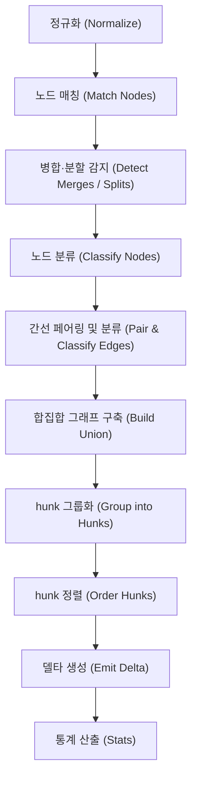
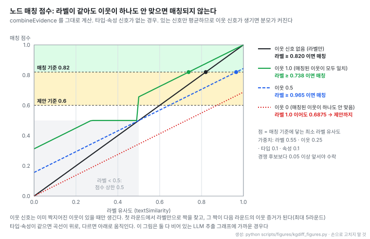

# kgdiff: 지식 그래프 버전 간 의미 diff와 리뷰 도구

- **원문**: [iiwish/kgdiff](https://github.com/iiwish/kgdiff) (설명: "git diff for knowledge graphs: semantic, visual diff and review for RDF, OBO and JSON graphs")
- **사이트·플레이그라운드**: [사이트](https://iiwish.github.io/kgdiff/) · [플레이그라운드](https://iiwish.github.io/kgdiff/playground.html) (브라우저에서 계산, 업로드 없음)
- **저장소 생성**: 2026-11-01 (GitHub created_at 2026-11-01T15:56:51Z, 첫 커밋 "feat: initial release" 2026-11-01). 읽은 시점 기준 이틀 된 저장소
- **코드**: 라이선스 MIT (예시 데이터셋은 CC0), 언어 TypeScript, 별 28개 (2026-11-03 기준), 기여자 2명, 커밋 37개
- **릴리스**: v0.2.0 (2026-11-02), v0.3.0 (2026-11-02), npm 패키지 `@kgdiff/*` 0.3.0
- **요구 환경**: Node.js ≥ 22, pnpm 11, 영어·중국어 UI 지원
- **토픽**: code-review, diff, graph-visualization, graphrag, knowledge-graph, obo, ontology, owl, rdf
- **읽은 날짜**: 2026-11-03
- **태그**: #KnowledgeGraph #Ontology #GraphDiff #GraphRAG #RDF #TypeScript

!!! note "핵심 요약"
    kgdiff는 RDF, OBO, JSON 형식의 지식 그래프 간 버전 차이를 구조적·의미론적으로 분석하고 시각적으로 검토할 수 있도록 설계된 TypeScript 기반 도구다. LLM 기반 파이프라인(GraphRAG, 에이전트 메모리 등)이 그래프를 지속적으로 생성·수정하는 환경에서, 기존 텍스트 diff의 트리플 나열과 일반 시각화 도구의 화면 재배치("everything jumps")를 문제로 삼는다. 두 버전의 노드를 다중 증거 기반으로 짝지어 이름 변경, 재식별, 속성 수정, 계층 이동, 병합(merge), 분할(split), 간선 대상 변경(retarget) 등으로 분류하며, 두 버전이 공유하는 단일 심상 지도(One mental map) 위에 변경 사항을 5가지 의미 색상으로 투영한다. 변경 사항은 의존성 순서에 따라 hunk로 그룹화되어 단계별 검토 및 재생이 가능하고, 적용·역적용 불변식을 속성 테스트로 확인한 역변환 가능 델타(invertible delta)를 내보낸다. 성능 수치는 저자 측정이고, 읽은 시점에 생성 이틀 된 저장소다.

## 1. 개요

kgdiff는 지식 그래프를 위한 의미적 diff 및 시각적 검토 도구다. 원문은 프로젝트의 배경과 문제의식을 다음과 같이 정의한다.

> "AI systems now write and rewrite knowledge graphs: GraphRAG pipelines, agent memories, ontology assistants, semantic layers. Someone has to review those changes."

기존 방식은 지식 그래프의 변경을 검토하는 데 구조적 한계를 지닌다. 텍스트 diff는 직렬화된 구문 단위에서 단순히 트리플이 추가되고 삭제된 결과만을 나열하므로, 실제 그래프 상에서 어떤 개념이 수정되었는지 파악하기 어렵다. 또한 기존 그래프 시각화 도구는 새 버전의 그래프에 대해 포스 레이아웃(force layout)을 다시 계산하여 노드 색상만 변경하므로, 화면 내 노드 위치가 급격히 뒤흔들리는 "everything jumps" 현상이 발생해 검토자의 인지 부담을 가중시킨다.

kgdiff는 이러한 문제를 단일 맵 기반의 의미적 diff로 해결한다.

> "kgdiff shows what actually happened: a merge, a rename, a class moved under a new parent, a relation that now points somewhere else — on one stable map, in a viewer built for review."

검토자는 CLI 명령 한 줄로 두 버전 간의 diff를 계산하고 인터랙티브 HTML 보고서를 생성해 브라우저에서 바로 확인할 수 있다.

```bash
npx @kgdiff/cli before.ttl after.ttl -o report.html --open
```


출처: [kgdiff README](https://github.com/iiwish/kgdiff/blob/d502bc26b80940e2b2200bb474e022f795e2f152/README.md)

- schema.org 형태 어휘의 두 버전 간 변경 사항을 뷰어에서 hunk 단위로 순차 재생하는 화면이다.
- 변경 전후의 노드와 관계를 안정적인 단일 맵 위에 배치하여 구조 변화를 한눈에 파악할 수 있도록 돕는다.
- 변경된 요소와 유지되는 문맥 요소를 시각적으로 구분하여 검토자가 직관적으로 변경 사항을 검증할 수 있게 한다.

## 2. 네 가지 원칙

kgdiff는 지식 그래프의 의미적 검토를 지원하기 위해 4가지 핵심 설계 원칙을 준수한다.

| 원칙 | 내용 |
|---|---|
| Semantic, not syntactic | 단순 텍스트 구문 비교를 넘어 버전 간 노드를 식별자(ID), 대체 힌트, 라벨 및 이웃 유사도로 짝지은 후 변경을 구체적인 의미 범주로 분류: rename, rekey, types, aliases, attributes, deprecation, replacement links, hierarchy move, merge, split, retarget, predicate change |
| One mental map | 두 버전이 결정적(deterministic)이며 라벨을 인식하는 단일 레이아웃을 공유. 바뀐 요소만 움직이고, 삭제된 요소는 기존 위치에 속이 빈 유령(hollow ghost) 노드로 보존되어 검토자의 심상 지도(mental map)를 유지 |
| Color is meaning | 의미를 담은 5개 색상 계열(added, removed, content, structure, identity)과 문맥 표시용 회색만 사용. 색상 외에 외곽선 형태 및 기하학적 도형 단서를 병행 제공하며 색각 이상자를 위한 전용 팔레트 내장 |
| Review is a workflow | 변경 내역을 의존성 순서에 따라 hunk 단위로 묶음. hunk 단위 순차 이동, 전후 변형 애니메이션 재생, 항목별 검토 완료 표시, 역변환 가능한 델타(delta) 내보내기 지원 |

## 3. 패키지 구성

저장소는 pnpm 모노레포다.

- **`core`**: diff 엔진 코어 모듈. 정규화(normalize), 노드 매칭(match), 분류(classify), hunk 생성(hunks), 역변환 가능 델타(invertible delta) 생성을 수행하며 외부 의존성이 전혀 없는 제로 디펜던시(zero dependencies) 구조다.
- **`formats`**: 다양한 지식 그래프 직렬화 파서 모음. RDF 계열(Turtle, N-Triples, N-Quads, TriG, RDF/XML, JSON-LD 1.1), OBO 1.4, JSON 계열(kgdiff JSON, d3·NetworkX node-link, Cytoscape.js, AntV G6 v5, graphology, vis-network)을 지원하며 RDF 파싱에는 `n3`를 활용한다. 동일한 그래프라면 다른 직렬화 형식으로 저장되어 있어도 완전히 동일한 diff 결과를 산출한다.
- **`layout`**: `d3-force` 기반의 결정적 합집합(union) 레이아웃 모듈.
- **`scene`**: diff 의미론적 결과를 그래픽 시각 요소로 변환하는 장면 구성 모듈.
- **`renderer`**: Canvas 2D 기반의 고성능 렌더링 엔진.
- **`viewer`**: `<kgdiff-viewer>` 커스텀 웹 컴포넌트.
- **`g6`**: AntV G6 v5 그래프 시각화 프레임워크 전용 어댑터.
- **`cli`**: 터미널 실행 및 HTML 보고서 생성을 담당하는 CLI 패키지 (`@kgdiff/cli`).
- **GitHub Action**: CI 파이프라인 연동을 위한 액션 (`uses: iiwish/kgdiff@v0`).
- **`apps/site`**: 공식 문서 및 브라우저 로컬 계산 기반 플레이그라운드 웹 애플리케이션.

패키지 의존 방향은 다음과 같다(화살표가 의존 대상을 가리킨다).

```
core ◀ formats
core ◀ layout ◀ scene ◀ renderer ◀ viewer ◀ cli
scene ◀ g6
```

아키텍처 설계는 다음 3가지 구현 원칙을 따른다.

1. **결정론(Deterministic)**: 같은 입력과 옵션이면 diff JSON, 레이아웃, hunk 순서가 바이트 단위로 같다. 시드 기반 의사 난수 생성기(PRNG)만 쓰고, 결과에 `Math.random`과 `Date.now`를 쓰지 않는다.
2. **순수 코어와 얇은 셸(Pure core thin shells)**: 연산 알고리즘을 담은 코어는 순수 함수형으로 격리하고, 플랫폼 종속 기능은 얇은 외곽 래퍼로 감싼다.
3. **동형성(Isomorphic)**: `core`, `formats`, `layout`, `scene` 모듈은 Node.js, Deno, Bun, 최신 웹 브라우저, 웹 워커(Web Worker) 전반에서 동일하게 구동된다.

## 4. diff 파이프라인

kgdiff의 diff 처리 과정은 정규화에서 시작하여 통계 산출에 이르는 10단계 파이프라인으로 구성된다.



### 정규화 (Normalize)

파이프라인의 첫 단계에서는 입력 데이터를 균일한 내부 구조로 정규화한다.

- **식별자와 텍스트 정규화**: 노드 라벨이 비어 있을 경우 기본값으로 노드 ID를 부여한다. 집합형 필드는 정렬 후 중복을 제거하며, 라벨, 별칭(aliases), 타입(types) 문자열은 Unicode NFC 형태로 정규화한다. 동일 노드 ID가 중복 선언된 경우 선언 순서에 구애받지 않고 단일 노드로 병합 처리한다.
- **간선 식별 모드**: `structure` 모드에서는 `[source, predicate, target]` 튜플 키를 기준으로 식별하며, `id` 모드에서는 명시적인 간선 고유 ID를 기준으로 식별한다.
- **미정의 끝점 처리**: 간선이 참조하는 노드가 선언부에 존재하지 않을 경우, 기본 동작(`create`)에 따라 암묵적(implicit) 노드를 자동으로 생성한다.
- **복잡도**: 정규화 단계의 계산 복잡도는 $\mathcal{O}(N + E)$(여기서 $N$은 노드 수, $E$는 간선 수)이며, 처리 결과는 입력 노드 및 간선의 물리적 정렬 순서와 무관하다.

## 5. 노드 매칭

노드 매칭은 버전 $A$와 버전 $B$의 노드 간 대응 쌍을 탐색하는 핵심 절차다.

1. **정확한 식별자 매칭**: `id` 및 `auto` 전략에서 양쪽 노드의 ID가 일치할 경우 점수 1.0을 부여하고 즉시 짝짓는다.
2. **대체 힌트(Replacement hints) 매칭**: 온톨로지 명세의 메타데이터(OBO의 `alt_id` 등)를 확인하여 $x.\text{replacedBy} \ni y$ 또는 $y.\text{replaces} \ni x$ 조건이 1:1 대응될 경우 점수 1.0으로 매칭한다. 출처가 다수이면 병합(merge), 대상이 다수이면 분할(split) 후보로 등록한다.
3. **블로킹(Blocking) 기반 후보군 생성**: `auto` 및 `similarity` 전략에서 미매칭 노드를 대상으로 역색인 키를 생성한다. 라벨 및 별칭의 정규형(`f:`), 길이 2 이상 단어(`w:`), 4글자 이상 단어의 접두 4글자(`p:`), CJK 문자 바이그램(`b:`)을 추출한다. IDF(역문서 빈도) 가중치가 적용된 키 중복도를 바탕으로 순위를 산출하며, 양방향 후보 합집합을 구축하여 어느 한 버전에 편향되지 않도록 처리한다. 후보군 생성 작업량은 대략 $\mathcal{O}((|R| + |A|) \cdot k)$ 수준이다 (여기서 $|R|$은 이전 버전 노드 수, $|A|$는 이후 버전 노드 수, $k$는 후보 노드 수).
4. **다중 증거 기반 점수 계산**: 라벨 유사도 $S_{\text{label}}$, 이웃 유사도 $S_{\text{neighbors}}$, 타입 유사도 $S_{\text{types}}$, 속성 유사도 $S_{\text{attrs}}$의 가중 평균을 구한다. 기본 가중치는 $w_{\text{label}} = 0.55$, $w_{\text{neighbors}} = 0.25$, $w_{\text{types}} = 0.10$, $w_{\text{attrs}} = 0.10$이다. 결손된 신호는 가중 평균 계산에서 완전히 배제되며, 유효한 신호 집합 $V \subseteq \{\text{label}, \text{neighbors}, \text{types}, \text{attrs}\}$에 대해서만 점수를 산출한다.

    $$
    \text{score} = \frac{\sum_{i \in V} w_i \cdot S_i}{\sum_{i \in V} w_i}
    $$

    - **라벨 유사도 상한**: 라벨 유사도 $S_{\text{label}} < 0.5$인 경우, 무관한 명칭의 노드가 우연히 짝지어지는 결함을 방지하기 위해 최종 점수 상한을 0.5로 제한한다 ("two things with unrelated names are never confidently the same").
    - **이웃 유사도($S_{\text{neighbors}}$)**: `(방향, 술어, 짝지어진 노드)` 형태 서명의 가중 Jaccard 유사도를 계산한다. 각 연결의 가중치로는 $1 / \log_2(2 + \text{deg})$를 부여하여, 많은 연결을 가진 허브 노드가 매칭 점수에 과도한 영향을 주지 않도록 감쇠한다. 이전 매칭이 없거나 양쪽 서명이 모두 비어 있으면 신호 없음(`undefined`)으로 처리한다.
    - **텍스트 유사도 알고리즘**: NFKC 정규화, 소문자 변환, 구두점의 공백 치환을 거친 후, 문자 바이그램 기반 Sørensen–Dice 계수와 토큰 집합 비율(token-set ratio) 중 큰 값을 취한다. 4글자 미만 문자열에는 Jaro–Winkler 알고리즘을 적용한다. 양측에 숫자가 포함되어 있고 해당 숫자가 서로 다를 경우(`Type 1`과 `Type 2`, `Windows 10`과 `Windows 11` 등) 유사도 상한을 0.5로 제한한다.
5. **할당(Allocation)**: 점수 내림차순으로 후보를 순회하며, 양 노드가 미할당 상태이고 $\text{score} \ge \text{threshold}$를 만족하며 모든 경쟁 후보보다 0.05 이상 앞설 때(`MARGIN` 0.05) 매칭을 수락한다. 임계값은 넘었지만 경쟁 후보와 차이가 0.05 미만이면 `ambiguous` 제안으로, 임계값 미만이지만 제안 임계값(0.6) 이상이면 `below-threshold` 제안으로 남긴다.
6. **전파(Propagation)**: 이웃 신호는 기존에 성립된 노드 매칭 결과에 의존하므로, 새로운 매칭이 1건이라도 성립하면 최대 5라운드까지 5~6단계를 반복 실행한다.
7. **기본 매개변수**: 수락 임계값 `threshold`는 0.82, 제안 임계값 `suggestThreshold`는 0.6, 최대 탐색 후보 수 `maxCandidates`는 8이다.



- 라벨 유사도와 이웃 유사도 신호 조합에 따른 노드 매칭 점수 변화를 보여준다.
- 라벨 단독 신호만 존재할 경우 라벨 유사도가 0.82 이상이어야 매칭이 성립하며, 이웃이 완전히 일치(1.0)하면 라벨 유사도 약 0.738부터 매칭 임계값을 넘는다.
- 매칭된 이웃이 존재하나 일치 이웃이 0이면 라벨이 1.0이어도 점수가 0.6875에 그쳐 임계값 0.82에 미달하고, 제안 임계값 0.6은 넘으므로 제안(suggestion) 후보에 머문다.

## 6. merge·split과 간선 분류

### 병합(Merge) 및 분할(Split) 감지

단순 1:1 매칭 외에 다수 노드가 하나로 합쳐지거나 하나의 노드가 여러 개로 나뉘는 온톨로지 리팩터링 패턴을 추적한다.

- **병합 (N → 1)**: 대체 힌트가 명시되어 있으면 신뢰도 1.0으로 즉시 판정한다. 힌트가 없을 경우 라벨 유사도 $\ge 0.9$ 또는 대상 노드의 별칭 목록에 출처 라벨이 포함되어 있고($x.\text{label} \in T.\text{aliases}$), 간선 승계율(carry-over)이 0.5 이상인 조건을 평가한다. 최종 신뢰도는 라벨 증거와 승계율을 각각 0.5씩 반영하여 계산하며, 신뢰도가 0.75 이상이면 정식 수락하고 미만이면 제안(suggestion)으로 분류한다.
- **분할 (1 → N)**: 병합과 대칭적인 규칙을 역방향으로 적용한다.
- **순환 및 연쇄 처리**: 연쇄적인 치환 관계($a \to n \to m$)는 최종 목적지인 $m$으로 자동 축약된다. 상호 치환 순환($a \leftrightarrow b$)은 병합으로 처리하지 않는다. 인접 노드가 32개를 초과하는 허브 노드의 경우 2차 연산 병목을 피하기 위해 이름 색인을 활용해 후보를 좁힌다.

### 노드 및 간선 분류 체계

매칭이 완료되면 각 요소의 변경 유형을 규정된 우선순위 순서대로 분류한다.

- **노드 패싯 정규 순서**: `rekey` → `rename` → `mergedInto` → `mergeTarget` → `splitFrom` → `splitInto` → `move` → `deprecate` → `replacement` → `types` → `aliases` → `attrs` 순으로 변경 속성을 부여한다. `similarity` 전략을 적용할 경우 ID 차이를 변경으로 간주하지 않으므로 `rekey` 패싯이 생성되지 않는다.
- **간선 분류 절차**:

    1. 정확 일치(Exact match): 출발지, 술어, 목적지가 동일한 간선.
    2. 병합·분할 승계: 노드 병합 및 분할에 의해 이어받은 간선.
    3. 술어 변경(Predicate change): 동일한 `(source, target)` 쌍에서 기존 간선 1개가 삭제되고 새로운 술어의 간선 1개가 추가된 경우.
    4. 대상 변경(Retarget): 동일한 `(source, predicate)` 쌍에서 목적지 1개가 삭제되고 새로운 목적지 1개가 추가된 경우.
    5. 추가 및 삭제(Added / Removed): 위 조건에 부합하지 않는 나머지 모든 간선 변경. 원문은 "Groups with other cardinalities stay as adds / removes (never guess)." 원칙을 명시하여 모호한 추측 매칭을 차단한다.

## 7. hunk와 delta

### hunk 구성 및 순서 결정

diff 결과물은 파일 기반 git diff처럼 사람이 직관적으로 검토할 수 있도록 의미 단위의 hunk로 군집화된다.

- **배정 원칙**: 그래프 내의 모든 변경 요소는 정확히 단 하나의 hunk에 소속된다.
- **씨앗(Seed) 탐색 순서**: `merge` → `split` → `add`(연결 성분 단위) → `remove` → `modify`(주어 노드 중심) → `relations` 순으로 씨앗을 찾아 hunk를 형성한다.
- **단계(Phase) 분류**: hunk는 `remove`, `restructure`, `modify`, `add`의 4단계로 분류된다.
- **의존 관계(`requires`) 및 정렬**: 델타 연산의 자원 읽기·쓰기 종속성에서 `requires` 관계를 유도한다. 상호 순환 참조가 발생하면 하나의 hunk로 병합한다. 정렬은 Kahn 알고리즘 기반 위상 정렬을 거친 뒤, 실행 준비가 완료된 hunk 중 이른 phase, 규모가 큰 hunk, 앵커 라벨, hunk id 순으로 정렬한다. 시각적 재생 모드에서는 카메라 시점 이동 거리를 최소화하는 공간 순회 순서를 적용한다.

### 델타(Delta) 연산과 불변식

kgdiff는 변경 내역을 9종의 원시 연산(`node.rekey`, `edge.remove`, `node.remove`, `node.set`, `node.attr`, `node.add`, `edge.add`, `edge.set`, `edge.attr`)으로 직렬화한다. 각 연산은 실행 전제조건(precondition)과 역연산 정보를 포함한다. 엄격 모드(`applyDelta(strict)`)는 베이스 그래프의 해시와 개별 전제조건을 순차 대조하며, 불일치가 발견되는 즉시 `delta-conflict` 오류를 발생시킨다.

그래프 동치성은 멀티셋 해시 함수인 $\text{hashGraph}$로 판정한다. $\text{hashGraph}$는 원소별 cyrb53 해시값을 합산하는 방식으로 동작하며, `c53:` 접두어와 14자리 16진수로 표현된다. 시각적 위치 정보나 메타데이터는 해시 계산에서 제외된다.

fast-check 속성 테스트로 다음 세 불변식을 확인한다. 아래 식의 $\text{delta}^{-1}$은 `invertDelta`의 결과다.

1. **델타 적용 정합성**: 원본 그래프 $A$에 델타 $\text{diff}(A, B).\text{delta}$를 적용한 결과는 대상 그래프 $B$와 일치한다.

    $$
    \text{hashGraph}(\text{applyDelta}(A, \text{diff}(A, B).\text{delta})) = \text{hashGraph}(B)
    $$

2. **역 델타를 통한 복원성**: 대상 그래프 $B$에 역 델타 $\text{diff}(A, B).\text{delta}^{-1}$를 적용하면 원본 그래프 $A$가 온전히 복원된다.

    $$
    \text{hashGraph}(\text{applyDelta}(B, \text{diff}(A, B).\text{delta}^{-1})) = \text{hashGraph}(A)
    $$

3. **동일 그래프 델타 공집합**: 동일한 그래프 간의 diff 연산 결과는 조작 연산 개수가 0이다.

    $$
    |\text{diff}(A, A).\text{delta}.\text{ops}| = 0
    $$

## 8. 레이아웃과 시각 언어

### 레이아웃 알고리즘

- **결정적 단일 맵**: 노드 위치가 사전에 지정된 경우 해당 좌표를 고정(`anchored`)한다. 좌표가 없을 경우 두 버전의 노드와 간선을 합친 합집합(union) 그래프를 생성하여 단 1회의 물리 시뮬레이션을 수행한다. 이를 통해 어느 한 버전의 구조로 뷰가 편향되는 문제를 차단한다.
- **수치적 결정론**: `d3-force` 알고리즘과 난수 시드 기반 `mulberry32` PRNG를 조합한다. 노드 라벨 상자 간 충돌 방지, 컴포넌트 패킹, PCA(주성분 분석) 기반 회전각 정규화를 수행한다. 엔진 간 편차를 없애기 위해 물리 계산 내부에서는 기본 사칙연산과 제곱근(`+`, `-`, `×`, `÷`, `√`) 및 직접 구현한 $\log_2$ 함수와 고정 회전 상수만을 사용한다 ("Only `+ − × ÷ √` are used inside the simulation (hand-written `log₂`, exact rotation constants), so results are byte-identical across JavaScript engines.").
- **범위 제한(`changes scope`)**: 대규모 그래프의 경우 변경 노드 및 문맥 홉($k$-hop) 범위 내 노드만 화면에 로드하며, 차수가 40을 초과하는 대형 허브 노드에서는 불필요한 인접 확장을 제한한다.

### 시각 언어 및 뷰어 인터페이스

시각 디자인은 5가지 원칙을 기반으로 구성된다.

- **Color is meaning**: 색상 자체에 명확한 변경 의미를 부여한다.
- **Quiet context loud change**: 바뀌지 않은 문맥은 낮은 대비로 물러나고 변경만 두드러진다 ("a 2,000-node graph with 12 changes reads as 12 changes").
- **Never color alone**: 색상에만 의존하지 않고 외곽선 굵기, 점선, 기하학적 도형 단서를 병행한다.
- **The ghost stays where it was**: 삭제된 노드는 사라지지 않고 원래 자리에 속 빈 점선 유령 형태로 잔류한다.
- **Motion explains structure**: 애니메이션 효과를 통해 노드 이동과 계층 구조 변화를 직관적으로 전달한다.

시각 요소는 5대 의미 범주로 구분된다.

- `added`: 실선 채움 및 후광(halo) 효과 적용.
- `removed`: 제자리에 속이 빈 점선 유령(hollow ghost)으로 표시하며 라벨에 취소선 적용.
- `content`: 라벨, 속성, 타입, 별칭, 폐기(deprecation) 변경을 동심원 링으로 표현.
- `structure`: 상하위 계층 이동, 목적지 변경(retarget), 술어 변경.
- `identity`: 병합, 분할, 재식별(rekey), 제안 노드를 출처에서 대상 방향의 곡선 호(arc) 화살표로 연결.

명도 대비는 범주 기본 색상 기준 3:1 이상, 텍스트 기준 4.5:1 이상을 충족하며, 뷰어는 Overlay, Swipe, Replay, Changes only의 4가지 모드를 지원한다.


출처: [kgdiff README](https://github.com/iiwish/kgdiff/blob/d502bc26b80940e2b2200bb474e022f795e2f152/README.md)

- 두 버전의 합집합 그래프를 하나의 캔버스에 배치하고 변경 유형별 색상을 적용한 뷰어 인터페이스다.
- 바뀌지 않은 노드는 회색 문맥으로 남고, 변경된 노드와 간선만 계열 색으로 칠해진다.
- 변경 목록에서 hunk를 하나씩 넘기며 검토 완료를 표시한다.

## 9. ID 없는 LLM 추출 그래프

### LLM 추출 파이프라인의 고유한 문제

GraphRAG나 비정형 텍스트 기반 지식 그래프 자동 구축 파이프라인은 실행할 때마다 노드 ID를 새롭게 발급(minting)하는 특성이 있다. 원문은 이로 인해 발생하는 diff의 무력화 문제를 다음과 같이 지적한다.

> "LLM extraction pipelines, GraphRAG and the like, usually mint new ids on every run. Diffing two runs by id then reports every node as removed and re-added, which tells you nothing."

동일한 기사를 대상으로 LLM 추출기를 두 번 실행하여 생성된 그래프(노드 39개 → 40개, 간선 55개 → 59개)를 비교할 때, 매칭 전략에 따른 결과 차이는 다음과 같다.

| `--match` | 변경 수 | hunk 수 | 이유 (원문) |
|---|---|---|---|
| `id` | 193 | 2 | No id is shared: every node removed, every node added |
| `auto` (기본) | 58 | 42 | Nodes pair up by similarity, but each pair reports its new id |
| `similarity` | 45 | 30 | Ids are ignored: what remains is what the runs disagree on |

`similarity` 전략은 노드 ID 차이를 무시하고 두 실행이 실제로 다르게 뽑은 내용만 남긴다. 원문 예시 출력은 45개 변경을 30개 hunk로 묶고, hunk는 추가 3, 삭제 2, 수정 24, 구조 재편 1이다 (원문 표기: `+3 added −2 removed ~24 modified ⇄1 restructured`, `~`는 수정 표시).

원문의 해석은 다음과 같다.

- `Albert Einstein`: 두 번째 실행에서 제거된 환각(hallucination) 노드다.
- 라벨 수정: 동일 개체에 대한 단순 표기 차이를 반영한다.
- `French Academy of Sciences`, `Gustave Bémont`: 두 번째 실행에서 새롭게 발굴된 엔티티다.
- `pitchblende`와 `uraninite (pitchblende)`: 매칭되지 않고 제안(suggestion)으로 남은 쌍이다.
- **실무 검토 팁**: 매 실행마다 바뀌는 청크 식별자나 모델 확신도 속성은 `--ignore-attr confidence --ignore-attr chunk_id` 옵션으로 제외할 수 있다. 간선 식별 모드는 기본값이 `structure`이므로 무작위 간선 ID가 diff 결과에 영향을 주지 않는다.

### 제공 예시 데이터셋

저장소에는 다양한 도메인의 변경 시나리오를 검증하기 위한 5종의 예시 데이터셋이 내장되어 있다.

| 데이터셋 | 형식 | 노드 (전 → 후) | 검증 대상 변경 유형 |
|---|---|---|---|
| `enterprise-kg` | kgdiff JSON (중국어) | 74 → 74 | 기업 신용 KG 온톨로지 v12→v13: 힌트 기반 병합, 도메인 이동, 간선 대상 변경, 이름 변경 |
| `ontology-release` | OBO 1.4 | 179 → 184 | 질병 온톨로지 월간 릴리스: `replaced_by` 폐기(2→1, 1→1 병합), `consider` 분할, `is_a` 계층 이동 |
| `llm-extraction` | kgdiff JSON | 39 → 40 | LLM 2회 추출 실행 비교: 무작위 식별자 처리, 모델 환각 분리, 모호한 매칭 제안 |
| `data-lineage` | kgdiff JSON | 43 → 44 | dbt 데이터 리니지 리팩터링: `stg_orders`에서 `stg_orders_v2`로의 재식별, 모델 분할 |
| `schema-vocab` | Turtle | 66 → 71 | schema.org 계열 어휘 수정: 중간 클래스 추가, 클래스 계층 이동, `owl:deprecated` 처리 |

각 데이터셋 디렉터리에는 정답 데이터인 `expected.json`이 포함되어 있으며, 저자는 알고리즘 명세(`algorithms.md`)의 독립적인 재구현 검증을 거쳤다고 명시한다.

## 10. CLI·CI

kgdiff는 로컬 개발 환경과 지속적 통합(CI) 환경 모두에서 지식 그래프 변경 사항을 간편하게 검토할 수 있는 수단을 제공한다.

터미널 환경에서 CLI를 실행하면 텍스트 diff 대신 변경 유형별로 집계된 요약 배지와 변경 목록이 출력된다.


출처: [kgdiff README](https://github.com/iiwish/kgdiff/blob/d502bc26b80940e2b2200bb474e022f795e2f152/README.md)

- OBO 온톨로지 버전 변경 시 터미널 상에 출력되는 의미론적 diff 요약 화면이다.
- 병합, 이동, 분할, 이름 변경 및 추가 내역을 유형별 색상 배지로 일목요연하게 표시한다.
- `--stat`, `--markdown`, `--exit-code` 출력으로 같은 분류를 CI에서 쓴다.

GitHub Actions 환경에서는 공식 액션(`uses: iiwish/kgdiff@v0`)을 워크플로에 추가하여 각 파일을 기준 브랜치 버전과 비교해 요약을 job summary와 PR 코멘트(이후 푸시 때 같은 코멘트를 갱신)에 쓰고, 인터랙티브 보고서를 artifact로 올린다. 포크에서 온 PR은 job summary와 보고서만 받는다.

CLI 및 웹 뷰어는 철저히 로컬 환경에서 연산을 수행한다. 외부 서버로의 데이터 전송은 발생하지 않으며, 보안 및 격리를 위해 원격 JSON-LD context와 RDF/XML 외부 엔티티는 네트워크를 통해 임의로 불러오지 않는다.

## 11. 정확성과 성능

### 벤치마크 측정치 및 성능 예산

README에 공개된 M-class 랩톱의 벤치마크(`pnpm bench`) 측정치는 다음과 같다.

- 노드 1만 개 / 간선 3만 개 diff 소요 시간: 약 0.1초 ($\approx 0.1\text{ s}$)
- RDF 5만 트리플 파싱 소요 시간: 약 0.1초 ($\approx 0.1\text{ s}$)
- 노드 1만 개 diff 레이아웃(`changes scope` 적용): 약 1.1초 ($\approx 1.1\text{ s}$)
- 노드 5천 개 프레임당 시각 요소 해석(`resolve`): 1밀리초 미만 ($< 1\text{ ms}$)
- 웹 뷰어 번들 크기: 약 96 kB gzip ($\approx 96\text{ kB}$)

아키텍처 문서(`architecture.md`)에 규정된 개발 목표 성능 및 크기 예산(Budgets)은 다음과 같다.

| 항목 | 대상 규모 | 성능 및 크기 예산 |
|---|---|---|
| diff (정확한 ID 매칭) | 10k 노드 / 30k 간선 | < 150 ms |
| diff (정확한 ID 매칭) | 100k 노드 / 300k 간선 | < 2 s |
| diff (`similarity` 전략) | 양측 미매칭 노드 5k개 | < 1.5 s |
| layoutDiff | 2k 노드 | < 800 ms |
| buildScene | 10k 노드 | < 50 ms |
| 프레임당 resolve | 5k 노드 / 10k 간선 | < 4 ms, 정상 상태 할당 0 |
| 팬·줌 | 5k 노드 / 10k 간선 | 60 fps |
| 뷰어 단독 번들 (min + gzip) | formats·compute add-on 제외 | < 100 kB (목표치 90 kB) |
| HTML 보고서 오버헤드 | 단일 파일 리포트 | < 120 kB gzip |

!!! warning "성능 수치 및 테스트 현황 검증 시 주의점"
    본 절에 기재된 성능 수치는 원문 저자의 자체 측정치(M-class laptop, pnpm bench 기준)이며 독립적으로 재현하지 않은 수치다 (미검증). 저장소 생성일이 2026-11-01로 읽은 시점(2026-11-03) 기준 생성된 지 이틀에 불과한 초기 프로젝트이므로, 실제 대규모 프로덕션 환경에서의 장기 운영 및 안정성 사례는 아직 확보되지 않았다 (미검증). 또한 README에는 패키지 전반에 걸쳐 약 1,600개의 테스트가 구축되어 있다고 명시되어 있으나, 테스트 코드 내 `it`/`test` 호출을 직접 전수 집계하면 1,471개로 집계된다 (미검증: `each` 반복 또는 fast-check 속성 기반 테스트 전개 방식에 따른 집계 기준 차이일 수 있음). FAQ는 메모리가 그래프 크기와 변경량에 따라 늘어나 백만 트리플 근처에서 수 GB를 예상하고, HTML 보고서가 가장 많이 쓴다고 적는다.

## 12. 한계와 로드맵

### 현재 기능의 한계

- **추론(Reasoning) 미수행**: kgdiff는 온톨로지가 기술하는 그래프를 비교할 뿐 추론하지 않는다. 존재 제한(existential restriction)을 제외한 복합 OWL 클래스 표현식은 익명 노드로 나타난다. 공리 수준 검토에는 `robot diff`를 함께 쓰라고 원문이 권한다.
- **단일 그래프 시각화 미지원**: 항상 두 버전 간의 비교(diff)만을 목적으로 하며 단일 지식 그래프의 독립적인 탐색 기능은 제공하지 않는다.

### 향후 로드맵

원문 README에 명시된 향후 개발 계획은 다음과 같다.

- **표준 포맷 지원**: KGCL 및 RDF Patch 형식 내보내기 기능 추가.
- **검토 기능 고도화**: hunk 단위의 변경 수락 및 거절(accept/reject) 워크플로 구현.
- **3-way merge**: 3-way merge와 충돌 시각화.
- **렌더링 엔진 확장**: 대규모 그래프 처리를 위한 Web Worker 연산 분리 및 WebGL 렌더러 도입.
- **외부 라이브러리 연동**: Cytoscape.js 및 Sigma.js 전용 어댑터 패키지 개발.
- **타 언어 생태계 연계**: Python 바인딩.

## 13. 관련 노트

- [open-ontologies: 온톨로지 변경계획과 검증가능한 추론](./[20260309]%20fabio-rovai_open-ontologies_온톨로지_변경계획과_검증가능한_추론.md): 온톨로지 변경 계획 수립 및 검증 가능한 추론 방법론 분석
- [omnigraph: 브랜치되는 타입 그래프 DB](./[20260410]%20ModernRelay_omnigraph_브랜치되는_타입_그래프DB.md): 버전 관리와 브랜치 기능을 내장한 타입 그래프 데이터베이스 아키텍처
- [GraphRAG 지식 지도](../_maps/graphrag_지식지도.md): GraphRAG 파이프라인 구축 및 지식 그래프 운영 전반에 관한 체계 지도

## 14. 결론

kgdiff는 AI가 고쳐 쓰는 지식 그래프의 변경을 사람이 PR처럼 검토하게 하려는 도구다. 텍스트 diff의 트리플 나열과 재배치되는 시각화 대신, 노드 매칭 기반 변경 분류와 두 버전이 공유하는 결정적 레이아웃을 쓴다.

GraphRAG 추출처럼 실행마다 id가 바뀌는 그래프에서는 `similarity` 전략이 두 실행의 실제 차이(빠진 엔티티, 새 엔티티, 표기 차이)만 남긴다. 다만 매칭 점수는 라벨 유사도에 크게 기대므로, 이웃이 하나도 맞지 않는 노드는 라벨이 같아도 제안으로만 남는다(5절 그림). 추론을 하지 않고, 읽은 시점에 생성 이틀 된 저장소이며, 성능 수치는 저자 측정뿐이라는 점을 감안해 쓴다.
