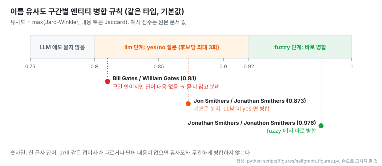
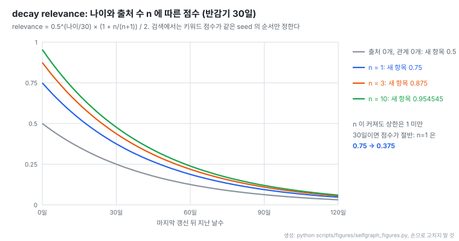

# SelfGraph: 어떤 그래프 DB 위에서도 버전 관리되는 에이전트용 지식 그래프 SDK

- **원문**: [hydra-db/selfgraph](https://github.com/hydra-db/selfgraph) (설명: "Build and query versioned knowledge graphs for AI agents, with any graph database.")
- **제작**: hydra-db 조직. 자체 그래프 DB인 HydraDB도 백엔드 중 하나로 지원한다(HydraDB 0.4.0 이상)
- **저장소 생성**: 2026-11-04 (첫 커밋 "Initial commit"). 읽은 커밋 `771f359` (2026-11-20), 커밋 447개
- **릴리즈**: Python [`v0.2.2`](https://github.com/hydra-db/selfgraph/releases/tag/v0.2.2), TypeScript `ts-v0.2.2` (2026-11-19). v0.2.0, v0.2.1은 2026-11-14
- **코드**: Apache-2.0, Python 3.10+, Node 20+. Python과 TypeScript 소스 합계 42,104줄, 테스트 파일 29개에 테스트 함수 474개, 문서 17개 3,195줄. 별 151개, 포크 49개, 기여자 40명(익명 포함, 2026-11-20 GitHub API 기준)
- **검증 범위**: README, `docs/` 문서, 소스 구조를 읽어 쓴 것이다. 테스트와 예제는 직접 돌리지 않았다
- **읽은 날짜**: 2026-11-20
- **태그**: #KnowledgeGraph #Ontology #GraphRAG #AgentMemory #Temporal #EntityResolution #MCP

!!! note "핵심 요약"
    SelfGraph는 텍스트에서 엔티티와 관계를 뽑아 **버전이 남는 지식 그래프**로 쌓고, 에이전트가 그 그래프로 답하게 하는 Python, TypeScript SDK다. 그래프 DB 기능에 기대지 않고 로직을 모두 SDK에 두어 Neo4j, Memgraph, FalkorDB, HydraDB, 내장 Kuzu 위에서 같은 API로 돈다. 특징은 세 가지다. 첫째, 추출, 엔티티 병합, 모순 처리, 검색 seed, 순회를 `light`, `balanced`, `max` 세 단계로 나누고 기본값을 **LLM 없이 deterministic하게** 둔다. LLM은 하위 단계가 결정하지 못한 경우만 받는다. 둘째, 새 사실이 옛 사실을 지우지 않고 retire하며, `as_of`(그때 참이던 것)와 `known_at`(그때 그래프가 알던 것)을 따로 읽는다. 셋째, 벡터 저장소 없이 BM25 키워드 seed에서 그래프를 걸어 원문 passage를 돌려주고, 답하기 전에 `check_answerable`로 "그래프에 답이 있는가"를 LLM 없이 판정한다. 생성 2주가 지난 0.2 판이고, seed 단계가 질의마다 엔티티 전체를 점수 매겨 비용이 그래프 크기에 선형으로 는다.

## 1. 개요

README가 내세우는 구분점은 다음 문장들이다.

> "No vector store. Retrieval walks the graph from keyword matches and returns the source passages. Embeddings are optional."

> "Knows when it has no answer. An LLM-free answerability check, readiness lint, and certified facts tell an agent what the graph holds."

GraphRAG 계열 도구 대부분은 LLM 추출과 임베딩 검색을 전제로 한다. SelfGraph는 반대로 무료이며 deterministic한 단계를 기본으로 두고, LLM과 임베딩을 선택 사항으로 올린다. 그래프 DB 쪽에는 작은 primitive만 요구하므로 백엔드를 바꿔도 동작이 같다. 대신 그래프 DB의 색인이나 질의 최적화에 기대지 않아 seed와 검사가 namespace 전체를 읽는다(10절).

| 구성 | 내용 |
|---|---|
| 적재 | `insert.text`(텍스트에서 추출), `insert.facts`(이미 있는 그래프) |
| 자원 | 엔티티, 관계, preference(선호), decision(행위자, 결과, 대안, 단계로 된 의사결정 기록) |
| 검색 | `retrieve`: BM25 seed → BFS, DFS, Personalized PageRank 순회 → 토큰 예산 안의 문맥 |
| 안전장치 | `readiness`, `check_answerable`, hub 표시, 사람이 확인한 사실의 certification |
| 시간 | `as_of`, `known_at`, `diff(since, until)` |
| 유지보수 | `decay`, `prune`, `dedupe_relations` |
| 접근 | Python SDK, TypeScript SDK, CLI, MCP 서버(`selfgraph mcp`), Obsidian 내보내기 |

## 2. 적재와 데이터 모델

```python
async with SelfGraph(store=KuzuStore("graph.kuzu")) as graph:
    await graph.insert.facts({
        "entities": [
            {"id": "person:jane", "type": "Person", "name": "Jane Doe"},
            {"id": "company:acme", "type": "Company", "name": "Acme"},
        ],
        "relations": [
            {"from_entity": "person:jane", "type": "WORKS_AT", "to_entity": "company:acme"},
        ],
    })
    result = await graph.retrieve("who works at Acme")
```

- 모든 insert는 **deterministic id 기반 upsert**다. 같은 입력을 두 번 넣으면 같은 그래프가 되고, 나중 insert가 `Acme, Inc.`처럼 다르게 부르면 저장된 이름은 그대로 두고 새 표기를 alias로 붙인다
- id는 `entity_id(type, name)`, `relation_id(from, type, to)` 같은 함수로 계산된다. 같은 사실은 어디서 들어와도 같은 id가 된다
- `insert.text`에 `source_id`를 주면 원문을 chunk로 저장하고, 뽑힌 관계마다 어느 chunk에서 왔는지 evidence를 남긴다. 검색 문맥의 원문 passage는 이 경우에만 나온다
- 같은 `source_id`에 바뀐 텍스트를 넣으면 새 판으로 기록하되 옛 판의 사실은 현재로 남는다. `replace_source=True`를 주면 새 판이 더 이상 말하지 않는 관계를 retire하고 유지, 추가, retire된 관계 id를 `source_diff`로 돌려준다(certified 관계는 남기고 `certified_kept` 경고)

## 3. 단계(level) 체계

모든 기능을 사다리처럼 단계로 나누고, `level` 하나로 전체를 고른다.

| 기능 | `light` | `balanced` (기본) | `max` |
|---|---|---|---|
| 추출 | regex | spaCy, 없으면 regex | LLM |
| 엔티티 resolution | exact | default (이름, alias 일치) | LLM 확인 |
| 모순 | warn | warn | LLM 판정 |
| 검색 seed | BM25 | BM25 + 스키마 동의어 | + 임베딩 (embedder를 줄 때) |
| 순회 | BFS | BFS | PageRank |

| 규칙 | 내용 |
|---|---|
| No silent escalation | `llm=`을 넘겨도 LLM 단계를 **쓸 수 있게만** 한다. 예외는 `insert.text` 추출 하나다 |
| Cascade | 상위 단계는 하위 단계를 먼저 돌리고 결정되지 않은 경우만 받는다. 비용이 어려운 경우의 수를 따른다 |
| One data model | 모든 단계가 같은 id와 인코딩을 쓴다. 단계를 바꿔도 마이그레이션이나 재적재가 없다 |
| Determinism | LLM 단계 아래에서는 insert가 idempotent하고 재현된다 |
| 비용 상한 | `max_tier="balanced"`면 내장 단계에서 LLM, embedder 호출이 없음을 보장한다. 상한을 넘는 단계는 거부가 아니라 낮춰서 실행한다 |

결과마다 `result.tiers`로 실제로 돈 단계를 돌려준다. spaCy가 없어서 regex로 떨어졌는지, 스키마가 없어서 `synonyms`가 `bm25`로 돌았는지 호출자가 알 수 있다.

## 4. 엔티티 resolution

`DefaultResolver(fuzzy=False, threshold=0.92)`는 먼저 걸린 신호로 병합 대상을 고른다. id 일치와 같은 외부 id는 신뢰도 1.0, 이름이나 alias 일치(NFC 정규화, case folding 후)는 0.95다. `fuzzy`를 켜면 같은 타입에서 이름 유사도가 0.92 이상인 것도 병합한다. 유사도는 Jaro-Winkler와 내용 토큰 Jaccard 중 큰 값이다. `LLMResolver(llm, band=(0.8, 0.92), max_questions=3)`는 그 아래 구간만 LLM에게 yes/no로 묻는다.



- 먼저 볼 것은 아래쪽 구간이다. 0.8 미만은 LLM에도 묻지 않으므로 LLM이 어휘상 후보가 없는 엔티티를 병합하는 일은 없다
- `Bill Gates`와 `William Gates`는 0.81로 질문 구간 안이지만, `Bill`에 대응하는 단어가 `William`에 없어 묻지도 않는다. 원문은 이런 이름을 alias나 공유 외부 id로 연결하라고 한다
- 유사도와 무관하게 막는 규칙(`distinct_names`)이 있다: 숫자열이 다르면(`Employee1`, `Employee2`), 한 글자 단어가 다르면(`Model A`, `Model B`), `Jr`, `II` 같은 접미사가 다르면 병합하지 않는다

모든 병합은 merge record를 남겨 `unmerge`로 되돌릴 수 있다. 다만 certified 관계를 다른 끝점으로 옮기게 되는 unmerge는 인증을 풀기 전까지 막힌다.

## 5. 모순과 시간

### 새 사실이 옛 사실을 retire

스키마에서 관계 타입의 `max_count`를 정하면 모순이 정의된다. `WORKS_AT`의 `from.max_count`가 1인데 Ann이 이미 Acme에서 일한다면, Globex에서 일한다는 관계는 모순이다.

| 모드 | 효과 |
|---|---|
| `warn` (기본) | 둘 다 현재로 남기고 경고 |
| `supersede` | 쓰기 뒤 그 끝점의 현재 관계를 순위 매겨 최신 `max_count`개만 남기고 retire |
| `llm` | `supersede` + 스키마 규칙이 없는 관계는 LLM이 판정 |
| `off` | 검사 안 함 |

`llm` 모드는 스키마 없이 동작한다. 새 관계와 같은 출발 엔티티에서 "같은 타입 다른 목적지"(`WORKS_AT Acme` 대 `WORKS_AT Globex`)나 "같은 목적지 다른 타입"(`LIKES Acme` 대 `DISLIKES Acme`)인 현재 관계를 rival로 모아 LLM에 묻는다. 비용은 rival이 있는 새 관계당 LLM 1회, 호출당 rival 최대 20개이고, `max_count`가 있는 타입은 규칙으로 정리하고 보내지 않는다. 원문은 "Use `max_count` where the rule is known, and keep `llm` for what a schema cannot state"라고 권한다.

순위는 effective time(`event_time`, 없으면 쓴 시각) → revision → `created_at` 순이다. 아무것도 지우지 않고, retire된 관계는 이력과 자신을 대체한 관계(`invalidated_by`)를 남긴다.

### as_of와 known_at

```python
await graph.retrieve("where does Ann work", as_of="2025-06-01")                         # Globex, 정정 반영
await graph.retrieve("where does Ann work", as_of="2025-06-01", known_at="2025-06-10")  # Acme, 정정 전
```

`as_of`는 "그 시점에 참이던 것"을 지금까지 저장된 모든 정보로 답한다. 오늘 알게 된 정정을 지난주로 소급하면 지난주 `as_of` 결과가 바뀐다. `known_at`은 "그 시점에 그래프가 갖고 있던 것"만 본다. 에이전트가 그때 무엇을 읽었는지 재현하려면 `known_at`이 필요하다. 유효 시간(valid time)과 기록 시간(transaction time)을 나누는 bitemporal 모델에 해당한다(원문은 이 용어를 쓰지 않는다).

- `known_at`도 되돌리지 못하는 변경이 있다: delete, merge와 unmerge, decay 점수, decision 수정, 엔티티 속성 변경은 지금 값으로 읽힌다
- `diff(since, until)`는 그 사이에 추가, 수정, retire된 관계와 새 엔티티를 돌려준다. 기록 시각(`created_at`, `invalidated_known_at`) 기준이고, 결과에 `"Deletes and merges are not visible."`이라는 한계를 함께 싣는다

## 6. 검색

| 단계 | 동작 |
|---|---|
| Seed | 질의를 유니코드 단어로 나누고 NFC, casefold, stopword 제거. 엔티티마다 BM25 + 부분 문자열 가산점(ASCII는 3글자 이상). 점수를 그 엔티티의 서로 다른 출처 수의 log로 나눠 흔한 엔티티가 구체적인 엔티티를 밀어내지 않게 한다. 상위 `k`개(기본 20)가 seed |
| 순회 | 현재 관계만 BFS나 DFS로 `depth` 홉(기본 3), `max_nodes`(기본 200)까지. `ppr`은 BFS로 `max_nodes`의 4배(최대 5000) 후보를 모은 뒤 seed 점수에 비례해 재시작하는 Personalized PageRank로 순위 |
| 조립 | 원문 passage, 관계, preference, decision, 엔티티를 가까운 순으로. passage는 예산의 60% 이하, 최대 6개. 전체는 `budget_tokens`(기본 3000)를 넘지 않고, 들어가지 않는 첫 줄에서 멈춰 먼 줄이 가까운 줄 자리를 차지하지 않는다 |

- `synonyms` 단계(기본)는 질의가 스키마 타입의 동의어를 말하면 그 타입 이름을 질의에 더한다. `employers`라고 물으면 `Company` 엔티티가 seed가 된다
- `embeddings` 단계는 사용자가 넘긴 embedder로 엔티티를 코사인 순위 매겨 BM25 seed와 RRF로 합친다. SelfGraph는 embedder를 제공하지 않고 벡터를 저장하지 않는다. 캐시는 프로세스 메모리에만 있고, 첫 질의가 namespace 전체를 임베딩한다. CLI와 MCP에서는 쓸 수 없다
- 문맥의 줄은 `SOURCE | `(원문)와 `GRAPH [certified] (via hub) | `(그래프 기록)로 시작한다. 첫 ` | ` 앞의 SDK 헤더만 권위가 있고, 원문 안에 `[certified]` 같은 글자가 있어도 데이터로 취급한다. 제어 문자와 양방향 서식 문자는 `\uNNNN`으로 보이게 바꾼다. 원문은 이것이 "not a general prompt-injection defense"라고 선을 긋는다
- 한계로 원문이 직접 적는 것: 발음 구별 기호를 접지 않아 `Zoe`가 `Zoë`를 놓치고, `Dan works`가 `Carol Danvers`를 seed로 잡는다

## 7. 답할 수 있는지 먼저 확인

원문은 `retrieve`가 질문과 무관해도 키워드가 닿는 것은 늘 돌려준다는 점을 문제로 삼는다. 아래 검사는 모두 LLM을 부르지 않는다. MCP 서버는 클라이언트에게 `check_readiness` → `check_answerable` → `retrieve` 순서로 쓰고, `not_answerable`이면 "not in the graph"라고 말하라고 안내한다.

| 판정 | 조건 |
|---|---|
| `answerable` | 모든 term이 덮이고, 서로 다른 term이 맞춘 엔티티가 `depth` 홉 안에서 연결됨 |
| `partial` | 일부 term만 덮임. `missing`에 빠진 term |
| `uncertain` | 모두 덮였지만 연결되지 않거나 hub를 거쳐서만 연결됨(`hub_only`) |
| `not_answerable` | 덮인 term 없음 |

- term은 엔티티 이름과 alias → 엔티티 타입 → 정의(definition) → 관계 타입 → 속성과 preference 키 순으로 맞춘다. 스키마에는 있지만 데이터가 없는 term은 `schema_only`로 빠진 것으로 센다. 원문 표현은 "a schema alone never makes a question answerable"이다
- 예: 스키마에 `Company`의 동의어 `firm`, 정의 `headcount`(동의어 `staff size`)가 있으면 "What is the staff size of the firm Acme by ad spend?"는 `missing = ["ad", "spend"]`로 `partial`이 된다
- **hub**는 현재 관계가 50개 이상인 엔티티다. 공유 문서나 범용 `Person`처럼 모든 것에 붙은 노드를 거친 연결은 약한 연결로 표시하고(`(via hub)`), `skip_hubs=True`면 hub를 지나가지 않는다
- **certification**은 사람이 확인한 관계 버전에 `certified_by`, `certified_at`을 붙인다. certified 관계는 supersede, LLM 모순, 출처 교체로 retire되지 않고 prune과 중복 정리에서 보존되며, 같은 거리면 문맥에서 먼저 나온다. 속성이 바뀌어 새 revision이 생기면 인증 없이 시작한다
- `readiness`는 저장소 도달 여부와 lint를 준다: 아무 데서도 참조하지 않는 엔티티, evidence 없는 관계, 현재가 아닌 관계를 가리키는 decision 단계, 스키마 밖 타입

## 8. 유지보수

`decay(half_life_days=30)`는 엔티티와 현재 관계마다 relevance 점수를 매긴다. 식은 Python과 TypeScript가 같다.

$$
\text{relevance} = 0.5^{\,\text{age}/h} \times \frac{1 + \frac{n}{n+1}}{2}
$$

$h$는 반감기(일), age는 마지막 갱신 뒤 지난 날수, $n$은 출처 수(엔티티는 연결된 현재 관계 수를 더함)다. 결과는 소수 여섯째 자리로 반올림한다.



- 출처가 하나인 새 관계는 0.75, 출처도 관계도 없는 새 항목은 0.5에서 시작하고, $n$이 커져도 1에 닿지 않는다. 출처 수보다 나이가 점수를 훨씬 크게 움직인다
- 검색은 이 점수를 **키워드 점수가 같은 seed의 순서를 정하는 데만** 쓴다. 오래된 사실을 자동으로 밀어내는 장치가 아니다
- 점수는 `dry_run=False`일 때만 저장되고, 새 관계 버전을 만들지 않는다. `prune(min_relevance=...)`은 이 점수가 기준보다 낮은 항목을 지운다(점수가 없는 항목은 대상이 아니다). certified 관계와 그 끝점은 기본으로 남긴다

## 9. 백엔드, CLI, MCP

| store | 대상 |
|---|---|
| `Neo4jStore`, `CypherStore` | Neo4j와 Memgraph 등 Bolt, openCypher DB (Neo4j, Memgraph는 Bolt로 테스트) |
| `FalkorDBStore` | FalkorDB, Redis 프로토콜 |
| `KuzuStore` | 내장 Kuzu, 서버 없음 |
| `HydraDBStore` | HydraDB 0.4.0 이상. Bolt 메시지 상한 2 MiB라 행 하나는 2 MiB에서 64 KiB를 뺀 크기까지 |

- 원문 설명은 "All logic lives in the SDK, and a store only implements a small set of graph primitives"다. 그래서 Kuzu로 로컬에서 만든 그래프와 서버 DB의 그래프가 같은 규칙으로 동작한다
- 타입 API로 안 되는 질의는 `run_cypher`로 직접 보낸다. 백엔드 방언과 물리 배치가 그대로 드러나므로 질의가 백엔드마다 다르다. CLI와 MCP의 Cypher 실행은 결과가 비면 namespace에 없는 라벨이나, 대소문자만 다른 이름을 경고로 알려 준다
- `selfgraph mcp`는 SDK API를 MCP 도구로 내보낸다. stdio 클라이언트는 셸 환경을 넘기지 않으므로 연결 정보를 설정의 `env`에 둔다
- `export_obsidian`은 엔티티와 decision마다 Markdown 노트를 만들어 Obsidian vault로 열 수 있게 한다

## 10. 한계와 주의

- **비용이 그래프 크기에 선형이다.** seed는 질의마다 엔티티 전체를 두 번 페이지로 읽어 점수를 매기고 상한이 없다. `check_answerable`과 `readiness`도 namespace를 전부 읽고, resolution은 insert마다 해당 타입의 저장 엔티티를 상한 없이 읽는다. 큰 그래프에서의 지연 수치는 원문에 없다(미검증)
- **임베딩 seed는 SDK 전용이고 캐시가 프로세스 메모리에 있다.** 프로세스를 새로 띄울 때마다 첫 질의가 namespace 전체를 임베딩한다
- **`known_at`과 `diff`가 모든 변경을 되돌리지는 않는다.** delete, merge, 엔티티 속성 변경은 이력이 남지 않는다
- **아직 만들지 않은 단계**(원문 `docs/tiers.md` "Not built yet"): ontology-guided extraction, reranking 단계, community 순회, 엔티티 요약 갱신, text-to-Cypher, text-to-SQL, OWL과 RDF 연동, 텍스트 언급을 DB 레코드로 resolve
- **생성 2주가 지난 0.2 판이다.** 커밋 447개가 2주 남짓에 몰려 있고 v0.2.0에서 v0.2.2까지 닷새다
- **LLM 단계는 재실행 시 결과가 달라질 수 있다.** 원문도 재현성 보장은 LLM 단계 아래까지만 한다

## 11. 가져올 수 있는 부분

| 대상 | 가져올 수 있는 부분 |
|---|---|
| 비용 통제 | 기능마다 deterministic 단계를 기본으로 두고, 하위 단계가 못 정한 경우만 LLM으로 올리는 cascade. `max_tier`로 "LLM 호출 없음"을 설정 하나로 보장하고, 결과마다 실제로 돈 단계를 보고하는 방식 |
| 엔티티 병합 | 유사도 구간을 셋으로 나누고 가운데만 LLM에 묻는 방식. 숫자열, 한 글자 단어, 세대 접미사로 유사도와 무관하게 병합을 막는 규칙 |
| 시간 모델 | `as_of`와 `known_at`을 나눠 "그때 참이던 것"과 "그때 에이전트가 읽었을 것"을 따로 재현. 사실을 지우지 않고 `invalidated_by`로 대체 관계를 남기는 retire |
| 답변 거부 | 검색 전에 질문 term이 그래프에 있는지, 서로 연결되는지를 LLM 없이 판정해 `not_answerable`이면 답하지 않게 하는 흐름. 스키마에만 있고 데이터가 없는 term을 빠진 것으로 세는 규칙 |
| 약한 연결 표시 | 관계가 많이 붙은 hub를 거친 연결을 문맥에 표시하고 판정을 `uncertain`으로 낮추는 방식 |
| 문맥 형식 | 원문과 그래프 기록을 줄머리로 나누고, 권위 있는 표시는 SDK 헤더에만 두며 데이터 안의 같은 글자는 무시하는 규칙 |
| 사람 검증 | 사람이 확인한 관계를 버전 단위로 인증하고, 자동 retire와 정리 작업에서 보호하는 방식 |

## 12. 결론

SelfGraph의 무게는 그래프 저장보다 **에이전트가 그래프를 믿고 써도 되는지**에 있다. 사실이 바뀌어도 지우지 않고 retire하며 두 시간 축으로 다시 읽을 수 있고, 답하기 전에 그래프에 답이 있는지부터 확인하며, 사람이 확인한 사실은 자동 정리에서 보호한다. 이 장치들이 모두 LLM 없이 동작하고, LLM은 결정되지 않은 경우만 받는다는 점이 비용과 재현성 면에서 실용적이다. 반면 그래프 DB의 색인을 쓰지 않고 SDK가 namespace를 직접 읽는 구조라, 엔티티 수가 커질 때의 지연은 따로 재야 한다. 아직 0.2 판이다.
